# Bathroom rooms · 70 · Look build: the pool family's look and water

Line: 游戏视觉 (ledger key `visual`). This is the line's build log for the pool family's look and water: the build of `16_pool_palette_fusion.md` §6 and `17_water.md` §7 (card bathroom-109; this line's answer bathroom-004 on 11-01: "we take 16 §6, 17 §7, 18 §4"). One section per workflow stage; later stages append their own.

- **Workflow:** `visual-pool-look-and-relay-lamps` (wf_f6fde9bb-4b3), launched by the line's session local_1fc9f09c on account G, 2026-11-03 16:5x (`handoff/archive/visual_history.md` log, line 1109). Stages: Prepare, PL01, Zone look, Tile, Ripples, Water surface, Submerged, Renders, Package.
- **This stage:** Prepare, 2026-11-03 16:58-18:25 (the first agent stopped at about 17:58, after the run that became the baseline; a second pass finished from the stage journal `W/pool_look/journal.txt`). Clone `W/proj_unlock` resynced from main (17:00, plus a copy-in of main's changes at 18:17); a clone-only look-dev harness for the pool family; the TODAY baseline (seven cameras, sheet `sheets/70_today_baseline.jpg`); this file.
- **Not done here:** nothing landed in main. Main was read only; no Unity ran on main; nothing was downloaded; no package was made. The harness and its texture are clone-only and never land.
- **Reused, not redone:** `16` (colour script, the fusion rule, the clone values of §5), `17` (water physics, per-tier stack, asks), `18` (moves M1-M7, the dark zone), `50` and `pool_modules.json` (module sizes, water classes, edges), `zone_lamps/30_for_red.md` §1.2 and §2.2-2.3 (pool lamps P1/P2), the bathroom line's stills harness and its stand-in room (`W/proj_pooldir/Assets/Editor/ZoneLamps/`, read only), main's `FrontRoomsKitLookdev` (edit-mode look-dev in a new scene), `level_space/70_structures_districts.md` §2 (look rules for the structures scene) and the level-space TILE recipe (`W/level_space/briefs/61c_r4t_redo_build.txt`, `W/level_space/make_tile.py`).

## Red's decisions that this build follows

Quoted from the records; Red's words stay verbatim, picks are given as recorded. `BH` = `Documentation/Takeover_2026-10-18/handoff/archive/bathroom_history.md` (sha1 890149ba).

| Item | Red's words or pick | When | Source |
|---|---|---|---|
| Palette | Club palette: selected "F1" (turquoise white from the club on) | 10-31 ~15:35, K chat | BH line 116 |
| Structure | Structural moves: selected all of "M7, M6, M5, M4, M3, M2, M1" | 10-31 ~15:35, K chat | BH line 116; `18` §2 |
| Dark zone | Night look: "做成更深处的一片固定区域" | 10-31 ~15:3x, K chat | BH line 117; `18` §3 |
| Dark zone in v1 | Selected "第一版就做成真正往下一层（Relay 要跨高度寻路，成本更大）" | 10-31 ~15:36, K chat | BH line 114; `50` §0 item 4 (floor -2.52, water -1.5) |
| Water Q1 | Selected "wrong": club water physical; level water absorption ×3-5, one or two rooms ×9 | 10-31 ~15:4x, K chat | BH line 115; `17` §6.5 |
| Water Q2 | Selected "v1": P4c (desktop wake simulation and surface caustics) in v1 | same | BH line 115 |
| Water Q3 | Selected "v1": ray-traced water on the Mac in v1, against the "later" recommendation | same | BH line 115; P4d in v1 (BH line 172, card bathroom-108) |
| Water Q4 | Selected "follow": the dark zone's white balance follows the warm wet-niche lamps | same | BH line 115 |
| Tile colour | "我希望底色不应该是偏暖的米白，而是和dream pool更相似的瓷白" | 10-31 17:19 | BH line 192 |
| Pool stairs | A pick (answer to `level_space/60` §8 question 8), recorded as a choice, no verbatim text on file: porcelain white on treads and risers, only a dark nosing strip marks each step, no teal band | 10-31 17:24 | BH line 193; `level_space/60_large_stairs.md` §3, §8 q8 |
| Slide supports | "管子里不会出现人影，样式混用，玩家可以滑，Relay不能走滑梯，塔高方案选择尽可能最高。其次就是滑梯当前的支架样式我不喜欢，看起来非常的工业，我认为应该是让瓷砖作为墙壁去托举滑梯" | 10-31 17:15 | BH line 190 |
| Large spirals | "办公室里/level 0还有level run里都不应该出现大型的螺旋滑梯" (read as large spiral stairs: B4-M and B4-L on the pool level only) | 10-31 17:29 | BH line 194 |

**Still Red's: the pool lamps.** P1 (overhead) and P2 (underwater) are open in `zone_lamps/30_for_red.md` §2.2 and §2.3; the recommendations are **P1-A** (indirect metal-halide wall boxes, 3.4 m up the long walls every 6 m, the ceiling lit, no lamp seen) and **P2-A** (300 W wet-niche lamps every 3 m, 0.7 m under the water, with the two caustic layers). This build works to the recommendations and keeps both switchable (the harness's `-plLamps` layer; the lamp presets of the Zone look stage). Nothing here decides them.

**The 11-01 pause and its lift.** The line's state file records Red, 11-01 17:34: "我希望你先暂停泳池" (`handoff/visual.md` §5 item 0), and the lift, 11-03 14:19: "解除泳池" (`handoff/visual.md` §3 item 2: "pool_look_wf builds look + water v1 to rec A lamps; land its packages; then the structures scene (RULES 5b, scene 4) uses them"). This workflow was launched by the line's session on 11-03 (`visual_history.md` line 1109).

## 0. Inventory (Prepare)

### 0.1 Main files this build reads (R) or will change through its packages (W)

sha1 (first 8) at main git `606036b2` plus the working tree, 2026-11-03 17:00. "W" files are 游戏视觉's (RULES rule 3); files of other owners are reached only through contracts.

| sha1 | Path (under `Frontrooms3D/`) | R/W | Why |
|---|---|---|---|
| 898dee87 | `Assets/Scripts/Rendering/FrontRoomsLook.cs` | W | one warm trilight and fog for the whole game today; the pool zones need their own (`16` §0.1, §6.1) |
| 68824661 | `Assets/Scripts/Rendering/FrontRoomsPostStack.cs` | W | zone grade volumes (`EnsureZoneVolume` loads `FrontRoomsPost_<zone>`) |
| f385ea86 | `Assets/Resources/Rendering/FrontRoomsPost.asset` | R | the global film look (white balance +9, tint -7, saturation -8: the yellow) |
| 040ba42b | `Assets/Scripts/Rendering/FrontRoomsZoneReflection.cs` | W | `Refl_Pool` and its dead-lamp twin (`17` §7.11) |
| 801aca30 | `Assets/Scripts/Rendering/FrontRoomsZoneReflectionDriver.cs` | R | the reflection crossfade the probes reuse |
| 8f3587e0 | `Assets/Resources/Rendering/FrontRoomsSurface.shader` | W | submerged shading, caustics, wet band (`17` §7.2, §7.8); used by the whole game, so every new term is off unless enabled |
| fe0a1ed7 | `Assets/Scripts/Rendering/FrontRoomsSurfaces.cs` | R | material lookup (`Troffer_Lens`, room sets) |
| 1bcc9d0d | `Assets/Resources/Surfaces/Prop_CeramicGlaze.mat` | R | the game's only glazed tile today (0.86 / 0.85 / 0.80, smoothness 0.85, no tile map); the pool tile becomes new `Prop_PoolTile_*` materials, this one stays |
| 8ac9b038 | `Assets/Resources/Surfaces/Troffer_Lens.mat` | R | the L03 lens drive |
| 2ab5cdf1 | `Assets/Scripts/Rendering/FrontRoomsTrofferKit.cs` | R (W in PL01) | the L03 kit; PL01's option A would add a fixture registry |
| b951084f, 43b4a8c4 | `Assets/Scripts/Rendering/GlassRT/FrontRoomsGlassRT.cs`, `FrontRoomsGlassRTSystem.cs` | R | G14; water as a receiver is P4d, after this workflow |
| 68eac09e | `NativePlugin/FrontRoomsMetalGlassRT.mm` | R | same |
| 556b9099 | `Assets/Scripts/FrontRoomsMap/FrontRoomsMapWorld.cs` | R (关卡设计's) | the lamp rule today (`BuildFixture`, `TickFixtures`); C1/C2 hooks come by contract |
| 76a6fc47 | `Assets/Scripts/FrontRoomsMap/FrontRoomsModuleUnits.cs` | R (关卡设计's) | cell 3 m, walls 0.16, ceilings 2.4 / 2.9 / 5.4, eye 1.62, 192 m world period |
| 11d34761 | `Assets/Levels/FrontRoomsLevel0.asset` | R (关卡设计's) | lightRadius 16, shadowRadius 9 |
| 0fb29ab1 | `Assets/Scenes/FrontRooms3D.unity` | R | the scene's fill light "Soft ambient direction" and render settings |
| 88027cf8 | `Assets/Scripts/FrontRoomsQuality.cs` | R (设置菜单与画质预设's) | ULTRA / HIGH / handheld rules; water tiers come by contract |
| 078d0a30 | `Assets/Scripts/Input/FrontRoomsHandheld.cs` | R (交互设计's) | the phone tier (`Active`, `Force`, `AspectFov`) |
| 18584f2b, 15ec2379 | `Assets/Settings/FrontRooms_URP.asset`, `FrontRooms_URP_Renderer.asset` | R (设置菜单's for tiers) | Forward+, MSAA 4, rendering layers off, box projection off |
| a8ae1402 | `ProjectSettings/QualitySettings.asset` | R | Standalone default Ultra (5), iPhone Medium (2), one URP asset for all levels |
| 72e0694b | `Assets/Editor/Rendering/FrontRoomsKitLookdev.cs` | R | the edit-mode look-dev pattern the harness follows |
| cb1372b7, 1ec7762d, e3622f0e, 90e792fb, ff54719f | `Documentation/research/bathroom_rooms/16`, `17`, `18`, `50`, `pool_modules.json` | R | the asks and the modules |
| 203c6b44 | `Documentation/research/zone_lamps/30_for_red.md` | R | P1/P2 |
| 9262342a | `Documentation/research/level_space/70_structures_districts.md` | R | the structures scene's pool look rules |
| 009fc4ed | `Assets/Scripts/Rendering/FrontRoomsLampKit.cs` (new in main at 17:00 and 17:16, 灯具适配's landings `zone_lamps_run`, `zone_lamps_office`) | R (W if the pool presets join it) | the zone-lamp factory past L03 (`ForCell`, `BuildMapLamp`, `LensDrive`; families Strip, RemotePlate, Pendant, Wrap); the pool's P1/P2 families would be added here once Red picks |
| (folder) | `Assets/Resources/Props/Lamps/` (same landings) | R | the kits on the troffer's trim sheet, and `Shaders/FrontRoomsLampGlow.shader` (FrontRooms/LampGlow: an additive analytic lit-ceiling patch as its own renderer), the shape P1-A's lit ceiling can reuse |

Re-checked 2026-11-03 18:15 at main git `64eb14d4` (Red's commit after the 17:00 sync): every sha1 above is unchanged.

New files the packages will add (paths proposed, decided in the Package stage) are listed in §1.2.

### 0.2 What exists in clones (stand-ins: references, never landed as they are)

| What | Where | Use here |
|---|---|---|
| Zone-lamps kit: HIDUP (= P1-A wall box), MHLB (P1-B), VT8 (P1-C), NICHE (= P2-A), PORT (P2-C), STRIP, INDR, PEND, MHDL; ZL tile maps; `ZL_Water`; `ZL_Caustic` with `ZoneLampsCausticAdd.shader` and `ZoneLampsGlowAdd.shader` | `W/proj_pooldir` and `W/proj_zonelamps`, `Assets/Resources/Props/ZoneLamps/` and `Assets/Resources/ZoneLamps/`; sources `W/zone_lamps/kit/zl_build.py`, `zl_tex.py` | P1-A / P2-A working picks; the lamp shapes, intensities and spot cones the Zone look stage starts from |
| The bathroom stills harness and its pool STAND-IN ROOM (hall 14.84 × 23.84 × 5.4 m, basin 9 × 18 m) | `W/proj_pooldir/Assets/Editor/ZoneLamps/FrontRoomsZoneLampsShots.cs`, `.PoolDir.cs` (copy in `W/bathroom_dir/src/`); frames `W/bathroom_dir/renders/pooldir/{all,fusion,structure}` | dimensions reused by this harness; its first-pass water is TODAY's water |
| Porcelain tile in the level-space greyboxes: `Prop_CeramicGlaze` set to (0.93, 0.95, 0.96) in the clones only | `W/proj_levelspace`, `W/proj_levelspace_slides` | Red's 17:19 colour, as tried; main's material is unchanged |
| TILE recipe: 150 mm (6 in) tile, 5 mm cool grey grout, per-tile tone about 1.2 %, normal tilt about 0.5°, cushion edge; 4096 px = 2.4 m sheet | `W/level_space/briefs/61c_r4t_redo_build.txt`, `W/level_space/make_tile.py` | starting point of the Tile stage's generator |
| The water's first pass: URP Lit, premultiplied transparent, base (0.05, 0.20, 0.22) at a constant alpha 0.30, smoothness 0.95, ripple normals `ZL_WaterRipple_N` at 0.30 every 1.8 m | `FrontRoomsZoneLampsSetup.MakeRoom` in `W/proj_pooldir` | TODAY's water in this harness (texture copied as `PL_TodayRipple_N.png`, sha1 e255eed5) |
| This harness | `W/proj_unlock/Assets/Editor/PoolLook/` (§2.6) | every stage of this workflow |

### 0.3 The bathroom stills' clone-only values (`16` §5): a starting point for the Zone look stage, not a spec

- Trilight sky 0.15 / 0.20 / 0.22, equator 0.17 / 0.23 / 0.24, ground 0.21 / 0.28 / 0.28; fog 0.11 / 0.16 / 0.17 at exp² 0.010.
- Grade: white balance -12 (the global film look has +9), tint -2, post-exposure +0.45, contrast -4, saturation +4.
- Lamps: metal halide 0.90 / 0.97 / 1, club cool white 0.93 / 0.97 / 1, level daylight 0.86 / 0.96 / 1 at 1.2×, wet-niche seen through water 0.55 / 0.92 / 1.
- Water base 0.16 / 0.60 / 0.62 at alpha 0.36; waterline course 0.40 / 0.76 / 0.77; caustic colour 0.32 / 0.50 / 0.50, ceiling levels 0.55-0.65.

### 0.4 The clone

- `W/proj_unlock` is the workstation "visual" (`W/tools/workstations.json`, holder 游戏视觉). Resynced 2026-11-03 17:00 from main git `606036b2` plus the working tree, by the manual `W/TOOLS.md` §2 recipe (main dataless count 0 in all five folders; rsync of Assets, Packages, ProjectSettings, NativePlugin, Tools with the iCloud excludes; `apply_local_patches.py`, a no-op; `install_tools.py`, test bundle id `com.redwang.frontroomsss.test.unlock`; `m_DisableAudio: 1`; the silencer's `.meta` files restored). Stamp: `W/proj_unlock/FRSYNC.txt` with nine key files' sha1.
- Before the rsync, every clone file that differed from main or was absent in it was saved: `W/pool_look/clone_only_backup/` (93 files, `MANIFEST.txt`: 46 clone-only = the installed W tools and the silencer, 47 differing = main's edits since the 11-02 sync and the clone's ProjectSettings). The unlock probe was already gone from the clone (removed by the 11-02 combined-test sync); its copy stays in `W/unlock_work/harness/`.
- Batch compile after the resync: 0 `error CS` (`W/pool_look/logs/compile_resync.log`).
- 18:17, main had moved (git `606036b2` → `64eb14d4`; the zone-lamp kits, world text, terminals; every CLAIM in LANDINGS had its LANDED row): a copy-in without deletions, `rsync -a` of Assets and Tools with the iCloud excludes, 1008 files (`W/pool_look/logs/resync_delta_1820.log`). Main deleted nothing since 17:00 (the 55 paths a `--delete` would remove are all clone-only and in `MANIFEST.txt`); ProjectSettings kept (only `ProjectSettings.asset` differs: the clone's test id). After it the clone is main plus its clone-only files. Roslyn on the clone, `--all`: COMPILE OK, 0 errors (`W/pool_look/tmp/roslyn_h7`). `FRSYNC.txt` carries both stamps.

## 1. Plan (Prepare)

### 1.1 Stages and what each covers

| Stage | Covers | Output |
|---|---|---|
| Prepare | clone, harness, TODAY | this file §0-§2; sheet `sheets/70_today_baseline.jpg`; frames `W/pool_look/renders/today_v4/` |
| PL01 | not the pool: the Relay's hood against the ceiling troffers (combined-test finding) | its own docs under `research/hunter/production_b/`; package `relay_lamp_clearance` (not applied) |
| Zone look | `16` §6.1 (per-zone ambient, fog, grade, blended at borders) and §6.2 (lamp colours); `17` §7.10 (cool fog, height fog over water, the dark zone's white balance following the niche lamps: Q4); `17` §7.9 in part (compact sources: P1-A / P2-A as presets) | profiles PoolClub, PoolHall, PoolLevel, PoolDark; `FrontRoomsZoneLookVolume`; `Attach(map)` / `Bind(map, viewer)` (bathroom-005), inert until the map exposes pool zones (C1) |
| Tile | `16` §6.4; Red 17:19 (porcelain white), 17:24 (dark nosing only); 17:15 (tile as the structure) | a generator under `Tools/lookdev/pool_tile/`, `Prop_PoolTile_*` materials (desktop 2048, phone 1024): field tile, waterline course, 1 in mosaic, bullnose and coping, stair treads with nosing, wet band |
| Ripples | `17` §7.3 (baked dispersive FFT loop, isotropic, distance roughness), §7.4 (rings) | `Tools/lookdev/pool_water/` generator, Texture2DArray loops per tier, `FrontRoomsWaterRings` |
| Water surface | `17` §7.1 (reflection only, alpha = Fresnel), §7.6 (planar camera), §7.7 noted (Relay-only overlay as the follow-up) | `FrontRooms/Water` shader, `FrontRoomsWaterPlanar`; tier rules by contract to 设置菜单与画质 |
| Submerged | `17` §7.2 (absorption, trapping LUT, `_WaterAbsorbScale` per zone: Q1), §7.8 (caustics by tier), §7.9 (lamps feed caustics), §7.11 (probes); `16` §6.3 | terms in `FrontRooms/Surface`, off unless enabled; `Refl_Pool` and its dead-lamp twin |
| Renders | the decision material | TODAY vs v1 sheets, MP4 walk, `71_look_for_red.md` (Chinese), `W/vl_pending/pool_look.md` |
| Package | landing | v2 tracks `pool_zone_look`, `pool_tile`, `pool_water`; contracts; combined-test rows |

Q2 (P4c in v1) runs through Ripples (rings), Water surface and Submerged (desktop caustics from the surface); the two-band wave window around the camera (`17` §7.5) is the part of P4c this list does not name: the Ripples stage decides whether it fits or becomes the first follow-up, and says so here. **Ripples decided (§5.8): the first follow-up, inside v1, desktop only; the hooks it needs are built.**

### 1.2 Packages and files (proposed; the Package stage decides)

| Track | Files (under `Frontrooms3D/`) | Owner |
|---|---|---|
| `pool_zone_look` | `Assets/Scripts/Rendering/` zone-look code (profiles, `FrontRoomsZoneLookVolume`, Attach/Bind, lamp presets); `Assets/Resources/Rendering/FrontRoomsPost_PoolClub`, `_PoolHall`, `_PoolLevel`, `_PoolDark` volume profiles; possibly `FrontRoomsLook.cs` and `FrontRoomsPostStack.cs` | 游戏视觉 |
| `pool_tile` | `Tools/lookdev/pool_tile/` (generator); `Assets/Resources/Surfaces/Pool/` (`Prop_PoolTile_*` materials, maps, phone variants) | 游戏视觉 |
| `pool_water` | `Tools/lookdev/pool_water/`; `Assets/Scripts/Rendering/Water/` (rings, planar); `Assets/Resources/Rendering/FrontRoomsWater.shader`; `FrontRoomsSurface.shader` (submerged terms); ripple loops; `Refl_Pool*` | 游戏视觉 |
| `relay_lamp_clearance` (PL01) | per PL01's recommendation | 游戏视觉 |
| contracts | map (关卡设计): C1 ZoneTheme and C2 `WaterAt` for `Attach(map)`; settings (设置菜单与画质预设): water quality tiers | the owners |

Every track is inert by itself: nothing outside a pool zone, a zone-look volume or a water component changes (RULES rule 5: Editor, Mac and Win unchanged outside them; WebGL behind its own gate).

**Decided by the Package stage (§9.1):** the three tracks as above, landing in that order (`FrontRoomsSurface.shader` stacked: 37ccbb59, cef7facc, 8067dc67); `FrontRoomsLook.cs` changes in `pool_water` (the pool cubes), `FrontRoomsPostStack.cs` does not change; the contracts are rebased in §9.6. Their textures sit in `Resources` and so ship in every build: §9.5.

### 1.3 Per tier (`17` §6.1, the reference for every stage)

| Layer | Desktop Ultra (1440p reference) | Desktop High | Handheld (iPhone, iPad) | WebGL |
|---|---|---|---|---|
| Normals | baked dispersive FFT loop 512² × 64 (or live 256²), 16 rings, two-band simulation, distance roughness | baked loop, 8 rings, ripple-band simulation 512² | baked loop 256² × 32, 4-6 rings | baked loop 256² × 16-32, 4 rings |
| Reflection | planar ½ res, overscan 1.15, mips; probe; lamp specular | planar ⅓-¼, every 2nd frame; probe; lamp specular | probe; lamp specular; Relay-only overlay | probe; lamp specular; Relay-only overlay (G11 Web plan) |
| Refraction and colour | analytic basin with the trapping LUT; ankle tint in Surface; opaque-texture wobble for ankle water | same | analytic basin; ankle tint; no wobble | same as handheld |
| Caustics | projected from the surface, ≤ 2 compact sources per room, plus thrown light | same at ½ res, ½ rate | flipbook | two scrolled layers |
| Wakes | two-band simulation | ripple band | rings | rings |
| Haze | per-zone exp² fog + height fog over water | same | same | same |
| Later | GlassRT water (Mac, 16+ GPU cores) replaces the planar on water; DXR on Windows | - | - | - |
| Budget (`17`, estimates) | ≤ 4-5.5 ms; RT option +3-5 ms | ≤ 2.5-3.5 ms | ≤ 2 ms at device scale | no new draws except the overlay camera; lights + probes ≤ 32 |

### 1.4 What stays for later

- **P4d, ray-traced water (water as a G14 receiver through the Surface hook, `17` §7.12), comes after this workflow's v1.** Red's Q3 keeps it inside the pool family's v1 (not v1.1); it needs G14's open items and a timing on a pool-sized quad first, so it is the next package after this workflow, not one of its stages.
- The Relay-only overlay on probe tiers (`17` §7.7, G11 §2.4b): named by the Water surface stage as its follow-up.
- Observation windows' underwater view (C10, M4): a shader of this line, not in this workflow's stages.
- Production lamp kits (P1/P2 hero LOD0-LOD2): after Red's P1/P2 picks; until then the Zone look stage uses the stand-in kits' shapes as presets.
- Map integration: the zone looks reach the game when 关卡设计 exposes pool zones (C1) and water classes (C2); until then they show only through `FrontRoomsZoneLookVolume` (the structures scene, RULES 5b) and the harness.
- Never in v1: underwater views and swimming, splash, spray and foam (`17` §8).

## 2. Baseline: TODAY (Prepare)

The game has no pool zone today. TODAY is what these rooms would look like if the map built them with today's code: Level 0's look everywhere.

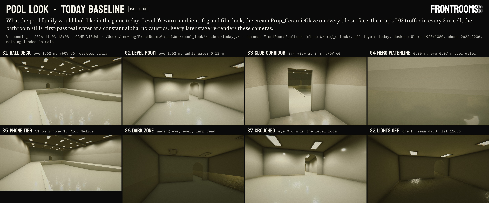

Sheet `sheets/70_today_baseline.jpg` (3840 × 1600, Shot format, chip BASELINE, sha1 e1e8bfbc; every label checked at full size: ALL LABELS FIT, `W/pool_look/sheets/70_today_baseline_fit.txt`). Frames: `W/pool_look/renders/today_v4/` (S1-S7 and the lamp check `S2_diag_nolights`). `today_v5` is the same run in the clone after the 18:17 copy-in: every frame pixel-identical (mean absolute difference 0.000, max 0). Runs `today_v1`-`v3` and `diag_v3` are void (lamps dark, §2.5) and are deletion candidates.

### 2.1 What "today" is, per layer

| Layer (flag) | TODAY | From (main) |
|---|---|---|
| Zone (`-plZone today`) | `FrontRoomsLook.ApplyAmbient`: trilight sky 0.20 / 0.19 / 0.15, equator 0.26 / 0.24 / 0.17, ground 0.40 / 0.36 / 0.24; fog 0.16 / 0.15 / 0.11 at exp² 0.014. The global film look (`FrontRoomsPost`: white balance +9, tint -7, saturation -8), no zone grade. The scene's fill light "Soft ambient direction" (0.77 / 0.82 / 0.80 at 0.16, soft shadows at 0.18). The reflection cube by zone: hall `Tall`; corridor, turn and level `Level0`; dark zone `DeadLamp` | `FrontRoomsLook.cs`, `FrontRoomsPostStack.cs`, `FrontRooms3D.unity`, `FrontRoomsZoneReflection.cs` |
| Lamps (`-plLamps today`) | the map's rule (`BuildFixture`, `TickFixtures`, Level 0 profile): an L03 troffer per 3 m cell, its root at the cell centre +0.3 z on the ceiling plane; its light a 162° / 96° spot 0.06 m under it, 1 / 0.96 / 0.88 at 5 (×1.6 and range 12 under the 5.4 m ceiling, range 10 elsewhere), off past 16 m (fading from 13 m), about one lamp in three soft-shadowed within 9 m; the lens at the L03 drive (1.8). Every overhead of the dark zone dead (lens ×0.04, light off). 69 troffers, 10 dead | `FrontRoomsMapWorld.cs`, `FrontRoomsTrofferKit.cs`, `FrontRoomsLevel0.asset` |
| Tile (`-plTile today`) | `Prop_CeramicGlaze` on all 20 tile slots: warm cream 0.86 / 0.85 / 0.80, smoothness 0.85, no tile map, no grout. Structure slots from main's Surfaces: `RunB_BlockUpper` above the hall tile, `Office_Wall_Fresh` paint and hall ceiling, `L0_Ceiling` grid (soffit, club), `RunB_Floor` (club VCT), `Prop_StainlessSatin` (ladders) | `Resources/Surfaces/` |
| Water (`-plWater today`) | the bathroom stills' first pass: URP Lit, transparent premultiplied, base 0.05 / 0.20 / 0.22 at a constant alpha 0.30, smoothness 0.95, the stand-in ripple normals at 0.30 every 1.8 m, static. Reflection = the zone cube; the stills' box-projected realtime probe is not reproduced (the game has no water probe today, `17` §7.11) | `FrontRoomsZoneLampsSetup.MakeRoom` (`W/proj_pooldir`) |
| Submerged (`-plSub today`) | none: no absorption, no caustics, no wet band | - |

### 2.2 Spaces and cameras (the same in every stage)

| Space | Module and size | Water | Origin |
|---|---|---|---|
| hall | PC_Hall, 5 × 8 cells (faces 14.84 × 23.84 m), Tall 5.4. Glazed tile to 2.25, cap band to 2.40, painted block above; painted structure with three downstand beams (z 6.04, 12, 17.96; 0.45 deep); M1 soffit at 2.9 over the south deck (z 0-3); coping 0.25 m, 30 mm proud, on W, E and N; two ladders; south arch 1.2 × 2.2 from the club, north round arch 1.4, crown 2.3 (the far door) | basin x 3-12, z 3-21, water -0.12. Floor: beach 0 → -0.40 (z 3-6), → -1.07 at z 9, -1.07 → -1.37 (z 9-15), -1.37 to the deep end. Waterline course from -0.155 to the deck | (0, 0, 0) |
| turn | PL_Turn behind the far door, 2 × 2 cells, Standard 2.9; tile to the ceiling, band at floor + 1.2-1.5 | ankle: floor -0.15, water -0.03 | the hall's |
| corridor | the club, 1 × 3 cells south of the hall, Standard 2.9; tile to 1.5 (band 1.25-1.40), paint above, VCT floor, the tower's 2' × 2' grid | none | the hall's |
| level | three PL_Chain rooms of 2 × 2 cells, Low 2.4; round arches 1.4 wide, crown 2.1 | ankle 0.12 (floor -0.15, water -0.03) | (192, 0, 0) |
| dark | two PL_Dark rooms (2 × 2 and 2 × 3 cells), floor -2.52, ceiling 0.38 (2.9 above its floor), round arch crown 2.3 above the floor | water -1.5 (1.02 deep) | (384, 0, 0) |

Fixture anchors (data only, TODAY places nothing on them): 8 P1-A wall boxes on the hall's W and E walls at 3.4 m, at the centres of the bays between the soffit's fascia, the beams and the north wall (z 4.52, 9.02, 14.98, 20.98); 18 P2-A wet niches, ring centre 0.7 m under the water, one per 3 m cell on the long walls where the floor clears the ring by 0.10 m (the basin's 4 deep cells per side at -0.82, z 10.5-19.5; the dark zone's 5 per side at -2.20, z 1.5-13.5). P2-A in the stand-in room had 12 (one per cell on both long walls); the decided basin's beach entry and 1.07 m shallow end leave room for 8 at that depth.

| Id | Space | Eye (world, m) | Looks at | vFOV | Frame | For |
|---|---|---|---|---|---|---|
| S1 | hall | (2.55, 1.62, 6.20), standing on the west deck at the coping over the shallow end | (9.2, -0.25, 17.0), down the basin to the deep end | 76 | 1920 × 1080, Ultra | the hall's read: water as a mirror, lamp streaks, the ceiling, tile to 2.4 m |
| S2 | level | (193.6, 1.47, 1.0), standing (floor -0.15 + 1.62) | (196.5, 0.55, 11.0), through the arch | 76 | 1920 × 1080 | the 2.4 m room, ankle water, the sourceless wash |
| S3 | corridor | (0.75, 1.62, -2.85) | (1.75, 1.15, 0.0), the arch into the hall | 60 | 1920 × 1080 | 3/4 view at about 3 m: the club's tile and VCT, the club-to-pool change |
| S4 | hall | (11.65, -0.05, 13.0), 0.35 m from the east basin wall, 0.07 m above the water | (12.0, -0.11, 13.09), 14° off square | 60 | 1920 × 1080 | hero: joints, the aqua waterline course, meniscus and wet band, coping |
| S5 | hall | as S1 | as S1 | 76 | 2622 × 1206 | the phone tier: `FrontRoomsHandheld.Force(IPhonePro)`, quality Medium (2), the URP asset's own shadow atlas, the kits' phone meshes |
| S6 | dark | (385.5, -0.90, 1.0), wading: 1.62 above the floor, 0.60 above the water | (388.2, -1.25, 13.0) | 76 | 1920 × 1080 | Red's fixed dark zone: niche lamps only, Q4's white balance |
| S7 | level | (195.0, 0.45, 1.4), crouched: 0.6 above the floor, 0.48 above the water | (196.5, 0.55, 9.0), along the water through the arches | 76 | 1920 × 1080 | the water close up: ripples, streaks, reflections |

### 2.3 Numbers (today_v4)

| Cam | Mean luma (0-255) | Min-max | Lamps on within 30 m (soft-shadowed) |
|---|---|---|---|
| S1 | 135.1 | 23-209 | 37 (5) |
| S2 | 116.6 | 21-211 | 11 (3) |
| S3 | 125.8 | 22-210 | 20 (2) |
| S4 | 123.4 | 77-152 | 42 (5) |
| S5 | 138.7 | 23-210 | 37 (5) |
| S6 | 50.0 | 22-103 | 0 |
| S7 | 133.2 | 21-209 | 12 (3) |
| S2 with every light off (the lamp check) | 49.0 | 21-209 | 0 |

No clipped pixels in any frame. The lamps add 67.6 of S2's mean (they added nothing in the void runs). Build cost (`cost.tsv`, all layers today): hall 232 renderers, 29,340 tris, 40 lights; turn 25 / 2,798 / 4; corridor 20 / 2,074 / 3; level 65 / 8,558 / 12; dark 55 / 6,990 / 10 (all dead); plus the fill light. Most of the tris are the L03 housings (desktop LOD0). Frame time and memory: not measured (rule 25; batch renders on a shared machine would be UNDER LOAD anyway).

### 2.4 Reading TODAY: what the later stages change

Against `16` §3 (colour script) and F1, `17`, and Red's words:
1. **Warm everywhere.** Level 0's yellow trilight, warm fog and the film look's +9 white balance turn the white tile cream-olive; nothing reads turquoise white (F1), and club, hall, level and dark zone share one look. → Zone look.
2. **Cream tile without joints.** The glaze is the warm cream Red turned down on 10-31 at 17:19; no joints, grout, courses or nosing anywhere, so S4 at 0.35 m is a blank field and the 3 m views read as painted plaster (1 px is about 2 mm at 3 m: joints must carry tone, not only relief). → Tile.
3. **Milky water.** A constant alpha 0.30 over the cream basin, lit by the warm cube: the deep end and the ankle water look alike (no depth colour), the surface is not a mirror at S1's grazing angles (no Fresnel), lamp highlights are round blobs instead of streaks, and the static normals repeat every 1.8 m (the scrolling-texture look `17` rejects). → Ripples, Water surface, Submerged.
4. **A black lid over the hall.** The troffer spots point down from 5.4 m, so the structure reads dark above bright tile and every lens shows in the water; P1-A lights the ceiling and shows no lamp. → Zone look (lamp presets).
5. **The dark zone is Level 0 with its lamps dead** (S6): dim olive, nothing glows; Red's fixed dark zone is lit only by the wet niches, the basin glowing aqua under a warm white balance (Q4). → Zone look and Submerged.
6. **No caustics, no wet band, no meniscus.** → Submerged.
7. **The phone tier (S5) reads like the desktop**, faults included: the later stages keep that parity without extra passes on phones.

### 2.5 Limits of the harness and of these frames

- Procedural stand-ins on the decided module sizes, not the map's pieces: no props, signs, Relay or player; walls are single faces on the 3 m lattice, arches without trim.
- URP rendering layers did not isolate lights here (run `diag_v3`: with them on, the lamps lit nothing, S2 49.0 either way, 116.6 with them off). Every space is on the Default layer and kept apart by distance (192 m); the hall, its turn room and the club corridor light each other through their walls as the map's unshadowed lamps do. The void runs `today_v1`-`v3` and `diag_v3` predate this finding.
- The new scene's ambient probe is rebuilt by Unity only between editor updates, so a run is staged over editor ticks and exits by itself. In both valid runs Unity rebuilt it after 3 updates; the computed fallback (logged COMPUTED) was never used.
- The ripple normal loads from the PNG's bytes: a texture imported inside the same batch call does not load through `AssetDatabase.LoadAssetAtPath`. The fallback is correct for an RGB normal map and is logged. Stages that bring their own textures import them in an earlier run, or read bytes for look-dev only and check the import settings before packaging.
- S4 is not a player view (inside the basin, 0.07 m above the water): a material frame only.
- Frame time and memory: not measured (rule 25).

### 2.6 The harness (for every later stage)

- **Files:** `W/proj_unlock/Assets/Editor/PoolLook/` (clone only, never lands): `FrontRoomsPoolLook.cs` (entry, staging, cameras, render, URP in memory; sha1 3bf69ff9), `FrontRoomsPoolLook.Spaces.cs` (spaces, lamp slots, water rects, anchors; 4a63f268), `FrontRoomsPoolLook.Layers.cs` (the five layers' TODAY cases; 38697c44), `Textures/PL_TodayRipple_N.png` (e255eed5). ASCII, no tuples, fresh GUIDs.
- **Entry point:** `FrontRoomsPoolLook.RunBatch` (batch). In code: `FrontRoomsPoolLook.Begin(LookSpec spec, string run, string camList, bool phone, bool png, bool exitAfter)`. Menu: FrontRooms > Pool look (clone only) > Render TODAY, all cameras.
- **Run it** through the launcher, which keeps the line at one Unity process (it waits for three quiet checks 5 s apart with no Unity on any `W/proj_*`, then writes `W/pool_look/logs/<run>.status`):

```
cd /Users/redwang/FrontRoomsVisualWork/pool_look/tmp && QUIET_CHECKS=3 /bin/zsh ./run_when_free.zsh <run> [-plZone <v>] [-plLamps <v>] [-plTile <v>] [-plWater <v>] [-plSub <v>] [-plCams S1,S4] [-plNoPhone] [-plPng] [-plDiag]
```

  which runs exactly:

```
/Applications/Unity/Hub/Editor/6000.6.3f1/Unity.app/Contents/MacOS/Unity -batchmode -projectPath /Users/redwang/FrontRoomsVisualWork/proj_unlock -buildTarget OSXUniversal -executeMethod FrontRoomsPoolLook.RunBatch -plRun <run> [flags] -frGlassRT off -logFile /Users/redwang/FrontRoomsVisualWork/pool_look/logs/<run>.log
```

  No `-quit` (the harness exits by itself: 0 = every camera written, 3 = a failure; deadline 25 min) and no `-nographics` (it renders). `today_v5` took 72 s from launch to exit, most of it importing the 18:17 copy-in; the harness itself takes 1-7 s.
- **Output:** `W/pool_look/renders/<run>/`: `S1.jpg` … `S7.jpg` (q92; `<id>_raw.png` too with `-plPng`, for pixel comparisons), `shots.tsv` (pose, quality, lights per camera), `look.txt`, `cost.tsv`, `run_log.txt` ending `FINISHED fail=0`. The TODAY sheet's script is `W/pool_look/tmp/make_today_grid.py`; a stage's TODAY-against-new grid copies it.
- **Flags:** one value per layer, `today` by default; an unknown value fails the run (no silent fallback). `-plCams` picks cameras, `-plNoPhone` skips S5's tier switch, `-plDiag` adds S2 with every light off.
- **Adding a look:** a `case "<value>":` in the layer's switch, best in the stage's own partial file (`FrontRoomsPoolLook.<Stage>.cs`): `BuildTileSet` fills `slots[...]` for every name in `TileSlots` and the structure slots; `ApplyZone` sets RenderSettings and volumes under `zoneRoot`, and `perCamera` for per-camera state (reflection, zone weights); `BuildLamps(value, phoneTier)` places lamps on `lampSlots` and `anchors`, adds their lights to `sceneLights` and its per-camera rule to `lampTick` (it is rebuilt with `phoneTier` true for S5); `BuildWater` builds per `waterRects`; `BuildSubmerged` sets globals and keywords. TODAY's cases stay as they are, so the TODAY column can be re-rendered at any time; every new value gets a line in its stage's section below.
- **Data the layers read:** `spaces` (id → `Space` with its transform, origin, reflection zone and pool zone PoolHall / PoolClub / PoolLevel / PoolDark), `lampSlots` (69 ceiling cells), `waterRects` (4: basin, two ankle, dark), `anchors` (26), and the constants of §2.2 (`HallWater`, `BasinFloor(z)`, `LevelFloor`, `LevelWater`, `DarkFloor`, `DarkWater`, …).
- **Cameras:** `AllCams()`. Never move one; a stage that needs another view adds a new id (S8, …) and says so here.
- **Tiers:** desktop = quality Ultra (5) with the additional-light shadow atlas at 8192, as `FrontRoomsQuality`'s ULTRA (in memory, restored at the end); phone = S5 as in §2.2.
- **For the walk film (Renders):** the club corridor, the hall and the turn room are one connected set; the level chain (x 192) and the dark zone (x 384) stand apart, so a walk cuts between them.

## 3. Zone look

Stage 3 of the workflow, 2026-11-03 21:07-23:0x. The first agent (account B, relay run `wf_48851110-b3c`) built the runtime, the harness layer and value iterations 1-3, and stopped at B's plan limit about 21:52 with its next runs queued; a relay agent on account G (local_1fc9f09c's workflow) ran them from the stage journal at 22:24 and finished the stage. **Nothing landed in main:** main was read only, no Unity ran on main, nothing was downloaded, no package was built (the Package stage builds `pool_zone_look`), the map contract is not applied.

The asks: `16` §6 item 1 ("per-zone ambient, fog and grade ... blended at zone borders") and item 2 (lamp colours per zone), `17` §7 item 10 (the pool family's cool fog, a height-fog layer over water, a night-state white balance that follows the niche lamps), Red's picks F1 and Q4 "follow" (recorded as picks, no verbatim words on file: BH lines 115-116, "Red's decisions" above). The agreed tool entries: bathroom-005 (游戏视觉 → bathroom, 11-01): "the pool look ... hangs off public tool entries Attach(map) and Bind(map, viewer) so the Level Designer preview shows it, as the station looks do".

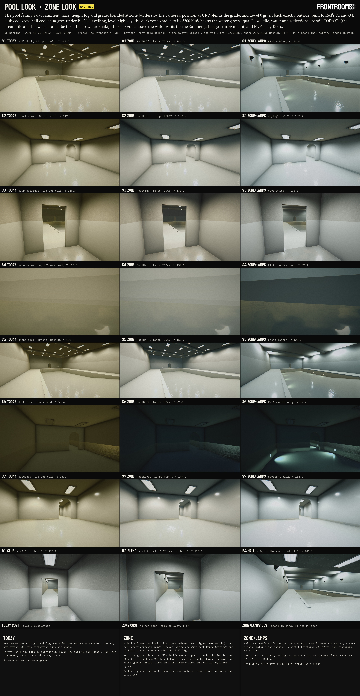

Sheet `sheets/70_zone_look.jpg` (3838 × 7400, Shot format, chip WAIT-RED: P1 and P2 stay Red's; columns TODAY = `today_v4`, ZONE = the zone look with every other layer TODAY = `zl_v8`, ZONE+LAMPS = the zone look with the lamp presets = `zl_v8L`; rows S1-S7, the club-to-hall border walk, COST; every label checked at full size: ALL LABELS FIT, `W/pool_look/sheets/70_zone_look_fit.txt`). Frames: `W/pool_look/renders/zl_v8/`, `zl_v8L/` (plus `B1`-`B7`, the `_pre` and `_off` frames of the checks).

### 3.1 What was built (in the clone `W/proj_unlock`; the Package stage carries it to main)

| Path (under `Frontrooms3D/`) | sha1 | GUID (`.meta`, fresh: none of main's 3,222) | What |
|---|---|---|---|
| `Assets/Scripts/Rendering/ZoneLook/FrontRoomsZoneLook.cs` | 8bf5b76f | 3fdfc4c3843d4e63906370be0a0eea3c | the runtime: registry, per-render-context blend and exact give-back, the trilight → probe basis, tool entries, lamp presets |
| `Assets/Scripts/Rendering/ZoneLook/FrontRoomsZoneLookProfile.cs` | 760264ae | 5f2a7b9a3c3f45b6b2be9f98d3890216 | one zone's look (ScriptableObject) and the built-in values per zone (`Defaults`, `Fill`) |
| `Assets/Scripts/Rendering/ZoneLook/FrontRoomsZoneLookVolume.cs` | 9f202db7 | 4fe7cbd07d1b45728c039b9ec308b324 | the scene-placeable box (Add Component > FrontRooms > Zone look volume) |
| `Assets/Scripts/Rendering/ZoneLook` (folder) | - | 1b87eaf8d06b453cb2de8fcfe3863119 | |
| `Assets/Resources/Rendering/ZoneLook/FrontRoomsZoneLook_PoolClub`, `_PoolHall`, `_PoolLevel`, `_PoolDark` `.asset` | aed7d2a3, c6593682, cd1bae91, 91a1bcb8 | a8b90e68…, eb299b7d…, e6567319…, 9b3a2154… | the four profiles (written from `Fill` by the harness; a missing asset falls back to the same code values) |
| `Assets/Resources/Rendering/ZoneLook` (folder) | - | c28e154671d4b45e08f8b851a2134772 | |
| `Assets/Resources/Rendering/FrontRoomsPost_PoolClub`, `_PoolHall`, `_PoolLevel`, `_PoolDark` `.asset` | 79990efa, a0ff106e, cd59b2d0, 59ef1a63 | 3486aa35…, a39672bd…, 0441227a…, 02697765… | the four grades (URP volume profiles, loaded by `FrontRoomsPostStack.EnsureZoneVolume`, as Office and Run_B) |
| `Assets/Resources/Rendering/FrontRoomsSurface.shader` | 8f3587e0 → 37ccbb59 | (unchanged) | `FRHeightFog` after each `MixFog` in the forward pass (3 lines + a 17-line function); off unless a zone writes it |

All ASCII, LF. `FrontRoomsLook.cs` and `FrontRoomsPostStack.cs` stay as they are (§1.2 had them as "possibly"): nothing in the game's own path changes. Clone-only and never landing: the harness layer `Assets/Editor/PoolLook/FrontRoomsPoolLook.ZoneLook.cs` (995a963c; flags in §3.9) and the stand-in lamp kit copied from `W/proj_pooldir` (P1-A `ZL_HIDUP`, P2-A `ZL_NICHE`, their meshes, materials, textures, `LampOpt_Trim.mat`, `ZoneLampsGlowAdd.shader`; same GUIDs as there, 27 entries listed with sha1 in `W/pool_look/tmp/zl_kit_copy.txt`).

### 3.2 How it works

- **Inert without a volume.** Nothing is hooked until a `FrontRoomsZoneLookVolume` is enabled; the last one disabled unhooks. With none, no value is read or written: the game, Level 0 and the Office floors run exactly as today.
- **Per render context, at that context's camera.** `RenderPipelineManager.beginContextRendering` (before URP reads `RenderSettings` and culls): capture what the context finds, weigh every look volume at the camera's volume trigger (else the camera), write the blend; `endContextRendering`: write back what was found. So outside rendering `RenderSettings` always hold the game's values (a scene saved in the editor never keeps a zone's look) and a camera outside every zone renders Level 0's values to the bit. The camera of a context is the one the player sees: an on-screen camera wins over an offscreen one (the exit cut's cross camera renders to a texture one depth below the view in the same context), then Game and Scene view cameras, then the highest depth; preview cameras never count. A context of an earlier frame that never ended (an exception inside a render) is unwound at the next context, so a lost end can never leave a zone's values behind; tools that call `ApplyNow` hold their level until `RestoreNow`.
- **The blend is URP's.** Weight 1 inside the box, `1 - (d / blend)²` within `blendDistance` (2.5 m) outside it, volumes in ascending priority each lerping what is below; the grade is a child URP volume over the same box, blend and priority, so the light and the grade never disagree at a border. The deeper zone wins where two meet (club 1.0, hall 1.05, level 1.1, dark 1.15, all above the Office grade's 1, which never meets them): its look reaches 2.5 m into the shallower zone, so the change starts before the player steps through (border walk: 1.9 m before the club-to-hall arch the hall weighs 0.42, at 0.9 m 0.87, in the arch 1.0). The reflection cube keeps its own crossfade (`FrontRoomsZoneReflection`; `Refl_Pool` is the Submerged stage's).
- **What a zone writes.**
  - The ambient: `RenderSettings.ambientProbe` in ambient mode Custom, the captured probe lerped toward the zone's trilight probe. Unity ignores a probe set from code in Trilight mode (measured, run `zl_v1`: the probe read back unchanged and the frames did not move), so the mode switches to Custom while a zone weighs in and back after. The zone's trilight is turned into a probe by Unity's own projection, measured from Unity 6000.6.3f1's rebuild (each colour alone at 1.0): sky (1/6, L1y +0.2722, L20 -0.0260, L22 -0.0781), equator (2/3, 0, +0.0521, +0.1563), ground = sky with L1y negated. It predicts Unity's probe of Level 0's trilight to 7.5e-9 and of PoolHall's to 3.7e-9, and every run checks the constants again (`zl_basis.txt`; the analytic `AddDirectionalLight` projection tried first had the wrong sign and scale).
  - The haze: `fogColor` and `fogDensity` (exp², as Level 0).
  - The height fog: the globals `_FR_HeightFog` (density per metre at the water, water height, 1 / scale height) and `_FR_HeightFogColor`, read by `FrontRooms/Surface` (§3.4).
  - The fill: the scene's directional light ("Soft ambient direction", the bounce of the room's lamps) times the zone's `fillScale` when that is not 1 (only the dark zone: 0.2), given back per context.
- **Exact give-back.** Every value is restored as found, the fill per nesting level. Checked in every harness run (§3.7).

### 3.3 Entry points

- **`FrontRoomsZoneLookVolume`** (`[ExecuteAlways]`): `zone` (PoolClub, PoolHall, PoolLevel, PoolDark), `center`/`size` (local box), `blendDistance` (2.5), `priority`, `weight`, `hasWater` + `waterLevel` (local y; the height fog sits on it), optional `profileOverride` for look-dev. It makes its grade child (`Post / zone <zone>`, through `FrontRoomsPostStack.EnsureZoneVolume`) once and keeps it matched to the box. Gizmo: the box, the blend margin, the water plane. The structures scene (RULES 5b, scene 4) shows the look by placing one per pool room with its water height; nothing else to call.
- **`FrontRoomsZoneLook.Attach(FrontRoomsMapWorld)`** and **`Bind(FrontRoomsMapWorld, Transform viewer)`**, the agreed entries (bathroom-005). The map exposes no pool zone yet (C1), so `Attach` finds none and does nothing (it counts the look volumes under the map: 0 today); `Bind` also keeps the viewer for the queries that run outside rendering (`ZoneAtViewer`: the later stages' lamp rigs and water). Rendering needs neither: each context is weighed at its own camera, in the game, the Level Designer and the editor alike.
- **`AddMapZone(holder, zone, localBounds, blendDistance, waterY)`**: one look volume over a rectangle of pool cells under a chunk's holder (NaN = a dry zone), at the zone's default priority. **The map contract** `W/apply/pool_zone_look_contract/` (README + `CONTRACT_map.diff`, owner 关卡设计, never applied by this line) calls it from the chunk build after `AddZoneGrades`: rectangles of cells of one pool look zone, PoolClub's Tall cells as PoolHall, by C1's theme names so it compiles and stays inert today; C2 later passes the module's `waterY` (until then the height fog is off in the game; ambient, haze and grade work). Base main `b71b023f` (关卡设计's H2 + H6 hooks, 22:29), patched `7c115d21`, `patch --dry-run` clean.
- Also public: `ZoneAt(position, out weight)`, `ZoneAtViewer`, `Evaluate(...)` (the blend without writing), `ApplyNow`/`RestoreNow` (tools that read `RenderSettings`), `Profile(zone)`, `ReloadProfiles`, `TrilightProbe(sky, equator, ground)`, `Lamps(zone)` (§3.5).

### 3.4 The values

Iteration 1 started from `16` §5's clone values for the whole family; every later value was judged on the harness renders against `16` §3 (the colour script) and F1, not taken as a spec. Colours gamma, as the Lighting window and `RenderSettings` take them.

| | Level 0 (TODAY) | 16 §5 start | PoolClub | PoolHall | PoolLevel | PoolDark |
|---|---|---|---|---|---|---|
| Ambient sky (floors face it) | .20/.19/.15 | .15/.20/.22 | .19/.20/.20 | .30/.33/.34 | .27/.30/.31 | .075/.083/.045 |
| Ambient equator (walls) | .26/.24/.17 | .17/.23/.24 | .23/.245/.245 | .24/.27/.28 | .28/.31/.32 | .092/.10/.055 |
| Ambient ground (ceilings) | .40/.36/.24 | .21/.28/.28 | .32/.335/.33 | .30/.33/.33 | .38/.41/.41 | .14/.155/.085 |
| Haze colour, exp² density | .16/.15/.11, .014 | .11/.16/.17, .010 | .14/.155/.16, .012 | .14/.17/.18, .009 | .20/.23/.24, .008 | .065/.07/.032, .014 |
| Height fog: density /m, scale, colour | - | - | off (no water) | .015, 0.7 m, .42/.48/.50 | .020, 0.6 m, .52/.58/.60 | .030, 0.5 m, .13/.155/.10 |
| Fill ("Soft ambient direction") | ×1 | - | ×1 | ×1 | ×1 | ×0.2 |

The grades (`FrontRoomsPost_Pool*`), each over the film look `FrontRoomsPost` (white balance +9, tint -7, post-exposure +0.15, contrast -6, saturation -8, warm shadows .97/1/.94 and highlights 1/.99/.93, lift 1/.99/.94 +.035, warm vignette .05/.045/.03, warm bloom tint 1/.93/.78). An override replaces the film look's value inside the zone; lens distortion, grain, chromatic aberration, tonemapping and bloom strength stay the film look's.

| | 16 §5 start | PoolClub | PoolHall | PoolLevel | PoolDark |
|---|---|---|---|---|---|
| White balance, tint | -12, -2 | -2, -3 | -8, -2 | -5, -1 | -72 (about 3200 K; -90 is 2800 K), 0 |
| Post-exposure, contrast, saturation | +0.45, -4, +4 | +0.25, -5, -6 | +0.45, -4, 0 | +0.55, -6, -2 | +0.40, -4, +4 |
| Shadows (SMH), midtones and highlights neutral | - | .98/1/1 | .98/1/1 | .98/1/1 | neutral |
| Lift (LGG), gamma and gain neutral | - | 1/1/1 +.035 | .99/1/1 +.03 | .99/1/1 +.03 | 1/1/1 +.025 |
| Vignette colour | - | .04/.045/.048 | .035/.045/.05 | .035/.05/.055 | .01/.02/.022 |
| Bloom tint | - | .98/1/1 | .96/1/1 | .95/1/1 | the film look's (its only glows are the 2800 K lenses) |

How the values got there (runs in `W/pool_look/renders/`, stage journal for the detail):
1. `zl_v1` (21:32), 16 §5's values: the measured basis replaced the computed one; two runtime defects found and fixed (the Trilight-mode probe above; `EnsureZoneVolume` finds its child by a name holding '/', which `Transform.Find` reads as a path, so a second call made a second grade volume: the look volume now finds its own grade first, a latent quirk of main's helper that main never triggers).
2. `zl_v2`/`v2L` (21:38): too blue and too saturated (the zone grade's own cool shadow and lift tints and a cyan ambient stacked on white balance -12): white balance -8 and saturation 0 in the hall, greyer ambients, club -2; the dark zone's ambient made a warm olive before the grade, computed through URP's white-balance matrix to land teal-black at -72.
3. `zl_v3`/`v4` (21:44-21:50): the hall under P1-A still dim (S1 mean 115 against TODAY's 135): ambient up, P1-A ×2.2, exposure +0.45; the dark zone read navy because the scene's neutral fill turned blue under -72 and lit the room evenly, which dead overheads cannot: `fillScale` 0.2; the level's ground term up and white balance -5. The phone tier's harness rebuild left the lamps on phone meshes for every later frame (fixed in the harness at 21:50; TODAY's S1-S7 were never affected).
4. `zl_v7`/`v7L` (22:43, the relay): the P2-A stand-in's spots lit the walls above the water (§3.5), and once that was cut the dark zone above the water lost the light that had stood in for the water's diffuse glow: its ground term ×1.5 and wall term ×1.15 (the water's glow is what ceilings and walls face at night; the Submerged stage's thrown light adds the caustic pattern on top, and its energy has to come out of this term then). The hall's niche light moved to 17 §4.3's 4 m value (§3.5).
5. `zl_v8`/`v8L` (22:50): the film look's warm bloom tint, left in every pool zone, overridden to neutral-cool in the club, hall and level. Final.

### 3.5 Lamp presets (16 §6 item 2)

`FrontRoomsZoneLook.Lamps(zone)` returns the preset the lamp kit path takes per zone: the rigs, the light and lens colours (gamma, as `Light.color`), intensity multipliers, and the wet-niche colours. The rigs are switches until Red picks P1 and P2 (`zone_lamps/30_for_red.md` §2.2-2.3): `FrontRoomsZoneLook.PoolHallOverhead` (MapTroffer, WallBoxP1A, LowBayP1B, VaporTightP1C, Dead; working pick P1-A) and `PoolUnderwater` (None, NicheP2A, NicheP2B, PortP2C; working pick P2-A, 300 W every 3 m, 0.7 m under the water).

| Zone | Overheads | Light | Lens | × | Underwater | Niche lens | Niche light | × |
|---|---|---|---|---|---|---|---|---|
| PoolClub (and the hall's soffit row) | the map's troffer | .93/.97/1 cool white | .93/.97/1 | 1.0 | none | - | - | - |
| PoolHall | P1-A indirect metal-halide wall boxes (the map's troffers off inside the rig, C7) | .90/.97/1 | .90/.97/1 | 2.2 (on the stand-in's 9 + 5.5 per box) | P2-A | 1/.80/.58 (2800 K) | .82/1/.78 | 0.8 |
| PoolLevel | the map's lamp, recoloured (its valance and flush-lens kit is later) | .90/.97/1 daylight | .88/.96/1 | 1.2 | none (17 §7.9's hidden compact lamps are the Submerged stage's) | - | - | - |
| PoolDark | dead | - | - | 0 | P2-A | 1/.80/.58 | 1/.92/.54 before the 3200 K grade | 3.0 |

Against 16's list: the club and hall colours are 16's. The level's light is .90/.97/1 rather than .86/.96/1, because under the zone's own cooler balance the bluer lamp went blue (`zl_v2`). The niches are warm at the lens (the one warm thing, 16 §3) and their light carries the colour it has after its own path through the water, since nothing applies absorption to a light's path yet: in the hall 17 §4.3's value after 4 m at the overheads' 4200 K balance, the basin's mean lit path (#D2FFC7: mint, kept subtle), which with the Submerged stage's view-path tint (#8AD0E7 at 1.07 m) lands near 16's ".55/.92/1 seen through water" (the 2 m value .90/1/.72 of iteration 3 read yellow); in the dark zone a warm light the 3200 K grade turns pale aqua (the floor pools measure .78/1/1 on screen in `zl_v8L` S6; the water stages' view-path tint deepens it). When the Submerged stage applies absorption along a submerged light's path, the niche light becomes the lens colour and the shader does the rest.

**The water-plane rule for wet niches** (found here, for the production kit too): a ray leaving a niche above the horizontal meets the surface from below at more than 48.6° from the vertical and is turned back down (total internal reflection; with the stand-in's 110°/40° cone tilted 12.4° down that is 29.4 % of its output, and none of it steep enough to leave the water). So no direct niche light reaches anything above the water. The stand-ins' spots did light the walls above the water (`zl_v5L`: the blooms on the dark zone's walls); the harness now gives each niche spot a water-plane cookie (rays above the light's horizontal cut, soft from -1° to +2.5°) and ×1.417 for the light the surface returns into the basin. What does leave the water is the Submerged stage's thrown light.

The lamp kit path: `FrontRoomsLampKit.ForCell` / `BuildMapLamp` choose a family per cell by theme and height; once C1 gives the pool themes, a pool cell asks `FrontRoomsZoneLook.Lamps(lookZone)` for its rig and colours, and C7 turns the map's troffers off inside a P1 rig. The production P1/P2 kits (hero LOD0-LOD2, phone meshes, their lamp logic: flicker, dim, dead, Relay warning, blackout) come after Red's picks; until then the stand-ins show the shapes and the light.

### 3.6 Per tier

| | Desktop (Ultra, High) | Phones and iPad (handheld) | WebGL |
|---|---|---|---|
| Values | the same | the same (S5: the phone tier at Medium reads as S1) | the same |
| Ambient, haze, fill | `RenderSettings` per render context: no GPU cost | same | same |
| Grade | URP's own LUT pass of the film look: no pass added | same | same |
| Height fog | about 20 ALU in `FrontRooms/Surface`'s forward pass behind a uniform branch, run only where a zone with water weighs in | same | same |
| Lamp presets | stand-ins: hall 29 lights, dark zone 20, none shadowed | phone meshes of the stand-ins; S5 32 lights at Medium | not rendered here |

Rule 5: no WebGL or phone branch is needed, since nothing is added per tier. Not checked here: the shader's iOS and WebGL compiles (the clone's batch compiled it for Metal only; the combined test's builds compile the rest), and frame time on any tier (rule 25; a shared machine would be UNDER LOAD anyway).

### 3.7 Checks (every value from `zl_v8`/`zl_v8L` unless named)

- **Calibration:** the runtime's basis equals Unity's rebuild (max difference 0); prediction errors 7.45e-9 (Level 0) and 3.73e-9 (PoolHall).
- **Give-back:** RESTORE EXACT after the frames (14 contexts applied, 14 restored); OUTSIDE (-500, 1.6, -500): nothing written; INSIDE the hall: probe, ambient mode (Trilight → Custom), fog colour and density and both height-fog globals change (height fog (0.015, -0.12, 1/0.7)), then RESTORE EXACT.
- **Off = TODAY:** with every look volume off, the six desktop cameras rendered again (`_off`) equal the same cameras rendered before any look frame (`_pre`) byte for byte, 6 of 6 (grain and dither off for these frames only, since both advance per render); S1 rendered twice in a row is identical (the harness's own repeatability). All grade volumes off with them.
- **The shader term is inert:** TODAY rendered with the height-fog term in the shader (`today_v8`) equals TODAY with the base shader (`today_v7`) and the baseline (`today_v4`) on all eight frames, 0 pixels different. (`today_v6`, run by the first agent, differed from `today_v4` in about 84 % of the pixels by 1-2 levels: a film-grain phase of that run, since URP's grain draws `UnityEngine.Random`; not the shader.)
- **Gate (rule 25),** 22:51, `W/pool_look/zl/tmp/gate.zsh g2` (each override its own zsh array element; the response files read): Roslyn against main with the three runtime files as overrides, macOS and iOS: COMPILE OK, 0 errors, 3 overrides; with the map contract's patched `FrontRoomsMapWorld.cs` as a fourth: COMPILE OK on both, 4 overrides. The shader compiled in every Unity run in the clone (0 shader errors, 0 `error CS` in the logs).

### 3.8 Reading the renders

| Cam | TODAY | ZONE (lamps TODAY) | ZONE+LAMPS |
|---|---|---|---|
| S1 hall deck | 135.7 | 146.0 | 128.0 |
| S2 level room | 117.1 | 132.9 | 137.4 |
| S3 club corridor | 126.3 | 130.2 | 133.0 |
| S4 hero waterline | 123.8 | 137.0 | 67.3 |
| S5 phone tier | 139.2 | 150.0 | 128.8 |
| S6 dark zone | 50.4 | 27.8 | 37.2 |
| S7 crouched | 133.7 | 149.2 | 154.0 |

Mean luma 0-255; no clipped pixel in any frame. Border walk (ZONE+LAMPS): B1 club 120.9, B2 (hall 0.42) 125.3, B4 in the arch 140.1, B7 in the hall 127.3.

Against `16` §3 and F1:
- **The yellow is gone** from every pool space (S1 RGB 142/136/109 → 144/147/137 with TODAY's warm troffers still in, 119/130/126 with the presets), and the four zones read apart: the club neutral, a touch cool and plain (F1's "cool grey"); the hall cool aqua-grey with P1-A's lit ceiling instead of the black lid of troffers; the level high key and cool white (the brightest space); the dark zone near-black teal where only the niches light the floor and the water glows aqua (Q4).
- **The colour-temperature descent** of 16 §0 shows along the route: Level 0's yellow (TODAY column) → the club's grey → the hall → the level's white.
- **Still TODAY's, so still wrong:** the tile is the warm cream glaze (the Tile stage), the water is the stills' milky first pass reflecting the warm Level 0 "Tall" cube, which turns the far water khaki at grazing angles in S1 and B4-B7 (the water and Submerged stages, `Refl_Pool`), and there are no caustics. S4 under P1-A (67 against 124) is dark because the stand-in's ceiling bounce sits 1.2 m from the walls and reaches the basin's inner faces weakly; P1-A's real lit ceiling is an area source. The dark zone above the water (S6, walls about 25-30 of 255) is lit only by the ambient until the Submerged stage's thrown light: the Renders stage checks it against rule 11 (darkness is never cover) with the Relay in frame.

### 3.9 Limits and open items

- The height fog lives in `FrontRooms/Surface` only: the water (FrontRooms/Water, next stages) takes the same `FRHeightFog`; URP Lit materials (the stand-in kits, today's water) do not. In the game it is off until C2 gives the map a module's water height (the contract passes NaN); in the structures scene a volume carries its water level. In these frames it is subtle by design: about 8 % over the hall's 15 m view down the basin, 10-19 % along the level's ankle water from a crouch, 19 % across the dark zone at the waterline, nearly nothing 2 m above the water.
- Not verified here: the editor's Scene view with a volume (the batch has none; the harness renders in edit mode through the same hook), whether writing `RenderSettings` in edit mode marks a scene dirty, and contexts with several cameras (the harness renders one camera per context; the camera choice is reasoned from URP's order, not rendered).
- The P1/P2 rigs, their kits and their lamp logic stay Red's and the later kit's; the presets carry them switchable.
- 16 §5 had the grade on one `FrontRoomsPost_Pool` profile; here each look zone has its own (club, hall, level, dark), as 16 §3 lists four looks.

### 3.10 For the next stages

- **Package (`pool_zone_look`):** the 3 runtime files, 2 folder metas, 4 profile assets and 4 grade assets of §3.1 with their metas, `FrontRoomsSurface.shader` (base 8f3587e0, unchanged in main since 17:00). The contract stays a contract (`W/apply/pool_zone_look_contract/`).
- **Harness:** `-plZone pool` (the look volumes on TODAY's base, the assets rewritten from code each run), `-plLamps pool` (the presets on the stand-in kits), `-plCalibrate`, `-plOffCheck`, `-plBorder` (§3.7). A later stage keeps `-plZone pool -plLamps pool` and swaps its own layer, for example `-plZone pool -plLamps pool -plTile <v>`.
- **Submerged:** absorption along a submerged light's path (then the niche light = its lens colour), the thrown light from the niches (its energy out of PoolDark's ground term), `Refl_Pool` and its dead-lamp twin (the warm cube's khaki), `_WaterAbsorbScale` per zone (Q1).
- **Superseded runs** (inside `W/pool_look`, deletion candidates for Red): `renders/zl_v1`-`zl_v6L` (`zl_v8`/`v8L` are final, `zl_v7`/`v7L` the run before the bloom tint), `renders/today_v6` (grain phase); keep `today_v7`, `today_v8` (the inertness proof); `zl/tmp/roslyn_c1`-`c9`, `gate_*`, `g1_*` (`g2_*` is the gate of record), `zl/tmp/view/`, `zl/contract/base`, `patched` (the draft against `a348751f`).

## 4. Tile

Stage 4 of the workflow, 2026-11-03 22:57 to 2026-11-04 06:1x, one agent on account G (the relay of `wf_48851110-b3c`). **Nothing landed in main:** main was read only, no Unity ran on main, nothing was downloaded (web pages read as text only), no package was built (the Package stage builds `pool_tile`). The stage lost about six hours of wall time to the machine: it idled from about 23:35 to 00:16, then ran at a load average of 500-840 (another line's iOS simulator, `log` and `diagnosticd`), so `tile_zl` took 58 minutes and `tile_v1` waited 4.5 hours to start; the harness itself takes 2-20 s. Frame times are not measured (rule 25; they would be UNDER LOAD anyway).

The asks: `16` §6 item 4, "Tile set: white glazed 6 in tile, an aqua waterline course, 1 in mosaic for basins, pristine in the level and worn in the club (P5)"; Red, 10-31 17:19: "我希望底色不应该是偏暖的米白，而是和dream pool更相似的瓷白" (BH line 192); the stairs, Red's pick of 10-31 17:24 (recorded as a choice, no verbatim text on file): porcelain white treads and risers, only a dark nosing strip marks each step, no teal band (BH line 193; the level-space pass set the nosing at 50 mm on the tread and 25 mm down the riser in deep blue-grey 0.24 / 0.27 / 0.31); D8, the colour and material sheet, answered in the batch "D2–D12 按推荐" (BH line 36), whose recommendation was A, "让游戏视觉出 6 个方案的对比图再选" (`20_for_red.md` D8). Red's 17:15 words on the slide ("让瓷砖作为墙壁去托举滑梯") are a structure question for the structures scene; the tile walls there take these materials.

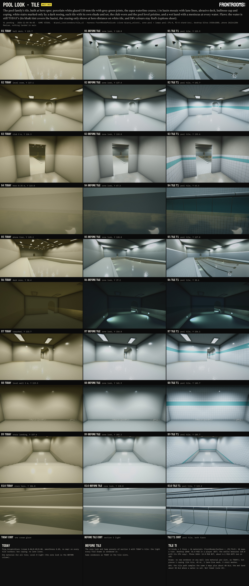

Sheet `sheets/70_tile.jpg` (3838 × 9026, Shot format, chip WAIT-RED: D8's colours stay Red's; columns TODAY = `tile_today` (all layers today; S1-S7 byte-identical to `today_v4`/`today_v8`), BEFORE TILE = `tile_zl` (section 3's zone look and lamp presets with today's tile: the light every TILE frame is rendered in), TILE T1 = `tile_v2` (the recommendation); rows S1-S10 and COST; every label checked at full size: ALL LABELS FIT, `W/pool_look/sheets/70_tile_fit.txt`).

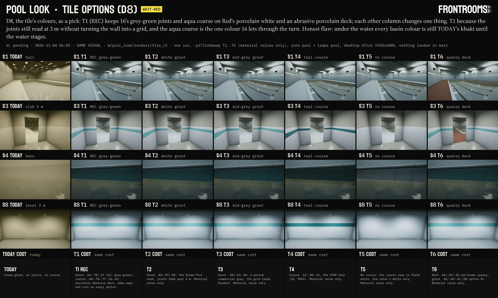

Sheet `sheets/70_tile_options.jpg` (3835 × 2294, chip WAIT-RED; columns TODAY, T1 REC, T2-T6, each one change from T1; rows S1, S3, S4, S8, COST; ALL LABELS FIT, `W/pool_look/sheets/70_tile_options_fit.txt`). Frames: `W/pool_look/renders/tile_v2/` (`S1`-`S10` and `<cam>_T1`-`T6`), `tile_today/`, `tile_zl/`.

### 4.1 Research: only the gaps

Reused, not redone: `10` §2.2 rows 1-4 and §2.5 (shell white or light blue, dark lane lines with T-ends and end-wall targets, glazed wall tile with cove and bullnose, the recessed gutter, the deck non-slip; S40, S43, P1-P3), `15` §4 (6 in and 1 in glazed tile; pristine in the level, worn in the club), `16` §0 item 2 and §5 (the palette's grey-green grout; the course .40 / .76 / .77), `18` §3 (the dark zone). New on 11-03, read as text, nothing downloaded; source ids local to this section, for `SOURCES.md` (the parent appends them):

| # | Source | Date | What it gives | Status |
|---|---|---|---|---|
| T1 | S43 again: Hoeganaes, *Architectural ceramic tile*, https://archive.org/stream/architecturalcer00hoeg/architecturalcer00hoeg_djvu.txt | 1965, PERIOD | Glazed wall tile 3⅝ × 7⅝ and 2 × 10 in; bullnose and cove base; non-skid faces (waffle, pebble, silicon carbide through the body; sanded glaze); coverage tables at ⅛ in joints; "special tile shapes for large and small pools"; colours include Turquoise, Cobalt Blue, Skyline Blue | READ (fetch summary of the OCR) |
| T2 | S40 again: TM 5-662 (1986), https://archive.org/stream/ost-military-engineering-tm5_662/tm5_662_djvu.txt | 1986, PERIOD | 2-8 white, light blue and aqua blue walls and bottom, dark colours discouraged; 4-4 a falling level "causes a scum ring"; 3-6 about 6 in from water to deck at skimmers; 2-11 non-slip treatments | READ (first half of the text) |
| T3 | Old House Online, "Guide to 20th Century Bathroom Tile", https://www.oldhouseonline.com/kitchens-and-baths-articles/guide-20th-century-bathroom-tile | n.d. | The 4 × 4 (4¼ in) square became the ubiquitous wall tile from the 1950s | READ (search excerpt), secondary |
| T4 | Pacific Tile & Porcelain range, https://wellstile.com/?p=11521 | 1936-1960 | 4¼ in square × ¼ in thick | READ (search excerpt) |
| T5 | Daltile Semi-Gloss sell sheet, https://designerpages.s3.amazonaws.com/assets/78007596/DAL_SemiGlossMatte_SS.pdf | modern, LATER | 4¼ and 6 × 6 in wall tile, 5/16 in thick; radius bullnose; sanitary (round-top) cove base | READ (search excerpt) |
| T6 | American Olean unglazed mosaics sheet, https://www.scribd.com/document/638979007/AO-UnglazedMosaics-SS | modern, LATER | 1 × 1 and 2 × 1 in unglazed porcelain for pool linings; the recurring joints give the slip resistance | READ (search excerpt; the page itself would not render) |
| T7 | Florida Building Commission, staff analysis DS2017-070, https://www.floridabuilding.org/FBC/commission/FBC_1217/DEC_Statements/STAFF_ANALYSIS-DS2017-070.htm | 2017, LATER | A waterline band at least 4 in high of tiles at least 1 in, at most 12 in high if dark | READ (search excerpt) |
| T8 | City of Winnipeg, tender 284-2008 addendum 1, https://legacy.winnipeg.ca/finance/findata/matmgt/documents/2008/284-2008/284-2008_Addendum_1/284-2008_Addendum_1.pdf | 2008, LATER | Black lane markings; a 4 in tiled line at the deep end's drop-off | READ (search excerpt) |
| T9 | Pool-care guides on waterline scale, e.g. https://www.flooringclarity.com/pool-tile-calcium-buildup-causes-prevention-effective/ | modern, low authority | A white calcium line where evaporation concentrates minerals; grey hard silicate scale; body-oil grime; scale wicks into grout | READ (search excerpts) |

What follows for the build:
- **Field tile 150 mm (6 in).** `16` §6 asks 6 in, and the period made it (T5); the most common square wall tile of the period was 4¼ in (T3, T4), kept here as the alternative (a new map set, not rendered). 150 mm divides 192 m, so the room stream's rebase never moves a joint.
- **Joints 3 mm** (⅛ in, T1's coverage tables) on wall tile; **2 mm** on the mosaic; **4 mm** on the deck. At 3 m a pixel is 3-4 mm here, so every joint also carries tone: the grout's own colour, its recess and the cushion edge's shading are baked into the data map (relief into tone, 1.2 above).
- **Basin: 1 in unglazed porcelain mosaic** (T6; `10` row 1's "unverified" small mosaic), on 300 mm face-mounted sheets whose joints show a little. Unglazed, so it is matte and grips under bare feet.
- **The waterline course:** one 150 mm row of the aqua glazed tile, the row the water sits in (T2 white or aqua; T7, later, asks at least 4 in; `16` the hinge colour).
- **Deck: unglazed abrasive tile with silicon-carbide grit** (T1's non-skid faces), porcelain white; red-brown quarry stays an option (D8 B).
- **Coping: a full bullnose,** 30 mm thick, its nose (r 15 mm) 20 mm over the basin wall; the wall's top course a bullnose cap (T1, T5).
- **Stairs:** treads and risers white, a dark L nosing: flat 42 mm + r 8 mm + flat 17 mm (seen: 50 mm from above, 25 mm from the front), three safety ribs on the tread leg.
- **The club's waterline shows a scale line** (T2 4-4, T9); the pool level shows none (pristine, `15` §2).

### 4.2 What was built (in the clone `W/proj_unlock`; the Package stage carries it to main)

| Path (under `Frontrooms3D/`) | sha1 | GUID (`.meta`, fresh: none of main's 3,222) | What |
|---|---|---|---|
| `Tools/lookdev/pool_tile/gen_pool_tile.py` | 61f41010 | - | the generator (numpy, Pillow; deterministic): six map sets, both tiers, every `.meta`, the 26 materials, `pool_tile_manifest.json` |
| `Assets/Resources/Surfaces/Pool/Textures/PoolTile_<set>_{D,N,S}[_Phone].png` | manifest | 36 GUIDs, manifest | sets Field, Mosaic, Deck (2048² / 1024²), Cap (2048 × 256), Coping (2048 × 512), Nosing (2048 × 128); linear; trims clamp in V |
| `Assets/Resources/Surfaces/Pool/Prop_PoolTile_<kind>[_Phone].mat` | manifest | 26 GUIDs, manifest | 13 kinds × 2 tiers (4.4) |
| `Assets/Resources/Surfaces/Pool`, `.../Pool/Textures` (folders) | - | 2 | |
| `Assets/Scripts/Rendering/PoolTile/FrontRoomsPoolTile.cs` | 95e63dbc | edc6429c9747495bbe9076893ba70b89 | the runtime: `Get(kind)` (tier from `FrontRoomsTrofferKit.PhoneTier`), `ForWater(kind, waterY)` (one instance per kind, tier and water height to the mm), `MoveWater`, `ReleaseInstances` |
| `Assets/Scripts/Rendering/PoolTile` (folder) | - | 9431cc2f3c0e4bd89978d43fee95c4e4 | |
| `Assets/Resources/Rendering/FrontRoomsSurface.shader` | 37ccbb59 (zone look) → cef7facc | (unchanged) | `_FR_TILE` (a `shader_feature_local_fragment`) and `FRTileSurface`; the wet band `FRWetBand` for every material, behind a uniform branch on `_WaterY`; 10 new per-material values in the CBUFFER (+134 lines over the zone look's version; main still 8f3587e0) |

The manifest is `Assets/Resources/Surfaces/Pool/Textures/pool_tile_manifest.json` (every file's size, sha1 and GUID). The PNGs weigh 44.1 MiB in the repository (35.6 desktop, 8.5 phone). All text LF, ASCII. Clone only, never landing: the harness layer `Assets/Editor/PoolLook/FrontRoomsPoolLook.Tile.cs` (b997130a, GUID 2038d634…) and its hooks (4.5).

### 4.3 How it works

- **The maps are data, the material holds the colours.** `_D` (linear): R the tone, the albedo multiplier 0.75 + 0.5 R (the glaze's lot and mottle, the cushion edge's shading; the grout's grain and its recess shadow), G the glaze's thickness (1 on the face, about 0.45 at the rounded edge, where the body shows), B grout. `_N`: OpenGL normal in the surface's UV frame (the cushion edge r 1.8 mm, the grout struck concave 0.7-1.3 mm under the face, per-tile lippage ±0.1 mm, set ±0.1°, a convex bow of 0.05-0.2 mm, the glaze's orange peel at 2.5 mm and its swell at 12 mm: what makes a lamp's reflection wobble from tile to tile). `_S`: R smoothness (bright glaze 0.935, its edge 0.90, unglazed mosaic 0.47, abrasive deck 0.31 with glassy grit at 0.6, grout 0.24), G cavity, B dirt potential (patchy grout, the horizontal joints' ledges, the crazing network on a third of the tiles, edges, specks), A chips. Maps are supersampled ×2 and seamless; each holds 64 tiles (Field, Deck), 576 chips (Mosaic) or 4-8 units (trims).
- **`_FR_TILE`** (`FRTileSurface`): the colour is `lerp(_EdgeColor, _BaseColor, glaze thickness)` × lot, the grout `_GroutColor`, both × the tone; the dirt `_DirtColor` as far as `_TileWear` (0 pristine, 1 club), which also shows the chips (matte bisque) and dulls an old glaze. **Every tile is its own:** a hash of its cell gives a shade jitter (`_TileGrid.w`: 1 % in the club, 0.4 % in the level), now and then a tile from another lot, bluer or creamier (`_TileLot`: 2.5 % of the club's tiles), and a set of ±0.18° (`_TileGrid.z`), so no repeat of the map shows and reflections break up tile by tile. The cell index wraps every 192 m, so a rebase never re-rolls a tile. On walls a little of the joints' relief goes into the tone (`_TileShade`, lamps overhead). Crazing and chips are hairlines and bites of a few texels: they show at the hero distance and vanish into the mip average beyond about 1 m.
- **The wet band** (`FRWetBand`, any FrontRooms/Surface material, off while `_WaterY` is below -999, the default): under the water porous parts soak and darken (grout, unglazed faces; porosity from the grout channel, else from smoothness, as Lagarde does); above it a band `_WetBand.x` high with a soft top `_WetBand.y` that wanders along the wall (`_WaterLine.z`) holds a water film (gloss up, grout recess filled); the meniscus, the 2.7 mm skin water draws up a wall, catches the light above (`_WetBand.w`, faded by its size on screen so it never shimmers); a club's pool shows its scale line (`_WaterLine.x`, `.y`; TM 5-662's "scum ring"). The water stages drive `_WaterY` (and may move it with the ripples): `FrontRoomsPoolTile.ForWater(kind, waterY)` hands out one instance per water height, `MoveWater` moves a water's line. Under the water the specular is the Submerged stage's (glaze under water reflects about a tenth of what it does in air).
- **Set-out.** Rows are world-planar on 150 mm from world 0; the map's pool floors at 0 and -0.15 sit on them. A floor off the rows (the dark zone's -2.52) takes a V offset on its wall tile so rows start at its floor (`_BaseMap` offset, the harness's datum); bands and caps belong on whole rows (course -0.15 to 0, club band 1.20-1.35, level band floor + 1.20 to 1.50). The stair and coping pieces carry their own UVs in metres, set out from each nosing and along each edge, so their joints line up (nosing joints on the riser joints).
- **Tiers.** The phone tier (handheld, WebGL players: the lamp kits' `PhoneTier`) takes `Prop_PoolTile_<kind>_Phone`, the same material on maps at half size; nothing else differs. The shader path is the same on every tier.

### 4.4 The values

Colours as the Inspector shows them (gamma). Every kind: `_TileGrid.z` set 0.18°, shade jitter 0.4 % (pristine) or 1 % (worn); grout .66 / .70 / .67 (light grey-green, `16` §0 item 2); dirt .36 / .33 / .27.

| Kind | Maps | Glaze (base / edge) | Wear | Wet band (height, fade, soak, meniscus); scale line | Where (harness) |
|---|---|---|---|---|---|
| Field | Field | .93/.95/.96 (Red's porcelain white) / .80/.81/.80 | 0 | .02, .04, 1, .75; none | pool level walls and ceilings, turn, dark zone, stair room |
| FieldClub | Field | same | 1 (lots 2.5 %) | .05, .08, 1, .75; .6 | hall wainscot, club corridor |
| Course | Field | .40/.76/.77 (`16` §5) / .70/.86/.86 | 0 | as Field | level and turn bands, dark band, the stair room's course |
| CourseClub | Field | same | 1 | as FieldClub | the hall's waterline course, the club band |
| Cap | Cap | white | 1 | .05, .08, 1, .75 | the hall wainscot's top course (2.25-2.40) |
| Mosaic | Mosaic | .92/.94/.95 unglazed | 0 | .02, .04, 1, 0 | flooded floors of the pool level |
| MosaicClub | Mosaic | same | 0.6 | .05, .08, 1, 0; .4 | the hall basin's floor and walls under the course |
| Lane | Mosaic | .10/.12/.16 near-black | 0.4 | .05, .08, 1, 0 | lane lines, T-ends, deep-end targets |
| Deck | Deck | .86/.88/.88 unglazed abrasive | 1 | (dry) | the hall deck |
| Tread | Deck (mesh UV) | same | 0 | .02, .04, 1, .75 | stair treads and landing |
| Riser | Field (mesh UV) | white | 0 | as Field | stair risers |
| Nosing | Nosing (mesh UV) | .24/.27/.31 / .42/.45/.50 | 0 | as Field | the stair's nosing L |
| Coping | Coping (mesh UV) | white; sanded top .62, bright nose .92 | 1 | .05, .08, 1, .75; .6 | the hall basin's W, N, E edges |

Macro wear (`_MacroTone` / `_MacroDirt`): .10 / .08 on the club's wall kinds, .12 / .12 on the deck, 0 in the pool level (pristine, as `15` §2's canon asks). `_FloorGrime` .25 on the club's wall kinds.

### 4.5 The harness (clone only)

- `-plTile pool` (T1, the recommendation) and `-plTile T2`…`T6` (D8): every tile slot gets an instance of its kind (the assets are never edited), slots at a water with its `_WaterY` (hall -0.12, pool level -0.03, dark zone -1.5, stair room -0.57). A pool value also builds what only a tiled pool has: the **bullnose coping** (mesh, mitred corners, 45 m, 114 tris) in place of TODAY's boxes, and the **lane lines** (four lanes of 2.25 m, lines 0.25 m wide on the lane centres from z 7 to z 19 with 1 m cross bars, 2 mm over the sloped floor; targets on the deep-end wall: a strip to 0.33 m under the water with a 0.5 m bar).
- `-plTileSweep T1,T2,…` with `-plSweepCams S1,S3,S4,S8`: the options differ only in material values, so one Unity start renders all of them (`<cam>_<option>.jpg`), after the run's own frames. The sweep's T1 frames equal the main frames within the grain (mean difference 0.8-1.0 levels, same means).
- **New for every value, TODAY included:** the stair space at x 576 (a room 6 × 12 m, ceiling 2.9 over a landing at 0, a straight flight of 8 risers of 0.175 and goings of 0.35 into water at -0.57 over a floor at -1.40: risers 1-3 dry, the waterline crossing riser 4 20 mm under its nosing, 5-8 under water; its own look volume (PoolLevel) and lamp cells), and three cameras: **S8** a 3 m read of a pool-level wall, square on (vFOV 60); **S9** standing on the stair's landing 1.8 m from the first nosing (vFOV 76); **S10** hero 0.35 m from riser 4, eye 0.07 m above the water, 14° off square (vFOV 60).
- **Set-out constants moved** onto the tile rows: the hall course from 0.155 to 0.15 deep, the club band from 1.25-1.40 to 1.20-1.35 (TODAY renders both sides of each split with one material, so its frames do not change); the dark zone's wall tile takes the V offset of 4.3.
- The phone tier swaps every tile renderer to the `_Phone` twins (S5) and back. `tile_cost.tsv` lists each map's format and size per tier.
- Runs: `tile_today` (`-plDiag`), `tile_zl` (`-plZone pool -plLamps pool`), `tile_v1` (+ `-plTile pool`), `tile_v2` (+ `-plTileSweep T1,T2,T3,T4,T5,T6`); launcher as in 2.6.

### 4.6 Numbers

| | Desktop | Phone tier |
|---|---|---|
| Maps | 18: three 2048² sets (Field, Mosaic, Deck) and three trims | the same 18 at half size |
| Texture memory | **55.0 MiB** in a player (BC7, 1 byte a texel with mips; the editor measures 110.0 MiB, counting its CPU copy) | 13.8 MiB BC7; about **6.1 MiB** as ASTC 6 × 6 on iOS (estimate) |
| Materials | 13 shared, plus one instance per kind and water height at run time (16 in these spaces: 4 at the hall's water, 3 at the pool level's, 3 at the dark zone's, 6 at the stair room's) | 13 shared `_Phone` twins, the same instances |
| Draws | no new renderer on any wall: each slot is one renderer with one material, as TODAY's single glaze was; kit pieces: 1 coping (114 tris), 1 lane-line mesh (hall), 3 stair meshes (treads, risers, nosings) | the same |
| Repository | 35.6 MiB of PNG | 8.5 MiB of PNG |
| GPU | the tile path samples the same three maps as the plain one plus about 40 ALU (six hashes, lerps); the wet band about 30 ALU where `_WaterY` is set, nothing elsewhere. Not timed (rule 25) | the same |

Mean luma (0-255) per camera, TODAY | BEFORE TILE | TILE T1: S1 135.7 | 128.0 | 125.9; S2 117.1 | 137.4 | 141.7; S3 126.3 | 133.0 | 135.6; S4 123.8 | 67.3 | 63.3; S5 139.2 | 128.8 | 127.8; S6 50.4 | 37.2 | 38.6; S7 133.7 | 154.0 | 156.1; S8 119.5 | 141.9 | 145.7; S9 157.6 | 182.2 | 185.7; S10 106.8 | 130.8 | 123.4. No clipped pixel in any TILE frame. Build cost (`tile_v2/cost.tsv`): hall 122 renderers, 35.9 k tris, 19 materials; stair 49 renderers, 5.6 k tris, 12 materials.

### 4.7 Checks

- **The shader is inert for every other material:** TODAY rendered with the tile layer and the wet band in the shader and with the stair space in the scene (`tile_today`) equals `today_v8` byte for byte on S1, S2, S3, S4, S6 and S7. S5 and the S2 lamp check differ by the dither and grain phase only (mean 0.6 levels): they render after three more cameras now.
- **Gate (rule 25)**, `W/pool_look/tile/tmp/gate.zsh g1` (the override its own zsh array element; the response files read): Roslyn against main with `FrontRoomsPoolTile.cs`, macOS and iOS: COMPILE OK, 0 errors, 1 override. The clone with the harness: COMPILE OK (`tile/tmp/roslyn_t2`). The shader compiled in every Unity run in the clone: 0 shader errors, 0 warnings on FrontRooms/Surface, 0 `error CS` (`logs/tile_*.log`). Unity rewrote none of the generated files (materials, maps and metas equal the manifest's sha1).
- **Assets:** 67 new GUIDs, none in main's 3,222; the three new folders are absent in main; every text file LF, ASCII.
- **Not checked here:** the shader's iOS and WebGL compiles (the clone's batch compiles Metal only; the combined test's builds compile the rest), GPU time on any tier.

### 4.8 Reading the renders

- **The pool family now reads as tile, and as the right tile.** Porcelain white, not cream (Red 17:19), on every surface the canon tiles; the grid reads at 3 m (S8, S3) without becoming a drawing: joints are thin grey-green lines that fade into the wall's tone past 6-8 m, as in a real tiled hall. The pool level (S2, S7, S8) is the canon's pristine white field with one aqua band; the club (S3, the hall) is the same tile with darker joints. The tile's gloss shows where it should: a lamp's reflection on the level's walls sits in one tile and stops at its joints, and the cushion edges glint along the joints (S7), each tile at its own small angle.
- **The hall (S1, S5)** has its period equipment in tile: the porcelain abrasive deck, the bullnose coping round the basin, the lane lines with T-ends and the targets on the deep-end wall, the cap course under the painted block. The basin still reads khaki, because TODAY's water (a constant-alpha teal reflecting the warm Tall cube) lies over it: the water stages' work, not the tile's.
- **Hero (S4, 0.35 m):** the coping's round nose with its joint, the aqua course with dirty club joints, the meniscus as a thin bright line at the water, the 1 in mosaic under the water. P1-A leaves this spot dark (section 3.8), so the aqua reads deep teal here; at S8 under the level's light it is the aqua of `16`.
- **The stairs (S9, S10):** from the landing the steps read as dark lines descending into the water (the nosing strips), white everywhere else; up close the nosing L with its ribs and joints lines up with the riser tile below, and the waterline draws its meniscus across riser 4 just under the nosing.
- **Crazing and chips** are there for the hero distance only, in the club; at S4's light they are barely visible on the dark course. A hero frame on white club tile would show them better; none of the fixed cameras has one.

### 4.9 D8: the choice that remains Red's

`20_for_red.md` D8 left the band colour and the deck open and promised a sheet. F1 and Red's porcelain white since narrowed it to: the grout, the course's hue, the deck. The options sheet shows each as one change from T1:

| Option | What changes | As the player sees it | Cost |
|---|---|---|---|
| **T1 REC** | grout .66/.70/.67 grey-green, aqua course .40/.76/.77, porcelain abrasive deck | a white tiled room whose grid you notice at arm's length and stop noticing across the hall; one aqua line where the water is; the deck as pale as the walls | the build |
| T2 | white grout .86/.87/.85 | the Dream Pool's seamless white; at 3 m the joints nearly vanish, the walls read as one surface | material value |
| T3 | mid-grey grout .50/.51/.50 | a period commercial installation; the grid reads hardest at every distance | material value |
| T4 | the course deep teal .12/.50/.52 (1990's teal) | a heavier, period line that reads darker than the water | material value |
| T5 | no course: the course rows in field white | the canon's white only; the water is the only colour | material value |
| T6 | red-brown quarry deck .56/.29/.20, grout .45/.44/.42 (D8 B) | a warm period floor round a cold pool; it brings back the warmth `16` takes out of the hall | material value |

**Recommendation T1:** the grey-green joint is the palette `16` chose for the fusion and keeps the tile legible at 3 m (Red's 1.2 rule) without turning the wall into a drawing; the aqua course is the one colour `16` lets through the turn into the pool level; the porcelain deck keeps the hall's floor in the same white as its walls. Its honest flaw: until the water stages, the basin's colour is still TODAY's khaki, so the course and the mosaic cannot yet be judged under real water. Any option is a change of material values in `gen_pool_tile.py`'s table, then one generator run.

### 4.10 Limits and open items

- **The water is TODAY's** in every frame; the basin's colours, the wet band's look under ripples and the meniscus's brightness against real water are judged again after the Water surface and Submerged stages.
- **Specular under water** stays the glaze's in air until the Submerged stage (glaze under water reflects about a tenth as much).
- **Set-out in the map** (owner 关卡设计): pool rooms' bands and caps on whole 150 mm rows from world 0, or a V offset per room as the dark zone takes here; the module data in `pool_modules.json` puts the club band at 1.25-1.40 and the dark floor at -2.52. A line for the map contract (Package stage), not a change made here.
- **Kit pieces are the harness's:** the bullnose coping, the stair's nosing L and the lane lines are built procedurally here; production pieces (a coping kit with gutter grates, `10` §2.2 row 4; the stair kits of `level_space/60`) take these materials and UV layouts (coping: U along the edge, V across the 0.34 m profile from the deck side; nosing: U along the step, V across the 0.075 m profile from the tread side).
- **4¼ in tile** (the period's commonest square) would be a new map set (about 18 MiB more on desktop); not rendered.
- **The coping's ends** at the beach are open (no end caps; no camera sees them).
- Frame time and memory on devices: not measured (rule 25).

### 4.11 For the next stages

- **Package (`pool_tile`):** `Tools/lookdev/pool_tile/`, `Assets/Resources/Surfaces/Pool/` (36 maps, 26 materials, manifest, metas), `Assets/Scripts/Rendering/PoolTile/FrontRoomsPoolTile.cs`; `FrontRoomsSurface.shader` cef7facc (shared with `pool_zone_look`: one payload, base 8f3587e0, unchanged in main since 17:00). The material assets keep `_WaterY` -1000 (no water): the map (C2) or a water component sets it through `ForWater`.
- **Water surface, Submerged:** drive `_WaterY` (and its ripple height) on the tile instances; take the specular under water; check the meniscus (`_WetBand.w`, now .75) and the scale line (`_WaterLine.x`, .6 in the club) against the real water.
- **Harness:** `-plZone pool -plLamps pool -plTile pool` is the base for the next stages; the TODAY columns for S8-S10 are `tile_today`.
- **Deletion candidates** (inside `W/pool_look`, Red deletes): `renders/tile_v1` (superseded by `tile_v2`), `tile/tmp/gen_test`, `tile/tmp/roslyn_t1`, `tile/tmp/preview_v1`, `tile/tmp/qa`. Keep `tile_today`, `tile_zl`, `tile_v2`, `tile/tmp/gate_g1_*`, `roslyn_t2`.

## 5. Ripples

Stage 5 of the workflow, 2026-11-04 06:00 to 07:05, one agent on account G (the relay of `wf_48851110-b3c`). **Nothing landed in main:** main was read only, no Unity ran on main, nothing was downloaded, no package was built (the Package stage builds `pool_water`). The machine ran at a load average of 13-41 on 16 cores during the Unity runs, so every frame time below is **UNDER LOAD** and indicative only.

The asks: `17` §7 item 3, "Ripple normals: a baked looping FFT sequence. Capillary–gravity dispersion, isotropic, λ from 5 mm to 30 cm, calm slopes 1–3°. Normal variance stored for distance roughness (anisotropic along the view). Disturbance raises amplitude locally"; item 4, "Rings: dispersive packets growing at 0.2–0.5 m/s with crests running through them. 4–16 by tier, mirrored at basin walls"; §3.3 (the scrolling-texture look and how to avoid it), §3.5 (calm, then uneasy; Reduce Motion; ≤ 3 Hz). Sizes from §6.1: desktop 512² × 64 frames, handheld 256² × 32, WebGL 256² × 16-32. No Red decision is open in this stage: the sheet's chip is PENDING (its VL row comes with the line's daily batch).

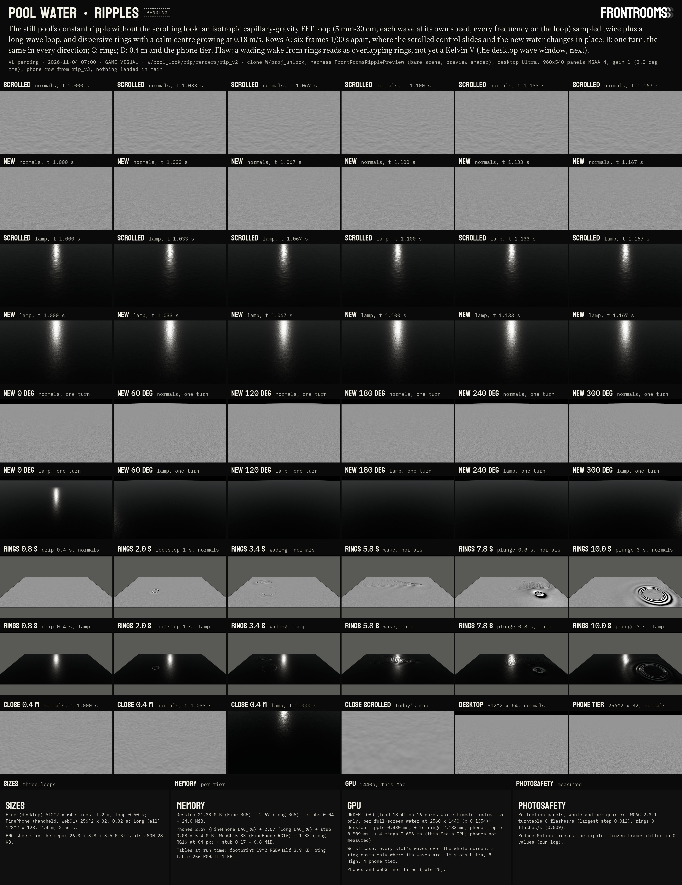

Sheet `sheets/70_ripples.jpg` (3840 × 4979, Shot format, chip PENDING; every label checked at full size: ALL LABELS FIT, `W/pool_look/sheets/70_ripples_fit.txt`). Rows A: six frames 1/30 s apart of one held view, the control (today's stand-in map scrolled the usual way, `17` §3.2 row 1) against the new ripple, as normals under one grazing lamp and as that lamp's reflection; B: one turn at six headings; C: the rings clip; D: 0.4 m, and the phone tier against the desktop; E: COST. Silent videos (h264, no audio stream; Shot header on every frame): `video/70_ripples_turntable.mp4` (12 s: holds 3 s, then one turn), `video/70_ripples_rings.mp4` (12 s: drip, footstep, wading, plunge, walls), `video/70_ripples_close.mp4` (2 s at 0.4 m), `video/70_ripples_phone.mp4` (6 s). Masters at 1920 wide: `W/pool_look/rip/video/`. Frames: `W/pool_look/rip/renders/rip_v2/` (desktop clips), `rip_v3/` (phone tier, timing).

### 5.1 What was built (in the clone `W/proj_unlock`; the Package stage carries it to main)

| Path (under `Frontrooms3D/`) | sha1 | .meta GUID | What |
|---|---|---|---|
| `Tools/lookdev/pool_water/gen_pool_ripples.py` | 165baa58 | - | the generator: FFT bake, sheets, metas, stats, QA (`--qa <dir>`); 7 s, deterministic (same bytes every run) |
| `Tools/lookdev/pool_water/ring_model.py` | 75373242 | - | the ring model's constants, Airy fit and calibration, checked against the exact solution |
| `Assets/Resources/Rendering/Water/FR_Ripple_Fine.png` | 2ee03f5b | ed818fd5 | desktop fine cascade: 64 slices of 512² as an 8 × 8 sheet (4096², 26.3 MiB) |
| `.../Water/FR_Ripple_FinePhone.png` | a80fafe2 | 10bf5eaf | phone tier (handheld and WebGL) fine cascade: 32 slices of 256², 8 × 4 sheet (3.8 MiB) |
| `.../Water/FR_Ripple_Long.png` | f9fefd2f | 931f1523 | long cascade, every tier: 128 slices of 128², 16 × 8 sheet (3.5 MiB) |
| `.../Water/FR_Ripple_Stats.json` | 59f49793 | e7e2db4d | per cascade: encoding, variances, frame-blend loss, the footprint table, sizes, sha1, GUIDs |
| `Assets/Resources/Rendering/Water.meta` (folder) | - | 2b21685d | |
| `Assets/Scripts/Rendering/Water/FrontRoomsWaterRipples.cs` | b6961916 | 31fc2378 | runtime: loads the tier's loops, keeps the ripple clock (Reduce Motion freezes it), sets the globals, ticks the rings |
| `Assets/Scripts/Rendering/Water/FrontRoomsWaterRings.cs` | 65298037 | 9eff4f0e | runtime: ring pool, hooks, wall images, slot budget, the wave-number table |
| `Assets/Scripts/Rendering/Water.meta` (folder) | - | a0920ec5 | |
| `Assets/Resources/Rendering/FrontRoomsWaterRipples.hlsl` | 800bd3fc | d26e59c1 | the include the water shaders call: `FRWaterRipples(xz)` → slope, unresolved covariance, footprint axis, ring height, agitation |
| `Assets/Editor/Rendering/FrontRoomsRippleArray.cs` | 7f90c11b | 1ad91ac1 | the import rules: menu "FrontRooms > Rendering > Ripple Arrays: Apply Import Rules" and `Check()`; not a postprocessor (§5.7) |
| clone only: `Assets/Editor/PoolLook/FrontRoomsRipplePreview.cs`, `.shader` | 252ebba8, 2dc13cd7 | f4075895, 85597cdc | the preview harness and its look-dev shader (never land) |

All 10 GUIDs of the package files are absent in main's `Assets` (checked against every `.meta`); the folders `Scripts/Rendering/Water` and `Resources/Rendering/Water` do not exist in main. Text files LF; C# and HLSL ASCII.

### 5.2 The constant ripple

**The spectrum.** Slope variance per ln k (`17` §3.1: "0.05–0.3 mm high at 1–5 cm wavelength (slopes 1–3°)"; §3.5: the constant ripple is capillary-scale sparkle, anything larger is caused by someone): a log-normal bump at 2 cm (width 0.55 in ln k) plus a faint shelf at 12 cm (8 %: the slow wobble of far reflections), soft edges a quarter octave wide at 5 mm and 30 cm. Half the slope variance lies between 1.4 and 3.3 cm, 80 % between 1.0 and 5.4 cm. At gain 1 the whole ripple has an rms slope of 2.0° (17's calm range 1-3° is gain 0.5-1.5); its rms height is 0.26 mm.

**The physics.** Capillary-gravity dispersion ω² = g k + (σ/ρ) k³ (σ/ρ = 0.0728/998 m³/s²), every direction equally (no wind, no current), random phases (Tessendorf's method, `17` W17): each wavelength moves at its own speed, so crests change shape and nothing slides. Each frequency is rounded to a whole number of turns per loop (never zero, so nothing stands still): the loop is exact.

**Why two cascades.** A 5 mm wave turns once in 16 ms, a 30 cm wave in 0.44 s; a loop of T seconds gives every wave a frequency that is a multiple of 1/T, and 64 frames cut T into 64 steps. A study over T (`W/pool_look/rip/tmp/study_t.py`, `study_t2.py`) found no single 64-frame loop that holds both ends: T 0.5 s quantises the 10-30 cm waves by 21 % rms (the long wobble would pulse on a fixed 2 Hz beat), T 1.0 s loses 18-37 % of the energetic band to the frame step. So the bake has two cascades, as ocean FFTs do:

| Cascade | Band | Sheet | Patch | Loop | Texel | Holds | Left to roughness | Frame-blend loss D | Frequency error |
|---|---|---|---|---|---|---|---|---|---|
| Fine (desktop) | 5 mm to ~7 cm (93 % of the slope variance) | 512² × 64 | 1.2 m | 0.50 s (7.8 ms a frame) | 2.34 mm | 97.3 % of its band; 1.34° rms per axis | 0.22° per axis | 0.120 | 5.9 % rms |
| FinePhone (handheld, WebGL) | the same field (the desktop's components, cut at its own resolution) | 256² × 32 | 1.2 m | 0.32 s (10 ms) | 4.69 mm | 93.9 %; 1.28° | 0.33° (waves under ~1 cm) | 0.143 | 9.3 % |
| Long (every tier) | ~7 to 30 cm (7 %) | 128² × 128 | 2.4 m | 2.56 s (20 ms) | 18.75 mm | 100 %; 0.38° | 0 | 0.054 | 3.2 % |

A wave that would turn more than 90-135° of phase per frame (45-90° on Long) is faded out of the sheet (linear blending of two frames cannot show it, and a 60 Hz display shows a 16-40 ms wave only as blur); its variance goes to roughness, like a wave too short for the texels. Encoding: R = ∂h/∂x, G = ∂h/∂z (world x along U, world z along V), 8 bit, slope = (2v - 1) × 5σ (clipped share 1e-6; quantisation 0.015° rms).

**No scrolling, measured** (`gen_pool_ripples.py --qa`, read back from the sheets by `W/pool_look/rip/tmp/qa_sheet.py`): the cross-correlation of a frame with a later one never finds a translation. From two frames on (15.6 ms, desktop) the best match anywhere is 0.10-0.32, with a mirror lobe of equal strength on the opposite side (waves leaving in both directions) and a random direction; a control scrolled at 0.25 m/s keeps 0.97 at every lag. Isotropy: the spectrum's energy in 8 direction sectors is within ±2.5 % (fine) and ±7 % (long; fewer lattice points); the x and z slopes have equal variance and correlation 0.0000. The patch-mean slope variance changes by 0.6 % over the loop (nothing pulses over a large area).

**Sampling** (`FrontRoomsWaterRipples.hlsl`): the fine loop twice on desktop, A as baked and B scaled 8/7, turned by the 3-4-5 angle and played at 0.8613 × (its phase speeds stay within 1.6 % of A's), so A + B never repeats exactly and no tile grid shows; the long loop once, turned by the 4-3-5 angle. Each patch divides 192 m along both world axes (B's turned patch 1.3714 m included), so the room stream's origin rebase never moves the pattern. A slow calm-patch mask (smooth value noise over 3.2 m and 24 s, ±25 %, `17` §3.3 item 4, W22's slicks) scales the slope and its roughness together; the phone tier samples A alone and skips the mask (6 array fetches become 4, and the mask's 8 hashes go).

**What it looks like** (sheet rows A, B, D; videos): in the held view the control's whole pattern slides one way and its 1.8 m tiles repeat across the frame; the new water changes in place, the fine sparkle boiling quickly while the long wobble moves the reflection slowly. The lamp's reflection is a streak along the view with glitter in its tail; at 0.4 m the capillaries are individual crests. The phone tier reads as the desktop at player distance (row D).

### 5.3 Distance roughness (anisotropic along the view)

The game has MSAA and no TAA, so what a pixel cannot show must become roughness (`17` §2.2, W23). `FRWaterRipples` returns the slope the pixel resolves and `cov`, the slope covariance it does not:
- **Footprint:** the pixel's footprint on the water from the screen derivatives of world x and z: its long axis (along the view) and short axis, in metres.
- **The variance of the normal map's mips, per footprint shape:** the generator computes, from each sequence's own spectrum, the share of each slope component a footprint of 2^a × 2^b texels averages away (box mip times bilinear, sinc² per axis), for a and b from 0 to 9 in half octaves (`lut_major_flat`, `lut_minor_flat`, 19 × 19 per cascade). The runtime packs them into one 19² RGBAHalf texture; the shader reads the share along and across the footprint. Isotropic footprints (the "variance of the mips", desktop fine): 12 % at 1 texel, 35 % at 2, 71 % at 4 (9.4 mm), 94 % at 8, 99.7 % at 16. A long footprint also raises the across share (16 × 4 texels: 99 % along, 89 % across, against 71 % for 4 × 4), which is why lamp reflections stretch into streaks. Under one texel the share fades to 0 (bilinear shows what the texels hold).
- **Plus** the sub-band (waves too short or too fast for the sheet) and the frame-blend loss of what stays resolved (4 f (1 - f) D, where f is the blend between two slices), both isotropic, so the total slope variance a pixel shows is constant through the loop.
- `FRRippleAlpha(r, alpha0)` turns `cov` into GGX alphas along and across the footprint (α² = α0² + 2σ² per axis); the preview's lamp uses an anisotropic GGX with them. The Water surface stage takes the same alphas for the lamp specular and the reflection's roughness mips.

### 5.4 Rings

**Physics** (`ring_model.py`; `FrontRoomsWaterRings.cs` builds the same constants at run time): a disturbance is a hump of volume V and radius a (plus a splash share at radius a_s) released from rest, the Cauchy-Poisson problem with the same dispersion. Energy travels at the group speed, whose minimum is **0.1777 m/s at 4.36 cm** (ω 40.42 rad/s): every ring has a calm centre whose rim grows at that speed; beyond it two wave trains share every point, long gravity waves whose crests run out through the packet (phase speed above group speed) and short capillary waves that race ahead of their crests, the front reaching 0.3-0.5 m/s. The shader evaluates both trains in closed form (stationary phase; the wave number at r / t comes from a 256-entry table on the gravity and capillary branches) and the rim by the Airy function (a degree-6 fit, error 4e-4); amplitudes fall as the waves spread, with viscous damping ×3 for a used pool's surface film and a 3 s fade (a ring is gone in 4-8 s, `17` §3.4). Each ring's crests are filtered by the pixel footprint along its radius; what is filtered goes to `cov`. Checked against the exact integral (correlation of the radial profiles at 0.5 / 1 / 2 / 4 s): drip 0.943 / 0.976 / 0.991 / 0.997, footstep 0.967 / 0.981 / 0.988 / 0.992, wade 0.786 / 0.928 / 0.954 / 0.988, plunge 0.839 / 0.890 / 0.964 / 0.986 (the closed form is weakest within a source radius or two of a fresh big source, where the splash, which v1 does not draw, dominates anyway).

**Hooks** (public static methods; callers never edit this file):

| Hook | Source (a, splash a_s and share) | Volume (calibrated to `17` §3.1) | Life | Agitation |
|---|---|---|---|---|
| `Drip(p)` | 3 mm, 1.5 mm 30 % | 0.74 ml: 0.4 mm crest at 0.10 m | 5 s | 0 |
| `Footstep(p)` | 40 mm, 8 mm 25 % | 0.30 l: 5 mm crest at 0.30 m | 7 s | 0.6 |
| `Wade(p)` | 180 mm, 20 mm 4 % | 10.1 l: 12 mm crest at 0.50 m | 6 s | 0.8 |
| `Plunge(p, size)` | 300 mm, 20 mm 8 % (size scales a and V) | 92 l: 30 mm crest at 1.0 m | 8 s | 1.2 |

`ReportBody(Body.Player / Body.Relay, feet, radius)` is the public method for the player's and the Relay's positions, called every frame they can move: in water shallower than 0.45 m at the feet a body leaves a footstep ring at each 0.7 m stride (feet 0.2 m apart); deeper, a wading ring every 0.3 m, slightly ahead of the body; standing in water, a faint ring every 1.5-3 s (the water keeps answering, `17` §3.5); stepping in, one stronger ring; a jump of more than 2 m makes none. `AutoSteps = false` hands footsteps to the game's own footstep events through `Footstep`. "Disturbance raises amplitude locally" (`17` §7 item 3): each ring stirs a patch around its source (radius a + 5 cm/s × age, fading over 1.5 s) where the constant ripple's slope rises by up to 80 % × agitation.

**Walls:** `RegisterWater(id, rect, waterY)` names the rectangles whose sides reflect; a ring inside one is mirrored across its four sides (×0.85) and corners (×0.72), and an image takes a slot only once its waves can have reached the water. **Slots:** 16 desktop Ultra, 8 other desktop presets, 4 the phone tier (`FrontRoomsTrofferKit.PhoneTier`: handheld and WebGL players); the preset is read from `FrontRoomsQuality.CurrentPreset`, which belongs to 设置菜单与画质预设 (`Budget` overrides it). Slots go to the strongest, freshest rings nearest the camera, then to images. Uploaded as two `float4[16]` globals (`_FR_Ring0`: centre, age, volume; `_FR_Ring1`: radius, splash radius and share, agitation) and a count.

**What it looks like** (row C, rings video): the drip and the footstep make the classic ring, a calm disc with a bright inner rim and wave trains outside it whose crests visibly move against the ring; the plunge sends a broad long-wave ring with short rings inside it, and its reflections come back off the near walls; a body wading leaves a cone of overlapping rings. **Its honest flaw:** the wake is a chain of rings, not yet the 19.5° Kelvin V of `17` §3.1; the desktop answer is the wave window (§5.8).

### 5.5 Safety

- **Reduce Motion** (the game's flag, `FrontRoomsHandheld.ReduceMotion`: the OS switch or CAMERA MOTION off; tools override it with `FrontRoomsWaterRipples.EditorReduceMotion`) freezes the ripple: the clock stops on the current frame, no new rings start, live rings stop where they are and fade out in one second. Measured (`still` clip): two frames 1/30 s apart with it on differ in 0 channel values; with it off, in 2,037,656.
- **Large-area modulation ≤ 3 Hz:** the loop's patch-mean slope variance is constant to 0.6 %, the frame-blend loss is returned as roughness (constant total), the calm-patch mask changes over 24 s, and the only waves that move large areas, the plunge's and the wade's long ones, have periods of 0.4-0.8 s (at most 2.5 Hz). Measured on the lamp-reflection panels (`W/pool_look/sheets/70_ripples_photosafety.json`, WCAG 2.3.1 as RELAY §9.5 defines a flash, whole panel and each quarter): 0 flashes per second in every clip (turntable, rings, close, phone); the largest frame-to-frame change of a mean is 0.012 of full scale (the turn moving the streak), and the panel mean's variation above 3 Hz has an rms of 0.0002.

### 5.6 Per tier and numbers

| | Desktop (Ultra / other presets) | Phone tier: handheld | Phone tier: WebGL |
|---|---|---|---|
| Fine loop | FR_Ripple_Fine 512² × 64, BC5 | FR_Ripple_FinePhone 256² × 32, EAC_RG | FR_Ripple_FinePhone 256² × 32, RG16 |
| Long loop | 128² × 128, BC5 | 128² × 128, EAC_RG | 64² × 128 (its WebGL tab), RG16 |
| Other tiers' sheets | 32 px stubs | 32 px stubs | 32 px stubs |
| **Memory** | **24.0 MiB** (21.33 + 2.67 + stubs 0.04) | **5.4 MiB** (2.67 + 2.67 + 0.08) | **6.8 MiB** (5.33 + 1.33 + 0.17) |
| Tables built at run time | footprint 19² RGBAHalf 2.9 KB, ring table 256 RGHalf 1 KB | same | same |
| Samples per pixel | fine A + B + long (6 array fetches), footprint table, mask | fine A + long (4), table | same as handheld |
| Ring slots | 16 / 8 | 4 | 4 |
| **GPU** (this Mac, UNDER LOAD, full-screen water at 2560 × 1440) | ripple +0.35-0.43 ms; 16 rings over the whole screen +2.2 ms (worst case) | not timed on a phone; on this Mac +0.49-0.51 ms, 4 rings +0.66-0.72 ms (from an uncompressed RGBA32 array: a phone samples 1 byte a texel) | not timed |

Repository: 33.6 MiB of PNG (26.3 + 3.8 + 3.5) and a 28 KB stats file. The editor measures double memory for each array (its CPU copy). Timing method: `FrontRoomsRipplePreview.Timing`, 7680 × 3544 (VISUAL_STANDARD 1.4), the same shader flat and with the ripple, wall clock with a one-pixel readback per frame, median of 20; two runs (`rip_v2`, `rip_v3`) differ by up to 20 %. A ring costs only where its waves are (each slot is skipped beyond its fastest front, `r > v_front t + 3a`), so the 16-ring figure (every slot covering the whole screen) is the ceiling, not the typical cost. Against `17` §6.1's budgets (≤ 4-5.5 ms Ultra, ≤ 2 ms handheld at device scale for all of the water), the ripple itself is small; rings are the item to watch on phones.

### 5.7 Checks

- **Gate (rule 25)**, `W/pool_look/rip/tmp/gate.zsh g2` (overrides as zsh array elements, response files read; g1 before the last edit gave the same): Roslyn against main with `FrontRoomsWaterRipples.cs`, `FrontRoomsWaterRings.cs` and `FrontRoomsRippleArray.cs`: macOS COMPILE OK, 0 errors, 3 overrides; iOS COMPILE OK, 3 overrides (`Assembly-CSharp.ios.rsp` holds the Water files and UNITY_IOS). The clone with the harness: COMPILE OK (`rip/tmp/roslyn_r5`). The include compiled for Metal in every Unity run (the preview shader includes it): 0 shader errors, 0 `error CS` (`W/pool_look/logs/rip_v1..v3.log`).
- **Import:** the arrays import as planned on the Standalone target (`rip_v2/import.txt`): Fine 512 × 512 × 64, 10 mips, BC5, trilinear, aniso 16, repeat, box mips, linear; Long 128² × 128 BC5; FinePhone a 32 px stub; the iPhone, Android and WebGL tabs EAC_RG / EAC_RG / RG16 at the sizes above. `FrontRoomsRippleArray.Check()`: all 3 sheets match the rules. The generator's `.meta` files are byte-identical to what Unity writes back after import.
- **Why the importer is not an AssetPostprocessor:** the first run had one (as `FrontRoomsPrintArray` does) and Unity reimported every texture in the project because a texture postprocessor was added (1,262 texture imports in the clone's log). In Red's Editor that would be a long stall for nothing, so the rules live in the `.meta` files the generator writes, plus a menu command and `Check()`.
- **Inert:** nothing changes until something calls `FrontRoomsWaterRipples.Ensure` or `Tick`; no shader in main includes the new file yet; no existing file was edited.
- **Runs:** `rip_v1` (06:42-06:44; found the postprocessor reimport, the stand-in not loading, the phone stub, the wake as a chain of drawn circles), `rip_v2` (06:49-06:50, the desktop clips of record), `rip_v3` (06:54, phone tier after its path changed, timing); all FINISHED fail=0, 9-42 s each.
- **Not checked here:** the include's compile for GLES3/WebGL, Vulkan and D3D (the batch compiles Metal only; the combined test's builds compile the rest); GPU time on any phone or browser; EAC_RG's error on the slopes (the phone preview used the sheet uncompressed).

### 5.8 The two-band wave window (`17` §7 item 5): the first follow-up, not this stage

Red chose P4c (desktop wake simulation and surface caustics) for v1 (Q2, BH line 115). This stage builds the hooks the window will use (`ReportBody`, `Footstep`, `Wade`, `Plunge` feed it as they feed the rings) but not the window: it needs a GPU height-field solver (two bands, 12 m and 24 m around the camera, `17` §3.4) and the water shader that consumes its heights, normals and slope variance, which is the Water surface stage's. Until then the desktop wake is the ring chain of §5.4. Proposed as the first package after this workflow's water stages, inside v1 (Q2), on desktop only.

### 5.9 Limits and open items

- **The wake** reads as overlapping rings (a cone of arcs), not a Kelvin V (§5.8). In ankle water the true wake is a supercritical V narrowing with speed (`17` §3.1); the rings give footsteps there, which is what a walker leaves at close range.
- **Ankle water:** the rings use deep-water dispersion; waves longer than about 40 cm travel slower in 0.12 m of water. The footstep's energetic waves (3-15 cm) are unaffected.
- **The constant ripple's height** is not baked (under 0.3 mm); refraction and caustics take the rings' height and the slopes.
- **A loop of 0.5 s** (0.32 s on phones) underlies the fine sparkle; A + B + Long never repeat exactly, but the fine pattern's own period is short, so a viewer staring at one glint for a long time might sense a rhythm. Not seen in the clips; a live FFT on desktop Ultra (`17` §6.1's "or live 256²") would remove it.
- **Rings on phones** are the expensive item (§5.6); the Water surface stage may want 2 slots on small phones.
- **The tier rule** (16 / 8 / 4) reads `FrontRoomsQuality.CurrentPreset`, which belongs to 设置菜单与画质预设: it goes to them with the Water surface stage's tier contract.

### 5.10 For the next stages

- **Water surface:** include `FrontRoomsWaterRipples.hlsl` after URP's Core.hlsl and call `FRWaterRipples(positionWS.xz)` in the fragment stage, unconditionally (it uses ddx / ddy); the normal is `FRRippleNormal(r.slope)`, the lamp specular's anisotropic GGX takes `FRRippleAlpha(r, alpha0)` along `r.axis`, and the planar or probe reflection picks its roughness mip from the same alphas. The water component calls `FrontRoomsWaterRipples.Tick(Time.deltaTime, camera position)` once a frame while water is visible (a second call in the same frame does nothing) and registers each water rectangle with `FrontRoomsWaterRings.RegisterWater`. `FrontRoomsWaterRipples.Gain` sets the calm (1 = 2.0°); a zone may want less in the dark zone. The wiring of `ReportBody` for the player and the Relay goes in that stage's contract (the callers are other lines' files, or the water component reads the camera and `FrontRoomsRelayRig`).
- **Submerged:** caustics can take the slopes (desktop) and `r.height` (rings); the long cascade's slopes drive the slow light pattern.
- **Package (`pool_water`):** `Tools/lookdev/pool_water/` (2 files), `Assets/Resources/Rendering/Water/` (3 PNG, the stats JSON, 4 metas, folder meta), `Assets/Scripts/Rendering/Water/` (2 files, metas, folder meta), `Assets/Resources/Rendering/FrontRoomsWaterRipples.hlsl` (+ meta), `Assets/Editor/Rendering/FrontRoomsRippleArray.cs` (+ meta). Base: all ABSENT in main. After `--apply`, the Editor imports three textures (no project-wide reimport).
- **Harness:** `FrontRoomsRipplePreview.RunBatch` (`-rpRun name -rpClips turntable,rings,close,phone,still,timing`) through `W/pool_look/rip/tmp/run_rip_when_free.zsh`; media `W/pool_look/rip/tmp/make_rip_media.py`.
- **Deletion candidates** (inside `W/pool_look`, Red deletes): `rip/renders/rip_v1` (110 MB, superseded), `rip/tmp/roslyn_r1`-`r3`, `rip/tmp/meta_after_import`, `rip/tmp/crop_*.png`, `rip/tmp/cmp_desk_phone.jpg`, `rip/tmp/sheet_*.jpg`, `rip/tmp/vcheck_rings.jpg`. Keep `rip/renders/rip_v2`, `rip_v3`, `rip/video`, `rip/qa`, `rip/tmp/gate_g2_*`, `roslyn_r5`, the scripts. Also candidates: `rip/tmp/gate_g1_*`, `roslyn_r4`.

## 6. Water surface

Stage 6 of the workflow, 2026-11-04 07:02 to 08:15, one agent on account G (the relay of `wf_48851110-b3c`). **Nothing landed in main:** main was read only, no Unity ran on main, nothing was downloaded, no package was built (the Package stage builds `pool_water`), and the contract below is not applied. The Unity runs met a load average of 17-260 on 16 cores: every frame time below is **UNDER LOAD**.

The asks: `17` §7 item 1, "Water surface = reflection only (alpha = Fresnel): planar or probe, plus lamp specular from the ripple normal. Retire the stand-in's constant 0.3 alpha and teal base"; item 6, "Planar camera per §2.3: submitted from `LateUpdate`, ½ / ⅓–¼ resolution, overscan 1.1–1.2, oblique clip, layers including the Relay, roughness mips. One camera per water height, one for a whole connected level. Quality tiers go through 设置菜单与画质"; item 7 (the Relay-only overlay), named here as the follow-up (§6.9); §2 (a window near, a mirror far; streaks whose width/length is the sine of the sight line's elevation, W20; the planar recipe) and §6.1's tiers. No Red decision is open in this stage: both sheets carry PENDING (their VL rows come with the line's daily batch).

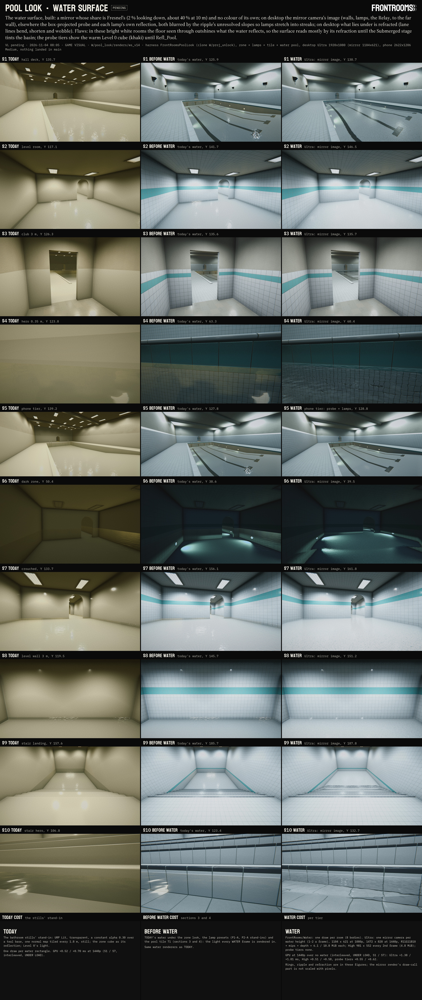

Sheet `sheets/70_water_surface.jpg` (3838 × 9086, Shot format, chip PENDING; every label checked at full size: ALL LABELS FIT, `W/pool_look/sheets/70_water_surface_fit.txt`): TODAY (`today_v4`; `tile_today` for S8-S10) | BEFORE WATER (`tile_v2`: the zone look, the lamp presets and the pool tile with TODAY's water) | WATER (`ws_v14`), rows S1-S10, COST. Sheet `sheets/70_water_surface_parts.jpg` (3838 × 5945, PENDING, ALL LABELS FIT, `…_parts_fit.txt`): the three tiers at S1 and S7, the debug views that take a frame apart (Fresnel, reflection only, unresolved slope; at S7 reflection only, F × reflection, what shows through), TODAY's troffers and the streak check, the mirror image itself, the default renderer, the asset's 2× opaque copy, and panels for timing, streaks and what is open. Silent films (h264, no audio stream, Shot header on every frame; 12 s at 30 fps, the ripple clock running, three drips each): `video/70_water_surface_S1.mp4`, `video/70_water_surface_S7.mp4` (1440 wide, crf 26; masters at 1920, crf 18: `W/pool_look/ws/video/`). Frames of record: `W/pool_look/renders/ws_v14/`; TODAY's troffers and the streak check: `ws_lamps3/`.

### 6.1 What was built (in the clone `W/proj_unlock`; the Package stage carries it to main)

| Path (under `Frontrooms3D/`) | sha1 | .meta GUID | What |
|---|---|---|---|
| `Assets/Resources/Rendering/FrontRoomsWater.shader` | 1de7c0e4 | fd0021231e7945fd8dd5db29370c061a | `FrontRooms/Water`: the surface (Fresnel, mirror image or probe, lamp reflections, refraction) |
| `Assets/Scripts/Rendering/Water/FrontRoomsWaterPlanar.cs` | 0706f3a7 | 267b1996d6ee4cd497567a25b5629f93 | the mirror cameras, the tier rule, each body's parameters, the opaque-texture request |
| `Assets/Scripts/Rendering/Water/FrontRoomsWaterSurface.cs` | 3817ecfa | 4d86b91af1a6433e93b2c30308c736eb | the component per body of water (Add Component > FrontRooms > Water surface) |
| contract, settings line: `Assets/Settings/FrontRoomsWaterReflection_Renderer.asset` | 4cdf3cd7 | 95693ae2507624779bd436d04a9ef870 | the mirror renderer (§6.10) |
| clone only: `Assets/Editor/PoolLook/FrontRoomsPoolLook.Water.cs` | f71b113f | 63aeeb40b87546b59b168d5e022df85d | the harness's water layer `pool`, tiers, debug views, films, timing (never lands) |

Clone only as well: the harness's `FrontRoomsPoolLook.cs` (0a2f1796: the flags, the per-shot water hook, the restore) and `FrontRoomsPoolLook.Layers.cs` (9cd5c7cf: the `pool` case; TODAY's water moved into `BuildWaterTodaySet` with the same statements); pre-edit copies in `W/pool_look/ws/base/`. The three package files are ASCII and LF; their GUIDs are absent in main's 3,328 `.meta` files and in the clone's; the folders exist since the Ripples stage.

### 6.2 The surface: reflection only

- **What it writes:** premultiplied, `rgb = F × reflection (+ the lamps' reflections)`, `alpha = F`, blended One / OneMinusSrcAlpha, so what lies under the water shows by `1 - F` with its own colour. No base colour and no constant alpha: the stand-in's 0.30 alpha and teal base are gone (`17` §7 item 1); the water's colour is the Submerged stage's (absorption, the trapping term, `17` §4.2).
- **F:** the exact unpolarised Fresnel of an air-to-water interface, n = 1.333 (0.0204 looking straight down, 1 at grazing), with the pixel's resolved ripple normal; where a resolved slope is steeper than the sight line it is scaled so the eye stays on the facet's front.
- **Read at S1** (debug view, through the grade): about 3 % at the coping below the eye, 0.45 at the deep end 15 m off, as `17` §2.1's table.

### 6.3 Reflection

**The mirror image (desktop High and Ultra).** `17` §2.3's recipe, with what the runs settled:
- **One camera per water height** (heights keyed to 1 mm). In the harness: the hall's basin (-0.12) and the ankle water of the turn room and of the level chain (-0.03, the same height: one camera serves the hall's far door and the whole level). Ultra renders up to two heights a frame (the nearest first), High one; the rest keep the probe.
- **The camera:** an ordinary camera at the eye mirrored through the water plane, looking along the mirrored view with the mirrored up turned over, which is a proper rotation, so culling stays as it is (no inverted culling); an oblique near plane 5 mm above the water, so nothing under the water reaches the image and a leg or a pillar meets its reflection at the line.
- **A fitted frustum:** off-centre, covering only where this height's water lies on the viewer's screen (each body's rectangle clipped to the near plane, widened ×1.15 about its centre plus 0.05 for rippled samples, never finer than the viewer's pixels). S1's image covers x -0.57..1.15, y -1.13..0.19 of the viewer's screen, S7's the full width and y -1.12..0.07: the texels go to the water and the room above it instead of the clipped space under the mirror's horizon (about 1.7-2× the texels on the water at the same size; the first symmetric frustum spent half its image there). The image size is fixed per tier, so turning never reallocates it.
- **Size and rate:** Ultra ½ of the viewer's pixels × 1.15 (1104 × 621 at 1080p, 1472 × 828 at 1440p), every frame. High ⅓ (¼ above 1440 rows) × 1.15, every second frame; the water samples an image with the view-projection of the frame it was rendered in, so an image one frame old still lands on the right place (world-space reprojection; things that moved lag by a frame).
- **Settings:** R11G11B10 HDR with a mip chain made after each render (the roughness filter reads it), MSAA off, no post-processing, no shadows (§2.3), no AA, camera type Reflection (URP keeps render scale off for it and the glass RT feature skips it). Culling mask: the viewer's minus Water (4), UI (5), the held glass (28) and the held item (30); the Relay and everything else stays. Its volume trigger is the viewer, so the zone look weighs the mirror's render context where the player stands (FrontRoomsZoneLook picks the context's camera and reads its trigger).
- **Submitted** with `RenderPipeline.SubmitRenderRequest` (`UniversalRenderPipeline.SingleCameraRequest`) from `Application.onBeforeRender`, after every `LateUpdate` and outside the render loop (never from a camera callback, which errors under Render Graph, W2/W3). Tools call `FrontRoomsWaterPlanar.RenderFor(camera, frame)` themselves, as the harness does.
- **Renderer:** the contract's mirror renderer (no SSAO, no glass RT; §6.10), found by name; until it lands, the default renderer, whose SSAO then runs on the oblique projection (`S1_defrenderer` on the parts sheet: close, but wrong in principle).
- **How the water reads it:** the reflected ray of the pixel's resolved slope is followed to where it leaves the room's box (the body's rectangle, up to the room's height), and that point is projected with the mirror's view-projection: for flat water exactly the mirror point, for rippled water a distortion scaled by distance. The slope covariance the pixel cannot resolve (`r.cov`, §5.3) becomes the filter: its two principal axes are followed as rays into texture space, the mip covers the narrow axis and up to 12 taps (Gaussian over ±2 sd) the long one. A tap whose ray would point into the water is masked by the waves in front of it (Smith's masking) and drops out; the rest renormalise (without this the far water pulled in the clear colour under the mirror's horizon, `ws_v2`). Outside the image the water falls back to the probe.

**The probe (phones, WebGL, desktop Medium and Low).** The zone's cube (`RenderSettings`' custom reflection; `_GlossyEnvironmentCubeMap` under Forward+) projected on the same room box from a capture point at the room's centre 1.6 m above the water, and filtered the same way in direction space (the mip from the narrow axis through GGX's roughness, 6 taps along the long axis on desktop, 3 on the phone tier), with the zone's fog and height fog for the whole reflected path.

*Changed by the Package stage (§9.3):* the probe is the water renderer's own (`unity_SpecCube0`): a local box probe (the structures scene's hall probes) on its own box, else the zone cube as described here.

**The lamps.** Every visible additional light above the water (Forward+ cluster; wet niches under the water are skipped: from above, their light comes through the surface, not off it) reflects as Fresnel × its radiance × the share of the pixel's slope distribution that points it at the eye: a Gaussian in slope space whose mean is the resolved slope and whose spread is the unresolved covariance, the calm roughness (α 0.012) and the lamp's own size (a downward lens of radius 0.4 m, its solid angle carried into slope space). The radiance is the light's colour × intensity × 0.36 with its range window and cone but without the inverse square (a source seen in a mirror keeps its radiance): an L03 at intensity 5 reflects at 1.8, its own lens drive. On the mirror tiers the lamps are already in the image (every lens to the far wall, with its flicker and dead states and the Relay passing in front), so this term is off there: one reflection per lamp on every tier, never two. On the probe tiers it shows the lamps whose lights are on (the map turns lights off past about 16 m): far lamps do not reflect on phones.

### 6.4 Refraction (desktop High and Ultra)

- The viewer camera asks URP for its opaque texture as `FrontRoomsGlassSceneColor` does: a pass that records nothing but declares the input, enqueued from `beginCameraRendering` for that camera only, while refracting water is in view; `_FR_WaterOpaque` tells the shader which camera has it. No camera or asset setting changes.
- The refracted ray of the resolved normal meets the depth of what lies straight behind the pixel (flat floors exactly, walls closely): the floor shows at its apparent depth and wobbles with the ripple; whatever stands above the water at the refracted pixel is not used (faded over 3 cm, so the coping's edge cuts no hard line).
- **The frame's edges:** looking steeply down near the bottom of the frame, the refracted ray lands nearer than the straight one, below the frame, where no image exists. Over the bottom and top 35 % of the frame the shift morphs into the ripple's wobble alone (the rippled minus the flat refraction, moved onto the floor seen straight), so lane lines curve gently into the edge. Tried first: a hard fallback (the lane line jumped), a shortened shift (the edge rows smeared), a 15 % band (the lane line kinked).
- **Every body refracts** by default (`FrontRoomsWaterSurface.refraction`). `17` §6.1 named the ankle water; the basin is included because under 1.2 m of rippled water its lane lines did not move at all (`ws_v8`), which read as an empty pool.
- With the asset's 2× opaque copy the joints under the water soften next to the dry tile (`S7_opaque2x`): the contract asks for the full copy.

### 6.5 The streak geometry (`17` §2.2, W20)

Measured on TODAY's troffers in the hall (run `ws_lamps3`, S1) with the resolved slope set to 0 (debug view 8), so each lamp's reflection is the unresolved lobe on the lamp; `W/pool_look/ws/tmp/streaks.py` takes each blob's second moments in angle and the elevation e of the view ray through its centre:
- **mirror image:** 15 lamps, (width/length) / sin e median **1.13** (p25 0.90, p75 1.55, range 0.55-1.82; the lens's own 0.6 × 1.2 m and neighbours merged in the blur widen some);
- **lamp term** (probe tier): 3 clean blobs, 0.51-1.08 (median 0.93).

W20's geometry comes out of the filter itself, with no texture trick: far lamps (low elevation) draw long thin streaks, near ones round blobs (tables `W/pool_look/ws/tmp/streaks_planar_v3.tsv`, `streaks_probe_v3.tsv`).

### 6.6 Per tier and numbers

| | Desktop Ultra | Desktop High | Desktop Medium, Low | Phones, iPad | WebGL |
|---|---|---|---|---|---|
| Reflection | mirror ½ × 1.15, every frame, up to 2 heights | mirror ⅓ (¼ above 1440 rows) × 1.15, every 2nd frame, 1 height | probe + lamps | probe + lamps | probe + lamps (`#if UNITY_WEBGL && !UNITY_EDITOR`) |
| Refraction | opaque texture | opaque texture | none | none | none |
| Memory per mirror image (colour with mips + depth) | 6.10 MiB at 1080p, 10.85 MiB at 1440p | 4.82 MiB at 1440p | 0 | 0 | 0 |
| Draws | one per body; the mirror renders the room again (opaque and transparent, no shadows) per height per frame | the same, every 2nd frame | one per body | one per body | one per body |

**GPU** (this Mac, UNDER LOAD; 7680 × 3544 as VISUAL_STANDARD 1.4, MSAA off, 30 interleaved rounds of the six variants, the median of each round's difference against no water; `ws_v14/water_timing.tsv`):

| | S1 at 7680 × 3544 | S1 at 1440p | S7 at 7680 × 3544 | S7 at 1440p |
|---|---|---|---|---|
| TODAY's water (stand-in) | +3.8 ms | +0.52 ms | +5.2 ms | +0.70 ms |
| probe tier | +4.1 | +0.55 | +4.6 | +0.62 |
| High (render frame / reuse frame) | +4.7 / +2.8 | +0.51 (average) | +4.8 / +3.8 | +0.58 (average) |
| Ultra (S1: two mirror images) | +10.2 (p25-p75 9.6-11.3) | +1.38 | +7.4 | +1.01 |

The 1440p column scales by pixels; the mirror render's draw-call part does not scale that way (the harness rooms have few renderers; G11's editor bench found about 2.5 ms fixed plus 20 µs per renderer, `17` §2.3), so a dressed room costs more. The probe tier's cost is mostly the lamp term (S1 has 32 lights in view). An earlier timing with independent medians (`ws_v8`) was noise and was replaced by the interleaved method. Against `17` §6.1's budgets for all of the water (Ultra ≤ 4-5.5 ms, High ≤ 2.5-3.5 ms, handheld ≤ 2 ms at device scale): inside them here; phones were not timed.

### 6.7 Checks

- **Gate (rule 25)**, `W/pool_look/ws/tmp/gate.zsh g2` (overrides as zsh array elements, response files read): Roslyn against main with `FrontRoomsWaterPlanar.cs`, `FrontRoomsWaterSurface.cs` and the Ripples stage's `FrontRoomsWaterRipples.cs`, `FrontRoomsWaterRings.cs`, `FrontRoomsRippleArray.cs`: macOS COMPILE OK, 0 errors, 5 overrides; iOS COMPILE OK, 5 overrides (the Water files and UNITY_IOS in `Assembly-CSharp.ios.rsp`). With the map contract's patched `FrontRooms3DGame.cs` as a sixth (`gate_con.zsh c2`): macOS and iOS COMPILE OK, 6 overrides. The clone with the harness: COMPILE OK (`ws/tmp/roslyn_w12`).
- **Shader:** compiled for Metal in every Unity run in the clone (`ws_v1`-`ws_v14`, `ws_lamps`-`ws_lamps3`, `ws_t1`): 0 shader errors, 0 warnings for `FrontRooms/Water`, 0 `error CS`.
- **Inert:** nothing runs until a `FrontRoomsWaterSurface` is enabled (no camera, texture, callback or global before that); the package's files are new; the map line and the settings change are the contract's.
- **Photosafety** (both films, WCAG 2.3.1 as RELAY §9.5 defines a flash; the whole frame, each quarter and the water's band): 0 flashes per second; the largest frame-to-frame change of a mean is 0.0008 of full scale (`W/pool_look/sheets/70_water_surface_photosafety.json`). The mirror and the refraction add no motion of their own; Reduce Motion freezes the ripple as §5.5 measured.
- **Runs:** `ws_v1`-`ws_v14` (07:30-08:05), `ws_lamps`, `ws_lamps2`, `ws_lamps3`, `ws_t1`; all FINISHED fail=0, 2-45 s of harness each. What they found and what was fixed: the first mirror render of a run drew the pool tile red (the tile not resident for that first render; the harness renders once before its first shot); the far water pulled in the mirror's clear colour (masked taps); the symmetric frustum spent half its image under the horizon (fitted frustum); the basin did not refract (refraction on every body); the refraction's frame edge (the morph band). The mirror renderer runs with intermediate textures Always, like the game's renderer (it was briefly Auto while the red frames were blamed on it; they were the first render).

### 6.8 Reading the renders

- **S1, hall deck:** the basin reads as water now: the lane lines bend, shorten by the apparent depth and wobble; the far water mirrors the walls; the lit ceiling's patches show as broken bright reflections; at the coping the water is a window (about 3 %). Against BEFORE WATER the milky teal veil is gone, as `17` §7 item 1 asks; the basin's colour arrives with the Submerged stage (`17` §4.2: #8AD0E7 at 1.07 m).
- **S2, S8, level, standing:** the floor under the ankle water is near white in the level's high-key look and outshines what the water reflects (walls of the same white, a dark ceiling), so the water shows mostly as refracted, wobbling joints. Taken apart at S7: F × reflection 23-150 on screen (near to far), what shows through 171-209: the reflection is there, under a floor in the tonemapper's shoulder. The next stage changes this twice over: the floor's glaze still reflects as in air (under water it reflects about a tenth as much), and the level's absorption ×3-5 (Q1) darkens and tints what shows through.
- **S7, crouched:** at grazing angles the far floor mirrors the walls, the teal band and the arch (reflection only, parts sheet); in the composite the wobble of the refracted grid is the strongest cue.
- **S4, S10, hero at the waterline:** a clean mirror of the course tile and the coping over a refracted, broken grid, with the meniscus between.
- **S5, phone tier:** the probe reflects the warm Level 0 cube (khaki at grazing) until the Submerged stage's `Refl_Pool`.
- **S6, dark zone:** the niche pools under dark glassy water, the room's few lights mirrored.
- **TODAY's troffers** (parts sheet): the mirror carries every lens to the far wall as rippled streaks; in the composite the bright basin under them swamps those reflections, because the game's lens drive (1.8) is only about 1.25× the floor it lights, where a real troffer's lens is 10-40× its floor. The reflections are as bright as the lenses the player sees, no brighter.

### 6.9 The Relay-only overlay (`17` §7 item 7, G11 §2.4b): the follow-up

On the mirror tiers the Relay is in the water (its renderers are on a layer the mirror keeps). On the probe tiers it is not: the probe is static. The overlay keeps the Relay "seen in the water first" on phones, WebGL and desktop Medium and Low: a second, Relay-only camera at the mirrored eye (culling the Relay alone, a small target, no clear of the scene), composited into the water where the probe shows. It needs the Relay on its own layer or rendering-layer mask and, from the hunter's line, which body to draw. Proposed as the first package after this workflow's water stages, with G11 §2.4b's design; not built here.

### 6.10 The contract and the Relay's rings

- **`W/apply/pool_water_contract/`** (README, `CONTRACT_settings.diff`, `CONTRACT_map.diff`; never applied by this line). Settings (设置菜单与画质预设, `FrontRooms_URP.asset` base 18584f2b): the mirror renderer as the pipeline's second renderer (no SSAO, no glass RT; it also keeps the non-SSAO shader variants in the build) and the opaque copy at full resolution (`m_OpaqueDownsampling` 1 → 0; the glass line's crack mirrors get the sharper copy too); the tier rule written out for the settings line to confirm (no diff: the water only reads `FrontRoomsQuality.CurrentPreset`, `LowPowerActive` and `FrontRoomsTrofferKit.PhoneTier`; `FrontRoomsWaterPlanar.ForceTier` is the hook for a "WATER REFLECTIONS" row if they want one). Map (关卡设计, `FrontRooms3DGame.cs` base d059a6de, patched 36a7d5b0): one `FrontRoomsWaterRings.ReportBody(Body.Player, playerRoot.position, ModuleUnits.PlayerRadius)` after the per-frame move, inert away from water. Both `patch --dry-run -p1` clean from the course root; main untouched.
- **The Relay's rings:** one line in `FrontRoomsRelayRig.TickAnimation` (Play mode), this line's own file: `FrontRoomsWaterRings.ReportBody(Body.Relay, transform.position, .3f)`. The Package stage adds it to `pool_water` against the then-current main (`542df78c` today).

### 6.11 Limits and open items

- **The mirror's hit distance is the room box's**, not the mirror's depth (URP renders through an intermediate texture, so the image keeps no depth): something near in the reflection (a ladder, the Relay standing in the water) is distorted as much as the far wall. A mirror renderer that renders straight into its target could keep the depth; a later refinement.
- **Far lamps on the probe tiers** do not reflect (their lights are off).
- **No self-reflection:** the player has no body; the GlassRT body proxy could be drawn into the mirror later.
- **Height fog in the mirror:** the mirrored first leg runs under the water plane, where `FRHeightFog` takes the density at the water; the far reflection's haze is up to about 5 % too dense.
- **The first render:** the harness's first mirror render of a run drew the pool tile red; check the first frame in the structures scene during the combined test.
- **Not verified here:** Play mode (`Application.onBeforeRender`; the harness calls the same `RenderFor` in edit mode), the Scene view, the shader's GLES3/WebGL, Vulkan and D3D compiles (Metal only), GPU time on any phone or browser.
- **Submerged items:** the basin's colour, caustics, the glaze under water, `Refl_Pool`.

### 6.12 For the next stages

- **Submerged:** the floor's glaze under water (specular about ×0.1), absorption with `_WaterAbsorbScale` per zone (Q1), the trapping term, caustics, `Refl_Pool` for the probe tiers (the box projection is already per body). The refraction reads the opaque image, so whatever Submerged draws on the floor and walls is refracted with it.
- **Renders:** the walk film and the decision sheets; this stage's films are the stills' two views.
- **Package (`pool_water`):** this stage's three files and their metas join the Ripples stage's; plus the Relay line in `FrontRoomsRelayRig.cs`. The contract stays a contract.
- **Harness:** `-plWater pool` (with `-plWaterTiers`, `-plWaterFilm S1,S7`, `-plFilmSeconds 12`, `-plWaterTiming`); media `W/pool_look/ws/tmp/make_ws_media.py`, sheets `make_ws_sheets.py`, the streak check `streaks.py`.
- **Deletion candidates** (inside `W/pool_look`, Red deletes): `renders/ws_v1`-`ws_v13`, `ws_lamps`, `ws_lamps2`, `ws_t1` (superseded by `ws_v14` and `ws_lamps3`); `ws/tmp/roslyn_w1`-`w11`, `ws/tmp/gate_g1_*`; `ws/tmp/*.jpg` previews; `ws/logs/*.launcher.txt`. Keep `renders/ws_v14`, `ws_lamps3`, `ws/video`, `ws/contract`, `ws/tmp/gate_g2_*`, `gate_c2_*`, `roslyn_w12`, the scripts.

## 7. Submerged and caustics

Stage 7 of the workflow, 2026-11-04 08:15 to 09:45, account G (the relay of `wf_48851110-b3c`; the first Submerged agent stopped at about 08:20 with nothing on disk but its folders, and a second agent did the stage from 08:38). **Nothing landed in main:** main was read only, no Unity ran on main, nothing was downloaded, no package was built (the Package stage carries this stage's files into `pool_water` and `pool_zone_look`), and the contract below is not applied. The Unity runs met a load average of 12-50 on 16 cores: every frame time below is **UNDER LOAD**.

The asks: `17` §7 item 2, "Submerged shading below `_WaterY` in `FrontRooms/Surface`, the analytic basin and the Relay's shader: absorption (0.29, 0.048, 0.006) per metre; a small depth LUT with the trapping term (§4.2); the per-zone `_WaterAbsorbScale` (Q1); caustics; the wet band and meniscus (10 §3.8)"; item 8, "Caustics: projected from the surface on desktop (floor nets from compact sources; thrown light on ceiling and walls from niche lamps); the flipbook on phones; scrolled layers on WebGL; ≤ 3 Hz large-area modulation; Reduce Motion freezes them"; item 9 (compact sources where moving light is wanted); item 11, "Probes: `Refl_Pool` with its dead-lamp twin, per-room probes in the level with blending, and a crossfade when a room's lamps die"; `16` §6 item 3; the note of `zone_lamps/30_for_red.md` §2.3 ("天花焦散是同一张网 … 落地时要把焦散按灯分区": the ceiling caustics were one net shared by every lamp). Red's picks this stage follows (recorded as picks, BH line 115): Q1 "wrong" (the club's water physical, the level's ×3-5, one or two rooms ×9), Q2 "v1" (surface caustics in v1), Q4 "follow" (the dark zone's white balance follows the niche lamps). **Open for Red:** only where inside Q1's range each zone sits (sheet `70_submerged_q1.jpg`, WAIT-RED; the recommendation: club ×1, level ×4, dark zone ×3, no ×9 room yet).

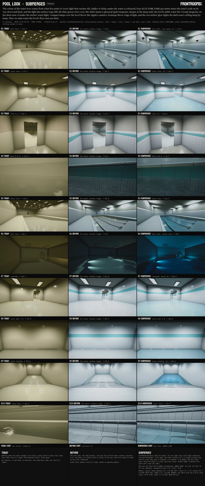

Sheets (Shot format; every label checked at full size, ALL LABELS FIT, fit files `W/pool_look/sheets/70_submerged*_fit.txt`): `sheets/70_submerged.jpg` (3838 × 9086, PENDING): TODAY (`today_v4`; `tile_today` for S8-S10) | BEFORE (`ws_v14`, the water surface stage) | SUBMERGED (`sub_v4`), rows S1-S10, COST. `sheets/70_submerged_q1.jpg` (3838 × 2122, **WAIT-RED**): TODAY | ×1 | ×3 | ×4 | ×5 | ×9 on S1, S2, S6, REC per row, COST. `sheets/70_submerged_parts.jpg` (3838 × 5152, PENDING): the calibration swatches, the caustic check, the thrown light with two niches dead, the pool cube on the probe tier, the phone tier, Reduce Motion, a film frame, timing, safety, open items. Silent films (h264, no audio stream, Shot header on every frame, 8 s at 30 fps): `video/70_submerged_S6.mp4` (something wades through the dark zone 2-4 m ahead) and `video/70_submerged_S7.mp4` (someone walks through the level's ankle water), 1440 wide crf 26 (masters 1920 crf 18 in `W/pool_look/sub/video/`). Frames of record: `W/pool_look/renders/sub_v4/`.

### 7.1 What was built (in the clone `W/proj_unlock`; the Package stage carries it to main)

| Path (under `Frontrooms3D/`) | sha1 | .meta GUID | What |
|---|---|---|---|
| `Assets/Resources/Rendering/FrontRoomsWaterSubmerged.hlsl` | 9ed1a464 | 32ed71877b784fe4a2509a8a6b080004 | the include: body lookup, `FRSubmergedPBR`, the caustic loops, the rings' lens, the thrown light |
| `Assets/Scripts/Rendering/Water/FrontRoomsWaterSubmerged.cs` | 1b96d77e | 11c2bdd11ab9477082ef9316fa3a4844 | runtime: the registry of bodies, niches and compact sources, the LUT, the tier's caustic loops, `Publish` |
| `Assets/Resources/Rendering/FrontRoomsSurface.shader` | cef7facc → 8067dc67 | (unchanged) | includes the above; finds the body at the top of `Frag`; under the water `FRSubmergedPBR` instead of `UniversalFragmentPBR`, above it in a pool room + the thrown light; the wet band takes the body's height when the material has none (+24 lines; no new keyword) |
| `Assets/Scripts/Rendering/Water/FrontRoomsWaterSurface.cs` | 3817ecfa → dfafe86c | 4d86b91a… | + `absorbScale`, `basinAlbedo`, `causticSourceA/B`, `causticSourceRadius`, `thrownGain`; registers its body; `RefreshSubmerged()` |
| `Assets/Scripts/Rendering/Water/FrontRoomsWaterPlanar.cs` | 0706f3a7 → abffda7b | 267b1996… | `RenderFor` sets `FrontRoomsWaterSubmerged.ViewerPosition` and calls `Publish` (2 lines) |
| `Assets/Scripts/Rendering/ZoneLook/FrontRoomsZoneLookProfile.cs` | 760264ae → 663efcde | 5f2a7b9a… | + `waterAbsorbScale` (club 1, hall 1, level 4, dark 3), `thrownLight` (hall 1, dark 2.5); niche light = its lens colour (1/.80/.58, since the shader now absorbs along the path); PoolDark's ground and wall terms back to the bounce alone (.095/.105/.058, .08/.088/.048) |
| `Assets/Scripts/Rendering/FrontRoomsLook.cs` (main 898dee87) | → 61f9b581 | (unchanged) | `ReflectionZone` + `Pool`, `PoolDead`, `PoolLevel` (appended) |
| `Assets/Scripts/Rendering/FrontRoomsZoneReflection.cs` (main 040ba42b) | → fc95d511 | (unchanged) | their cube names and intensities (0.5 linear, as Level 0's) |
| `Assets/Editor/Rendering/FrontRoomsReflectionCapture.cs` (main ad9ebcb1) | → 7a4f7c55 | (unchanged) | keeps the pool cubes (its `Matches` default would have baked Level 0 cells into them) |
| `Assets/Resources/Rendering/Water/FR_Caustic_Fine.png`, `_FinePhone.png`, `_Long.png` | 4b26cc4a, 71fb7033, abdd3340 | 92303e65…, 3a39c89c…, 1e68d9e6… | the caustic loops (7.4); 10.1, 1.1, 4.3 MiB of PNG |
| `Assets/Resources/Rendering/Water/FR_Caustic_Stats.json` | b3f81e58 | ffedcb16… | per loop: size, slices, lens distances, contrast per distance, sha1, GUIDs |
| `Tools/lookdev/pool_water/gen_pool_caustics.py` | f319a97a | - | the generator (imports `gen_pool_ripples.bake`: the same surface), deterministic, 4 min |
| `Assets/Resources/Rendering/Reflections/Refl_Pool.exr`, `Refl_PoolDead.exr`, `Refl_PoolLevel.exr` | 31dc19b5, 72708dc6, 8dae4d85 | 87e3941e…, c420d827…, bdbe573f… | the pool family's cubes (7.6), 256 px BC6H, 9 mips; WebGL RGB9E5 at 128 |
| `Assets/Resources/Rendering/ZoneLook/FrontRoomsZoneLook_Pool*.asset` | rewritten from code | (unchanged) | the profiles with the two new fields |
| contract `W/apply/pool_submerged_contract/` | | | `FrontRooms3DGame.UpdateReflectionZone` picks the pool cubes (7.6) |
| clone only: `Assets/Editor/PoolLook/FrontRoomsPoolLook.Submerged.cs` | 28718144 | 52097edc… | the harness layer `-plSub pool` and its checks (7.9); hooks in `FrontRoomsPoolLook.cs`, `.Layers.cs` (pre-edit copies `W/pool_look/sub/base/`) |

Every new GUID is absent in main's `Assets` and appears once in the clone. C# and HLSL are ASCII; every text file LF.

### 7.2 Under the water: the colour comes from the light's path

`17` §4.2 says where the colour lives: "everything below `_WaterY` gets the trapping tint in its own shader". So the water surface stays colourless (§6.2) and every `FrontRooms/Surface` pixel that lies under a registered body of water is lit through the water. The body is found **by position** (`FRSubFind`: up to 12 bodies, each a water rectangle, its height, its room's rectangle and top, its absorption scale and basin albedo), not by material, so the tile, the ladders, the props and the Relay's legs all take it with no material change; the Relay's three materials (`Creature_TwillSpruce`, `_LensOpal`, `_TapeSilver`) use `FrontRooms/Surface` (checked), so it has no shader of its own to change.

For a point d metres under the surface, per colour channel (a = (0.29, 0.048, 0.006) per metre × the zone's scale):
- **Each light** (its own loop, as `UniversalFragmentPBR` with the light refracted): a light above the water crosses the surface with 1 − F at its angle (exact unpolarised Fresnel, n = 1.333), arrives bent (Snell keeps the azimuth and divides the horizontal part by n, so the irradiance across the beam is × cos θa / cos θw: the flux per horizontal area is kept) and loses exp(−a d / cos θw); a light under the water (a wet niche) loses exp(−a |L − P|) over its whole path, so the niche's warm light turns neutral after about 2 m and mint beyond, as `17` §4.3 computes, by itself: the zone look's pre-tinted niche colours are gone (its lens colour 1/.80/.58 is the light).
- **The ambient** (the zone's probe, the light from above): × D(τ), the mean over a uniform sky of (1 − F) exp(−τ / cos θw) (the LUT's R; D(0) = 0.934).
- **The glaze under water:** against water a glaze of n 1.52 reflects 0.0043 instead of 0.0426: the specular and its grazing term × 0.10 (`_FR_SubMode.y`); the view direction is the refracted one.
- **The way out:** exp(−a d / cos θv) along the view's refracted path; the trapping, 1 / (1 − ρ P(τ)) with P(τ) the share of the upwelling diffuse light the surface sends back down (the mean over a Lambertian of the reflectance from below, 1 past the critical angle, × exp(−2τ / cos θ); P(0) = 0.475, W26's p) and ρ the basin's albedo (0.8); and 1 / n² (radiance leaving a denser medium). The surface's own 1 − F at the eye is the water shader's (§6.2), on every tier.
- **The LUT** (`FR_SubLut`): 64 texels over u = τ / (τ + 1), R = D(τ), G = P(τ), built at start-up (512-step integrals, 0.5 KB); three taps per pixel, one per channel.

**The wet band and the meniscus** (`10` §3.8, the Tile stage's `FRWetBand`): a material without its own `_WaterY` now takes the height of the body it lies in, so the ladder, a prop or the Relay's cloth darken where porous under the water and carry the film and the meniscus at the line, as the pool tile already did.

### 7.3 The absorption scale per zone (Q1) and the colours measured off the frames

The scale is a field of each zone's profile (`FrontRoomsZoneLookProfile.waterAbsorbScale`; a body may override it, `FrontRoomsWaterSurface.absorbScale`, for the "one or two rooms ×9"): **PoolClub and PoolHall ×1** (the club's water is physical), **PoolLevel ×4** (Red's "wrong" ×3-5; the turn room and the stair room are PoolLevel), **PoolDark ×3** (`18` §3: "dark tile and absorption make it read deeper"; ×3 keeps the niche pools from going black, sheet `70_submerged_q1.jpg`).

**Calibration** (`-plSubCal`, table `W/pool_look/renders/sub_v4/sub_cal.tsv`): a tank at x 768 with a white Lambertian floor (albedo 0.80, `17` §4.2's dry tile) under 0.12, 1.07 and 1.37 m of water, a uniform white sky, no lamps, looking straight down, post-processing off, a linear float readback; each patch rendered with the term on and off, so the ratio is the water's alone; × (1 − F) looking straight down (0.98); shown as `17` prints its colours (the brightest channel at the dry tile's 0.80, sRGB):

| Depth | Scale | Measured (shader) | Model (this build's formula, C#) | `17` §0 item 3 / §4.2 | Brightest channel vs dry (`17`'s "brightness vs dry") |
|---|---|---|---|---|---|
| 0.12 m | ×1 | **#D6E4E7** | #D6E4E7 | #D6E4E7 | 0.83 (17: 0.83) |
| 1.07 m | ×1 | **#92D2E7** | #92D3E7 | #8AD0E7 | 0.80 (17: 0.81) |
| 1.37 m | ×1 | **#85CEE7** | #85CEE7 | #7ACBE7 | 0.79 (17: 0.81) |
| 0.12 m | ×3 | **#BEDFE7** | #BEDFE7 | #BCDEE7 | 0.82 |
| 0.12 m | ×5 | **#ADDBE7** | #ADDBE7 | #A8D9E7 | 0.81 |
| 0.12 m | ×9 | **#92D2E7** | #92D2E7 | #8AD0E7 | 0.80 |

The shader equals the model to the hex (one level of R at 1.07 m: the LUT's half floats). Against `17`'s numbers: the shallow case and the brightness match; at depth this build is a little paler (R 146 against 138 at 1.07 m, 133 against 122 at 1.37 m): `17` made its colours from Pope and Fry's spectrum through the colour-matching functions, this build uses `17` §4.1's three effective coefficients, which cannot follow the red band's spread of absorption at depth. Not tuned away: the difference is under the frames' own lighting differences, and §4.1 asks for these coefficients.

**In the frames** (sheet, `sub_v4`): the club's basin (S1, ×1) is pale turquoise near the beach and deeper toward the deep end under P1-A's cool light; the level's ankle water (S2, S7, S8, ×4) a pale turquoise against the white tile, the "wrong" water that reads at a glance; the stair room's pit (S9, ×4 over 0.83 m) goes sky-blue (×4 at that depth is 3.3 m of real water); the dark zone (S6, ×3) deep blue-teal with aqua pools under the niches, under the 3200 K grade (Q4). Mean luma 0-255 TODAY | BEFORE | SUBMERGED: S1 135.7 | 130.7 | 123.4, S2 117.1 | 146.5 | 146.6, S3 126.3 | 135.7 | 135.0, S4 123.8 | 62.4 | 62.0, S5 139.2 | 129.0 | 122.9, S6 50.4 | 38.1 | 39.7, S7 133.7 | 159.1 | 159.9, S8 119.5 | 146.0 | 146.2, S9 157.6 | 182.6 | 182.9, S10 106.8 | 121.7 | 121.4.

### 7.4 Caustics: projected from the same surface

**The loops** (`Tools/lookdev/pool_water/gen_pool_caustics.py`): the caustics are the projection of the surface the ripple loops hold, frame by frame (`gen_pool_ripples.bake`: the exact float slope fields, before 8-bit encoding), not a separate texture. A ray crossing the surface at x leaves it bent by the slope s(x) and meets a receiver at x + D s(x), with **D = d (1 − 1/n)** for light refracted down onto a floor d under the water and **D = h (n − 1)** for light leaving the water up to a ceiling h above it; the brightness there is the density of arriving rays (`17` §4.4's "refract a grid through the surface; brightness from the area change", folds included): every source texel's energy is splatted where its ray lands on a field upsampled to 64 samples per output texel (FFT, exact for the band-limited bake), then a 0.5-texel blur. Each slice keeps its mean exactly (1.000000: energy is only moved). Four lens distances per loop go into RGBA; the shader interpolates in log D, fades to flat below the first and holds the last (the nets of random waves keep their contrast past the focus).

| Loop | Tier | Slices | Lens D (m) | Contrast (std of I) at each D | Format, memory |
|---|---|---|---|---|---|
| `FR_Caustic_Fine` (fine cascade, each desktop layer at its 1/√2 weight) | desktop | 256² × 64 (0.5 s, the ripple's slices) | 0.01, 0.03, 0.10, 0.32 (floors 4 cm to 1.3 m) | .04, .12, .36, .58 | BC7, 4.0 MiB + mips |
| `FR_Caustic_FinePhone` (layer A at full weight) | phones; WebGL's scrolled tile (slice 0) | 128² × 32 (0.32 s) | same | .02, .06, .19, .33 | ASTC 4×4 0.5 MiB; WebGL RGBA32 |
| `FR_Caustic_Long` (7-30 cm) | every tier | 128² × 128 (2.56 s) | 0.06, 0.2, 0.6, 1.8 (floors 0.24-7 m, ceilings 0.2-5.4 m) | .02, .08, .23, .62 | BC7 2.0 MiB + mips; WebGL 64 px RGBA32 |

Encoding: linear, intensity / 6 in 8 bits (box mips stay energy-true; the share of energy above 6 is 1e-6 at most); the fourth distance is the alpha channel, so the importer takes alpha from the input (`alphaUsage: 1`: the ripple sheets' template drops alpha, which read the fourth channel as intensity 6 in `sub_v1`-`v3` and made the thrown light up to six times too bright; found by the caustic check, fixed in the generator and the three `.meta` files).

**In the shader:** the loops play on the ripple's own clock (`_FR_RippleA/B/L`: the same slices and blend), so they move with the surface the player sees and **Reduce Motion freezes them with it** (measured: S7 and S6 rendered 1/30 s apart with it on differ in 0 channel values; with it off 1.8 M values differ). Desktop multiplies the fine loop at layer A, the fine loop at layer B (scale 8/7, its caustic at D × 7/8) and the long loop; phones the phone loop and the long loop (the flipbook); WebGL two scrolled layers of one tile crossing at under 4 cm/s, on the same clock (frozen by Reduce Motion too). The ripple's gain scales D (a stirred surface focuses sooner). The mip is the larger of the pixel's footprint (taken at the top of `Frag`, in uniform control flow) and the source's blur (its angular radius × the path): a large source sees flat light, a small one crisp nets, with no aliasing.

**The rings throw caustics too** (`FRRingLens`): a footstep, a drip, a wading body's packets (the Ripples stage's closed form) give each point their curvature along the radius (h″) and across it (h′/r); the lens 1 / |(1 + D h″)(1 + D h′/r)| (clamped at a quarter: a finite source never focuses to a point) multiplies the loops' caustic. Film `70_submerged_S7.mp4`: each footstep spreads a ring of light and shadow across the floor under the compact lamps.

**Which lights carry them** (`17` §4.4, §7 item 9): at most **two compact sources per body**, matched by position in the light loop (`causticSourceA/B` of the water). The harness gives each pool-level room (the turn, the three level rooms, the stair room) two hidden compact lamps: 1990 low-voltage downlights hidden at the ceiling's edge, 50 mm aperture (radius 0.025 m), daylight .90/.97/1, a 54° beam aimed across the room at the water, intensity 7.5 (at 3.2 their caustics drowned in the overheads' light, `sub_v3`). No fixture is drawn (hidden, as `17` asks); the production kit is the lamp line's. The hall's P1-A wash and the dark zone's dead overheads carry none: the basin floor under an extended source is flat light, as `17` §4.4 and `zone_lamps/10_pool.md` §5 say ("faint with the overheads on").

**What they look like, honestly:** in calm water the level's floor nets are faint. The calm ripple (2.0° rms) at ankle depth gives a contrast of about ±12-17 % in the compact lamps' light, and their cells (1-2 cm) are finer than a pixel beyond about 2 m: the caustic check (`S7_c0`, `S7`, `S7_c3`) moves the frame by 1.4 levels of std (means equal, 159.3: energy kept). The water stirred (gain 1.8) or a footstep makes them strong where they fall. This is the physics of `17`'s "near-still" water (§0 item 5): moving light comes from what disturbs the water.

### 7.5 The thrown light: per lamp, so it dims with its lamp

The zone lamps' note (`30_for_red.md` §2.3: the ceiling caustics were "one net" and a dead lamp left the ceiling as it was) is answered by building the thrown light lamp by lamp (`FRSubThrown`, above the water in a body's room: ceilings and walls):
- **Each wet niche** (registered with `FrontRoomsWaterSubmerged.RegisterNiche`; the lamp kit calls it, the harness does for the 18 P2-A stand-ins) is a glow under the water at its lamp: the light it puts into the basin comes back up from the tile around it (`17` §4.3's three bounces; I0 = 0.25 × its intensity, upward Lambertian), in the water's colour (exp(−a (2 × the lamp's depth + 1 m))).
- **Its rays leave the flat surface where Snell puts them:** the exit point solves hL tan θw + hQ tan θa = r with sin θa = n sin θw (Newton on t = tan θa, four steps: the residual is 0 to 1e-15 for lamp depths 0.05-0.7 m, ceilings 1-5.5 m, distances 0-20 m; the first version iterated on sin θw, stalled near the critical angle and drew hard-edged discs, `sub_v1`); the flat interface spreads them (E = I T sin θw / (r dr/dθw)), they carry 1 − F out, and on any surface the cosine of their arrival.
- **The caustic** of their path through the air: the long loop at D = (n − 1) × the path, blurred by the glow's size (radius 0.15 m: the niche's lens and its lit tile), and the rings' lens at the exit point of the lamp that gives the point most. With a source that wide, the thrown light is a soft glow that wavers little in calm water or under a wade and moves in broad bands only when the water is thrown about (a plunge): what an indoor pool's ceiling does at night (`17` §4.4: "thrown light on the ceiling, softened by distance").
- **Each lamp's live share** (its light's intensity against its base, every frame; 0 when off or dead) scales its glow: **a niche that flickers, dims or dies takes its part of the ceiling with it** (frame `S6_dead2`: two niches of the first dark room dead).
- **Energy:** the zone look had lifted PoolDark's ground term ×1.5 and its wall term ×1.15 to stand in for the water's glow (§3.4 item 4); the glow is now the thrown light, so both terms are back at the bounce alone, and PoolDark's `thrownLight` is 2.5: at the estimated physical share (1.0) the dark zone's ceiling stayed near black (`sub_v3` S6 mean 32), against `16` §3's night ("ceiling caustics carry the room"). S6 now 39.7 (TODAY 50.4, zone look 37.2): the ceiling and the upper walls lit teal by the water, the pools aqua under the niches.

### 7.6 The pool family's reflection cubes

- **Baked** (`-plSubProbes`, after the frames of `sub_v2`) the way the game's cubes are (`Lightmapping.BakeReflectionProbe`, 256 px, HDR, then the capture tool's importer: cube, specular convolution, 9 mips, BC6H; WebGL RGB9E5 at 128), with the zone look applied at the point (`FrontRoomsZoneLook.ApplyNow`), the water surfaces hidden (their mirror image belongs to the viewer) and the submerged term on (the basins show their colour): **`Refl_Pool`** at the hall's centre 1.6 m over the water, its lamps on; **`Refl_PoolDead`**, the same with the 16 P1-A lights dead and the niches on (the night or mains-dip state, as `Refl_DeadLamp` is Level 0's dead-lamp twin); **`Refl_PoolLevel`** in the middle level room.
- **Used** through the existing path: `FrontRoomsLook.ReflectionZone` gains `Pool`, `PoolDead`, `PoolLevel`; `FrontRoomsZoneReflection` blends them as it blends Level 0's cubes (desktop: the cube render texture lerped per face and mip over 0.5 s; WebGL: the intensity dip), so **a room whose lamps die crossfades to `PoolDead`** as a Level 0 cell crossfades to `Refl_DeadLamp`. Which cube the player's position takes is the map's (`FrontRooms3DGame.UpdateReflectionZone`): contract `W/apply/pool_submerged_contract/` (7.8).
- **In the frames** (`-plSubCubes`): the probe tiers' water reflects the hall's own cool room instead of Level 0's warm Tall cube (`S1_probe`: the khaki at grazing angles of §6.8 is gone), and every glaze in the pool rooms reflects its own family.
- **Per-room probes in the level:** each room's water already projects its cube on its own box (`FrontRoomsWaterSurface`, one body per room, §6.3); per-room *captured* cubes need either URP's probe blending (off in `FrontRooms_URP.asset`: the settings line's) or a capture per room at load: the follow-up, with the structures scene's real rooms (7.11).

### 7.7 Per tier and numbers

| | Desktop (Ultra, High) | Phones, iPad | WebGL |
|---|---|---|---|
| Under the water | own light loop, 3 LUT taps, the glaze, the trapping | same | same |
| Floor caustics | ≤ 2 compact sources per body: fine A × fine B × long (6 array taps each) × the rings' lens | phone loop × long (4 taps), rings' lens (4 ring slots) | two scrolled layers of the phone loop's slice 0 (2 taps) |
| Thrown light | per niche of the body: exit point (4 Newton steps), long loop (2 taps); rings' lens once | same | two scrolled layers of the long loop |
| Caustic memory | 4.0 + 2.0 MiB (BC7) + mips | 0.5 + 2.0 MiB (ASTC 4×4) | the phone loop and a 64 px long loop, RGBA32 |
| Cubes | 3 × 0.5 MiB (BC6H, 256 px) | same | RGB9E5, 128 px |

**GPU** (this Mac, UNDER LOAD, 7680 × 3544 as VISUAL_STANDARD 1.4, MSAA off, 20 interleaved rounds against the term off, scaled to 2560 × 1440 by pixels; `W/pool_look/renders/sub_v4/sub_timing.tsv`): S1 (the hall, 34 lights in view, the basin over a third of the frame) +1.89 ms (absorption alone +1.53), S6 +1.05 (+0.85), S7 +0.75 (+0.60); the phone path on this Mac within 0.05 ms of the desktop path. The light loop of its own is most of it (each light's refraction, Fresnel and three exponentials); the caustics add 0.15-0.35 ms. With the water surface (§6.6: S1 Ultra +1.38) all of the hall's water is about 3.3 ms at Ultra, inside `17` §6.1's ≤ 4-5.5 ms. Phones and browsers were not timed.

### 7.8 The contract

`W/apply/pool_submerged_contract/` (README, `CONTRACT_map.diff`; owner 关卡设计, never applied by this line): in `FrontRooms3DGame.UpdateReflectionZone`, inside a pool look zone (`FrontRoomsZoneLook.ZoneAt`, weight over 0.5) the cube is `PoolDead` for PoolDark or a dead, dimmed or switched-off lamp in the cell, `PoolLevel` for PoolLevel, `Pool` for the hall and the club. Inert until pool look zones exist (C1; weight 0 keeps today's choice). Base main `d059a6de`, patched `a969ce31`, `patch --dry-run -p1` clean from the course root; a different function from `pool_water_contract`'s line, so both apply in either order. It compiles after `pool_zone_look` and `pool_water` land.

### 7.9 Checks

- **Gate (rule 25)**, `W/pool_look/sub/tmp/gate.zsh` (each override its own zsh array element; the response files read: the new files are listed, UNITY_IOS in the iOS file): Roslyn against main with the twelve runtime and editor files this stage touches or depends on (`FrontRoomsWaterSubmerged`, `WaterSurface`, `WaterPlanar`, `WaterRipples`, `WaterRings`, `RippleArray`, `ZoneLook`, `ZoneLookProfile`, `ZoneLookVolume`, `FrontRoomsLook`, `FrontRoomsZoneReflection`, `FrontRoomsReflectionCapture`): macOS and iOS COMPILE OK, 0 errors, 12 overrides; with the contract's patched `FrontRooms3DGame.cs`: COMPILE OK on both, 13 overrides. The clone with the harness: COMPILE OK (`W/pool_look/sub/tmp/roslyn_s8`).
- **Shader:** compiled for Metal in every Unity run in the clone (`sub_v1`-`v4`, `sub_today`, `sub_today2`, `sub_inert_*`): 0 shader errors, 0 `error CS`.
- **Level 0's materials keep their variants:** the shader's `#pragma` and keyword lines are identical to the water surface stage's version (against main's 8f3587e0 the only difference is the Tile stage's `_FR_TILE`, a `shader_feature_local` only the pool tile enables); every new term is a branch on a global (no body registered = count 0 = nothing runs), so no material's keyword list or variant count changes.
- **TODAY unchanged, proven:** with grain and dither off (`-plNoNoise`), TODAY rendered with this stage's shader (`sub_inert_new`) and with the shader before it (`sub_inert_base`, cef7facc swapped back, the same harness) is **byte-identical in the raw PNGs on S1, S2, S3 and S4 (0 pixels differ)**. With noise on, `sub_today2` equals `tile_today` byte for byte on S2, S6-S10 and the lamp check, and the hall views differ in 0.01-0.1 % of their pixels by at most 4/255 in isolated JPEG blocks: the grain's phase, which the noise-off pair rules out as the shader's (`sub_today_base` came out on a whole other grain phase, 85-90 % of pixels by up to 16, as `today_v6` did in the zone look).
- **Calibration** (7.3): the shader equals the model to the hex at every depth and scale.
- **The other tiers' paths:** the phone flipbook (mode 2) and WebGL's two scrolled layers (mode 3) rendered on this Mac by forcing the mode (`sub_tiers`, 09:42: S7, S2, S6 `_mode_phone`, `_mode_webgl`): they compile and draw the same colours (S7 mean 159.9 on all three paths). The editor's Standalone target holds the phone loop as a 32 px stub (its platform tab), so these frames show the long loop's caustic only; on iOS the phone loop imports at 128² (its `.meta`), not seen here.
- **Reduce Motion:** frozen (0 values differ, S7 and S6); motion on, 1.8 M values in 1/30 s (`sub_checks.tsv`).
- **Energy:** the caustics move light and keep its mean (S7 with them at 0, 1 and 3: means 159.34, 159.33, 159.29).
- **Photosafety** (both films, WCAG 2.3.1 as RELAY §9.5 defines a flash; the whole frame, its quarters, the water band and the upper third): **0 flashes per second**; the largest frame-to-frame change of a mean 0.0009 of full scale (`W/pool_look/sheets/70_submerged_photosafety.json`). Large areas move only with the long cascade and the rings, every caustic slice keeps its mean.
- **Runs:** `sub_v1` (09:10-09:13: the look works; three defects found: the thrown light's hard edges, the calibration tank beyond 8 bodies, grain in the Reduce Motion check), `sub_v2` (09:17-09:21: fixed; the cubes baked), `sub_v3` (09:24-09:30: the caustic sheets' alpha fixed, the rings' lens, the cubes in use), `sub_v4` (09:31-09:32, the frames of record), `sub_today`, `sub_today2`, `sub_today_base` (another grain phase: unusable), `sub_inert_new`, `sub_inert_base` (09:37, the noise-off pair), `sub_tiers` (09:42); all FINISHED fail=0 except `sub_v1` (fail 2: the two Reduce Motion checks, before grain was turned off for them).

### 7.10 Reading the renders

- **S1, the hall (the club's water, ×1):** the basin finally has the colour `17` predicts for real water: pale turquoise at the beach, deepening down the basin to the deep end, the lane lines bending through it, the lit ceiling's patches mirrored on top. Against BEFORE the floor no longer reads as dry tile under glass.
- **S2, S7, S8, the pool level (×4):** the ankle water is the canon's turquoise over white tile, the "wrong" water `17` Q1 describes, while the walls stay porcelain white; its moving light is faint in calm water and wakes with every footstep (film S7).
- **S6, the dark zone (×3, niches only, the 3200 K grade):** deep blue-teal water, aqua pools at the niches, and the ceiling and upper walls carried by the niches' glow: `16` §3's night ("the water is the light"). Two dead niches take their share of the ceiling (`S6_dead2`).
- **S9, the stair room:** ×4 over 0.83 m reads as a deep pit, sky-blue (the Q1 sheet's flaw: ×5 and ×9 belong only to ankle-deep rooms).
- **S4, S10, at the waterline:** the course tile and the riser under the water take the water's colour and lose most of their glaze's gloss (×0.1), the meniscus and wet band at the line.
- **S5, the phone tier:** the same colours (the term is the same on every tier); the probe reflects `Refl_Pool`.

### 7.11 Limits and open items

- **Calm water makes faint nets** in the level (7.4): physics, kept honest; brighter nets would need a rougher constant ripple (the Ripples stage's calm, 2.0°) or brighter compact lamps (the lamp line's kit).
- **The thrown light's pattern is soft** (a 0.15 m glow at 0.7 m): it moves in broad bands only under strong waves; a sharper pattern would need a more compact source (the niche's lens alone, at a fraction of the energy) or reflected caustics from compact lamps above the water (a follow-up: the same lens on the reflected ray).
- **The rings' lens is a single-sheet Jacobian** per ring (clamped), not a projection: right for the packets' long crests, approximate where two rings cross.
- **The colour model** uses three effective coefficients (§4.1): at depth a little paler than `17`'s spectral numbers (7.3).
- **The stand-in lamps:** the niche lenses keep glowing when their light is cut (`S6_dead2`): the P2-A kit is the lamp line's, with its lamp logic.
- **The cubes** come from the stand-in rooms; rebake them in the structures scene once its pool rooms exist (the recipe is `SubProbes`). Per-room captured cubes in the level: a follow-up (7.6).
- **Not verified here:** Play mode (`Publish` from `onBeforeRender` through `FrontRoomsWaterPlanar`), the Scene view, the include's GLES3/WebGL, Vulkan and D3D compiles (Metal only), GPU time on any phone or browser, the crossfade to `PoolDead` in Play mode (the existing blend path; edit mode switches at once).

### 7.12 For the next stages

- **Renders:** the walk film and the decision sheets with every layer on (`-plZone pool -plLamps pool -plTile pool -plWater pool -plSub pool -plSubCubes`); the Q1 sheet is the one open choice (WAIT-RED).
- **Package:** `pool_water` takes `FrontRoomsWaterSubmerged.hlsl` (+ meta), `FrontRoomsWaterSubmerged.cs` (+ meta), the changed `FrontRoomsWaterSurface.cs` and `FrontRoomsWaterPlanar.cs`, the three caustic loops + stats (+ metas), `gen_pool_caustics.py`, the three cubes (+ metas), `FrontRoomsLook.cs`, `FrontRoomsZoneReflection.cs`, `FrontRoomsReflectionCapture.cs` (bases 898dee87, 040ba42b, ad9ebcb1 = main); `pool_zone_look` takes the changed profile and the four rewritten profile assets; `FrontRoomsSurface.shader` 8067dc67 is the one payload all three tracks share (base 8f3587e0, unchanged in main) and it now includes `FrontRoomsWaterRipples.hlsl` and `FrontRoomsWaterSubmerged.hlsl`: **the shader cannot land before both includes** (one combined landing, or `pool_water` first). The contract stays a contract.
- **Harness:** `-plSub pool` with `-plSubCubes`, `-plSubCal`, `-plSubStill`, `-plSubDead`, `-plSubCaustic`, `-plSubSweep 1,3,4,5,9`, `-plSubTiming`, `-plSubFilm S6,S7`, `-plSubProbes`, `-plNoNoise`; media `W/pool_look/sub/tmp/make_sub_media.py`, sheets `make_sub_sheets.py`, gate `gate.zsh`.
- **Deletion candidates** (inside `W/pool_look`, Red deletes): `renders/sub_v1`, `sub_v2`, `sub_v3` (superseded by `sub_v4`), `sub_today`, `sub_today_base` (grain phase); `sub/tmp/roslyn_s1`-`s7`, `sub/tmp/view/`, `sub/tmp/gentest`. Keep `renders/sub_v4`, `sub_today2`, `sub_inert_new`, `sub_inert_base`, `sub_tiers`, `sub/video`, `sub/qa`, `sub/contract`, `sub/tmp/gate_g2_*`, `roslyn_s8`, the scripts.

## 8. Renders

Stage 8 of the workflow, 2026-11-04 09:44 to 10:45. Account G's agent read and planned (09:44-10:02) and wrote the harness partial; it died at G's limit at about 10:03 before any run; account B's agent (the relay of `wf_d2994299-a35`) finished the stage from the journal. **Nothing landed in main:** main was read only, no Unity ran on main, nothing was downloaded, no package was built, and this stage changed no runtime or package file (only the clone-only harness). What Red sees and decides: `71_look_for_red.md` (Chinese), with the sheets and the film in `renders/look/`.

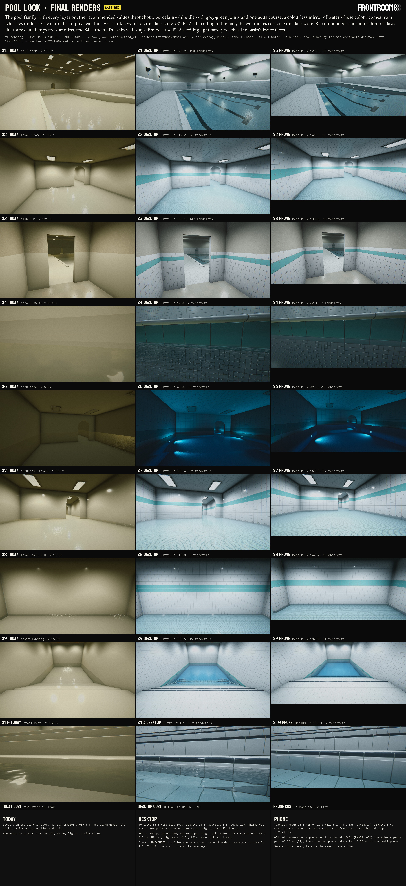

### 8.1 Runs

| Run | When | What | Result |
|---|---|---|---|
| `rend_v1` | 10:17:11-10:18:24 | every layer on (`-plZone pool -plLamps pool -plTile pool -plWater pool -plSub pool -plSubCubes -plCubeContract`), every camera at the phone tier (`-plPhoneAll`), the D8 sweep T1-T6 on S1 S3 S4 S8, the Q1 sweep ×1 ×3 ×4 ×5 ×9 on S2 S7 S9 S6, the Relay in the dark zone at the thrown light ×1 / ×2.5 / ×4 (`-plRelay -plNight`), cost per camera (`-plCost`), the walk film (`-plWalk`) | FINISHED fail=0 in 59.9 s, 80 stills + 699 film frames, 0 `error CS` |
| `rend_today` | 10:18:40-10:19:01 | TODAY on every camera, the Relay check, cost | FINISHED fail=0 in 13.4 s |
| `rend_walk2` | 10:21:41-10:22:19 | the walk again: the dark zone's last leg ends on the arch's centre line (in `rend_v1` it ended 0.1 m inside the left jamb, which filled the last second) | FINISHED fail=0 in 26.0 s; the film of record |

Frames: `W/pool_look/renders/rend_v1/`, `rend_today/`, `rend_walk2/walk/`.

**The harness partial** (clone only): `Assets/Editor/PoolLook/FrontRoomsPoolLook.Renders.cs` (321df097, meta guid 85cdfb81dfd64d0bb3676d7c72ffbd78) and one hook in `FrontRoomsPoolLook.cs` (3e0153d6; pre-edit copy `W/pool_look/rend/base/`): `-plPhoneAll` (every desktop camera again at the phone tier, `<cam>_ph`; S5 already is S1's), `-plRelay` and `-plNight v,v,v` (the production Relay, `FRONTROOMS_RELAY_V2`, walks the last 0.96 m toward S6 at 0.8 m/s with its lens at Walk and its own wading rings; R1 4.1 m ahead before the back wall, R2 4.3 m ahead before the west wall; for each, noise-off raw PNG pairs with and without it), `-plCost` (renderers, submeshes, triangles and lights in each view; Unity's profiler draw counters were read around each render and did not move in an edit-mode batch), `-plWalk` (the film), `-plCubeContract` (each frame takes the reflection cube `pool_submerged_contract` would give it, `FrontRoomsZoneLook.ZoneAt` at the eye: only the club corridor changes against `-plSubCubes`, Level0 → Pool, so the walk has no cube pop at the arch).

### 8.2 Sheets and film (staged for `renders/look/`)

| File | Size | sha1 | What |
|---|---|---|---|
| `71_look_final.jpg` | 3838 × 8364 | c769ace9 | TODAY \| DESKTOP ULTRA \| PHONE TIER on S1-S10 (S5 = S1 at the phone tier), COST; WAIT-RED |
| `71_tile_d8.jpg` | 3835 × 2674 | 475d114f | D8 under the finished water: TODAY \| T1 REC \| T2-T6 on S1 S3 S4 S8, an 800 × 450 crop of S8 at 1:1, COST; WAIT-RED |
| `71_water_q1.jpg` | 3838 × 2554 | 3dced059 | Q1: TODAY \| ×1 \| ×3 \| ×4 \| ×5 \| ×9 on S2 S7 S9 S6, REC per row, the floor's colour measured on each frame, COST; WAIT-RED |
| `71_night.jpg` | 3840 × 3459 | 4e26f55b | the dark zone's thrown light: TODAY \| N-A ×1 \| N-B ×2.5 REC \| N-C ×4 with the Relay at R1 and R2, a ×1.5 crop, the empty room, the rule 11 numbers; WAIT-RED |
| `71_look_walk.mp4` | 17.4 MB | daa69316 | 23.3 s at 30 fps, 1920 × 1080, H.264 CRF 23 (preset slow), yuv420p (tv range, BT.709), faststart, one stream (silent), no logo on the picture: the club corridor through the arch onto the hall's west deck in one shot (285 frames, 12.85 m, 1.35 m/s, the slow gait), cut, the pool level's first room through its arch (210 frames, 9.25 m, 1.32 m/s), cut, wading in the dark zone toward its arch (204 frames, 4.81 m, 0.71 m/s); no head bob, the player's own rings |

Every label checked at full size: fit files `W/pool_look/sheets/71_*_fit.txt`, each ending ALL LABELS FIT. Builder `W/pool_look/rend/tmp/make_rend_sheets.py` (86f42acc).

### 8.3 Cost

| | TODAY | Desktop Ultra | Phone tier (iOS) |
|---|---|---|---|
| Textures | (Level 0's) | **88.5 MiB**: tile 55.0 (BC7), ripples 24.0 (BC5), caustics 8.0 (BC7 with mips), cubes 1.5 (BC6H) | about **15.5 MiB**: tile 6.1 (ASTC 6×6, estimate; 13.8 as BC7), ripples 5.4, caustics 2.5 (ASTC 4×4), cubes 1.5 |
| Mirror image | none | 6.10 MiB at 1080p, 10.85 at 1440p per water height (the hall shows two); High 4.82 at 1440p | none (probe and lamp reflections) |
| GPU, 1440p, measured per stage, UNDER LOAD | - | hall water +1.38 ms (§6.6) + submerged +1.89 (§7.7) = about 3.3 ms at Ultra (`17` §6.1: ≤ 4-5.5); High water +0.51; ripple +0.35-0.43 inside the water's figure; 16 rings worst case +2.2; tile and zone look not timed (about 40 and 20 ALU) | not measured on a phone; on this Mac the water's probe path +0.55 ms (S1), the submerged term's phone path within 0.05 ms of the desktop one |
| Draws | UNMEASURED | UNMEASURED (the profiler counters stay at 0 in an edit-mode batch; `rend_cost.tsv` says so per row); each renderer in view is at least one draw per pass, and the mirror draws its room again per water height | UNMEASURED |
| Renderers in view (`rend_cost.tsv`) | S1 172, S2 64, S3 247, S4 6, S6 50, S7 55, S8 5, S9 19, S10 7 | S1 110, S2 66, S3 147, S4 7, S6 83, S7 57, S8 6, S9 19, S10 7 | S1 (S5) 56, S2 19, S3 68, S6 23, S7 17 (the kits' phone culls) |
| Triangles in view | S1 20.7 k, S6 6.3 k | S1 33.0 k, S3 38.0 k, S6 30.0 k (the ten P2-A stand-in niches) | S1 3.5 k, S6 1.2 k |

The hall's renderer count falls (one P1-A wall box per bay instead of a troffer per 3 m cell); the dark zone's rises with the stand-in niches, which are the zone lamps study's kit (the lamp line's production kit replaces them).

### 8.4 Rule 11: the Relay in the dark zone

The Zone look stage asked for this check (§3.8: "darkness is never cover"). The production Relay walks toward the player at 0.8 m/s with its lens at Walk (0.25 and its 1.6 m self-light, `FrontRoomsRelayLens`); noise-off pairs of the same frame with and without it, above the water line (its mirror image and its legs under the water are below it): the silhouette is every pixel it darkens by more than 3 levels (about 65,000 px), the background the hidden frame at those pixels (`W/pool_look/rend/qa/relay_contrast.tsv`, script `rend/tmp/relay_contrast.py`).

| | Weber contrast, linear (R1 / R2) | Relay luma / background luma (sRGB, R1 / R2) | Lens peak | Frame mean |
|---|---|---|---|---|
| TODAY (Level 0 look, every lamp dead) | -0.585 / -0.575 | 33.0 / 56.4, 32.7 / 54.8 | 81 | 49.3 |
| N-A ×1 (the physical share) | -0.560 / -0.654 | 20.0 / 33.7, 20.2 / 38.2 | 85 | 32.7 |
| **N-B ×2.5 (as built)** | -0.639 / -0.783 | 21.6 / 41.0, 21.5 / 51.8 | 85-92 | 39.5 |
| N-C ×4 | -0.689 / -0.839 | 22.9 / 47.5, 22.5 / 64.6 | 86-114 | 45.6 |

At every value the Relay is a dark figure against the lit walls and ceiling, with its lens lit: rule 11 holds and does not decide between the values; the choice is the room's mood (`71` item 3).

### 8.5 Caustic strength: not a row

The caustics' strength is not a visible choice at the game's framing: on the crouched view of the level (S7, the frames of record `sub_v4`, rows 700-1080, the floor under the ankle water) the fine-scale contrast (luma minus its 13 px box blur, std in 8-bit levels) is 7.70 with the caustics off, 7.73 at ×1, 7.84 at ×3 and 7.40 stirred (the stirred ripple blurs the refracted joints more than its nets add); the floor's mean moves by 0.2 of a level (energy is only moved, §7.4). In calm ankle water the nets are physically faint; a footstep or a wade makes them strong where they fall (films `70_submerged_S7.mp4`, `70_ripples_rings.mp4`). Clear nets on a basin floor need a compact source over deep water, which is the P1 lamp pick (P1-A is an extended wash: no nets, `17` §4.4); `71` says so under P1.

### 8.6 Checks

- Roslyn, the clone with the harness: COMPILE OK, 0 errors (`W/pool_look/rend/tmp/roslyn_r1`, `r2`, `r3`; the response file lists the partial). The Renders partial and the edited hook are ASCII and LF.
- Every run FINISHED fail=0, 0 `error CS`, 0 shader errors in `W/pool_look/logs/rend_*.log`.
- Photosafety of the walk film (WCAG 2.3.1 as RELAY §9.5 defines a flash, whole frame, quarters, the water band and the upper third; `W/pool_look/rend/qa/71_look_walk_photosafety.json`): at most 2 opposing changes of 10 % in any 1 s, counted conservatively from extremum to extremum; both are the two cuts (the largest step, 0.34 of full scale, is the cut into the dark zone); the limit is 3.
- The phone tier's frames read as the desktop's (same colours; S2 146.0 against 147.2, S7 160.0 against 160.4).

### 8.7 Limits

- The rooms, the P1-A wall boxes and the P2-A niches are stand-ins; the frames show the look, not the production kits. S4 at the hall's basin wall stays dim (mean 62) because the stand-in's ceiling bounce barely reaches the basin's inner faces.
- Draw counts are unmeasured; GPU figures are the earlier stages' and UNDER LOAD; nothing was timed on a phone or in a browser.
- The walk film's cuts are edits, not game transitions; the film shows the look in motion, not the level's route.
- The Relay check covers the Walk state at 4.1-4.3 m; Listen (the 0.06 standby glow) in the dark zone at longer range is the hunter line's test (`hunter/production_b/20_build.md` §"Darkness is never cover").

### 8.8 For the Package stage

- Nothing new to package from this stage: the packages' inputs are those of §3.10, §4.11, §5.10, §6.12 and §7.12. The look values that `71` puts to Red (D8, the Q1 placement, PoolDark's thrown light) are one value each after landing.
- Deletion candidates (inside `W/pool_look`, Red deletes): `renders/rend_v1/walk/` (superseded by `rend_walk2`, 218 MB), `rend/tmp/view/` (7.4 MB of review contact sheets), `rend/tmp/roslyn_r1`-`r2`. Keep `renders/rend_v1` (stills), `rend_today`, `rend_walk2`, `rend/qa`, `rend/sheets`, `rend/video`, `rend/tmp/roslyn_r3`, the scripts.

## 9. Package

Stage 9 of the workflow, 2026-11-04 10:37-12:3x. The first agent (account B, relay of G's `wf_d2994299-a35`) stopped at about 10:40 with an inventory only; a second agent on B built the stage from the journal from 11:32. **Nothing landed in main:** main was read only, no Unity ran on main, nothing was downloaded; the packages and contracts are in `W/apply` for the line's session to land. The 10:33 note from 水体仿真调研 (relayed by the line's session in the journal) was checked in code and answered in 9.3.

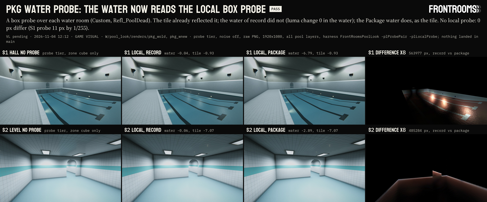

Sheet `sheets/70_package_water_probe.jpg` (3840 × 1600, Shot format, chip PASS; fit `W/pool_look/sheets/70_package_water_probe_fit.txt`: ALL LABELS FIT): the water against a local box probe, 9.3.

### 9.1 Tracks and the landing order

| Track (`W/apply/`) | What | Paths | `FrontRoomsSurface.shader` | Dry run on main today |
|---|---|---|---|---|
| `pool_zone_look` | the zone look (3.1): `FrontRoomsZoneLook`, `FrontRoomsZoneLookProfile` (with the Submerged stage's two fields), `FrontRoomsZoneLookVolume`, the four profiles and four grades | 25: 24 new (3 C#, 8 assets, their metas, 2 folder metas), 1 replaced; 1 kept (the shader's `.meta`) | 8f3587e0 → 37ccbb59 (the height fog) | DRY RUN OK |
| `pool_tile` | the tile (4.2): `gen_pool_tile.py`, 36 maps, 26 `Prop_PoolTile_*` materials, the manifest, `FrontRoomsPoolTile` | 133: 132 new, 1 replaced; 1 kept | 37ccbb59 → cef7facc (`_FR_TILE`, the wet band) | refuses on the shader only, until `pool_zone_look` lands |
| `pool_water` | ripples and rings (5.1), the surface (6.1, with 9.3's probe), submerged and caustics (7.1), the pool cubes, the Relay's rings | 50: 45 new, 5 replaced (the shader; `FrontRoomsLook.cs` 898dee87 → 61f9b581, `FrontRoomsZoneReflection.cs` 040ba42b → fc95d511, `Editor/Rendering/FrontRoomsReflectionCapture.cs` ad9ebcb1 → 7a4f7c55, `FrontRoomsRelayRig.cs` 542df78c → 5c19eb59); 5 kept (their metas) | cef7facc → 8067dc67 (submerged, caustics, thrown light) | refuses on the shader only, until `pool_tile` lands |

- **Order: `pool_zone_look`, `pool_tile`, `pool_water`.** Each lands alone and compiles (9.2). The shader is stacked because each stage added one term to `FrontRooms/Surface` and each version is the one that stage proved inert in Unity (3.7, 4.7, 7.9); the stacked bases make each script refuse a wrong order. C# depends the same way: the water reads the zone look (`ZoneAt`, `Profile`, the profile's `waterAbsorbScale` and `thrownLight`); the tile's C# needs only main.
- **After the last landing** `pool_zone_look.sh` and `pool_tile.sh` print REFUSED on the shader (it holds the later version, "partially applied"): expected, not a fault; `pool_water.sh` prints ALREADY APPLIED. The MERGED rows are the record.
- `FrontRoomsRelayRig.cs` (this line's file, base 542df78c = main): three lines in `TickAnimation`, after the animation clock: `if (Application.isPlaying) FrontRoomsWaterRings.ReportBody(FrontRoomsWaterRings.Body.Relay, transform.position, .3f);` with a comment (6.10).
- Built by `W/pool_look/pkg/tools/build_overlays.py` (the overlays: only files that differ from main; LF; ASCII except main's own lines in the Surface shader and `FrontRoomsReflectionCapture.cs`; every new asset with its `.meta`; no new GUID among main's 3,636) and `mkapply_stacked.py` (`W/tools/mkapply.py` with a base view of main plus the earlier tracks). Diffs: 2,091, 11,302 and 8,580 lines. Manifest: `W/pool_look/pkg/tmp/overlay_manifest.tsv`. API rows the scripts check on main: `FrontRoomsPostStack.EnsureZoneVolume`; `FrontRoomsTrofferKit.PhoneTier`; `FrontRoomsQuality.CurrentPreset`, `LowPowerActive`, `FrontRoomsHandheld.ReduceMotion` (all ok).

### 9.2 Gate (rule 25)

- **Roslyn against main**, every landing state, macOS and iOS (`W/pool_look/pkg/tools/gate.zsh g1 <state>`, each override its own zsh array element; the response files read: the override paths listed, `UNITY_IOS` in every iOS file): `pool_zone_look` alone (3 overrides), `pool_tile` alone (1), zone look + tile (4), all three (14), all three + the three contracts' patched files (16): **COMPILE OK, 0 errors** on both platforms (`W/pool_look/pkg/gate/g1_*`).
- **Shader, one Unity batch in the clone with the final files** (`pkg_wnew`, 11:51, Unity 6000.6.3f1, OSXUniversal): `FrontRooms/Surface` (8067dc67) and `FrontRooms/Water` (76892c0f) 0 errors (`ShaderUtil`), 0 shader errors and 0 `error CS` in the log. **Level 0's materials keep their keywords:** main's 225 `FrontRooms/Surface` materials hold 7 keywords (`_FR_MESH_UV` 186, `_EMISSION` 27, `_FR_DAMAGE` 12, `_FR_OWN_LIGHTS` 11, `_FR_PRINT` 5, `_FR_SHEEN` 4, `_FR_LAMP_FIELD` 1; none invalid): all declared by the final shader; the clone's 245 Surface and Water materials load with exactly their files' keywords (`renders/pkg_wnew/pkg_matcheck.tsv`). The intermediate versions: the keyword pragmas of 37ccbb59 equal main's, those of cef7facc and 8067dc67 are main's plus `_FR_TILE` (a `shader_feature_local` only the 26 pool tile materials enable); 37ccbb59 compiled with 0 shader errors in `zl_v8`/`zl_v8L`, cef7facc in `tile_today` and `tile_v2`.
- **Dry runs and rehearsal:** `pool_zone_look.sh` DRY RUN OK on main. On a scratch copy of main (`W/pool_look/tmp/rehearse_pool`: `ProjectVersion.txt`, all 3,673 `.meta` files, the 9 base and API files), in order, each track DRY RUN OK, then `--apply` **MANIFEST OK** (25, 133, 50 paths; 1, 1, 5 kept metas unchanged), then `pool_water` ALREADY APPLIED (logs `W/pool_look/pkg/logs/rehearse_*`, `dry_main_*`).

### 9.3 The water's probe (the 10:33 finding)

- **The finding** (水体仿真调研, relayed by the line's session): `FRProbeSample` in `FrontRooms/Water` read `_GlossyEnvironmentCubeMap` under the cluster loop (Forward+, the game's renderer), so the structures scene's hall probes (`FrontRoomsStructuresLook.Probe`: realtime, box projection) never reached the water on the probe tier, nor on water heights past the mirror budget (2 at Ultra, 1 at High). Confirmed in code.
- **What this project's URP does** (read in URP 17.6.0): `FrontRooms_URP.asset` keeps probe blending off (`m_ReflectionProbeBlending: 0`, GPU resident drawer off), so under Forward+ URP asks for per-object probes (`GetPerObjectLightFlags`: `PerObjectData.ReflectionProbes`) and never uploads the cluster's probe atlas (`ForwardLights` calls `UpdateGpuData` only with `reflectionProbeAtlas`, which needs blending). `FrontRooms/Surface` reads `unity_SpecCube0` (no box projection: that keyword is off). Sampling the atlas "the URP way" would read nothing here.
- **The choice:** the water reads `unity_SpecCube0` on every path, as Surface does. A probe with box projection (`unity_SpecCube0_ProbePosition.w > 0`, the hall probes) is projected on its own box from its own position (URP's `BoxProjectedCubemapDirection`); without one the renderer gets the default reflection, the zone cube, projected on the body's room box from its capture point as before. Water shader 1de7c0e4 → 76892c0f (one function, 6 lines, and two comments); `FrontRoomsWaterSurface`'s public API unchanged (水体仿真调研's stage 2 builds on it).
- **Numbers** (`renders/pkg_wold` = the water of record, `pkg_wnew` = this; every pool layer, grain and dither off, raw PNG, 1920 × 1080; `W/pool_look/pkg/tmp/compare_p1.json`):

| Check | Result |
|---|---|
| No local probe, desktop Ultra, S1 S2 S6 S7 | 0 px differ |
| No local probe, probe tier, S2 S6 S7 | 0 px differ |
| No local probe, probe tier, S1 | 11 px of 2,073,600 by 1/255 (float rounding of the recompiled function) |
| Water renderers BlendProbes instead of Off, no local probe | 0 px differ from Off, both shaders |
| A box probe over each water room (Custom, `Refl_PoolDead`), probe tier, S1 | water of record: water luma -0.04 (it ignores the probe) while the tile around it changes -0.93; Package: water -6.79 over 563,977 px, the tile the same -0.93 |
| The same, S2 (the level's ankle water) | record -0.06, Package -2.89 over 485,284 px; tile -7.07 both |
| The same, S1 at Ultra | 3,718 px by at most 4/255: the mirror image's edges fall back to the probe |

- **Limits:** with blending off Unity gives each renderer one probe (the most important at its bounds), so a water renderer must not span two halls (one `FrontRoomsWaterSurface` per room, as 6.3 asks). If the settings line turns probe blending on, Surface and Water both need the atlas path: one change for both, not this package.

### 9.4 Inert check: what in the game can reach the new code

| Entry | Reached when | With no pool zone, look volume or water |
|---|---|---|
| `FrontRooms/Surface` (every Surface material) | every frame | the height fog runs only while `_FR_HeightFog.x > 0` (a zone writes it per context), the submerged term only with a water body registered (global count 0), the wet band only where a material's `_WaterY` is above -999 (default -1000), `_FR_TILE` only in the 26 pool tile materials: pixel-inert, proven per stage (`today_v8` = `today_v7`; `tile_today` = `today_v8`; `sub_inert_new` = `sub_inert_base`, 0 px) |
| `[RuntimeInitializeOnLoadMethod]` statics: `FrontRoomsZoneLook`, `FrontRoomsPoolTile`, `FrontRoomsWaterRipples`, `FrontRoomsWaterRings`, `FrontRoomsWaterPlanar`, `FrontRoomsWaterSubmerged` | once at load | static resets; `FrontRoomsZoneLook` subscribes `SceneManager.sceneUnloaded` (removes nulls from an empty list, unhooks nothing); `FrontRoomsWaterSubmerged` writes its two count globals = 0 (the off state) |
| `RenderPipelineManager` hooks (zone look), `Application.onBeforeRender` (mirrors) | only after a `FrontRoomsZoneLookVolume` / `FrontRoomsWaterSurface` is enabled | never subscribed |
| `FrontRoomsZoneLookVolume`, `FrontRoomsWaterSurface` (`[ExecuteAlways]`) | when placed | new GUIDs: no scene or prefab of main references them |
| `FrontRoomsLook.ReflectionZone` (+ Pool, PoolDead, PoolLevel, appended), `FrontRoomsZoneReflection` (cube arrays of 7) | every zone switch | cubes load one zone at a time on request; the game asks only for Level0, Office, Tall, DeadLamp until `pool_submerged_contract` |
| `FrontRoomsReflectionCapture` (editor menu) | when run | skips the pool zones; Level 0's four cubes are captured as before |
| `FrontRoomsRelayRig.TickAnimation` | every Relay frame, Play mode | `ReportBody` finds no registered water and returns after noting the position |
| `FrontRoomsRippleArray` (editor) | menu only | not a postprocessor (5.7) |
| The contracts' map code | chunk builds | places volumes only while a pool plan is held (the structures scene) |

**Not inert: build content (9.5).**

### 9.5 Build content (open, for the line's session and Red)

Everything under `Assets/Resources` ships in every player build, used or not. The three packages put about **96.8 MiB of PNG and EXR** there (tile 44.1, ripples 33.7, caustics 15.5, cubes 3.5). In a player that is about **100 MiB of textures on desktop** (tile maps 55.0 + 13.8, ripple arrays 24.0, caustic loops about 8, cubes 1.5), **about 75-80 MiB on iOS and WebGL** (the tile maps have no platform override, so their phone and desktop sets both import at high-quality 8 bits a texel; the arrays are per platform, 5.4 and 6.8 MiB): estimates from 4.6, 5.6 and 7.7, not measured in a build (rule 25). Nothing loads them in the game, but they make every shipped build that much larger until the pool enters the game; the structures scene keeps its own textures out of builds (`Assets/Structures/Textures`, serialized fields; scene 4 is not in the build list).
- **(a) Land as built:** scene 4 has the look at once; every build carries the textures until the pool enters the game.
- **(b) REC: an editor-only home until Red takes the pool into the game.** Unity strips a `Resources` folder that sits inside an `Editor` folder from builds and still loads it in the editor (Unity Manual, special folder names): the textures, materials and cubes move to `Assets/Editor/Rendering/Resources/` with the same Resources paths and the same GUIDs, so `Resources.Load` and every material keep working in the editor and in scene 4, and builds stay as they are; one move back when the pool enters the game. A follow-up package of this line (the generators' output paths, `FrontRoomsRippleArray`'s paths, one harness run to confirm the load), about an hour; the C# and the shaders stay where they are.

### 9.6 Contracts

- **`W/apply/pool_zone_look_contract/`** rewritten for main as it is now: C1 and C2 have landed (`ZoneTheme` PoolClub, PoolLevel, PoolDark; `FrontRoomsMapWorld.WaterAt`; the pool pass `FrontRoomsMapWorld.Pool.cs`). `AddPoolLooks` returns unless a pool plan is held, `PoolLookZone` compares the enum and skips non-pool cells, the height fog takes the rectangle's C2 water height. Base `FrontRoomsMapWorld.cs` d660ed55 (the 11-03 diff against b71b023f no longer applied), patched 178e425b, `patch --dry-run -p1` clean. Inert in the game (a plan is held only on the structures scene's profile copy).
- **`W/apply/pool_water_contract/`** (settings: the mirror renderer, the full-resolution opaque copy, the tier rule; map: the player's rings): bases unchanged (`FrontRooms_URP.asset` 18584f2b, `FrontRooms3DGame.cs` d059a6de), dry runs clean; a re-check section added. The map's own water (the pool pass's greybox water and caustics) is described there as the map's next step (one water renderer per room and height with `FrontRoomsWaterSurface`), no diff yet.
- **`W/apply/pool_submerged_contract/`** (the pool cubes in `UpdateReflectionZone`): base unchanged, dry run clean, both map diffs apply together (44a6d8f2).
- All three contracts compile with all three packages (9.2, state `con`).

### 9.7 The structures scene (RULES 5b, scene 4): what to drop on a stand-in pool

Once the three packages have landed, a pool room in scene 4 shows the look with:
1. **The zone look:** a `FrontRoomsZoneLookVolume` per pool room (Add Component > FrontRooms > Zone look volume): `zone` PoolClub, PoolHall, PoolLevel or PoolDark; `center`/`size` the room's box (local), `blendDistance` 2.5, `hasWater` + `waterLevel` (local y of the water: the height fog sits on it). With `pool_zone_look_contract` applied the map places them from the pool plan. `FrontRoomsStructuresLook` keeps its `Game` preset (pool grade weight 0, no trilight of its own) in districts with volumes, else its global pool grade (priority 100) sits on top of the zone's grade.
2. **The water:** per room and water height a flat mesh at the water (MeshRenderer, shadows off) with a material on `FrontRooms/Water` (`new Material(Shader.Find("FrontRooms/Water"))`; the defaults are the tuned values) and a `FrontRoomsWaterSurface` (Add Component > FrontRooms > Water surface): `kind` Basin or Ankle, `roomHeight` the ceiling over the water, `roomMargin` out to the walls, `probeHeight` 1.6; for floor nets `causticSourceA/B` (up to two compact lamps); `absorbScale` and `thrownGain` -1 take the zone's (Q1: club 1, level 4, dark 3). The component puts its object on the Water layer itself. The stand-in water and greybox caustics go in those rooms (the submerged term draws the water's colour and the caustics on whatever lies under it).
3. **The tile:** renderers take `FrontRoomsPoolTile.Get(kind)` (Field, FieldClub, Course, CourseClub, Cap, Mosaic, MosaicClub, Lane, Deck, Tread, Riser, Nosing, Coping; the `_Phone` twins come by tier) or the materials `Resources/Surfaces/Pool/Prop_PoolTile_<kind>.mat` directly; pieces that meet water take `FrontRoomsPoolTile.ForWater(kind, waterY)` (wet band, meniscus). Rows are world-planar on 150 mm from world 0 (a floor off the rows: a V offset, 4.3); coping and nosing need the mesh UVs of 4.10.
4. **Reflections:** the hall probes of `FrontRoomsStructuresLook.Probe` now reach the water as they reach the tile (9.3). Where no local probe covers a pool, `FrontRoomsLook.SetZoneReflection(FrontRoomsLook.ReflectionZone.Pool / PoolDead / PoolLevel, ...)` gives the pool family's cubes (rebake them in scene 4's rooms with the recipe of 7.6 once they exist).
5. **The Relay's rings** come by themselves in Play mode; the walker's need `pool_water_contract`'s map line, or scene 4's bootstrap calls `FrontRoomsWaterRings.ReportBody(FrontRoomsWaterRings.Body.Player, feet, .25f)` each frame.
6. **First look in scene 4:** the first mirror render may draw the pool tile red for one frame (6.11); the lamp presets for P1/P2 are `FrontRoomsZoneLook.Lamps(zone)`, the kits themselves stay Red's pick.

### 9.8 Combined-test rows (rule 25)

For `handoff/visual_combined_test.md`, one heading per landing (time and account filled in when landed):

- `pool_zone_look`: [ ] Game, Level 0 and Office (no pool plan): no look volume exists and every frame is as before (`FrontRoomsZoneLook.AppliedContexts` 0). [ ] Scene 4 with volumes: club → hall → level → dark zone, the ambient, haze and grade change over 2.5 m before each arch (hall 0.42 at 1.9 m, 0.87 at 0.9 m); club neutral cool grey, hall white and cool, level high-key cool white, dark zone near-black teal; leaving every volume gives Level 0's values back exactly; a scene saved in the editor keeps no zone ambient.
- `pool_tile`: [ ] Scene 4: the 26 materials on the stand-ins: porcelain white field, 3 mm grout, the aqua course on whole 150 mm rows, a dark nosing on every stair edge, lane lines; wet band and meniscus at the water; phone tier takes the `_Phone` twins. [ ] Every other Surface material unchanged (main's 7 keywords all declared). [ ] Build size delta measured (9.5).
- `pool_water`: [ ] Scene 4, desktop Ultra: the room mirrored in the water (up to 2 heights; High 1, every second frame), Medium/Low and phones the probe and lamp reflections; under the water the club's pale turquoise deepening to the deep end, the level ×4, the dark zone ×3 lit by the niches' thrown light; faint nets in calm water that wake with footsteps. [ ] A hall probe reaches the water as it reaches the tile (9.3). [ ] The Relay leaves rings in water; Reduce Motion freezes ripples and rings; 0 flashes a second. [ ] Level 0 and the game unchanged; the capture menu still captures Level 0's four cubes. [ ] GPU on device (desktop 1440p hall ≈ +3.3 ms UNDER LOAD; phones and WebGL never timed).

### 9.9 Files of this stage

- Clone only (never land): `Assets/Editor/PoolLook/FrontRoomsPoolLook.Package.cs` (`-plProbePair`, `-plLocalProbe`, `-plMatCheck`; `.meta` cf92a6e7) and two hook lines in `FrontRoomsPoolLook.cs` (pre-edit copy `W/pool_look/pkg/base/`); the clone's water shader is now 76892c0f (pre-edit copy `pkg/base/FrontRoomsWater.shader.pre_pkg`). Roslyn on the clone: COMPILE OK (`pkg/tmp/roslyn_c2`).
- Tools: `W/pool_look/pkg/tools/` (`build_overlays.py`, `mkapply_stacked.py`, `gate.zsh`, `chain_p1.zsh`, `compare_p1.py`, `surface_mats.py`, `make_zl_contract.py`, `make_pkg_sheet.py`).
- Deletion candidates (inside `W/pool_look`, Red deletes): `pkg/view/` (the base views, rebuilt by `mkapply_stacked.py`), `tmp/rehearse_pool*`, `tmp/pool_*_applied_manifest.txt` (the scratch rehearsal), `pkg/tmp/panels/`, `pkg/tmp/roslyn_c2`, `pkg/tmp/c_*.txt`, `m_to_c_candidates.txt`, `m_newer_or_diff.txt` (inventories). Keep `renders/pkg_wold`, `pkg_wnew`, `pkg/gate/`, `pkg/overlay/`, `pkg/contract/`, `pkg/logs/`, the tools.

## 10. Landing (2026-11-04 12:52-13:04, account A)

- **Landed in order:** `pool_zone_look` 12:52 (25 paths; `FrontRooms/Surface` 8f3587e0 → 37ccbb59), `pool_tile` 12:52 (133 paths; → cef7facc), `pool_water` 13:04 (50 paths; → 7be4e235). Gate per landing state on main as it stood then (after 关卡设计's and 交互设计's 12:46-12:48 landings): `fr gate` macOS + iOS 0 errors with 3, 4 and 10 overrides; each dry run OK on main; MANIFEST OK. Rows in LANDINGS.md, `W/apply/MERGED.md`, `handoff/visual_combined_test.md`.
- **The fix that held `pool_water` (12:31-13:04).** The Submerged stage's `FRSub sub = FRSubFind(...)` (top of `Frag`) and the paper substrate's `half3 sub` inside `#if defined(FR_SUBSTRATE)` share one scope. `FR_SUBSTRATE` is defined only for `_FR_PRINT` off GLES3 / WebGPU, so every hung-paper variant (Level 0's walls) failed with "redefinition of 'sub'" on Metal and D3D, while WebGL and every material rendered in this stage's harness compiled (found by 水体仿真调研 in their render clone). Fix: the substrate's local is `subN` (three lines, 1087 / 1088 / 1092); nothing else changed (8067dc67 → 7be4e235).
- **Why §9.2's check missed it, and the check that replaced it.** `-plMatCheck` read `ShaderUtil.GetShaderMessages`, which reports only variants already compiled, and no rendered view used a paper wall. The landing check compiles instead: clone-only `Assets/Editor/PoolLook/FrontRoomsPoolSurfaceCompileCheck.cs` calls `ShaderData.Pass.CompileVariant` on the ForwardLit pass for every keyword set of the clone's 245 Surface materials (14 sets), each `shader_feature` alone and three `_FR_PRINT` pairs, with no and with full URP globals, on Metal macOS, Metal iOS and D3D (fragment) plus Metal macOS (vertex): **105 of 105 OK**. Control: the 8067dc67 text under a hidden name, `_FR_PRINT` sets, Metal macOS and iOS: **8 of 8 FAIL**, each "redefinition of 'sub' (line 1087)", so the check sees the fault it is for. Output `W/proj_unlock/Verification/pool_look/surface_compile_check.txt`, log `W/pool_look/logs/surface_compile_check.log`.
- **Still open:** the contracts (§9.6) wait on their owners through 总控; §9.5 build content (~100 MiB of pool textures in Resources in every desktop build until the pool enters the game).


## 11. Rings, less regular

Stage "Rings" of the 游戏视觉 workflow run by the line's session local_be0f3747 on account A, 2026-11-04 13:21-20:20, one agent (journal `W/water_rings/journal.txt`). **Nothing landed in main:** main was read only, no Unity ran on main, nothing was downloaded, nothing sounded; the work ran in the clone `W/proj_unlock` and is packaged as `W/apply/water_rings` for the line's session to land. The key U wiring in scene 4 is 水体仿真调研's (their `FrontRoomsStructuresWater.cs`, read only here).

**Red's words** (relayed by 水体仿真调研, local_d012b32d, from their chat at 13:1x; not re-read in a transcript): after walking scene 4 at SP6 with the water at W-D ×4 and RT High, "我目前认为这个ok，但是目前水的波纹我认为太规范了"; on how to choose, "我需要你把每一版的水都做进去，然后让我在structure scene试了之后我选择对应的". So every cause below is a runtime static that Red switches with key U in scene 4; the defaults are today's rings exactly.

**Done:** the diagnosis (the model's own numbers, and the same walk rendered on today's code); six statics on `FrontRoomsWaterRings` (and `ShapeOnPhoneTier`) with `NaturalLook()` and `TodayLook()`; the shader's shaped loop in its own keyword variant of `FrontRooms/Water` (`_FR_RINGS_SHAPED`, off by default, so today's variant is today's program on every tier); `ring_model.py --rings11`; films of every variant from one walk and one camera, and of today and the recommendation from the walker's own eye; the default-identity proof; a compile check with a failing control; the package. **Not done:** the wiring of key U (水体仿真调研's), the floor caustic of the rings (11.9), the Kelvin wave window (5.8, still the follow-up), any phone or browser timing.

**Reused, not redone:** the ring model of 5.4 (`ring_model.py`, its calibration and its accuracy check), the pool look harness (2.6) and its hall, `17_water.md` 3.1, 3.4 and 7 item 4 (the asks).

### 11.1 Diagnosis: what makes today's rings read as drawn circles

Rendered first (run `wr_r1` on today's code, then TODAY at the defaults in every later run; the hall's beach as an SP6 stand-in, 11.6): a walker crossing 0.15 m of water at the scene-4 walker's 3.2 m/s leaves a chain of thin, crisp, evenly growing ellipses, one per 0.7 m stride, each a single dark line on a calm base, and at the walker's own feet a crisp concentric target (sheet `sheets/70_rings.jpg`, the TODAY tiles; film `video/70_rings_variants.mp4`, first tile). That is Red's "太规范".

The causes, in the order they matter (numbers from `ring_model.py --rings11`, the footstep at strength 1; scene 4's walk reports each step at 2.16 times that volume, so its slopes are about twice these):

1. **The rim (most of it).** Today a footstep is a hump of 4 cm released at once plus a coherent splash share of 25 % at 8 mm. Only the splash has energy at the 4.4 cm waves of the minimum group speed, and the Airy caustic piles them into one ring: the rim zone holds **97 / 95 / 91 / 84 %** of the ring's slope² at 0.5 / 1 / 2 / 3 s, with rms slopes of **47 / 21 / 6 / 2.4°** against **4.6 / 2.7 / 1.2 / 0.7°** for both wave trains outside it, and maxima of 71 / 55 / 26 / 13° (steeper than real waves stand; gravity waves break near 25-30°). The base ripple is 2.0° rms, so nothing breaks that line up. Physically the coherent rim belongs to a drop (a point that lands at once: Prosperetti and Oguz 1993; the Cauchy-Poisson ring of Lamb 1932, ch. IX, and Lighthill 1978, ch. 3, needs a source smaller than the waves): a foot's splash is many droplets over 10-30 cm and 0.1-0.3 s, whose 4.4 cm waves cancel instead of adding (a source of size σ or duration τ keeps exp(-k²σ²/2) or exp(-ω²τ²/2) of them: 2 % at σ 2 cm, 13 % at τ 0.05 s).
2. **The source is a point and an instant** (task item a, b). A foot is longer than wide, moves forward as it lands, and the forefoot and the lift make a second, weaker, opposite impulse a few centimetres ahead and a fraction of a second later; two ring systems then interfere and the pattern is lopsided along the heading. Today every ring is round and the same.
3. **The water is perfectly still** (item c). A crest crossing a slow drift of the water arrives early where the drift runs outward and late where it runs inward (wave-current refraction: Longuet-Higgins and Stewart 1961; Phillips 1977, ch. 3); a used pool always drifts (circulation, the walkers' own wakes). The constant ripple itself cannot do it: its orbital speeds (a few mm/s) and slopes (2°) move a crest by about 1 mm, which is why the rings stay perfect over it.
4. **Echoes** (item f). Every rectangle side mirrors every ring at 0.85 (corners 0.72), exactly in time, so each ring has perfect twins; every water surface registers its renderer's bounds as the rectangle (`FrontRoomsWaterSurface.OnEnable`), so a side that is a beach or a join to the next quad of water echoes too. Real walls return less, especially of short waves: the meniscus takes the capillaries (Hocking 1987; Miles 1967), deck-level gutters take most of everything, a beach returns nothing.
5. **Regular strides and long lives** (item g, and the walk). AutoSteps drops a ring every 0.7 m at any speed, so at 3.2 m/s 4.6 rings a second land on one line at equal spacing; every ring lives its full 7 s, so a walk leaves a long chain. A gait's stride grows with speed (cadence about 1.6 + 0.35 v steps a second, a fit over walking and jogging; Grieve and Gear 1966 give the walking relationships) and varies step to step; a used pool's surface film damps faster (Lucassen 1968; Alpers and Hühnerfuss 1989).
6. **Not a cause: depth** (item d). Footsteps happen in water under 0.45 m, where their energetic waves are 8-13 cm long (kh 6-12, tanh kh = 1.000): deep-water dispersion is exact. Wading happens in water over 0.45 m, where its 1 m waves have kh above 2.8 (tanh 0.99). Finite-depth dispersion would change no frame the hooks make; dropped.
7. **Not a cause: the rim's softness as a shader filter** (item e). The rim is soft enough once the splash is incoherent (1); no separate rim filter was needed.

Sources are cited once, from the literature, not re-read in this stage: H. Lamb, *Hydrodynamics*, 6th ed., 1932, ch. IX; J. Lighthill, *Waves in Fluids*, 1978, ch. 3; G. B. Whitham, *Linear and Nonlinear Waves*, 1974, ch. 11 and 13; A. Prosperetti and H. N. Oguz, "The impact of drops on liquid surfaces and the underwater noise of rain", Annu. Rev. Fluid Mech. 25 (1993) 577-602; M. S. Longuet-Higgins and R. W. Stewart, "The changes in amplitude of short gravity waves on steady non-uniform currents", J. Fluid Mech. 10 (1961) 529-549; O. M. Phillips, *The Dynamics of the Upper Ocean*, 2nd ed., 1977; L. M. Hocking, "The damping of capillary-gravity waves at a rigid boundary", J. Fluid Mech. 179 (1987) 253-266; J. W. Miles, "Surface-wave damping in closed basins", Proc. R. Soc. A 297 (1967) 459-475; J. Lucassen, "Longitudinal capillary waves", Trans. Faraday Soc. 64 (1968) 2221-2229; W. Alpers and H. Hühnerfuss, "The damping of ocean waves by surface films", J. Geophys. Res. 94 (1989) 6251-6265; D. W. Grieve and R. J. Gear, "The relationships between length of stride, step frequency, time of swing and speed of walking", Ergonomics 9 (1966) 379-399.

### 11.2 What was built (in the clone `W/proj_unlock`; the package `W/apply/water_rings` carries it to main)

| Path (under `Frontrooms3D/`) | sha1 (base → new) | What |
|---|---|---|
| `Assets/Scripts/Rendering/Water/FrontRoomsWaterRings.cs` | 65298037 → 087b04c6 | the six statics, `NaturalLook()`, `TodayLook()`, `DescribeLook()`, `Footstep(p, strength, heading)`; the heading of the nearest walking body for footsteps posted without one; the variants' own random numbers (today's sequence never moves); the shape slots `_FR_Ring2[16]` and `_FR_RingShape0/1` and the global keyword `_FR_RINGS_SHAPED`, set only while a shader static is on (put off, with zeros, once when switched off and once at the start of a session); `ShapeOnPhoneTier` |
| `Assets/Resources/Rendering/FrontRoomsWaterRipples.hlsl` | 800bd3fc → 7e905f27 | `FRRingsAddShaped` (the foot's source, the lift's far-field factor, the drift), `FRRingCurrent`, `FRRingLift` and their globals, every line under `#if defined(_FR_RINGS_SHAPED)`; `FRWaterRipples` calls it under the keyword, else today's `FRRingsAdd`, untouched. Without the keyword the file's token stream (comments aside) is identical to 800bd3fc's: 3061 tokens each |
| `Assets/Resources/Rendering/FrontRoomsWater.shader` | 76892c0f → c2578106 | `#pragma multi_compile_fragment _ _FR_RINGS_SHAPED` and two comment lines; nothing else |
| `Tools/lookdev/pool_water/ring_model.py` | 75373242 → ee30f2f9 | `--rings11`: `model_shaped` (the shader's shaped terms in the closed form), the rim's share of the slope, the lift factor against two rings added, the lopsidedness by azimuth; without the flag it prints and writes what it did before |
| clone only: `Assets/Editor/WaterRings/FrontRoomsWaterRingsLook.cs`, `FrontRoomsWaterRingsCtl.shader`, `FrontRoomsWaterRipplesCtl.hlsl` (the failing control), `FrontRoomsWaterRingsOld.shader`, `FrontRoomsWaterRipplesOld.hlsl` (main's program, for the A/B) (+ metas, folder meta) and two hook lines in `Assets/Editor/PoolLook/FrontRoomsPoolLook.cs` (e5c026ea → 541bd0a2, pre-edit copy `W/water_rings/base_harness/`) | a45a1479 (`FrontRoomsWaterRingsLook.cs`), 8837e60f / 489c2b33 (control), 965b437b / 08def12b (main's program); `FrontRoomsPoolLook.cs` 541bd0a2 | the films, the PNG pairs, the timing and the compile check (never land) |

`FrontRoomsWaterRipples.cs` (b6961916) is unchanged: the new globals live in the include and are set by `FrontRoomsWaterRings`. One new global keyword, `_FR_RINGS_SHAPED`, declared only by `FrontRooms/Water`: its fragment variants double (8 → 16 light and fog sets in the compile check), a build-size cost only (70-92 KB of Metal source and 35-44 KB of D3D bytecode for each of the 8 new fragment programs, against 63-85 KB and 31-40 KB for today's); `FrontRooms/Surface`, which includes the same file through the Submerged include, never declares it and compiles today's code. No new asset, no new GUID in the package. Text LF, C# and HLSL ASCII.

### 11.3 The statics (key U: 水体仿真调研 wires them in scene 4)

| `FrontRoomsWaterRings.` | Type, range | Default (today) | Suggested for key U | What the player sees | Cost per tier |
|---|---|---|---|---|---|
| `RimSoftness` | float 0..1 | 0 | 1 (values between blend; only 0 and 1 were filmed) | a footstep or a wading step is no longer a crisp drawn circle: soft, broad 8-15 cm crests and a churned patch at the foot (the coherent splash share × 0.2, its radius × 2.5, the patch's agitation × 1.8; a footstep foot-sized, its hump 6 cm instead of 4, with 3.09 × the volume so its calibrated 5 mm crest at 0.3 m rides on the long waves); drips keep their crisp ring | CPU only: none on any tier |
| `SourceShape` | float 0..1 | 0 | 1 (with RimSoftness 1) | every ring lopsided along the walking direction: strong ahead and to the sides, faint behind, its crests broken into lobes, and no two steps alike (1.15 × longer than wide, forward push 1 + 0.7 cos φ, a second impulse −0.55 at 13 cm and 0.16 s, ±30 % per step); alone, on today's crisp rim, it reads as cracks (11.7) | shader, while on: the `_FR_RINGS_SHAPED` variant, desktop +27 to +41 % of the rings' own cost (+12.3 ms of 45.5 in run 5, +4.96 of 12.1 in run 2: paired medians at 7680 × 3544 with 16 slots covering the frame, the worst case; UNDER LOAD); phone tier: none (left out unless `ShapeOnPhoneTier`; measured −2.1 ms, inside the noise) |
| `Currents` | float 0..0.3 | 0 | 0.05 (0.08 stronger) | a slow swirl of the water (0.05 ≈ 1.2 cm/s) bends the big rings into eggs and kinks while small fresh ones stay round; the pattern drifts over 8-16 s | shader, while on: the same variant (four cosines a pixel, two multiplies a slot), desktop +31 to +44 % (+13.9 of 45.5, +5.33 of 12.1); with SourceShape +32 to +47 % (they share the variant); phone tier: none unless `ShapeOnPhoneTier` |
| `EchoGain` | float 0..1.15 | 1 | 0.5 (0 none) | the walls return half as much (corners a quarter) and each echo comes back up to 0.13 s late, so the echoes are faint, unequal and out of step with their rings; 0 = no echoes, their slots go to real rings | CPU only |
| `LifeScale` | float 0.25..2 | 1 | 0.8 | rings fade a fifth sooner (a used pool's film): a shorter chain behind a walker | CPU only (one uniform when it changes) |
| `Gait` | float 0..1 | 0 | 1 | AutoSteps strides follow the speed (1.18 m at the walker's 3.2 m/s instead of 0.7 m; 0.69 m at the slow 1.44 m/s) and each step varies its length ±8 %, its place ±3 cm, its strength ±25 % | CPU only; AutoSteps only (U 3/4's own strides ignore it) |
| `ShapeOnPhoneTier` | bool | false | leave false | false: the phone tier (handheld, WebGL) leaves SourceShape and Currents out and runs today's program (it keeps the CPU statics); true: phones get the shaped variant too, without the second impulse | phone tier, when true: +45 to +61 % of the four rings' cost on this Mac's phone path (run 2: +1.75 / +2.39 / +2.02 ms of 3.9 for shape / currents / both, without the second impulse; UNDER LOAD); never timed on a phone |
| `NaturalLook()` | method | | U "推荐" | RimSoftness 1, SourceShape 1, Currents 0.05, EchoGain 0.5, LifeScale 0.8, Gait 1 (the recommendation, 11.7) | the sum |
| `TodayLook()` | method | | on leaving scene 4 | every static back to today | |

The statics act on footsteps and wading steps from `ReportBody` and from `Footstep(p)` / `Wade(p)` alike, so they combine with U 3 and 4 (the preview's own strides): a footstep posted without a heading takes the walking direction of the nearest body that `ReportBody` saw moving within 0.6 m (U 3/4 report the walker every frame before their strides). `ResetStatics` (Play start) calls `TodayLook()` and clears whatever a previous session left on the GPU.

**For 水体仿真调研's key U (a suggestion; the file is theirs):** keep 1-4 and add 5 "软边" `RimSoftness = 1`, 6 "脚形" `RimSoftness = 1; SourceShape = 1`, 7 "推荐" `NaturalLook()`, 8 "推荐 + 两只脚" `NaturalLook()` with their own strides (AutoSteps off); `ApplyRipple` calls `FrontRoomsWaterRings.TodayLook()` first, `OnDestroy` calls it too.

### 11.4 How each works

- **RimSoftness** (`Spawn`, footsteps and wading steps): eps × (1 − 0.8 s), aS × (1 + 1.5 s), agitation × (1 + 0.8 s); a footstep also a × (1 + 0.5 s) (a 26 × 10 cm foot is a Gaussian hump of about 5.6 cm, not 4) and volume × (1 + 2.09 s): today's calibration put the footstep's 5 mm crest at 0.3 m into the rim, which a soft source no longer has (1.68 mm there without the factor; × 3.09 restores 5.2 mm, `ring_model.py --rings11`). At 1 the footstep's rim zone holds 13 / 7 / 5 / 1 % of the slope² at 0.5 / 1 / 2 / 3 s (today 97 / 95 / 91 / 84 %), its maximum slope is 16.6 / 6.0 / 2.3 / 1.0° (today 71 / 55 / 26 / 13°), its highest crest 9.8 / 4.0 / 1.5 / 0.7 mm, carried by the gravity train's 8-15 cm waves; the churn the coherent splash no longer draws shows as the stirred patch (the constant ripple's slope × up to 1 + 0.8 × agitation near the foot, 5.4). Wading steps keep their volume (their crest was never the rim's).
- **SourceShape** (`FRRingsAddShaped`, per slot `_FR_Ring2` = the heading × the ring's amount, and a seed): the body term's spectrum along the wave's direction φ uses a(φ)² = a² (ρ² cos²φ + sin²φ / ρ²), ρ = 1 + 0.15 s; the amplitude is (1 + p cos φ) / √(1 + p²/2), p = 0.7 s (the same energy); the second impulse of gain g = −0.55 s, d = 0.13 s m ahead (× 0.7-1.3 by seed) and τ = 0.16 s later (× 0.7-1.3) enters each wave of the far field as 1 + g e^{i(ωτ − k d cos φ)} (one more sincos per wave), ramping in over 40 ms once it has happened. Against two closed-form rings added (the exact sum), the far-field factor correlates 0.61 / 0.85 / 0.94 ahead, 0.98 / 0.95 / 0.99 to the side and 0.85 / 0.87 / 0.80 behind at 0.5 / 1 / 2 s: it is weakest close to the source ahead, where the two systems have not separated yet. By azimuth (1.5 s, rim softness 1, rms slope ahead / to the side / behind): 1.13 / 1.33 / 0.16° against 0.81° all round for today's round source. The splash term stays round. Wall images carry the heading mirrored.
- **Currents** (`FRRingCurrent`, once a pixel): U = Σ of four divergence-free stream waves (wave vectors (73, 49), (−55, 120), (169, −42), (−151, −149) × 2π / 192 m, so 2.18, 1.45, 1.10 and 0.91 m; periods 12, 9.6, 16 and 8 s, all dividing the mask clock's 6144 s), scaled to rms |U| = `Currents` × the crest speed; each slot evaluates the ring at r (1 − U · dir). A ring of radius r moves by r × U · dir: about 8 mm at 0.15 m and 2.5 cm at 0.5 m (rms) for `Currents` 0.05. The clock is the ripple's (frozen under Reduce Motion).
- **EchoGain** (`Tick`): wall reflection 0.85 × g per side (corners its square); below 1 each image's age is reduced by 0.25 s × (1 − g) × u, u from the ring's birth time, seed and side, so the echo's rim lags its geometric place; at 0 no images.
- **LifeScale** (`Spawn` and the shader's constants): every new ring's life × l, the film damping ν / l and the fade time × l, uploaded once when the value changes.
- **Gait** (`ReportBody`, AutoSteps): the next stride is clamp(v / (1.6 + 0.35 v), 0.45, 1.3) m × (1 ± 0.08); each step moves ±3 cm and its strength ±25 %.
- **Default = today, byte for byte:** with every static at its default the CPU makes the same rings in the same order from the same random numbers (the variants draw from their own generator) and uploads exactly today's arrays (once per session it also puts the keyword off and zeroes the two shape vectors, which today's program does not read); the keyword stays off, so the water runs today's program, compiled from today's code. Proof in 11.8.

### 11.5 Tried and dropped

- **A domain warp** (moving the whole ring field by a smooth 3 cm displacement): it bent small fresh rings as much as old ones and read as hand-drawn wobbly circles, not water (`W/water_rings/proto/td_variants1.png`, row 2). The current field's displacement grows with the ring's radius instead, as a real drift's does.
- **A stronger elongation** (1.6 × instead of 1.15 ×): the sides took all the energy and the rings became brackets "[ ]" (`proto/td_variants1.png`, row 3); push and lift carry the lopsidedness better.
- **ShallowDepth** (finite-depth dispersion): no visible change at any depth the hooks use (11.1, item 6), and it would need a depth-dependent wave-number table per slot.
- **Swing drips** (small drops from the lifted foot ahead of each step): more small perfect circles, the opposite of the ask; not built.
- **A separate rim filter in the shader**: not needed once the splash is incoherent (RimSoftness).

### 11.6 The harness, the walk and the runs

Clone-only `Assets/Editor/WaterRings/FrontRoomsWaterRingsLook.cs` is one more partial of the pool look harness (2.6), hooked by two lines in `FrontRoomsPoolLook.cs` (`WrArgs`, `WrAfterRenders`); flags `-wrFilm <variants>`, `-wrOut`, `-wrSeconds`, `-wrPng`, `-wrTiming`, `-wrCompile` (head of the file). It sets the statics by reflection, so the same file runs on today's code (run 1) and on section 11's (runs 2-5), and it restarts both random sequences before every film, so every variant walks the same walk.

- **The scene (an SP6 stand-in):** the harness hall's beach, where the basin floor rises from −0.40 to the deck (water −0.12, waterline at z 3.9), with the water's absorption set to ×4 as scene 4's W-D. Layers `-plZone pool -plLamps pool -plTile pool -plWater pool -plSub pool -plSubCubes -plCubeContract`, desktop Ultra (16 ring slots), RT off: 17 §10.7 measured that RT High changes nothing on scene 4's water (SP6 has no receivers).
- **The walk:** feet on the beach floor at z 5.0 (0.15 m of water), x 4.3 → 10.2 at the scene-4 walker's 3.2 m/s, easing to a stop over 0.5 s (at 1.9 s), then standing; `ReportBody(Player, feet, 0.3)` every frame (AutoSteps, the radius scene 4 reports), ripple clock 20 s + t.
- **Cameras:** "deck", standing on the south deck (eye 1.62 at x 5.6, z 2.55, looking at the walk 2.5-3 m away, vFOV 76); "pov", the walker's own eye 1.62 over the feet looking 38° down along the walk, turning 150° after the stop to look back over its trail (33° down).
- **Honest limits of these frames:** during run 1 the clone lacked the clone-only stand-in kit of the pool lamps (`Resources/Props/ZoneLamps`, P1-A wall boxes and P2-A niches; another run had taken it out, and it was back by 17:14), so run 1's hall is dim (26 lamp FAILs) and serves only the diagnosis; every film of the look comes from one later run (`wr_r5`, the kit lit, 0 lamp FAILs), so all variants share the light. The hall is a stand-in for SP6: scene 4's pool has its own walls, lamps and quads (11.9).
- **Runs** (logs `W/water_rings/logs/wr_r*.log`, outputs `renders/wr_r*/`): `wr_r1` (today's code, 13:58-14:02: the diagnosis); `wr_r2` (17:14-17:17, the first build with a uniform branch: compile check, eight variants, the PNG A/B, timing); `wr_r3` (17:33-17:35) and `wr_r4` (17:45-17:51), the look's two fixes (11.7); `wr_r5` (19:29:52-19:39:45, the final build with the keyword: compile check, eight variants from the deck, today and natural from the walker's eye, the PNG A/B, timing). The Mac restarted at 18:58 and took the scratch frames of runs 2-4 with it, so the films of record are run 5's. Load average 33-57 on 16 cores during run 5: every time below is UNDER LOAD.

### 11.7 The films, the author's one look, and the recommendation

All from run `wr_r5` (one session: the same walk, light and camera for every variant). In the repo: `video/70_rings_variants.mp4` (every variant side by side from the deck, TODAY first, NATURAL last, 8 s), `video/70_rings_today_natural.mp4` (today and the recommendation, from the deck and from the walker's own eye), `sheets/70_rings.jpg` (every variant at the telling moment, 2.0 s, the walker just stopped; the walker's view back over its trail at 4.5 s; 2× details of today's and the recommendation's newest steps) and `sheets/70_rings_today_natural.jpg` (the same moments at full size). Shot format, chip WAIT-RED on the stills; labels checked at full size (`W/water_rings/media/stills/*_fit.txt`: ALL LABELS FIT). Silent MP4s (h264, no audio stream, a Shot header on every frame). Masters at 1920-2560 wide in `W/water_rings/media/video/`: `rings_<variant>_deck.mp4` for each of the eight, `rings_today_pov.mp4`, `rings_natural_pov.mp4`, `rings_variants_deck.mp4`, `rings_today_natural_quad.mp4`; the first diagnosis on run 1's dim hall is `rings_diagnosis_r1_today_deck.mp4` and `_pov.mp4`.

Read as Red would at the deck (does the water still read as calm, clean water that a body has disturbed?):
- **TODAY:** a chain of thin, crisp, evenly growing ellipses, one per 0.7 m, each a dark double line on calm water, overlapping into a chain of circles by 3 s; at the walker's feet, after it turns, a crisp concentric target. Drawn circles, as Red said.
- **RIM (RimSoftness 1):** the single biggest step. The lines are gone: each step leaves soft, broad crests that bend the lamp glints and the lane lines and then fade into the calm; the walk shows as a trail of soft disturbances, not a chain. A young ring (under 0.4 s) still shows a dark crescent on its far side.
- **SHAPE alone:** keeps today's crisp rim and breaks it into thick and thin dark strokes: it reads as cracks, not water. SourceShape belongs with RimSoftness (key U: never alone).
- **CURRENTS, ECHO, LIFE alone:** small changes on today's crisp rings (egg shapes by 3 s; no visible change in this framing, where the beach side's echo enters at the waterline; rings a little fainter by 3-4.5 s): each is right, none answers Red alone.
- **GAIT alone:** at the walker's 3.2 m/s the strides become 1.18 m: fewer rings, irregularly spaced, still crisp.
- **NATURAL (`NaturalLook()`), recommended:** calm, clean water that a body has disturbed: soft, lopsided rings, strong ahead and to the sides, faint behind, no two alike, bending the glints near the stop and nearly calm again by 4.5 s; from the walker's eye after the turn, the lamp glint gently broken instead of ringed by a target. **Its honest flaw:** each young step (under 0.4 s) shows a small dark dash or crescent ahead of the foot, the steep young hump pushed forward, gone within half a second. A bigger foot hump does not remove it (the exact integral, at the walker's strength 2.16 with the volume re-calibrated: a 6, 7, 8 or 9 cm hump gives 37° at 0.25 s and 33-36° at 0.4 s): the steepness is the jog's energy (`ReportBody`'s strength rises with speed, 2.16 at 3.2 m/s, 1.23 at the Shift walk's 1.44 m/s), and a real jogging step makes spray and foam there, which the rings do not draw; its darkness is the harness hall's dark ceiling seen in the steep face (under a lit ceiling the same face reflects light).

Fixed before packaging, from the first two looks (runs 2 and 3, journal 17:31-17:38): with the splash made incoherent the footstep had lost the crest it was calibrated to (17 §3.1, 5 mm at 0.3 m: the rim had carried it), so the soft rings barely showed; restoring the volume alone (× 2.05) brought back steep dark crescents on the young rings (36° at 0.5 s), so the soft footstep is now foot-sized (6 cm hump) with × 3.09 the volume: 16.6° at 0.5 s and 6.0° at 1 s for strength 1, its 5.2 mm crest at 0.3 m kept. Run 5 then moved the shaped loop into its own shader variant (11.2) and re-rendered every film: the look is run 4's.

**Recommendation:** `NaturalLook()` for the pool family; if Red wants the least change, RimSoftness 1 alone (CPU only, no cost anywhere). The phone tier gets NaturalLook's CPU half (soft rims, half echoes, a shorter life, the gait) and leaves out the shape and the drift (`ShapeOnPhoneTier` false) unless Red asks for them there.

### 11.8 Checks

- **Gate (rule 25):** `fr gate --staging W/water_rings/land` (the one C# file as its override) against main: macOS COMPILE OK 0 errors, iOS COMPILE OK 0 errors, 1 override (`W/water_rings/land/GATE.txt`, `logs/gate_final.txt`; g6 the same at 19:2x). The clone with the final harness and runtime: COMPILE OK, 2 overrides (`W/water_rings/tmp/roslyn_c_new5`).
- **Shader compile (offline, `-wrCompile`, `renders/wr_r5/compile_check.txt`):** `FrontRooms/Water`'s ForwardLit for its 16 keyword sets (8 light and fog sets, without and with `_FR_RINGS_SHAPED`): 57 real compiles OK, 0 failed (Metal macOS fragment 16 and vertex 8, Metal iOS 16, D3D 16, and `FrontRooms/Surface`'s Metal smoke set). The GLES3x (WebGL) calls return success with no output in this editor, even for the broken control, so WebGL is not checked here (as in 5.7). The control (`Hidden/FrontRooms/WaterRingsCtl`: the new shader with an undeclared name inside `FRRingsAddShaped`) fails 6 of 6 with the keyword (Metal macOS, Metal iOS, D3D: "undeclared identifier 'frRingsCtlUndeclared'") and compiles without it: the check sees the shaped loop, and today's variant holds none of it. Today's variant against main's program, byte for byte: Metal iOS 8 of 8 identical, D3D 7 of 8, Metal macOS 3 of 8; the six that differ do so by 40-43 bytes, and two keyword sets that compile the same program (`_CLUSTER_LIGHT_LOOP FOG_EXP2`, and the same with `_ADDITIONAL_LIGHTS`) come out at 84000 and 84043 bytes in the new shader and at 84043 and 84000 in main's: the macOS compiler's output varies from call to call. The harness's strict "24 identical" line therefore printed NOT A PASS (run 5's one FAIL); the pixels below are the proof. Also, by accident of timing, the parent's own Surface check (14:05-14:27) compiled `FrontRooms/Surface`'s 105 keyword variants (Metal macOS and iOS, D3D) with run 2's include on disk: 105 ok, 0 failed (Surface never declares the keyword, so it now compiles today's code).
- **Default = today (0 px over 1/255):** (1) By construction: without the keyword the include's token stream, comments aside, is identical to main's 800bd3fc (3061 tokens each), and with every static at its default the C# makes the same rings from the same random numbers and uploads the same arrays (once per session it also puts the keyword off and zeroes two vectors today's program does not read). (2) Pixels, same session: today at the defaults through the new `FrontRooms/Water` against `Hidden/FrontRooms/WaterRingsOld` (main's shader with main's include), noise off, the deck camera at 1.0, 2.0, 3.0 and 4.5 s of the walk: **0 pixels differ at all** (max |diff| 0/255 in 4 of 4 pairs; `W/water_rings/renders/wr_r5/png/`, `identity.txt`). (3) The CPU side across code versions: run 1 (today's code) and run 2 (section 11 at the defaults) gave the same feet, live rings and slots in 240 of 240 frames of both films; every C# change since sits behind a static off its default. (4) Cost: today's program through main's shader against the new one, paired (run 5): −4.8 ms on desktop (p25-p75 −11.0 to +8.8, of 222 ms frames) and −5.1 ms on the phone tier (−14.7 to +9.6): inside the noise of a loaded machine, as the same program must be.
- **Timing** (`-wrTiming`, `renders/wr_r5/timing.tsv`; 7680 × 3544, the water filling the frame, 16 footsteps with headings and 16 wading rings covering it, 24 paired rounds; UNDER LOAD, the worst case): desktop, rings 45.5 ms over none; SourceShape +12.3 ms (+27 %), Currents +13.9 (+31 %), both +14.7 (+32 %); run 2 (`renders/wr_r2/timing.tsv`, a lighter load): rings 12.1 ms, +4.96 (+41 %), +5.33 (+44 %), +5.73 (+47 %). Phone tier (4 slots, `ShapeOnPhoneTier` false): rings 16.0 ms; the same three rows −2.1, −1.3 and −1.6 ms (today's program: inside the noise); run 2, before `ShapeOnPhoneTier` existed, with the shaped loop on the phone path (no second impulse): +1.75, +2.39 and +2.02 ms of 3.9 (+45, +61, +52 %). Today's program through main's shader: item (4) above. At 2560 × 1440 the same worst case scales to about 1.6 ms for the rings and 0.7 ms for the shaped loop (run 2's figures × 0.136).
- **Reduce Motion:** unchanged paths: no ring spawns (`Spawn` returns first), the drift's clock is the ripple's (frozen), live rings fade in a second as before; the shaped terms only reshape what exists.
- **Photosafety:** nothing new moves large areas: the drift's periods are 8-16 s and it only moves crests; RimSoftness lowers every ring's contrast; the lift adds structure inside a ring. The films' panel means stay within 0.0004-0.0005 of full scale between frames from the deck in every variant (today included) and 0.017 from the walker's eye (the turning camera, the same in today and natural), for the whole frame and each quarter in relative luminance, with no opposing swing of 0.1 or more within a second (`W/water_rings/renders/wr_r5/photosafety.txt`).

### 11.9 Limits and open items

- **The floor's ring caustics stay round.** The ring loop in `FrontRoomsWaterSubmerged.hlsl` (the Submerged include, 8626e5b0 since water_light landed at 16:47; not touched here) evaluates the same slots with today's round source: with SourceShape or Currents on, the faint caustic rings on the pool floor stay round under lopsided surface rings. RimSoftness, EchoGain, LifeScale and Gait act on both (they change the slots). Follow-up for the Submerged include's owner: call the same shaped terms there (the per-slot code of `FRRingsAddShaped` is self-contained: `_FR_Ring2`, `_FR_RingShape0/1`, `FRRingCurrent`, `FRRingLift`).
- **The rectangles' sides.** Scene 4's water bodies are the stand-in's flat quads; a side that is a beach or a join to the next quad still echoes (at EchoGain × 0.85). A per-side reflectivity in `RegisterWater` would fix it where the caller knows its walls; EchoGain 0.5 is the global answer for now.
- **The wake is still a chain**, now of soft, lopsided, irregular rings: the Kelvin V of `17` §3.1 waits for the wave window (5.8).
- **Not measured:** GPU time on a phone or in a browser; the WebGL (GLES3x) compile, which this editor's offline compiler answers with no output (11.8); every time on this Mac is UNDER LOAD.

### 11.10 For the next stages

- **水体仿真调研 (scene 4, key U):** the suggestion in 11.3; the statics need nothing else (no material, no Ensure). `FrontRoomsWaterRings.DescribeLook()` gives the panel a one-line state.
- **The game:** when Red picks, the pick goes into the game as a call to the matching statics at start (or `NaturalLook()`), in the water component or the map contract; until then the game runs today's rings.
- **Package `water_rings`** (`W/apply/water_rings`, convention v2, built over main; the fr land staging `W/water_rings/land` with its GATE.txt is the same payload): four code paths (above; base 65298037, 800bd3fc, 76892c0f, 75373242), this file (base 628a0a6d: section 11 inserted before section 12, nothing else changed) and the media (`sheets/70_rings.jpg`, `sheets/70_rings_today_natural.jpg`, `video/70_rings_variants.mp4`, `video/70_rings_today_natural.mp4`, all new). After `--apply` the Editor recompiles scripts and the water shader (twice its fragment variants), nothing reimports.

### 11.11 Files of this stage

- Work: `W/water_rings/` (journal, `stage/` the payload sources, `base/` the main copies, `stage_harness/` the clone-only harness, `proto/` the numpy prototype and its strips, `tmp/` scripts: `chain.zsh`, `chain_r2.zsh`, `chain_r5.zsh`, `run_rings.zsh`, `make_rings_media.py`, `assemble_doc.py`, `ring_model_rings11.json`), `renders/wr_r1`..`wr_r5` (logs, PNG pairs, timing, compile check; run 5's frames in `renders/wr_r5/frames/`), `media/video/` (the MP4 masters at 1920-2560 wide), `media/stills/` (Shot-format stills and the sheet with their fit files).
- Deletion candidates (inside `W/water_rings`, Red deletes): `renders/wr_r5/frames/` (1.1 GB; the MP4s carry them), `media/repo/` (the repo copies, once landed), `proto/t1_*.png`, `proto/persp_*.png`, `tmp/roslyn_c_old`, `tmp/roslyn_c_new`, `tmp/roslyn_c_new2`, `tmp/roslyn_c_new3`, `tmp/*.pre_r5`, `tmp/*.v1`, `tmp/FrontRoomsWaterRingsLook.cs.e42caba1`, the stale package of 15:35 that this one replaces (`W/apply/water_rings*` is rebuilt in place).

## 12. Water lights its room

Stages "Water light" (13:29-16:05) and "Package" (16:04-16:4x) of the line's workflow (游戏视觉, ledger key `visual`), run by the line's session local_be0f3747 on account A, 2026-11-04. Clone `W/proj_bstations` (synced from main 13:31; its HUD harness saved to `W/hud_chips_build/clone_only_save/20261104_1331/` and put back; the pool look harness and the zone-lamps stand-in kit copied in, clone-only), work dir `W/water_light` (journal `journal.txt`). Unity runs `wl_b1` (15:23-15:50), `wl_c1` and `wl_d_base` (15:57, 16:00), `wl_e_fix` (16:17-16:29) and `wl_f_zone` (16:3x), one at a time for the line; every frame time below is UNDER LOAD. **Nothing landed in main:** main was read only, no Unity ran on main, nothing was downloaded; the packages `W/apply/water_light` and `W/apply/pool_zone_look_tune` (stacked on it) wait for the line's session.

Red's words (on scene 4, relayed verbatim by 水体仿真调研, local_d012b32d, 13:2x): "同时，目前水面的光没有给整个房间晕染上一层反射光所以看起来非常奇怪，光影水反应该是在一起相互影响的，目前似乎并不是如此" and "目前当前房间看起来不够精致的一个重点就在于，目前的整套漫反射和反射的颜色倾向并不对，如果水是青色，这个颜色是否会影响房间？". On choosing (13:1x): "我需要你把每一版的水都做进去，然后让我在structure scene试了之后我选择对应的" (Red picks by walking scene 4: this stage gives the statics and a preset; the keys are 水体仿真调研's driver's).

- **Done:** a model of the three paths with numbers (12.2); two terms in `FrontRooms/Surface` through `FrontRoomsWaterSubmerged.hlsl` (the mirror: overhead lamps reflected by the water with the long ripple's net; the bounce: the light the water sends back in its own colour, by the exact form factor of the water seen from each surface, with the wet niches' glow optionally spread over the basin); statics whose defaults are today's frames byte for byte, and a preset (`FrontRoomsWaterSubmerged.SetWaterLight`); the reflection side checked (mirror camera, probes, cubes); renders TODAY | each path alone | REC at the hall, level and dark cameras, two silent films; the package and the doc. The Package stage added what the parent asked for while it ran: the registry fix (12.10, note of 16:03: which water a point belongs to no longer depends on the list's order) and scene 4's zone look track (12.11, note of 15:15: the zone's light follows its lamps, height fog over terraced water, the pool level's thrown light).
- **Not done:** footstep rings do not move the mirrored lamps' light (12.8); the game's baked pool cubes are not rebaked (12.5); PoolLevel's trilight values not re-tuned, and nothing looked at in scene 4 itself (12.11: a lamp share of 3 stands in for scene 4's missing fixtures, computed from 夸张结构调研与设计's measurements); nothing timed on a phone or in a browser.
- **Reused, not redone:** `17` §4.1-4.4 (absorption, trapping P(0) = 0.475, the caustic physics), 70 §6-7 (the surface, FRSubFind, the LUT, the caustic loops, FRSubThrown, the pool cubes recipe), the pool look harness (`W/proj_unlock/Assets/Editor/PoolLook`, copied clone-only), its compile check (§10), 水体仿真调研's stand-in model (`FrontRoomsStructuresWater.cs` dbd06344 key I, read only: the same albedo 0.8, P 0.475, the 4 % surface reflection).

### 12.1 What reads wrong today

TODAY = the look of record with every pool layer (zone look volumes, P1-A / P2-A lamps, tile, water, submerged, the pool cubes), as `pkg_wnew` and this stage's own TODAY frames. Read as Red at the deck: **the water's colour stops at the coping.** In the hall (S1) the basin is a saturated turquoise slab, and the deck, the tile walls and the ceiling are one cool grey that does not know the water is there: the ceiling over the basin is the same grey as over the dry deck, the lower tile courses beside the water carry no cyan and no moving light. Light goes from the room into the water (the wall boxes' lit ceiling mirrored on it) and nothing comes back. In the pool-level room (S2) the ankle water is lit about ten times as bright as the ceiling (troffers point down; the ceiling's only light is the zone's ambient), so a bright aqua floor sits under a dim grey lid. In the dark zone (S6) the niches' thrown light rises in spots above each niche and the room's middle stays dark. That is Red's "没有给整个房间晕染上一层反射光" and "颜色倾向并不对": the room's diffuse light and its reflections come from a uniform ambient and a cube that ignore where the water is and what colour it is.

### 12.2 The physics, with numbers

Three paths carry a lamp's light from the water back into the room (`W/water_light/tmp/model.py`, output `model_out.txt`; URP units: a surface's diffuse radiance = albedo x E; the harness rooms and their lamps):
- **(a) Mirror (specular).** Fresnel R of the light that meets the surface: 0.020 straight down, 0.034 at 50 deg, 0.06 at 60, 0.35 at 80 (n 1.333); no Snell, no absorption. A facet tilted by s turns a reflected ray by 2 s (a ray refracted into the water by about s / 4, one leaving it by s / 3), so reflected nets focus 6-8 x closer: the long ripple (7-30 cm, 0.38 deg rms per axis) focuses at about 0.5 m, so on a ceiling 2.4-5.5 m up the net is far past its focus; the fine ripple (0.5-12 cm, 1.35 deg rms per axis) scatters the reflected light by 2 x path x 0.0235: 11 cm on a 2.4 m ceiling, 26 cm on the hall's. In calm water the mirrored lamps' light is a soft, slowly moving patch; nets sharpen only where the water is stirred.
- **(b) Refracted return.** T into the water, down the column, the white basin (albedo 0.8), back up, the trapping (the surface sends P(0) = 0.475 of the upwelling diffuse light back down; 1 - R inside the critical cone leaves): the water's **return albedo** per channel, `FrontRoomsWaterSubmerged.ReturnAlbedo` (the dry tile: 0.80):

| Water | Return albedo (R, G, B) | Luminance | R / G |
|---|---|---|---|
| clear (x1), 0.12 m | 0.53, 0.61, 0.63 | 0.60 | 0.86 |
| clear (x1), 0.9 m (the hall's mean) | 0.24, 0.51, 0.61 | 0.46 | 0.47 |
| clear (x1), 1.2 m | 0.19, 0.48, 0.61 | 0.42 | 0.39 |
| the level's x4, 0.12 m | 0.35, 0.56, 0.62 | 0.52 | 0.63 |
| x9, 0.12 m | 0.21, 0.49, 0.61 | 0.44 | 0.42 |
| the dark zone's x3, 1.02 m | 0.05, 0.34, 0.57 | 0.30 | 0.14 |

  Even water with no absorption returns only 0.63 of what the dry tile does (the trapping and the surface's own loss), and the return is cyan: red is spent twice in the column. The floor's caustic net is gone by the time this light reaches a ceiling (each ceiling point sees metres of floor), so (b) is a smooth wash: **its pattern is the form factor (c), its colour is the return albedo.**
- **(c) The wash's geometry.** The irradiance from a Lambertian rectangle of radiance L at a point with normal N is L x F, F the form factor by Lambert's contour integral, clipped to the point's horizon (checked against a brute-force integral: within 2e-4 on 18 cases, `tmp/ffcheck.py`). F is 0.58 at the hall's ceiling over the basin centre, 0.27 over the west deck, 0.12-0.21 on the long walls; 0.66 at the level room's ceiling, 0.46 / 0.32 / 0.25 on its wall 0.3 / 1.5 / 2.2 m above the water; 0.76 at the dark room's ceiling.

Shares at the receivers (TODAY = direct + ambient (+ the niches' thrown light); the terms as built, at gain 1; the bounce net of the ambient it replaces):

| Receiver | TODAY E (luminance) | (a) mirror | (b+c) bounce | R / G today -> with a + b |
|---|---|---|---|---|
| hall ceiling over the basin centre | 0.079 (ambient only) | +0.4 % | +113 % | 0.81 -> 0.49 |
| hall ceiling over the west deck | 0.247 | 0 | +17 % | 0.84 -> 0.74 |
| hall west wall 1 m / 3 m | 0.249 / 0.489 | 0 | +8 % / +7 % | 0.83 -> 0.79 |
| level ceiling centre | 0.115 (ambient only) | +11 % | +331 % | 0.84 -> 0.56 |
| level wall 0.3 / 1.5 / 2.2 m over the water | 0.78 / 0.41 / 0.085 | +2 / +2 / +6 % | +36 / +46 / +173 % | 0.84 -> 0.75 / 0.73 / 0.60 |
| dark ceiling centre (niches only) | 0.055 | 0 | -6 % (the ambient's ground replaced by an unlit water) | 0.34 -> 0.30 |
| dark: niche glow spread over the basin, all of it | | | ceiling centre +242 %, wall 0.5 m +382 % (moved, not added: the niches' total is kept) | |

What the numbers say: **the bounce carries the room's colour and most of the new light;** it is large wherever a ceiling has no light of its own (the level's troffers point down; the harness's P1-A uplights reach 7 m, so the hall's ceiling centre is ambient only). The mirror is a few per cent: real light, read as a soft moving sheen, not a net, in calm water. Energy: the mirror is the lamps' own light times R (at most a few per cent of what reaches the water); the bounce is the lamps' light on the water times the return albedo, single bounce, and replaces (does not add to) the ambient's light from the water's directions; the niche spread only moves light. Nothing adds light the lamps do not have.

### 12.3 What was built (in the clone `W/proj_bstations`; the package `W/apply/water_light`)

| Path (under `Frontrooms3D/`) | main -> payload | What |
|---|---|---|
| `Assets/Resources/Rendering/FrontRoomsWaterSubmerged.hlsl` | ee8ed0f0 -> 8626e5b0 | one block after `FRSubThrown`: `FRCausticMirror`, `FRSubMirror`, `FRSubEdgeFF`, `FRSubRectFF`, `FRSubBounce`, `FRSubWaterLight`; four globals (`_FR_SubWL`, `_FR_SubWL2`, `_FR_SubBounceA/B`); above it only `FRSubFind`'s choice of body (12.10) |
| `Assets/Resources/Rendering/FrontRoomsSurface.shader` (`FrontRooms/Surface`) | c1a74c99 -> dae1432d | one statement after the thrown light's: `if (sub.room && _FR_SubWL.w > 0.5) color.rgb = max(color.rgb + albedo x 0.96 x occlusion x FRSubWaterLight(inputData, sub), 0)`; no keyword, no property |
| `Assets/Scripts/Rendering/Water/FrontRoomsWaterSubmerged.cs` | 093c2f13 -> b72541ed | the statics and `SetWaterLight` (12.4), `SetDepth`, `ReturnAlbedo`, `PublishWaterLight` (called once at the end of `Publish`), the lamps' irradiance on each water (`LampsOnWater`), its own reset at `SubsystemRegistration`; two fields on the private `Body`; `Register` keeps a re-registered body's place and `BodyUnder` takes the lowest surface above a niche (12.10) |
| `Assets/Scripts/Rendering/Water/FrontRoomsWaterSurface.cs` | dfafe86c -> bcf3e20e | `depth` (m; below 0 by kind: Basin 1.2, Ankle 0.12) and one `SetDepth` call in `OnEnable`; `RefreshSubmerged` registers in place (12.10) |

Base: main after the waterline knob (landed 14:28). The four files are ASCII and LF; no new file, no new GUID. Clone only (never land): `Assets/Editor/PoolLook/FrontRoomsPoolLook.WaterLight.cs` (-plWL, -plWLDepth, -plWLCubes, -plWLPhone, -plWLFilm, -plWLStill, -plWLTiming, -plWLCompile, -plWLProofBase/-plWLProofMine, and from the Package stage -plWLTerrace/-plWLTerraceBase/-plWLTerraceMine and -plWLZone), three hook lines in `FrontRoomsPoolLook.cs`, `FrontRoomsWaterLightCompileCheck.cs`, the control shader `WLCtl/FrontRoomsSurfaceWLCtl.shader`.

**The mirror (`FRSubMirror`).** For a pixel above the water in a pool room, URP's own light loop (Forward+ clusters, or the object's lights) is walked once more: a light inside the body's room box, above the water, is taken at the receiver mirrored below the plane (`GetAdditionalLight(i, P')`: URP's distance and cone fall-off over the whole reflected path, the light's flicker and dim state with it; no shadow); the path counts only where it meets the water inside the body's rectangle; Fresnel R at the angle it meets the water; the receiver's cosine toward the mirrored lamp. The two strongest lamps carry the long ripple's net at their own reflection point (`FRCausticMirror`: D = 2 x path x the calm's gain; blur = the lamp's angular size x path, the fine ripple's 2 x path x rms slope, the pixel), the rest stay flat. A body's compact caustic lamps (`causticSourceA/B`) keep their radius (0.025 m in the harness), any other lamp takes `MirrorLampRadius` (0.25 m). Desktop only.

**The bounce (`FRSubBounce`).** Every body whose room holds the pixel (so a district with several waters adds them) gives F (the clipped rectangle's form factor) x (L_w - BounceGain x BounceReplace x the ambient toward the water), with L_w = the return albedo x (the lamps' irradiance on the water, from C#) + (the return albedo + 0.066, the surface's reflectance for diffuse light) x the ambient from above (`SampleSH(up)`, the shader's own) + the spread niches. C# (`LampsOnWater`) averages URP's lighting of the water (colour x intensity, the range fade, the cone, the cosine) over a grid about 1.5 m apart (2-8 per side) for every point and spot light inside the body's room box and above its water; the light list is found again once a second in Play mode (every publish in edit mode), the intensities are read every frame (a lamp that flickers or dies takes its bounce with it). The return albedo is integrated once per (depth, scale, albedo) and cached per body.

**The niche spread.** `NicheSpread` s moves s of each registered niche's glow from `FRSubThrown` (`_FR_SubThrown.x` = 1 - s) into the bounce, as a Lambertian rectangle over its body's water with the glow's own flux (0.525 pi I0: 1 - P(0) leaves): the light that lit the basin's far wall and floor and leaves over the whole water, not above the lamp.

**The reflection side.** The mirror cameras (`FrontRoomsWaterPlanar`, desktop High and Ultra) render the room with the same `FrontRooms/Surface` and the globals published before them (`RenderFor` calls `Publish`), so the water mirrors the lit, tinted ceiling with no change. Scene 4's hall probes are realtime and rendered by script (`FrontRoomsStructuresLook.Probe`; `FrontRoomsStructuresWater` re-renders them on each look change): they pick the terms up when re-rendered after `SetWaterLight`. The game's baked pool cubes (`Refl_Pool`, `Refl_PoolDead`, `Refl_PoolLevel`) hold the room without the terms: for the frames, the harness bakes them again with REC on into a clone-only folder (`-plWLCubes`) and uses them for the REC column; the landed cubes are untouched (12.8).

### 12.4 The statics and the preset (Red picks in scene 4)

Every default is today's frame (12.7). `FrontRoomsWaterSubmerged` unless named; all reset at Play start (`SubsystemRegistration`).

| Static | Type | Default (= today) | Values for scene 4's keys | What the player sees | Cost when on |
|---|---|---|---|---|---|
| `MirrorGain` | float | 0 | 0, **1 (REC)** | the lamps over the water reflected onto the ceiling and the upper walls: a soft sheen that drifts with the long ripple (Fresnel R x the lamp; a crisp net only from a compact lamp aimed at the water) | desktop only (phones and WebGL: off): one more walk of the pixel's lights, 2 x 2 array taps |
| `BounceGain` | float | 0 | 0, 0.5, **1 (REC)** | the water's own colour on the ceiling and walls, strongest right over the water and on a wall's lower part: pale aqua over the level's x4 water, a cool cyan over the club's deep basin | every tier: about 80 ALU per pool-room pixel per body, 2 SH taps; C#: the lamps on each water once a frame |
| `BounceReplace` | float | 1 | keep 1 | 1: the water's light replaces the zone ambient's light from the water's directions (energy kept); 0: added on top | none |
| `NicheSpread` | float | 0 | 0, **0.5 (REC)**, 1 | the wet niches' glow rises over the whole basin, the dark room glows from its water instead of in spots above each niche; the niches' total is kept, so the spots above them are dimmer | only with the bounce's loop |
| `MirrorLampRadius` | float | 0.25 | 0.1-0.4 | the blur of a mirrored lamp's sheen (troffer lens about 0.3, down-fill 0.2) | none |
| `ForceMirror` | int | -1 | tools | -1 the tier decides, 0 off, 1 on | |
| `FrontRoomsWaterSurface.depth` | float | -1 (Basin 1.2, Ankle 0.12) | scene 4: the body's measured depth (`FrontRoomsStructuresWater` already raycasts it as `bodyDepth`) | the bounce's colour: deeper water sends back a bluer light | none |
| `SetWaterLight(WaterLightLook)` | method | `Today` | `Today`, `Mirror`, `Bounce`, `Spread`, **`Recommended`** | each path alone, or REC (`RecMirror` 1, `RecBounce` 1, `RecSpread` 0.5); publishes at once; callers re-render their realtime probes after it | |

### 12.5 The renders, read as Red at the deck

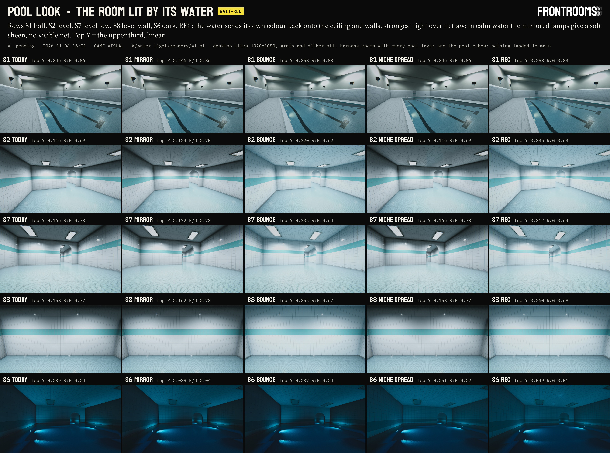

Sheet `sheets/70_water_light.jpg` (3837 x 2854, Shot format, chip WAIT-RED: the keys are Red's to try in scene 4; fit `W/water_light/media/70_water_light_fit.txt`: ALL LABELS FIT): TODAY | MIRROR | BOUNCE | NICHE SPREAD | REC on S1 (hall deck), S2 (level room), S7 (level, crouched), S8 (a level wall from 3 m), S6 (dark zone); each caption gives the upper third's linear luminance and R / G. Keys sheet `sheets/70_water_light_keys.jpg` (3840 x 2173, WAIT-RED, ALL LABELS FIT, `media/70_water_light_keys_fit.txt`: TODAY | REC with the bounce at 0.5 | REC | REC on the phone path (S1, S2; the mirror off, the phone loops) or the bounce alone (S7)). Silent films (h264, no audio stream, Shot header on every frame, 4 s at 30 fps, TODAY beside REC, a drip at 1.0 s): `video/70_water_light_S6.mp4`, `video/70_water_light_S7.mp4` (1440 wide, crf 26; masters 1920 in `W/water_light/media_b1/`). Frames of record `W/water_light/renders/wl_b1/` (desktop Ultra 1920 x 1080, grain and dither off), `wl_c1` (the half-bounce key) and `wl_d_base` (main's shader, the proof of 12.7).

- **The pool level (S2, S7, S8; x4 water, troffers pointing down).** TODAY a bright aqua floor sits under a slate-grey lid and the tops of the walls fall off into near black. With REC the ceiling and the upper walls are lit by the floor: the upper third goes from 0.116 to 0.335 (S2), 0.166 to 0.312 (S7), 0.158 to 0.260 (S8), and its R / G from 0.69 to 0.63: a pale aqua ceiling over turquoise water, the walls white with a cool cast that grows toward the water. The dark ceiling corners are gone; the room reads as one lit space whose light comes from its water. It stays a tiled room, not an aquarium: the walls keep their white and the water stays the most saturated thing in view; the ceiling's R / G (0.63) stays above that of the light the water sends up (the x4 return under the lamps' cool white, 0.53): it takes the water's colour without matching it.
- **The hall (S1; the club's x1 water, the P1-A rig).** A quiet change, as the club's clear water and its uplit ceiling should give: the ceiling over the basin (lit by the ambient only, past the stand-in uplights' 7 m reach) takes a teal cast and lifts a little (the upper third 0.246 to 0.258, R / G 0.86 to 0.83), the beams' undersides most; the deck, facing up, is untouched; the far wall's lower courses carry a trace of cyan.
- **The dark zone (S6; niches only, x3).** The bounce alone changes nothing visible (no lamp lights the water from above; it replaces a near-black ambient with a near-black water: -0.7 of luma). The niche spread (half the niches' glow over the whole basin) lights the walls and the ceiling evenly from the water instead of in streaks above each niche: the upper third 0.039 to 0.051; the room glows from its water, which is `16` §3's night.
- **The mirror.** Light the lamps have, at a few per cent: +6 % on the level's upper third, nothing visible in the hall (the P1-A rig's down spots, 1.2 m from the long walls, reach the ceiling over the basin only by mirror paths of about 11 m: 0.4 % of its light) or the dark zone (dead overheads). In calm water it is a soft sheen, not a net (12.2): the films move by at most 9/255 on the ceilings (mean 0.2-0.5), the floor nets and the drip's ring carry the motion.
- **Light, shadow and water together.** With REC the room's brightness follows the water: brightest close to it, the ceiling lit where it faces the water, the walls' lower courses more than their tops, faces turned away untouched; the shadowed corners stay where the water cannot see (the soffit's top, behind the beams). The water's mirror (desktop) shows the lit ceiling, so the reflection agrees with the room.

### 12.6 Cost per tier

| | Desktop Ultra, High | Desktop Medium, Low | Phones, iPad | WebGL |
|---|---|---|---|---|
| Mirror | the pixel's lights walked once more (only pool-room pixels above the water), 2 x 2 taps of the long loop | same as Ultra (the term is ALU and taps; the mirror camera is not involved) | off | off (`ForceMirror` -1: desktop only) |
| Bounce | per body whose room holds the pixel: a clipped quad's contour integral (4-5 edges, atan2) and 2 SH evaluations; C#: the lamps on each water once a frame (grid of 4-64 points x the room's lamps), the light list found once a second | same | same | same |
| Niche spread | inside the bounce's loop | same | same | same |
| Reflection | the mirror cameras see it with no cost of their own | the probe: a realtime hall probe needs a re-render after `SetWaterLight`; the baked pool cubes do not see it (12.8) | same as Medium | same |
| Memory | 0 (two 12-element global arrays) | 0 | 0 | 0 |
| Body lookup (12.10, always on, not a static) | `FRSubFind` walks every registered body (at most 12 x about 15 ALU) for a Surface pixel in a pool room instead of stopping at the first room; not timed | same | same | same |
| Zone lamp share (12.11) | C# only: a dictionary read per look volume per render context | same | same | same |

**GPU** (this Mac, Apple M3 Max, **UNDER LOAD**: load average 41-111 during the timing; 7680 x 3544, MSAA off, 16 interleaved rounds against TODAY, scaled to 2560 x 1440 by pixels; `W/water_light/renders/wl_b1/wl_timing.tsv`):

| Camera | Bounce | Mirror | REC | REC on the phone path (no mirror, phone loops) |
|---|---|---|---|---|
| S1 hall | +0.36 ms | +0.53 | +0.93 | +0.40 |
| S2 level | +0.34 | +0.54 | +0.87 | +0.34 |
| S6 dark | +0.29 | +0.14 | +0.44 | +0.25 |
| S8 level wall | +0.35 | +0.61 | +0.95 | +0.32 |

With 70 §7.7's +3.3 ms for the hall's water at Ultra, all the water is about 4.2 ms at 1440p, inside `17` §6.1's 4-5.5 ms for Ultra. The phone path's own cost on a phone is not measured (it is the bounce's ALU: no textures, no loop over lights); WebGL not timed. C# per frame (the lamps on the water): not timed; about 64 points x the room's lamps per body (the hall: 48 points x 29 lamps).

### 12.7 Checks

- **Gate (rule 25):** `fr gate --staging W/water_light/stage_pkg` against main at 16:32 (first at 16:17, again after 交互设计's 16:20 landing; after the waterline knob, the rings and tech-art runs not landed): macOS and iOS COMPILE OK, 0 errors, 2 overrides (`FrontRoomsWaterSubmerged.cs`, `FrontRoomsWaterSurface.cs`; `GATE.txt` with the four files' sha1); `fr land` dry run OK. The zone track (12.11) over main: 3 overrides, PASS (`W/water_light/stage_zone_pkg/GATE.txt`, 16:26); both tracks together: 4 overrides, 0 errors (`W/water_light/logs/gate_ab.txt`). The clone with the harness: COMPILE OK (`W/water_light/tmp/roslyn_e`, `roslyn_f`).
- **Shader compile check** (clone-only `FrontRoomsWaterLightCompileCheck.cs`, after §10's; `ShaderData.Pass.CompileVariant` on the ForwardLit pass, `W/water_light/compile_check.txt`): run again by the Package stage on the include with the registry fix (8626e5b0, run `wl_e_fix`; `W/water_light/tmp/compile_check_e.txt`), the same result as the first run's: FrontRooms/Surface 34 of 34 OK (the 14 keyword sets of the clone's 254 Surface materials with each feature alone and three `_FR_PRINT` pairs, 21 sets, on Metal macOS with full URP globals; the empty set without globals and through the vertex stage; four sets on Metal iOS and on D3D; three on GLES3 for WebGL, which compile without error but return no bytecode in the editor); FrontRooms/Water 4 of 4 OK (it does not include the changed file). Control `Hidden/FrontRooms/SurfaceWLCtl` (the payload text with the water light's call given a third argument), three main-path sets on Metal macOS and iOS: **6 of 6 FAIL**, each "'FRSubWaterLight': no matching 3 parameter function (line 1239)", so the check compiles the line this stage added. RESULT PASS. Unity's own import of the payload in the clone: 0 shader errors for FrontRooms/Surface (the control's errors are the expected ones).
- **Today's frames, byte for byte** (grain and dither off, raw PNG, every new static at its default; the same run swaps main's `FrontRoomsSurface.shader` and include in, reimports them, renders S1 S2 S6 again and swaps this stage's back): main's shader and include in place, S1 S2 S6 shot as a run's first frames (`wl_d_base`), against this stage's at its defaults shot the same way (`wl_b1`, and again `wl_c1`): **0 px differ at S1, S2 and S6** (0 over 1/255). The payload as packaged (the registry fix in; `wl_e_fix`, S1 S2 S6 as its first frames) against main (`wl_d_base`): **0 px at S1, S2 and S6 again**. The zone track at its defaults on top (`wl_f_zone`): **0 px at S1, S2 and S6** against water_light alone (`wl_e_fix`), and its two-height hall 0 px against run E's. Found on the way: the harness's water depends on the order the cameras are shot in (the same shader shot later in a run gives up to 32/255 inside the water's box and never a pixel outside it), so the pairs compare frames shot at the same place in a run. The C# side at its defaults only writes `_FR_SubWL` = 0 and a body's depth: inert by construction.
- **Reduce Motion** (REC on): S8 and S7 rendered 1/30 s apart with the ripple clock frozen: **0 channel values differ** on both; with motion on S8 differs in 1,342,927 values. The mirror's net plays on the long ripple's slices, the bounce does not move.
- **Photosafety** (both films, WCAG 2.3.1 as RELAY §9.5 defines a flash; whole frame, quarters, the upper 40 %): **0 flashes per second** in TODAY and REC; the largest frame-to-frame change of a mean 0.0009 of full scale (the floor's caustics with the drip), 0.00017 on the dark ceiling and 0.00003 on the level's (`W/water_light/media_b1/70_water_light_numbers.json`). The terms add no motion faster than the long ripple's; the bounce follows a lamp's flicker exactly as the lamp's own light does.
- **The form factor** (`tmp/ffcheck.py`): the HLSL's contour integral with clipping, ported line by line, against a 200 x 200 brute-force integral on 18 receivers (ceilings, walls, tilted faces, faces turned away, walls touching the water's edge): largest difference 2e-4.
- **Energy:** the bounce is single-bounce light from the lamps that reach the water (C# averages URP's own falloff over the water) times a return albedo of at most 0.63; it replaces the ambient's light from the water's directions; the niche spread only moves light (`_FR_SubThrown.x` = 1 - spread); the mirror is R of the lamps' light. Nothing adds light the lamps do not have.

### 12.8 Honest flaws and limits

- **No dancing net from overhead lamps in calm water.** That is the physics of this ripple (12.2): the fine waves carry most of the slope and scatter the reflected light by 11-26 cm at ceiling distance. The visible moving light on ceilings stays the wet niches' (the dark zone) and the floor's nets; a stirred pool (wading, the Relay, a plunge) would sharpen it, but **the footstep rings do not move the mirrored lamps' light**: past the focus a ring's lens is not a single sheet (the floor's `FRRingLens` would print black rings at D = 2 x path), and a proper form (several sheets, or a stirred-surface blur that follows the rings) is a follow-up.
- **The bounce is one uniform rectangle per body:** the exitance is the mean over the water (a lamp right over one end lights that end's ceiling no more than the other's); a basin of varying depth takes one mean depth (`FrontRoomsWaterSurface.depth`; the harness sets the hall's 0.9 m, scene 4 should pass the body depth it already measures). No occlusion inside the room box (a beam or the soffit does not shadow the water's light); light through an arch into the next room is not counted.
- **Calibration against the zone's ambient.** The bounce is physical (the lamps' light on the water x the return albedo); the zone looks' ambient terms were tuned by eye and are dimmer than a physical floor bounce (the hall's ground term 0.074 against about 0.25 for its lit deck). So over the water the ceiling now gets more than over a dry deck, where a full GI would give the deck side more still. Visible in the level rooms (the ceiling x2-3) and not in the hall; the zone look line may lift its ambient ground terms toward the deck's real bounce later. `BounceGain` 0.5 is the key for a softer step.
- **Single bounce.** The water's light that reaches the walls does not bounce again (the zone ambient stands in for it).
- **The game's baked pool cubes** (`Refl_Pool`, `Refl_PoolDead`, `Refl_PoolLevel`) do not hold the lit, tinted room: on the probe tiers (phones, WebGL, desktop Medium and Low) the water and the glaze reflect the room as it was. A rebake with REC on (the recipe of 7.6, `-plSubProbes`, with `-plWL rec`) belongs to the day Red picks, in scene 4's own rooms (they are baked from the stand-in rooms, 7.11). The harness's REC frames use cubes rebaked in memory (`-plWLCubes`, clone-only `Assets/Editor/PoolLook/WLCubes/`).
- **The room box decides who gets the light.** `FrontRoomsStructuresWater` sets `roomMargin` as the mean of both sides' gaps, so in an asymmetric room the box can reach past one wall: a surface behind that wall within the box would take the water's light. Their box, their fix (per-side margins would need a `FrontRoomsWaterSurface` field).
- **The registry holds no basin floor** (12.10): a point under a higher water's rectangle counts as in it whatever lies between; scene 4's terraces stand beside their catch pools, so it does not arise there.
- **The zone's lamp share is set by hand** (12.11): nothing measures a zone's lamps; the scene or the game's lamp driver sets it with them. The value 3 for scene 4 is computed, not looked at there.
- **Not verified here:** Play mode (the light scan once a second, the flicker; the harness calls the same `Publish` in edit mode), scene 4 itself, a phone, a browser, D3D and GLES3 at run time (compiled only).

### 12.9 For the landing and for scene 4

- **Package `W/apply/water_light`** (v2, rebuilt by the Package stage over main at 16:16, with the registry fix): 4 replaced paths, 4 metas kept (`FrontRoomsSurface.shader` c1a74c99 -> dae1432d, `FrontRoomsWaterSubmerged.hlsl` ee8ed0f0 -> 8626e5b0, `FrontRoomsWaterSubmerged.cs` 093c2f13 -> b72541ed, `FrontRoomsWaterSurface.cs` dfafe86c -> bcf3e20e); DRY RUN OK; gate in `W/water_light/stage_pkg/GATE.txt`; scratch rehearsal MANIFEST OK then ALREADY APPLIED (`W/water_light/tmp/rehearsal_a`). **Package `W/apply/pool_zone_look_tune`** (v2, stacked on it, 12.11): 4 replaced paths, 4 metas kept; refuses on main until water_light lands; on main + water_light DRY RUN OK, MANIFEST OK, then ALREADY APPLIED (`tmp/rehearsal_b`); re-run its `fr gate --staging W/water_light/stage_zone_pkg` after water_light lands (main's C# will have changed). Inert: every default is today (12.7). The rings run (`W/water_rings`) touches other files; the tech-art run's LOD cross-fade and MotionVectors pass go into `FrontRooms/Surface` too: whichever lands second runs `W/tools/rebase_apply.sh` (this stage's hunk in the shader is one statement after the thrown light's; the include's is one block at its end).
- **For 水体仿真调研 and 夸张结构调研与设计** the exact calls, values and key states are in `W/water_light/for_water_line.md` (main's `FrontRoomsStructuresWater.cs` is b73d9831 now). In short, **for 水体仿真调研 (scene 4's driver, theirs):** their key I's stand-in spot lights become `FrontRoomsWaterSubmerged.SetWaterLight(WaterLightLook.Today / Mirror / Bounce / Spread / Recommended)` (a half step: `BounceGain = 0.5f` then `Publish(true)`), with their stand-in lights off whenever a real look is on (both at once would count the water's light twice), and their hall probes re-rendered after each switch (they already do on K and I); `ws.depth = bodyDepth[i]` in `Body()` (the bounce's colour by the real depth); scene 4's `Underwater()` lamps registered with `FrontRoomsWaterSubmerged.RegisterNiche(light, light.intensity)` so their light comes back out of the basins (today no scene-4 lamp is a niche, so neither the thrown light nor the spread sees them). The zone look volumes are placed now (夸张结构调研与设计, LANDINGS 15:14 `pool_zone_s4`, key Q); with this stage's zone track Q can default ON once a look at `SetLampShare("PoolLevel", 3f)` holds the porcelain (12.11).
- **Combined-test rows** (`handoff/visual_combined_test.md`, when landed): the rows for both tracks are in `W/water_light/combined_rows.md` (the game unchanged; each key of the water light in scene 4; SP1's several waters stay water; Reduce Motion; GPU; Q on with the lamp share; height fog over the terraces; the pool level's niches).
- **Files of this stage:** the clone-only harness (`FrontRoomsPoolLook.WaterLight.cs`, `FrontRoomsWaterLightCompileCheck.cs`, `WLCtl/`, three hook lines, the RenderRoot pointing at `W/water_light/renders/`, the zone-lamps stand-in kit copied from `W/proj_pooldir`) lives in `W/proj_bstations` (the HUD chips harness put back beside it); the model `tmp/model.py`, the form-factor check `tmp/ffcheck.py`, the media `tmp/make_wl_media.py`, `tmp/make_wl_sheet.py`. Deletion candidates (inside `W/water_light`, Red deletes): `old_pkg_1426/` (the package built before the knob landed), `old_stage_pkg_1437/`, `stage_pre_bugfix/`, `base_main/`, `tmp/roslyn_c0`, `tmp/roslyn_c7`, `tmp/roslyn_e`, `tmp/roslyn_f`, `tmp/view/`, `tmp/rehearsal_a/`, `tmp/rehearsal_b/`, `renders/wl_b1/film_*` (the MP4s hold them), `media_b1/` once the doc copies are in main; the Package stage's harness additions stay in the clone with the rest. mkapply moved the 14:37 payload and base to `W/_partial/` (also deletion candidates).

### 12.10 Which water a point belongs to (the registry fix, Package stage)

Found by 夸张结构调研与设计 in scene 4 (`W/level_space/glaze/render_log.txt`, 15:23; the parent's note 16:03): SP1's catch pool rendered dry. `FRSubFind` took the first body whose room box held the point, and `FrontRoomsWaterSurface.RefreshSubmerged` (`OnDisable`, `OnEnable`) put a body back at the end of the list. SP1's waters share their hall (the catch pool at -0.05, court basins at +0.50 to +2.30, each body's room the whole hall), so once their rig had refreshed the basins that carry caustic lamps, a point on the catch pool's floor met a terrace's room first: not under that terrace's water, so dry. Their rig works round it (`SetSources` in place).

The rule now, in the loop `FRSubFind` already ran (`FrontRoomsWaterSubmerged.hlsl`):
- under a body's rectangle (the same 2 cm margin) and below its surface: that body, the **lowest** such surface above the point (the water the point is in);
- over a rectangle and above its surface: that body's room, the **highest** such surface below the point (the water under it: its niches' thrown light and its mirror);
- elsewhere: the first room box that holds the point, as before.

Equal heights keep the first body, as before, so a room with one water, or a hall of waters at one height (the harness's level and dark rooms; scene 4's SP6 rooms at -0.03), renders exactly as before. C#: a wet niche belongs to the lowest surface above it (`BodyUnder`), `Register` keeps a re-registered body's place in the list, and `RefreshSubmerged` registers in place (the planar and the rings as before). Cost: the loop now walks every registered body instead of stopping at the first room that holds the point: at most 12 iterations of about 15 ALU for a `FrontRooms/Surface` pixel inside a pool room (a pixel outside every room walked them all before too), on every tier; not timed separately.

**Proof** (run `wl_e_fix`, harness `-plWLTerrace`; frames `W/water_light/renders/wl_e_fix/`): the hall with a raised basin on its east deck (inside 1.80 x 4.70 m, water 0.45 m over the deck and 0.40 m deep, its room box the whole hall as SP1's), registered before the hall's basin (the order the old refresh left: `... 9@0.450 1@-0.120`). `RefreshSubmerged` on both: the order is the same afterwards (KEPT). With this stage's include the hall basin is water: its box in S1 averages sRGB 76.0 / 116.3 / 128.2 (R / G 0.653; without the terrace 76.1 / 116.4 / 128.2). With main's include in the same run (`S1_terrace_base`, `ST_terrace_base`) the hall's floor renders dry: 119.9 / 137.7 / 143.0 (R / G 0.871), the bug as scene 4 showed it. Without the terrace, S1 S2 S6 are 0 px against main (12.7).

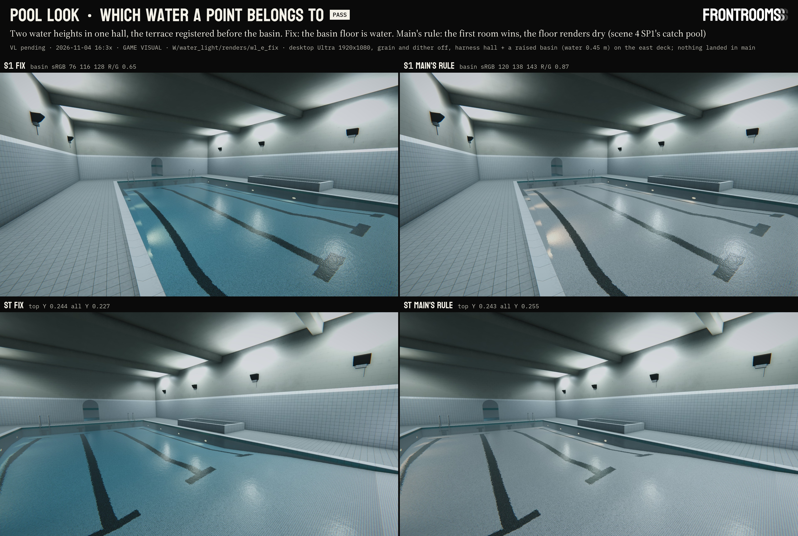

Sheet `sheets/70_water_registry.jpg` (3840 x 2582, Shot format, PASS, ALL LABELS FIT: `W/water_light/media/70_water_registry_fit.txt`): S1 and ST, the fix beside main's rule, in the same run.

Limit: the registry holds no basin floor, so a point under a higher water's rectangle counts as in it whatever lies between (the underside of a slab over a lower pool, inside the upper basin's footprint). Scene 4's terraces stand beside their catch pools, not over them.

### 12.11 Scene 4's pool zone look (Package stage, the parent's note of 15:15)

夸张结构调研与设计 placed this line's `FrontRoomsZoneLookVolume`s in scene 4 (LANDINGS 15:14 `pool_zone_s4`: SP1 7 rooms, SP2 F0, SP6 9 rooms, all PoolLevel; key Q, off by default) and measured (`W/level_space/glaze/zone_log.txt`, 14:36; frames `W/level_space/renders/scene4/zone1/`): with Q on the porcelain goes slate grey-blue, tile luma 11-39 % lower (SP1 s00 123.8 against 165.0, SP6 s01 90.2 against 148.1). Four asks, all this line's; the second track `W/apply/pool_zone_look_tune` (stacked on water_light) holds the answers.

1. **The ambient.** PoolLevel's trilight (.27 / .30 / .31, .28 / .31 / .32, .38 / .41 / .41) is about a third, in linear light, of the trilight scene 4 tuned by eye (.44 / .49 / .51, .50 / .555 / .575, .66 / .72 / .72): 2.8, 3.4 and 3.4 x per term in luminance. It was tuned (§3) for rooms lit as the map lights the pool level, which the harness's frames hold, and there it is right; raised in the profile, it would light the game's pool rooms twice once 灯具适配 builds P1-A / P2-A. Scene 4's rooms have neither those fixtures nor the map's troffers, and its own trilight stands in for them. So the profile's values stay, and **the zone's light follows its lamps**: `FrontRoomsZoneLook.SetLampShare(zone, share)` scales the zone's ambient probe, its haze colours (exp2 and the height fog) and its share of the scene's fill, linearly; 1 = as tuned, the default, where the same floats as before are written. **For scene 4 without its fixtures: `SetLampShare("PoolLevel", 3f)`.** Above 1 the share adds light no lamp in scene 4 has: it stands in for the fixtures the rooms will get, as scene 4's own trilight does today, and goes back to 1 when they are built; the water-light terms on top of it stay energy-honest (they only return what reaches the water). From their stops: with Q off the ambient carries about 70 % of the tile's light (SP1 s00 in linear: 0.376 = 0.112 direct + 0.264 ambient, solved from 123.8 / 165.0 and the trilight ratio; SP6 s01 nearly all ambient; SP2 s08 about 35 %), so three times the zone's ambient brings Q on back to Q off's tile level at every stop (2.8-3.4 by term). **The split with the water light on:** REC's bounce replaces the zone ambient's light from the water's directions with the water's own (its light from above is the lifted ambient times the return albedo plus 0.066, so it scales with the share too); a ceiling over lit water then takes the water's colour and light, everything else the lifted ambient. In the harness's level room, where the lamps are as built, the bounce is two thirds of the ceiling's light with REC (12.5, S2's upper third 0.116 to 0.335); in scene 4 its share depends on how much of scene 4's own lamplight reaches the water, which was not measured here. Harness check (run `wl_f_zone`, S2, the lamps as built; sheet `sheets/70_zone_share.jpg`): with the lamps as built, share 0.5 takes the upper third from 0.117 to 0.084 (x 0.72) and the whole frame from 0.347 to 0.323 (the lamps carry the floor); share 3 lifts them to 0.248 (x 2.1) and 0.435 (x 1.25), over-bright in a room that has its lamps, which is why 3 is for scene 4's rooms without them. **Not looked at in scene 4:** it renders in their clone with their harness. One look decides, Q on with 3 against Q off (their `zone_measure.py`: tile luma within 5 % at the six stops); 2.5-3.5 is the range to move in. The other pool profiles, checked the same way against scene 4's trilight: PoolHall 2.3 / 4.5 / 5.4 x, PoolClub 6.1 / 5.4 / 5.1 x (shares of about 4 and 5.5 would stand in the same way), PoolDark 28-46 x (dark by design: no share); scene 4 places only PoolLevel, so only its share is needed there.
2. **The pool level's thrown light.** `thrownLight` 0 -> 1 in `Fill("PoolLevel")` and `FrontRoomsZoneLook_PoolLevel.asset`: the physical share of `17` §4.3 (`NicheGlow` 0.25; PoolHall 1, PoolDark 2.5 to carry its night). It was 0 because the level's ankle water has no niches (its moving light is the hidden compact lamps' caustics); scene 4's PoolLevel basins (SP1's catch pool and court basins, the grotto) do. Nothing changes where no niche is registered, as in the harness's level rooms. Scene 4's underwater lamps still have to be registered as niches (`W/water_light/for_water_line.md`).
3. **Night and dead lamps.** The same share, driven with the lamps: scene 4's night key (`FrontRoomsStructuresLook` preset PoolNight) halves the trilight's gamma colours, which leaves 0.23-0.24 of its light in linear, so `SetLampShare("PoolLevel", 0.7f)` at night with the stand-in (3 x 0.235; a zone with its fixtures and lamps that really halve: 0.5) and 3 again by day; a dead zone 0, which leaves the niches' thrown light and the water's bounce of whatever still burns (the bounce reads the lamps' live intensities every frame). The game's lamp driver can call it the same way.
4. **Height fog over terraced water.** `AddPoolLooks` gives a volume over waters of several heights no single height (NaN), so SP1's hall and SP6's weirs had no height fog. Such a volume now lays its height fog on the lowest registered water whose rectangle's centre lies in its box (`FrontRoomsZoneLook.LowestWaterIn`, reading `FrontRoomsWaterSubmerged.GetBody`): the haze pools on the catch pool and thins up the terraces (PoolLevel's 0.6 m scale: 43 % of the density 0.5 m up, 2 % at 2.3 m). A volume with a height keeps it. Check (run `wl_f_zone`): the hall's look volume given no water height (`ST_terrace_lowfog`) renders 0 px from the same frame with its height (`ST_terrace`): the lowest water it finds is the hall basin's -0.12, the terrace's 0.45 lies above it.

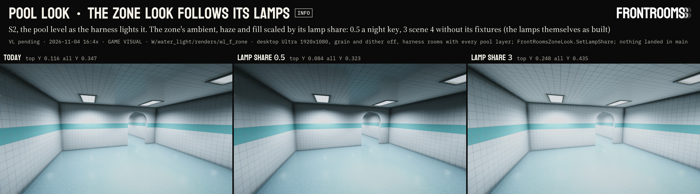

Sheet `sheets/70_zone_share.jpg` (3838 x 1067, Shot format, INFO, ALL LABELS FIT: `W/water_light/media/70_zone_share_fit.txt`): S2 TODAY | lamp share 0.5 | lamp share 3, the harness's lamps as built.

| Path (under `Frontrooms3D/`) | base -> payload | What |
|---|---|---|
| `Assets/Scripts/Rendering/ZoneLook/FrontRoomsZoneLook.cs` | 8bf5b76f -> a13eff0f | `SetLampShare`, `LampShareOf`, `LowestWaterIn` in one block before the fills; two branches in `Evaluate` (the share, the lowest water); the shares cleared with the statics |
| `Assets/Scripts/Rendering/ZoneLook/FrontRoomsZoneLookProfile.cs` | 663efcde -> 52d1cfa3 | PoolLevel `thrownLight` 1 and its comment |
| `Assets/Resources/Rendering/ZoneLook/FrontRoomsZoneLook_PoolLevel.asset` | 4b2dc8b6 -> af8c1e9f | `thrownLight: 1` |
| `Assets/Scripts/Rendering/Water/FrontRoomsWaterSubmerged.cs` | b72541ed (water_light's) -> 1f68c7a3 | `GetBody(i, out rect, out y)` |

Statics and defaults (= today): `FrontRoomsZoneLook.SetLampShare(zone, share)`, every zone 1 until set, reset at Play start; `""` sets every zone without its own value. Cost: a dictionary read per volume per render context, and for a volume without a water height a pass over the registered bodies (at most 12); no shader change, the same on every tier.

## 13. Tile, second pass: POOLS, GZ-C and the dish (workflow `surface_detail`, 2026-11-04)

Line 游戏视觉, workflow `surface_detail` (parent session local_be0f3747, account A): stage Research 13:5x-17:32 (13.1-13.4), stage Pool tile 17:33-20:4x (13.5-13.14; the machine rebooted at about 18:58 and the stage resumed from disk at 19:07). The research was staged as §11; the water rings landed as §11 at 20:27, so the tile's second pass lands here as one section. Red's asks, verbatim (this line's chat, plain user turns):
- 13:4x: "目前的泳池瓷砖又一些太平整了，以至于看起来特别的假，并且在光线追踪打在上面的时候，边远过于清晰和面过于平整导致很多细节过于整齐不够真实，我需要你参考Pools游戏 优化瓷砖，以及光打在瓷砖上的表现"; then "同我需要你给我仔细revise办公室等不同房间的serface design，避免过于平整，我需要你调研3A游戏是如何通过法线贴图等一系列技巧来提升这些模型信息量并且和光线追踪协作的，来优化每一个房间" (every room family: `research/surface_detail/`, 00 inventory, 10 AAA techniques and POOLS, 20 design, 60 build log, SOURCES; this section keeps the tile's part next to §4)
- 16:5x: "目前泳池瓷砖本身还需要你给我做各种各样的variation，重点在于法线贴图让瓷砖表现出一种不规则的感觉，中间凹四角突"
- 16:4x, in 夸张结构调研与设计's chat (relayed by local_138b3879 and the parent's note of 16:44, binding): GZ-C picked for the glaze ("选这个", with the sheet's GZ-C column; `research/level_space/73_pool_glaze.md`).

The build (13.5-13.14) reuses, not redoes: §4 (the tile as built), 13.1-13.4 (POOLS, real tile numbers, TODAY frames), `research/surface_detail/` (00 inventory, 10 AAA techniques, 20 design §2), 73 (GZ-A/B/C, their numbers and shader prototype `W/level_space/glaze/contract/glaze_c.diff`, credited here: the box projection for the tile only, the two-lobe glaze and its helpers, the specular AA values and GZ-C's warp numbers are theirs). Nothing landed in main by either stage, no Unity on main, nothing downloaded, no git.

### 13.1 What Red sees today, and why it reads flat (stage Research)

- **Scene 4 does not draw §4's tile.** The structures scene and the map's pool pass take `FrontRoomsPoolMaterials.Tile` / `Band` (关卡设计's `Scripts/FrontRoomsMap/FrontRoomsPoolMaterials.cs` 5ed07ecc): a runtime clone of `Prop_CeramicGlaze` on the level-space set `Assets/Structures/Textures/LS_PoolTile150_{A,N,S}` (2048² over 1.5 m), smoothness 0.85, mesh UVs, every wear term set to 0. Its faces are exactly flat (only the tile edges are bevelled in the normal map), its glaze gloss is one value (raw R .997 +- .018), its albedo pure white (.998), its joints ruled. §4's `Prop_PoolTile_*` (landed 12:52) is used by no scene: no call to `FrontRoomsPoolTile.Get` outside its own file.
- **No ray tracing reaches the tile.** GlassRT traces mirror rays from glass receivers only; scene 4's pool route has none on screen (the scene's own flash: "只有玻璃会变；水不接收光追反射，也不在光追场景里"). What reads as "光线追踪打在上面" is the lamps' GGX highlights, the probe's image and the desktop planar water mirror, on a flat, constant-gloss surface with knife-sharp box edges (`00_inventory.md` §3).
- **§4's own tile, measured:** per-tile set +-0.18 deg and shade 0.4-1 %, orange peel and swell in the normal (6.9 deg RMS at mip 0, 2.6 at mip 5), but a glaze gloss of 0.935 +- 0.006 that never varies and turns mirror-like as the normal mips away (as CoD WWII describes for bumpy, glossy surfaces), and joints still perfectly straight.

### 13.2 POOLS and real tile (from `surface_detail/10` §11-§12)

- POOLS (Tensori, Unity, baked lighting + SSGI + probes, no real-time RT): each tile is a slightly different mirror (a lamp's or window's reflection breaks into tile-sized patches; some tiles inside it nearly dark), joints wobble and vary in width, tone steps per tile (multi-tone teal mosaic), gloss high but soft inside a tile, soft bounced light, a found-footage camera.
- Real glazed wall tile: warpage and curvature about +-0.3-0.5 % (0.6-1.1 mm over a 150 mm tile's diagonal), lippage 1 mm plus warpage within ANSI A108.02-2023, cushion edges with slightly recessed joints, orange peel long wave 1.2-12 mm (what wobbles a reflection at 2-3 m).

### 13.3 The plan (`surface_detail/20` §2)

Built on the glaze line's work, not beside it (`research/level_space/73_pool_glaze.md`, GZ-A/B/C, sheet with Red): one glaze model in `FrontRooms/Surface`. P1 one tile: scene 4 and the map draw this tile (contract; `LS_PoolTile150` stays the switch's today value) with the GZ numbers Red picks in `gen_pool_tile.py`; P2 the glaze model inside `_FR_TILE` (box projection for the tile only, geometric specular AA, the two-lobe glaze, the reflected water band: level_space's §9 asks); P3 hand-set joints (offsets +-0.5-0.9 mm, widths 2.4-3.8 mm, rows drifting +-1 mm); P4 gloss and tone per tile and lots on the course and mosaic; P5 micro-shadowing and directional specular occlusion on the grout, the cushion's highlight line kept at distance; P6 bullnose geometry on tiled corners, pillars, steps and edges (contract); P7 lamps bright enough to be mirrored (Red's P1 pick, scene 4's proxies); P8 `_FR_TILE` in GlassRT's hit shader; P9 SSAO per pool zone (0.6-0.8 instead of 1.6, a float in `FrontRoomsZoneLookProfile`); P10 lamp images on phones from the baked `Refl_Pool*` cubes (realtime probes are off at Medium and on handhelds). Every term behind `FrontRoomsSurfaceDetail` (today = byte-identical), WebGL unchanged. (As built, 13.5-13.14: package `pool_tile_real`, P1-P5 and P9 behind the tile's own switch `FrontRoomsPoolTile.SetLook`, with Red's dish of 16:5x; the shared `FrontRoomsSurfaceDetail` core starts with the Office package.)

### 13.4 TODAY frames

Sheet `research/surface_detail/sheets/sd_today_tile.jpg` (3835 × 1894, chip BASELINE; ALL LABELS FIT): scene 4 as Red walks it (the water line's Play frames `W/water/renders/s10b/rtp`, look Today, GlassRT Off and High: identical, 0 glass pixels) with 1:1 crops of the gallery's one-blob lamp reflection and the knife-edged pillars; the tile booth (clone-only harness `FrontRoomsSurfaceLook`, run `W/surface_detail/renders/today_v7`): row A scene 4's tile, row B §4's tile (Field walls, Deck floor), one 6 × 6 m room each under the same four L03 troffers, rows eye, 3 m, grazing, 0.35 m, floor, raking light 0.25 m off the wall, phone; then the pool look as landed (the pool look harness inside the same batch, every layer `pool`: S1, S2, S5, S8, S10) with 1:1 crops of the landed tile.

What the booth shows (`surface_detail/00` §5.1): A's lamp images are soft discs that the joints cut square, a glossy plane with a grid printed on it; B's (§4's tile) are pinpoint glints at 3 m and a crinkled, foil-like patch at 0.35 m (the orange peel and swell at a constant 0.935 glaze: sparkle, not waviness); under raking light both walls stay dead flat (the 0.18 deg per-tile set is about a third of real warpage's 0.3-0.6 deg); the Deck floor is matte beside the glossy wall. 13.3's P3-P5 answer exactly this (built: 13.5-13.14).

### 13.5 What reads flat today, and what each lever answers

| Red sees (13:4x, 16:5x) | Cause (13.1, `surface_detail/00` §5.1) | Lever in this package |
|---|---|---|
| faces too flat ("面过于平整") | the per-tile set is ±0.18° and the map's bow 0.05-0.20 mm convex: a third of real warpage; every tile one plane | **the dish**, per tile, analytic in the shader: the centre sunk, the four corners up (Red 16:5x), shallow to deep, round bowl to flat floor with steep corners, corners raised more, a twist, one edge bowed on a third of the tiles, a tilt; a few tiles near flat or domed |
| edges too crisp ("边缘过于清晰") | the cushion's highlight is a sub-pixel line on a 0.935 glaze, never filtered | the cushion drawn analytically with each tile's own radius (0.85-1.3 x 1.8 mm), the glaze thickening into the joint (a fillet at the cushion's foot), **lippage** against the neighbours rolling a proud edge further; **specular AA** turns the line into a soft highlight as it shrinks on screen |
| details too neat ("细节过于整齐") | ruled joints, one gloss, one tone, the map's waviness repeating every 1.2 m | **hand-set joints** (each tile offset in its joints, one in six turned up to 0.25°, joints stretched or squeezed between neighbours, never closed; the setter's lines drifting over metres), **gloss per tile** (±0.03, one in seven a hazy glaze), **tone per tile** (±0.6 % on top of the lot jitter), **each tile its own window and strength of the glaze's waviness** |
| light on the tile ("光打在瓷砖上的表现") | one GGX lobe at 0.935, the probe never box projected, a mirror at distance | **GZ-C's glaze**: the probe box projected for the tile (lamp images stay on their lamps where a box probe exists), two environment lobes (a sharp core 0.97 in a soft halo 0.62 at 0.2), the lamps one lobe at the glaze's own gloss; the face map's slope variance that its mips average away goes into the roughness (far tiles keep their sheen); directional specular occlusion and micro-shadowing from the cavity in the grout |
| corners drawn as dark wire (level_space SP6-F12, the parent's note 14:04) | the shared SSAO at 1.6 on white porcelain | **contact shade per zone**: the pool zones keep 0.6-0.8 of the shared SSAO's darkening on their tile (a float the zone look blends) |

### 13.6 What was built (in the clone `W/proj_unlock`; package `W/apply/pool_tile_real`)

| Path (under `Frontrooms3D/`) | Base (main) → payload | What |
|---|---|---|
| `Assets/Resources/Rendering/FrontRoomsSurface.shader` | dae1432d → 5f96f272 | the real look inside `_FR_TILE` (`FRTileSurfaceReal`, `FRTileShapeSlope`, `FRTileJointRemap`, `FRTileSetOut`, `FRTilePBR`, `FRTileGI`, `FRTileEnvSample`, `FRTileLobe`, `FRTileAA`, `FRTileMicroShadow`); 3 per-material vectors (`_TileForm`, `_TileForm2`, `_TileEdge`) and the face map slot `_TileFaceMap` in every pass's layout; the globals `_FR_TileLook`, `_FR_TileLook2`, `_FR_TileGlaze`, `_FR_TileAA`, `_FR_ZoneSSAO`. Today's path is not touched: `FRTileSurface` and `UniversalFragmentPBR` run as before while `_FR_TileLook.x` is 0. WebGL (GLES3, WebGPU) compiles the real look out |
| `Assets/Scripts/Rendering/PoolTile/FrontRoomsPoolTile.cs` | 95e63dbc → 47385d1e | `PoolTileLook` (Today, GZC, DishShallow, DishMedium, DishDeep), `DefaultLook` = DishMedium, `Look`, `SetLook`, `NextLook`, `Publish` (writes the globals; at load in the editor, before the first scene in a player, and when the tier changes), kinds FieldMesh and CourseMesh |
| `Assets/Scripts/Rendering/ZoneLook/FrontRoomsZoneLook.cs` | a13eff0f → e1cd3853 | the blended `contactShade` written as `_FR_ZoneSSAO` per render context (saved and restored with the context's other globals) |
| `Assets/Scripts/Rendering/ZoneLook/FrontRoomsZoneLookProfile.cs` | 52d1cfa3 → 6b52850b | `contactShade` (1 = the renderer's SSAO, as before) and its built-in values per pool zone |
| `Assets/Resources/Rendering/ZoneLook/FrontRoomsZoneLook_Pool{Club,Hall,Level,Dark}.asset` | f8406464, fb77eb4c, af8c1e9f, 9c51e73a → one line added each | `contactShade` 0.7, 0.65, 0.6, 0.8 |
| `Tools/lookdev/pool_tile/gen_pool_tile.py` | 61f41010 → 3e67a0b2 | `make_face` (the face map), the per-kind real-look values (`REAL`), the slot in every material, kinds FieldMesh and CourseMesh; every earlier map is generated byte for byte as before |
| `Assets/Resources/Surfaces/Pool/Textures/PoolTile_Face_F.png`, `_F_Phone.png` (+ `.meta`, new GUIDs) | new | the glaze's waviness (R, G slope codes) and the grout's grain (B, A), no tile structure; 1024² and 512² over 0.6 m; BC7 on Standalone, ASTC 4x4 on iOS, 32 px on WebGL (never sampled there) |
| `Assets/Resources/Surfaces/Pool/Prop_PoolTile_*.mat` (26) | replaced, `.meta` kept | the face map slot and the three vectors added; every value today's path reads is unchanged |
| `Assets/Resources/Surfaces/Pool/Prop_PoolTile_{FieldMesh,CourseMesh}[_Phone].mat` (+ `.meta`, new GUIDs) | new | the field and the course on mesh UVs in metres: the structures scene's tile and band (contract below) |
| `Assets/Resources/Surfaces/Pool/Textures/pool_tile_manifest.json` | replaced | the face map's files, its slope statistics and lost variance by mip, the materials' real-look values |

Clone only, never landing: `Assets/Editor/SurfaceDetail/FrontRoomsPoolLook.TileLooks.cs` (the looks on the pool look harness, the identity pair, the film), `FrontRoomsSurfaceTileCompileCheck.cs`, `FrontRoomsSurfaceToday.shader` (main's Surface renamed `Hidden/FrontRooms/SurfaceToday`, the identity reference), `FrontRoomsSurfaceTileCtl.shader` (the compile check's control), and two lines in `Assets/Editor/PoolLook/FrontRoomsPoolLook.Tile.cs` (`-plTileLook`, default Today, so every other run of the harness keeps its tile; `-plTileSweep LOOKS`).

### 13.7 How it works

- **One switch, no material edits.** `FrontRoomsPoolTile.SetLook(look)` writes four global vectors; every pool tile material reads them. `Today` writes zeros and the shader takes today's path (`FRTileSurface`, `UniversalFragmentPBR`), bit for bit (13.10). The default is `DishMedium`, Red's ask; scene 4 cycles the looks with `SetLook(NextLook(Look))` and no rebuild.
- **Each tile its own, from a hash of its cell** (the cell wraps every 192 m, as today's lot jitter, so a room-stream rebase never re-rolls a tile; nothing repeats within it). Nine hashes of the tile (three of them today's lot jitter) and two of its neighbours per pixel, 8 bits per number:
  - *set-out*: the tile sits up to 0.5 mm off its place in its joints (uniform), one tile in six turned up to 0.25° (a wedge joint, 0.33 mm at the corners), the joint between two tiles stretched or squeezed to its new width (3.0 ± 0.41 mm, 2.2-3.8 mm for 95 % of joints, never under 1.5 mm even at a turned tile's corner: offsets stay under half a joint); the setter's rows and columns drift 0.4 mm over 3.84 and 4.8 m. The maps are read through this remap with the unwarped UV's gradients, so mips never seam.
  - *shape* (`FRTileShapeSlope`, analytic slopes, no 8-bit steps and no mips): the dish h = D s^p + C x²y², s = (x² + y²)/2 over the face (0 at the centre, 1 at the corners), D = the look's depth x 0.45-1.55 per tile, 85 % of tiles dished, 9 % near flat (0.15 D), 6 % domed (-0.5 D), p = 1-2.4 (a round bowl to a flat floor with steep corners), C up to 0.4 D (the corners raised more), a twist (w x y), one tile in three with one edge bowed (0.45 x the depth, up or down, fading to the opposite edge), a tilt (sd 0.20°). GZ-C as given: its bow h = b (1 - r²/75²), domed 0.15-0.40 mm on 80 % and dished at 0.65 x that on 20 %, saddle sd 0.05 mm, tilt sd 0.20° (73 §7), and none of the levers below.
  - *cushion and grout* (the set's geometry from `_TileEdge`, as the maps draw it): the face rounds over into the joint with the tile's own radius (0.85-1.3 x 1.8 mm), the glaze thickening at the cushion's foot (a fillet over 0.34 mm instead of the kink to the grout), a proud edge rolling further by its lippage against that neighbour (sd 0.12 mm per tile, ANSI A108.02 allows 1 mm plus warpage at 3-6 mm joints), the grout struck concave (0.7 mm under the face at the foot, 1.3 mm in the middle). These few millimetres fade out per axis as a pixel grows over them (from about 1.5 m: the slopes scale by saturate((2 r / pixel - 1) / 3), the job the maps' mips do for today's cushion), so far joints keep the maps' grey line instead of aliasing into dark and white dashes (pt_v1 showed exactly that before the fade).
  - *the glaze's waviness*: the face map (GZ-C's orange peel on 5 mm at 3 µm and swell on 14 mm at 6 µm: 0.246° rms per axis; today's normal map carries 0.56° on the flat face, the crinkled foil of 13.4) read through a window of the map the tile takes at random, at the tile's own strength (0.6-1.4), fading to nothing on the cushion; the grout its own grain. The slope variance the map's mips average away (6 % at mip 0, 59 % at mip 2, 98 % at mip 4) goes back into the roughness (Kaplanyan's α² + σ²), so a far wall keeps its sheen instead of turning to a mirror.
  - *gloss and tone*: ±0.03 per tile on the glaze, one tile in seven a hazy glaze (0.04-0.09 lower); ±0.6 % tone per tile on top of the lot jitter (white tiles step in tone, as POOLS' do).
- **The light on it (GZ-C, `FRTilePBR`)**: the lamps' lobe at the glaze's own gloss, filtered by geometric specular AA (Tokuyoshi-Kaplanyan 2021: variance 0.10, threshold 0.18); the environment in two lobes of the same probe, a sharp core (0.97) inside a soft halo (0.62) at 0.2 (73's tuning note: 0.4 hid the core at 0.35 m), each with its own environment BRDF so the energy stays at the glaze's F0, both AA-filtered; the probe box projected for the tile only, without URP's keyword (`BoxProjectedCubemapDirection` when the probe has a box: realtime box probes, scene 4's; the zone cubes and the default reflection have none and stay at infinity); directional specular occlusion from the cavity (Lagarde 2014) instead of a flat multiply; micro-shadowing on every light from the cavity at half strength (Brinck-Maximov), so the grout darkens under a grazing lamp and opens under a frontal one; the zone's contact shade on the shared SSAO.
- **GZ-C's water band** (`FRSubReflected`, 73 §5.2) is the same light as §12's `FRSubWaterLight` (the lamps the water mirrors onto its walls), landed 16:47: one term, not two; the tile takes it from §12.
- **Tiers.** Desktop and phones run the same real look (phones read the 512 px face map; the lod offset in `_FR_TileAA.w` keeps the lost-variance table right). Realtime probes are off at Medium and on handhelds, so phones mirror the zone's baked `Refl_Pool*` cube (no box projection) and the lamps' own highlights, which the dish breaks tile by tile as on desktop. WebGL compiles the real look out: today's path, unchanged.

### 13.8 The values

Per look (`FrontRoomsPoolTile.Publish`; the globals `_FR_TileLook` (look, dish depth mm, dished share, the Pools levers), `_FR_TileLook2` (tilt sd °, twist sd mm, GZ-C bow lo, hi mm), `_FR_TileGlaze` (core, halo, halo weight, box projection), `_FR_TileAA` (AA variance, threshold, face slope variance rad², phone lod offset)):

| Look | Dish (mean depth at the corners, per tile range) | Tilt, twist | Levers (joints, lippage, gloss, tone, cushion, waviness per tile) | Glaze (core, halo at weight, box) | AA |
|---|---|---|---|---|---|
| Today | the landed tile: the map's bow 0.05-0.20 mm convex, set ±0.18° (uniform) | (map) | none | one lobe 0.935, no box | none |
| GZC (as given) | GZ-C's bow: domed 0.15-0.40 mm (80 %), dished 0.10-0.26 (20 %) | 0.20°, 0.05 mm | none | 0.97, 0.62 at 0.2, on | 0.10, 0.18 |
| DishShallow | 0.25 mm x 0.45-1.55 (+ corners up to 0.4 x), 85 % dished | 0.20°, 0.08 mm | all | as GZC | as GZC |
| **DishMedium (REC, default)** | **0.45 mm x 0.45-1.55**: the dished tiles' corners 0.54 mm up on average, 0.84 at p95, 0.98 at most (ISO 10545-2 allows ±0.5 % of the diagonal for glazed wall tile, about 1 mm) | 0.20°, 0.12 mm | all | as GZC | as GZC |
| DishDeep | 0.75 mm x 0.45-1.55 (beyond ISO on the deepest tiles: a by-eye option) | 0.22°, 0.18 mm | all | as GZC | as GZC |

Per kind (`gen_pool_tile.py` `REAL`, the materials' `_TileForm` (shape scale, joint jitter mm, two-lobe glaze, gloss variety), `_TileForm2` (peel variety, face smoothness, lippage sd mm, face source), `_TileEdge` (joint, cushion radius, corner radius, grout depth mm)):

| Kinds | Shape | Jitter | Lobes | Gloss ± | Peel ± | Face | Lippage | Source | Geometry |
|---|---|---|---|---|---|---|---|---|---|
| Field, FieldClub, Course, CourseClub, Riser, FieldMesh, CourseMesh | 1 | 0.5 mm | 2 | 0.03 | 0.4 | 0.935 | 0.12 mm | analytic cushion + face map | 3 / 1.8 / 1.2 / 0.7 |
| Cap | 0.6 | 0.5 (U only: one row) | 2 | 0.03 | - | 0.935 | - | its own map (the bullnose) | 3 / 1.8 / 1.2 / 0.7 |
| Mosaic, MosaicClub, Lane | 0.25 | 0.3 | 1 (unglazed) | 0.04 | - | 0.47 | - | its own map | 2 / 1.0 / 1.0 / 0.6 |
| Deck, Tread | 0.5 | 0.6 | 1 (unglazed) | 0.03 | - | 0.31 | - | its own map | 4 / 1.4 / 1.5 / 1.0 |
| Nosing, Coping (profiles) | 0 | 0 | 2 | 0.02 | - | 0.90, 0.92 | - | its own map | - |

Contact shade (`FrontRoomsZoneLookProfile.contactShade`, the share of the shared SSAO's darkening the pool tile keeps; URP's darkening grows as intensity^0.6, so 0.6 is about intensity 0.7 under the shared 1.6): PoolClub 0.7, PoolHall 0.65, PoolLevel 0.6, PoolDark 0.8 (the niches alone light it, so its corners keep more shade).

### 13.9 The renders, read at the deck

Sheets in `research/surface_detail/sheets/` (Shot format, every label checked at full size, `*_fit.txt` ALL LABELS FIT): `pt_tile_looks.jpg` (WAIT-RED; columns TODAY, GZ-C, DISH S, DISH M REC, DISH D; rows the pool level at eye height, a 3 m wall square on, grazing along a lamp-lit wall, 0.35 m with a lamp in the glaze, down the stair's flight into the water, the waterline hero at riser 4, the hall from the deck, the phone tier three times, COST), `pt_tile_detail.jpg` (1:1 crops of the grazing, hero, 3 m and water frames), `pt_identity.jpg` (PASS); film `research/surface_detail/video/pt_tile_film.mp4` (4 s, a 3.1 m dolly along the pool level's east wall 0.85 m off it under its lamps, eased like the slow walk; 2 x 2: TODAY, GZ-C, DISH M, and DISH M at 1:1 on the band the lamps' highlights cross; silent, tone mark). Frames `W/surface_detail/renders/pt_v2/` (the pool look harness with every layer `pool`: the zone looks, P1-A / P2-A lamps, the water and Submerged; desktop Ultra 1920 x 1080, phone 2622 x 1206; one Unity start for every look, so lamps, probes and exposure are the same in every column).

Read as Red at the deck (my one look, rule 26):
- **0.35 m (H):** TODAY's lamp highlight is a round blob crinkled by the old waviness (the "foil"); GZ-C smooths it into a calm round highlight with gently wobbling edges; in the dish looks the same lamp's highlight grows into a soft patch that fills most of its tile and stops at the joint, the tile above carrying its own, offset piece. A dished tile is a weak concave mirror: the lamp's image grows (about 1.4x for DISH S, 2x for DISH M) and softens. This is the honest optics of a point lamp; the crisp-edged lamp images POOLS shows come from bright area lamps in the probe (GZ-C's lamp proxies in scene 4, 73 §3.3), not from the tile.
- **Grazing (G) and the film:** along the lit wall the dish looks break the lamp's highlight at every joint, each tile throwing its piece at its own place and size; in GZ-C and TODAY the highlight runs on across the joint as one shape cut by a line. In the film the tiles slide past faster than the highlights drift (one lamp's highlight hands over to the next at about 1.4 s); in DISH M each highlight changes shape tile by tile and splits at every joint it crosses, in TODAY it stays one crinkled blob, in GZ-C one smooth one.
- **3 m square on (S8) and the eye (S2):** a 0.5 mm dish is below what diffuse light shows at 3 m, as it should be: the wall reads as today's white field with a faint tone step from tile to tile and joints that wander by a fraction of a millimetre (sub-pixel here); the change is in the lamps' glints and in the water's mirror of the wall. The joints keep the maps' grey line at every distance (pt_v1 had dark and white dashes there before the footprint fade, 13.7).
- **The hall (S1) and the basin hero (S4):** the club's wainscot and the far walls keep their grid with no crawl or dashes; the coping, the course and the mosaic read as today (their shape scale is small: 0.6 cap, 0.25 mosaic, 0 profiles).
- **Water (S9, S10):** the submerged risers and floor read as today under the water (the Submerged path keeps its own shading; the glaze under water reflects a tenth); the waterline hero shows the riser tiles' lamp glint broken per tile above the meniscus.
- **Phone tier (S5, S2, G at 2622 x 1206, Medium):** the same look on the half-size maps; lamp glints come from the lamps' own highlights (realtime probes are off at Medium) and break per tile as on desktop.
- **Brightness:** the new looks average 1-4 levels brighter than TODAY on the same frames (the pool zones' lighter contact shade and the glaze's halo); colour stays porcelain white.
- **The choice:** DISH M (REC) answers "中间凹四角突" at a real tile's size (corners up 0.54 mm on average, 0.98 at most); DISH S if Red wants the change mostly in the glints; DISH D is stronger than ISO allows on its deepest tiles and its hero highlight becomes a large soft glow.

### 13.10 Checks (rule 25: the gate; one look at the frames is the visual check, no verify stages)

- **The switch is today, bit for bit.** In one Unity session (run `pt_v2`, on the final shader, noise off, raw PNG), every FrontRooms/Surface material in the pool look harness's scene on `Hidden/FrontRooms/SurfaceToday` (main's Surface before this package, dae1432d, renamed) against the new Surface with `FrontRoomsPoolTile.Look = Today`: 39 Surface materials over 329 renderers; all five pairs byte-identical, 0 pixels differ (G grazing, H 0.35 m, S8 3 m, S2 eye, S10 the waterline hero; 1920 x 1080 each; run pt_v2, 2026-11-04 20:26, each reference after a warm-up frame of its own camera; in pt_v1 the first reference without it caught its water mirror drawing the walls while the swapped shader was still compiling, the other four pairs were already 0 px) (`pt_identity.jpg`, `W/surface_detail/renders/pt_v2/identity_stats.json`).
- **Shader compile** (`FrontRoomsSurfaceTileCompileCheck`, clone only, `ShaderData.Pass.CompileVariant`): surface 105 ok, 0 failed (21 keyword sets: every Surface material's set, each feature alone, _FR_TILE with _FR_MESH_UV and with _FR_DEBUG_VIEW; Metal macOS fragment without and with the full global set, Metal iOS and D3D with it, Metal macOS vertex), shader 01f784a4; control broken 9 of 9 failed (undeclared identifier frTileCtlUndeclared), control clean 3 of 3 compiled -> PASS (W/surface_detail/renders/pt_v1/surface_tile_compile_check.txt, 2026-11-04 19:51-20:13); after the footprint fade (13.7) the three _FR_TILE sets again on the final shader 5f96f272: surface 15 ok, 0 failed; control broken 9 of 9 failed, control clean 3 of 3 compiled -> PASS (renders/pt_v2, 20:26; the fade lives inside FR_TILE_REAL, so the other sets' preprocessed text is pt_v1's). The _FR_TILE fragment program with every global keyword: 458 KB on Metal macOS, 483 KB on Metal iOS, 188 KB on D3D (both light loops, today's and the real look's, live in it). The control (`Hidden/FrontRooms/SurfaceTileCtl`: the same text with one undeclared identifier inside the real look under `FR_TILE_CTL_BROKEN`) fails on every `_FR_TILE` set on Metal macOS, Metal iOS and D3D and compiles without the keyword, so the check reads the real look's code. WebGL (GLES3) is not checked here (CompileVariant returns success with 0 bytes there for every call; the real look is compiled out on WebGL anyway).
- **Roslyn** (`fr gate`, rule 25; re-run at 20:4x on main with the water rings landed): macOS + iOS 0 errors over main with `FrontRoomsPoolTile.cs`, `FrontRoomsZoneLook.cs`, `FrontRoomsZoneLookProfile.cs` (3 overrides); with the contract's `FrontRoomsPoolMaterials.cs` too, 4 overrides, 0 errors. The clone with the clone-only harness: COMPILE OK (`roslyn_check.py --all`).
- **Maps:** the generator run with `--sets Face` rewrote only the face map, the materials and the manifest; every earlier PNG and `.meta` equals main (sha1 against the manifest). The face map: glaze slope 0.246° rms per axis, variance 3.7e-5 rad², lost to the mips 6 / 24 / 59 / 85 / 98 % at mips 0-4, 0 % of texels clipped at the ±2° code.
- **Package:** W/apply/pool_tile_real (apply convention v2, W/tools/mkapply.py from the overlay T/tmp/pkg_overlay): 49 paths (12 new, 37 replaced incl. 70_look_build.md), 35 kept metas; DRY RUN OK on main; scratch rehearsal (main's bases + kept metas in T/tmp/rehearsal_v3, main as checked at 20:4x) --apply MANIFEST OK for all 49 touched paths and the 35 kept metas, then ALREADY APPLIED.
- **Rebased 2026-11-05 (the workflow's Package stage, `research/surface_detail/60_build.md` §4):** main's Surface had moved (water_light_fix 21:47 and ta_lod_fade 22:37: dae1432d -> 59d036b0) and so had `FrontRoomsZoneLook.cs` (water_light_fix's `_FR_ZoneAmbientShare`: a13eff0f -> 66484119). The package now lands **last of the six surface packages** and stacks on `run_surface_detail`: Surface 8fc8f213 -> fffef6e7 (a clean three-way merge of this tile's edits; the same text in either landing order), ZoneLook 66484119 -> 438ae286 (seven add/add hunks at the same anchors, both kept: main's ambient share and this tile's contact shade). `fr gate` macOS + iOS 0 errors with the earlier packages' C# (4 overrides; 5 with the contract); the landing text compiled in the clone with every keyword set of the landing state's Surface materials on Metal macOS / iOS and D3D, its control failing (60 §4.4); the six rehearsed in order on a scratch copy of main, MANIFEST OK each.

### 13.11 Cost per tier (estimates from the code; frame time not measured, rule 25)

| Tier | The real look on a pool tile pixel | Memory | Notes |
|---|---|---|---|
| Desktop Ultra / High | today's 3 map fetches (D, S and the face map instead of N) + 1 more cube fetch (the halo) + about 250 ALU (8 hashes, the joint remap, the shape, the cushion, the AA, two lobes, micro-shadowing per light) | + `PoolTile_Face_F` 1024² BC7 = 1.3 MiB with mips | box projection is a few ALU; GlassRT: unchanged (13.13) |
| Desktop Medium / Low | the same | the same | realtime probes off at Medium: the zone's baked cube, unprojected |
| iPhone / iPad (phone tier) | the same path on the `_Phone` maps | + `PoolTile_Face_F_Phone` 512² ASTC 4x4 = 0.33 MiB | the heaviest relative cost is iPad's pixel count (about 1.8 x iPhone's); measured in the combined test on a device |
| WebGL | nothing: the real look is compiled out (GLES3, WebGPU); today's tile | the face maps ship at 32 px (4 KB each), never sampled | RULES 5 |
| Repository | | +3.0 MB + 0.7 MB PNG (the face maps), 4 new materials | |

### 13.12 For scene 4 and the landing

- **Land `W/apply/pool_tile_real` after the room chain** (rebased 2026-11-05: `office_surface_detail` -> `level0_surface_detail` -> `run_surface_detail` -> `station_surface_detail` -> `stair_surface_detail` -> this; its Surface base is `run_surface_detail`'s payload 8fc8f213, every other base = main as checked at 2026-11-05 04:0x: FrontRoomsPoolTile.cs 95e63dbc, ZoneLook.cs 66484119, ZoneLookProfile.cs 52d1cfa3, the four zone profiles, gen_pool_tile.py 61f41010, the 26 materials, the manifest, 70_look_build.md 20f86559; `research/surface_detail/60_build.md` §4.3). It is live for the pool tile at once (the default look is DishMedium) and inert for every other material; nothing in the game draws `Prop_PoolTile_*` until a contract does (the map's pool rooms enter the game after Red tries them, RULES 5b).
- **Then the contract `W/apply/pool_tile_real_contract`** (关卡设计's `FrontRoomsPoolMaterials.cs`, one hunk): scene 4 and the map's pool pass draw `Prop_PoolTile_FieldMesh` / `CourseMesh` instead of the runtime tile on the LS set (which stays as `LsTile` / `LsBand`). 夸张结构调研与设计's own design asks for exactly this (73 §7: one tile).
- **The key in scene 4** (夸张结构调研与设计 or 水体仿真调研 wires it): `FrontRoomsPoolTile.SetLook(FrontRoomsPoolTile.NextLook(FrontRoomsPoolTile.Look));` cycles Today → GZC → DishShallow → DishMedium → DishDeep with no rebuild; `FrontRoomsPoolTile.Look` names the current look for an on-screen line. Red picks there (13:1x: "让我在structure scene试了之后我选择"); the pick becomes `DefaultLook` in a one-line follow-up.
- **GZ-C's other parts** (73 §3.3-§4.3, theirs): the lamps' reflection proxies (x15-20 rather than x30, their tuning note), the probe capture on arrival, one renderer per probe box. The tile's box projection shows its effect only where a box-projected probe covers the wall (scene 4's SP1 and SP6 probes); the game's pool rooms take the zone's baked cube (no box), as today.

### 13.13 Honest flaws and limits

- **Box projection needs a box.** The game's pool rooms take the zone's baked `Refl_Pool*` cube (the default reflection, no box), so their lamp images still sit at infinity and slide as you walk; the tile projects only where a realtime box probe covers the wall (scene 4's SP1 and SP6). One probe per room in the game is the map's and the lamp line's (73 §4.3), not this package.
- **Bright lamp images need bright, small lamps** (73 §0 item 6): under the pool hall's indirect P1-A uplights the walls have little to mirror; the dish breaks what is there (the lamps' own highlights, the troffers in the pool level, the water's light). Red's P1 lamp pick is open in `71_look_for_red.md` §3.5.
- **GlassRT** still reads a `_FR_TILE` material as a plain Surface (its data map as colour, today's flaw too); no glass stands in a pool room today. The port (20 §2 P8) needs the native hit shader rebuilt: a follow-up.
- **The face map repeats** every 0.6 m inside a window, but each tile reads its own window at its own strength, so no two neighbours match; the shape and the set-out never repeat inside 192 m.
- **Analytic shapes alias where a tile is a few pixels wide** (past about 15 m): the specular AA widens the lobe there (the normal's change per pixel is large), so it reads as a sheen, not as sparkle; the films show the far end of the wall.
- **The contact shade reaches the tile only** (every pool surface is tile; the hall's painted upper walls and the lamps keep the shared SSAO).
- **Not done here:** bullnose geometry on corners, steps and pillars (20 §2 P6, a contract), authored scale and stain decals, the tile's wet band in scene 4 (`ForWater` calls in the contract's undecided list).

### 13.14 给 Red（中文）：泳池瓷砖的"真实版"，请在 structure scene 里试，然后选

**先说结论。** 你说的三件事（太平整、边缘太清晰、细节太整齐）和"中间凹四角突"，现在都做进了同一块瓷砖里：每一块瓷砖都有自己的形状、自己的铺贴偏差、自己的光泽和釉面起伏，全部由 shader 按每块砖的编号算出来，整面墙不会重复。光打上去时，灯的高光和反射会在每块砖上断开、弯曲、错位，像 POOLS 里那样。推荐 **DISH M**，它现在就是默认值；`Today` 一键回到今天的样子（逐像素相同，已验证）。

**怎么看这张图（`sheets/pt_tile_looks.jpg`）。** 每一列是一种瓷砖，每一行是同一个机位、同一套灯光：
- **TODAY**：今天落地的瓷砖。每块砖是一块平板，接缝像尺子画的。
- **GZ-C**：你在 夸张结构调研与设计 那边选的釉面（锐利的反射核心加一圈柔和光晕，反射按房间位置投影，远处不闪），形状用他们的数字（多数砖微微鼓起）。
- **DISH S / DISH M（推荐）/ DISH D**：GZ-C 的釉面，加上你要的"中间凹四角突"（浅、中、深三档），再加上 POOLS 的手工感：接缝宽窄不一、偶尔一块砖略歪、相邻砖有高低差（边缘高光强弱不同）、每块砖光泽和色调略有差别、每块砖的釉面起伏不同。
- 行：站立视角、3 米看墙、沿墙看灯（掠射）、0.35 米近看、水下（台阶）、水线近看、大厅、手机三行、成本。

**在 scene 4 里怎么试。** 夸张结构调研与设计 接上合同（`pool_tile_real_contract`）以后，场景 4 的瓷砖就是这一块；按一个键在 Today → GZC → DishShallow → DishMedium → DishDeep 之间切换，不用重建场景。你选定哪一档，我们把默认值改成那一档。

**代价。** 每个瓷砖像素多大约 250 次运算和 1 次反射贴图采样；内存桌面多 1.3 MiB、手机多 0.3 MiB；WebGL 完全不变。帧时间没有测（规则 25，合并测试时测）。

**老实说的缺点。** 游戏里泳池房间用的是烘焙的反射贴图，没有按房间投影的探针，所以"反射钉在灯的位置上"只在 scene 4 那种有盒形探针的地方成立；泳池大厅的灯是间接照明（P1-A），墙上能映出的亮灯很少，POOLS 那种一排排碎灯影要靠更亮、更小的灯（P1 选灯是你的决定，不在这里）；光线追踪玻璃里看到的瓷砖还是旧算法（目前泳池房间里没有玻璃）。

**怎么回复。** 可以直接说"全部按推荐"（DISH M），或者说你在 scene 4 里更喜欢哪一档（DISH S / DISH D / GZ-C / Today）。

### 13.15 The dish in tone (stage tile_tone, 2026-11-05)

Line 游戏视觉 (ledger key `visual`), a stage of the workflow run by the line's session local_be0f3747 (account A), 2026-11-05 06:27-08:1x; work dir `W/tile_tone` (journal `journal.txt`). Red's ask (11-04 16:5x, this line's chat, plain user turn), verbatim: "目前泳池瓷砖本身还需要你给我做各种各样的variation，重点在于法线贴图让瓷砖表现出一种不规则的感觉，中间凹四角突". What the dish of 13.5-13.14 did not yet do: 夸张结构调研与设计 rendered the five looks in scene 4 (`research/level_space/sheets/pool_tile_looks.jpg`, landed 11-05 06:26; frames `W/level_space/renders/scene4/review14/TL_*`) and found the dish only where a lamp reflects: the tile's flat white face read the same in every look (sRGB about 176-195). Red's rule from the walls (C+2, VISUAL_STANDARD 1.2): 1 px is about 2 mm at 3 m, so relief goes into the tone as well as the normal. This stage puts the same dish into the tone. Reused, not redone: 13.5-13.14 (the shape, the cushion, the glaze, the pool look harness and its spaces, lamps, water and zone looks), `research/surface_detail/60_build.md` sections 1 and 4. Nothing landed in main by this stage, no Unity on main, nothing downloaded, no git; one Unity at a time, in the clone `W/proj_bstations` (synced from main 607ce853 at 06:36, its clone-only files kept in `W/tile_tone/clone_only_save`; productName private).

#### What was built (in the clone `W/proj_bstations`; package `W/apply/pool_tile_tone`)

| Path (under `Frontrooms3D/`) | Base (main) -> payload | What |
|---|---|---|
| `Assets/Resources/Rendering/FrontRoomsSurface.shader` | fffef6e7 -> 87a758e1 | inside `FR_TILE_REAL` (the tile's real look): the global `_FR_TileTone`; `FRTileShapeHeight` (the tile's form as height, less its mean), `FRTileBandI` / `FRTileBand` (the joint's cavity and its exact box filter), `FRTileTone` (the multiplier); `FRTileSurfaceReal` takes the texel's position and multiplies its colour by the tone under a uniform branch (`_FR_TileTone.xy` 0: skipped); the call passes `input.positionWS`. Today's path (`FRTileSurface`) and every other material: untouched |
| `Assets/Scripts/Rendering/PoolTile/FrontRoomsPoolTile.cs` | 47385d1e -> 78f5d0d4 | `DishTone` (default `DefaultDishTone` 1; the setter publishes), `ToneOf(look)` (each look's own amounts), `ToneNear` / `ToneFadeEnd` and their phone twins; `Publish` writes `_FR_TileTone`; `ResetStatics` puts DishTone back |
| `Documentation/research/bathroom_rooms/70_look_build.md` | 3706b0d9 -> this | this section |
| `Documentation/research/surface_detail/sheets/pt_dish_tone.jpg`, `pt_dish_tone_frames.jpg`, `pt_dish_tone_identity.jpg` (+ `_fit.txt`); `video/pt_dish_tone_film.mp4` | new | the sheets and the film below |

Clone only, never landing (`W/proj_bstations/Assets/Editor/SurfaceDetail/`): `FrontRoomsPoolLook.TileTone.cs` (the harness's tone stage: `-plTileSweep TONE`, the identity pairs, the variants, the film; the cameras HW, UW, DK, W10, H2 added to the harness's own), `FrontRoomsSurfaceToneCompileCheck.cs`, `FrontRoomsSurfaceLanded.shader` (main's Surface as landed, fffef6e7, renamed `Hidden/FrontRooms/SurfaceLanded`: the identity reference and the cost's baseline), `FrontRoomsSurfaceToneCtl.shader` (the compile check's control); two lines in `Assets/Editor/PoolLook/FrontRoomsPoolLook.Tile.cs` (`-plTileSweep TONE`); the pool look harness itself copied from `W/proj_unlock` (read only there). Tools in `W/tile_tone/tools/`: the shader and C# patches (anchored edits on main's text, so a moved base fails loudly), the check shaders, the launcher, the sheets, the film, the measurements, the package and its rehearsal.

#### How it works

- **The dish's height, into the tone.** The same per-tile shape the normal uses (`FRTileShapeSlope`'s hashes 13 and 14 of the tile's cell and the look's numbers) is evaluated as a height over the face, `FRTileShapeHeight`: the dish D (s^p - its mean) with s = (x^2 + y^2)/2, the corners C x^2 y^2, a bowed edge on a third of the tiles (GZ-C: its bow b (1 - r^2/75^2)); each less its mean over the face (the mean of s^p as a fit, within 0.0008), so the tone moves light inside a tile and never changes its average. Tilt and twist are left out: a plane and a saddle hold no hollow. The tone is `_FR_TileTone.x` per mm of that height: the sunk centre a little darker, the raised corners a little lighter, on the glaze only, scaled by the kind's shape scale as the slope is. It is an occlusion of the sky, not a shadow: symmetric about the tile's centre, the same under a lamp and under the ceiling's bounce (the directional part stays where it was: `_TileShade` times the normal's up component). Physically a 0.5 mm hollow over 75 mm occludes almost nothing; this is the texture artist's baked form that Red's wall rule asks for, sized so the eye reads the dish the normal draws.
- **Set for the hero, falling with the distance.** A gradient over a whole tile is what the eye sees least well up close (a 150 mm tile at 0.35 m spans 24 degrees: about 0.04 cycles per degree, where the threshold of contrast is several percent) and best at 5-15 m (1-5 cycles per degree, threshold a few tenths of a percent), where a tiled wall must not turn into a quilt of pillows. tt_v1 (one amount, 0.08 per mm, at every distance to a fade at 2-8 m) showed the first half: in the false-colour maps every tile carried its dish, but at the hero the frames moved by +2 / -1 levels and could not be told from the landed tile. So the dish's amount is set at 0.35 m and falls as z / (z + d - 0.35) with the view distance d (half at 0.35 + z m), and both terms fade out from 0.35 w to w (smoothstep) to the tile's mean tone.
- **The joint's cavity, a narrow band.** Across each edge, from the struck grout's middle (0.6) to the cushion's foot (1: the inside corner sees the least sky), 1 over the glaze's fillet (to d0 = 0.33-0.40 mm), then falling over the cushion onto the face (exp, scale 1.2 x the tile's own cushion radius: 1.8-2.8 mm), times `_FR_TileTone.y` at the foot: the cushion edge and the grout's sides darker, so the raised rim of a tile reads between its sunk centre and the joint it rolls into (a slightly pillowed, slightly sunk piece). On top of what the data map already bakes (the cushion -4.5 % at its foot, the grout -12 % at its middle). The kinds with the analytic cushion only (field, course, riser, the mesh kinds).
- **Filtered by the footprint.** The cavity is box-filtered exactly over the pixel's footprint across the edge (its integral from the joint's middle is closed form; a window past the joint's middle takes the neighbour's side as the mirror): as a joint shrinks on screen it keeps its darkening's integral, so it neither breaks into dashes nor changes the wall's mean; the cavity needs no distance falloff of its own. The dish is one wave per tile; its only filter is the tile's size in pixels (gone below 3 px).
- **To the tile's mean tone.** Past the fade every texel is 1 - A m (m the cavity's mean over the cell, 0.097 for a 150 mm cell at the default radius; the dish's mean is zero): the wall's mean is the same near and far, in every look, and the texels past the fade skip the rest of the arithmetic. By distance, not by pixels: a footprint-only fade would bring the quilt back at 10 m on a 4K screen.
- **One switch on top of the look.** `FrontRoomsPoolTile.DishTone` (default 1) multiplies each look's own amounts (`ToneOf`); setting it publishes at once (a global: no material is edited). 0 = the dish in the normal only: the shader skips the tone (a uniform branch) and runs the landed arithmetic. Today never runs it (today's path, `FRTileSurface`). WebGL compiles it out (it lives inside `FR_TILE_REAL`).

#### The values

Per look at DishTone 1 (`FrontRoomsPoolTile.ToneOf`; `_FR_TileTone` = (dish tone per mm at 0.35 m x DishTone, cavity at the foot x DishTone, the dish's falloff `ToneNear`, the fade's end `ToneFadeEnd`)). The tone on a look's tiles at the hero's 0.35 m, from the shader's own formula over 200,000 tiles (`tools/tone_stats.py`; against the tile's mean, in the albedo; median and the 5th-95th percentiles):

| Look | Dish tone per mm | Centre | Edge's middle | Corner | Corner minus centre | Cavity at the foot |
|---|---|---|---|---|---|---|
| Today | (today's path never runs it) | | | | | |
| GZC (domed on 80 %: the reverse) | 0.21 | +3.3 % [-2.9, +5.2] | -1.6 % | -6.6 % [-10.3, +5.9] | -9.8 % [-15.5, +8.8] | 0.12 |
| DishShallow | 0.35 | -1.9 % [-4.1, +0.7] | +0.8 % | +7.2 % [-2.5, +12.9] | +9.4 % [-3.3, +16.1] | 0.12 |
| **DishMedium (REC, the default)** | **0.35** | **-3.5 % [-7.3, +1.2]** | **+1.5 %** | **+13.0 % [-4.6, +23.2]** | **+16.9 % [-5.9, +29.1]** | **0.14** |
| DishDeep | 0.28 (less per mm: its dish is deeper) | -4.6 % [-9.8, +1.6] | +2.0 % | +17.4 % [-6.1, +30.8] | +22.5 % [-7.9, +38.8] | 0.16 |

The dish's share by the view distance, z / (z + d - 0.35) times the fade (desktop z 0.8 m, fade 2.8 -> 8 m; phone tier z 0.5 m, fade 1.6 -> 4.5 m):

| d (m) | 0.35 | 0.5 | 1 | 1.5 | 2 | 3 | 4 | 5 | 6 | 8 |
|---|---|---|---|---|---|---|---|---|---|---|
| desktop | 1.00 | 0.84 | 0.55 | 0.41 | 0.33 | 0.23 | 0.16 | 0.09 | 0.04 | 0 |
| phone tier | 1.00 | 0.77 | 0.43 | 0.30 | 0.22 | 0.08 | 0.01 | 0 | 0 | 0 |

The cavity has no falloff of its own (its footprint filter shrinks it with the joint) and fades with the dish. Its mean over a 150 mm cell is 0.097 (so DishMedium's 0.14 at the foot darkens the tile's mean by 1.4 % at every distance, the same near and far). DishTone multiplies the dish and the cavity; 0.5 / 1 / 1.5 are the sheet's columns.

#### The renders, read at the deck (my one look, rule 26)

Runs in `W/tile_tone/renders/` (the pool look harness, every layer `pool`: the zone looks, P1-A / P2-A lamps, the water and Submerged; desktop Ultra 1920 x 1080; one Unity start per run, so lamps, probes and exposure are the same in every column): `tt_v1` (the first amounts: 0.08 per mm at every distance, fade 2-8 m; identity 16/16 byte-identical), `tt_v2` (the near-weighted amount and a sweep of five settings), `tt_final` (the landing text and values: the compile check, the identity, the sheet's columns, the other looks at DishTone 1, the film). Cameras: HW (eye 1.62 m on the hall's deck, 1.17 m off its west wall, under the hall's soft P1-A light), S8 (3 m square on, the pool level's lamp-lit wall), H2 (0.35 m from the pool level's east wall between the lamps, soft light) and H (0.35 m with the lamp in the glaze), UW (crouched on the pool stair's tread 3: the submerged treads and risers 1.2-1.8 m away), DK (the dark zone, wading: the west wall above the water by a lit niche), W10 (the hall's north wall 9.9 m away; the west wall runs from 1.5 to 10 m along the left).

Sheets in `research/surface_detail/sheets/` (Shot format; every label checked at full size, `*_fit.txt` ALL LABELS FIT): `pt_dish_tone.jpg` (WAIT-RED; columns TODAY | DISH M AS LANDED (DishTone 0) | TONE 0.5 | TONE 1 REC | TONE 1.5; rows 1:1 crops of HW, S8, H2, UW, DK, W10 as on the screen, COST), `pt_dish_tone_frames.jpg` (the same rows as whole frames, each crop boxed), `pt_dish_tone_identity.jpg` (PASS: the identity pairs and where the tone changes the frame). Film `research/surface_detail/video/pt_dish_tone_film.mp4` (4 s, 30 fps: a 3.1 m walk along the hall's tiled west wall 1.1 m off it under its soft light, eased like the slow gait; 2 x 2: DISH M AS LANDED | DISH M TONE 1 REC above, the near tiles at 2x below; 2560 x 1440, silent, tone mark).

Read as Red at the deck (tt_final; numbers from the raw noise-off pairs, DishTone 1 against the landed DishMedium, `renders/tt_final/tone_stats.json`):
- **0.35 m hero (H2, soft light; H with the lamp in the glaze):** the landed tile is one flat white; at DishTone 1 each tile is a shallow dish: its centre a little darker, its four corners a little lighter, its rim rolling into a joint that now has a soft dark edge (pixels p99 +7.3 %, p1 -12 % at the joints, median -1.4 % in linear light; +5 / -8 levels). The tiles differ: the deep ones read plainly, a near-flat one beside them hardly changes. At 0.5 the dish is a hint; at 1.5 the centre's shade is plain at a glance and still reads as porcelain, not as a painted vignette. With the lamp in the glaze (H) the tone sits under the highlight and does not compete with it.
- **Eye at the hall wall (HW, 1.2-2 m under the hall's soft uplight):** the near tiles carry a faint dish each, a soft modelling more than a pattern; along the wall it thins out (half at 1.5 m, a third at 2 m); the club's dirty grout already reads dark, so the cavity adds little here.
- **3 m (S8, square on):** no pillows: the faces read as before (the tone's variation over 50 mm patches is 0.6 % rms at 1, 0.9 % at 1.5: at the edge of seeing); the joint lines are a little darker and crisper, the cavity's integral (p1 -10 %).
- **Under the water (UW):** the submerged treads and risers take the tone through the water's colour and the ripples' distortion, weaker (p99 +2.4 %, the joints -7.6 %): the steps read as before, with a faint shading tile by tile at 1.5; the Submerged path keeps its own light.
- **Dark zone (DK):** where the niche's light reaches the wall the tiles shade the same way, at the light's own level (the tone multiplies: no light, no change); nothing glows, nothing goes black.
- **10 m (W10, the grid test):** the north wall at 9.9 m is the landed wall darker by 1.36 % evenly (the cavity's mean, -A m), no pattern at any amount (its 8 px blocks vary 0.3 % rms at 1: each tile's cavity mean follows its own cushion radius, well under the club tile's lot jitter of +-1 %); along the west wall on the left the dish fades out between 3 and 8 m with no visible edge.
- **The film (HW's wall, walked):** the tone moves with each tile as it slides past (it is the tile's, not the screen's); the joints do not crawl: the pixel-scale change from frame to frame (grain included, frames 10-110) is the landed film's +6 % on the far wall's small tiles (the joints a little darker) and -2 % on the near ones.
- **The other looks at DishTone 1** (`renders/tt_final/<cam>_{GZC1,DS1,DD1}.jpg`): DishShallow a gentle version of the REC; DishDeep plain; GZ-C the reverse (light centres, darker corners: its tiles are domed).

#### Checks (rule 25: the gate; my one look at the frames is the visual check, rule 26: no verify stages)

- **The switch is the landed tile, bit for bit.** One Unity session per run, noise off, raw PNG; every FrontRooms/Surface material in the harness's scene on `Hidden/FrontRooms/SurfaceLanded` (main's Surface as landed, fffef6e7, renamed; 39 Surface materials over 329 renderers) against the new Surface; a warm-up frame per camera before each side: `FrontRoomsPoolTile.Look = Today` and `Look = DishMedium` with `DishTone = 0`: Today 7 of 7 pairs byte-identical (HW, S8, H2, H, UW, DK, W10; 1920 x 1080); DishMedium at DishTone 0: 6 of 7 byte-identical, and in UW one pixel of 2,073,600 differs by one level (red 170 against 171, on the dry tread's edge at the frame's bottom): 0 px over 1/255, PASS (`renders/tt_final/identity_stats.json`); the first text (tt_v1) gave the same, 16 of 16 pairs (HW, S8, H, H2, S9, DK, S6, W10). What DishTone 1 changes, against the landed DishMedium on the same frames (raw, noise off): H2 pixels p99 +7.3 %, p1 -12.0 % (the joints), median -1.4 % in linear light; H +6.0 / -11.7; HW +3.3 / -12.5; S8 +2.1 / -9.9; UW +2.4 / -7.6; DK +3.9 / -10.3; W10's north wall at 9.9 m -1.36 % evenly (the cavity's mean).
- **Shader compile** (`FrontRoomsSurfaceToneCompileCheck`, clone only, `ShaderData.Pass.CompileVariant`, run tt_final 2026-11-05 07:30-07:55, 1,498 s): surface 101 ok, 0 failed (24 keyword sets: the 17 of the clone's 269 Surface materials (main's), each feature alone and the run-time pairs; ForwardLit fragment on Metal macOS, Metal iOS and D3D with the full global set; `LOD_FADE_CROSSFADE` on all three for the 3 sets with `_FR_TILE`, on Metal macOS for the plain and the `_FR_DETAIL` sets; vertex on Metal macOS for 4 sets; ShadowCaster, DepthOnly, DepthNormals and MotionVectors on Metal macOS (fragment, vertex) and D3D); control broken 0 ok, 9 failed (`undeclared identifier 'frToneCtlUndeclared'`, line 616: inside `FRTileTone`), control clean 3 ok -> PASS; shader 87a758e1 (`renders/tt_final/surface_tone_compile_check.txt`). The control (`Hidden/FrontRooms/SurfaceToneCtl`: the same text with one undeclared identifier inside `FRTileTone` under `FR_TONE_CTL_BROKEN`) fails on every `_FR_TILE` set on Metal macOS, Metal iOS and D3D and compiles without the keyword, so the check reads the tone's code. WebGL (GLES3) is not checked here (CompileVariant returns success with 0 bytes there); the tone lives inside `FR_TILE_REAL`, which is 0 on GLES3 and WebGPU (the tile's WebGL path: today's tile).
- **Roslyn** (`fr gate`, rule 25): macOS + iOS 0 errors over main with `FrontRoomsPoolTile.cs` 78f5d0d4 (1 override): FR GATE OK. The clone with the clone-only harness: COMPILE OK (`roslyn_check.py --all`).
- **Package:** `W/apply/pool_tile_tone` (apply convention v2, `W/tools/mkapply.py` from the overlay `W/tile_tone/to_main`, `tools/build_pkg.zsh`): 10 paths (7 new: the three sheets, their fit files and the film; 3 replaced: the Surface, `FrontRoomsPoolTile.cs`, this doc), 2 kept metas (the Surface's and `FrontRoomsPoolTile.cs`'s, GUIDs unchanged); DRY RUN OK on main as checked at 08:0x; scratch rehearsal (main's bases and kept metas, `tools/rehearse.zsh`): DRY RUN OK, --apply MANIFEST OK for all 10 touched paths and the 2 kept metas, then ALREADY APPLIED. Text files LF only; the C# and the shader ASCII (the shader keeps main's own 3 non-ASCII comment lines).

#### Cost per tier (from the code and the compiled programs; frame time not measured, rule 25)

| Tier | The tone on a pool tile pixel | Memory | Notes |
|---|---|---|---|
| Desktop Ultra / High / Medium / Low | within the fade (to 8 m): about 245 ALU (the shape's two hashes and height about 115, the cavity's exact box filter about 75, the footprint, the distance and the fade); past it about 35 (the cavity's mean only); no texture fetch | 0 | on top of the real look's about 250 ALU and its fetches (13.11); a uniform branch: DishTone 0 and Today run none of it |
| iPhone / iPad (phone tier) | the same arithmetic, to 4.5 m (the dish half its amount at 0.85 m) | 0 | fewer pixels pay the full cost; at 2622 x 1206 with half the screen tile within 4.5 m about 0.4 G ALU a frame: about 0.3 ms on an A18-class GPU (an estimate; desktop 1080p on this Mac's M3 Max about 0.04 ms) |
| WebGL | nothing: compiled out (`FR_TILE_REAL` is 0 on GLES3 and WebGPU); today's tile | 0 | RULES 5 |
| Programs | `_FR_TILE` ForwardLit fragment, full globals, against the landed text in the same check: Metal macOS 459,377 -> 473,873 bytes (+3.2 %), Metal iOS 484,021 -> 498,515 (+3.0 %), D3D 188,386 -> 195,242 (+3.6 %); `_FR_MESH_UV` + `_FR_TILE` +3.1 / +3.1 / +3.6 % | | compile time: not measured cleanly (offline the new text compiled faster than the landed one in the same run, by load and order; the editor's first use of one heavy tile variant took 2:38 against 1:42) |
| Repository | | the shader +10.3 KB, the C# +3.1 KB of text; the sheets (3 JPG, 7.6 MB) and the film (6.4 MB) in Documentation | |

#### For scene 4 and the landing

- **Land `W/apply/pool_tile_tone`** (apply convention v2; bases = main as checked at 2026-11-05 08:0x: `FrontRoomsSurface.shader` fffef6e7, `FrontRoomsPoolTile.cs` 47385d1e, `70_look_build.md` 3706b0d9; the sheets and the film are new). It is live for the pool tile at once (DishMedium with DishTone 1 is the default) and inert for every other material; scene 4 draws the tile (the contract landed 04:23); nothing in the game draws `Prop_PoolTile_*` until the map's pool rooms enter it (RULES 5b).
- **The scene-4 call** (夸张结构调研与设计): `FrontRoomsPoolTile.DishTone = 1f;` (the default already). To compare, a key beside the look key (`) that steps `FrontRoomsPoolTile.DishTone` through 0 / 0.5 / 1 / 1.5 (the setter publishes at once, no rebuild; a probe re-render is optional: the tone moves the tiles' albedo by a few percent, which the probes see only faintly), with the flash `"瓷砖色调：" + FrontRoomsPoolTile.DishTone` (0 = 只在法线里, as landed). Red's pick becomes `DefaultDishTone` in a one-line follow-up (or the per-look amounts in `ToneOf`).

#### Honest flaws and limits

- **It is drawn, not lit.** A 0.5 mm hollow over 75 mm occludes a few hundred-thousandths of the sky; real tile shows its dish in reflections, which the normal already does (13.9). The tone is the baked form of Red's wall rule (VISUAL_STANDARD 1.2), sized by eye. It multiplies the albedo, so it shows under every light, the dead and dark ones too (a dead lamp still shows nothing: it multiplies), under the water through the Submerged path, and in the water's thrown light.
- **Its strength depends on the distance.** Strong at the hero, a third of it at 2 m, nothing past 8 m (4.5 m on the phone tier): walking up to a wall the dish comes into view the way the joints' detail does; a camera standing still sees a steady tone. This is what keeps a far wall from reading as a quilt; the price is that the dish at 3-5 m shows mostly in the lamps' reflections again, as before this stage.
- **The joints read a little crisper at 3 m.** The cavity keeps its darkening's integral as it shrinks on screen, so a joint 1-2 px wide carries it: the joint lines at 3 m are a few percent darker than landed (S8). Physically right (the joint is a cavity), and it fades with the rest past 2.8 m.
- **The cavity is on the analytic-cushion kinds only** (field, course, riser, the mesh kinds). The cap, the mosaic, the lane and the deck keep their maps' joints; they take the dish's tone at their shape scale (0.6, 0.25, 0.5); the nosing and the coping (shape 0) take none.
- **GZ-C's tone is the reverse of the dish** (its tiles are domed on 80 %: lighter centres, darker corners), true to its shape; if Red keeps GZ-C, "中间凹" comes only from its 20 % dished tiles.
- **GlassRT** still reads a `_FR_TILE` material as a plain Surface (13.13): a glass pane beside a pool tile would not mirror the tone either. No glass stands in a pool room today.
- **Compile time and program size** grow (the cost table); a player build compiles the tile's variants once; the editor's first use of a tile variant takes longer.
- **Not done here:** phone-tier frames (the phone's shorter falloff and fade are from the arithmetic of its screen, not judged on a device); frame time (rule 25: the combined test, on a device).

#### 给 Red（中文）：瓷砖的"中间凹四角突"现在在柔和的光下也能看出来

**先说结论。** 之前的碟形只做在法线里，所以只有灯的反光扫过时才看得出来；在柔和的顶光下，瓷砖的白面在五种 look 里看起来一样（夸张结构调研与设计 在 scene 4 里发现的）。按你墙面的规矩（起伏要同时进色调，不只进法线），现在每块砖的同一个碟形也进了色调：中间凹下去的地方稍暗，四个翘起的角稍亮，接缝处砖的圆边和勾缝两侧有一条很窄的暗边。每块砖用的是它自己的形状，所以色调和法线一块一块对得上；有的砖深，有的浅，少数几乎是平的或微微鼓起。

**分寸。** 近看最明显（0.35 米近看时，推荐值让一块普通砖从中心到角在画面上多差约 9 个色阶，1.5 档约 14 个），离得越远越淡：1 米时剩一半，3 米时剩四分之一，8 米以外完全回到砖的平均色调。所以 3 米处的墙不会变成一格一格的"枕头"，10 米外的整面墙和现在完全一样（图表最后一行检查过）。手机上淡得更早（4.5 米），因为小屏幕上同样的砖看起来更小。

**怎么在 scene 4 里比。** `FrontRoomsPoolTile.DishTone`：0 = 和现在落地的一样（只在法线里），0.5、1（推荐，已经是默认值）、1.5。改了马上生效，不用重建场景。图表 `research/surface_detail/sheets/pt_dish_tone.jpg` 每一列一个档位（今天 / 现在落地的 / 0.5 / 1 / 1.5），每一行一个机位（1:1 截图，就是屏幕上的样子）：站在泳池大厅墙边、3 米、0.35 米近看、水下的台阶、暗区、10 米外的整面墙；最后一行是成本。还有一段 4 秒的视频（`video/pt_dish_tone_film.mp4`）：沿着大厅的瓷砖墙走过去，左边是现在落地的，右边是推荐值，下面是放大。

**代价。** 每个近处的瓷砖像素多大约 245 次运算，不读贴图，不占内存；淡出距离以外的像素只多约 35 次。WebGL 完全不变。帧时间按规则在合并测试里测。

**怎么回复。** 可以说"按推荐"（DishTone 1），或者说你在 scene 4 里更喜欢 0.5 还是 1.5；如果想要整体更强或更弱，我们改每个 look 自己的量。
