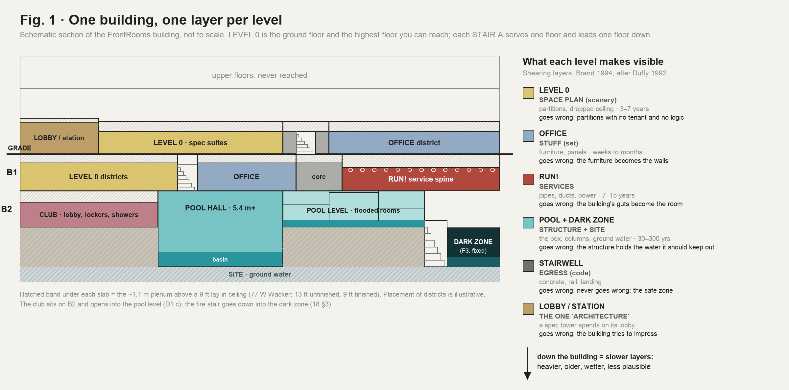
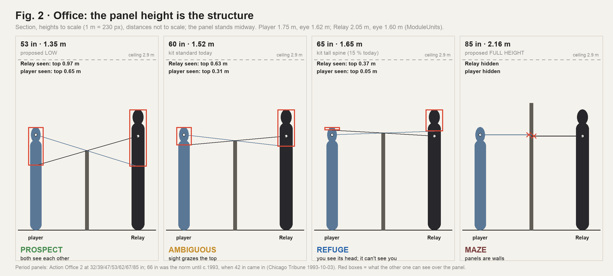
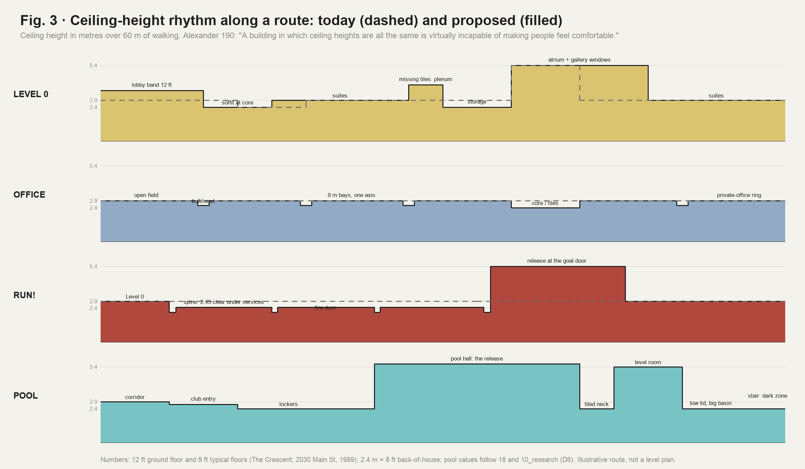

# Level space · 10 · Architecture and spatial structure: how to strengthen each level

Date: 2026-10-31. Line: 浴室房间调研 (`bathroom`), K session (Red's API key, Cursor): the research sub-chat Red opened at ~15:2x, next to the main K chat.

Red, 10-31 ~15:2x (K research chat): "我需要你目前去给我一个详细的research，从建筑和空间结构的角度上去思考（reference both 概念美术项目和environmental design和室内设计，以及90年代的建筑景观）分别思考如何进一步强化不同level内的空间（level 0，level office， level run，level pool等）". Just before, on the pool fusion sheets: "目前但是在结构层面上似乎没有进一步的融合了，只有配色方案上的融合。"

Research only. No code, no clone, no Unity run, no download. The three figures are schematic diagrams computed from the numbers on this page (`W/level_space/make_figs.py`, Pillow). Sources: [LS1]–[LS32] in `SOURCES.md`.

Not redone; read and built on:
- `level_transitions/01_ip_research.md`, `02_real_buildings.md`: how levels join, how real finishes stop;
- `office_and_film/10_synthesis.md`: the Office kit and Red's "a maze of walls, not a pillar hall";
- `room_visuals/03_run_research.md`, `run_b_production/10_plan.md`: what Run! is, B · Emergency Power;
- `zone_lamps/00_inventory.md`: every zone, its ceiling and its lamp today;
- `stairwell/`, `station/`: the safe zone and the first room;
- `bathroom_rooms/15_poolrooms.md`, `16_pool_palette_fusion.md`, `18_structure_fusion.md`. 18 is the pool's structural fusion, written in the main K chat at the same time. This page does not repeat it.
- Units: `LEVEL_MODULE_SPEC.md`, `FrontRoomsMap.cs`, `FrontRoomsModuleUnits.cs`, `FrontRoomsOfficeKit.cs` and the kit sidecars.

## 0. Short answer

1. **Diagnosis.** The levels differ today mostly by surface (paper or drywall, lamp colour) and by three ceiling heights. Their structure is one generator: 3 m cells, maze corridors, carved rooms, a 6 m column grid, one lay-in lamp per cell. So the player's body learns one space. Red's note on the pool ("only the palette fused, not the structure") holds for every level.
2. **Thesis: one building, one layer per level** (Fig. 1). The fiction already describes one 1990 building that you descend: LEVEL 0 is the ground floor, and each STAIR A leads one floor down (`narrative/40` §1). Duffy and Brand split a building into "shearing layers" that change at different speeds [LS1]. Give each level one layer as its structure, and let that layer go wrong:
   - **Level 0 = the space plan** (partitions, dropped ceiling): a building-standard floor that never got its tenant.
   - **Office = the stuff** (systems furniture): the panels become the walls.
   - **Run! = the services** (pipes, ducts, power): the back-of-house spine.
   - **Pool = the structure and the site** (the box, the columns, ground water): the structure holds the water it should keep out.
   Deeper means slower, heavier, older and wetter layers, and less plausible failures.
3. **The strongest move per level** (§4–§7):
   - **Level 0:** an honest floor plate first (a core, a ring corridor, suite entries), then its decay; ceiling-height variety (a 12 ft lobby band, soffits, the plenum seen through missing tiles); Tall halls read as 1980s atria.
   - **Office:** the panel height is the structure (Fig. 2). Fields of 1.35 m panels you see over; fields of 1.65 m panels where you see the Relay's head and it cannot see you; fields of 2.16 m panels that are walls. Plus a perimeter ring of private offices, and one landmark that does not hold still (*Playtime*).
   - **Run!:** the spine behind the walls, met as doors long before it opens. Its section is the threat (2.45 m clear under services, fire-door frames), and it ends in the game's clearest release.
   - **Pool:** the section tells the story (compression in the club, release in the hall, lids that do not fit the rooms in the level). Deck, water and gallery make the prospect–refuge pattern, and light from the next room is the visual magnet. 18's seven moves stay the structural core.
4. **Rules for every level** (§9): vary the ceiling; make thresholds thick; loops over dead ends (the code caps a dead end at 50 ft); one identity object per district; light leads to the important places and never makes a hiding pocket; one prospect–refuge pattern per level; era-true dimensions; no creator's composition.
5. **Order of work** (§10): the Office panel heights and the Level 0 ceiling section first (high impact, kit-level, no map contract); then the Level 0 core and the Run! spine (map contracts). The pool moves go into R4a with 18.
6. **For Red:** adopt the thesis? Which level gets greybox stills first? Asked in the K chat.

## 1. Frame and constraints

### 1.1 What "spatial structure" means here

Seven levers. None of them is colour.

| Lever | Question | Our tools |
|---|---|---|
| Plan grammar | How do rooms and corridors aggregate: core and ring, spine, field, enfilade, labyrinth, maze, rhizome? | generator rules, room modules |
| Section | Ceiling heights, floor levels, plenum, soffits | `ZoneHeight`, soffit and bulkhead kits |
| Structure | Column grid, bays, bulkheads | columns rule v1, module Custom columns |
| Enclosure and aperture | What blocks sight, and what blocks movement | walls, arches, panels, glass |
| Sequence and threshold | Compression and release, entrance transitions | module order, borders, doors |
| Orientation | Landmarks, axes, decision points | identity objects, signs (平面视觉) |
| Light as structure | Where light comes from; pools and gaps | lamp modes, zone lamps |

### 1.2 Fixed constraints (binding)

- **Map units** (`LEVEL_MODULE_SPEC.md` §2–§3, §9; `FrontRoomsMap.cs` l.52–55):
  - cell 3 m; chunk 8 × 8 cells (24 m); fine module 0.6 m; structural grid 6 m; walls 0.16 m;
  - heights Low 2.4 m (35 %), Standard 2.9 m (55 %), Tall 5.4 m (10 %); Office is Standard only;
  - edges Wall / Arch / Open; doors only on Low–Standard borders; windows only on borders with a Tall side;
  - modules up to 8 × 8 cells; corridors up to 9 cells; columns on the corners of the world 6 m grid.
- **Bodies** (`FrontRoomsModuleUnits.cs` l.103–105): player 1.75 m, eye 1.62 m; Relay 2.05 m, eye 1.60 m. Relay sight 12 m; sprint 27.5 m; lamps off beyond 16 m (`03_run_research` §0.7).
- **Rules:** darkness is never cover; cues are never a radar and never point at windows or glass (COMMON rule 12); era ≤ 1993, no brands; never copy a creator's composition (15 §3 guard); the stairwell is a safe zone.
- **Owners:** map and generator 关卡设计; kits, materials and lamps 游戏视觉; strings 叙事设计; lettering 平面视觉; dates 系统设计. This page proposes; the owners decide.

## 2. Reference families: what each one gives us

### 2.1 Concept art and production design

| Reference | What it is | What it teaches about space | Used in |
|---|---|---|---|
| Lynne Cohen, *Occupied Territory* (Aperture 1987; work 1973–c.1989) [LS26] | View-camera photographs of empty offices, labs, waiting rooms, party rooms, motel rooms and swimming pools. Flat light; walls, corners and partitions read like a stage. Fake nature indoors: "clouds peel off walls, forest glades invade indoor tennis courts" | Emptiness reads strongest when the room still shows its function. Decoration that tries to be warm only amplifies the uniformity. Frontal, level framing | Level 0 suites, the club, the station |
| Jacques Tati, *Playtime* (1967); set "Tativille" drawn by Eugène Roman [LS27] | Hulot is lost in a maze of identical cubicles whose only landmark, a receptionist, swivels, "so that each time he sees her, his internal map is altered". He chases a man's reflection in glass. Every chair is the same | Breaking the one landmark is the strongest disorientation. Glass separates seeing from reaching | Office OF-4, OF-6 |
| *Severance* (2022), production designer Jeremy Hindle [LS28]. Post-era: method only | About 140 ft hallway runs re-arranged so the corridors seem endless; they jog left again and again, "almost like Escher". Narrow near the elevator, wider the deeper you go. Ceilings lowered in tests "to maximize its claustrophobic aspect, but also make it comfortable". Sources: *Playtime*, Saarinen and Roche's Bell Labs | Width and ceiling height are dials that change with depth. "When someone walks down a hallway, that itself is suspense, because we don't know where the hallway's going to go" | Level 0 L0-6, Run! |
| *Control* (Remedy 2019), world design director Stuart Macdonald, trained as an architect [LS29] | World design is "creating the potential space that supports game design and narrative", close to production design. Sectors, not floors. The rigid repeated desks of the Executive Sector come from Kevin Roche's John Deere secretarial pool and Taylorist office planning. Brutalism kept "readable" during action | A level's structure can come from one real building type and one real office theory | Office OF-5 |
| Simon Stålenhag, *Tales from the Loop* (2014), *Things from the Flood* (2016) [LS32] | An alternate late-1980s and 1990s Sweden. Ordinary places with abandoned machinery. In the second book an abandoned underground facility floods the countryside with dark water | The uncanny sits in infrastructure under everyday places; the flood comes from below; the threat is rarely shown | Pool, dark zone, Run! |
| Backrooms canon and its makers (Kane Parsons, Jared Pike, POOLS, the 2026 films) | Studied already (`level_transitions/01`, `office_and_film/03`, `15`) | Text only, never compositions | guard |

### 2.2 Environmental design

- **Brand, *How Buildings Learn* (1994), after Duffy (1992)** [LS1]. Site, structure, skin, services, space plan, stuff; Duffy's shell, services, scenery, set. Services last 7–15 years, a space plan about 3, stuff days to months. "Because of the different rates of change of its components, a building is always tearing itself apart." → the thesis (§3).
- **Arthur and Passini, *Wayfinding: People, Signs, and Architecture* (1992)** [LS2]. Wayfinding is spatial decision-making at decision points. Places need *identity* (what tells one apart) and *equivalence* (what groups them). Poor wayfinding comes from "repetitive architectural features", ambiguous circulation and entrances that look alike. → The Backrooms is a designed wayfinding failure. FrontRooms fails it on purpose, in doses, and keeps the honest building legible (the evacuation plan, STAIR A).
- **Lynch, *The Image of the City* (1960)** [LS8]: paths, edges, districts, nodes, landmarks. Totten applies them to games [LS5]. → each level is a district at the scale of the game; each zone needs a node and a landmark.
- **Cullen, *Townscape* (1961)** [LS9]: serial vision, space revealed as a chain of views. → district changes at turns (J3).
- **Alexander et al., *A Pattern Language* (1977)** [LS4]:
  - 190 Ceiling Height Variety: "A building in which ceiling heights are all the same is virtually incapable of making people feel comfortable." 10–12 ft for public rooms, 7–9 ft for small groups, 6–7 ft for one or two people. In buildings made of standard components the variety "tends to be forgotten". Highest ceilings on the ground floor.
  - 135 Tapestry of Light and Dark: people walk toward the light when they go to important places.
  - 112 Entrance Transition: a change of light, sound, direction, surface, level, enclosure and view.
  - → Level 0's single ceiling is the discomfort: keep it there on purpose and vary it deeper. Use the patterns straight in the safe places (stairwell, station).
- **Prospect and refuge** (Appleton 1975) through **Totten, *An Architectural Approach to Level Design*** (2014; 2nd ed. 2019) [LS5, LS10]. A prospect is open and exposed; a refuge is a sheltered place to watch from. Paths alternate refuge → prospect → secondary refuge. Also shade, shadow, negative space, and "enemies as alternative architecture". → each level needs a prospect–refuge pattern made of its own architecture.
- **Sklar, "Mickey's Ten Commandments" (Walt Disney Imagineering)** [LS7]: organize the flow of people and ideas; create a "weenie", a visual magnet that rewards the walk; avoid contradictions; tell one story at a time. A weenie reveals just enough to pull you on. → every level needs its weenies, and one story.
- **Jameson on Portman's Westin Bonaventure** (1984; book 1991) [LS6]: "postmodern hyperspace" exceeds "the capacities of the individual human body to locate itself… and cognitively to map its position". Entrances are played down; the atrium is a total space. → Tall halls can disorient the way a period atrium did.
- **Vidler, *The Architectural Uncanny* (1992)** [LS3]: the uncanny is the familiar made strange; essays "Dark Space", "Homesickness", "Nostalgia", "Buried Alive", "Transparency"; architecture's "seeing walls". → the theory under the whole game.
- **Augé, *Non-Places* (1992)** [LS11]: places of transit and anonymity, the root of the "liminal space" idea.

### 2.3 Interior design of 1990

- **The speculative office floor** [LS12–LS16].
  - A centre core holds the elevators, restrooms and service elevator, ideally also the exit stairs. Core to glass is 42 ft for private offices and 47 ft for open workstations. A 5 ft planning grid; a 30 ft structural bay; private offices 10 or 15 ft wide on the perimeter [LS12].
  - Built examples: Park Avenue Plaza (1981), 45 ft core to window; The Crescent (Dallas), 43–44 ft bays, a 10 ft planning module, 9 ft finished ceilings on typical floors and 12 ft on the ground floor; 2030 Main Street, Irvine (1989), 39–45 ft bays, 12 ft ground floor, 9 ft above; 77 West Wacker (1992), a 5 ft module, 45 ft lease spans, 13 ft unfinished and 9 ft finished, a 42 ft lobby.
  - **In our units:** 5 ft = 1.52 m, half a cell and exactly the kit's panel width (1.524 m). 10 ft = 3.05 m ≈ one cell. A 30 ft bay ≈ 3 cells. A 42–47 ft lease depth ≈ 4–5 cells. 9 ft = 2.74 m (our Standard 2.9 m is a little generous). A 13 ft slab-to-slab height leaves about 1.1–1.2 m of plenum above a 9 ft ceiling. 12 ft = 3.66 m.
- **Building standard** [LS17, LS18]. The landlord's work in a 1980 lease: "building standard paint" on all walls, all doors and hardware, suspended ceilings, lighting, baseboard strips, wall-to-wall carpet, window blinds, outlets. One building standard allows vinyl wall covering on 20 % of the walls. → **Level 0 is literally the building standard:** the finish package a landlord installs before anyone moves in.
- **Systems furniture** [LS19–LS22]. Action Office 2 panels came 32, 39, 47, 53, 62, 67 and 85 in high. Panel heights averaged 60–84 in through the early 1990s. In 1993: "The preferred height for cubicle wall panels used to be 66 inches, but 42 inches is becoming popular." 64 in gave seated privacy; 53 in "generally allow an outside view of the top of a worker's head". **The kit today:** a 1.52 m (60 in) standard panel and a 1.65 m (65 in) tall spine on 15 % of runs, commented "blocks the Relay's 1.6 m sight ray".
- **Back-of-house** [LS24]. Service corridors at least 6 ft (1.8 m) for two carts passing, 7–8 ft in large hotels; the corridor ceiling carries ducts, pipes and sprinkler mains; the service spine often runs offset from the main grid. These are low-authority sources: use them as a rule of thumb. Rutes and Penner's *Hotel Planning and Design* (1985) is the period book (no figure read).
- **Egress code** [LS23]. NFPA 101, business occupancies: dead-end corridors at most 20 ft unsprinklered and 50 ft sprinklered; common path 75 / 100 ft; travel to an exit 200 / 300 ft; clear width 44 in for 50 or more occupants. Current text; the 1991 values are to verify.
- **The club fit-out:** 18 §1, PS1–PS9 (postmodern arches and oculi, glass block back in fashion from 1983, racquetball courts turned into aerobics rooms, leisure pools).

### 2.4 The 1990 landscape

- **The atrium boom** [LS25]: Saxon's *Atrium Buildings* (1983, 2nd ed. 1986) and *The Atrium Comes of Age* (1993) document 1980s atria in hotels, shopping and offices (Portman's Hyatts, Eaton Centre, Water Tower Place).
- **Corporate postmodernism puts the architecture in the lobby.** 77 West Wacker: "modern classicism", colonnades and pediments, a 42 ft lobby; above it, 9 ft spec floors [LS16]. A 1990 tower spends its architecture on the lobby and the skin; the floors are generic.
- **The office park and the edge city:** Lewis Baltz's *The New Industrial Parks near Irvine, California* (1974) is the photographic lineage Aperture places Cohen in [LS26]; Garreau's *Edge City* (1991) names the type [known, not re-read]. Anonymous spec buildings in parking fields: the exterior FrontRooms never shows, and the reason its interiors are generic.

## 3. The thesis: one building, one layer per level

| Level | Layer [LS1] | The structure the player reads | What goes wrong | Section | Plan grammar | Prospect / refuge | Visual magnet | Light |
|---|---|---|---|---|---|---|---|---|
| Level 0 | Space plan (Duffy: scenery), about 3–7 years | demising walls, corridors, suite entries, the T-bar grid, cove base | partitions with no tenant and no logic; the grid runs on where rooms should stop | one ceiling (the discomfort), broken by soffits, the 12 ft lobby band and the plenum | an honest core and ring that decays into a maze | corridors are prospect; suite doorways and alcoves are refuge | STAIR A's EXIT sign; the lit lobby | an even wash with dead fixtures; pools at junctions |
| Office | Stuff (Duffy: set), weeks to months | panels, files, desks, CRTs; the private-office ring | furniture becomes the walls; the set is larger than the room; a landmark moves | 2.9 m with bulkheads on one axis | core side, open field, window-wall ring | panel height (Fig. 2) | a reception desk or conference table; light behind blinds | cool and even; private offices dark |
| Run! | Services, 7–15 years | soffit, sprinkler main, tray, conduit, fire doors, battery units | the services are the room; the corridor is longer than the code allows | low and long (2.45 m clear); release only at the goal | one spine with stubs, offset from the room grid | none in the spine; refuge is the door you shut behind you | the goal door (the brightest thing) | battery pools and gaps |
| Pool | Structure and site, 30–300 years and "eternal" | tiled columns, basin walls, the fire stair, observation windows, the slab | the structure holds water; levels flood; the column grid multiplies | the big release (5.4 m+), then lids that do not fit the rooms | club enfilade → one hall → a rhizome of flooded rooms → dark zone | deck vs water; the gallery | glowing water; light from the next room | caustics, wet-niche lamps |
| Stairwell | Egress: the code's one honest piece | concrete, rail, two landings | never (safe zone) | vertical | two landings | refuge | the far door | steady |
| Station / lobby | The lobby: a spec tower's only "architecture" | the front desk, lobby finishes | never (the first room) | the 12 ft band (proposal J2) | one room | — | the TV | its own |

Why this works:
1. **Each level gets its own body memory, not only a colour.** This is Passini's identity at the scale of the game.
2. **The descent reads as depth.** It runs from the tenant's layers (Level 0 and Office, Duffy's scenery and set) to the building's own (Run! and Pool: services, shell, site).
3. **The wrongness escalates in plausibility.** A partition in the wrong place is believable, a duct in the room is odd, water in the structure is impossible.
4. **It is era-true.** Every layer is a 1990 system with dated dimensions (§2.3).
5. **It fits what exists.** Level 0's paper and grid, the Office kit, Run! B's exposed services and the pool's tile and water each already show their layer. The moves below make the layer structural.

## 4. Level 0: the floor that never got its tenant

### 4.1 Today

- One generator for the bulk of every floor: carved rooms plus maze corridors, Low 2.4 / Standard 2.9 / Tall 5.4 m, paper and carpet, one lay-in lamp per cell (`zone_lamps/00` rows 2–4).
- 0.6 m columns on 25 % of the rooms that qualify; Tall halls (5–7 cells, one per zone) with 0.9 m columns on 70 %.
- Modules: `L0_WaitingRoom_4x3`, `Low_Storage_2x3`, `Tall_PillarHall_6x5`.
- **What already works:** the 3 m cell is the real 10 ft planning dimension; the 2 × 4 grid, cove base and carpet are the building standard; the three heights give some section.

### 4.2 Weak, spatially

1. **No hierarchy, no address.** Every corridor equals every other. There is no core, no main corridor, nothing to orient by, so the maze reads as a generator, not as a building (Passini's missing identity).
2. **The ceiling is a lid, never a space.** The plenum every real floor has (about 1.1 m) is invisible.
3. **Height changes only at random borders,** through a door (Low–Standard) or an arch (Tall). There is no designed section: no soffit, no bulkhead in Level 0 rooms, no lobby height near the start.
4. **Tall halls do not read as anything.** The same troffer hangs at 5.4 m (`zone_lamps/00` open point 1), and the 0.9 m columns do not make an atrium.
5. **Dead ends are not measured.** A 9-cell maze corridor that ends blind is 27 m: half again over the code's 50 ft.

### 4.3 Moves

**L0-1 · An honest floor plate first, then its decay.**
- *What:* near the floor's start (the area the station already counts, `StationExploreCells` 150), the plan reads as a real multi-tenant floor:
  - a core block: restrooms, an elevator lobby with dead call buttons, janitor and electrical closets;
  - a one-cell ring corridor round it;
  - suite entries off the ring: a pair of doors or a door with a sidelight, a suite-number plate.
  
  Farther out, the ring runs on where the core should end; suites open into suites; the floor becomes a space plan with no tenant.
- *Why:* the real floor plate [LS12]; the building standard [LS17]; Passini's identity (everyone knows what a core is) [LS2]; Lynch's node [LS8]; Vidler's familiar made strange [LS3].
- *Build:* a Core module (4 × 3 or 4 × 4 cells, Level 0 Standard, inner walls); a generator rule "one core per floor near the start"; suite-entry dressing. Doors exist only on Low–Standard borders today, so suite entries are framed arches with a dead sidelight, unless the contract allows doors inside modules. STAIR A stays where the map puts it. The elevator lobby's period sign sends people to the stairs (string by 叙事设计).
- *Size, owner:* L. 关卡设计 (generator, module); 游戏视觉 (dress); 叙事设计 and 平面视觉 (signs).
- *Risk:* an honest plan makes the start easier to read. That is the onboarding's job ("Floor 1 without a chase", `relay_pursuit/NOTE_1030`): check with 教程设计.

**L0-2 · Ceiling-height variety inside Standard zones** (Fig. 3, row 1).
- *What:*
  1. soffit bands where real ducts run: along the ring corridor and round the core, a gypsum soffit at 2.4 m over a 0.6–1.2 m strip;
  2. a lobby band at 3.6 m (12 ft) in the cells round the station and along the floor's first corridor;
  3. bulkheads between the 6 m-grid columns of Level 0 rooms, as Office already has.
- *Why:* Alexander 190, including its warning that standard components make variety "forgotten" [LS4]; the ground floor of a real tower is 12 ft and the typical floor 9 ft [LS14, LS15]; `02_real_buildings` §6 (a soffit face with a corner bead wherever ceilings change).
- *Build:* a soffit kit (游戏视觉) and a placement rule (关卡设计) that keeps clear of the lens rectangle in `BuildFixture` (X 1.2–1.8, Z 1.2–2.4 m in each cell). A 2.4 m soffit clears the Relay's 2.05 m by 0.35 m. The 3.6 m band needs a height class or a module ceiling override: a map contract.
- *Size, owner:* M for soffits and bulkheads; L for the 3.6 m band. 游戏视觉 + 关卡设计.

**L0-3 · The plenum as a second space.**
- *What:* a few ceiling tiles per chunk pushed up or missing, showing about 1.1 m of plenum: a duct, a sprinkler branch, a cable bundle, the underside of the slab, the back of a troffer. Once per floor, a run of missing tiles along a corridor lets you see the duct continue past the wall. Never a place to hide or to climb.
- *Why:* the services sit under the scenery [LS1]; 13 ft unfinished against 9 ft finished [LS16]; it seeds the Run! layer, so the player has seen the services before Run! opens them.
- *Build:* ceiling-tile variants and a plenum kit (游戏视觉); placement by hash (关卡设计) with the lamp keep-out. One plenum box per open tile, culled; off on phone and WebGL tiers.
- *Size, owner:* M. *Risk:* light and reflection probes leaking through the opening.

**L0-4 · Tall halls as 1980s atria.**
- *What:*
  - a second-storey band of interior windows (borrowed lights) at about 3.2–4.6 m on one or two walls, from rooms you can never reach, sometimes lit: Vidler's "seeing walls";
  - planters with indoor trees and a dry fountain basin;
  - glass-block screens;
  - period HID downlights or pendants instead of the cell troffer (`zone_lamps` open point 1).
  
  Keep symmetry and repetition so the hall disorients the way the Bonaventure does, with the hall's one arch to a lower zone (C33 `TallExit`) as the clear way on.
- *Why:* the atrium boom [LS25]; Jameson [LS6]; 77 West Wacker's lobby [LS16].
- *Build:* hall dress kits (游戏视觉); `Tall_PillarHall` module variants (关卡设计); lamps through zone_lamps. The gallery windows are dressing above 3.2 m with no reachable sill, so they never read as the breakable windows (0.35–2.0 m). No Relay cue ever points at them (rule 12).
- *Size, owner:* M–L. 游戏视觉 + 关卡设计.

**L0-5 · One identity object per district.**
- *What:* each zone, or each chunk, gets one object only it has: a drinking-fountain alcove, a fire-hose cabinet, a copier niche, a suite-number plate, a column with an extinguisher, a blank directory board, a mail slot. Everything else stays repeated.
- *Calibration from *The Exit 8* [LS31]:* anomalies must cause unease, not be a spot-the-difference test. Its maker dropped "the number of fluorescent tubes changes" as too hard, and dealt them about 60 : 20 : 20 easy, hard and special.
- *Why:* Passini's identity and equivalence [LS2]; Lynch's landmarks [LS8].
- *Build:* kits (游戏视觉); one slot per zone (关卡设计: a module marker or a zone-level pick).
- *Size, owner:* M.

**L0-6 · Corridor width as a dial (idea only).**
- Real office corridors are 44 in to 6 ft clear [LS23]; ours are 2.84 m. *Severance* narrows the first hallways and widens them deeper [LS28].
- For us, any narrowing means geometry inside a cell (chase walls, built-in storage), which touches the keep-clear strips and the Relay's 0.3 m radius: a map contract.
- *Size:* L. Low priority; measure what width does to the chase first.

**L0-7 · A dead-end budget.**
- *What:* measure dead-end lengths per chunk (cells from the last branch).
  - Near the start, keep them at most 2 cells (the code's 20 ft).
  - Anywhere, at most 5 cells (50 ft), unless the dead end ends in a breakable window or a door that shuts: an out.
  - Longer ones are "the building lying", kept for deeper floors.
- *Why:* NFPA 101 [LS23]; *Alien: Isolation* has "barely any dead ends", because every level is built on loops for a hunter that could be anywhere [LS30].
- *Build:* a validator metric first, then a rule (关卡设计).
- *Size:* S to measure, M for the rule.

## 5. Office: the furniture becomes the architecture

### 5.1 Today

- Standard 2.9 m only, a 2 × 2 grid, 0.9 m columns on 75 % of the rooms that qualify, with bulkheads (`LEVEL_MODULE_SPEC` §3).
- The cubicle fill: aisles 1.6 m; panels 1.52 m; a 1.65 m tall spine on 15 % of runs; CRTs. Module `Office_Bullpen_4x4`.
- Transitions to Level 0 with frames, renovation scars and the light lead (`level_transitions`).
- Red's direction: "a maze of walls, not a pillar hall".

### 5.2 Weak, spatially

1. **The Office uses the same carved-room maze as Level 0,** with cubicles as islands inside rooms. A real 1990 office floor is one field wrapped by a core side and a window side.
2. **The panels sit at eye height** (Fig. 2). The 1.52 m standard is 10 cm under the player's eye and 8 cm under the Relay's, so most sightlines graze the panel tops: neither clearly open nor clearly blocked.
3. **No window wall,** the defining edge of an office floor (daylight, blinds, private offices).
4. **No landmark.**

### 5.3 Moves

**OF-1 · The panel height is the structure** (Fig. 2).

- *What:* three panel heights, each a district character. Numbers are for a panel midway between the two bodies.
  - **Low, 1.35 m (53 in): the prospect field.** Each sees the other's upper body (the Relay above 1.08 m, the player above 1.10 m). The early-1990s move toward low panels [LS20].
  - **Refuge, 1.65 m (65 in, the existing tall spine): the refuge field.** Both eyes are blocked. The top 0.37 m of the Relay shows over the panel tops; only the top 0.05 m of the player does. You can track it; it cannot see you. Use it for whole fields, not as 15 % random spines.
  - **Full height, 2.16 m (85 in): the maze field.** Panels are walls: Red's "maze of walls".
  - The 1.52 m (60 in) standard is the ambiguous one: each sees the other's head and shoulders. Keep it for runs inside the other fields, not as the default.
- *Why:* period panel heights [LS19–LS22]; prospect and refuge [LS5, LS10].
- *Rule check:* seeing the Relay over a panel is the world, not a radar. The Relay's own sight test must treat each panel height as a blocker; the kit's comment says the tall spine already blocks its 1.6 m ray. 关卡设计 checks how `FrontRoomsMapHunter`'s sight tests treat panels.
- *Build:* two new panel heights in the kit (游戏视觉, `Tools/Blender/frontrooms_kit`); a fill rule per district in `FrontRoomsOfficeKit` (游戏视觉, `Scripts/Office`); the sight check (关卡设计); balance (系统设计). No map contract.
- *Size:* M.

**OF-2 · The floor plate: core side, open field, private-office ring.**
- *What:* an Office district planned like a 1990 floor:
  - one edge is the window wall, blinds down: on a basement floor, steady light behind blinds with no outside, or dark;
  - a ring of one-cell private offices along it (10 ft offices = one cell);
  - the open field in the middle;
  - the core side with files, a copy room and a conference room with a glass front.
  
  Four to five cells from core to window is the real 42–47 ft lease depth.
- *Why:* the floor plate [LS12, LS15]; *Playtime*'s and *Severance*'s rows of identical doors [LS27, LS28].
- *Build:* an Office floor-plate module (for example 8 × 5 cells). Doors are not authored inside modules, so the private offices open by arches, unless the contract allows doors inside Office modules. Window-wall dressing by 游戏视觉. The light behind the blinds is a sourceless glow like the pool's glass block: steady (photosafety) and never a cue.
- *Size:* L (map contract for doors).

**OF-3 · Bulkheads that give the ceiling an axis.**
- *What:* bulkheads run one way only in each district, so the ceiling shows an axis to steer by. Optionally, Office modules that do not touch Level 0 rooms use a 3-cell (9 m) custom column rhythm: the 30 ft bay.
- *Why:* the 30 ft bay [LS12]; Alexander 190 [LS4]; Lynch's paths [LS8].
- *Build:* a direction rule on existing bulkheads (关卡设计).
- *Size:* S–M.

**OF-4 · A landmark that does not hold still.**
- *What:* one strong landmark per Office district: a reception desk with a switchboard, a round conference table under a pendant, a large plant, a column clad differently. On a revisit shift (the map already re-rolls modules then), it faces another aisle, or turns up in a second district. Rare: it breaks the player's anchor.
- *Why:* Tati's swivelling receptionist [LS27]; landmarks anchor the cognitive map [LS2]; an anomaly should unsettle [LS31].
- *Build:* a landmark module and the revisit rule (关卡设计).
- *Size:* S–M.

**OF-5 · Two office theories as two kinds of district.**
- *What:*
  - **Taylorist rows:** identical desks in long rows, axial aisles, low panels. Prospect-heavy and readable: *Control*'s Executive Sector, from Roche's John Deere pool [LS29].
  - **Office landscape (Bürolandschaft):** clusters at angles, screens, plants. Refuge-heavy and disorienting. Developed by the Quickborner Team in the late 1950s and still in offices in 1990 [known, not re-read].
- *Build:* two fill modes in `FrontRoomsOfficeKit` (游戏视觉); props may take any yaw.
- *Size:* M.

**OF-6 · Glass: sight without passage.**
- *What:* the interior glazing of a 1990 office: sidelights next to private-office doors, conference rooms with glass fronts and blinds half down. The player sees across without passing, and so does the Relay.
- *Why:* *Playtime*: glass "allows sight across its bounds, but not movement" [LS27]. Period photographs still to find.
- *Rule:* glass is never a Relay cue (rule 12).
- *Build:* map windows exist only on Tall borders today, so interior glazing in Office modules is a map contract (关卡设计); glass kit and G14 RT glass (游戏视觉).
- *Size:* M–L.

## 6. Run!: the service spine

### 6.1 Today

- Decided: B · Emergency Power (Red 10-21). A back-of-house egress corridor: `Run_AlarmCorridor_1x9` (27 m), a painted concrete soffit at 2.9 m with an exposed sprinkler main, tray and conduit, wraparounds every 3 m, battery twin-heads, glossy VCT; armed → trip → reset (`run_b_production/10_plan`, `zone_lamps/00` row 9).
- Not reachable in play yet: it needs the map contract CR-1 to CR-6 (a corridor longer than 4 cells).
- The rules from `03_run_research` §0.8 stand: the brightest thing is the door you can shut; darkness sits between pools, never in pockets.

### 6.2 Weak, spatially

1. **A 1 × 9 tube dropped into a maze** has no relation to the building round it. Why is a service corridor here? Where does it go?
2. **Its section is the Standard 2.9 m;** only the dressing says "services".
3. **There is no "before".** The research asks that you can read a Run! room before you enter; today only its finish tells you.

### 6.3 Moves

**RN-1 · The spine behind the walls.**
- *What:* Run! corridors are the building's back-of-house spine:
  - they run behind and parallel to public corridors, offset from the room grid;
  - plain doors connect them to Level 0: a push plate, a wire-glass vision panel, an "employees only" plate (string by 叙事设计);
  - stubs to janitor, electrical and telephone closets, a dead freight-elevator door, and the goal door at the end.
  
  The player passes these doors and glimpses the spine through their vision panels long before an alarm trips: readable before entering, and Cullen's "here and there" [LS9].
- *Why:* the hotel service spine [LS24]; the services layer [LS1]; `03_run_research` §0.3.
- *Build:* the pending map contract (CR-1–CR-6) plus a placement rule parallel to corridors (关卡设计); door dressing (游戏视觉).
- *Size:* L.

**RN-2 · The section is the threat.**
- *What:*
  - the soffit stays at 2.9 m, but the services hang lower: sprinkler main, tray and ducts down to about 2.45 m clear, still above the Relay's 2.05 m;
  - fire-door frames at 2.1 m every 3 cells (smoke compartments), held open by magnets [period practice to verify];
  - pipe hangers every 3 m give the corridor a structural rhythm;
  - pipes and fire gear on the walls make it read narrower than it is.
- *Why:* service ceilings carry ducts, pipes and mains [LS24]; *Severance* lowers ceilings to the edge of comfort [LS28].
- *Open design question (系统设计, 关卡设计):* on the trip, the magnets release and the fire doors behind the player swing shut, so the Relay has to break each one (A12's break rules): the building helps you once. Or the doors stay open and nothing changes. A question, not yet a recommendation.
- *Build:* `FrontRoomsRunDress` already carries the services; the frames join the corridor preset (游戏视觉).
- *Size:* M.

**RN-3 · The code as the clock.**
- *What:* the spine is always an exit route, never a dead end, and its end is the brightest thing. The code's numbers become design numbers: the 27.5 m sprint is about 90 ft; compartments every 9 m; the goal door has a panic bar.
- *Why:* NFPA 101 [LS23]; `03_run_research` rule 5.
- *Size:* S (already in the plan).

**RN-4 · A release at the goal.**
- *What:* the goal door opens into the tallest, brightest space near it: a Tall hall, a loading dock with a high roll-up door, or a stairwell landing. Compression, then release.
- *Why:* Alexander 112 run backwards [LS4]; Totten's narrow space into prospect space [LS5].
- *Build:* a placement rule: the Run! goal sits next to a Tall zone or the stairwell (关卡设计).
- *Size:* M.

**RN-5 · The racetrack (later tiers).**
- *What:* a service loop round a core, so the Relay can come from either side. Deeper floors only.
- *Why:* *Alien: Isolation*'s loops [LS30]; racetrack hospital plans [to verify].
- *Size:* L. Later.

## 7. Pool: the structure and the water (adds to 18)

**Where 18 stands:** the Poolrooms read as a 1980s leisure pool and a 1990 basement assembled wrongly; seven moves M1–M7 (the office ceiling over the water, the column grid that forgets the load, the fire stair into the water, the service gallery with windows, postmodern arches from the club, the club programme repeated, leisure-pool geography); the dark zone at the foot of the fire stair (Red's F3 pick: "做成更深处的一片固定区域"). The main K chat renders its stills. This page adds the sequence and the environmental-design layer.

**PL-1 · The section tells the story** (Fig. 3, row 4).
- corridor 2.9 m → club entry 2.7 m (lowered: Alexander 112's change of level and enclosure);
- lockers and showers 2.4 m (compression);
- the hall at 5.4–5.6 m: the largest volume so far, the release;
- past the far door, a tiled neck at 2.4 m over water;
- level rooms whose lid does not fit the room: 2.4 m over a large basin, 5.4 m over a corridor (15 §4);
- the fire stair down, then the dark zone, low.

The hall's release only works if everything before it is low.

**PL-2 · Deck, water and gallery as prospect and refuge.**
- The deck is the fast, exposed edge.
- The water slows you (D6, × 0.85) and is the prospect.
- The observation gallery (18 M4) is the refuge, with windows into lit water: sight without passage.
- The Relay wades too (D3), so the gallery windows must keep it readable (rule 12).

**PL-3 · The visual magnet is light from the next room.** The club's far door shows the hall's glow first. In the level, each junction's next room is brighter. In the dark zone, the gallery windows and the wet-niche lamps are the only magnets [LS7]. This is POOLS's "light from the next space" (`level_transitions/01` §0.7), done with 1990 devices.

**PL-4 · A different plan grammar.** The floors are mazes; the pool level is a rhizome [LS5]: channels (flooded corridors with a current), beaches (sloped floors), weirs (steps between water levels) and column islands (18 M2, M7).

**PL-5 · The club as an *Occupied Territory* interior** [LS26]. Purpose shows everywhere: numbered lockers, a schedule board, a beach mural, plastic plants, the aerobics room seen through glass (until mirrors exist, D7). Then it drains away past the far door (15 §0.7).

## 8. The joints: stairwell, station, transitions

- **J1 · The stairwell stays the one honest space.** Alexander 112 used straight: change of light, surface, level and enclosure. Its door into each new floor should open onto that floor's most typical view (Totten's "arrivals", Cullen's first view): the edge of an Office field, or the club lobby's glow on the pool floor.
- **J2 · The station as the lobby.** A spec tower spends its architecture on the lobby [LS16]. The first room could take the 12 ft band and one postmodern gesture (a granite base, a brass reveal, a pediment over the desk), so the suites behind it read as building standard. A suggestion to 游戏视觉 (station look v1 is decided); low priority.
- **J3 · District changes at turns.** Put the change at a turn (closure, deflection), so the next district shows in one view (serial vision [LS9]) instead of down a straight corridor. This extends `level_transitions`' "the frame owns the joint".

## 9. Rules for every level

1. **Section first.** At least three ceiling heights in use per level, and a small room next to every large one [LS4].
2. **Thresholds are thick.** A district change is a change of light, surface, height and view (Alexander 112; `02_real_buildings` rules 1–6).
3. **Loops over dead ends.** At most 2 cells near the start, 5 anywhere; longer only with an out [LS23, LS30].
4. **One identity object per district;** repetition everywhere else [LS2, LS31].
5. **Light leads to the important places** (STAIR A, the door that shuts, the next district) and never makes a pocket to hide in [LS4]; COMMON rule 12.
6. **One prospect–refuge pattern per level,** made of its own architecture: panels, alcoves, deck and water, stubs [LS5].
7. **Era-true numbers:** a 5 ft module (half a cell), 10 ft offices (one cell), 9 ft finished ceilings, a 12 ft ground floor, a 42–47 ft lease depth (4–5 cells), panels of 53, 65–67 and 85 in, service corridors of at least 6 ft.
8. **The guard:** no creator's composition; period hardware and canon text only (15 §3).

## 10. Order of work, owners, size

S = a few hours for one line; M = a day or two; L = several days or a map contract.

| # | Move | Level | Impact | Size | Owners | Map contract |
|---|---|---|---|---|---|---|
| 1 | OF-1 panel heights | Office | high | M | 游戏视觉 (kit, fill), 关卡设计 (sight check), 系统设计 (balance) | no |
| 2 | L0-2 soffits and bulkheads, L0-3 plenum | Level 0 | high | M | 游戏视觉 (kits), 关卡设计 (placement) | no (the 3.6 m band: yes) |
| 3 | L0-7 dead-end budget | all floors | medium | S then M | 关卡设计 | no |
| 4 | L0-4 Tall halls as atria | Level 0 | medium–high | M–L | 游戏视觉, zone_lamps, 关卡设计 | no |
| 5 | RN-1, RN-2, RN-4 the spine | Run! | high | L | 关卡设计 (CR-1–CR-6), 游戏视觉 | yes |
| 6 | L0-1 core and ring | Level 0 | high | L | 关卡设计, 游戏视觉, 叙事设计, 平面视觉 | yes |
| 7 | OF-2 floor plate, OF-6 glass | Office | high | L | 关卡设计, 游戏视觉 | yes (doors, glazing inside modules) |
| 8 | OF-3, OF-4, OF-5 | Office | medium | S–M | 关卡设计, 游戏视觉 | no |
| 9 | PL-1–PL-5 | Pool | high | in R4a | this line, with 18 | per `30_estimate` |
| 10 | J1–J3 | joints | medium | S–M | 关卡设计, 游戏视觉 | no |
| 11 | L0-6 corridor width | Level 0 | low | L | 关卡设计 | yes |

Before any of it: Red picks (§0.6). Images first, as for the pool: greybox stills of the chosen moves in a W clone.

## 11. Limits

- Several books are read through publisher pages, tables of contents or secondary summaries (Arthur and Passini, Totten, Vidler, Brand in excerpt). Lynch, Cullen, Appleton, Augé, Garreau and the Bürolandschaft history are cited from knowledge. `SOURCES.md` marks each.
- The NFPA numbers are the current text; check the 1991 edition before any sign or rule quotes a number.
- *Severance* and *The Exit 8* are post-era: method only, nothing visual taken.
- The service-corridor widths come from low-authority sources: rule of thumb only.
- The figures are schematic. Fig. 2 assumes the panel midway between the two bodies; what each sees changes with the distances.

## 12. Figures

- `images/ls_fig1_building_layers.png`: the building in section, one layer per level.
- `images/ls_fig2_office_sightlines.png`: four panel heights against the player's and the Relay's eyes.
- `images/ls_fig3_ceiling_rhythm.png`: ceiling height along a 60 m route, today and proposed, for Level 0, Office, Run! and Pool.

