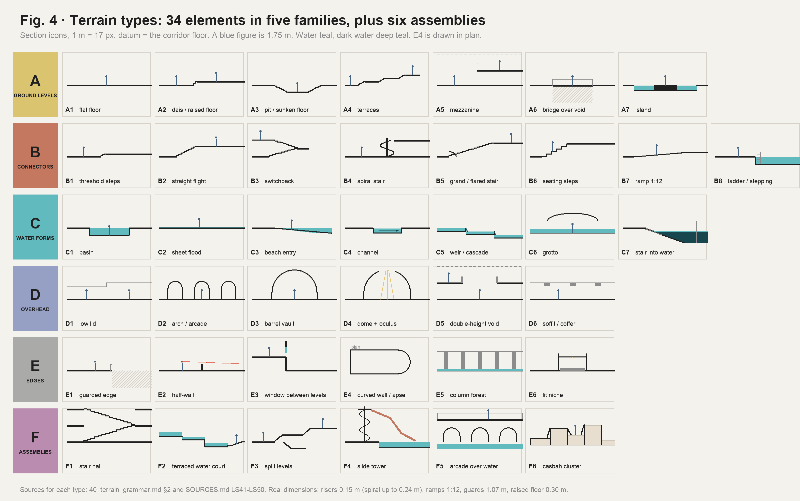
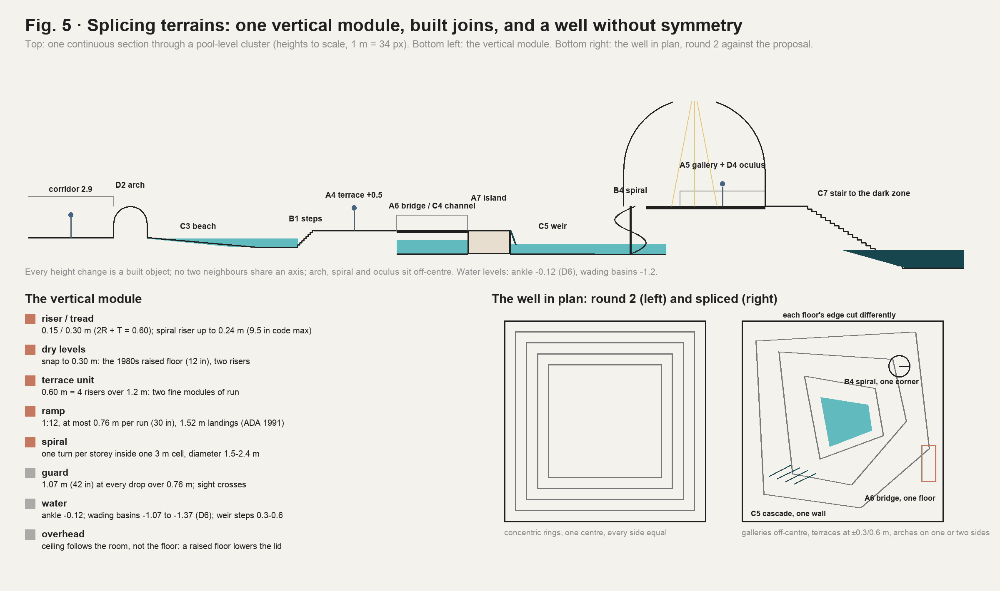

# Level space · 40 · Terrain: how many kinds there are, how they splice, and how they become modules

Date: 2026-10-31. Line: 浴室房间调研 (`bathroom`), K session (Red's API key, Cursor), research sub-chat.

Red, 10-31 16:06 (K research chat): "以及，目前你的很多空间设计似乎都是对称/环形的，但是没有不同地形之间的拼接融合，比如说在dream pool的作品里，就有很多拱形/螺旋楼梯，一个高度不一的环境设计，我需要你再开一个最新的research，思考这种环境设计里面有多少种不同的地形设计，并且要如何模块化落位到我们的不同level里".

Builds on, does not repeat:
- `10_research.md`: the thesis (one building, one layer per level), adopted by Red;
- `20_structural_drama.md`: devices V1–V7 and the well, and the round 1–2 stills Red is reacting to;
- the pool line's `bathroom_rooms/50_modules_and_contracts.md`: per-cell `floorY` and `water` (C2), basin cells (C3), the round-headed arch edge (C5), the sunken region and its stair (C9), weirs;
- `LEVEL_DESIGNER.md`: room modules, the stamp, markers.

Research only: no code, no clone, no Unity, no download. Sources [LS41]–[LS50] are added to `SOURCES.md`. Figures 4 and 5 are diagrams drawn from the numbers here (`W/level_space/make_terrain_figs.py`). The two research sub-sessions planned at 15:59 (`30`, `31`) stopped when the API key ran out of credit; relaunched at 16:41, they landed at 16:52 and 16:53, and their proposed types are registered in §4, "Proposed additions".

## 0. Short answer

1. **Red is right.** The round 1–2 spaces are symmetric and ring-shaped: the well's concentric rings, the funnel, the four-quadrant split level, balconies on three sides of the stair hall. Each scene also shows one terrain only, and its height changes happen at the scene's edge. A Dream-Pools-type environment reads rich for three reasons:
   - many terrain types in one view at different heights;
   - curves (arches, spirals, curved walls) cutting across an orthogonal tile grid;
   - water acting as a ground that itself changes level.
2. **How many kinds:** 34 elementary terrain types in five families, plus 6 assemblies (Fig. 4):
   - A, ground levels (7);
   - B, connectors (8);
   - C, water forms (7);
   - D, overhead forms (6);
   - E, edges (6);
   - F, assemblies made of the others (6).
3. **Splicing (拼接融合) is a grammar, not a picture** (Fig. 5):
   - **One vertical module.** Risers 0.15 m on 0.30 m treads. Dry floor levels snap to 0.30 m, the 1980s raised-floor height. Terraces step in 0.60 m. Ramps run at 1:12, at most 0.76 m per run. A spiral rises one storey per turn inside one 3 m cell.
   - **Every height change is a built object.**
   - **No assembly is symmetric on both axes,** and curves are inscribed in cells.
   - **Every raised or sunken area has two ways in.**
   - **A spiral stair is never the only way and never the EXIT.** In 1991 a spiral could serve only a small space [LS48].
4. **Modules:** generalise the pool line's data to every theme:
   - per-cell `floorY` and `water` (C2), the round-headed arch (C5) and the sunken region (C9);
   - new: per-edge crossings (Step, Flight, Ramp, Guard, Weir, Coping, Beach) and per-cell connectors (Stair, Spiral, Ramp, Bridge, Void);
   - authored as room modules in the Level Designer; placed by the generator with a splice check.
5. **Per level, following the thesis** (§7):
   - **Level 0** gets the built terrain of a tenant floor: a raised computer floor with its ramp, a tiered training room, a sunken lounge, and a split-level suite with a spiral convenience stair inside a Tall room.
   - **Office** gets a raised trading floor, the sunken bullpen, a file mezzanine on a spiral stair, and a tiered boardroom.
   - **Run!** keeps its corridor nature: ramps, threshold steps and a loading-dock release only. No catwalks: Red cut G.
   - **Pool** gets the whole vocabulary: beach, weirs, channels, islands, a grotto, a terraced water court, a slide tower on a spiral stair, arcades, a dome with an oculus, apses, stairs into water.
   - **The well** loses its symmetry: each floor's edge is cut differently, with a spiral in one corner, a cascade down one wall, and a bridge on one floor only.
6. **Cost tiers:**
   - view-only terrain (arches, vaults, domes, windows, guarded drops) needs no navigation work;
   - small steps (≤ 0.45 m) need step rules for the player and the Relay;
   - storey changes (flights, spirals, mezzanines) need two-level navigation, which the pool's C9 already asks 关卡设计 for.

## 1. What Red saw, and why it reads symmetric

| Round 1–2 scene (`20` §6, round 2) | Why it reads symmetric or single |
|---|---|
| C, J1–J3 the well, the funnel, the bridge well | one 9 × 9 m void, every floor's ring centred on it and equal on four sides |
| K split levels | four quadrant platforms around a centre: rotational symmetry |
| L stair hall | balconies on three sides of one void |
| A, B, D, E, F, H (round 1) | one device per scene: one cut, one pit, one tall room, one ramp |

What is missing, and what this page supplies:
1. **Splices.** Two or more terrain types joined inside one view: a floor that steps onto a terrace, which bridges a channel, which falls over a weir.
2. **Curvature against the grid.** Arches, spirals and apses that break the orthogonal tile and the 3 m cell.
3. **Water as ground.** Levels made by water as well as by floors: beach, weir, stair into water.
4. **Asymmetry with a reason.** Each part sits where its own logic puts it, as in La Muralla Roja, where every block starts from its own level [LS41].

## 2. The genre's terrain vocabulary, read as text

Read only in interviews and articles; no image opened or copied [LS50].

- **Recurring elements:** spiral staircases (the best-known image of the series), arches, columns, railings, slides, stairs that run into water, water at about waist height, "multi-storey car parks, meandering hallways, spiralling staircases, and maze-like rooms", "curving, undulating forms of supposedly human-made structures".
- **The maker's method:**
  - a camera first: 24 or 35 mm, at eye or waist height, where a person could take a photograph;
  - the scene is composed round that camera; "everything not visible by the camera doesn't matter";
  - scenes "just kind of end";
  - a sunlit part, and an area kept dark on purpose.
- **What a game cannot borrow: the single camera.** In a game every view exists, and every part must be walkable and loop. So the terrain has to compose from many viewpoints, which is why FrontRooms needs a grammar of splices, not a set of pictures.
- **The guard stands** (15 §3): no composition, camera angle, colour scheme or layout from *Dream Pools* or any creator. The types below come from dated real places, period code and the canon's words.

## 3. Real precedents for spliced terrain (era-true)

| Precedent | What it splices | Types it supplies |
|---|---|---|
| Ricardo Bofill / Taller de Arquitectura, La Muralla Roja, Calpe (1968–73) [LS41] | One 5 m square module aggregated into Greek crosses. Every block starts from its own level. Interlocking stairs, platforms and bridges like a casbah; stair cores take a sixth of the built area; "urban gates" between courtyards | F6 casbah cluster, A6, B2, A4; *a single module with independent base levels* |
| Lawrence Halprin: Lovejoy Fountain (1966), Auditorium Forecourt / Ira Keller Fountain (1970), Portland [LS42] | Lovejoy: water pours "over an irregular series of stairsteps" into a basin, with stepping stones and a wading pool. Keller: an 80 ft cascade into a plaza 10 ft below the street, "floating" concrete platforms over the pool, amphitheatre steps 100 ft wide; "possible to climb, crawl, walk or sit anywhere … including behind the falls". Halprin's "geometric naturalism"; plazas as "theatre sets for choreographing human movement" | F2, C5, A7, B6, B8 |
| Charles Moore with Perez Associates, Piazza d'Italia, New Orleans (1978) [LS43] | Curving colonnades and arches in five orders (plus the "Delicatessen order"), neon, and a stepped fountain shaped as the map of Italy. Neglected by the 1980s; the city moved to take it off its parkland list in March 1991 | D2, F5, C5, E4; *a postmodern ruin with water* |
| West Edmonton Mall, World Waterpark (1986) [LS44] | An indoor wave pool with wave bays behind panels, 17 slides up to 25.3 m, a dark enclosed slide into a 1.2 m splashdown pool, all reached by a "web of staircases" from platforms | F4 slide tower, B4, A5, C1; *machinery behind grates* |
| Piranesi, *Carceri* (1750, 1761); Escher (1951–60) (`20` [LS33], [LS38]) | Stairs, bridges and galleries crossing tall voids; connections that cannot be assembled | F1 stair hall; the impossible connection (deep floors only, `20` §5) |
| Raised access floors, early 1980s offices; mainframe rooms (8 in minimum, 12 in as an air plenum; ramps about 1 in per ft) [LS49] | A whole room lifted 0.20–0.30 m, with its ramp and step at the door | A2, B7, B1 |
| The convenience stair of a multi-floor tenant (77 West Wacker: "internal staircase to privately connect to multiple floors", `10` [LS16]); spiral stairs allowed only for small spaces (1991) [LS48] | A stair, often a spiral, cut through a tenant's own slab, never part of egress | B4, A5 |

## 4. The 40 terrain types

Key:
- **Walk:**
  - V = view-only (no navigation change);
  - S = small step, ≤ 0.45 m;
  - L = a level change (flight, spiral, ramp over 0.45 m).
- **Levels:** L0 = Level 0, OF = Office, RN = Run!, PL = Pool, W = the well.
- **Codes** are terrain codes. The pool line's decisions (D1–D12) are written "pool D6" and so on.

### A · Ground levels

| Code | Type | What it does to the player | Dimensions (era) | Precedent | Walk | Levels |
|---|---|---|---|---|---|---|
| A1 | Flat floor | the datum; the uniform field (`20` §1) | — | building standard | — | all |
| A2 | Dais / raised floor | a stage: whoever stands on it is seen; you look over the room | +0.30 (raised floor), +0.60, +0.90 | raised computer floors [LS49] | S | L0 OF RN PL |
| A3 | Pit / sunken floor | prospect from the edge, refuge in the pit (`10` OF-1) | −0.60 lounge, −1.20 bullpen, −2.40 suite | conversation pits; `20` V2 | S/L | L0 OF PL |
| A4 | Terraces | three or more levels in one room; the eye reads depth by steps | 0.60 per terrace, 2.4 m deep | Halprin [LS42], La Muralla Roja [LS41] | S | L0 PL |
| A5 | Mezzanine / gallery | a second ground over part of a room; seen from below, seeing down | +2.70 inside a Tall room (5.4 m) | tenant mezzanines; World Waterpark platforms [LS44] | L | L0 OF PL W |
| A6 | Bridge | a walk across a void or water: exposure | 1.2–1.8 m wide, guards 1.07 | atrium bridges; La Muralla Roja | V/L | PL W |
| A7 | Island | ground surrounded by water or void; reached by a bridge or stepping stones | 2 × 2 cells and up | Keller's floating platforms [LS42] | S | PL |

### B · Connectors (how ground levels splice)

| Code | Type | What it does | Dimensions | Precedent | Walk | Levels |
|---|---|---|---|---|---|---|
| B1 | Threshold steps | the smallest splice: a level change you feel | 1–3 risers, ≤ 0.45 m | split suites, dock sills | S | all |
| B2 | Straight flight | a directed climb with a view at its head | 4–12 risers, 0.15 / 0.30 | — | L | L0 OF RN PL |
| B3 | Switchback | a storey in a small footprint; a landing turns you round | a storey in 2 × 1 cells | STAIR A | L | (stairwell) |
| B4 | Spiral stair | a curve in the grid; a storey in one cell; what's above is hidden until the last turn | diameter 1.5–2.4 m, riser ≤ 0.24 m (9.5 in), headroom 1.98 m [LS48] | World Waterpark; convenience stairs | L | L0 OF PL W (this 1-cell size, B4-S; the larger B4-M and B4-L of `50` and `60` are pool level only, Red 17:29) |
| B5 | Grand / flared stair | a monumental arrival; doubles as seating | widening flight, curved lower steps | postmodern lobbies | L | PL (L0 lobby only) |
| B6 | Seating steps | a terrace for sitting, climbable, not a walking stair | 0.45 rise, 0.90 tread | Keller's amphitheatre steps [LS42]; training rooms | S | L0 OF PL |
| B7 | Ramp | the floor itself tilts; a long slow descent | 1:12, ≤ 0.76 m per run, 1.52 m landings [LS47]; service ramps up to 1:8 | raised floors; `20` V6 | S/L | L0 OF RN PL |
| B8 | Ladder / stepping stones | the water's own connectors | pool ladders; stones at 0.6 m spacing | Lovejoy's stepping stones [LS42] | S | PL |

### C · Water forms

| Code | Type | What it does | Dimensions | Precedent | Walk | Levels |
|---|---|---|---|---|---|---|
| C1 | Basin | the pool: a sunken floor of water | −1.07 to −1.37 (pool D6) | the club's pool | S | PL |
| C2 | Sheet flood | water across the floor: no dry refuge | ankle −0.12 (pool D6) | canon (15 §2) | — | PL |
| C3 | Beach entry | the floor slopes into water: no edge to hold | 1:12 to 1:15 | 1980s leisure pools (18 PS9) | S | PL |
| C4 | Channel | water as a corridor, with a current | 1–2 cells wide, −0.9 | leisure pools; World Waterpark rapids [LS44] | S | PL |
| C5 | Weir / cascade | water steps down; the sound of falling water marks the drop | 0.30–0.60 a step | Halprin [LS42]; Piazza d'Italia [LS43] | S | PL W |
| C6 | Grotto | a low covered water passage: compression | vault crown 2.2–2.6 | leisure-pool grottos | S | PL |
| C7 | Stair into water | somewhere deeper exists | 0.18 / 0.28 (C9) | canon; PL_FireStair | L | PL |

### D · Overhead forms (the sky as terrain)

| Code | Type | What it does | Dimensions | Precedent | Walk | Levels |
|---|---|---|---|---|---|---|
| D1 | Low lid | compression before a release | 2.2–2.4 m | Alexander 190 (`10` [LS4]) | V | all |
| D2 | Arch / arcade | a framed view; curvature; rhythm | round-headed, 1.4–2.4 m (C5); arcades of 3+ | Piazza d'Italia [LS43]; postmodern fit-outs (18 PS3) | V | PL (L0 lobby) |
| D3 | Barrel vault | a tunnel ceiling: direction | crown = span / 2 above springing | Roman baths; grottos | V | PL |
| D4 | Dome + oculus | light from above, from nowhere | dome over 3 × 3 to 4 × 4 cells | baths and hammams | V | PL |
| D5 | Double-height void | two grounds in one view (`20` V3, V4) | 5.4 m and up | atria (`10` [LS25]) | V | L0 OF PL W |
| D6 | Soffit / coffer | steps in the ceiling: an axis overhead | drop to 2.4 m (`10` L0-2) | building standard | V | L0 OF RN |

### E · Edges

| Code | Type | What it does | Dimensions | Walk | Levels |
|---|---|---|---|---|---|
| E1 | Guarded edge | a drop you see over; sight crosses, bodies do not | 1.07 m (42 in) | V | all but RN |
| E2 | Half-wall | movement blocked, sight open (`10` OF-1 panels) | 1.1 m | V | L0 OF PL |
| E3 | Window between levels | one level seen from another: preview and memory | sill above 1.0 m | V | L0 OF PL W |
| E4 | Curved wall / apse | the grid bends; a room ends in a curve | radius 1.5 or 3.0 m | V | PL |
| E5 | Column forest | a screen of columns, in water or on dry ground | the 3 m or 6 m grid (18 M2) | V | OF PL |
| E6 | Lit niche | a pocket to stand in; always lit (darkness is never cover) | 1 cell edge deep 0.6 | V | L0 PL |

### F · Assemblies (named splices of the above)

| Code | Assembly | Made of | Precedent | Levels |
|---|---|---|---|---|
| F1 | Stair hall | B2 flights crossing D5, A5 landings, E1 | Piranesi (`20`) | PL W (deep floors) |
| F2 | Terraced water court | A4 + C5 + B6 + C1 + A7 | Halprin, Keller [LS42] | PL |
| F3 | Split levels | A2 + A3 + B1/B2 around a core, offset | Loos's Raumplan (`20` round 2 K) | L0 OF |
| F4 | Slide tower | B4 + A5 platform + slide tube through a wall + C1 catch pool | World Waterpark [LS44]; 18 M7 | PL |
| F5 | Arcade over water | D2 + A5 gallery + C1/C2 | Piazza d'Italia [LS43]; baths | PL |
| F6 | Casbah cluster | blocks at independent levels joined by B2 and A6 | La Muralla Roja [LS41] | PL (the deepest rooms), L0 (one per floor at most) |

### Proposed additions (from `30` and `31`; not adopted until Red picks)

Codes assigned by this chat at 16:53 so the two parallel pages do not clash (`31`'s own F7, F8, C8 and E7 became F8, F9, C9 and E8). Definitions, dimensions and sources are on the pages named. None needs a spiral.

| Code | Type | What it does | Precedent | Era | Levels | Page |
|---|---|---|---|---|---|---|
| B9 | Creeping slope | a floor sloping too gently to notice (about 1:30), no landing; under a flat lid the room gets lower | Seattle Books Spiral; Rolex Learning Center | method | OF L0 | `31` §5 |
| B10 | Flume | a one-way connector, down only, from a start platform to C1 water level; cells under it keep their floor with 2.1 m clear; not in the Relay's graph | 1980s fibreglass slides (`61`) | content | PL | `61` §4 (adopted by Red, 17:15) |
| C8 | Covered basin | an access floor over a full basin; missing panels, guarded, show the water; one open edge steps down (C7) | Willis Faber's staff pool, floored over in 1994 | method (1994) | PL | `30` §8 |
| C9 | Wet block | a tiled solid in the pool hall holding one small wet room (whirlpool, steam, plunge, sauna) | Therme Vals | method | PL (club) | `31` §5 |
| D7 | Riser shaft | a 1-cell opening in a soffit into a service shaft two to four storeys tall; view-only | McMaster HSC; Northwick Park | content | RN, L0 core | `30` §8 |
| E7 | Floor light | a walkable glass or glass-block panel over a lower level or the well, inside the guard line | HSBC Hong Kong's glass hall floor | content | W L0 PL | `30` §8 |
| E8 | Mesh partition | full-height chain-link or expanded metal: sight and sound cross, bodies never (R7) | the 1990 storage cage; Depot Boijmans and Vessel as method | content | RN PL W | `31` §5 |
| E5b | Blade field (variant of E5) | freestanding panels, two thirds on one axis: a wall one way, open the other | KAIT Workshop | method | OF | `31` §5 |
| F7 | Island field | 3 × 3-cell islands between 1-cell void lanes, joined by bridges on two or three arms | Centraal Beheer | content | L0 (one zone per floor), OF | `30` §8 |
| F8 | Flat lid over a stepped floor | one flat ceiling over a floor stepped from −1.20 to +0.60: headroom 4.10 → 2.30 m | *Severance* S2; Maggie's Gartnavel | method | L0 OF | `31` §5 |
| F9 | Parallel bowl | a pit whose lid steps down with the floor; from one rim the far rim shows only up to about 1.7 m, so the Relay's head is cut by the lid while its body stays in view (check rule 12 in greybox) | KAIT Plaza | method | L0 (one per floor) | `31` §5 |
| F1b | Slot stair hall (variant of F1) | straight flights crossing in a slot 2 cells deep and 6–9 long, over 2–3 floors | Depot Boijmans | method | OF W | `31` §5 |

If all are adopted: 41 elementary types (A1–A7, B1–B10, C1–C9, D1–D7, E1–E8) and nine assemblies (F1–F9), plus the variants B4-S/M/L (`50`), E5b and F1b.

## 5. Splicing: the join grammar

### 5.1 The vertical module

| Unit | Value | Why |
|---|---|---|
| Riser / tread | 0.15 / 0.30 m (2R + T = 0.60) | inside the period range (4–7 in risers, 11 in treads [LS47]); four risers make a terrace |
| Dry floor levels | multiples of 0.30 m | the 1980s raised floor (12 in) [LS49]; two risers |
| Terrace unit | 0.60 m = 4 risers over 1.2 m | two fine modules (0.6 m) of run: steps land on the map's fine grid |
| Ramp | 1:12, ≤ 0.76 m a run, 1.52 m landings | ADA 1991 [LS47]; service ramps may reach 1:8 (Run! H) |
| Spiral | one turn per storey in one 3 m cell; diameter 1.5–2.4 m; riser ≤ 0.24 m | code limits [LS48]; 0.3 m clear to the cell's walls |
| Guard | 1.07 m at every drop over 0.76 m | the period 42 in guard |
| Water | ankle −0.12; basins −1.07 to −1.37 (pool D6); weir steps 0.30–0.60 | the pool line's water law |
| Overhead | the ceiling belongs to the room, not to the floor | a raised floor lowers the lid; a sunken floor makes the room taller (`20` V2) |

### 5.2 Ports and joins

Every terrain module's edge carries **ports**, each a ground level plus a joint kind. Two modules join where their ports match; otherwise a connector module absorbs the difference.

| From → to | Δ | Joint |
|---|---|---|
| floor → floor | 0 | Open, or an arch (D2) when the ceiling changes |
| floor → dais / pit | 0.30–0.45 | B1 inside the higher module; or B7 at 1:12 |
| floor → terrace / pit | 0.60–2.40 | B2 flight, B6 seating steps, or B7 runs with landings |
| floor → mezzanine | 2.70 | B4 spiral or B2 flight; E1 guard along the open edge |
| floor → water | to −0.12 / −1.37 | C3 beach, coping with B8 ladder, or B1 steps into water |
| water → water | 0.30–0.60 | C5 weir |
| any → void | any | E1 guard; sight crosses (rule 12) |
| any → island | any | A6 bridge or B8 stepping stones |

### 5.3 Eight splice rules

1. **R1 · A built object at every height change:** a step, flight, ramp, weir, coping or guard. Never a bare ledge: `02_real_buildings` rule 1 extended to height.
2. **R2 · Changes happen inside modules, not on cell lines.** A connector occupies its own cells, and its landings meet the neighbours flat.
3. **R3 · The ceiling follows the room.** Raise the floor and the room gets lower (compression); sink it and the room gets taller. Where the ceiling itself changes, the edge gets a soffit or an arch (D2, D6).
4. **R4 · No assembly symmetric on both axes.** Connectors sit off the room's centre lines; terraces have unequal widths; an assembly is placed in one of eight orientations (four turns, mirrored). Cullen's deflection (`10` [LS9]) and La Muralla Roja's independent levels [LS41] are the models.
5. **R5 · Curves are inscribed in cells.** Quarter circles of 1.5 or 3.0 m radius; arches 1.4–2.4 m wide; a spiral in one cell. Where a curve meets the grid, a "pivot and flange" piece closes the gap, as in Skyrim's Ratway kit [LS45].
6. **R6 · Two ways onto every raised or sunken area of 2 cells or more.** This gives loops for the chase (`10` [LS30]). A spiral is never the only way, and never the EXIT: STAIR A stays the egress [LS48].
7. **R7 · Sight crosses, bodies do not, where the grammar says so** (E1, E2, E3). The Relay stays readable across every drop (COMMON rule 12).
8. **R8 · Light on the joints.** Lit landings, lit stair noses and a lit weir lip. Dark only in water depth or in unreachable voids, never on a walkable pocket.

### 5.4 Composition from any viewpoint (what replaces the single camera)

- **Three planes in every long view:** a near change (a step, a coping), a middle ground at another level (a terrace, an island), and a far frame (an arch, an oculus, a lit gallery).
- **Partial reveals:** a spiral hides its top, an arch frames one slice, a weir hides the basin below its lip. Each reveal is a weenie (`10` [LS7]).
- **The grid stays visible** in tile and cells, so the curves read as curves.

## 6. Modules: from types to the map

### 6.1 Data (extends the pool line's C2, C5 and C9 to every theme; contract work for 关卡设计)

| Data | Values | Note |
|---|---|---|
| per-cell `floorY` | multiples of 0.30 m (−2.40 … +2.70) | C2 already proposes it for the pool |
| per-cell `water` | Dry, Wet, Ankle, Wade | C2 |
| per-cell `connector` | None, Stair (direction, risers), Spiral (hand), Ramp (direction, slope), Bridge, Void | new |
| per-edge `crossing` | Open, Step (n), Guard, Weir, Coping, Beach, Arch (rect, round), Window | Arch round = C5; Weir = the pool's weir edge |
| per-cell `ceilingY` / `head` | Flat, Soffit, Vault, Dome (+ oculus) | dome and vault cells switch the map's lamp off and carry their own light (zone_lamps P6) |

### 6.2 Terrain modules (starter kit; authored in the Level Designer)

| Module | Footprint (cells) | Height class | Types | Note |
|---|---|---|---|---|
| T_L0_ComputerRoom | 4 × 3 | Standard | A2 +0.30, B7 1:12 (3.6 m) along one side, B1 at the door, D1 | a 1980s raised floor; low lid 2.6 |
| T_L0_TrainingRoom | 4 × 4 | Standard | B6 × 4 tiers falling to a front wall, A4, two doors (top and bottom) | rule R6 |
| T_L0_SunkenLounge | 3 × 3 | Standard | A3 −0.60, B1 on two sides, E2 | the mild pit; `20` D is the deep one |
| T_L0_SplitSuite | 4 × 3 | Tall 5.4 | A2 +1.20 platform by B2, A5 +2.70 gallery by B4 spiral, E1 | the multi-floor tenant's convenience stair |
| T_L0_LobbyStair | 3 × 4 | Tall 5.4 | B5 flared stair down 0.90 into the lobby band, D2 one arch | the one postmodern gesture (`10` J2); station only |
| T_OF_RaisedFloor | 4 × 4 | Standard | A2 +0.30, B7 and B1, low panels on top (`10` OF-1) | trading or computer floor |
| T_OF_FileMezzanine | 4 × 3 | Tall 5.4 | A5 +2.70 over files, B4 spiral in one corner, B2 at the other end | R6: two ways up |
| T_OF_Boardroom | 3 × 3 | Standard | A2 +0.30 and +0.60 tiers, E3 glass front | |
| T_RN_DockRelease | 3 × 4 | Tall 5.4 | A2 +1.22 dock (48 in), B2 down at one end, a roll-up door | the Run! goal as a release (`10` RN-4) |
| T_RN_Thresholds | 1 × 3 | Standard | B1 ± 0.30–0.45 at fire-door frames | corridor variety without catwalks |
| T_PL_BeachHall | 4 × 5 | Tall 5.4 | C3 + C2, D2 arcade on one long side, E4 apse at one end | |
| T_PL_WeirTerraces | 4 × 6 | Tall 5.4 | C5 × 3 (0.30–0.60), B1 steps beside, A4, E1 | Halprin's logic, our tile |
| T_PL_IslandChannel | 5 × 5 | Standard / Tall | C4 in an L, A7 island, A6 bridge, B8 stepping stones | never a ring |
| T_PL_SlideTower | 3 × 4 | Tall 5.4 | F4: B4 to the platform, slide tube through the wall to the next module's C1. **Red 17:15:** the highest option, `61` §4 option 2: the tower rises through a ceiling opening to the floor above, over a D5 double-height hall, so the start is on the upper floor (about +9 m) and the slide is a one-way storey connector (B10); tiled walls carry the flume and the tower, no freestanding steel; styles mixed; the player rides, the Relay never; nobody is ever seen inside the tube | World Waterpark |
| T_PL_DomeGallery | 4 × 4 | Tall 5.4 | D4 dome + oculus off-centre, A5 gallery by B4, C1 under | |
| T_PL_Grotto | 2 × 4 | Low 2.4 | C6 vault over C4, leads toward the dark zone | |
| T_PL_Casbah | 6 × 6 | Tall 5.4 | F6: blocks at 0 / +0.6 / +1.2 / +2.4 joined by B2 and A6; the lowest level flooded | La Muralla Roja's logic |
| (pool line) PL_Leisure, PL_FireStair, PL_Gallery, PL_PoMo | as in `50` | — | C5, C7, E3, D2 | already specified |

### 6.3 Placement and checks (the generator, after the stamp)

- Each theme's profile lists its terrain modules with weights, and a terrain density per tier: rising with depth, and highest on pool floors.
- **Splice check** (an error if it fails):
  - every port matched, or a connector in between;
  - every cell reachable by the player and the Relay within their step limits;
  - two routes onto every raised or sunken area of 2 cells or more;
  - a guard on every drop over 0.76 m;
  - lamps clear of soffits, vaults and domes.
- **Symmetry check** (a warning): an assembly whose ground levels are the same after a mirror on both axes.

### 6.4 Navigation and cost tiers

| Tier | Types | Needs | Owners |
|---|---|---|---|
| 1 · view-only | D1–D6, E1–E5, A6 seen across, the well's terraces seen from above | arch and ceiling heads, guards, lamp rules | 游戏视觉, 关卡设计 |
| 2 · small steps | A2, A3 (to −0.60), A4, B1, B6, B7, C3, C5 | per-cell `floorY`; player step offset; Relay step climbing; ramp colliders over steps | 关卡设计, 系统设计 |
| 3 · storey changes | A5, B2 over 0.45, B4, F1, F3, F4, F6, C7 | two-level navigation inside one floor (C9's question), mezzanine floors as a second walk surface | 关卡设计, 系统设计 |

**Decided by Red (10-31 ~16:15): the Relay does not use spiral stairs; they are the player's shortcuts.** Rule R6 makes this safe: every raised or sunken area reached by a spiral has a second way in, which the Relay takes, so a spiral gains the player time and never safety. 关卡设计 keeps spiral cells out of the Relay's navigation graph; 系统设计 records the rule. (The recommendation had been "yes, more slowly".)

## 7. Per level (落位)

| Level | Terrain types it uses | Why (the thesis) |
|---|---|---|
| Level 0 (space plan) | A1–A5, B1, B2, B4 (only inside Tall rooms), B6, B7, D1, D5, D6, E1–E3, E6, F3 | everything a tenant fit-out could build inside a floor: platforms, pits, tiers, a convenience stair; rectangles, no arches except the lobby |
| Office (stuff) | A1–A3, A5, B1, B2, B4 (Tall rooms), B6, B7, D1, D5, D6, E1–E3, E5, F3 | the furniture's terrain: raised floors under desks, the pit, the file mezzanine |
| Run! (services) | A1, A2 (the dock), B1, B2, B7, D1, D6 | a corridor stays a corridor: ramps, thresholds, a dock at the goal. G (the catwalk) was cut by Red because it changed what the room is |
| Pool (structure, site) | all of C; A1–A7; B1, B4, B5, B7, B8; D1–D5; E1, E3–E6; F1, F2, F4–F6 | the structure holds water, so the ground itself floods, steps, falls and curves |
| The well | A5, A6, B4, C5, D5, E1, E3, F1 | the one place where every floor's terrain is seen at once |

### 7.1 Level 0
- Mostly A1 (the uniform field stays the ground, `20` §1).
- One terrain module per zone at most: T_L0_ComputerRoom, T_L0_TrainingRoom, T_L0_SunkenLounge or T_L0_SplitSuite.
- Every module offset from its room's centre (R4).
- Its splices are the building's own: a raised floor's ramp, a training room's tiers, a suite's half-level.

### 7.2 Office
- T_OF_RaisedFloor carries the low panels: prospect.
- The sunken bullpen (`20` F) carries the refuge panels.
- T_OF_FileMezzanine adds the one spiral per district: a curve in the cubicle grid, two ways up.

### 7.3 Run!
- The ramp spine (`20` H, kept), threshold steps at fire-door frames, and T_RN_DockRelease at the goal.
- The release is a tall, bright loading dock with a high door: the brightest thing (`03_run_research` rule 5).

### 7.4 Pool
- The pool line's PL_* modules stay the base.
- The T_PL_* modules add the splices. A route through the level (Fig. 5, top):
  1. corridor → arch → beach;
  2. steps up to a terrace → bridge over a channel → island;
  3. weir down to a basin;
  4. spiral up to a gallery under an oculus;
  5. stair down into the dark zone.
- No two neighbours share an axis.

### 7.5 The well, without symmetry (Fig. 5, bottom right)
- **Each floor's edge** is drawn from four to six outlines, and turned or mirrored per floor: never centred, never equal on four sides.
- **Galleries** step in terraces of ±0.30 / 0.60 m around the void (A4 at its rim).
- **A spiral stair** in one corner descends to the lower terrace of the same floor, and is seen continuing down in the stand-in shaft.
- **A cascade** falls down one wall from the floors near the pool (C5): the water arriving before you do.
- **A bridge** crosses the void on one floor only.
- **Arches** on one or two sides of a gallery, never all four.

### 7.6 Joints
- The stairwell stays B3 and honest (`10` J1).
- District changes still happen at turns (`10` J3); a terrain change is a good place for one (R2).

## 8. Order of work

1. **Red picks** the assemblies and modules to greybox. They render in `W/proj_levelspace`, round 3, once the API key has credit again.
2. **Tier 1** (view-only): the well's asymmetric outlines and terraces seen from above, arches and domes in the pool modules, the lobby stair's arch. This is mostly the pool line's C5 and 游戏视觉's kits.
3. **Tier 2:** per-cell `floorY` for every theme (C2 generalised): computer room, training room, sunken lounge, raised trading floor, beach, weir terraces.
4. **Tier 3:** two-level navigation (C9 generalised): mezzanines, spirals, the slide tower, the casbah cluster.

## 9. Stills, round 3 (Red 10-31 ~16:15: "全部")

Rendered in clone `W/proj_levelspace`, in stand-in scenes far from the map, under the game's ambient, fog and post. The pool scenes use the main K chat's F1 values for ambient and fog, plus a cooler white balance. Nothing changed in main.
- 26 stills: `W/level_space/renders/levelspace/r3/`.
- Source: `Assets/Editor/ZoneLamps/FrontRoomsZoneLampsShots.LevelSpace3.cs` (scenes O–U), routed from `LevelSpace.cs`.
- Two runs. The second moved the cameras for O1, O3, R2, S4 (gallery) and T2, put uplights on the dome and raised the hall and dock lights.

| Sheet (Shot format) | Scenes | Types shown |
|---|---|---|
| `W/level_space/sheets/LS5_well_spliced.jpg` | O1–O4 | the well per §7.5: offset openings, an arcade on one side, a spiral in one corner, a bridge on one floor, a cascade |
| `LS6_pool_route.jpg` | P1–P5 | the Fig. 5 route: D2 → C3 → A4 → A6/C4 → A7 + D4 → C5 → B4 → A5 |
| `LS7_slide_and_casbah.jpg` | Q1–Q3, R1–R3 | F4 slide tower; F6 casbah cluster with C7 stairs into water |
| `LS8_level0_office_terrain.jpg` | S1–S4, T1–T2 | T_L0_ComputerRoom, T_L0_TrainingRoom, T_L0_SunkenLounge, T_L0_SplitSuite; T_OF_RaisedFloor, T_OF_FileMezzanine |
| `LS9_run_terrain.jpg` | U1–U3 | T_RN_Thresholds and T_RN_DockRelease |

Limits of the stills:
- Walls have no thickness; the Relay is a 2.05 m capsule; lamps are lens quads with spot lights.
- Guards are simplified in the casbah.
- The pool gallery shows one route up (the spiral), not R6's second route.
- Water is a transparent turquoise layer, not the pool line's water shader.

## 10. Limits

- *Dream Pools* is read only through interviews and articles [LS50]; no image was opened, and none is used.
- The 1991 stair, ramp and spiral numbers come from the ADA 1991 text [LS47] and from code summaries that quote the BOCA/UBC/IRC wording [LS48]. The model codes of 1990 are to verify before any sign or rule quotes a number.
- The leisure-pool history beyond World Waterpark (Center Parcs, Bletchley) was in the lost sub-session `30`; it can be added when that runs.
- The figures are diagrams. Fig. 5's section is one route, not a level plan.
