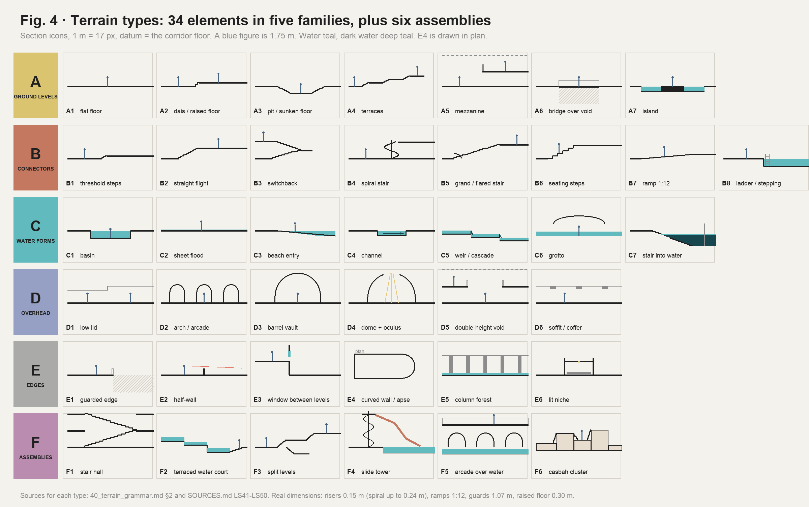
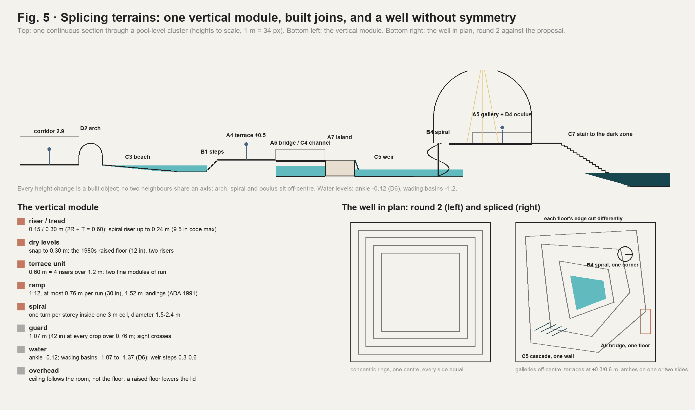

# Level space · 40 · Terrain: how many kinds there are, how they splice, and how they become modules

Date: 2026-10-31. Line: 浴室房间调研 (`bathroom`), K session (Red's API key, Cursor), research sub-chat.

Red, 10-31 16:06 (K research chat): "以及，目前你的很多空间设计似乎都是对称/环形的，但是没有不同地形之间的拼接融合，比如说在dream pool的作品里，就有很多拱形/螺旋楼梯，一个高度不一的环境设计，我需要你再开一个最新的research，思考这种环境设计里面有多少种不同的地形设计，并且要如何模块化落位到我们的不同level里".

Builds on, does not repeat:
- `10_research.md`: the thesis (one building, one layer per level), adopted by Red;
- `20_structural_drama.md`: devices V1–V7 and the well, and the round 1–2 stills Red is reacting to;
- the pool line's `bathroom_rooms/50_modules_and_contracts.md`: per-cell `floorY` and `water` (C2), basin cells (C3), the round-headed arch edge (C5), the sunken region and its stair (C9), weirs;
- `LEVEL_DESIGNER.md`: room modules, the stamp, markers.

Research only: no code, no clone, no Unity, no download. Sources [LS41]–[LS50] are added to `SOURCES.md`. Figures 4 and 5 are diagrams drawn from the numbers here (`W/level_space/make_terrain_figs.py`). The two research sub-sessions planned at 15:59 (`30`, `31`) stopped when the API key ran out of credit; relaunched at 16:41, they landed at 16:52 and 16:53, and their proposed types are registered in §4, "Proposed additions".

## 0. Short answer

1. **Red is right.** The round 1–2 spaces are symmetric and ring-shaped: the well's concentric rings, the funnel, the four-quadrant split level, balconies on three sides of the stair hall. Each scene also shows one terrain only, and its height changes happen at the scene's edge. A Dream-Pools-type environment reads rich for three reasons:
   - many terrain types in one view at different heights;
   - curves (arches, spirals, curved walls) cutting across an orthogonal tile grid;
   - water acting as a ground that itself changes level.
2. **How many kinds:** 34 elementary terrain types in five families, plus 6 assemblies (Fig. 4):
   - A, ground levels (7);
   - B, connectors (8);
   - C, water forms (7);
   - D, overhead forms (6);
   - E, edges (6);
   - F, assemblies made of the others (6).
3. **Splicing (拼接融合) is a grammar, not a picture** (Fig. 5):
   - **One vertical module.** Risers 0.15 m on 0.30 m treads. Dry floor levels snap to 0.30 m, the 1980s raised-floor height. Terraces step in 0.60 m. Ramps run at 1:12, at most 0.76 m per run. A spiral rises one storey per turn inside one 3 m cell.
   - **Every height change is a built object.**
   - **No assembly is symmetric on both axes,** and curves are inscribed in cells.
   - **Every raised or sunken area has two ways in.**
   - **A spiral stair is never the only way and never the EXIT.** In 1991 a spiral could serve only a small space [LS48].
4. **Modules:** generalise the pool line's data to every theme:
   - per-cell `floorY` and `water` (C2), the round-headed arch (C5) and the sunken region (C9);
   - new: per-edge crossings (Step, Flight, Ramp, Guard, Weir, Coping, Beach) and per-cell connectors (Stair, Spiral, Ramp, Bridge, Void);
   - authored as room modules in the Level Designer; placed by the generator with a splice check.
5. **Per level, following the thesis** (§7):
   - **Level 0** gets the built terrain of a tenant floor: a raised computer floor with its ramp, a tiered training room, a sunken lounge, and a split-level suite with a spiral convenience stair inside a Tall room.
   - **Office** gets a raised trading floor, the sunken bullpen, a file mezzanine on a spiral stair, and a tiered boardroom.
   - **Run!** keeps its corridor nature: ramps, threshold steps and a loading-dock release only. No catwalks: Red cut G.
   - **Pool** gets the whole vocabulary: beach, weirs, channels, islands, a grotto, a terraced water court, a slide tower on a spiral stair, arcades, a dome with an oculus, apses, stairs into water.
   - **The well** loses its symmetry: each floor's edge is cut differently, with a spiral in one corner, a cascade down one wall, and a bridge on one floor only.
6. **Cost tiers:**
   - view-only terrain (arches, vaults, domes, windows, guarded drops) needs no navigation work;
   - small steps (≤ 0.45 m) need step rules for the player and the Relay;
   - storey changes (flights, spirals, mezzanines) need two-level navigation, which the pool's C9 already asks 关卡设计 for.
7. **Modules (Red 11-02, §11):** the smallest unit is the 3 m cell on one floor plane. The kit adds the vertical (cell levels in 0.30 m steps, storeys, voids), resolves edges from neighbouring cells, and builds the slide (pick A) from cell pieces: flume cells dropping whole tile courses on spine bays of a 0.6 m pier and a 2.4 m arch.

## 1. What Red saw, and why it reads symmetric

| Round 1–2 scene (`20` §6, round 2) | Why it reads symmetric or single |
|---|---|
| C, J1–J3 the well, the funnel, the bridge well | one 9 × 9 m void, every floor's ring centred on it and equal on four sides |
| K split levels | four quadrant platforms around a centre: rotational symmetry |
| L stair hall | balconies on three sides of one void |
| A, B, D, E, F, H (round 1) | one device per scene: one cut, one pit, one tall room, one ramp |

What is missing, and what this page supplies:
1. **Splices.** Two or more terrain types joined inside one view: a floor that steps onto a terrace, which bridges a channel, which falls over a weir.
2. **Curvature against the grid.** Arches, spirals and apses that break the orthogonal tile and the 3 m cell.
3. **Water as ground.** Levels made by water as well as by floors: beach, weir, stair into water.
4. **Asymmetry with a reason.** Each part sits where its own logic puts it, as in La Muralla Roja, where every block starts from its own level [LS41].

## 2. The genre's terrain vocabulary, read as text

Read only in interviews and articles; no image opened or copied [LS50].

- **Recurring elements:** spiral staircases (the best-known image of the series), arches, columns, railings, slides, stairs that run into water, water at about waist height, "multi-storey car parks, meandering hallways, spiralling staircases, and maze-like rooms", "curving, undulating forms of supposedly human-made structures".
- **The maker's method:**
  - a camera first: 24 or 35 mm, at eye or waist height, where a person could take a photograph;
  - the scene is composed round that camera; "everything not visible by the camera doesn't matter";
  - scenes "just kind of end";
  - a sunlit part, and an area kept dark on purpose.
- **What a game cannot borrow: the single camera.** In a game every view exists, and every part must be walkable and loop. So the terrain has to compose from many viewpoints, which is why FrontRooms needs a grammar of splices, not a set of pictures.
- **The guard stands** (15 §3): no composition, camera angle, colour scheme or layout from *Dream Pools* or any creator. The types below come from dated real places, period code and the canon's words.

## 3. Real precedents for spliced terrain (era-true)

| Precedent | What it splices | Types it supplies |
|---|---|---|
| Ricardo Bofill / Taller de Arquitectura, La Muralla Roja, Calpe (1968–73) [LS41] | One 5 m square module aggregated into Greek crosses. Every block starts from its own level. Interlocking stairs, platforms and bridges like a casbah; stair cores take a sixth of the built area; "urban gates" between courtyards | F6 casbah cluster, A6, B2, A4; *a single module with independent base levels* |
| Lawrence Halprin: Lovejoy Fountain (1966), Auditorium Forecourt / Ira Keller Fountain (1970), Portland [LS42] | Lovejoy: water pours "over an irregular series of stairsteps" into a basin, with stepping stones and a wading pool. Keller: an 80 ft cascade into a plaza 10 ft below the street, "floating" concrete platforms over the pool, amphitheatre steps 100 ft wide; "possible to climb, crawl, walk or sit anywhere … including behind the falls". Halprin's "geometric naturalism"; plazas as "theatre sets for choreographing human movement" | F2, C5, A7, B6, B8 |
| Charles Moore with Perez Associates, Piazza d'Italia, New Orleans (1978) [LS43] | Curving colonnades and arches in five orders (plus the "Delicatessen order"), neon, and a stepped fountain shaped as the map of Italy. Neglected by the 1980s; the city moved to take it off its parkland list in March 1991 | D2, F5, C5, E4; *a postmodern ruin with water* |
| West Edmonton Mall, World Waterpark (1986) [LS44] | An indoor wave pool with wave bays behind panels, 17 slides up to 25.3 m, a dark enclosed slide into a 1.2 m splashdown pool, all reached by a "web of staircases" from platforms | F4 slide tower, B4, A5, C1; *machinery behind grates* |
| Piranesi, *Carceri* (1750, 1761); Escher (1951–60) (`20` [LS33], [LS38]) | Stairs, bridges and galleries crossing tall voids; connections that cannot be assembled | F1 stair hall; the impossible connection (deep floors only, `20` §5) |
| Raised access floors, early 1980s offices; mainframe rooms (8 in minimum, 12 in as an air plenum; ramps about 1 in per ft) [LS49] | A whole room lifted 0.20–0.30 m, with its ramp and step at the door | A2, B7, B1 |
| The convenience stair of a multi-floor tenant (77 West Wacker: "internal staircase to privately connect to multiple floors", `10` [LS16]); spiral stairs allowed only for small spaces (1991) [LS48] | A stair, often a spiral, cut through a tenant's own slab, never part of egress | B4, A5 |

## 4. The 40 terrain types

Key:
- **Walk:**
  - V = view-only (no navigation change);
  - S = small step, ≤ 0.45 m;
  - L = a level change (flight, spiral, ramp over 0.45 m).
- **Levels:** L0 = Level 0, OF = Office, RN = Run!, PL = Pool, W = the well.
- **Codes** are terrain codes. The pool line's decisions (D1–D12) are written "pool D6" and so on.

### A · Ground levels

| Code | Type | What it does to the player | Dimensions (era) | Precedent | Walk | Levels |
|---|---|---|---|---|---|---|
| A1 | Flat floor | the datum; the uniform field (`20` §1) | — | building standard | — | all |
| A2 | Dais / raised floor | a stage: whoever stands on it is seen; you look over the room | +0.30 (raised floor), +0.60, +0.90 | raised computer floors [LS49] | S | L0 OF RN PL |
| A3 | Pit / sunken floor | prospect from the edge, refuge in the pit (`10` OF-1) | −0.60 lounge, −1.20 bullpen, −2.40 suite | conversation pits; `20` V2 | S/L | L0 OF PL |
| A4 | Terraces | three or more levels in one room; the eye reads depth by steps | 0.60 per terrace, 2.4 m deep | Halprin [LS42], La Muralla Roja [LS41] | S | L0 PL |
| A5 | Mezzanine / gallery | a second ground over part of a room; seen from below, seeing down | +2.70 inside a Tall room (5.4 m) | tenant mezzanines; World Waterpark platforms [LS44] | L | L0 OF PL W |
| A6 | Bridge | a walk across a void or water: exposure | 1.2–1.8 m wide, guards 1.07 | atrium bridges; La Muralla Roja | V/L | PL W |
| A7 | Island | ground surrounded by water or void; reached by a bridge or stepping stones | 2 × 2 cells and up | Keller's floating platforms [LS42] | S | PL |

### B · Connectors (how ground levels splice)

| Code | Type | What it does | Dimensions | Precedent | Walk | Levels |
|---|---|---|---|---|---|---|
| B1 | Threshold steps | the smallest splice: a level change you feel | 1–3 risers, ≤ 0.45 m | split suites, dock sills | S | all |
| B2 | Straight flight | a directed climb with a view at its head | 4–12 risers, 0.15 / 0.30 | — | L | L0 OF RN PL |
| B3 | Switchback | a storey in a small footprint; a landing turns you round | a storey in 2 × 1 cells | STAIR A | L | (stairwell) |
| B4 | Spiral stair | a curve in the grid; a storey in one cell; what's above is hidden until the last turn | diameter 1.5–2.4 m, riser ≤ 0.24 m (9.5 in), headroom 1.98 m [LS48] | World Waterpark; convenience stairs | L | L0 OF PL W (this 1-cell size, B4-S; the larger B4-M and B4-L of `50` and `60` are pool level only, Red 17:29) |
| B5 | Grand / flared stair | a monumental arrival; doubles as seating | widening flight, curved lower steps | postmodern lobbies | L | PL (L0 lobby only) |
| B6 | Seating steps | a terrace for sitting, climbable, not a walking stair | 0.45 rise, 0.90 tread | Keller's amphitheatre steps [LS42]; training rooms | S | L0 OF PL |
| B7 | Ramp | the floor itself tilts; a long slow descent | 1:12, ≤ 0.76 m per run, 1.52 m landings [LS47]; service ramps up to 1:8 | raised floors; `20` V6 | S/L | L0 OF RN PL |
| B8 | Ladder / stepping stones | the water's own connectors | pool ladders; stones at 0.6 m spacing | Lovejoy's stepping stones [LS42] | S | PL |

### C · Water forms

| Code | Type | What it does | Dimensions | Precedent | Walk | Levels |
|---|---|---|---|---|---|---|
| C1 | Basin | the pool: a sunken floor of water | −1.07 to −1.37 (pool D6) | the club's pool | S | PL |
| C2 | Sheet flood | water across the floor: no dry refuge | ankle −0.12 (pool D6) | canon (15 §2) | — | PL |
| C3 | Beach entry | the floor slopes into water: no edge to hold | 1:12 to 1:15 | 1980s leisure pools (18 PS9) | S | PL |
| C4 | Channel | water as a corridor, with a current | 1–2 cells wide, −0.9 | leisure pools; World Waterpark rapids [LS44] | S | PL |
| C5 | Weir / cascade | water steps down; the sound of falling water marks the drop | 0.30–0.60 a step | Halprin [LS42]; Piazza d'Italia [LS43] | S | PL W |
| C6 | Grotto | a low covered water passage: compression | vault crown 2.2–2.6 | leisure-pool grottos | S | PL |
| C7 | Stair into water | somewhere deeper exists | 0.18 / 0.28 (C9) | canon; PL_FireStair | L | PL |

### D · Overhead forms (the sky as terrain)

| Code | Type | What it does | Dimensions | Precedent | Walk | Levels |
|---|---|---|---|---|---|---|
| D1 | Low lid | compression before a release | 2.2–2.4 m | Alexander 190 (`10` [LS4]) | V | all |
| D2 | Arch / arcade | a framed view; curvature; rhythm | round-headed, 1.4–2.4 m (C5); arcades of 3+ | Piazza d'Italia [LS43]; postmodern fit-outs (18 PS3) | V | PL (L0 lobby) |
| D3 | Barrel vault | a tunnel ceiling: direction | crown = span / 2 above springing | Roman baths; grottos | V | PL |
| D4 | Dome + oculus | light from above, from nowhere | dome over 3 × 3 to 4 × 4 cells | baths and hammams | V | PL |
| D5 | Double-height void | two grounds in one view (`20` V3, V4) | 5.4 m and up | atria (`10` [LS25]) | V | L0 OF PL W |
| D6 | Soffit / coffer | steps in the ceiling: an axis overhead | drop to 2.4 m (`10` L0-2) | building standard | V | L0 OF RN |

### E · Edges

| Code | Type | What it does | Dimensions | Walk | Levels |
|---|---|---|---|---|---|
| E1 | Guarded edge | a drop you see over; sight crosses, bodies do not | 1.07 m (42 in) | V | all but RN |
| E2 | Half-wall | movement blocked, sight open (`10` OF-1 panels) | 1.1 m | V | L0 OF PL |
| E3 | Window between levels | one level seen from another: preview and memory | sill above 1.0 m | V | L0 OF PL W |
| E4 | Curved wall / apse | the grid bends; a room ends in a curve | radius 1.5 or 3.0 m | V | PL |
| E5 | Column forest | a screen of columns, in water or on dry ground | the 3 m or 6 m grid (18 M2) | V | OF PL |
| E6 | Lit niche | a pocket to stand in; always lit (darkness is never cover) | 1 cell edge deep 0.6 | V | L0 PL |

### F · Assemblies (named splices of the above)

| Code | Assembly | Made of | Precedent | Levels |
|---|---|---|---|---|
| F1 | Stair hall | B2 flights crossing D5, A5 landings, E1 | Piranesi (`20`) | PL W (deep floors) |
| F2 | Terraced water court | A4 + C5 + B6 + C1 + A7 | Halprin, Keller [LS42] | PL |
| F3 | Split levels | A2 + A3 + B1/B2 around a core, offset | Loos's Raumplan (`20` round 2 K) | L0 OF |
| F4 | Slide tower | B4 + A5 platform + slide tube through a wall + C1 catch pool | World Waterpark [LS44]; 18 M7 | PL |
| F5 | Arcade over water | D2 + A5 gallery + C1/C2 | Piazza d'Italia [LS43]; baths | PL |
| F6 | Casbah cluster | blocks at independent levels joined by B2 and A6 | La Muralla Roja [LS41] | PL (the deepest rooms), L0 (one per floor at most) |

### Proposed additions (from `30` and `31`; not adopted until Red picks)

Codes assigned by this chat at 16:53 so the two parallel pages do not clash (`31`'s own F7, F8, C8 and E7 became F8, F9, C9 and E8). Definitions, dimensions and sources are on the pages named. None needs a spiral.

| Code | Type | What it does | Precedent | Era | Levels | Page |
|---|---|---|---|---|---|---|
| B9 | Creeping slope | a floor sloping too gently to notice (about 1:30), no landing; under a flat lid the room gets lower | Seattle Books Spiral; Rolex Learning Center | method | OF L0 | `31` §5 |
| B10 | Flume | a one-way connector, down only, from a start platform to C1 water level; cells under it keep their floor with 2.1 m clear; not in the Relay's graph | 1980s fibreglass slides (`61`) | content | PL | `61` §4 (adopted by Red, 17:15) |
| C8 | Covered basin | an access floor over a full basin; missing panels, guarded, show the water; one open edge steps down (C7) | Willis Faber's staff pool, floored over in 1994 | method (1994) | PL | `30` §8 |
| C9 | Wet block | a tiled solid in the pool hall holding one small wet room (whirlpool, steam, plunge, sauna) | Therme Vals | method | PL (club) | `31` §5 |
| D7 | Riser shaft | a 1-cell opening in a soffit into a service shaft two to four storeys tall; view-only | McMaster HSC; Northwick Park | content | RN, L0 core | `30` §8 |
| E7 | Floor light | a walkable glass or glass-block panel over a lower level or the well, inside the guard line | HSBC Hong Kong's glass hall floor | content | W L0 PL | `30` §8 |
| E8 | Mesh partition | full-height chain-link or expanded metal: sight and sound cross, bodies never (R7) | the 1990 storage cage; Depot Boijmans and Vessel as method | content | RN PL W | `31` §5 |
| E5b | Blade field (variant of E5) | freestanding panels, two thirds on one axis: a wall one way, open the other | KAIT Workshop | method | OF | `31` §5 |
| F7 | Island field | 3 × 3-cell islands between 1-cell void lanes, joined by bridges on two or three arms | Centraal Beheer | content | L0 (one zone per floor), OF | `30` §8 |
| F8 | Flat lid over a stepped floor | one flat ceiling over a floor stepped from −1.20 to +0.60: headroom 4.10 → 2.30 m | *Severance* S2; Maggie's Gartnavel | method | L0 OF | `31` §5 |
| F9 | Parallel bowl | a pit whose lid steps down with the floor; from one rim the far rim shows only up to about 1.7 m, so the Relay's head is cut by the lid while its body stays in view (check rule 12 in greybox) | KAIT Plaza | method | L0 (one per floor) | `31` §5 |
| F1b | Slot stair hall (variant of F1) | straight flights crossing in a slot 2 cells deep and 6–9 long, over 2–3 floors | Depot Boijmans | method | OF W | `31` §5 |

If all are adopted: 41 elementary types (A1–A7, B1–B10, C1–C9, D1–D7, E1–E8) and nine assemblies (F1–F9), plus the variants B4-S/M/L (`50`), E5b and F1b.

## 5. Splicing: the join grammar

### 5.1 The vertical module

| Unit | Value | Why |
|---|---|---|
| Riser / tread | 0.15 / 0.30 m (2R + T = 0.60) | inside the period range (4–7 in risers, 11 in treads [LS47]); four risers make a terrace |
| Dry floor levels | multiples of 0.30 m | the 1980s raised floor (12 in) [LS49]; two risers |
| Terrace unit | 0.60 m = 4 risers over 1.2 m | two fine modules (0.6 m) of run: steps land on the map's fine grid |
| Ramp | 1:12, ≤ 0.76 m a run, 1.52 m landings | ADA 1991 [LS47]; service ramps may reach 1:8 (Run! H) |
| Spiral | one turn per storey in one 3 m cell; diameter 1.5–2.4 m; riser ≤ 0.24 m | code limits [LS48]; 0.3 m clear to the cell's walls |
| Guard | 1.07 m at every drop over 0.76 m | the period 42 in guard |
| Water | ankle −0.12; basins −1.07 to −1.37 (pool D6); weir steps 0.30–0.60 | the pool line's water law |
| Overhead | the ceiling belongs to the room, not to the floor | a raised floor lowers the lid; a sunken floor makes the room taller (`20` V2) |

### 5.2 Ports and joins

Every terrain module's edge carries **ports**, each a ground level plus a joint kind. Two modules join where their ports match; otherwise a connector module absorbs the difference.

| From → to | Δ | Joint |
|---|---|---|
| floor → floor | 0 | Open, or an arch (D2) when the ceiling changes |
| floor → dais / pit | 0.30–0.45 | B1 inside the higher module; or B7 at 1:12 |
| floor → terrace / pit | 0.60–2.40 | B2 flight, B6 seating steps, or B7 runs with landings |
| floor → mezzanine | 2.70 | B4 spiral or B2 flight; E1 guard along the open edge |
| floor → water | to −0.12 / −1.37 | C3 beach, coping with B8 ladder, or B1 steps into water |
| water → water | 0.30–0.60 | C5 weir |
| any → void | any | E1 guard; sight crosses (rule 12) |
| any → island | any | A6 bridge or B8 stepping stones |

### 5.3 Eight splice rules

1. **R1 · A built object at every height change:** a step, flight, ramp, weir, coping or guard. Never a bare ledge: `02_real_buildings` rule 1 extended to height.
2. **R2 · Changes happen inside modules, not on cell lines.** A connector occupies its own cells, and its landings meet the neighbours flat.
3. **R3 · The ceiling follows the room.** Raise the floor and the room gets lower (compression); sink it and the room gets taller. Where the ceiling itself changes, the edge gets a soffit or an arch (D2, D6).
4. **R4 · No assembly symmetric on both axes.** Connectors sit off the room's centre lines; terraces have unequal widths; an assembly is placed in one of eight orientations (four turns, mirrored). Cullen's deflection (`10` [LS9]) and La Muralla Roja's independent levels [LS41] are the models.
5. **R5 · Curves are inscribed in cells.** Quarter circles of 1.5 or 3.0 m radius; arches 1.4–2.4 m wide; a spiral in one cell. Where a curve meets the grid, a "pivot and flange" piece closes the gap, as in Skyrim's Ratway kit [LS45].
6. **R6 · Two ways onto every raised or sunken area of 2 cells or more.** This gives loops for the chase (`10` [LS30]). A spiral is never the only way, and never the EXIT: STAIR A stays the egress [LS48].
7. **R7 · Sight crosses, bodies do not, where the grammar says so** (E1, E2, E3). The Relay stays readable across every drop (COMMON rule 12).
8. **R8 · Light on the joints.** Lit landings, lit stair noses and a lit weir lip. Dark only in water depth or in unreachable voids, never on a walkable pocket.

### 5.4 Composition from any viewpoint (what replaces the single camera)

- **Three planes in every long view:** a near change (a step, a coping), a middle ground at another level (a terrace, an island), and a far frame (an arch, an oculus, a lit gallery).
- **Partial reveals:** a spiral hides its top, an arch frames one slice, a weir hides the basin below its lip. Each reveal is a weenie (`10` [LS7]).
- **The grid stays visible** in tile and cells, so the curves read as curves.

## 6. Modules: from types to the map

### 6.1 Data (extends the pool line's C2, C5 and C9 to every theme; contract work for 关卡设计)

| Data | Values | Note |
|---|---|---|
| per-cell `floorY` | multiples of 0.30 m (−2.40 … +2.70) | C2 already proposes it for the pool |
| per-cell `water` | Dry, Wet, Ankle, Wade | C2 |
| per-cell `connector` | None, Stair (direction, risers), Spiral (hand), Ramp (direction, slope), Bridge, Void | new |
| per-edge `crossing` | Open, Step (n), Guard, Weir, Coping, Beach, Arch (rect, round), Window | Arch round = C5; Weir = the pool's weir edge |
| per-cell `ceilingY` / `head` | Flat, Soffit, Vault, Dome (+ oculus) | dome and vault cells switch the map's lamp off and carry their own light (zone_lamps P6) |

### 6.2 Terrain modules (starter kit; authored in the Level Designer)

| Module | Footprint (cells) | Height class | Types | Note |
|---|---|---|---|---|
| T_L0_ComputerRoom | 4 × 3 | Standard | A2 +0.30, B7 1:12 (3.6 m) along one side, B1 at the door, D1 | a 1980s raised floor; low lid 2.6 |
| T_L0_TrainingRoom | 4 × 4 | Standard | B6 × 4 tiers falling to a front wall, A4, two doors (top and bottom) | rule R6 |
| T_L0_SunkenLounge | 3 × 3 | Standard | A3 −0.60, B1 on two sides, E2 | the mild pit; `20` D is the deep one |
| T_L0_SplitSuite | 4 × 3 | Tall 5.4 | A2 +1.20 platform by B2, A5 +2.70 gallery by B4 spiral, E1 | the multi-floor tenant's convenience stair |
| T_L0_LobbyStair | 3 × 4 | Tall 5.4 | B5 flared stair down 0.90 into the lobby band, D2 one arch | the one postmodern gesture (`10` J2); station only |
| T_OF_RaisedFloor | 4 × 4 | Standard | A2 +0.30, B7 and B1, low panels on top (`10` OF-1) | trading or computer floor |
| T_OF_FileMezzanine | 4 × 3 | Tall 5.4 | A5 +2.70 over files, B4 spiral in one corner, B2 at the other end | R6: two ways up |
| T_OF_Boardroom | 3 × 3 | Standard | A2 +0.30 and +0.60 tiers, E3 glass front | |
| T_RN_DockRelease | 3 × 4 | Tall 5.4 | A2 +1.22 dock (48 in), B2 down at one end, a roll-up door | the Run! goal as a release (`10` RN-4) |
| T_RN_Thresholds | 1 × 3 | Standard | B1 ± 0.30–0.45 at fire-door frames | corridor variety without catwalks |
| T_PL_BeachHall | 4 × 5 | Tall 5.4 | C3 + C2, D2 arcade on one long side, E4 apse at one end | |
| T_PL_WeirTerraces | 4 × 6 | Tall 5.4 | C5 × 3 (0.30–0.60), B1 steps beside, A4, E1 | Halprin's logic, our tile |
| T_PL_IslandChannel | 5 × 5 | Standard / Tall | C4 in an L, A7 island, A6 bridge, B8 stepping stones | never a ring |
| T_PL_SlideTower | 3 × 4 | Tall 5.4 | F4: B4 to the platform, slide tube through the wall to the next module's C1. **Red 17:15:** the highest option, `61` §4 option 2: the tower rises through a ceiling opening to the floor above, over a D5 double-height hall, so the start is on the upper floor (about +9 m) and the slide is a one-way storey connector (B10); tiled walls carry the flume and the tower, no freestanding steel; styles mixed; the player rides, the Relay never; nobody is ever seen inside the tube | World Waterpark |
| T_PL_DomeGallery | 4 × 4 | Tall 5.4 | D4 dome + oculus off-centre, A5 gallery by B4, C1 under | |
| T_PL_Grotto | 2 × 4 | Low 2.4 | C6 vault over C4, leads toward the dark zone | |
| T_PL_Casbah | 6 × 6 | Tall 5.4 | F6: blocks at 0 / +0.6 / +1.2 / +2.4 joined by B2 and A6; the lowest level flooded | La Muralla Roja's logic |
| (pool line) PL_Leisure, PL_FireStair, PL_Gallery, PL_PoMo | as in `50` | — | C5, C7, E3, D2 | already specified |

### 6.3 Placement and checks (the generator, after the stamp)

- Each theme's profile lists its terrain modules with weights, and a terrain density per tier: rising with depth, and highest on pool floors.
- **Splice check** (an error if it fails):
  - every port matched, or a connector in between;
  - every cell reachable by the player and the Relay within their step limits;
  - two routes onto every raised or sunken area of 2 cells or more;
  - a guard on every drop over 0.76 m;
  - lamps clear of soffits, vaults and domes.
- **Symmetry check** (a warning): an assembly whose ground levels are the same after a mirror on both axes.

### 6.4 Navigation and cost tiers

| Tier | Types | Needs | Owners |
|---|---|---|---|
| 1 · view-only | D1–D6, E1–E5, A6 seen across, the well's terraces seen from above | arch and ceiling heads, guards, lamp rules | 游戏视觉, 关卡设计 |
| 2 · small steps | A2, A3 (to −0.60), A4, B1, B6, B7, C3, C5 | per-cell `floorY`; player step offset; Relay step climbing; ramp colliders over steps | 关卡设计, 系统设计 |
| 3 · storey changes | A5, B2 over 0.45, B4, F1, F3, F4, F6, C7 | two-level navigation inside one floor (C9's question), mezzanine floors as a second walk surface | 关卡设计, 系统设计 |

**Decided by Red (10-31 ~16:15): the Relay does not use spiral stairs; they are the player's shortcuts.** Rule R6 makes this safe: every raised or sunken area reached by a spiral has a second way in, which the Relay takes, so a spiral gains the player time and never safety. 关卡设计 keeps spiral cells out of the Relay's navigation graph; 系统设计 records the rule. (The recommendation had been "yes, more slowly".)

## 7. Per level (落位)

| Level | Terrain types it uses | Why (the thesis) |
|---|---|---|
| Level 0 (space plan) | A1–A5, B1, B2, B4 (only inside Tall rooms), B6, B7, D1, D5, D6, E1–E3, E6, F3 | everything a tenant fit-out could build inside a floor: platforms, pits, tiers, a convenience stair; rectangles, no arches except the lobby |
| Office (stuff) | A1–A3, A5, B1, B2, B4 (Tall rooms), B6, B7, D1, D5, D6, E1–E3, E5, F3 | the furniture's terrain: raised floors under desks, the pit, the file mezzanine |
| Run! (services) | A1, A2 (the dock), B1, B2, B7, D1, D6 | a corridor stays a corridor: ramps, thresholds, a dock at the goal. G (the catwalk) was cut by Red because it changed what the room is |
| Pool (structure, site) | all of C; A1–A7; B1, B4, B5, B7, B8; D1–D5; E1, E3–E6; F1, F2, F4–F6 | the structure holds water, so the ground itself floods, steps, falls and curves |
| The well | A5, A6, B4, C5, D5, E1, E3, F1 | the one place where every floor's terrain is seen at once |

### 7.1 Level 0
- Mostly A1 (the uniform field stays the ground, `20` §1).
- One terrain module per zone at most: T_L0_ComputerRoom, T_L0_TrainingRoom, T_L0_SunkenLounge or T_L0_SplitSuite.
- Every module offset from its room's centre (R4).
- Its splices are the building's own: a raised floor's ramp, a training room's tiers, a suite's half-level.

### 7.2 Office
- T_OF_RaisedFloor carries the low panels: prospect.
- The sunken bullpen (`20` F) carries the refuge panels.
- T_OF_FileMezzanine adds the one spiral per district: a curve in the cubicle grid, two ways up.

### 7.3 Run!
- The ramp spine (`20` H, kept), threshold steps at fire-door frames, and T_RN_DockRelease at the goal.
- The release is a tall, bright loading dock with a high door: the brightest thing (`03_run_research` rule 5).

### 7.4 Pool
- The pool line's PL_* modules stay the base.
- The T_PL_* modules add the splices. A route through the level (Fig. 5, top):
  1. corridor → arch → beach;
  2. steps up to a terrace → bridge over a channel → island;
  3. weir down to a basin;
  4. spiral up to a gallery under an oculus;
  5. stair down into the dark zone.
- No two neighbours share an axis.

### 7.5 The well, without symmetry (Fig. 5, bottom right)
- **Each floor's edge** is drawn from four to six outlines, and turned or mirrored per floor: never centred, never equal on four sides.
- **Galleries** step in terraces of ±0.30 / 0.60 m around the void (A4 at its rim).
- **A spiral stair** in one corner descends to the lower terrace of the same floor, and is seen continuing down in the stand-in shaft.
- **A cascade** falls down one wall from the floors near the pool (C5): the water arriving before you do.
- **A bridge** crosses the void on one floor only.
- **Arches** on one or two sides of a gallery, never all four.

### 7.6 Joints
- The stairwell stays B3 and honest (`10` J1).
- District changes still happen at turns (`10` J3); a terrain change is a good place for one (R2).

## 8. Order of work

1. **Red picks** the assemblies and modules to greybox. They render in `W/proj_levelspace`, round 3, once the API key has credit again.
2. **Tier 1** (view-only): the well's asymmetric outlines and terraces seen from above, arches and domes in the pool modules, the lobby stair's arch. This is mostly the pool line's C5 and 游戏视觉's kits.
3. **Tier 2:** per-cell `floorY` for every theme (C2 generalised): computer room, training room, sunken lounge, raised trading floor, beach, weir terraces.
4. **Tier 3:** two-level navigation (C9 generalised): mezzanines, spirals, the slide tower, the casbah cluster.
5. **The module system (§11):** 关卡设计 rules on §11.7 through 总控; then the kit sheet and plates (§11.8); then 游戏视觉's spine kit.

## 9. Stills, round 3 (Red 10-31 ~16:15: "全部")

Rendered in clone `W/proj_levelspace`, in stand-in scenes far from the map, under the game's ambient, fog and post. The pool scenes use the main K chat's F1 values for ambient and fog, plus a cooler white balance. Nothing changed in main.
- 26 stills: `W/level_space/renders/levelspace/r3/`.
- Source: `Assets/Editor/ZoneLamps/FrontRoomsZoneLampsShots.LevelSpace3.cs` (scenes O–U), routed from `LevelSpace.cs`.
- Two runs. The second moved the cameras for O1, O3, R2, S4 (gallery) and T2, put uplights on the dome and raised the hall and dock lights.

| Sheet (Shot format) | Scenes | Types shown |
|---|---|---|
| `W/level_space/sheets/LS5_well_spliced.jpg` | O1–O4 | the well per §7.5: offset openings, an arcade on one side, a spiral in one corner, a bridge on one floor, a cascade |
| `LS6_pool_route.jpg` | P1–P5 | the Fig. 5 route: D2 → C3 → A4 → A6/C4 → A7 + D4 → C5 → B4 → A5 |
| `LS7_slide_and_casbah.jpg` | Q1–Q3, R1–R3 | F4 slide tower; F6 casbah cluster with C7 stairs into water |
| `LS8_level0_office_terrain.jpg` | S1–S4, T1–T2 | T_L0_ComputerRoom, T_L0_TrainingRoom, T_L0_SunkenLounge, T_L0_SplitSuite; T_OF_RaisedFloor, T_OF_FileMezzanine |
| `LS9_run_terrain.jpg` | U1–U3 | T_RN_Thresholds and T_RN_DockRelease |

Limits of the stills:
- Walls have no thickness; the Relay is a 2.05 m capsule; lamps are lens quads with spot lights.
- Guards are simplified in the casbah.
- The pool gallery shows one route up (the spiral), not R6's second route.
- Water is a transparent turquoise layer, not the pool line's water shader.

## 10. Limits

- *Dream Pools* is read only through interviews and articles [LS50]; no image was opened, and none is used.
- The 1991 stair, ramp and spiral numbers come from the ADA 1991 text [LS47] and from code summaries that quote the BOCA/UBC/IRC wording [LS48]. The model codes of 1990 are to verify before any sign or rule quotes a number.
- The leisure-pool history beyond World Waterpark (Center Parcs, Bletchley) was in the lost sub-session `30`; it can be added when that runs.
- The figures are diagrams. Fig. 5's section is one route, not a level plan.

## 11. The module system: from the smallest unit to the skeleton (Red 11-02)

### 11.1 Red's ask, and what was done

Red, 11-02 ~10:40: "我希望你不要搭建白盒，而是像是我之前的关卡设计逻辑一样，思考这些dramatic设计如何能够作为一个个module，然后modulize。比如说一个最小的建筑单位目前是什么，然后如何模组化构成一些有趣的结构，一般游戏里强调建筑的模组化建筑都是怎么做的" (do not build whiteboxes; like my earlier level-design logic, think how these dramatic designs can become modules and modularize them: what is the smallest architectural unit now, how do modules compose interesting structures, how do games that stress modular architecture do it).

Red, 11-02 ~14:30, choosing among three readings of how tiled walls carry the water slide: "A · 墙在下面" (A: a tiled wall stands under the flume like an aqueduct, with arches; chosen over B, a ledge growing out of the room's wall beside the flume, and C, the flume threaded through full-height walls).

The ask came after Red, 11-02 07:31: "目前不只是滑梯重做，在cursor还有dramatic 空间的各种各样的尝试，目前你的滑梯重做方案似乎忽略了dramatic 空间结构的study". So the slide is one assembly of the same kit.

What was done, and what was not:
- **No whitebox, no Unity, no download:** research text only. The map line's spec and code were read, not edited; §11.7 holds proposals, through 总控.
- **Two research drafts** (2026-11-03, working notes, both complete): `W/level_space/drafts/modules_games.txt` (eleven games and tools, G1–G56) and `modules_architecture.txt` (ten works built before 1993, A1–A55). The sources cited are [LS180]–[LS200] in `SOURCES.md`.
- **Also read:** this page's §4–7; `20`; `61` §0.1 and §2.5–4; `60`, `30` and `31` by search; the r5 and r4t briefs.
- **Guard:** methods, not looks: the works below lend rules, never a composition.

### 11.2 The smallest unit today

From `LEVEL_MODULE_SPEC.md` (LMS), `LEVEL_DESIGNER.md` and `FrontRoomsModuleUnits.cs` (`ModuleUnits`), read only:

| Unit | Value | Where |
|---|---|---|
| Cell | 3.0 m square; every wall, doorway, door and window spans one cell edge | LMS §2; `Cell` |
| Fine module | 0.6 m, five per cell: ceiling grid, carpet tiles, fixtures | LMS §2, §4; `Fine` |
| Structural grid | 6 m (every other cell line); columns 0.6 or 0.9 m on corners with both indices even | LMS §2, §3; `ColumnGrid` |
| Chunk | 8 × 8 cells = 24 m, built and dropped round the player; a room never crosses one | LMS §2, §9 |
| Wall | 0.16 m, centred on the cell line; clear span n × 3 − 0.16 | LMS §2; `WallThickness` |
| Door | 1.0 × 2.1 m, Low ↔ Standard borders only | LMS §3; `DoorWidth`, `DoorHeight` |
| Arch | doorless, 1.1–1.8 m wide, top 2.2 m, off-centre, ≥ 0.2 m of wall to each corner | LMS §3; `ArchMinWidth` … `ArchCornerMargin` |
| Ceiling classes | Low 2.4, Standard 2.9, Tall 5.4 m clear; floor slab 0.20, ceiling slab 0.16 | LMS §2; `LowCeiling` … |
| Room module | 1–8 × 1–8 cells, one ceiling class and theme; edges Wall / Arch / Open; columns; props; fill; lamps; markers | LMS §9; `LEVEL_DESIGNER.md` |
| `Validate` | errors: no way in, cells cut off, a prop in a wall or a clear strip, a blocked walk, a bad marker | LMS §9 |

The generator stamps a module into an intact, uniform carved room of its height and theme (`moduleChance` 0.3).

**The one missing degree of freedom.** Everything stands on one floor plane, y = 0 of its floor. The only vertical variable is the ceiling class; a Tall room is a taller box on the same ground. There is no floor level per cell, no void, no storey inside a level, no edge that is a step, a ledge or a guard. The generator can vary plan and ceiling, never the ground: that is the root of the endless horizontal (`20` §1). §6.1 already asks for per-cell `floorY`; this section builds the rest on it.

### 11.3 What modular games and buildings teach

From the drafts; built before 1993, or method only.

| Work | Smallest unit | Joint rule | Vertical | Why compositions surprise | Lesson for us | Sources |
|---|---|---|---|---|---|---|
| Bethesda kits (Skyrim 2011, Fallout 4 2015); kit practice | footprints in multiples (a 512 room, a 256 hall); a 3 m footprint on a 1.5 m snap | grid snap; glue kits between kits; sockets and plugs; 11 holes per wall half give 121 walls | shaft sub-kits of fixed plan; stacked prefabs; floors with thickness | kit-bashing; repetition shows in clutter first | one metrics table for every kit; glue pieces own each style change; stack, loopback and gap tests | [LS45] [LS180] [LS181] |
| Stålberg: Bad North, Townscaper | a cell holding a state; pieces drawn at its corners (dual grid: 16 cases, 6 with rotation) | adjacency solved from tile edges (WFC) | stacked cells; arches, stairways, bridges drawn "depending on their configuration" | the drama is where states change; big shapes predictable, small ones free | pieces are resolved from neighbouring states, not placed | [LS46] [LS182] |
| Wave Function Collapse, model synthesis | a labelled cell | an adjacency table; fixed tiles pinned first | one more axis: no storey, support or reachable stair | weighted choice inside the rules | the joint table is the design; pin the big moves; a known-good fallback per region | [LS183] |
| Minecraft jigsaw; DunGen | a template; a tile prefab | named connectors with target pools; sockets meet only their kind; a fallback or blocker for every unused port | up and down connectors; stair tiles whose entrances fix the direction | depth-weighted pools; pieces inside pieces | a socket per opening type; every unused port designed; rings as convex pieces round a void cell | [LS184] [LS185] |
| Spelunky (2008) | a room of 10 × 8 tiles in a 4 × 4 grid | a room type promises its exits | the level is a descent; a shaft is a top, repeatable middles and a bottom | template, insert slot and chance tile re-roll apart | route first; exits on six faces; a tower is a cap, N middles, a base | [LS186] |
| The Sims (storeys; platforms 2020) | a tile; storeys of one wall height | one step: walk on; more: a stair or ladder; the platform edge is its own piece | storeys plus in-storey platforms; a spiral is 2 × 2 plus a landing square and needs one storey height | players' split levels and pits | two height systems; the edge follows the height difference | [LS187] |
| Tiny Glade (2024); Valheim (1.0) | a stroke; a piece and its hop | joint pieces derived where strokes meet; support flows from piece to piece | a raised building grows columns; stone "17 up but 0 out" | the carrier is derived from the carried | lay the flume first and draw its spine under it; tile has no reach; the arch is the only span | [LS188] [LS189] |
| Shadows of Doubt (2019–22) | a 1.8 m tile; floors of 15 × 15 | door rules per room type | floors stack; ducts routed by search through leftover space | rooms scored on shape and windows | author the storey plan, fill the rooms; route the flume through free air by search | [LS190] |
| Habitat 67 (1967); Nakagin (1972), Yamanashi (1966) | a 12 × 5.33 × 3 m box; a capsule; a round service shaft | box on box, offset; capsule bolted to a core; floor trays between shafts | streets every 4th floor; bridges every 3rd; missing trays leave voids | offset roofs become terraces; bare shafts read as towers | stack with an offset; plug into a core; protect voids by rule (Yamanashi's filled up) | [LS191] [LS192] |
| Centraal Beheer (1972); Amsterdam Orphanage (1960) | a 9 × 9 m island = 3 × 3 cells with a one-cell cross; a 3.36 m bay and a 3 × 3-bay hall | islands meet through bridges over void bands; units chained on diagonals | void bands give views up, down and across; stepped towers | every floor sees into the gaps | a 3 × 3-cell island and a 1-cell void band; 1 : 3 sizes; height marks the hall | [LS121] [LS193] [LS194] |
| Bofill: Kafka's Castle (1968) to Walden 7 (1975) | a small cell; a 5 m Greek cross | the core first; each unit one step higher and turned | spirals of rooms round a core; displaced towers | courts between arms; colour by role | a height-and-turn operator round a core; mark circulation by tile format or trim | [LS41] [LS141] [LS195] |
| Habraken, *Supports* (1961); Alexander, *A Pattern Language* (1977) | support and infill; a pattern | support designed first, judged over many variants; patterns large to small | 116 cascade of roofs; 195 the stair as one bay two storeys high; 119 arcades | gradients of height and light | drama in the support; test over many seeds; the spine as an arcade | [LS4] [LS196] [LS197] |
| Piranesi, *Carceri* (1750, 1761); Portman's atria (1967–85), Kansas City walkways (1981) | a kit of pier, arch, stair, bridge; a ring of rooms on a gallery | montage in depth; every storey round one void | layered depth; lifts shown moving; hung walkways fell | ends out of sight; every storey seen at once | three layers in a long view; one cue per quadrant; carry from below, never hang | [LS33] [LS137] [LS139] [LS198] [LS199] |
| GDR pools (1968–92); FaulknerBrowns leisure pools (1974–89) | the whole hall as a type | type plus a change at each site; one repeated roof element | Doncaster's flume runs through mall and atrium, about 3.5 storeys over 120 m | four types, many sites | a hall with a vault per cell; the flume as the line joining modules | [LS200] |

Lessons, in order of use:
1. **Two units.** The generator decides a cell's state; pieces are drawn where cells meet, chosen by the states on both sides (Stålberg, DunGen, Minecraft).
2. **Fix the metrics before any piece:** footprint multiples, pivots, slab thickness, one opening standard, shared by the office kit and the tile kit (Bethesda, kit practice).
3. **The vertical gets its own mechanism:** storeys plus in-storey levels; stair cores and towers stack as cap, middles and base (The Sims, Spelunky, Bethesda's shafts).
4. **Pin the big moves, then fill.** Local rules have no global form (WFC). The route, the well, the tower and the flume come first; void cells are reserved (Spelunky, Shadows of Doubt, Habraken, Yamanashi).
5. **Derive the carrier from the carried.** The spine is drawn under the flume's path; tile has no horizontal reach, so the arch is its only span (Tiny Glade, Valheim, Alexander's arcade, the 1981 walkways). This makes "A · 墙在下面" a rule the generator cannot break.
6. **Composition comes from the joint rule, kept alive by a gradient:** offset stacking makes terraces, a height-and-turn step makes spirals, void bands make cross-views; one repeated box reads dead (Habitat, Bofill, Centraal Beheer).
7. **Every port closes by design, and legibility is planned:** terminators and blockers, known-good fallbacks, tests over many seeds, a re-orientation cue (DunGen, Minecraft, *Variations*, the Bonaventure).

### 11.4 The hierarchy: unit, piece, module, assembly, skeleton

**UNIT.**

| Unit | Value | Decides |
|---|---|---|
| Cell | 3.0 × 3.0 m (LMS §2) | the generator's choice: kind, level, ceiling |
| Half-grid | 1.5 m | offsets of cores and landings only, never a state [LS181] |
| Fine module | 0.6 m | piece sizes: piers, step runs, copings |
| Tile course | 0.15 m (the pool line's 6 in tile) | every vertical piece size: riser, sill, coping step; the 2.4 m arch's radius is 8 courses |
| Level step (new) | 0.30 m = two courses = two risers | the floor level of a cell inside a storey: −8 … +9 steps (−2.40 … +2.70, §6.1) |
| Storey (new) | a whole number of steps: 15 = 4.5 m on the pool level (`61` §4, upper floor +9.0); 13 = 3.9 m on office floors | multi-storey modules, void cells, the well |

A cell's state is its kind (Floor, Water with a depth, Void, Block, or a Connector: Stair, Spiral, Ramp, Bridge, Flume), its level in steps and its ceiling (a class, or a number of storeys).

**Why 0.30 m and storeys.**
- Every dry level in §4 is a multiple of 0.30 (§5.1): raised floor +0.30, terraces 0.60, pits −0.60 to −2.40, mezzanine +2.70; the dock's 48 in rounds to +1.20. Water keeps its own depths. A 0.60 step would lose the raised floor, the mezzanine and the 4.5 m storey for nothing.
- 0.30 is the player's step offset (LMS §7): one step is the most a body takes without a flight, and R1 still builds it.
- It is two courses, so every coping, nosing and weir lip lands on a tile line.
- Steps alone make no well or tower; storeys alone no terrace, pit or weir. The Sims keeps both [LS187].
- The 3.9 m office storey (2.9 clear + 0.2 slab + 0.8 plenum) and the 4.5 m pool storey replace the 4.0 m map storey of `20` §4.1 and `60` §2.1, which is not a whole number of steps; `60`'s stair sweeps need redoing for them.

**PIECE.** Edge pieces are resolved from the two cells' kinds and their height difference Δ; nobody places them (lesson 1). A step run of n steps takes n fine modules (2n risers, §5.1), so up to 5 steps fit in one cell.

| Cells A / B | Δ (steps) | Edge that is crossed | Edge that is closed |
|---|---|---|---|
| Floor / Floor | 0 | Open; arch (LMS §3, or round C5 up to 2.4 m); a door where LMS §3 puts one | Wall |
| Floor / Floor | 1 (0.30) | STEP: two risers on one fine module of the lower cell | KERB: a nosing |
| Floor / Floor | 2–5 (0.60–1.50) | STEP RUN: 4–10 risers on 2–5 fine modules inside one cell, a cheek on its open side | LEDGE with coping; over 0.76 m a guard: half-wall 1.07 m or balustrade |
| Floor / Floor | 6 and up, under a storey | none at the edge: a connector module in its own cells (R2) | LEDGE + guard 1.07 (E1): a gallery edge |
| Floor / Void | any | none | VOID EDGE: guard 1.07 on a slab edge that shows its section (V1) |
| Floor / Water | to the water | COPING with a ladder (B8); STEPS INTO WATER (C7); BEACH (C3) takes its own cells | COPING |
| Water / Water | 1–2 | WEIR (C5) | WEIR |
| any / Block | — | an arch or door the block owns | the block's wall |
| Floor / Floor, flume over the line | 0 | SPINE BAY with a walk arch (§11.6) | SPINE BAY with a sight arch or plinth |

Where the two ceilings differ, a soffit or an arch head sits over the edge (R3). **Corner pieces** come from the four cells round a corner (16 cases, 6 under turns and mirrors, the dual grid [LS182]): column (structural grid), pier (spine), newel or guard post where two guarded edges meet, coping corner (inside, outside), the cheek at a step run's end, the WALL PASS (§11.6).

**MODULE** (rooms with heights; each owns its connectors, R2): mezzanine (A5: a +9-step gallery over a third to a half of a Tall room, two connectors); terrace (A4: 0 / +2 / +4 steps, unequal widths); sunken court (A3: −2 to −8 steps, runs on two sides, the ceiling kept); gallery (a one-cell band beside a void); bridge (A6: Connector cells over a void, guarded); stair cores B4-S 1 × 1, B4-M 2 × 2, B4-L 3 × 3 (`60` §6), B2 a 3.9 m storey in 1 × 3 cells, B3 in 2 × 1; the B10 Flume (§11.6).

**ASSEMBLY** (multi-storey groups with ports):
- **The well:** a void column of 3 × 3 cells (or r5's 2 × 6 slot) through every storey. Per storey the rim is one of four to six outlines, turned (§7.5). Ports: a gallery on one or two sides, one stair core in one corner, one bridge on one storey only, a cascade (C5) down one wall near the pool.
- **The slide hall:** §11.6. Others: F1 and F1b stair halls, F2 water court, F6 casbah.

**SKELETON** (lesson 4): (1) pin the well at its world position, then each level's assemblies; (2) fill with room modules as today, void cells reserved; (3) check: §6.3's splice check, support (every tiled run on a wall, pier or arch), the Relay's graph without spirals or flume (R6), symmetry (R4), over many seeds.

| Level | Pinned | Modules per floor | Against symmetry (R4) | Two routes (R6) |
|---|---|---|---|---|
| Level 0 | the well's rim | ≤ 1 terrain module per zone (§7.1); at most one split suite with B4-S | modules off their room's centre lines; the rim outline turned per floor | every raised or sunken area of 2+ cells: two step runs, or a run and a ramp |
| Office | the well; one stack (V3) per district | one raised floor or sunken bullpen and one file mezzanine (B4-S + B2) per district | no two districts put the stack in the same place | the mezzanine's flight is the Relay's way up |
| Run! | the ramp spine; the dock release | thresholds only | — | the corridor loops as today |
| Pool | the well's foot; one slide hall; one B4-L arrival | 2–4 T_PL_* modules; 1–2 B4-M | no two neighbours share an axis (§7.4); the slide never symmetric (`61` §4) | every spiral paired with a flight; the start room's corridor door |

### 11.5 Tests: does the kit compose what is already designed

LS1–LS11 here are sheets, not sources.

| Device | Made of | What the kit lacks |
|---|---|---|
| `20` V1 cut, V3 stack, the well; sheets LS2, LS5; r5 S1 | Void cells, VOID EDGE, gallery bands, a core, a bridge, a WEIR down a wall, storeys | the view down while one floor is loaded (the stand-in shaft, `20` §3) |
| V2 drop; A2–A4; LS1, LS3, LS8 | levels in steps, STEP, STEP RUN, LEDGE | the Relay's step climbing (§6.4 tier 2) |
| V4 tall void (14.5 m) | a ceiling in storeys | stronger lamps, a longer far clip (`20` §7) |
| V5 bridge; F7 island field | Bridge cells over Void; 3 × 3 islands, 1-cell void lanes | two-level navigation (tier 3) |
| V6 ramp (1:8, 3 m down over 24 m = 10 steps over 8 cells), LS4; B9 creeping slope (1:30) | a Ramp connector with a whole number of steps | a sloped floor cell: every level here is flat |
| V7 moving structure | edges re-resolved at a revisit shift | a rule for which edges may change |
| LS6 route; F2, F5; C1–C7 | WEIR, COPING, BEACH, STEPS INTO WATER, round arches | a water level per cell (C2) |
| LS7, LS11: F4, F6; LS10: B4-M, B4-L; LS9 | §11.6; blocks at their own levels; 2 × 2 and 3 × 3 cores; STEP, ramp, dock LEDGE | nothing new |
| F8 flat lid over a stepped floor; F9 parallel bowl | levels under a ceiling plane (§6.1 `ceilingY`) | a ceiling that steps with the floor (F9) |
| C8 covered basin; E7 floor light | Water or Void below, Floor above | two layers in one cell |
| C9 wet block; D7 riser shaft | a Block with a room in it; a Void in the ceiling only | a room inside a Block; a ceiling-only Void |
| E8 mesh; E5b blade field | E8 a closed edge that sight and sound cross (R7); E5b panels on fine-module points | E5b is props, not edges |
| F1, F1b slot stair hall | a 2-cell Void slot over 2–3 storeys | a flight across a void |
| r5 S2 terraces | levels; a terrace's LEDGE carries the flume | a SPINE BAY on a ledge (blind arches on its low side) |
| r5 S3 through | WALL PASS | its threaded walls are reading C; under pick A the spans need SPINE BAYs |

### 11.6 The slide as modules (Red's pick A)

"A · 墙在下面": the tiled wall stands under the flume (`61` §2.6). The flume runs on cell lines, so its spine is an edge piece like any wall (LMS §2).

| Piece | Size | Rule |
|---|---|---|
| FLUME CELL | one cell, one 3.0 m section (`61` §1.1 has no period length; 2.4 m was inferred too) | drops whole courses: 2c = 0.30 m (10 %), 3c = 0.45 m (15 %); 5c = 0.75 m (25 %) in the slot only; 0c level in the last cell. Joints over the piers; the style (SL-A, B, C) changes only there |
| SPINE BAY | 3.0 m = a 0.6 m PIER on the cell corner + a 2.4 m round ARCH on the edge | body 0.6 m; coping 0.9 × 0.30 m on a 0.15 m corbel course, one level per pier, its top one course (the saddle, 0.7 m long) under the riding line; it steps 2 or 3 courses at mid-arch (`61` §2.6: every 1.6 m); no steel |
| SPINE BEND | r 3.0 m round a cell corner, in 45° bays (chord 2.30, opening 1.70 m): 2 for 90°, 4 for 180° | both tangent points on cell corners. Changes `61`: 90° bends were r 2.0, the colonnade 1.55 m chords with 0.95 m openings; now every bay is a walkable arch |
| WALL PASS | a 1.8 × 1.8 m tiled reveal centred where the spine's line meets a wall line (a corner piece) | the flume cell on each side is SL-C, whole cells (`61` §2.5 said 1.2 m); the half-edges beside it hold no other opening; the gap of M4 |
| TOWER SHAFT | 2 × 2 cells; Ø 3.6 m; through the ceiling | base (arched door), N middle storeys, cap (half-wall ring). Proposed riser 0.1875 m: 24 a 4.5 m storey, two turns of 2.25 m (headroom about 2.15, code 1.98 [LS48]), the same bearing on every floor; `61`'s 0.20 m gives 22.5 |
| START ROOM | 5 × 2 cells on the floor above: +9.0, 3.0 m clear | the slot is the first two flume cells (5c): riding line 9.3 → 7.8 over 6 m (`61` §4: to 7.97 over 5.3 m), trough top 8.51 under the 8.7 soffit; tub, cheeks, crossbar; corridor door (R6) |
| CATCH POOL | 3 × 2 cells, long axis on the flume's line | C1, 0.9 m of water; `61` §2.1's 7.2 × 5.2 m water fits, ≥ 6.1 m of it beyond the lip [LS78] |

**The grade, against `61` §4.** A uniform 10 % is 9.3 / 0.30 = 31 cells, 93 m: exactly M7's limit. With the slot and the level last cell, 10 % gives 29 cells, 87 m: the base run (42 m), one crossing loop (25 m) and a second crossing room (12–15 m). Alternating 2c and 3c (11 + 10 cells for the 52 courses below +7.8) gives 24 cells, 72 m, 12.9 %, like the r4t path (72 m, 12.8 %), with one crossing loop. **12.5 % is better**, as that mix: 10 % is M7's floor, under the 1983 tubes' 15 % and today's 14 % open flumes (`61` §1.1), and a uniform 12.5 % cell drops 2.5 courses, off the tile grid. 3c cells go after bends, 2c into the pool; all-2c only buys a second crossing room.

**Crown rule.** c = the lower coping underside over the arch, above the bay's floor. Springing s = 0.6 c, rounded down to a course; crown = s + 1.2.
- Walk arch where c ≥ 3.6 m: s ≥ 2.10 (M6; the Relay, 2.05 m, walks through).
- Highest: under the slot c reaches 7.95 and s 4.65, capped at `61`'s 4.5 in that one bay; under the first run c = 7.2, s = 4.20.
- c drops at least 2 courses a bay, so neighbouring crowns always differ (R4); the solid band over each crown is at least 0.3 m.
- This replaces `61` §2.6's "springing = body top − 1.8" (equal arches wherever it hits the 4.5 m cap) and r4t's 0.62 c + 0.9 (for 1.78 m arches).
- **Sight arch** where c = 2.2–3.6: 1.2 m wide, sill 1.07, round head, crown 0.3 m under c. **Plinth** where c < 2.2: solid and 0.9 m thick, so no coping hangs below 2.1 m (M6).
- **R7:** above eye level, never more than one 0.6 m pier of solid wall between openings; the one or two plinth bays with c between 1.62 and 2.2 are the only exception (`61` §2.6 missed it).

**Styles by piece** (`61` §2.5): SL-B in the slot, the first run and the last cells (seen from above and from the deck); SL-A on cells seen from the floor (the bend, hall spans, the crossing room); SL-C at WALL PASSes and in the service void.

**The Relay never rides.** Flume cells and the shaft's spiral stay out of its graph; it reaches the start room by the corridor door. Walk arches in every bay where c ≥ 3.6 m, and the deck round the spine's low end, keep the hall one space (R6): the answer to r4t's flaw "it divides the hall".

**The assembly** (T_PL_SlideHall, 7 × 7 cells, `61` §3): the shaft in one corner, the spine with one 180° bend, two WALL PASSes on different walls (M1), the catch pool, the start room over the south side. Ports: the hall's doors, the corridor door above, the two passes, the exit lane.

### 11.7 What it asks of 关卡设计 and 游戏视觉

**关卡设计** (proposals only, through 总控; LMS and the code stay theirs):
1. A level per cell in 0.30 m steps (§6.1's `floorY`, every theme) and a storey height per level profile, a whole number of steps.
2. Void cells: reserved, guarded; sight and sound cross, the Relay never.
3. Multi-storey modules: a footprint with a storey count and ports per storey (door, gallery, connector, flume), pinned before the carve.
4. Edge resolution as data: §11.4's table, every edge with a crossed and a closed state; corner pieces; the round arch up to 2.4 m as a new edge size.
5. The Flume connector: one-way cells on cell lines, out of the Relay's graph, and a support check.

**游戏视觉** would build: FLUME CELL in three styles and four drops; PIER with saddle and coping; walk and sight ARCH; plinth; bend bay; WALL PASS reveal; shaft base, middle and cap; tub and cheeks; catch pool; STEP, STEP RUN, LEDGE, VOID EDGE, WEIR and COPING in an office and a tile version. LOD: one tile material for spine, coping and shaft, so a run merges into few draws on iPhone and iPad [LS190]; LOD1 drops grout normals and the saddle's curve; LOD2 merges a run of bays into one mesh. The tile sheet must divide 3 m (LMS §5, `TileAlign`): 1.5 m (10 × 10 tiles), not r4t's 2.4 m.

### 11.8 Diagrams to draw next

Spec only; to be drawn from the numbers like Fig. 4 and 5 (`W/level_space/make_terrain_figs.py`), no source image:
1. **Kit sheet**, axonometric: the cell with its 0.6, 0.30 and 0.15 m marks; every edge and corner piece of §11.4 by Δ; the pieces of §11.6 with sizes.
2. **Plate 1, the slide hall:** plan on the cell grid, and the section unrolled along the flume with each bay's c, s and crown.
3. **Plate 2, the well:** the void column, each storey's rim turned, the core, the one bridge, the cascade.
4. **Plate 3, a pool-level skeleton:** the pinned moves, then the infill, with R4 and R6 marked.

### 11.9 Module sizes: whole modules on one strict 3D grid (Red, 11-03)

Red, 11-03 ~18:3x, in this line's chat: "我认为不一定所有模组都要严格的遵循最小单位，就比如说有些模组它本来就需要就是9×9的一个大小。" Then: "目的只是为了让所有的模组都遵循一套严谨的一个 3D 网格的这种比例关系，然后呢它们之间就是有这种明确的数学关系去对照，这样子在关卡生成器进行生成的时候，这个关卡它就是比较可控的。"

Read as follows (the reading is this line's; Red may correct it):
- **A module is one whole piece at the size its use needs.** It need not be assembled from §11.4's smallest pieces. A B4-L is 3 × 3 cells (9 × 9 m), the well's column 3 × 3, the slide's shaft 2 × 2 (6 × 6 m), a dome gallery 4 × 4 (12 × 12 m), the slide hall 7 × 7, because their geometry needs it; their insides (radii, risers, flume sections, arches) follow their own design.
- **What the grid fixes is the proportion between modules, in all three dimensions:** every footprint a whole number of cells (3.0 m); every floor, ceiling and port level a whole number of level steps (0.30 m = one tenth of a cell); every storey a whole number of steps (13 = 3.9 m, 15 = 4.5 m); every port on a cell edge at a step level. Any two modules then relate by integers, and the generator places, stacks and joins them by integer arithmetic. That is the control Red asks for.
- **Below the step, sizes are a module's own detail, not a placement rule:** the 0.15 m tile course and the 0.6 m fine module stay the kit's metrics (§11.4, LMS §2), so pieces line up inside a module, but they never decide where a module goes.
- **Edge and corner pieces (§11.4) are how the generator joins modules,** not a requirement that every module be made of them. A set piece (stair core, B4-M, B4-L, shaft, dome, slide hall, the well) is placed whole with its ports declared.
- **A natural outline that is not a cell multiple** (B4-M's 4.36 m) takes the smallest whole-cell footprint that holds it (2 × 2), and the leftover belongs to the module (a landing, a collar, a wider tread), never a hole in the grid (R5's pivot and flange). Likewise a stair core takes the footprint its storey needs: a 4.5 m storey of 30 risers at 0.15 / 0.30 needs about 6.6 m of flights and landings, so 3 × 1 cells or a three-flight stair in 2 × 2, not a 1 × 1 cell.
- **Limits that stay:** LMS's 1-8 × 1-8 cells per room module and the 24 m chunk (a room never crosses one). A module larger than a chunk would need 关卡设计 to change the chunk rule; this page does not propose it.
