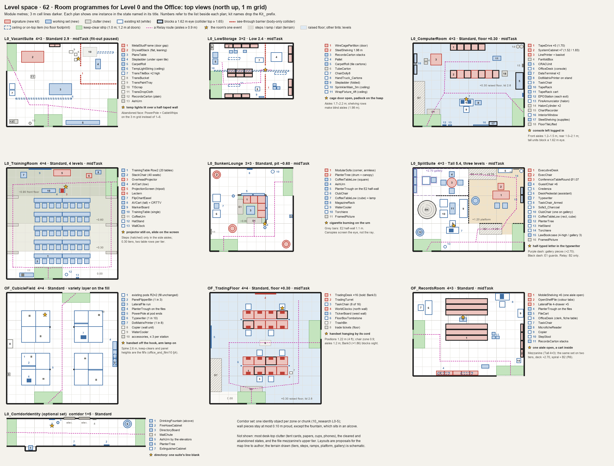

# Level space · 62 · Furniture: room programmes for Level 0 and the Office

Date: 2026-10-31. Line: 浴室房间调研 (`bathroom`), K session (Red's API key, Cursor), research sub-session for the furniture system.

Red, 10-31 ~16:27: "屋子里的陈设也就是家具系统需要大范围的更新和增加，这样能够符合房间的内容需求，而不是用现有的很多家具重复利用" (the furnishings need a large update and expansion, so that each room fits its content instead of reusing many existing pieces).

Builds on:
- `50_refinement.md` §3: the rule that every room type has a programme, and a first list of new kits.
- `40_terrain_grammar.md` §6.2: the terrain modules (`T_L0_ComputerRoom`, `T_L0_TrainingRoom`, `T_L0_SunkenLounge`, `T_L0_SplitSuite`, `T_OF_RaisedFloor`, `T_OF_FileMezzanine`).
- `office_and_film/10_synthesis.md` §4–5 (the Office fill, kit rules, budgets) and `office_and_film/22_era_lock.md` (how a kit is dated).
- `LEVEL_DESIGNER.md` and `LEVEL_MODULE_SPEC.md` §6–8: modules, keep-clear strips, sight, budgets.
- The level profile (`Assets/Levels/FrontRoomsLevel0.asset`): carved rooms are 2–3 cells a side when Low, 2–4 when Standard, 5–7 when Tall.
- The kit library: 246 sidecars in `Assets/Resources/Props/Models`, about 160 of them not door or lock parts.

Sources: [LS56]–[LS59] from `SOURCES.md`, and [LS80]–[LS99] in the table at the end of this file (the parent merges them into `SOURCES.md`). Research and specification only: no code, no kit, no download, no cost estimate. A sibling sub-session uses the same programme block (§1) for the Run! and pool rooms.

## 0. Short answer

1. **Nine room programmes and one optional corridor set** (§2). Each uses one shared block (§1): signature pieces, the working set in the arrangement the use makes, clutter of use, one state per instance, one event per room, placement, counts, clearances, sight and colliders.
2. **71 new kits** (§3.1): 22 priority 1 (signature), 30 priority 2 (working set), 19 priority 3 (clutter). There are also 8 variant families of existing kits (§3.2). About 60 existing kits keep their places; the domestic pieces stay in piles (§3.4).
3. **Period findings that change what we build:**
   - **Vacant suite.** A Level 0 vacant suite has three true faces: a fit-out stopped mid-task (metal studs, drywall, drawings, temporary lights), the tenant gone (power poles, cut cable whips, carpet ghosts), or the space swept for leasing. The "see-through buildings" of 1985–88 stood floor after floor in that state [LS80]–[LS82].
   - **Computer room.** A 1990 tenant computer room is smaller and newer than a university machine room. It holds midrange cabinets, a few 9-track reel drives beside cartridge drives (from 1984), a line printer, a downflow air conditioner, an emergency power-off button at each exit and halon abort stations [LS83]–[LS86]. The tape drive's reel window is the most legible single piece.
   - **Training room.** The 1989 training room ran on overheads, a screen, a lectern, a flip chart and a TV and VCR cart [LS57][LS91]. Its 18 in tables need about 1.5 m per row, so the tiers should be 0.30 m per cell row with two rows each, not the 0.45 m seating steps of `40` (Q3).
   - **Trading floor.** Bond desks of the late 1980s were four feet wide and joined on three sides, with three or four screens and two or three phones each [LS87]. Screens built into the desk kit keep 16 positions inside the Office budget, and traders stood, so a few chairs are enough.
   - **Lounge.** Office lounges of 1985–90 were where smoking was still allowed [LS90]. They were planted with ficus, dracaena and palms, with long planters on files and panels [LS89]. The planter trough also gives the cubicle field variety without touching the fill.
4. **Sight is designed, not left over.** Rows of tall pieces (tape drives, tall cabinets, shelving, mobile carriages, three-high screen banks) make blind aisles on purpose. Some period barriers are see-through (wire cages, stud frames). Today any collider whose top is at 1.65 m or more blocks the Relay's sight, so these barriers need a body-only collider (Q1).
5. **Budgets hold by construction.** A row or track merges its colliders into one box. Repeated seats and screens are baked into row and bank kits. Clutter and desk-top items carry no collider. Level 0 rooms stay under 60k triangles and Office rooms under 120k (§4.5).
6. **The programme is data on the module** (programme, state, event), with a new Fill mode, *Programme*. Generated rooms roll a programme from the level profile, as they roll modules (§4.2). The Office cubicle fill stays as it is; its programme only adds accessories and a state (§4.4).
7. **Order by legibility.** First the signature pieces of the computer room, training room, trading floor and records room (12 kits), with the computer room as the pilot programme from data to dressing (§4.7).

## 1. The programme block (shared format)

Every room type gets one block with these fields, in this order. The sibling sub-session (Run! and pool rooms) uses the same block. §4.1 gives the same fields as a schema.

| Field | What it holds |
|---|---|
| Programme | id and name (`L0_ComputerRoom`, "Computer room on a raised floor") |
| Zone | one or more of Level0, Office, Run, PoolClub, PoolLevel |
| Footprint, ceiling | 3 m cells, min..max (in either turn); Low 2.4, Standard 2.9 or Tall 5.4 |
| Signature | 2–3 kits that name the room at a glance |
| Working set | what the use needs, in the arrangement the use makes (rows facing a front, a U round a console, runs along walls) |
| Clutter of use | the small things work leaves behind |
| States | one per instance, from midTask, cleared, piled, abandoned; each block says what each means and which it allows |
| Event | one per room: a single sign that someone was just here |
| Pieces | per piece: role (S signature, W working set, C clutter), placement keyword, count or density, collider, blocks sight |
| Clearances | aisles, service zones, the module keep-clear strips |
| Sight | which pieces block a 1.62 m eye line |
| Colliders | policy and count; nothing may block the Relay's routes |

### 1.1 Placement keywords

| Keyword | Meaning |
|---|---|
| wall | back to a wall, 3 cm off its face, like today's wall units (`depth/2 + 0.03` from the face); never across a corner, a doorway or a crossing wall |
| row | equal pitch along a line, all facing one front; a row merges its colliders into one box |
| u | three sides round a focus (a console, a table, a pit) |
| cluster | grouped round a centre with small gaps (a seating group, a stack of cartons) |
| island | free-standing, with an aisle all round |
| track | on rails or in a fixed run at a fixed pitch (mobile shelving, a bench of trading positions); one box per run |
| ceiling | hung from the ceiling plane; no floor footprint, no collider |
| desktop | on the `top` support of the host piece named by `on`; no collider, as today's desk-top items |
| floorScatter | scattered over an area of floor; flat, no collider |

### 1.2 Shared rules: states, events, sight, colliders, routes

- **States.**
  - midTask: work stopped in the middle; things out, on, open.
  - cleared: tidied or shut down; chairs in; dust sheets where the period used them.
  - piled: the existing furniture pile (`office_and_film/06`, `FrontRoomsFurniturePile`), only where its room rules allow it (halls of 4 × 4 or more).
  - abandoned: left for good; gaps, open doors, dead plants, things on the floor.
  - One state per instance, rolled by weight or set on the module.
- **Event.** One per room, chosen from the programme's list and placed where the main entry sees it. It is an object state, not a sound or a script: the console logged in, the projector lit.
- **Sight.** The player's eye is at 1.62 m; the Relay is 2.05 m tall with its eye at 1.60 m. Today the sight ray is blocked by walls, shut doors, columns and anything with a collider top at 1.65 m or more (`LEVEL_MODULE_SPEC.md` §7). "Blocks sight" in this file means that rule. Foliage and screens that hide the eye, but have no collider at that height, do not block the ray.
- **Colliders.** Box colliders from the sidecar, 1–3 per kit. A row or track merges its boxes into one per run. Clutter and desk-top items have none. A room keeps to 40 colliders and 120 renderers or fewer.
- **Routes.** The Relay is a body of radius 0.3 m that detours on a 0.25 m grid (`LEVEL_MODULE_SPEC.md` §7).
  - Main aisles are 1.2 m; other aisles at least 0.9 m.
  - Dead-end aisles may be 0.75–0.9 m, but never lie between two openings.
  - Every opening keeps its keep-clear strip: 1.0 m deep (1.2 m at doors), across the whole 3 m cell edge.
  - Office rooms keep the fill's 1.6 m chase lane and 1.0 m minimum aisle.

## 2. Programmes

Existing kits are named plainly; **new kits are in bold** (specified in §3.1). Variants of existing kits are marked §3.2.

### 2.1 Level 0 vacant suite (`L0_VacantSuite`)

**Period.** In the office glut of the mid-1980s whole towers stood empty.
- In July 1985 Houston's Phoenix Tower had 33 of its 34 floors empty. Its interior was "decorated only with naked wiring and bare metal", hot and dusty with grit from unfinished cement floors [LS80].
- It stayed a "see-through" building until spring 1987. Its first tenant then took 15,000 sq ft on concessions [LS81].
- A suite was finished under the lease's work letter: building-standard partitions (one layer of 1/2 in drywall on each side of 3-5/8 in metal studs, run 2 in above the ceiling), a 2 × 4 lay-in ceiling, building-standard doors, lighting, carpet and base, and blinds. One 1987 lease capped this at $27.50 per rentable square foot; anything beyond was the tenant's cost [LS82].

Level 0 is already finished to building standard (carpet, wallpaper, troffers). So its vacant suite is one of three moments: a new tenant's fit-out stopped, the last tenant gone, or the space swept for leasing.

| Field | Value |
|---|---|
| Programme | `L0_VacantSuite`, "Level 0 vacant suite" |
| Zone | Level0 |
| Footprint, ceiling | 2×3..4×4; Standard 2.9 |
| Signature | **Kit_MetalStudFrame** and **Kit_DrywallStack** (midTask); **Kit_PowerPole** with **Kit_CableWhips** (abandoned) |
| Working set | the fit-out's own: a plans table on sawhorses in the middle; drywall, tile cartons and carpet staged against walls; a stepladder under an open ceiling tile; temporary light strings on the grid |
| Clutter of use | offcuts along the stud runs; buckets and trays at the half-boarded wall; drop cloths; cups. Abandoned: plain cartons, a broken chair, a stripped desk, an ash urn by the door |
| States | midTask (fit-out paused); abandoned (tenant gone); cleared (swept for leasing: carpet ghosts, one carton stack, a drop cloth); piled (the existing pile from left-behind furniture, 4 × 4 only) |
| Event | midTask: the temporary lights still lit over a half-taped wall, a taping knife standing in the mud pan. Abandoned: a desk phone on the bare floor, still plugged into its wall jack |
| Clearances | stud runs at least 1.2 m from any opening; a 0.91 m door gap in every enclosed run; a run never cuts the room in two; a 1.2 m route between openings; at least 0.9 m round the plans table |
| Sight | leaning drywall (2.44 m) and power poles block; stud frames are see-through (body-only collider, Q1); everything else stays under 1.65 m |
| Colliders | one per stud run, plus stacks, ladder, table, rolls and poles; about 14 colliders and 25 renderers |

| Piece | Role | Placement | Count | Collider | Blocks sight |
|---|---|---|---|---|---|
| **Kit_MetalStudFrame** | S | row (a partition line) | 1–3 runs, ≤ 9 m | body only | no |
| **Kit_DrywallStack** | S | island (Flat), wall (Leaning) | 1–2 | yes | Leaning only |
| **Kit_PowerPole** | S (abandoned) | island, on the 3 m grid where the pods stood | 2–4 | yes | yes (thin) |
| **Kit_CableWhips** | S (abandoned) | ceiling, over each pole and at open tiles | 2–5 | no | no |
| **Kit_PlansTable** | W | island | 0–1 | yes | no |
| **Kit_Stepladder** | W | island under an open tile (Open), wall (Folded) | 1 | yes, to 1.2 m | no |
| **Kit_CarpetRoll** | W | wall | 0–2 | yes | no |
| **Kit_TempLightString** | W | ceiling, along a grid line | 1–3 | no | no |
| Kit_TransTileBox | W | cluster, two high | 1–2 clusters | yes | no |
| Kit_TransBucket, Kit_TransPaintTray | C | floorScatter at a wall | 2–4 | no | no |
| **Kit_TIScrap** | C | floorScatter along the stud runs | 1–3 | no | no |
| Kit_TransDropCloth | C | floorScatter | 1–2 | no | no |
| **Kit_RecordsCarton** (PlainCarton, FlatBundle) | C | cluster at a wall | 1–2 | stacks only | no |
| Kit_TaskChair_Broken, Kit_OfficeDesk_Stripped (§3.2) | C (abandoned) | island, off the routes | 0–2 | yes | no |
| **Kit_AshUrn** | C | wall, by the door | 0–1 | yes | no |
| Kit_DeskPhone on the floor, at an outlet-planner jack | event | floor at a wall jack | 1 | no | no |

The transition dresser keeps the renovation kits out of module rooms (`LEVEL_MODULE_SPEC.md` §6). Here the programme places them itself, so the two never double up (the map line to confirm).

### 2.2 Level 0 low storage room (`L0_LowStorage`)

**Period.** Storage rooms in office buildings held records cartons on steel shelving.
- The one-cubic-foot records carton (14¾ × 12 × 9½ in) is the unit. A 42 in shelf takes three, and records-centre shelving is 42 in wide by 30 in deep [LS94].
- Buildings kept spare finishes on site ("attic stock": ceiling tile, carpet, lamps), and many rented wire-mesh storage cages to tenants [LS99].
- Low rooms show their sprinkler mains and wraparound fixtures. The Run! kits already model both.

The sample module `Low_Storage_2x3` keeps its crate and key spot; the programme fills round them.

| Field | Value |
|---|---|
| Programme | `L0_LowStorage`, "Level 0 low storage room" |
| Zone | Level0 |
| Footprint, ceiling | 2×2..3×3; Low 2.4 |
| Signature | **Kit_SteelShelving** (rows), **Kit_WireCagePartition** (one tenant cage) |
| Working set | shelving along both long walls and one island double row; cartons on the shelves (baked variants) and in floor stacks; attic stock at the far wall; surplus chairs on a dolly; a hand truck and a folded ladder near the door |
| Clutter of use | an inventory clipboard by the door, lids off, a trash bin, a padlock on the cage hasp |
| States | midTask (someone sorting: lids off, hand truck loaded, ladder out); cleared (half-empty shelves, swept); piled (surplus furniture, low pieces only); abandoned (shelving racked and leaning, stacks sagging, cage open) |
| Event | one cage door standing open, its padlock hanging open on the hasp |
| Clearances | shelving aisles at least 0.9 m (dead ends allowed); a 1.2 m route from the door to the cage door; the cage door's 1.0 m swing kept clear |
| Sight | shelving (1.98 m in a Low room) blocks, so the aisles are blind; the cage is see-through (Q1) |
| Colliders | one per shelving run, cage panels (body only), stacks of three or more; about 25 |

| Piece | Role | Placement | Count | Collider | Blocks sight |
|---|---|---|---|---|---|
| **Kit_SteelShelving** | S | wall (runs), island (double row) | 6–16 units | yes, per run | yes |
| **Kit_WireCagePartition** | S | row (a cage line with one door) | 1 cage, 2–6 panels | body only | no |
| **Kit_RecordsCarton** | W | on shelves (baked into shelving variants), cluster on the floor | 3–10 stacks | stacks only | no |
| Kit_TransTileBox | W | cluster | 1–4 | yes | no |
| **Kit_CarpetRoll** (TileCartons, Roll) | W | wall | 1–2 | yes | no |
| **Kit_TubeCarton** | C | wall (leaning sleeves), cluster (cases) | 1–2 | no | no |
| Kit_ChairDolly8 | W | island, off the route | 0–1 | yes | no |
| Kit_HandTruck_Cartons | W | wall, near the door | 0–1 | yes | no |
| **Kit_Stepladder** (Folded) | W | wall | 0–1 | no | no |
| Kit_Pallet, Kit_Crate, Kit_PlyCabinet | W | island inside the cage | 0–2 | yes | no |
| Kit_SprinklerMain_3m, Kit_PipeHanger_Band, Kit_SprinklerHead_Upright, Kit_WrapFixture_4ft | W | ceiling | as the room needs | no | no |
| Kit_Clipboard_Wall; Kit_Padlock_Body and _Shackle | C | wall; on the hasp | 1 each | no | no |
| Kit_JanitorCart | W | wall (custodial variant only) | 0–1 | yes | no |

### 2.3 Computer room on a raised floor (`L0_ComputerRoom`)

**Period.**
- Machine rooms of the early to mid 1980s held tape drives, disk farms, printers, an operator console area, a tape library with a "cache" rack, a power panel, a dewpoint recorder, chillers and a fire panel [LS56].
- The floor was raised about a foot (planning guides give 6–30 in) to carry the cables and the cold air [LS83][LS84].
- Emergency power-off switches stood at each exit and near the operator. Halon systems had abort stations beside the exits [LS83][LS84].
- An operator recalls a mid-1980s raised floor: the halon horn, the master abort, the tape library, the print room, a ramp out of the room and "the big red button" [LS85].
- A 1990 tenant's room was smaller and newer. In December 1989 a research centre ran a MicroVAX with 9-track tape units and a cartridge drive. Midrange cabinets of 1989 stood about as tall as a person. The 3480 cartridge (4 × 5 × 1 in, 1984) was replacing reels [LS86].

| Field | Value |
|---|---|
| Programme | `L0_ComputerRoom`, "Computer room on a raised floor" |
| Zone | Level0 (`T_L0_ComputerRoom`), Office (`T_OF_RaisedFloor`) |
| Footprint, ceiling | 3×3..4×4 (module 4 × 3); Standard 2.9 over a +0.30 floor, so the lid is 2.6 m |
| Signature | **Kit_TapeDrive** (a row of 3–5 against a wall), **Kit_SystemCabinet** (one or two rows of mixed heights), **Kit_LinePrinter** |
| Working set | rows of cabinets facing a 1.2 m front aisle, with a service aisle behind; tape drives facing the cabinets' backs; the console desk near the door, looking at the rows; the air conditioner on a wall with its service zone; the tape library on a wall by the drives; power-off and halon stations at each exit |
| Clutter of use | fanfold cartons and printouts by the printer; the operator log on a clipboard and the tape log in a register; manuals; cups; one floor panel lifted |
| States | midTask (running: lamps lit, reels turning, printer mid-job, console on); cleared (powered down: cabinets under dust sheets, chairs in); abandoned (gaps in the rows where machines were pulled, panels up, doors open) |
| Event | the console left logged in, and a tape half threaded in one drive. Alternative: one floor panel up beside the cabinet row |
| Clearances | front aisles at least 1.2 m (the doors of cabinets and drives swing out); service aisles at least 0.9 m; 0.9 m in front of the air conditioner; the B7 ramp and the B1 steps keep clear; power-off plates at 1.2 m beside each exit |
| Sight | tall cabinets (1.83 m), tape drives (1.70), the air conditioner (1.90) and the tape rack (1.98) block; 1.52 m cabinets, the printer and the console do not. The rows make blind aisles; the Relay's routes run in the 1.2 m aisles |
| Colliders | one box per row (merged); about 15 colliders and 30 renderers |

| Piece | Role | Placement | Count | Collider | Blocks sight |
|---|---|---|---|---|---|
| **Kit_TapeDrive** | S | row against a wall | 3–5 | yes (row) | yes |
| **Kit_SystemCabinet** | S | row facing the front aisle | 4–8 per row, 1–2 rows | yes (row) | tall units only |
| **Kit_LinePrinter** | S | island or wall | 1 | yes | no |
| Kit_OfficeDesk with Kit_TaskChair (the console) | W | wall or island facing the rows | 1 | yes | no |
| **Kit_DataTerminal** | W | desktop on the console | 1–2 | no | no |
| **Kit_DotMatrixPrinter** (OnStand) | W | beside the console | 1 | yes (stand) | no |
| **Kit_CRACUnit** | W | wall | 1–2 | yes | yes |
| **Kit_TapeRack** (Rack, Cart) | W | wall (Rack); island in the service aisle (Cart) | 1–2; 0–1 | yes | Rack only |
| **Kit_EPOStation** | W | wall, beside each exit | 1 per exit | no | no |
| Kit_FireAnnunciator (as the halon panel) | W | wall, by the main door | 1 | as its sidecar | no |
| Kit_InteriorWindow | W | wall on a corridor side | 0–1 | no | no |
| **Kit_SteelShelving** (supplies) | W | wall | 0–1 | yes | yes |
| **Kit_FanfoldBox** | C | cluster by the printer | 2–4 | no | no |
| **Kit_FloorTileLifted** | C | floorScatter at a row end | 0–1 | no | no |
| **Kit_ChartRecorder** | C | wall | 1 | no | no |
| **Kit_HalonCylinder** | C | wall, in a corner | 0–2 | yes | no |
| Kit_Clipboard, Kit_RegisterBook, Kit_Binders, Kit_CoffeeCup | C | desktop on the console | 2–4 | no | no |
| Kit_WallClock; Kit_CableTray_3m | C | wall; ceiling | 1; 0–2 | no | no |

### 2.4 Tiered training room (`L0_TrainingRoom`)

**Period.**
- Before presentation software, corporate training ran on overhead transparencies, VHS and slides. LCD panels laid on overheads came in the late 1980s. A training room held a projector, a screen, a lectern, a flip chart, training tables and chairs, and a TV and VCR on a cart [LS57].
- A November 1989 trade column lists overheads with a fold-down post, a 10½ in square stage and a pencil tray. It also describes IBM's "Advanced Technology Classroom" with a "smart lectern" and keypads for trainees: the high end of the period, not modelled here [LS91].
- An overhead of the time stands 14.2 × 16.75 × 28 in, with its stage 8.5–9 in up [LS91].
- Training tables were 18 in deep before laptops and seated two at a 60 in table [LS98]. A current guide keeps 36 in between table rows and 48 in on main paths [LS97].

**Tiers.** `40_terrain_grammar.md` §6.2 draws this room with B6 seating steps (0.45 m rise, 0.90 m tread). Tables do not fit a 0.90 m tread: a row needs about 1.5 m (a 0.46 m table plus 1.04 m to the next table). This programme assumes four floor levels 0.30 m apart, one 3 m cell row each, two table rows per tier, and B1 steps only in the side aisles (Q3).

| Field | Value |
|---|---|
| Programme | `L0_TrainingRoom`, "Tiered training room" |
| Zone | Level0 |
| Footprint, ceiling | 3×4..4×4; Standard 2.9; levels 0.00, −0.30, −0.60 and −0.90, falling to the front wall |
| Signature | **Kit_OverheadProjector** on **Kit_AVCart** (Low), **Kit_ProjectionScreen**, **Kit_Lectern** |
| Working set | **Kit_TrainingTable** rows (two tables per row kit, four tables per row, two rows per tier) with **Kit_StackChair**. On the front floor: the projector cart, the screen, the lectern, a flip chart, the TV cart and the instructor's table. A marker board on the front wall, a clock on the back wall where the trainer sees it, coats by the top door, coffee at the back |
| Clutter of use | handouts, name tents and course binders at every seat (baked into row variants); transparencies on the cart; cups; surplus chairs stacked on a dolly (cleared) |
| States | midTask (handouts out, chairs out, projector lit); cleared (chairs tucked or stacked, tables bare, screen rolled up); piled (stack chairs piled on the front floor); abandoned (half the chairs gone, flip-chart pages on the floor) |
| Event | the projector still on, a transparency on its stage, its square of light on the screen |
| Clearances | two 1.2 m side aisles with the steps; 1.2 m across the front of the first row; 0.34 m behind seated chairs; at least 1.5 m between the screen and the projector cart; both doors' strips (a top door and a bottom door, rule R6) |
| Sight | nothing blocks (tables 0.74 m, chairs 0.81, lectern 1.17, the tall cart with its TV 1.57). The screen hides the eye but has no collider at 1.6 m. The tiers change eye height: from the top tier the player sees the whole room |
| Colliders | one per row kit (10), the front set (5), pulled-out chairs only (up to 16); about 31. About 60 renderers with chairs out |

| Piece | Role | Placement | Count | Collider | Blocks sight |
|---|---|---|---|---|---|
| **Kit_OverheadProjector** | S | desktop on the low cart | 1 | no | no |
| **Kit_ProjectionScreen** (Tripod or Wall) | S | wall (front), or island in front of it | 1 | tripod legs, to 1.2 m | no |
| **Kit_Lectern** | S | island on the front floor, facing the rows | 1 | yes | no |
| **Kit_AVCart** (Low) | W | island on the front floor, facing the screen | 1 | yes | no |
| **Kit_TrainingTable** (Row2 and its variants) | W | row, facing the front | 10 row kits (20 tables) | yes, one per row kit | no |
| **Kit_StackChair** | W | row, behind each table | up to 40 seats | pulled out: yes; tucked: in the row kit | no |
| **Kit_FlipChartEasel** | W | island on the front floor | 1 | legs, to 1.2 m | no |
| **Kit_AVCart** (Tall) with Kit_CRTTV | W | island in a front corner | 0–1 | yes | no |
| **Kit_MarkerBoard** | W | wall (front) | 1 | no | no |
| **Kit_TrainingTable** (Single) | W | island (instructor); wall (coffee) | 1–2 | yes | no |
| **Kit_CoffeeUrn** | C | desktop on the back table | 0–1 | no | no |
| Kit_TentCard, Kit_PaperStack, Kit_Binders | C | desktop, baked into row variants | one set per seat | no | no |
| Kit_PaperStack_Acetate (§3.2) | C | desktop on the cart | 1 | no | no |
| Kit_WallClock; Kit_HatStand | W | wall (back); by the top door | 1; 0–1 | no; yes | no |
| Kit_ChairDolly8 | C (cleared) | island on the front floor | 0–2 | yes | no |

### 2.5 Sunken lounge (`L0_SunkenLounge`)

**Period.**
- The office lounge and the conversation pit of 1975–90 used low modular seating. *Interiors* (November 1984) advertised "modular lounge seating … for conference, residential and executive interiors", and reception seating with table units set between the seats [LS88].
- Interior plantscaping was standard. The 1981 industry awards name Ficus benjamina, Dracaena 'Warneckei', Spathiphyllum and palms. In one open office "tropical foliage was used extensively in long planters atop files and panels to soften lines" [LS89]. A 1975 study expects large planters and sunken garden areas in reception [LS89].
- By 1985–88 the lounge was where smoking went. Los Angeles banned smoking in two-thirds of lounges in 1985, and one worker found gum where his ashtray had been. A 1988 headquarters confined smoking to a snack bar and half a cafeteria; the smoke still reached other floors through open doors and the ceiling plenum [LS90].

| Field | Value |
|---|---|
| Programme | `L0_SunkenLounge`, "Sunken lounge" |
| Zone | Level0 (Office allowed, as a reception lounge) |
| Footprint, ceiling | 3×3..4×4; Standard 2.9; a pit at −0.60 of one cell (3 × 3 m) or of 2 × 2 cells |
| Signature | **Kit_ModularSofa** (an L or U in the pit, backs to the pit edge), **Kit_PlanterTree** (two or three) |
| Working set | a low table in the pit, 0.3–0.5 m from the seats; ash urns at the pit steps and the entries; troughs on the half-wall (E2); a pair of club chairs with an end table and a lamp on the upper ring; a magazine rack on a wall; a water cooler. A vending machine and a notice board only in the break-lounge variant |
| Clutter of use | magazines, ashtrays, cups, a framed print, an urn |
| States | midTask (in use: cushions slipped, cups, full ashtrays, a magazine open); cleared (tidy, ashtrays emptied); abandoned (plants dead, one unit pulled out, dust); piled only in a 4 × 4 room |
| Event | a cigarette still burning on the urn's sand, with a thin wisp of smoke (Q4). Alternative: one sofa unit pulled out of the L and turned to face the wall |
| Clearances | the pit steps keep 0.9 m clear; a ring of at least 1.2 m round the pit edge; 0.3–0.5 m of knee space between seats and table |
| Sight | nothing blocks (seats 0.71 m, half-wall 1.1, trough top 1.35); the canopies hide the eye, but the ray passes |
| Colliders | sofa runs merged per side, tables, planter drums, urns; about 15 |

| Piece | Role | Placement | Count | Collider | Blocks sight |
|---|---|---|---|---|---|
| **Kit_ModularSofa** | S | u (or L) in the pit | 4–8 units | yes (run) | no |
| **Kit_PlanterTree** | S | wall corners, pit corners | 2–3 | drum only (0.53 m) | no |
| **Kit_CoffeeTableLow** (Square, Rect) | W | island in the pit | 1 | yes | no |
| **Kit_CoffeeTableLow** (Cube) with Kit_TableLampPleated | W | cluster between the club chairs | 1 | yes | no |
| **Kit_AshUrn** | W | island at the steps; wall at the entries | 1–3 | yes | no |
| **Kit_PlanterTrough** | W | on the E2 half-wall | 2–4 | no | no |
| Kit_ClubChair (or _Oatmeal) | W | cluster on the ring | 0–2 | yes | no |
| **Kit_MagazineRack** | W | wall | 0–1 | floor stand only | no |
| Kit_Torchiere | W | wall, in a corner | 0–1 | as its sidecar | no |
| Kit_WaterCooler | W | wall | 0–1 | yes | no |
| Kit_VendingMachine; Kit_NoticeBoard | W | wall (break lounge only) | 0–1 | yes; no | yes; no |
| Kit_PaperStack_Magazines (§3.2), Kit_Ashtray, Kit_CoffeeCup | C | desktop on tables and seats | 3–6 | no | no |
| **Kit_FramedPicture**; Kit_Urn | C | wall; on a table | 0–2 | no | no |

### 2.6 Executive split-level suite (`L0_SplitSuite`)

**Period.**
- The executive floor of a multi-floor tenant. *Interiors* (November 1984) showed bank executive floors by SOM: reception desks in burl with brass trim, glass-walled conference rooms over the banking hall, custom furniture throughout [LS88].
- The private office has a stable kit: a 72 × 36 in executive desk, a 72 in credenza, two guest chairs, and a 42 or 48 in round table for meetings [LS92].
- The secretary outside the door still had an electric typewriter in 1990 [LS99].
- The convenience stair between the tenant's floors is the suite's own (`40` §6.2).

| Field | Value |
|---|---|
| Programme | `L0_SplitSuite`, "Executive split-level suite" |
| Zone | Level0 |
| Footprint, ceiling | 4×3..5×4 (module 4 × 3); Tall 5.4. Ground 0.00; platform +1.20 (B2); gallery +2.70 (a B4 spiral, plus a B2 from the platform for rule R6); E1 guards |
| Signature | **Kit_ExecutiveDesk** with **Kit_ExecChair** (on the platform, facing the stair head); **Kit_ConferenceTableRound** (on the ground, under the gallery); the stair itself |
| Working set | Kit_Credenza behind the desk; two **Kit_GuestChair** in front of it and four round the table. The assistant's station by the entry, facing the door: Kit_DeskPedestal, **Kit_Typewriter**, Kit_TaskChair_Armed, Kit_DeskPhone. A seating group: Kit_Sofa3_Charcoal or **Kit_ModularSofa**, Kit_ClubChair, **Kit_CoffeeTableLow**. **Kit_LawBookcase** on the gallery and on the platform wall. Kit_Torchiere, Kit_TableLampPleated, **Kit_PlanterTree**, Kit_HatStand |
| Clutter of use | **Kit_DeskSet**, Kit_DeskBlotter, framed certificates (**Kit_FramedPicture**), **Kit_RotaryCardFile** for the assistant, papers, binders, cups |
| States | midTask (in use: papers out, a sheet in the typewriter, a lamp on); cleared (dust sheets over the desk and the sofa, the typewriter covered); abandoned (bookcases gappy, pictures leaning on the floor, the plant dead) |
| Event | a half-typed letter in the assistant's typewriter (text by 叙事设计, dated 1990 or earlier). Alternative: the executive chair turned to face the wall |
| Clearances | 1.2 m at the head and foot of every stair; guards on every edge over 0.76 m; 0.9 m behind the executive chair; 1.0 m round the table's chairs; a 1.2 m ground route from door to door |
| Sight | four-high bookcases (1.73 m) block; nothing else does. The platform and the gallery give the room its views down |
| Colliders | about 22; the suite is at the 60k triangle cap (§4.5) |

| Piece | Role | Placement | Count | Collider | Blocks sight |
|---|---|---|---|---|---|
| **Kit_ExecutiveDesk** | S | island on the platform | 1 | yes | no |
| **Kit_ExecChair** | S | behind the desk | 1 | yes | no |
| **Kit_ConferenceTableRound** | S | island | 1 | yes | no |
| **Kit_GuestChair** | W | in front of the desk (2); round the table (4) | 6 | yes | no |
| Kit_Credenza | W | wall, behind the desk | 1 | yes | no |
| Kit_DeskPedestal, Kit_TaskChair_Armed | W | island facing the entry | 1 each | yes | no |
| **Kit_Typewriter** | W | desktop on the assistant's desk | 1 | no | no |
| Kit_Sofa3_Charcoal or **Kit_ModularSofa**; Kit_ClubChair | W | cluster | 1; 2 | yes | no |
| **Kit_CoffeeTableLow** | W | island in the group; Cube beside a chair | 1–2 | yes | no |
| **Kit_LawBookcase** | W | wall (gallery: 3-high; platform: 4-high) | 3–5 | yes | 4-high only |
| **Kit_PlanterTree**; Kit_Torchiere; Kit_HatStand | W | corners; by the door | 1–2; 0–1; 1 | drum; as its sidecar; yes | no |
| Kit_MiniBlind_Lowered and _Raised | W | wall (windows) | per window | no | no |
| **Kit_DeskSet**, Kit_DeskBlotter, Kit_DeskPhone, **Kit_RotaryCardFile** | C | desktop | 2–4 | no | no |
| **Kit_FramedPicture** | C | wall (platform) | 2–4 | no | no |
| Kit_TransDropCloth_Draped (§3.2) | C (cleared) | over the desk and the sofa | 2 | no | no |

### 2.7 Office cubicle field: the variety layer (`OF_CubicleField`)

**Period.**
- Panel systems of 1984 had flipper doors that slide under overhead storage, trays and racks that hang from the panel frames for collating paper, and even a terminal recessed into a panel [LS88].
- Panel fabric is tackable. Pinned photos, memos and cartoons were how people of the period made a station their own [LS93].
- Long planters stood on files and panels [LS89]. Power poles fed systems furniture from the ceiling [LS99].

The fill (`FrontRoomsOfficeKit`, `office_and_film/10` §4) stays exactly as it is: pods, spine, wall units, panel heights, chairs, CRTs, density and the anomaly layer. This programme only adds pieces on the fill's stations and walls, and a room state.

| Field | Value |
|---|---|
| Programme | `OF_CubicleField`, "Office cubicle field (variety layer)" |
| Zone | Office |
| Footprint, ceiling | 2×2..4×4; Standard 2.9 |
| Signature | the fill's own (the Kit_CubiclePanel family with Kit_OfficeDesk); nothing new |
| Working set (added) | **Kit_PanelFlipperBin** over 1 station in 3; **Kit_LateralFile** in the wall-unit list (runs of 2–4); **Kit_PowerPole** at 1 pod end in 2; **Kit_Typewriter** at 1 station in 10; **Kit_DotMatrixPrinter** at 1 in 8; **Kit_PlanterTrough** on 1 lateral run in 4 and 1 panel top in 6 |
| Clutter of use (added) | per station 0–3 of: **Kit_PanelTray**, **Kit_PinnedPapers**, **Kit_RotaryCardFile**, **Kit_DeskLampArm**, **Kit_LetterTray**, **Kit_DeskPlant**, **Kit_PrintingCalculator**, **Kit_DeskPersonal**, Kit_JacketDraped, Kit_CoffeeCup. At most 3 paper items per desk, counting the fill's (`10` §4.6) |
| States | midTask (lamps on, papers out, chairs out); cleared (stations stripped: pinned papers gone, pin holes left, no personal things, chairs in); piled (the existing pile); abandoned (half the stations stripped, plants dead, one flipper door up) |
| Event | one handset off the hook on a desk, its arm lamp on |
| Clearances | the fill's (spine 1.6–2.4 m, minimum aisle 1.0 m, keep-clear strips). Power poles stand inside the pod footprint at its end, never in the spine |
| Sight | unchanged: 1.57 m panels do not block, the 10 % at 1.65 m do; flipper bins end at the panel top; planters on panels have no collider; poles are thin blockers |
| Colliders | added only for lateral files and poles; accessories have none |

| Piece | Role | Placement | Count | Collider | Blocks sight |
|---|---|---|---|---|---|
| **Kit_PanelFlipperBin** | W | on a panel face, over a desk | 1 station in 3 | no | no |
| **Kit_LateralFile** | W | wall, butted runs | 2–4 per run, 0–2 runs | yes (run) | 5-drawer only |
| **Kit_PowerPole** | W | at a pod end | 1 pod in 2 | yes | yes (thin) |
| **Kit_Typewriter**; **Kit_DotMatrixPrinter** | W | desktop | 1 in 10; 1 in 8 | no | no |
| **Kit_PlanterTrough** | W | on files and panel tops | 1 run in 4; 1 panel in 6 | no | no |
| **Kit_PanelTray**, **Kit_PinnedPapers** | C | on panel faces | 0–2 per station | no | no |
| **Kit_DeskLampArm**, **Kit_LetterTray**, **Kit_RotaryCardFile**, **Kit_PrintingCalculator**, **Kit_DeskPlant**, **Kit_DeskPersonal** | C | desktop | 0–3 per station | no | no |
| Kit_JacketDraped, Kit_CoffeeCup | C | on a chair; desktop | as the fill | no | no |
| Kit_DeskPhone_OffHook (§3.2) | event | desktop | 1 per room | no | no |

### 2.8 Raised trading floor (`OF_TradingFloor`)

**Period.**
- A sociologist's notes from bond trading floors of the late 1980s: traders "work at desks that are typically four feet across and are piled with three or four quote screens, a personal computer, and two or three telephones. These desks are attached to other traders' desks on three sides." They stand at their desks holding several phones on long cords, jackets slung over their chairs, on a 40th floor with windows all round [LS87].
- Turrets carried 30–300 line buttons, several handsets and speakers. Quote terminals had fraction keypads. By 1991 a trader had four 14 in monitors [LS58].
- SOM's 1984 bank trading rooms used custom-built workstations [LS88].
- The raised floor carries the cabling (A2, +0.30).

| Field | Value |
|---|---|
| Programme | `OF_TradingFloor`, "Raised trading floor" |
| Zone | Office (`T_OF_RaisedFloor`) |
| Footprint, ceiling | 3×4..4×4; Standard 2.9 over a +0.30 floor (lid 2.6 m) |
| Signature | **Kit_TradingDesk** (benches of positions, back to back), **Kit_TradingTurret** (one per position), **Kit_WorldClocks** (one wall) |
| Working set | two benches of 4 positions a side; a 0.9 m chair zone behind each position; up to 8 chairs (traders stand); **Kit_QuoteTerminal** where a position has no screen bank; **Kit_TickerBoard** on one wall; second phones; floor boxes at the bench ends; the trader's own PC (Kit_CRTMonitor) at 1 position in 3 |
| Clutter of use | trade tickets on the desks and the floor, handsets off the hook, jackets on chairs, cups, overflowing bins, a printing calculator |
| States | midTask (every screen on, tickets everywhere, handsets off); cleared (screens off, chairs in, tickets swept up); abandoned (screens pulled from the banks, cables hanging, chairs gone) |
| Event | a handset hanging by its cord over the desk edge, the turret's line lamp still lit |
| Clearances | 1.2 m between chair zones; benches of at most 4 positions a side, so a cross aisle comes every 4.9 m; the ramp and the steps keep clear |
| Sight | three-high screen banks (Bank3, top about 1.86 m) block; Bank2 (about 1.45 m) does not. At most 1 position in 3 is Bank3, so the floor gets screen walls without being sealed |
| Colliders | one per bench run, a riser box to 1.70 m at each Bank3, chairs up to 8; about 14 |

| Piece | Role | Placement | Count | Collider | Blocks sight |
|---|---|---|---|---|---|
| **Kit_TradingDesk** (Bank2, Bank3, End, BackToBack) | S | track (bench runs) | 12–16 positions | yes (run) | Bank3 only |
| **Kit_TradingTurret** | S | desktop, one per position | 12–16 | no | no |
| **Kit_WorldClocks** | S | wall, hung at 2.1 m | 1 | no | no |
| Kit_TaskChair (any colour) | W | behind a position | up to 8 | yes | no |
| **Kit_QuoteTerminal** | W | desktop where there is no bank | 0–4 | no | no |
| **Kit_TickerBoard** | W | wall, high | 0–1 | no | no |
| Kit_DeskPhone, Kit_CRTMonitor | W | desktop | 0–1 per position | no | no |
| Kit_FloorBoxTombstone | W | at the bench ends (outlet planner) | 1 per run end | no | no |
| Kit_PaperStack_Tickets (§3.2) | C | desktop, floorScatter | 4–10 | no | no |
| Kit_DeskPhone_OffHook (§3.2), Kit_JacketDraped, Kit_CoffeeCup, **Kit_PrintingCalculator** | C | desktop; on chairs | 3–8 | no | no |
| Kit_TrashBin; Kit_Ashtray (rare) | C | at the bench ends; desktop | 2–4; 0–2 | no | no |

### 2.9 File mezzanine and records room (`OF_RecordsRoom`, `L0_FileMezzanine`)

**Period.**
- A county records manual describes lateral files of four or five drawers (about 130 linear inches each), mobile aisle shelving on tracks, and microfiche readers and carousels [LS59]. The mobile carriages were hand-cranked and ran on floor rails [LS59].
- Open-shelf filing with colour-coded end tabs was the dense office method for law and medical files [LS99].
- Records cartons are the overflow [LS94].
- Multi-tier steel shelving with a deck between tiers is old library and records-centre practice [LS95].

Two instances:
- **Records room** (`OF_RecordsRoom`): Office, 2×2..4×4, Standard.
- **File mezzanine** (`L0_FileMezzanine`): 4×3..5×4, Tall 5.4. A deck at +2.70 over the shelving rows, a B4 spiral in one corner and a B2 at the other end (rule R6). The generator's Office zones are Standard only (`LEVEL_DESIGNER.md`, Room), so `T_OF_FileMezzanine` cannot be an Office room today. It is a Level 0 Tall module until the map line opens Tall Office rooms (Q2).

| Field | Value |
|---|---|
| Programme | `OF_RecordsRoom` and `L0_FileMezzanine`, "Records room and file mezzanine" |
| Zone | Office (records room); Level0 (mezzanine, for now) |
| Footprint, ceiling | 2×2..4×4, Standard; 4×3..5×4, Tall |
| Signature | **Kit_MobileShelving** (a run of 4–6 carriages, one aisle open), **Kit_OpenShelfFile** (colour-coded walls), **Kit_LateralFile** (a run along one wall) |
| Working set | the main aisle along the crank ends; lateral files with 1.0 m in front; the clerk's desk by the door with a terminal and the sign-out register; a fiche table with a reader; carts; a copier; library steps; carton overflow; dead storage on steel shelving (the mezzanine's upper tier) |
| Clutter of use | the register, clipboards, letter trays, papers, binders, out-guides in the gaps, troughs on the lateral files, a retention schedule pinned up |
| States | midTask (files out on carts, a drawer open, one aisle open with a cart in it); cleared (all aisles shut, carts parked); piled (cartons stacked in front of the shelving); abandoned (gaps, out-guides everywhere, cartons sagging) |
| Event | one mobile aisle left open with a file cart inside it, and a lateral drawer open |
| Clearances | a 1.2 m main aisle along the crank ends; the open mobile aisle 0.9 m (a dead end, never between openings); the rails (0.03 m) are walkable; 1.0 m in front of the lateral files (a 0.46 m drawer plus a person) |
| Sight | mobile carriages, open shelving (2.13 m), five-drawer laterals (1.67) and the deck block; four-drawer laterals, carts and desks do not |
| Colliders | one per carriage, shelving runs merged; about 18 (records room), 25 (mezzanine) |

| Piece | Role | Placement | Count | Collider | Blocks sight |
|---|---|---|---|---|---|
| **Kit_MobileShelving** | S | track (on rails) | 4–6 carriages | yes, each | yes |
| **Kit_OpenShelfFile** | S | wall; row (double-faced) | 3–8 units | yes (run) | yes |
| **Kit_LateralFile** | S | wall, butted | 3–6 | yes (run) | 5-drawer only |
| **Kit_FileCart** | W | in the open aisle; by the laterals | 1–3 | yes | no |
| Kit_OfficeDesk with Kit_TaskChair (clerk; fiche table) | W | by the door; against a wall | 1–2 | yes | no |
| **Kit_DataTerminal** or Kit_CRTMonitor | W | desktop (clerk) | 1 | no | no |
| **Kit_MicroficheReader** | W | desktop (fiche table) | 1 | no | no |
| Kit_Copier | W | wall | 0–1 | yes | no |
| Kit_StepStool | W | by the open shelving | 1 | yes | no |
| **Kit_RecordsCarton** | W | cluster in front of the shelving | 2–8 stacks | stacks only | no |
| **Kit_SteelShelving** | W | row (the mezzanine's upper tier) | 4–12 | yes (run) | yes |
| Kit_FilingCabinet (old verticals); Kit_FilingCabinet_DrawerOpen (§3.2) | W | wall | 0–2 | yes | no |
| **Kit_PlanterTrough** | C | on the lateral files | 0–2 | no | no |
| Kit_RegisterBook, Kit_Clipboard, **Kit_LetterTray**, Kit_PaperStack, Kit_Binders | C | desktop | 2–5 | no | no |
| **Kit_PinnedPapers** | C | wall (a retention schedule) | 0–1 | no | no |

### 2.10 Corridor and elevator lobby (optional set, `L0_CorridorIdentity`)

**Period.** `10_research.md` L0-5 asks for one identity object per district. The period's corridor objects:
- a wall-hung electric water cooler with its own clear floor space, and a semi-recessed fire hose cabinet [LS96];
- a changeable-letter directory board in satin aluminium, with black felt and white letters [LS96]; leases kept the landlord's right to directory boards in the lobby [LS82];
- a mail chute beside the elevators [LS99], and a smoking urn by the elevator doors [LS90].

This is a set for corridors and lobbies, not a room block. Zone Level0 (Office allowed); corridors 1×N cells; Standard. One identity object per zone or chunk; everything else stays repeated.

| Piece | Role | Placement | Count | Collider | Blocks sight |
|---|---|---|---|---|---|
| **Kit_DrinkingFountain** | identity | wall, in a 1.2 × 0.5 m alcove | 0–1 per zone | yes | no |
| **Kit_FireHoseCabinet** | identity | wall, semi-recessed (0.08 m proud at most) | 0–1 per chunk | no | no |
| **Kit_DirectoryBoard** | identity | wall, in the elevator lobby | 0–1 per lobby | no | no |
| **Kit_MailChute** | identity | wall, beside the elevators | 0–1 per lobby | no | no |
| **Kit_AshUrn** | C | beside the elevator doors | 0–1 | yes | no |
| **Kit_PlanterTree** | C | a lobby corner | 0–1 | drum only | no |
| Kit_ExtinguisherCabinet, Kit_PullStation, Kit_FireBell, Kit_EvacPlacard | W | wall (as today) | as today | no | no |

Event, where the set is used: the directory board lists this floor with one suite's line blank.

## 3. Kit spec

### 3.1 New kits

How to read the table:
- **Rooms:** VS vacant suite, ST storage room, CR computer room, TR training room, SL sunken lounge, EX executive suite, OF cubicle field, TF trading floor, RR records room and mezzanine, CO corridor set.
- **Basis:** the source that dates the piece or gives its size; [LS98] and [LS99] are KNOWN trade sizes and dates.
- **Size:** W × D × H in metres, standing on the floor, front −Y in Blender (+Z in Unity), as `office_and_film/10` §5.1.
- **Materials:** existing slots in `Assets/Resources/Surfaces`. Four are proposed new: Prop_WireMesh (alpha-cut mesh) and Prop_Foliage (alpha-cut leaves) are needed; Prop_FabricRust and Prop_VinylOxblood are optional (Q7).
- **Collider:** "row" or "run" means merged into one box per run (§1.2); "body only" means a collider the sight ray ignores (Q1).
- **Tris:** LOD0 budget / LOD1. "L1" = an LOD1 at about 45 %; "–" = no LOD1, culled below 2.5 % of screen height (`10` §5.1). These are targets: the live kit ran 2–13 times over earlier budgets (`10` C3).
- **No brand on any surface.** Every design is generic and dated 1993 or earlier (`22_era_lock.md`).

| Kit | Rooms | Purpose | Basis | Size W × D × H (m) | Materials | Variants | States | Collider | Blocks sight | Tris | P |
|---|---|---|---|---|---|---|---|---|---|---|---|
| **Kit_MetalStudFrame** | VS | an unfinished partition: steel studs at 0.41 m in top and bottom track | LS82 | 3.00 × 0.09 × 2.85 (Low: 2.35) | RunB_GalvSteel, Prop_Label, Wall_Primer | Run1220, Run2440, Run3000, DoorGap (0.91 m, header), HalfBoarded, CornerL | midTask: HalfBoarded and taped; abandoned: one stud bent | body only | no | 1,500 / L1 | 1 |
| **Kit_DrywallStack** | VS | gypsum board staged for the fit-out | LS82, LS98 | Flat 2.44 × 1.22 × 0.30; Leaning 1.22 × 0.35 × 2.44 | Wall_Primer, Prop_Compound, Prop_PinePallet | Flat, FlatHalf, Leaning (Standard and Tall only), CornerBroken | – | yes | Leaning only | 600 / – | 1 |
| **Kit_PowerPole** | VS, OF | a ceiling-fed raceway pole that powered systems furniture; it stays when the furniture goes | LS99 | 0.07 × 0.04 × 2.85 (Low: 2.35) | Prop_AluminiumAnodised, Prop_SteelPutty, Prop_PlasticBeige | Putty, Aluminium, Cut (cable stubs at the top) | abandoned: Cut | yes | yes (thin) | 400 / – | 1 |
| **Kit_Stepladder** | VS, ST, CR | a 6 ft wooden stepladder | LS98 | Open 0.56 × 1.07 × 1.83; Folded 0.56 × 0.15 × 1.90 | Prop_Studs, Prop_Aluminium, Prop_PaintWet | Open, Folded; paint-spattered | – | Open: box to 1.2 m | no | 900 / L1 | 2 |
| **Kit_PlansTable** | VS | sawhorses and a plywood sheet carrying the fit-out drawings (blueline prints) | LS99 | 2.44 × 1.22 × 0.80 | Prop_Plywood, Prop_Studs, Prop_Paper | Rolled, Spread (with a mug and a level) | – | yes | no | 1,200 / L1 | 2 |
| **Kit_CarpetRoll** | VS, ST | a broadloom roll waiting to be laid; carpet-tile cartons | LS98 | Roll 3.66 × 0.45 × 0.45; cartons 0.61 × 0.61 × 0.30 (stack of 3) | L0_Carpet, Office_Carpet, Prop_Cardboard, Prop_PlasticWhite | Roll, RollWrapped, TileCartons | – | yes | no | 800 / – | 2 |
| **Kit_TempLightString** | VS | construction lighting: caged lamp holders on a cord strung from the bare grid | LS99 | 3.00 × 0.15 × 0.40 (hanging) | Prop_PlasticBlack, Prop_SteelBlack, Prop_BulbLit | Lit, Dead, OneOut | midTask: Lit | no | no | 800 / – | 2 |
| **Kit_CableWhips** | VS, ST | cut phone and data cables hanging from an open tile | LS99 | 0.60 × 0.60 × 1.20 (hanging) | Prop_PlasticGrey, Prop_PlasticBlue, Prop_PlasticBeige | Short (0.5 m), Long (1.2 m) | – | no | no | 600 / – | 3 |
| **Kit_TIScrap** | VS | floor scatter of offcuts: stud ends, board pieces, screw boxes, corner bead | LS99 | 1.50 × 1.00 × 0.08 | RunB_GalvSteel, Wall_Primer, Prop_Cardboard | A, B | – | no | no | 800 / – | 3 |
| **Kit_SteelShelving** | ST, RR, CR, VS | a clip steel shelving unit | LS94, LS98 | 0.91 × 0.46 × 2.13 (Low: 1.98); deep 0.91 × 0.61 | Prop_SteelPutty, Painted_Metal, Prop_Label | Empty, Cartons, Mixed (attic stock), Racked (leaning); 0.46 or 0.61 deep | cleared: half empty; abandoned: Racked | yes (run) | yes | 1,500 / L1 (contents baked) | 1 |
| **Kit_WireCagePartition** | ST | a welded-wire tenant storage cage panel | LS99 | 1.52 × 0.05 × 2.13 (fits Low); door 1.00 wide | Painted_Metal, Prop_WireMesh (new) | Panel1520, Panel760, Door (hasp for Kit_Padlock_*), Post | door shut or open | body only | no | 300 / – | 1 |
| **Kit_RecordsCarton** | ST, RR, VS | the lidded one-cubic-foot records carton; plain cartons | LS94 | 0.39 × 0.31 × 0.27 per box | Prop_Cardboard, Prop_Label | Single, Stack3, Stack5, LidOff, Sagging, PlainCarton (0.46 cube), FlatBundle (0.60 × 0.90 × 0.08) | abandoned: Sagging | stacks of 3+ | no | 300 per box / – | 2 |
| **Kit_TubeCarton** | ST | a case of 4 ft fluorescent tubes (attic stock) | LS98 | Case 1.24 × 0.30 × 0.18; sleeve 1.24 × 0.04 × 0.04 | Prop_Cardboard, Prop_Label | Case, LeaningSleeves | – | no | no | 300 / – | 3 |
| **Kit_TapeDrive** | CR | a stand-alone tape unit: two reels behind a glass door, or a cartridge loader | LS56, LS86 | 0.76 × 0.74 × 1.70 | Prop_PlasticPutty, Prop_SteelBeige, Prop_Glass, Prop_PlasticBlue, Prop_PlasticWhite, Prop_LEDAmber | Reel, Cartridge | midTask: reels turn; cleared: covered; abandoned: door open, a reel gone | yes (row) | yes | 3,000 / L1 | 1 |
| **Kit_SystemCabinet** | CR | a midrange computer cabinet, set in rows | LS56, LS86 | 0.76 × 0.86 × 1.52; tall 1.83; DiskPack 0.76 × 0.76 × 0.95 | Prop_PlasticPutty, Prop_SteelBeige, Prop_PlasticBlack, Prop_LEDRed, Prop_LEDGreen, Prop_Label | CPU (operator panel), Disk (window), Comms, PDU (breakers and meters), DiskPack (top-loading, second-hand) | midTask: lamps lit; cleared: draped; abandoned: door open, boards out | yes (row) | tall only | 2,000 / L1 | 1 |
| **Kit_LinePrinter** | CR | a line printer in an acoustic cabinet; paper out of the back into a basket | LS56 | 1.20 × 0.80 × 1.10 (+ basket 0.45 deep) | Prop_PlasticPutty, Prop_SteelBeige, Prop_Paper, Prop_LEDAmber | LidShut, LidUp, Spill | midTask: LidUp and Spill | yes | no | 2,500 / L1 | 1 |
| **Kit_DataTerminal** | CR, RR, OF | a character terminal: monochrome screen, separate keyboard | LS56, LS98 | 0.38 × 0.40 × 0.36 (+ keyboard 0.46 × 0.19 × 0.04) | Prop_PlasticBeige, Prop_ScreenCRT, Prop_ScreenCRT_On, Prop_KeyboardKeys | Green, Amber | midTask: a prompt on screen (atlas) | no | no | 1,500 / L1 | 2 |
| **Kit_DotMatrixPrinter** | CR, OF, RR | a wide-carriage dot-matrix printer with tractor feed | LS98 | Desk 0.60 × 0.38 × 0.18; OnStand 0.70 × 0.50 × 0.70 | Prop_PlasticBeige, Prop_PlasticBlack, Prop_Paper | Desk, OnStand (paper carton below) | midTask: a sheet half out | stand only | no | 1,200 / L1 | 2 |
| **Kit_CRACUnit** | CR | a downflow computer-room air conditioner | LS56, LS84 | 1.83 × 0.86 × 1.90 | Prop_SteelBeige, Prop_SteelBlack, Prop_LCD | 1.83 or 2.44 long | midTask: panel lit; abandoned: filter out, panel dark | yes | yes | 1,500 / L1 | 2 |
| **Kit_TapeRack** | CR | a tape library rack; a mobile tape cart | LS56 | Rack 1.07 × 0.38 × 1.98; Cart 0.91 × 0.51 × 1.20 | Prop_SteelPutty, Prop_PlasticBlue, Prop_PlasticWhite, Prop_PlasticRed, Prop_Label | RackFull, RackGaps, Cart | abandoned: RackGaps | yes | Rack only | 2,500 / L1 | 2 |
| **Kit_EPOStation** | CR | a red power-off button under a hinged cover; halon abort and release beside it | LS83, LS84, LS85 | 0.40 × 0.08 × 0.25 (on the wall at 1.2 m) | Prop_PlasticRed, Prop_PlasticWhite, Prop_SignEngraved, Prop_Label | EPO, EPO + halon | cover up (an event option) | no | no | 600 / – | 2 |
| **Kit_FanfoldBox** | CR, RR | a carton of continuous paper with a printout on top | LS98 | 0.40 × 0.30 × 0.28 | Prop_Cardboard, Prop_Paper | Carton, CartonStack, Stack, Spill | – | no | no | 400 / – | 3 |
| **Kit_FloorTileLifted** | CR, TF | one 0.61 m floor panel lifted, with its suction lifter | LS84 | 0.61 × 0.61 × 0.03, + lifter 0.30 × 0.12 × 0.10 | Prop_LaminateGrey, Prop_SteelBlack, Prop_Rubber, Prop_Chrome | Leaning, Flat | an event option | no | no | 500 / – | 3 |
| **Kit_ChartRecorder** | CR | a circular temperature and humidity chart recorder | LS56 | 0.36 × 0.15 × 0.40 (on the wall at 1.5 m) | Prop_SteelBeige, Prop_Glass, Prop_Paper | – | midTask: pen moving | no | no | 600 / – | 3 |
| **Kit_HalonCylinder** | CR | a red halon cylinder on a wall bracket, piped up | LS83, LS85 | 0.40 × 0.40 × 1.55 | RunB_FireRed, Prop_Brass, RunB_GalvSteel | Single, Pair | – | yes | no | 800 / – | 3 |
| **Kit_OverheadProjector** | TR | an overhead projector with a fold-down post | LS57, LS91 | 0.36 × 0.43 × 0.71 (folded: 0.19 high) | Prop_PlasticGrey, Prop_PlasticBeige, Prop_SteelBlack, Prop_Glass, Prop_BulbLit | PostUp, Folded; stage lit or dark; a transparency on the stage | midTask: lit, with a slide | no | no | 1,500 / L1 | 1 |
| **Kit_ProjectionScreen** | TR, EX | a tripod or wall pull-down screen | LS57 | Tripod 1.85 × 0.70 × 2.30 (surface 1.78 square); wall case 2.13 × 0.10 × 0.10 (pulled: 1.83 square) | Prop_PlasticWhite, Prop_SteelBlack, Prop_Aluminium | Tripod, WallRolled, WallPulled, Lit (an image) | midTask: Lit; cleared: WallRolled | tripod legs, to 1.2 m | no | 800 / L1 | 1 |
| **Kit_Lectern** | TR | a floor lectern with a slanted top and a reading lamp | LS57, LS91 | 0.61 × 0.51 × 1.17 | Prop_WoodWalnut, Prop_WoodOak, Prop_Brass, Prop_LampShadeLit | Walnut, Oak; lamp on or off; notes on top | – | yes | no | 1,000 / L1 | 1 |
| **Kit_AVCart** | TR | an AV cart: low for the overhead, tall for the TV and VCR | LS57 | Low 0.61 × 0.46 × 0.66; Tall 0.61 × 0.46 × 1.07 (VCR baked in) | Prop_SteelBlack, Prop_PlasticBlack, Prop_Rubber | Low, Tall, Tall with a cord | – | yes | no (Tall with a TV: 1.57) | 1,200 / L1 | 2 |
| **Kit_TrainingTable** | TR | an 18 in deep training table | LS97, LS98 | Single 1.52 × 0.46 × 0.74; Row2 3.05 × 0.46 × 0.74 | Prop_LaminateBeige, Prop_LaminateGrey, Prop_SteelBlack, Prop_PVCEdge | Single, Row2, Row2 with a modesty panel, Row2 + ChairsTucked (one mesh), Row2 + Handouts | cleared: ChairsTucked; midTask: Handouts | yes, one per kit | no | 600 per table; row set 4,000 / L1 | 2 |
| **Kit_StackChair** | TR, VS | an upholstered stacking chair | LS57, LS98 | 0.53 × 0.55 × 0.81; Stack6 0.53 × 0.60 × 1.30 | Prop_FabricNavy, Prop_FabricCharcoal, Prop_FabricTeal, Prop_SteelBlack, Prop_Chrome | Single, Stack6; three fabrics | – | pulled out: yes; tucked: none | no | 1,000 / L1 (the most repeated piece) | 2 |
| **Kit_FlipChartEasel** | TR, EX | a tripod easel with a pad | LS57 | 0.70 × 0.65 × 1.85 | Prop_Aluminium, Prop_Hardboard, Prop_Paper | Blank, Written, PagesOver | abandoned: pages on the floor | legs, to 1.2 m | no | 800 / – | 2 |
| **Kit_MarkerBoard** | TR | a wall marker board with trim and a tray | LS99 | 2.44 × 0.05 × 1.22 (sill at 0.90) | Prop_PlasticWhite, Trans_AluminiumSatin, Prop_PlasticBlack | Clean, Written; Chalkboard | – | no | no | 300 / – | 2 |
| **Kit_CoffeeUrn** | TR, SL | a 50-cup urn with cups | LS98 | 0.30 × 0.30 × 0.55 | Prop_StainlessSatin, Prop_PlasticBlack, Prop_CeramicGlaze | Urn, Urn + cups | – | no | no | 800 / – | 3 |
| **Kit_ModularSofa** | SL, EX | low modular lounge seating units | LS88, LS98 | Armless 0.76 × 0.84 × 0.71; Corner 0.84 × 0.84 × 0.71; End 0.91 × 0.84 × 0.71; Ottoman 0.76 × 0.76 × 0.40 | Prop_FabricBeige, Prop_FabricTeal, Prop_FabricCharcoal, Prop_FabricRust (optional, new), Prop_WoodOak | Armless, Corner, EndL, EndR, Ottoman; three fabrics | midTask: a cushion slipped; abandoned: a unit out of line | yes (run) | no | 2,500 / L1 | 1 |
| **Kit_PlanterTree** | SL, EX, CO | a ficus, dracaena or palm in a drum planter | LS89 | planter Ø 0.56 × 0.53; overall 0.90 × 0.90 × 1.90 | Prop_SteelAlmond, Prop_CeramicGlaze, Prop_WoodTeak, Prop_Foliage (new) | Ficus, Dracaena, Palm; Alive, Drooping, Dead | abandoned: Dead | drum only | no | 3,000 / L1 | 1 |
| **Kit_AshUrn** | SL, CO, VS | a smoking urn: a cylinder with a sand-top ashtray | LS90 | 0.30 × 0.30 × 0.61 | Prop_Chrome, Prop_SteelBrown, Prop_SteelAlmond, Prop_Compound | Chrome, Brown, Almond; butts in the sand; Smoking (the event) | – | yes | no | 600 / – | 2 |
| **Kit_CoffeeTableLow** | SL, EX | a low table; an end-table cube | LS98 | Rect 1.22 × 0.61 × 0.38; Square 0.91 × 0.91 × 0.38; Cube 0.56 × 0.56 × 0.51 | Prop_WoodOak, Prop_WoodWalnut, Prop_Chrome, Prop_Glass | Rect, Square, Cube; oak, walnut, chrome and glass | – | yes | no | 800 / – | 2 |
| **Kit_MagazineRack** | SL | a wall literature rack or a floor stand | LS98 | Wall 0.61 × 0.10 × 0.91; Floor 0.45 × 0.35 × 1.00 | Prop_WoodOak, Prop_Chrome, Prop_Paper | Wall, Floor; Full, Sparse | – | floor stand only | no | 800 / – | 2 |
| **Kit_PlanterTrough** | SL, OF, RR | a long planter box with trailing foliage, for half-walls, files and panel tops | LS89 | 1.22 × 0.25 × 0.25 (+ 0.40 trailing) | Prop_SteelAlmond, Prop_WoodTeak, Prop_PlasticBeige, Prop_Foliage (new) | 0.91, 1.22; Alive, Dead | abandoned: Dead | no | no | 1,500 / L1 | 2 |
| **Kit_ExecutiveDesk** | EX | a double-pedestal executive desk with a modesty panel | LS92, LS88 | 1.83 × 0.91 × 0.76 | Prop_WoodWalnut, Prop_WoodCherry (to match Kit_Credenza), Prop_Brass, Prop_Vinyl | Walnut, Cherry; BowFront | cleared: draped | yes | no | 2,500 / L1 | 1 |
| **Kit_ExecChair** | EX | a high-back tufted executive chair | LS88, LS98 | 0.68 × 0.74 × 1.17 | Prop_Vinyl or Prop_VinylOxblood (optional, new), Prop_WoodWalnut, Prop_PlasticBlack, Prop_Chrome | Black, Oxblood; Turned (an event option) | – | yes | no | 4,000 / L1 | 1 |
| **Kit_ConferenceTableRound** | EX | a round meeting table on a pedestal base | LS92 | Ø 1.07 or Ø 1.22 × 0.74 | Prop_WoodWalnut, Prop_WoodCherry | 1.07, 1.22 | – | yes | no | 1,500 / L1 | 1 |
| **Kit_GuestChair** | EX | a wood-frame upholstered side chair | LS92, LS98 | 0.58 × 0.61 × 0.86 | Prop_WoodWalnut, Prop_WoodCherry, Prop_FabricBeige, Prop_FabricNavy, Prop_FabricTeal | Arms, Armless; fabrics | – | yes | no | 1,500 / L1 | 2 |
| **Kit_LawBookcase** | EX, RR | a stacking barrister bookcase with glass doors | LS99 | 0.86 × 0.33 × 1.47 (3-high); 1.73 (4-high) | Prop_WoodWalnut, Prop_WoodOak, Prop_Glass, Prop_Atlas (spines) | 3-high, 4-high; Full, Gappy; one door up | abandoned: Gappy | yes | 4-high only | 1,500 / L1 | 2 |
| **Kit_Typewriter** | EX, OF, RR | an electric office typewriter | LS99 | 0.47 × 0.39 × 0.18 | Prop_PlasticBeige, Prop_PlasticBlue, Prop_KeyboardKeys, Prop_Paper | Beige, Blue; SheetIn (text by 叙事设计), Cover | midTask: SheetIn; cleared: Cover | no | no | 1,500 / L1 | 2 |
| **Kit_DeskSet** | EX | an executive desk set: pen stand on a stone base, nameplate, letter opener | LS98 | 0.30 × 0.15 × 0.15 | Prop_Brass, Prop_CeramicGlaze, Prop_WoodWalnut | PenStand, Nameplate (blank or engraved) | – | no | no | 600 / – | 3 |
| **Kit_FramedPicture** | EX, SL, CO, RR | a framed print, certificate or photograph (art by 平面视觉) | LS98 | 0.60 × 0.03 × 0.45; 0.90 × 0.03 × 0.70; 0.30 × 0.02 × 0.38 | Prop_WoodWalnut, Prop_Brass, Prop_Aluminium, Prop_Glass, Prop_Atlas | three sizes; Hung, Askew, Leaning on the floor | abandoned: Leaning | no | no | 200 / – | 3 |
| **Kit_PanelFlipperBin** | OF | an overhead bin with a flipper door, hung on a 1.52 m panel, a task light under it | LS88 | 1.52 × 0.38 × 0.38 (top at the panel top) | Prop_SteelPutty, Prop_FabricCubicle, Prop_PlasticBeige, Prop_BulbLit | 1.52, 0.76; DoorShut, DoorUp; LightOn | midTask: LightOn | no | no | 800 / – | 2 |
| **Kit_PanelTray** | OF | paper trays hung on the panel rail | LS88 | 0.36 × 0.25 × 0.30 | Prop_SteelPutty, Prop_PlasticBeige, Prop_Paper | One, Three; Full, Empty | – | no | no | 400 / – | 3 |
| **Kit_PinnedPapers** | OF, RR, CR | memos, a calendar (1990 or earlier), photos and a cartoon pinned to a panel or board | LS93 | 0.60 × 0.01 × 0.45 | Prop_Paper, Prop_Atlas | three layouts; Stripped (pin holes only) | cleared: Stripped | no | no | 100 / – | 3 |
| **Kit_RotaryCardFile** | OF, EX | a rotary card file | LS98 | 0.20 × 0.18 × 0.18 | Prop_PlasticBlack, Prop_Paper | Closed, Open | – | no | no | 500 / – | 3 |
| **Kit_DeskLampArm** | OF, EX, RR | a balanced-arm task lamp on a weighted base or a clamp | LS99 | 0.30 × 0.75 × 0.60 | Prop_SteelBlack, Prop_SteelAlmond, Prop_BulbLit | Base, Clamp; On, Off | event: On | no | no | 800 / – | 3 |
| **Kit_LetterTray** | OF, EX, RR | stacked in, out and hold trays | LS98 | 0.27 × 0.35 × 0.18 | Prop_PlasticBlack, Prop_PlasticBeige, Prop_WoodOak, Prop_Paper | 2-tier, 3-tier; Full, Empty | – | no | no | 400 / – | 3 |
| **Kit_DeskPlant** | OF, EX, SL, VS | a pothos or spider plant in a pot | LS89 | 0.20 × 0.20 × 0.35 | Prop_CeramicGlaze, Prop_Foliage (new) | Alive, Trailing, Dead | abandoned: Dead | no | no | 600 / – | 3 |
| **Kit_PrintingCalculator** | OF, RR, TF | an adding machine with a paper tape | LS98 | 0.23 × 0.33 × 0.10 | Prop_PlasticBeige, Prop_KeyboardKeys, Prop_Paper | TapeShort, TapeLong (curling to the floor) | – | no | no | 500 / – | 3 |
| **Kit_DeskPersonal** | OF | personal things: a framed photo, a pen mug, a small radio, a figurine | LS93 | 0.35 × 0.15 × 0.18 (the set) | Prop_PlasticBlack, Prop_CeramicGlaze, Prop_Atlas | Photo, PenMug, Radio, Set | cleared: removed | no | no | 600 / – | 3 |
| **Kit_TradingDesk** | TF | one 4 ft bench position with a screen bridge; the screens are built in | LS87, LS58, LS88 | 1.22 × 0.91 × 0.74; bridge at 1.04; Bank2 top about 1.45; Bank3 top about 1.86 | Prop_LaminateGrey, Prop_SteelBlack, Prop_PlasticPutty, Prop_PlasticBlack, Prop_ScreenCRT, Prop_ScreenCRT_On, Prop_Atlas (quote pages) | Middle, End (cable end panel), BackToBack pair (1.22 × 1.97), Bank2, Bank3 | midTask: screens on; cleared: off; abandoned: a screen gone, cables hanging | yes (run); Bank3 riser box to 1.70 | Bank3 only | 3,000 / L1 | 1 |
| **Kit_TradingTurret** | TF | a dealer board: a field of line keys, two handsets, a speaker | LS58 | 0.46 × 0.30 × 0.22 | Prop_PlasticGrey, Prop_PlasticBlack, Prop_PhoneKeys, Prop_LEDRed, Prop_LEDGreen | HandsetsOn, OneOffHook; a separate speaker | event: a line lamp lit | no | no | 1,500 / L1 | 1 |
| **Kit_WorldClocks** | TF | a wall row of clocks with city plates | LS58 | 2.25 × 0.05 × 0.45 (five clocks) | Prop_PlasticBlack, Prop_PlasticWhite, Prop_SignEngraved | 4, 5 or 6 clocks; one stopped (an anomaly hook) | – | no | no | 1,500 / – | 1 |
| **Kit_QuoteTerminal** | TF | a stand-alone quote screen with its own fraction keypad | LS58 | screen 0.36 × 0.38 × 0.35; keypad 0.30 × 0.15 × 0.04 | Prop_PlasticPutty, Prop_ScreenCRT_On, Prop_KeyboardKeys, Prop_Atlas | Amber, Green | – | no | no | 1,500 / L1 | 2 |
| **Kit_TickerBoard** | TF | an LED moving-message board | LS99 | 2.44 × 0.10 × 0.25 (also 3.66 long) | Prop_SteelBlack, Prop_LEDRed | Running, Dead, StuckLine | anomaly hook: StuckLine | no | no | 400 / – | 2 |
| **Kit_MobileShelving** | RR | a hand-cranked shelving carriage on floor rails | LS59 | 4.57 × 0.61 × 2.13 (5 bays); also 2.74 and 3.66 long; rails 0.03 high | Prop_SteelPutty, Prop_SteelAlmond, Prop_LaminateBeige, Prop_Chrome, Prop_Paper, Prop_Label | 3, 4 or 5 bays; Files (colour tabs), Cartons; rail strip | the open aisle, per instance | yes, each | yes | 3,000 / L1 (contents baked) | 1 |
| **Kit_OpenShelfFile** | RR | open-shelf filing with colour-coded end-tab folders | LS99, LS95 | 0.91 × 0.31 × 2.13; double-faced 0.91 × 0.61 | Prop_SteelPutty, Prop_Paper, Prop_Atlas (colour tabs), Prop_Label | Single, Double; Full, Gappy (out-guides) | midTask: Gappy | yes (run) | yes | 1,500 / L1 | 1 |
| **Kit_LateralFile** | RR, OF, EX, VS | a lateral file with 2, 4 or 5 drawers | LS59, LS93, `LEVEL_MODULE_SPEC.md` §6 | 0.91 × 0.46 × 1.33 (4); 1.67 (5); 0.72 (2) | Prop_SteelPutty, Prop_SteelAlmond, Prop_SteelBeige, Prop_Chrome, Prop_Label | 2, 4, 5 drawers; DrawerOpen | event: DrawerOpen | yes (run) | 5-drawer only | 1,200 / L1 | 1 |
| **Kit_FileCart** | RR | a hanging-folder file cart | LS98 | 0.81 × 0.41 × 0.91 | Prop_SteelPutty, Prop_WoodOak, Prop_Rubber, Prop_Paper | Steel, Oak; Full, Empty | midTask: in the open aisle | yes | no | 1,200 / L1 | 2 |
| **Kit_MicroficheReader** | RR | a desktop fiche reader; a carousel of fiche | LS59 | 0.40 × 0.55 × 0.50; carousel Ø 0.30 × 0.25 | Prop_PlasticBeige, Prop_PlasticPutty, Prop_FrostedGlass, Prop_BulbLit | Reader, Reader + Carousel; Lit | midTask: Lit | no | no | 1,200 / L1 | 2 |
| **Kit_DrinkingFountain** | CO, SL | a wall-hung electric water cooler | LS96, LS99 | body 0.46 × 0.48 × 0.66, rim at 0.97 m | Prop_StainlessSatin, Prop_SteelAlmond, Prop_PlasticBlack | Stainless, Almond; HiLo pair (1991 on, rare) | – | yes | no | 1,200 / L1 | 2 |
| **Kit_FireHoseCabinet** | CO | a semi-recessed hose cabinet with a glass door: hose rack and valve | LS96, LS98 | 0.61 × 0.20 × 0.91 (0.08 proud); with an extinguisher 0.76 wide | Painted_Metal, Prop_StainlessSatin, Prop_Glass, RunB_FireRed, Prop_Brass | HoseOnly, HoseAndExtinguisher; DoorAjar | – | no | no | 1,500 / L1 | 2 |
| **Kit_DirectoryBoard** | CO | a changeable-letter board: black felt, white letters, aluminium frame, acrylic doors | LS96, LS82 | 0.61 × 0.05 × 0.91; 0.91 × 0.05 × 1.22 | Trans_AluminiumSatin, Prop_FabricChair, Prop_Glass, Prop_Atlas (letters) | 36 in, 48 in; Full, Gappy, Blank | anomaly hook: one line blank | no | no | 300 / – | 2 |
| **Kit_MailChute** | CO | a glass-fronted mail chute with a receiving box | LS99 | box 0.38 × 0.18 × 0.61; chute 0.10 × 0.05, up to the ceiling | Prop_BrassSatin, Prop_Glass, Prop_SignEngraved | Box, Box + chute | – | no | no | 800 / – | 3 |

**Count: 71 new kits.** Priority 1 (signature): 22. Priority 2 (working set): 30. Priority 3 (clutter): 19.

| Priority | Kits |
|---|---|
| 1 (22) | MetalStudFrame, DrywallStack, PowerPole, SteelShelving, WireCagePartition, TapeDrive, SystemCabinet, LinePrinter, OverheadProjector, ProjectionScreen, Lectern, ModularSofa, PlanterTree, ExecutiveDesk, ExecChair, ConferenceTableRound, TradingDesk, TradingTurret, WorldClocks, MobileShelving, OpenShelfFile, LateralFile |
| 2 (30) | Stepladder, PlansTable, CarpetRoll, TempLightString, RecordsCarton, DataTerminal, DotMatrixPrinter, CRACUnit, TapeRack, EPOStation, AVCart, TrainingTable, StackChair, FlipChartEasel, MarkerBoard, AshUrn, CoffeeTableLow, MagazineRack, PlanterTrough, GuestChair, LawBookcase, Typewriter, PanelFlipperBin, QuoteTerminal, TickerBoard, FileCart, MicroficheReader, DrinkingFountain, FireHoseCabinet, DirectoryBoard |
| 3 (19) | CableWhips, TIScrap, TubeCarton, FanfoldBox, FloorTileLifted, ChartRecorder, HalonCylinder, CoffeeUrn, DeskSet, FramedPicture, PanelTray, PinnedPapers, RotaryCardFile, DeskLampArm, LetterTray, DeskPlant, PrintingCalculator, DeskPersonal, MailChute |

### 3.2 New variants of existing kits

These are state variants, not new kits. Each is a new model file with a suffix, as the kit library does today (`Kit_TaskChair_Navy`).

| Variant | Of | For | What changes |
|---|---|---|---|
| Kit_PaperStack_Acetate | Kit_PaperStack | TR | clear sheets in a box lid (Prop_Glass) |
| Kit_PaperStack_Magazines | Kit_PaperStack | SL, EX | fanned magazines with invented mastheads (平面视觉) |
| Kit_PaperStack_Tickets | Kit_PaperStack | TF | trade tickets; plus a floor-scatter version |
| Kit_DeskPhone_OffHook | Kit_DeskPhone_Corded | OF, TF | the handset on the desk, or hanging by its cord |
| Kit_FilingCabinet_DrawerOpen | Kit_FilingCabinet | RR, VS | one drawer out, an out-card in it |
| Kit_TaskChair_Broken | Kit_TaskChair | VS | back tilted, one caster gone |
| Kit_OfficeDesk_Stripped | Kit_OfficeDesk | VS | drawers out, the top scarred |
| Kit_TransDropCloth_Draped (Desk, Cabinet, Sofa) | Kit_TransDropCloth | CR, EX, SL, VS | canvas draped over a piece of that size: the cleared state |

### 3.3 Names changed from `50_refinement.md` §3.2

| In `50` | Here | Why |
|---|---|---|
| Kit_MainframeBay, Kit_DiskDrive | **Kit_SystemCabinet** (CPU, Disk, Comms, PDU, DiskPack) | a 1990 tenant room has midrange cabinets; the top-loading disk pack survives as one second-hand variant |
| Kit_OperatorConsole | Kit_OfficeDesk + **Kit_DataTerminal** + **Kit_DotMatrixPrinter** | the console of a small room was a desk; the two new pieces also dress cubicles and records rooms |
| Kit_TapeLibraryRack, Kit_TapeCart | **Kit_TapeRack** (Rack, Cart) | one kit, two variants |
| Kit_EPOButton | **Kit_EPOStation** | the power-off button and the halon abort and release stood together by the exit [LS83][LS85] |
| Kit_ProjectorCart, Kit_AVCart | **Kit_AVCart** (Low, Tall) | one kit, two heights |
| Kit_PlanterFicus | **Kit_PlanterTree** (Ficus, Dracaena, Palm) | the 1981 plant lists name all three [LS89] |
| Kit_DeskFileTrack | dropped | one 1980 film shows it [LS58]; a desk conveyor reads as a factory. Kept as an idea only |
| Kit_Bookcase in the split suite | **Kit_LawBookcase** | the golden-oak bookcase is domestic stock; it moves to the vacant suite and the storage room |

All other names from `50` §3.2 for these rooms are kept as they were.

### 3.4 Existing kits and where they belong

| Room | Existing kits that belong there |
|---|---|
| VS vacant suite | Kit_TransBucket, Kit_TransDropCloth, Kit_TransPaintTray, Kit_TransTileBox; Kit_DeskPhone (the event); the outlet planner's jacks; left behind: Kit_Bookcase, Kit_FilingCabinet; move-out: Kit_HandTruck_Cartons, Kit_ChairDolly8; the pile kits (piled). Kit_DoorwayStuds stays at transitions |
| ST storage room | Kit_Crate, Kit_Pallet, Kit_PlyCabinet, Kit_ChairDolly8, Kit_HandTruck_Cartons, Kit_JanitorCart, Kit_TransTileBox, Kit_TransBucket, Kit_StepStool, Kit_SprinklerMain_3m, Kit_PipeHanger_Band, Kit_SprinklerHead_Upright, Kit_WrapFixture_4ft, Kit_EmergencyTwinHead, Kit_Clipboard_Wall, Kit_Padlock_* (on the cage), Kit_KeyCabinet, Kit_TrashBin |
| CR computer room | Kit_OfficeDesk, Kit_TaskChair, Kit_FireAnnunciator, Kit_InteriorWindow, Kit_Clipboard, Kit_RegisterBook, Kit_Binders, Kit_CoffeeCup, Kit_WallClock, Kit_CableTray_3m, Kit_EmergencyTwinHead |
| TR training room | Kit_CRTTV (on the tall cart), Kit_TentCard, Kit_PaperStack, Kit_Binders, Kit_WallClock, Kit_HatStand, Kit_ChairDolly8 (cleared), Kit_CoffeeCup |
| SL sunken lounge | Kit_ClubChair (and _Oatmeal), Kit_Sofa3_Charcoal (secondary), Kit_TableLampPleated, Kit_Torchiere, Kit_Ashtray, Kit_CoffeeCup, Kit_Urn, Kit_WaterCooler; Kit_VendingMachine and Kit_NoticeBoard in the break-lounge variant only |
| EX executive suite | Kit_Credenza, Kit_DeskPedestal (the assistant), Kit_TaskChair_Armed, Kit_DeskPhone, Kit_DeskBlotter, Kit_ClubChair, Kit_Sofa3_Charcoal, Kit_Torchiere, Kit_TableLampPleated, Kit_HatStand, Kit_MiniBlind_Lowered and _Raised, Kit_PaperStack, Kit_Binders, Kit_CoffeeCup |
| OF cubicle field | the whole fill (Kit_CubiclePanel family, Kit_PanelPost, Kit_OfficeDesk, the Kit_TaskChair family, Kit_CRTMonitor, Kit_PCDesktop, Kit_Keyboard, Kit_Mouse, Kit_DeskPhone, Kit_PaperStack, Kit_Binders, Kit_TrashBin, Kit_FilingCabinet, Kit_Copier, Kit_WaterCooler, Kit_VendingMachine, Kit_InteriorWindow, Kit_WallClock), Kit_CubiclePanel_Powered, Kit_JacketDraped, Kit_CoffeeCup, Kit_FloorBoxTombstone |
| TF trading floor | Kit_TaskChair, Kit_DeskPhone, Kit_CRTMonitor (the trader's PC), Kit_FloorBoxTombstone, Kit_JacketDraped, Kit_CoffeeCup, Kit_Ashtray (rare), Kit_TrashBin |
| RR records room | Kit_OfficeDesk, Kit_TaskChair, Kit_CRTMonitor, Kit_Copier, Kit_StepStool, Kit_FilingCabinet (old verticals), Kit_RegisterBook, Kit_Clipboard, Kit_Binders, Kit_PaperStack, Kit_KeyCabinet |
| CO corridor set | Kit_ExtinguisherCabinet, Kit_PullStation, Kit_FireBell, Kit_EvacPlacard, the Kit_ExitSign family, Kit_WaterCooler (a bottle cooler where there is no fountain) |
| none of these rooms | the domestic stock stays in piles and in the fill's "domestic leak" anomaly (`10` §4.8): Kit_Hutch and _Cherry, Kit_DisplayCabinet, Kit_Dresser70s, Kit_DresserLow, Kit_Nightstand2, Kit_QueenAnneArmchair, Kit_BergereChair, Kit_LadderChair, Kit_BarStool, Kit_SideTableTurned, Kit_RollingCabinet, Kit_Pouf, Kit_Sofa3 and _Floral |

## 4. The programme system

### 4.1 Schema

The block of §1 as data. One asset per programme; field names are proposals for 游戏视觉 and 关卡设计 to settle.

```
programme {
  id:         "L0_ComputerRoom"
  name:       "Computer room on a raised floor"
  zone:       ["Level0", "Office"]              // Level0 | Office | Run | PoolClub | PoolLevel
  footprint:  { min: [3, 3], max: [4, 4] }      // 3 m cells, either turn
  ceiling:    "Standard"                        // Low | Standard | Tall
  terrain:    ["T_L0_ComputerRoom", "T_OF_RaisedFloor"]   // optional; 40 §6.2
  states:     { midTask: 0.5, cleared: 0.3, abandoned: 0.2 }   // weights; one per instance
  events: [                                     // one per room
    { id: "console_logged_in", on: "Kit_DataTerminal", weight: 2 },
    { id: "floor_panel_up",    on: "Kit_FloorTileLifted", weight: 1 }
  ]
  clearances: { mainAisle: 1.2, aisle: 0.9, deadEnd: 0.75, service: 0.9 }   // plus the map's keep-clears
  budget:     { tris: 60000, renderers: 120, colliders: 40 }
  pieces: [
    { kit: "Kit_TapeDrive", role: "signature", place: "row", against: "wall",
      count: [3, 5], variants: { Reel: 2, Cartridge: 1 },
      state: { midTask: "Run", cleared: "Covered", abandoned: "DoorOpen" },
      collider: "merge", blocksSight: true },
    { kit: "Kit_DataTerminal", role: "working", place: "desktop", on: "Kit_OfficeDesk",
      count: [1, 2], collider: "none" },
    { kit: "Kit_FanfoldBox", role: "clutter", place: "cluster", near: "Kit_LinePrinter",
      count: [2, 4], collider: "none" }
  ]
}
```

Per piece:
- `role`: signature, working or clutter.
- `place`: one keyword of §1.1, with `against`, `on`, `near` or `facing` naming the wall or the host piece.
- `count`: [min, max], or `density` per m² or per host.
- `variants`: weights.
- `state`: the variant suffix each room state uses; a missing state means the piece is absent in that state.
- `collider`: box, merge, bodyOnly or none.
- `blocksSight`: derived from the sidecar (collider top ≥ 1.65 m), and declared so the checks can compare.

### 4.2 Attaching a programme to a module and to generated rooms

- **Module.** `RoomModuleData` gets three fields:
  - `programme`: an id, or none.
  - `programmeState`: Auto, or one state.
  - `programmeEvent`: Auto, None, or one event id.
- **Fill.** A new Fill mode, *Programme*, beside Auto, None, Office and Pile. The programme fills round the authored props. An authored prop whose kit is in the programme counts toward that piece's count, so a designer can pin the signature pieces and let the rest fill. The markers keep their clear squares (1 m round a floor key, 0.8 m round a Relay entry), as with the Office and Pile fills.
- **Terrain modules** carry their programme by default: `T_L0_ComputerRoom` → `L0_ComputerRoom`, `T_L0_TrainingRoom` → `L0_TrainingRoom`, and so on.
- **Generated rooms.** The level profile lists programmes per zone with weights and tier ranges, as it lists modules. A carved room that no module claimed rolls `programmeChance`. The programme is picked among those whose footprint and ceiling fit the room in an allowed turn.
- **Dressing.** The furnish pass dresses one room per frame within 3 ms, as today. Proposed entry point: `FrontRoomsProgrammeDress.Dress(parent, floorXZ, ceilingHeight, seed, keepClear, obstacles, programme, state)`, with the same contract as `FrontRoomsOfficeKit.Dress`. It returns the occupied footprints, so the hunter-lane check (`10` §4.2) runs unchanged.
- **Office zones.** The fill stays. The cubicle programme is a pass over the fill's station list after the fill (§4.4).

### 4.3 Variety

- **Variants:** two or three per signature piece, picked per instance by weight.
- **Seeds:** sub-streams per phase, `Hash(seed, programme, phase)`, as `10` §4.10 asks for the fill; adding a phase must not reshuffle the others. Layout ignores `data.revision`.
- **State per instance:** variant suffixes plus placement changes. cleared tucks chairs into row kits and drapes covers; abandoned removes 20–40 % of the working set and leaves gaps where it stood.
- **One event per room:** from the programme's list, placed where the main entry sees it, or at a marker if the module has one.
- **Jitter:** wall units ±1.5°, chairs ±35° (the fill's rules); clutter free.
- **Revisits:** on revision > 0, one piece swaps to its twin (TT02, `10` §4.10).
- **Repetition:** a programme does not repeat within two chunks unless the zone has nothing else that fits (a rule for the map line).
- **Anomaly hooks:** each programme offers one "wrong" option to the existing anomaly layer, at most one per room and none in the first room of a run. Examples: every world clock showing the same time; reels turning in a room with the power off; every training chair facing the back; one directory line blank.

### 4.4 What stays with the Office cubicle fill

- **Stays as it is:** `FrontRoomsOfficeKit.Dress` keeps the room classes, reservation, spine and side aisles, columns, wall units, pods, panel heights (1.57 m and the 10 % at 1.65 m), station dressing, floor traces, anomaly layer, density and validation (`10` §4.1–4.10).
- **Added by `OF_CubicleField`, after the fill:**
  - **Station accessories:** 0–3 per station from the clutter list, on the desk top or the panel face that belongs to the station, never more than 3 paper items counting the fill's own.
  - **Panel pieces:** flipper bins and trays on panel faces over desks.
  - **Wall units:** Kit_LateralFile joins the fill's list (`LEVEL_MODULE_SPEC.md` §6 already plans a lateral file with no kit yet), and troughs go on top of some runs.
  - **Power poles:** at pod ends, inside the pod footprint.
  - **A room state and one event.**
- **Budget rule:** the accessory pass spends only what the fill leaves under the Office cap (120k triangles, 120 renderers, 40 colliders) and stops there.

### 4.5 Budgets and checks

Estimates from the sidecars (live kits) and the §3.1 targets (new kits). LOD0 triangles, per room.

| Programme | Cap | Estimate | Renderers | Colliders | Note |
|---|---|---|---|---|---|
| L0_VacantSuite | 60k | ≈ 28k | ≈ 25 | ≈ 14 | the live Kit_TransBucket is 4,386 tris; two buckets are a third of the clutter |
| L0_LowStorage | 60k | ≈ 48k | ≈ 40 | ≈ 25 | the live Kit_ChairDolly8 alone is 11,784 tris; it goes first |
| L0_ComputerRoom | 60k | ≈ 55k | ≈ 30 | ≈ 15 | rows merged |
| L0_TrainingRoom | 60k | ≈ 58k | ≈ 60 | ≈ 31 | 40 chairs at 1,000 each; cleared uses row sets (≈ 30k) |
| L0_SunkenLounge | 60k | ≈ 47k | ≈ 25 | ≈ 15 | – |
| L0_SplitSuite | 60k | ≈ 60k | ≈ 35 | ≈ 22 | at the cap: the second planter and the torchiere (5,208 tris live) go first |
| OF_CubicleField | 120k | fill + ≤ 20k | fill + ≤ 30 | fill + ≤ 6 | the accessory pass stops at the cap |
| OF_TradingFloor | 120k | ≈ 116k | ≈ 50 | ≈ 14 | 16 positions × 4,500 (desk and turret) + 8 chairs × 5,200 |
| OF_RecordsRoom | 120k | ≈ 53k | ≈ 35 | ≈ 18 | – |
| L0_FileMezzanine | 60k | ≈ 55k | ≈ 40 | ≈ 25 | upper-tier shelving with baked contents |

New checks, in the Level Designer and in the dressing code:
- **error:** a programme piece with a collider in a keep-clear strip (as today);
- **warning:** a programme module without one of its signature pieces;
- **warning:** a see-through barrier without a body-only collider (until Q1 is decided);
- **warning:** a dead-end aisle under 0.75 m, or any aisle under 0.9 m between two openings;
- **warning:** a room over its triangle, renderer or collider budget (counted from the sidecars);
- **listing:** the window lists the room's sight blockers (collider top ≥ 1.65 m).

### 4.6 Owners

| Owner | Work |
|---|---|
| 游戏视觉 (the visual line) | the kits and variants through the Blender kit pipeline (`Tools/Blender/frontrooms_kit`); the new materials; the programme data assets; the dressing code (`FrontRoomsProgrammeDress`) and the state and event looks (reels, lamps, the smoke wisp, the lit screen) |
| 关卡设计 (the map line) | the `RoomModuleData` fields and the *Programme* fill; authoring the modules (props, markers); the profile's programme lists and chance; the terrain modules (tiers, raised floors, platform, gallery); the keep-clear and budget checks |
| 平面视觉 | atlas regions: screen pages, quote pages, green-bar paper, colour tabs, directory letters, labels, blueline drawings, pinned papers, certificates, magazine covers |
| 叙事设计 | event texts: the half-typed letter, the operator log, the directory names, the tape labels |
| 系统设计 | the sight layer for see-through barriers (Q1); the Relay on 0.30 m tier steps; the event triggers, if any are more than an object state |

### 4.7 Order of work (by legibility, no cost)

1. **The signature pieces of the four rooms where reuse reads most wrong** (12 kits): computer room (TapeDrive, SystemCabinet, LinePrinter), training room (OverheadProjector, ProjectionScreen, Lectern), trading floor (TradingDesk, TradingTurret, WorldClocks), records room (MobileShelving, OpenShelfFile, LateralFile). In parallel, the programme data and the dressing code, with the computer room as the pilot from data to dressing.
2. **The other signature pieces** (10 kits): lounge (ModularSofa, PlanterTree), executive suite (ExecutiveDesk, ExecChair, ConferenceTableRound), storage room (SteelShelving, WireCagePartition), vacant suite (MetalStudFrame, DrywallStack, PowerPole).
3. **The working sets** (30 kits), most repeated first: StackChair, TrainingTable, RecordsCarton, then carts, terminals, racks and the air conditioner.
4. **States, events and clutter:** the 8 variant families, the drop cloths and lit materials, then the 19 clutter kits; the cubicle accessories and the corridor identity objects last.

## 5. Plans

Top views of the nine programmes and the corridor set, one instance each, drawn by `/Users/redwang/FrontRoomsVisualWork/level_space/make_plans_62.py` into `images/ls62_room_programmes.png`.



How to read the plans:
- North is up; 1 m grid, 3 m cell lines darker. Each plan shows one instance in the state named in its title (all midTask here). The numbers refer to the list beside each plan.
- Red is a signature piece, blue the working set, grey clutter; a filled box is a new kit, a white box an existing kit. A heavy black outline marks a piece that blocks a 1.62 m eye (collider top at 1.65 m or more). A dashed red line is a see-through barrier (Q1); a dashed outline is a ceiling item or a piece that sits on top of another.
- Green strips are the keep-clear strips at openings. The magenta dotted line is one Relay route, through aisles of 0.9 m or more. The star is the room's one event.
- What the plans check: every opening keeps its strip; every room has a route between its openings that misses every collider; the blind aisles sit where the programme wants them (shelving, cabinet rows, mobile carriages, Bank3 positions); the training room's steps lie only in the side aisles; the trading floor fits 16 positions and 8 chairs.
- What they leave out: most desk-top clutter, the cleared and abandoned states, and the mezzanine's upper tier. The terrain drawn (tiers, steps, ramps, platform, gallery) is schematic; the map line authors the real modules.

## 6. Open questions for Red

- **Q1 · See-through barriers.** Wire cages and stud frames are barriers you can see through. Today any collider whose top is at 1.65 m or more blocks the Relay's sight. Should these use a body-only collider, so the Relay sees the player through them, or should they block sight like a wall? Recommendation: body-only; a cage that hides you would read wrong.
- **Q2 · File mezzanine.** The generator's Office rooms are Standard only, so the Tall file mezzanine cannot be an Office room today. Keep it as a Level 0 Tall module, or open Tall Office rooms? Recommendation: keep it in Level 0 for now; the Office keeps the Standard records room.
- **Q3 · Training-room tiers.** Replace the B6 seating steps (0.45 m) with 0.30 m tiers one cell deep, two table rows each, with steps in the side aisles? Recommendation: yes; tables cannot stand on a 0.90 m tread.
- **Q4 · Smoking.** Is a burning cigarette with a wisp of smoke acceptable as the lounge's event, and are ash urns and ashtrays acceptable as period clutter? Both are true to 1990 [LS90]. The alternative event is a sofa unit turned to face the wall.
- **Q5 · The vacant suite's two faces.** Both the fit-out (studs, drywall) and the tenant gone (power poles, cable whips), chosen by state? Or one face per depth tier?
- **Q6 · Build order.** Start round 4 with the four rooms of §4.7 step 1 (12 kits), or build all 22 priority-1 kits first?
- **Q7 · Materials.** The executive chair in the existing black vinyl, or a new oxblood? The modular sofa in the existing oatmeal, teal and charcoal, or also a new rust, the most 1970s–80s of the three?

Points for the lines (no decision needed from Red):
- The transition dresser keeps the renovation kits out of module rooms; the vacant-suite programme places them itself (the map line to confirm there is no double placement).
- Kit_FloorTileLifted shows a lifted panel. The hole in the raised floor is terrain (the map line) or a dark decal (the visual line).
- Kit_TempLightString is emissive only; a real light is the lamps owner's call (zone_lamps).
- Printed matter in the events (the letter, the directory, the screens) comes from 叙事设计 and 平面视觉, all dated 1990 or earlier.
- Some live kits are heavy for repeated use: Kit_TransBucket 4,386 tris, Kit_ChairDolly8 11,784, Kit_TaskChair 5,168. A decimation pass would give the programmes room (`10` C3).

## 7. Limits

- Room contents come from period text: newspapers, a design magazine, a training journal, a sociology book, leases, a records manual, patents. Most dimensions are typical US trade sizes (KNOWN) or current catalogues for forms that have not changed. No photograph was viewed; the brief was text only.
- The computer room combines a US university machine room of the early 1980s [LS56], an Italian research centre's captions of 1989 [LS86] and US planning and fire texts [LS83]–[LS85]. A 1990 tenant's room is inferred from them.
- [LS83] shows no date; its content (halon deluge systems, floors raised about a foot) reads as 1980s. [LS84] is a 2000s guide whose planning rules are long-standing.
- The trading floor comes from New York bond desks [LS87] and the earlier [LS58]; a FrontRooms trading floor is a generic tenant's.
- The executive suite's sizes come from current traditional catalogues [LS92]. The forms have not changed since the 1980s, but no period catalogue was read.
- Triangle counts for the new kits are targets, not measurements. The live kit has run 2–13 times over earlier targets.
- The layouts in §5 are proposals for 关卡设计 to author. The terrain drawn there (tiers, steps, ramps, platform, gallery) is schematic.

## Sources (LS80–LS99)

| ID | Source | Date | What it gives | Status |
|---|---|---|---|---|
| LS80 | J. Michael Kennedy, "'See-Through' Interiors: Office Glut: It Sweeps the Country", *Los Angeles Times*, https://www.latimes.com/archives/la-xpm-1985-07-06-mn-9467-story.html | 1985-07-06 | Phoenix Tower, Houston: 33 of 34 floors empty, "decorated only with naked wiring and bare metal", unfinished cement floors; 37 million sq ft vacant in Houston; allowances for finishing a suite | READ |
| LS81 | "How Houston Beat the Bust: Real Estate", *Texas Monthly*, https://www.texasmonthly.com/news-politics/how-houston-beat-the-bust-real-estate/ ; *Houston Chronicle* retrospective (via reference.org, 2003-07-27); *Texas Tribune*, "Last time Texas oil prices plummeted, the fallout changed everything" (2020-05-18) | 1988-11; 2003; 2020 | Phoenix Tower a "see-through" building from 1984 to spring 1987; a first tenant of 15,000 sq ft on concessions; Houston citywide vacancy 32 % in 1987; what "see-through buildings" meant | READ (excerpt) |
| LS82 | Office leases on SEC EDGAR: Alliance Bank, Culver City, https://www.sec.gov/Archives/edgar/data/1140472/000091205702017610/a2075613zex-10_7.htm ; Carnation Building, Glendale, https://www.sec.gov/Archives/edgar/data/1042776/000093176303000144/dex1095.htm ; Law Insider, "Building Standard Improvements" clause samples, https://www.lawinsider.com/clause/building-standard-improvements | 1984-07-20; 1987; samples undated | work letters: building-standard and non-standard work; a cap of $27.50 per rentable sq ft (1987); partitions of 1/2 in drywall on 3-5/8 in metal studs, run 2 in above the ceiling; 2 × 4 lay-in ceiling; doors, lighting, carpet and base, blinds; the landlord's lobby directory boards | READ (excerpts) |
| LS83 | "Computer Room Fires", *Fire Engineering*, https://www.fireengineering.com/firefighting-equipment/computer-room-fires/ | archive article, date not shown (content reads 1980s) | floors raised about a foot (up to three feet), cables and air under the floor; power-off at each exit; halon deluge with abort stations beside the exits | READ (excerpt) |
| LS84 | IBM, "Site preparation and physical planning", https://www.ibm.com/docs/en/POWER6/arebe/arebe.pdf | 2000s guide; long-standing rules | raised floor 6–30 in (12 in recommended minimum), stringer and stringerless floors, cutouts; power-off near the operator and the exits; ramps at 1:12; doors 36–42 in | READ (excerpts) |
| LS85 | ibm-main list, "Re: Pre-Friday fun: Halon dumps and POK Resets", https://www.mail-archive.com/ibm-main@bama.ua.edu/msg151688.html | posted 2012; recalls the mid-1980s | an operator's account: raised floor, halon zones and panel, master abort, tape library, print room, command centre, a ramp out of the room, "the big red button" | READ |
| LS86 | Computer History Museum, "1984: Tape cartridge improves ease of use", https://www.computerhistory.org/storageengine/tape-cartridge-improves-ease-of-use/ ; Museum of Obsolete Media, "IBM 3480", https://obsoletemedia.org/ibm-3480/ ; CNR Centro Calcolo photo captions, http://old-www.ira.inaf.it/foto/Cedstory/1989-ced/slides/80-mvax.html ; hampage.hu, "VAX 1989", https://hampage.hu/vax/e_1989.html | 1984–1991; captions December 1989 | the 3480 cartridge (4 × 5 × 1 in, 200 MB, 1984) and 3490E (1991); a 1989 room with a MicroVAX 3100, two 9-track units and a TK-50 cartridge drive; 1989 midrange enclosures | READ |
| LS87 | Mitchel Y. Abolafia, *Making Markets: Opportunism and Restraint on Wall Street* (Harvard University Press), chapter text at http://www.fridaynewsletter.com/wp-content/uploads/2015/10/Making-Markets-Opportunism-and-Restraint-on-Wall-Stree-Abolafia.pdf | 1996, on the bond markets of the late 1980s | desks four feet across with three or four quote screens, a PC and two or three phones, attached on three sides; traders standing with several phones on long cords; jackets on chairs; 100–200 people per floor | READ (excerpt) |
| LS88 | *Interiors*, November 1984, https://www.usmodernist.org/I/I-1984-11.pdf | 1984-11 | panel systems: flipper doors under overhead storage, trays and racks hung from the panel frames, a terminal recessed in a panel; reception seating with table units between seats; modular lounge seating for executive interiors; SOM bank executive floors and custom trading-room workstations | READ (excerpts) |
| LS89 | "Award Winking" (Interior Plantscape Association awards, 1981), *Weeds Trees & Turf*, https://archive.lib.msu.edu/tic/wetrt/article/1981dec18.pdf ; N. Falta, *Selection and maintenance of natural plants for commercial interiors* (thesis), http://libres.uncg.edu/ir/uncg/f/falta_nancy_1975.pdf | 1981-12; 1975 | Ficus benjamina, Dracaena 'Warneckei', Spathiphyllum and palms in offices; "long planters atop files and panels to soften lines"; large planters and sunken garden areas in reception | READ (excerpts) |
| LS90 | "Smoking Law Strikes Few Sparks in Offices", *Los Angeles Times*, https://www.latimes.com/archives/la-xpm-1985-04-21-me-13248-story.html ; "The Smoking Lamp Is Definitely Not Lit", *Los Angeles Times*, https://www.latimes.com/archives/la-xpm-1986-10-12-vw-2823-story.html ; "Impact of 'Designated Smoking Area' Policy on Nicotine Vapor and Particle Concentrations in a Modern Office Building", *JAPCA* 40, https://doi.org/10.1080/10473289.1990.10466741 | 1985-04-21; 1986-10-12; 1990-07 | smoking banned in two-thirds of lounges (Los Angeles, 1985); an ashtray replaced by gum and lollipops; a firm with no smoking lounge at all (1986); a 1988 headquarters policy limiting smoking to a snack bar and half a cafeteria, the smoke spilling through doors and plenums | READ (excerpts) |
| LS91 | "Presentation Products", *Training & Development Journal*, November 1989, https://assets.td.org/m/3ddb8155f97740e6/original/Presentation-Products-November-1989.pdf ; 3M overhead projector quick reference, https://device.report/m/93722d32babbcfcfd274bf6a4072cce0f544f7f62b51d444153a7cc979ece924.pdf ; US patent 4,978,218 (3M, a folding arm for an overhead projector), https://www.freepatentsonline.com/4978218.html | 1989-11; sheet undated; 1990 | overheads with fold-down posts, 10½ in stages and pencil trays; IBM's Advanced Technology Classroom with a "smart lectern" and trainee keypads; an overhead of 14.2 × 16.75 × 28 in with its stage 8.5–9 in up | READ (journal); READ (excerpt) (sheet, patent) |
| LS92 | DMI traditional office collections (Governor's, Keswick), https://www.everythingfurniture.com/governors-col.html ; Capital Choice, private-office packages, https://ccofficefurniture.com/furnish-a-space/private-offices/ | current catalogues | 72 × 36 in executive desks, 72 in credenzas, 42 and 48 in round conference tables, guest chairs; a 12 × 14 ft office takes a U desk and two guest chairs, with 36 in behind the chair | READ (excerpts) |
| LS93 | Fentress, "We Won't Get Cubed Again: The History of the Open Office", https://blog.fentress.com/blog/we-wont-get-cubed-again-the-history-of-the-open-office ; UsedCubicles, organising with Ethospace, https://usedcubicles.com/organizing-your-cubicle-with-herman-miller-ethospace/ ; Open Plan Systems brochure, https://www.cubicles.com/uploads/light-box/65/pdf/o2-corporate-office-furniture.pdf | current | tack boards and pushpin panels for personal things; the "cubicle farms" of the 1980s; panel trays, flipper-door bins, tackable tiles; lateral files 30, 36 or 42 in wide with 2–5 drawers | READ (excerpts) |
| LS94 | NARA, *The FRC Toolkit*, https://www.archives.gov/frc/toolkit ; NARA cubic-foot box specification, https://www.archives.gov/files/preservation/storage/pdf/archives-box-cf.pdf ; Society of American Archivists, "Section 6 – Equipment", https://www2.archivists.org/sites/all/files/Section%206%20-%20Equipment.pdf ; DC Velocity, "94 miles of shelves on the walls", https://www.dcvelocity.com/articles/22974-94-miles-of-shelves-on-the-walls | current; specification 2015; 2005-06-01 | the records carton, 14¾ × 12 × 9½ in (exterior up to 15 13/16 × 12¾ × 10 13/16 in); a 42 in shelf holds three; records shelving 42 × 30 in | READ (excerpts) |
| LS95 | SCHAEFER, *R 4000 modular shelving* (catalogue), https://rafturi-schaefer.ro/download/54 ; multi-tier library stacks | current; long-standing practice | bolt-free steel shelving that converts to multi-tier installations with mezzanine decks | READ (excerpt); KNOWN |
| LS96 | Magnetic Concepts, changeable-letter directories, https://www.magneticconcepts.com/accessories/other-products/changeable-letter-directories ; AGC office renovation drawings, sheet T-101, https://www.lagc.org/uploads/9/2/8/6/92866386/agc_office_renovation_50__cd_drawings.pdf | current | felt boards grooved at 1/4 in, satin aluminium frames, acrylic doors, 36 and 48 in sizes, white letters; fire hose and valve cabinets, and electric water coolers with their clear floor space (30 × 48 in) | READ (excerpts) |
| LS97 | Office Gallery International, training tables, https://www.officegallery.net/quick-turnaround-product/categories/training-tables ; National Business Furniture, training-room layout, https://www.nationalbusinessfurniture.com/blog/training-room-layout-for-effective-design/ | current | 24–30 in of table per person; 36 in between table rows; 48 in on main paths; two to four people per table | READ (excerpts) |
| LS98 | Typical US trade sizes of the period, not re-read here: 18 in deep training tables; stacking chairs (seat at 18 in); 4 × 8 ft drywall; 12 ft broadloom rolls; 48 in fluorescent tubes; 36 × 18 × 84 in steel shelving; 6 ft stepladders; 9-track tape units about 30 × 29 in; modular lounge units 30–36 in square; 24 in raised-floor panels; electric typewriters; fanfold cartons for 15 × 11 in paper; executive and guest chairs; desk accessories | – | sizes for the new kits where no source was read | KNOWN |
| LS99 | Period dates and practices, not re-read here: "attic stock" kept in buildings; tenant storage cages; ceiling-fed power poles for systems furniture (1980s); blueline (diazo) drawings; temporary construction lighting; colour-coded end-tab filing (1970s–90s); stacking barrister bookcases (1900s on); balanced-arm lamps (1930s on); dry-erase boards common in offices by the late 1980s; LED moving-message signs (late 1970s on); mail chutes in office buildings (1880s on); electric typewriters on secretarial desks in 1990; single-height drinking fountains before the 1991 accessibility guidelines | – | dating the new kits inside the era lock | KNOWN |
