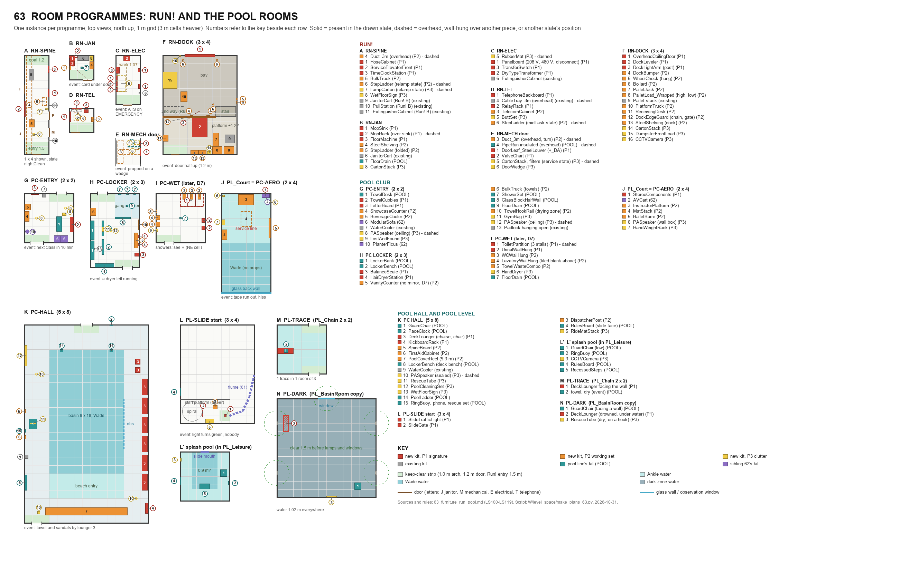

# Level space · 63 · Furniture: Run! and the pool rooms (room programmes and new kits)

Date: 2026-10-31. Line: 浴室房间调研 (`bathroom`), K session (Red's API key, Cursor), research sub-session 63. Sibling: 62 (Level 0 and Office rooms, same format).

Red, 10-31 ~16:27: "其他的房间本身是ok的，但是屋子里的陈设也就是家具系统需要大范围的更新和增加，这样能够符合房间的内容需求，而不是用现有的很多家具重复利用。" And: "不用评估成本，我需要你开始research细化方案".

Builds on, does not repeat:
- `50_refinement.md` §3: the rule (every room type has a programme: signature pieces, working set, clutter of use, state) and the first kits for the dock, pool hall and slide tower;
- `40_terrain_grammar.md` §6.2 and §7: T_RN_DockRelease, T_RN_Thresholds, T_PL_*;
- `bathroom_rooms/10_research.md` §2: the club's period fittings (ladders, gutter, drains, depth marks, guard chair, pace clock, lockers, showers, washroom, pump room), cited as POOL §2 row n;
- `bathroom_rooms/50_modules_and_contracts.md` §1 and `pool_modules.json`: modules PC_* and PL_* and their props;
- `bathroom_rooms/18_structure_fusion.md` M6: the club programme repeated and misplaced;
- `room_visuals/run_b_production/10_plan.md` §1.2: the Run! B dress kits (fire gear, overhead services, rail, plates, three obstacles);
- the kit library (`Assets/Resources/Props/Models`, 246 sidecars, about 150 kits that are not door, lock, key or outlet parts) and the surfaces in `Assets/Resources/Surfaces`;
- `LEVEL_MODULE_SPEC.md` (keep-clear strips, body radius) and `LEVEL_DESIGNER.md` (module props, *No collider*).

Research only: no code, no Unity, no download, no cost estimate. Sources [LS100]–[LS119] are in §10; earlier ones are [LS51]–[LS54] (slides) and [LS60] (loading docks). Brand names appear only in §10, never in a kit.

## 0. Short answer

1. **Fourteen programmes cover the eleven room types.** Run! has six: the spine, four stub rooms (janitor closet, electrical room, telephone closet, mechanical-room door zone) and the loading dock. The club has five: entry, locker room, showers and toilets, aerobics room, pool hall. The pool level has three: misplaced club traces, the slide start and splash pool, and the dark zone. Each programme is in the shared format (§1.1).
2. **72 new kits.**
   - 66 serve v1 rooms: **25 signature (P1), 25 working set (P2), 16 clutter (P3)**.
   - 6 more are for the club washroom, which stays deferred by D7 (2 P1, 3 P2, 1 P3).
   - By zone: Run! 39, club and pool level 33. The 50 §3.2 list is refined in §8.4; no kit of the pool line is specified again.
3. **What the period sources changed** (§2):
   - **A 1990 back-of-house corridor holds a Class II hose cabinet, a service elevator and a time clock with IN and OUT racks.** These read as back of house before the alarm trips. Run! B has none of them.
   - **The 1990 telephone closet is a painted plywood backboard of 66 blocks under a 12 in ladder rack** [LS100]–[LS102]. A Sandia spec of June 1990 still terminates on 66-type blocks; data still runs on coax. So a rack of modular RJ45 patch panels would be anachronistic.
   - **The electrical room carries the Run! story.** An automatic transfer switch shows NORMAL or EMERGENCY, so the trip is visible there. Under the 1990 NEC the working space was in 110-16, and the 30 in width and 6½ ft headroom rules only came in 1993 [LS104].
   - **A downtown office dock was for single-unit trucks** (12–13 ft clearance, 15 ft platform depth). Tractor-trailers came only for tenant moves, at night [LS105]. So our dock is an interior truck bay with a 12 × 14 ft coiling door at grade and a pit leveler at the platform edge. The foam dock seal moves to an optional exterior variant.
   - **The 1980s club handed out towels and loan clothing, sold supplements and T-shirts, ran a juice bar and played background music** [LS107]–[LS109]. Its locker rooms had hair dryers, saunas, steam and whirlpools. POOL §2 row 27 (sauna and whirlpool "unverified") now has sources, but D10 keeps them out of v1.
   - **Slides of 1990 were dispatched by a red and green traffic light** tripped by body sensors, with an intercom, emergency buttons, CCTV of the splash pool and a ride counter [LS114], [LS115]. The light gives the slide its event: it turns green with nobody at the top.
   - **The racquetball court the pool level turns into an aerobics room (PL_Court) is 20 × 40 ft, exactly 2 × 4 cells.** Its period contents are a pitch-control tape deck, a carpeted instructor platform, mats and a barre. Mirrors stay out until D7. Step benches (1989–90) are left out [LS110], [LS111].
4. **Rules that matter most** (§1.2):
   - tall pieces stand only against walls;
   - Run! obstacles stay at most two per 12 m, in light pools, with a 1.4 m lane;
   - nothing stands in Wade water, and nothing floats;
   - no piece that rises above the water stands within 1.5 m in front of a wet-niche lamp or a window, because darkness is never cover.

## 1. Format and rules

### 1.1 The shared programme format

Every programme below has the same fields in the same order (shared with 62, whose §"programme system" holds the data schema and the Level Designer hook; it is not repeated here):

| Field | Meaning |
|---|---|
| Programme | name and id (RN-*, PC-*, PL-*) |
| Zone | Level0, Office, Run, PoolClub or PoolLevel |
| Footprint, ceiling | 3 m cells, min..max; Low 2.4, Standard 2.9 or Tall 5.4 |
| Signature pieces | 2–3 kits that name the room at a glance |
| Working set | what the use needs, in the arrangement the use makes |
| Clutter of use | what the work leaves behind |
| States | one per instance, picked by seed |
| Event | one per room |
| Placement | per piece, from: wall, row, u, cluster, island, track, ceiling, desktop, floorScatter |
| Counts or density | per room or per 12 m |
| Clearances | aisles 0.9–1.2 m; the keep-clear strips (1.0 m inside openings, 1.2 m at doors) |
| Sight | which pieces block a 1.62 m eye line (player eye 1.62 m; the Relay is 2.05 m tall, eye 1.60 m) |
| Colliders | yes or no per piece; nothing blocks the Relay's routes; darkness is never cover |

Each programme ends with a piece table: kit, role (S signature, W working set, C clutter), placement, count, collider, whether it blocks the eye line. **New** kits are in bold; *POOL* marks a kit the pool line owns; *62* marks a kit the sibling programme specifies; the rest exist today.

*Figure: one instance of each programme, top view, 1 m grid, 3 m cells in heavier lines. Colour gives the priority of new kits (P1 red, P2 orange, P3 yellow), existing kits (grey), pool-line kits (teal), sibling kits (violet), keep-clear strips (green), water (turquoise). Script: `W/level_space/make_plans_63.py`.*

### 1.2 Rules for these rooms

- **G1 · Routes.**
  - Main routes are at least 1.2 m wide and secondary aisles at least 0.9 m; the Run! lane is at least 1.4 m (Run! B).
  - No gap a body can enter is narrower than 0.9 m. A gap is either at least 0.9 m or closed below 0.3 m, so there are no pockets.
  - No collider stands in a keep-clear strip (the map leaves it out). Player and Relay are both 0.30 m in radius.
- **G2 · Colliders.**
  - A wall piece up to 0.25 m proud needs none: the 0.30 m body keeps the camera off it.
  - A floor piece 0.15 m or taller gets a box.
  - Floor scatter under 0.15 m and anything hung 2.0 m up or higher gets none.
- **G3 · Sight.**
  - A piece taller than 1.5 m stands only against a wall, never as an island or in a row across a room.
  - Low pieces (1.2 m or less) may stand anywhere.
  - The eye line therefore crosses every room over its furniture. The Relay stays readable from every opening.
- **G4 · Light (darkness is never cover).**
  - In Run!, every obstacle sits in a light pool and reads at 2 : 1 or better at 8 m (Run! B).
  - On the pool level and in the dark zone, nothing that rises above the water stands within 1.5 m in front of a wet-niche lamp or an observation window, because its shadow would make a pocket. Submerged pieces under 0.5 m may lie in a lamp's light: they are lit, not hidden.
  - Lamps and their light are the lighting line's. A kit's own emissive part (a pilot lamp, a cooler's lit interior) is part of the kit.
- **G5 · Wet areas.**
  - On Wet decks, kits are made of glazed ceramic, stainless steel, galvanised steel, aluminium or vinyl. Hardwood appears only where the period used it (guard chair seat, bench, barre); no carpet or raw chipboard.
  - A piece standing in Ankle water gets a waterline band (0.03–0.15 m) and wet feet.
  - Nothing stands in Wade cells except the pool line's ladders and steps.
  - Nothing floats; floating props belong to the water line (17).
- **G6 · Era.**
  - Club fittings date to 1989 or earlier (POOL §2, fiction A) and Run! to 1990 or earlier.
  - Nothing on POOL §2.4's do-not-show list.
  - No brand and no trade-dress silhouette: a generic weight machine must not borrow a maker's spiral cam.
  - Printed faces go through 平面视觉, strings through 叙事设计.
- **G7 · Variety.**
  - Two or three variants per signature kit, one state per instance, one event per room.
  - A kit appears more than once in view only where the use repeats it (lockers, loungers, panelboards).
- **G8 · Run!**
  - At most two obstacles per 12 m, at least 6 m apart.
  - No floor piece in the first 1.5 m past the entry (trigger arming), in the goal door's 1.2 m strip, or within 1.2 m of a T_RN_Thresholds step.
  - Overhead services keep 2.45 m clear (RN-2).

## 2. Period findings (what the rooms held, 1985–1993)

### 2.1 Back of house

- **Telephone closet.**
  - 66-type blocks terminate 50 pairs each. A June 1990 Sandia spec still uses them and moves to 110-type for density. Floor "backbone cabinets" are metal with a lockable hinged door, stacked floor over floor in the utility chase. LANs are moving from coax to twisted pair; underfloor "monuments" are called a tripping hazard [LS100]. The existing `Kit_FloorBoxTombstone` is exactly that object.
  - EIA/TIA-569 (1990) sized closets by floor area served: 10 × 7 ft for 5,000 sq ft, 10 × 9 for 8,000, 10 × 11 for 10,000 [LS101]. The 1998 revision adds:
    - a 36 × 80 in door;
    - lamps at 8.5 ft or higher, 50 fc at 3 ft;
    - two dedicated outlets, plus perimeter outlets every 6 ft at 6 in above the floor;
    - light-coloured surfaces;
    - no piping or ductwork through the room [LS101].
  - ¾ in plywood backboards go on at least two walls, painted with two coats of light, fire-retardant paint, with a 12 in ladder rack above [LS102]. The existing `Kit_CableTray_3m` (0.30 m galvanised ladder tray) is that rack.
- **Janitor closet** [LS103] (current standards for long-standing forms):
  - at least 60–70 sq ft, no side under 6 ft, a 36 in door;
  - a floor-mounted service sink 24 × 24 × 10–12 in of molded stone or terrazzo, in a corner by the door;
  - a faucet 36 in above it with a vacuum breaker, a hose and a bucket hook;
  - a 36 in mop and broom holder shelf (four holders, three hooks) over the sink, wet mops hung at 5 ft to drip into it;
  - a floor drain, room for a 6 ft stepladder and a trash cart (40 in high × 26 in wide);
  - typical equipment: mopping cart 2 × 6 ft, 6-bushel trash cart 2 × 3, upright vacuum 2 × 1, floor machine 2 × 4, wet/dry vacuum 2 × 3, 15 linear ft of shelving 1 ft deep.
- **Electrical room** [LS104] [LS119]:
  - In the 1990 NEC, working space is in 110-16. The 30 in minimum width and the rise of headroom from 6¼ to 6½ ft came in 1993. Depth was 3 ft at 150 V or less to ground and 3–4 ft at 151–600 V.
  - A floor electrical room of the period held surface panelboards (a 277/480 V lighting panel and a 120/208 V receptacle panel), a ventilated dry-type transformer stepping 480 V down to 208/120 V, and disconnect switches.
  - On a B level it would also hold the automatic transfer switch that puts the emergency circuits on the generator, with NORMAL and EMERGENCY pilot lamps.
  - OSHA's lockout/tagout rule dates from 1989, so a padlocked disconnect with a red tag is period [LS119].
- **Corridor.**
  - A Class II standpipe gives building occupants 1½ in hose stations, with the valve 3–5 ft above the floor, within 130 ft of every point (NFPA 14 as quoted today). A semi-recessed cabinet holding hose rack, extinguisher and 2½ in valve is 32 × 38 × 8 in [LS117].
  - Caution signs are yellow with black letters (ANSI Z53.1-1967 in OSHA 1910.145). The plastic yellow A-frame was sold by 13 of 15 janitorial suppliers in 2001, but no source dates its first use [LS118]: date-check it before building.
  - Time recorders with IN and OUT card racks, canvas bulk trucks for night trash, cases of 4 ft fluorescent tubes and a service elevator for freight are period practice [LS119]. RN-1 (`10` §6.3) already names the dead freight-elevator door.

### 2.2 Loading dock

- **The 1978 study of downtown docks** [LS105]:
  - Office buildings rarely see tractor-trailers, except for tenant moves made in the evening or at weekends.
  - Clearance: 12 ft minimum and 13 ft desirable for single-unit trucks, 14 ft for tractor-trailers.
  - Space depth 25, 35 or 55 ft; space width 12 ft.
  - Dock height 1.22–1.32 m (4–4.33 ft) for tractor-trailers, 1.02–1.27 m for single-unit trucks.
  - Platform depth at least 15 ft (4.57 m).
- **Current planning guides** [LS106]:
  - docks 46–52 in high, doors 8–9 ft wide by 8–10 ft high, door centres 12–14 ft;
  - a leveler where truck bed heights vary by more than 18 in;
  - adjustable lights at every truck position, edge guards and bumpers;
  - coiling doors preferred, plus a separate personnel door;
  - a supervisor's office and a receiving log.
- **The 1980s dock** [LS60]: pull-chain pit levelers, laminated rubber bumpers 4–6 in thick, manual overhead doors, wheel chocks (OSHA 1978), the first vehicle restraints (1980) and swing-arm dock lights.
- **US practice moves loads on pallet jacks and four-wheel platform trucks;** the roll cage of 50 §3.2 is European. Stretch-wrapped pallets, yellow pipe bollards and front-load trash containers are period [LS119].

### 2.3 The club

- **1985 Washington Post survey of DC clubs** [LS107]:
  - Nautilus areas, Lifecycles, treadmills, air-pressure machines, rowing machines;
  - a tennis court turned into a Nautilus area, a glassed-in 20 × 60 ft pool, a wooden deck for aerobics, a mirrored aerobics space;
  - locker rooms with sauna, whirlpool and steam.
  - A hotel club inside an office block (1400 M St, about 175 members) handed out T-shirt, shorts and socks and provided hair dryers, shampoo and soap. That is the closest documented cousin of our tenant club.
- **1988 Los Angeles Times** [LS108]:
  - amenities: free towels, steam rooms, whirlpools, massage, juice bars;
  - clubs sold supplements, exercise gear and protein drinks.
  - A private gym of 1988: walls of mirrors, an aerobics and ballet floor, a TV and VCR "in case there is no aerobics instructor", a steam room.
- **1982 advertisement for a 4,000 sq ft centre** [LS109]: 13 Nautilus machines, washrooms, showers, lockers and blowdryers, a sauna for 8 and a whirlpool for 8–10, "full intercom & background music", a TV-video viewing area, a health juice bar, vitamins and T-shirts for sale. A 1988 Utah spa: mirrors, smoked glass, neon, soft-rock music.
- **Aerobics** [LS110]:
  - In 1984, suspended wood floors were best, and concrete or wood on concrete was to be avoided.
  - In a study of 29 facilities (c. 1992): a pitch-control tape deck in 18, an instructor platform in 11, shock-absorbing floors in 16, microphones in 5; mirrors and portable or built-in sound systems.
- **Equipment dates** [LS111]:
  - multi-station machine 1957; electronic exercise bike 1968; variable-resistance cam machine 1970; flywheel rower 1981; stair climber 1983–84.
  - Step benches 1989, commercial in 1990 (4–12 in high, 3 ft long, 14 in wide). That is too late for a club fitted in the mid-1980s.

### 2.4 Pool deck, guards, slide start

- **Deck gear in current catalogues, same forms as the period** [LS112]:
  - foam kickboards about 17 × 12 × 1.5 in; a rack 49 × 12.5 × 28 in holds about 30;
  - lane-line reels; backstroke-flag posts 1.8 m tall;
  - ladders of 2–7 treads; starting platforms and benches.
  - Starting blocks are left out: our pool is 3 ft 6 in to 4 ft 6 in with NO DIVING (POOL §2.1).
- **Lifeguard gear** [LS113]:
  - Foam rescue tubes (4 ft with a strap) entered pool training in the early 1980s: one 1983 national programme, the YMCA and the Red Cross. The Red Cross went all-tube in 1994.
  - A 1998 state code still asked only for ring buoys and shepherd's crooks.
  - Spine boards began in 1979 as plywood with straps.
- **Pool covers** [LS116]: a 1980 patent describes a hand-cranked reel on two wheeled carriages. A 1983 study found covers on indoor pools save energy when ventilation is cut, and the DOE's later RSPEC programme put the saving at 50–70 %. An energy-conscious 1980s indoor pool would park a cover reel on its deck.
- **Slides** [LS114] [LS115]:
  - The UK code of 1990 recommends feet-first riding, rules on age and height, and signage. It lists support equipment (intercom, telephones, emergency call buttons, CCTV, voice amplification at the exit).
  - A traffic-light system is "essential" where staff cannot see the run, best on two body sensors, and ride counters are recommended.
  - A 1998 study describes access by a spiral stair; signs at the top and bottom; a lifeguard at the splash pool; attendants on CB radio watching the exit pools on CCTV.
  - Its lights sit over each flume entry and trip to red on entry. They turn green after a sensor two-thirds down plus 3 s.
  - Indoor slides of 1981 were ridden head first on foam mats [LS52].

### 2.5 Do not show (adds to POOL §2.4)

| Thing | Why | Source |
|---|---|---|
| Modular RJ45 data patch panels in racks; Category 5 | the commercial wiring standard came in July 1991, and the 1990 closet terminates on 66 blocks | [LS100] [LS119] |
| Arc-flash warning labels | from the 2000s | [LS119] |
| Plastic, X-ray-translucent spine boards | the 1979–1980s board is plywood | [LS113] |
| Step benches | 1989–90, after the club's fit-out | [LS111] |
| White plastic monobloc chairs on the deck | the A24 film's set (POOL §1.1): the state we must not copy | POOL §1.1 |
| A red cross on the first-aid cabinet | a protected emblem; use FIRST AID in white and green | [LS118] |
| LED-dot signal heads on the slide | the period head is incandescent behind glass lenses | [LS119] |
| Mirrors in the locker room or aerobics room | until D7's mirror path exists | POOL D7 |

## 3. Run! programmes

### 3.1 RN-SPINE · the service spine

| Field | Value |
|---|---|
| Programme | RN-SPINE: the back-of-house egress corridor (RN-1, RN-2), beyond what Run! B dresses |
| Zone | Run |
| Footprint, ceiling | 1 × 3 .. 1 × 9 cells (today's module limit is 1 × 4; 1 × 9 is the CR-1 request); Standard 2.9, services hung to 2.45 m clear |
| Signature pieces | **Kit_HoseCabinet** (FIRE HOSE cabinet, semi-recessed); **Kit_ServiceElevatorFront** (the service elevator that never comes); **Kit_TimeClockStation** (time recorder between IN and OUT racks, at the dock end) |
| Working set | Run! B's set stays as it is (wraps, twin-heads, EXIT signs, sprinkler main, tray, EMT, bumper rail, corner guards, pull station, bell, extinguisher cabinet, plates, chair dolly, janitor cart, hand truck). New: **Kit_Duct_3m** along one side of the soffit, giving the overhead mass RN-2 asks for; **Kit_BulkTruck** as a fourth obstacle type; stub doors on both walls (existing steel frame and leaf, plus a louvered leaf at the mechanical room); the house phone as the pool line's wall-phone variant (*POOL* §2 row 12) |
| Clutter of use | **Kit_StepLadder** (open under the one dead wrap), **Kit_LampCarton**, **Kit_WetFloorSign**, **Kit_PlatformTruck** with moving pads; existing Kit_HandTruck_Cartons |
| States (one per instance) | `cleared` (B's dressing and the wall pieces only); `nightClean` (bulk truck parked, wet-floor sign out, janitor cart in the lane); `relamp` (stepladder open under the dead wrap, carton of tubes leaning); `moveIn` (platform truck with pads, hand truck with cartons, OUT OF SERVICE sign taped to the elevator) |
| Event (one per room) | One time card stands in the IN rack, stamped today, an hour ago (strings 叙事设计, faces 平面视觉; the live-clock rule of the pool log, POOL §1.5) |
| Placement | wall units along both walls; obstacles as islands in light pools; duct and services on the ceiling; ladder and carton as floorScatter |
| Counts or density | 1 hose cabinet per spine (NFPA 14 reach 130 ft [LS117]); at most 1 elevator front; 1 time clock (dock end); 2–4 stub doors per 12 m; at most 2 obstacles per 12 m (G8) |
| Clearances | corridor 2.84 m clear; lane ≥ 1.4 m beside any obstacle; 1.2 m strips at the entry and goal doors; nothing on the floor in the first 1.5 m; nothing within 1.2 m of a threshold step |
| Sight | nothing on the floor above 1.4 m (bulk truck 1.02; B's cart 1.40; the open ladder 1.75 is an open A-frame): the goal door reads from the start |
| Colliders | obstacles yes (box); wall units no (≤ 0.15 proud); duct no |

| Kit | Role | Placement | Count | Collider | Blocks eye line |
|---|---|---|---|---|---|
| **Kit_HoseCabinet** | S | wall, valve at 1.37 m | 1 | no | no |
| **Kit_ServiceElevatorFront** + Kit_KeySwitchPlate | S | wall | 0–1 | no | no |
| **Kit_TimeClockStation** | S | wall, slot at 1.2 m | 1 | no | no |
| **Kit_Duct_3m** | W | ceiling, one side, ≥ 2.45 m clear | 1 per 3 m | no | no |
| **Kit_BulkTruck** | W | island, 0.5 m off the wall, in a pool | 0–1 | yes | no |
| Stub doors: Kit_DoorFrame_Steel, Kit_DoorLeaf_Steel, Kit_SafetyPlate_* (faces JANITOR, ELECTRICAL ROOM, TELEPHONE, MECHANICAL ROOM by 平面视觉) | W | wall | 2–4 per 12 m | as the door family | no |
| Wall phone (*POOL* variant of Kit_DeskPhone_Corded) | W | wall | 0–1 | no | no |
| **Kit_StepLadder** (open) | C | island under a fixture | state `relamp` | yes | no |
| **Kit_LampCarton** | C | floorScatter, leaning | state `relamp` | no | no |
| **Kit_WetFloorSign** | C | floorScatter | state `nightClean` | no | no |
| **Kit_PlatformTruck** (pads) | C | island | state `moveIn` | yes | no |

### 3.2 RN-JAN · janitor closet

| Field | Value |
|---|---|
| Programme | RN-JAN: the custodial closet off the spine |
| Zone | Run |
| Footprint, ceiling | 1 × 1 cell (2.84 × 2.84 m = 87 sq ft, above the 60–70 sq ft minimum [LS103]); Low 2.4 (a Low room off a Standard spine is where the map's own rule puts a door) |
| Signature pieces | **Kit_MopSink** (floor service sink with its faucet); **Kit_MopRack** (mops hung over the sink); **Kit_FloorMachine** |
| Working set | existing Kit_JanitorCart parked on the rear wall; **Kit_SteelShelving** with janitorial supplies (tissue cases, jugs); **Kit_StepLadder** folded on a wall; floor drain (*POOL* Kit_FloorDrain) in the centre |
| Clutter of use | **Kit_WetDryVac**, **Kit_CartonStack** (tissue cases), existing Kit_TransBucket, **Kit_DoorWedge**, **Kit_LampCarton** |
| States (one per instance) | `stocked` (shelves full, cart parked, machine stored); `midTask` (grey water in the sink, the cart's place empty because the cart is out in the spine, one mop missing); `pickedOver` (shelves half empty, cartons open, the vac out) |
| Event (one per room) | The floor machine stands with its handle down and its cord runs out under the door into the spine, readable before the door is opened |
| Placement | sink in the rear corner (wall); rack over it (wall); machine, cart and shelving along the walls; drain in the floor; vac and cartons as cluster |
| Counts or density | 1 each of sink, rack, machine; 1 shelving unit; at most 1 clutter cluster |
| Clearances | the 1.2 m door strip stays empty of colliders; at least 1.0 m of free floor in front of the sink; the sink sits in the rear corner rather than beside the door (the standards' "beside the door" would fall in the keep-clear strip) |
| Sight | shelving (2.13 m) stands against a wall; the rest is low |
| Colliders | sink, machine, cart, shelving, vac yes; rack, wedge, carton (leaning) no |

| Kit | Role | Placement | Count | Collider | Blocks eye line |
|---|---|---|---|---|---|
| **Kit_MopSink** | S | wall (rear corner) | 1 | yes | no |
| **Kit_MopRack** | S | wall, shelf at 1.55 m | 1 | no | no |
| **Kit_FloorMachine** | S | wall | 1 | yes | no |
| Kit_JanitorCart | W | wall | 0–1 | yes | no |
| **Kit_SteelShelving** (janitorial) | W | wall | 1 | yes | yes (wall only) |
| **Kit_StepLadder** (folded) | W | wall, leaning | 1 | no | no |
| *POOL* Kit_FloorDrain | W | floor centre | 1 | no | no |
| **Kit_WetDryVac** | C | wall | 0–1 | yes | no |
| **Kit_CartonStack**, Kit_TransBucket | C | cluster | 0–2 | stack ≥ 0.5 m: yes | no |
| **Kit_DoorWedge** | C | floorScatter | 0–1 | no | no |

### 3.3 RN-ELEC · electrical room

| Field | Value |
|---|---|
| Programme | RN-ELEC: the floor electrical room, which on a B level also holds the emergency transfer switch |
| Zone | Run |
| Footprint, ceiling | 1 × 2 cells (2.84 × 5.84 m); Low 2.4 (1990 headroom rule 6¼ ft = 1.91 m [LS104]) |
| Signature pieces | **Kit_Panelboard** in a row of 3–4; **Kit_DryTypeTransformer**; **Kit_TransferSwitch** (NORMAL and EMERGENCY lamps) |
| Working set | **Kit_Panelboard** disconnect variant on the opposite wall; existing Kit_ExtinguisherCabinet by the door; existing Kit_SafetyPlate_Electrical outside |
| Clutter of use | **Kit_RubberMat** in front of the panels; a padlock and DANGER tag on a disconnect (existing Kit_Padlock_* on the disconnect variant); existing Kit_Clipboard on the transformer top |
| States (one per instance) | `normal` (doors shut); `service` (one panel door open on its typed circuit directory, one disconnect locked out); `cleared` |
| Event (one per room) | The transfer switch shows EMERGENCY (red lamp) once Run! has tripped (`RunTripped`, Run! B §1.6); before the trip it shows NORMAL |
| Placement | panelboards in a row on one wall; transformer against the end wall on its pad; transfer switch on a wall; mat as floorScatter |
| Counts or density | 3–4 panelboards; 1 transformer; 1 transfer switch; 1–2 disconnects |
| Clearances | working space in front of every panel at least 1.07 m (3½ ft at 480 V; 0.91 m at 208 V) [LS104] [LS119], which also gives the 1.0 m aisle; the door strip stays empty |
| Sight | transfer switch (1.83 m) against a wall; everything else is wall-mounted or low |
| Colliders | transformer and transfer switch yes; panels and disconnects no (≤ 0.20 proud) |

| Kit | Role | Placement | Count | Collider | Blocks eye line |
|---|---|---|---|---|---|
| **Kit_Panelboard** (208 V, 480 V) | S | row, wall | 3–4 | no | no |
| **Kit_DryTypeTransformer** | S | wall, on its pad | 1 | yes | no |
| **Kit_TransferSwitch** | S | wall (floor-standing) | 1 | yes | yes (wall only) |
| **Kit_Panelboard** (disconnect) | W | wall | 1–2 | no | no |
| Kit_ExtinguisherCabinet | W | wall by the door | 1 | no | no |
| **Kit_RubberMat** | C | floorScatter | 1 | no | no |
| Kit_Padlock_* + tag (on the disconnect) | C | wall | state `service` | no | no |
| Kit_Clipboard | C | desktop on the transformer | 0–1 | no | no |

### 3.4 RN-TEL · telephone closet

| Field | Value |
|---|---|
| Programme | RN-TEL: the floor telephone and data closet (an intermediate distribution closet) |
| Zone | Run |
| Footprint, ceiling | 1 × 1 cell (2.84 × 2.84 m, about 9.3 × 9.3 ft: just under the 10 × 9 ft that serves 8,000 sq ft [LS101]); Standard 2.9, so that lamps can hang at 8.5 ft or higher [LS101]. Low 2.4 is acceptable if 关卡设计 wants the map's Low-room door |
| Signature pieces | **Kit_TelephoneBackboard** on two walls; **Kit_RelayRack** with the 1990 data gear |
| Working set | existing Kit_CableTray_3m as the 12 in ladder rack over the backboards [LS102]; **Kit_TelecomCabinet** (key system or distribution cabinet); existing Kit_OutletDuplex: two dedicated outlets plus perimeter outlets every 1.83 m at 0.15 m [LS101] |
| Clutter of use | **Kit_ButtSet** hanging from a block; **Kit_StepLadder** (open); **Kit_CartonStack** (spare blocks); coils of 25-pair cable as part of the backboard's spaghetti variant |
| States (one per instance) | `inService` (tidy, doors shut); `midTask` (cabinet open, butt set clipped on, ladder open); `abandoned` (a carton open, jumper wire on the floor) |
| Event (one per room) | One line LED on the key system cabinet flashes at 1 Hz: a call ringing that nobody answers (sound line; within photosafety) |
| Placement | backboards on two walls; rack floor-bolted against the rear wall; cabinet on the third wall; tray on the ceiling; butt set on the wall |
| Counts or density | 2 backboards, 1 rack, 1 cabinet |
| Clearances | at least 0.9 m in front of each backboard; door strip empty; **no pipe, duct or sprinkler main passes through** (TIA/EIA-569 [LS101]), so the spine's duct turns away from this door |
| Sight | the relay rack (2.13 m) is an open frame standing at the rear wall |
| Colliders | rack yes; backboards, cabinet and tray no; ladder (open) yes |

| Kit | Role | Placement | Count | Collider | Blocks eye line |
|---|---|---|---|---|---|
| **Kit_TelephoneBackboard** (tidy or spaghetti) | S | wall | 2 | no | no |
| **Kit_RelayRack** | S | wall (floor-bolted) | 1 | yes | partly (open frame) |
| Kit_CableTray_3m | W | ceiling over the backboards, 2.4 m | 1–2 | no | no |
| **Kit_TelecomCabinet** | W | wall | 1 | no | no |
| Kit_OutletDuplex | W | wall, 0.15 m | 4–6 | no | no |
| **Kit_ButtSet** | C | wall (hanging) | 0–1 | no | no |
| **Kit_StepLadder** (open) | C | island | state `midTask` | yes | no |
| **Kit_CartonStack** | C | cluster | 0–1 | no | no |

### 3.5 RN-MECH · mechanical-room door zone

| Field | Value |
|---|---|
| Programme | RN-MECH: the spine cell outside a mechanical room door; the room itself is not built |
| Zone | Run |
| Footprint, ceiling | 1 × 1 cell of the spine; Standard 2.9 |
| Signature pieces | **Kit_DoorLeaf_SteelLouver** (a leaf with a low transfer louver; built by the door family); **Kit_ValveChart** beside the door |
| Working set | **Kit_Duct_3m** turning through the wall over the door; the pool line's *POOL* Kit_PipeRun in an insulated variant (white jacket, valve tags) entering beside it; existing Kit_SafetyPlate_* (face MECHANICAL ROOM, 平面视觉) |
| Clutter of use | **Kit_CartonStack** of air-filter cartons beside the door; **Kit_DoorWedge** |
| States (one per instance) | `shut`; `service` (filter cartons and a folded stepladder against the wall beside the door) |
| Event (one per room) | The door is propped 0.1 m open on a wooden wedge: light and hum come through the gap (sound line). The gap must show light, not black (G4) |
| Placement | door and chart on the wall; duct and pipe on the ceiling; cartons as cluster; wedge as floorScatter |
| Counts or density | at most one mechanical door per spine |
| Clearances | the cartons stay outside the lane and the door's sweep |
| Sight | nothing blocks |
| Colliders | cartons yes when stacked 0.5 m or higher; the rest no |

| Kit | Role | Placement | Count | Collider | Blocks eye line |
|---|---|---|---|---|---|
| **Kit_DoorLeaf_SteelLouver** (+ _DA) | S | wall (door) | 1 | as the door family | no |
| **Kit_ValveChart** | S | wall, at 1.5 m | 1 | no | no |
| **Kit_Duct_3m** (turn) | W | ceiling | 1 | no | no |
| *POOL* Kit_PipeRun (insulated variant) | W | ceiling | 1–2 | no | no |
| **Kit_CartonStack** (filters) | C | cluster | state `service` | yes | no |
| **Kit_DoorWedge** | C | floorScatter | event | no | no |

### 3.6 RN-DOCK · loading dock (the Run! goal and release)

| Field | Value |
|---|---|
| Programme | RN-DOCK: the interior truck bay behind the Run! goal door, a dock platform (+1.22 m over the bay floor) and an overhead door at grade (T_RN_DockRelease) |
| Zone | Run |
| Footprint, ceiling | 3 × 4 .. 4 × 5 cells; Tall 5.4 |
| Signature pieces | **Kit_OverheadCoilingDoor** (12 × 14 ft, hand chain hoist); **Kit_DockLeveler** (pit leveler with lip and pull chain, flush in the platform edge); **Kit_DockLightArm** (swing arm over the leveler) |
| Working set | **Kit_DockBumper** (pair on the dock face); **Kit_WheelChock** on chains (wall); **Kit_Bollard** at the door guides and the stair foot; **Kit_PalletJack**; **Kit_PalletLoad_Wrapped** in a row against the back wall; existing Kit_Pallet in a stack; **Kit_PlatformTruck**; **Kit_ReceivingDesk** with existing Kit_Clipboard and Kit_RegisterBook; **Kit_DockEdgeGuard** along the platform edge; **Kit_SteelShelving** (cartons); existing Kit_EmergencyTwinHead on the walls (lighting line) |
| Clutter of use | a broken wrapped load (film torn); a chock left out on the bay floor; **Kit_CartonStack**; **Kit_DumpsterFrontLoad** in a bay corner; **Kit_CCTVCamera** over the door |
| States (one per instance) | `idle` (door shut, leveler stored, chocks hung, pallets stacked); `midDelivery` (leveler raised, a load at the edge with the jack under it, receiving log open, chocks out); `cleared` (swept, everything against the walls) |
| Event (one per room) | The overhead door is left half up (bottom bar at 1.2 m). What shows under it must be lit (G4): a lit ramp beyond, never a black slot |
| Placement | door on the wall; leveler, bumpers and edge guard in a row along the dock face; light arm on a wall or post; loads and shelving in a row against the back wall; jack, platform truck and desk as islands or against a wall; bollards in a row at the jambs; dumpster on a wall |
| Counts or density | 1–2 dock positions per 3 × 4 room; per position 1 leveler, 1 light arm, 2 bumpers, 2 chocks; 4–6 bollards; 1 jack; 2–4 loads; 1 pallet stack (6–10); 1 desk; 0–1 dumpster |
| Clearances | platform at least 4.57 m deep (15 ft [LS105]); a 1.4 m route from the goal door along the platform to the stair; the stair and its landings empty; a second way to the bay (R6: a second stair or the bay's own exit, terrain); 1.2 m strip at the goal door |
| Sight | the platform is a stage over the bay: nothing on the platform island zone above 1.2 m; the high wrapped loads, shelving and dumpster stand against walls; the Relay reads across the whole bay |
| Colliders | jack, loads, platform truck, desk, bollards, dumpster, edge guard yes; leveler stored no (it is floor); raised leveler yes and never on the route; bumpers, chocks and light arm no |

| Kit | Role | Placement | Count | Collider | Blocks eye line |
|---|---|---|---|---|---|
| **Kit_OverheadCoilingDoor** | S | wall (bay, at grade) | 1 | the door plane | shut: yes; half up: below 1.2 m only |
| **Kit_DockLeveler** | S | row (dock face) | 1–2 | stored: no; raised: yes | no |
| **Kit_DockLightArm** | S | wall or post | 1 per position | no | no |
| **Kit_DockBumper** | W | row (dock face) | 2 per position | no | no |
| **Kit_WheelChock** | W | wall (hung) | 2 per position | no | no |
| **Kit_Bollard** | W | row (jambs, stair foot) | 4–6 | yes | no |
| **Kit_PalletJack** | W | island | 1 | yes | no |
| **Kit_PalletLoad_Wrapped** (low, high) | W | row (back wall) | 2–4 | yes | high: yes (wall only) |
| Kit_Pallet (stack) | W | cluster | 1 | yes | no |
| **Kit_PlatformTruck** | W | island | 0–1 | yes | no |
| **Kit_ReceivingDesk** + Kit_Clipboard, Kit_RegisterBook | W | wall | 1 | yes | no |
| **Kit_DockEdgeGuard** | W | row (platform edge) | edge length | yes (a guard) | no |
| **Kit_SteelShelving** (dock) | W | row (back wall) | 0–2 | yes | yes (wall only) |
| **Kit_DockSeal** (only if the door is moved into the dock face) | W | wall | optional | no | no |
| **Kit_CartonStack** | C | cluster | 0–2 | yes | no |
| **Kit_DumpsterFrontLoad** | C | wall (bay corner) | 0–1 | yes | yes (wall only) |
| **Kit_CCTVCamera** | C | wall, 2.6 m | 0–1 | no | no |

Why the interior bay: a downtown office building had its dock inside the building, served by single-unit trucks through a grade-level door of 12–14 ft [LS105]. That gives the Tall room its high door and keeps the 1.22 m platform (A2 in T_RN_DockRelease). An exterior dock with the door in the platform wall would need the foam seal (50 §3.2) and a truck outside the building; that is kept as the optional `Kit_DockSeal` variant.

## 4. Pool club programmes

### 4.1 PC-ENTRY · club entry and front desk

| Field | Value |
|---|---|
| Programme | PC-ENTRY: the club's front room: towel desk, loan clothing, retail, juice, notices |
| Zone | PoolClub |
| Footprint, ceiling | 2 × 2 cells (PC_Entry) .. 2 × 3; Standard 2.9 |
| Signature pieces | the towel desk (*POOL* Kit_TowelDesk); **Kit_TowelCubbies** behind it (towels, grey loan T-shirts and shorts [LS107]); **Kit_LetterBoard** (today's classes) |
| Working set | **Kit_ShowcaseCounter** (T-shirts, sweatbands, supplements [LS107]–[LS109]); **Kit_BeverageCooler** (the juice bar's trace [LS108] [LS109]); waiting seats (*62* Kit_ModularSofa, two units in the club's band colour); existing Kit_WaterCooler (*POOL* §2 row 29), Kit_WallClock, Kit_NoticeBoard; existing Kit_KeyHookBoard and Kit_RegisterBook on the desk (*POOL* §2 row 23); **Kit_PASpeaker** (ceiling) |
| Clutter of use | *POOL* towel stack and bin; **Kit_LostAndFound** under the desk; *62* Kit_PlanterFicus |
| States (one per instance) | `open` (cubbies full, cooler lit, towels stacked); `closed` (CLOSED card on the counter, cooler dark, cubbies half empty); `afterHours` (cubbies empty, lost-and-found box on the counter) |
| Event (one per room) | The letter board lists today's classes, and the next one starts in ten minutes (a live-clock letter set, like the pool log; strings 叙事设计, letters 平面视觉) |
| Placement | desk as an island counter facing the entrance; cubbies on the wall behind it; board on the wall facing the entrance arch; showcase and cooler on the side wall; seats in a row; speakers on the ceiling |
| Counts or density | 1 each of desk, cubbies, board, showcase, cooler; 2 seat units |
| Clearances | 1.0 m strips inside both arches; staff aisle behind the desk ≥ 0.9 m; visitor zone in front of the desk ≥ 1.2 m; a 1.2 m route from the south arch to the north arch |
| Sight | cubbies (2.10) and cooler (1.98) against walls; desk, showcase and seats are low |
| Colliders | desk, cubbies, showcase, cooler, seats, planter yes; board, speakers, clock, lost-and-found no |

| Kit | Role | Placement | Count | Collider | Blocks eye line |
|---|---|---|---|---|---|
| *POOL* Kit_TowelDesk | S | island counter | 1 | yes | no |
| **Kit_TowelCubbies** | S | wall (behind the desk) | 1 | yes | yes (wall only) |
| **Kit_LetterBoard** | S | wall, 1.5 m | 1 | no | no |
| **Kit_ShowcaseCounter** | W | wall | 1 | yes | no |
| **Kit_BeverageCooler** | W | wall | 1 | yes | yes (wall only) |
| *62* Kit_ModularSofa | W | row | 2 units | yes | no |
| Kit_WaterCooler, Kit_WallClock, Kit_NoticeBoard | W | wall | 1 each | cooler yes | no |
| **Kit_PASpeaker** (ceiling) | W | ceiling | 2 | no | no |
| **Kit_LostAndFound** | C | floorScatter (under the desk) | 1 | no | no |
| *62* Kit_PlanterFicus | C | cluster | 0–1 | yes | no |

### 4.2 PC-LOCKER · locker room

| Field | Value |
|---|---|
| Programme | PC-LOCKER: changing room with grooming corner (lockers, benches and showers are the pool line's) |
| Zone | PoolClub |
| Footprint, ceiling | 2 × 3 cells (PC_Lockers) .. 3 × 3; Standard 2.9; Wet |
| Signature pieces | the locker banks (*POOL* Kit_LockerBank); **Kit_BalanceScale**; **Kit_HairDryerStation** (two over the vanity) |
| Working set | *POOL* Kit_LockerBench; **Kit_VanityCounter** (two basins; the wall above is a tiled blank until D7); **Kit_BulkTruck** with the towel load (offered to the pool line as its towel bin, §8.1); **Kit_PASpeaker** (ceiling) |
| Clutter of use | **Kit_GymBag** on a bench; a padlock hanging open on a hasp (existing Kit_Padlock_*); *POOL* towels |
| States (one per instance) | `inUse` (lockers open in a row, the pool line's state); `closedForNight` (every locker shut, benches clear, floor mopped); `midChange` (a bag open on a bench, clothes folded, shoes under it, one locker open with its padlock hanging) |
| Event (one per room) | One hair dryer hangs from its hose, running: warm air and a motor hum (sound line) |
| Placement | locker banks in rows on the walls; benches in rows parallel to them; scale and vanity on walls; dryers on the wall over the vanity; towel truck against a wall |
| Counts or density | 3 locker banks, 2 benches (*POOL*); 1 scale; 1 vanity with 2 dryers; 1 towel truck |
| Clearances | 0.9 m between locker face and bench (secondary aisle); 1.2 m route arch to arch; 1.0 m strips inside both arches; the shower cell's opening (1.1 m) stays clear |
| Sight | **locker banks (1.98 m) only against walls, never back to back as an island**, so the Relay reads from both arches; everything else is low |
| Colliders | lockers, benches, scale, vanity, truck yes; dryers, bag, speakers no |

| Kit | Role | Placement | Count | Collider | Blocks eye line |
|---|---|---|---|---|---|
| *POOL* Kit_LockerBank | S | row (walls) | 3 | yes | yes (wall only) |
| **Kit_BalanceScale** | S | wall | 1 | yes (base) | no |
| **Kit_HairDryerStation** | S | wall, 1.5 m | 2 | no | no |
| *POOL* Kit_LockerBench | W | row | 2 | yes | no |
| **Kit_VanityCounter** | W | wall | 1 | yes | no |
| **Kit_BulkTruck** (towels) | W | wall | 1 | yes | no |
| **Kit_PASpeaker** (ceiling) | W | ceiling | 1 | no | no |
| **Kit_GymBag** | C | desktop (on a bench) | 0–1 | no | no |
| Kit_Padlock_* (open on a hasp) | C | wall (on a locker) | state | no | no |

### 4.3 PC-WET · showers and toilets (only what the pool line does not cover)

| Field | Value |
|---|---|
| Programme | PC-WET: the drying zone of the gang shower (the shower itself is the pool line's), and the club toilet, **later (D7 A)** |
| Zone | PoolClub |
| Footprint, ceiling | showers: the NE cell of PC_Lockers (1 × 1); toilet (later): 2 × 2 .. 2 × 3; Standard 2.9; Wet |
| Signature pieces | showers: *POOL* Kit_ShowerSet and Kit_GlassBlockHalfWall. Toilet (later): **Kit_ToiletPartition**, **Kit_UrinalWallHung** |
| Working set | showers: **Kit_TowelHookRail** in the drying zone outside the shower opening. Toilet (later): **Kit_WCWallHung**, **Kit_LavatoryWallHung** (the wall above stays a tiled blank: D7 B), **Kit_TowelWasteCombo**, **Kit_HandDryer**, *POOL* Kit_FloorDrain |
| Clutter of use | towels on the hooks; **Kit_WetFloorSign**; the towel **Kit_BulkTruck** |
| States (one per instance) | `dry` (showers off, floor drying); `used` (towels on the hooks, floor wet); `cleaning` (wet-floor sign out) |
| Event (one per room) | showers: one head left running (a state of the pool line's Kit_ShowerSet; sound line). Toilet (later): one stall door ajar, a faucet running |
| Placement | hook rail on the wall; partitions in a row; urinals and lavatories in rows on walls; combo and dryer on walls |
| Counts or density | 1 hook rail; toilet: 2–3 stalls, 2 urinals, 2 lavatories, 1 combo, 1 dryer |
| Clearances | drying zone at least 1.2 × 1.5 m outside the shower opening; toilet aisle at least 1.2 m between stall fronts and lavatories |
| Sight | partitions (top 1.77 m) block the eye line, as real ones do; they stand only along walls, so the room's aisle stays open |
| Colliders | partitions, WCs, lavatories yes; rail, urinals, combo, dryer no |

| Kit | Role | Placement | Count | Collider | Blocks eye line |
|---|---|---|---|---|---|
| **Kit_TowelHookRail** | W | wall, 1.6 m | 1 | no | no |
| **Kit_WetFloorSign** | C | floorScatter | state | no | no |
| **Kit_ToiletPartition** (later) | S | row | 2–3 stalls | yes | yes (wall only) |
| **Kit_UrinalWallHung** (later) | S | row (wall) | 2 | no | no |
| **Kit_WCWallHung** (later) | W | row (in stalls) | 2–3 | yes | no |
| **Kit_LavatoryWallHung** (later) | W | row (wall) | 2 | yes | no |
| **Kit_TowelWasteCombo** (later) | W | wall | 1 | no | no |
| **Kit_HandDryer** (later) | C | wall, 1.1 m | 1 | no | no |

### 4.4 PC-AERO · aerobics room (the dry original of PL_Court)

| Field | Value |
|---|---|
| Programme | PC-AERO: the racquetball court turned aerobics room (PS5 in 18). As a club room it is **later (D10)**; in v1 its contents dress PL_Court on the pool level (M6) |
| Zone | PoolClub (later); PoolLevel (PL_Court, v1) |
| Footprint, ceiling | 2 × 4 cells: a racquetball court is 20 × 40 × 20 ft (6.1 × 12.2 × 6.1 m) [LS119], which fits 2 × 4 cells; Tall 5.4 |
| Signature pieces | **Kit_StereoComponents** on the sibling's *62* Kit_AVCart (a pitch-control cassette deck [LS110]); **Kit_InstructorPlatform** at the front wall |
| Working set | **Kit_MatStack**; **Kit_BalletBarre** (two runs on a long wall, [LS108]); **Kit_PASpeaker** (wall boxes high in the front corners); court lines in red (surface); the glass back wall (PS5) |
| Clutter of use | **Kit_HandWeightRack**; one mat unfolded on the floor; a towel on the platform edge |
| States (one per instance) | `setUp` (mats out, cart beside the platform); `packedAway` (mats stacked, cart against the wall); `abandoned` (one mat unfolded, a pair of weights on the floor) |
| Event (one per room) | The tape deck's VU lights are on and the tape has run to its end: hiss from the speakers (sound line) |
| Placement | platform against the front wall; cart and stereo on the wall beside it; barre on a wall; mats and weights in a cluster on a wall; speakers on the wall high up |
| Counts or density | 1 platform, 1 cart, 2 barres, 1 mat stack, 1 rack, 2 speakers |
| Clearances | the class floor stays open (nothing on it but one unfolded mat as floorScatter); 1.0 m strips at the openings; in PL_Court, props stand only in Ankle cells, never in Wade cells (G5) |
| Sight | nothing above 1.1 m except wall pieces: the court reads end to end through its glass wall |
| Colliders | platform, cart, mat stack, rack yes; barre, speakers, unfolded mat no |

| Kit | Role | Placement | Count | Collider | Blocks eye line |
|---|---|---|---|---|---|
| **Kit_StereoComponents** on *62* Kit_AVCart | S | wall; desktop on the cart | 1 | cart yes | no |
| **Kit_InstructorPlatform** | S | wall (front) | 1 | yes (a 0.30 m step) | no |
| **Kit_MatStack** | W | wall | 1 | yes | no |
| **Kit_BalletBarre** | W | wall, 1.07 m | 2 | no | no |
| **Kit_PASpeaker** (wall box) | W | wall, 2.4 m | 2 | no | no |
| **Kit_HandWeightRack** | C | wall | 0–1 | yes | no |

Mirrors stay out until D7. Step benches are left out (1989–90, §2.5). Exercise machines are not proposed: D10 defers the exercise room, and each period machine is one maker's design, so a generic one needs its own era and trade-dress check.

### 4.5 PC-HALL · pool hall (deck furniture and equipment)

| Field | Value |
|---|---|
| Programme | PC-HALL: the deck of the 5 × 8 hall around the 3 × 6 basin; the basin, its edge, the guard chair and the rescue set are the pool line's |
| Zone | PoolClub |
| Footprint, ceiling | 5 × 8 cells (PC_Hall); Tall 5.4; deck Wet, about 2.92 m wide on every side |
| Signature pieces | *POOL* Kit_GuardChair and Kit_PaceClock (the hall's own signatures); **Kit_DeckLounger** in a row; **Kit_KickboardRack** |
| Working set | **Kit_SpineBoard** and **Kit_FirstAidCabinet** on the wall by the guard chair, next to the pool line's phone and rescue set; **Kit_PoolCoverReel** parked along the shallow-end deck; *POOL* Kit_LockerBench reused as a deck bench; existing Kit_WaterCooler; **Kit_PASpeaker** (vapour-tight) |
| Clutter of use | **Kit_RescueTube** on the guard chair; **Kit_PoolCleaningSet** on the wall by the pump-room door; **Kit_WetFloorSign** inside the lockers arch; a towel on a lounger (*POOL* towel) |
| States (one per instance) | `readyNobody` (loungers in their row with backs up, boards racked, cover rolled: the 50 §3.2 state); `afterSession` (boards scattered by the shallow end, one lounger out of line, the rescue tube on the deck); `closedForNight` (loungers folded against the wall) |
| Event (one per room) | A folded towel and a pair of sandals lie beside one lounger, as if someone were in the water |
| Placement | loungers in a row parallel to the long wall opposite the guard chair; rack on a wall; spine board, first aid and cleaning set on walls; reel in a row along the end deck; bench on a wall |
| Counts or density | 6–8 loungers and 2 chairs; 1 rack; 1 spine board; 1 first-aid cabinet; 1 reel; 1 bench |
| Clearances | loungers parallel to the wall leave about 2.2 m of deck; the reel splits the shallow-end deck into two aisles of at least 1.0 m; the 1.0 m strips at the lockers arch and the far round arch stay clear; deck furniture stays at least 1.0 m off the coping |
| Sight | nothing on the deck above 1.2 m except the pool line's guard chair (an open frame); the hall stays the one place where the Relay is seen at full size (POOL §1.5) |
| Colliders | loungers, rack, reel, bench yes; wall pieces, rescue tube, sign no |

| Kit | Role | Placement | Count | Collider | Blocks eye line |
|---|---|---|---|---|---|
| *POOL* Kit_GuardChair, Kit_PaceClock | S | island; wall | 1; 1 | chair yes | no |
| **Kit_DeckLounger** (chaise, chair) | S | row | 6–8 + 2 | yes | no |
| **Kit_KickboardRack** | S | wall | 1 | yes | no |
| **Kit_SpineBoard** | W | wall | 1 | no | no |
| **Kit_FirstAidCabinet** | W | wall | 1 | no | no |
| **Kit_PoolCoverReel** (9.3 m) | W | row (end deck) | 1 | yes | no |
| *POOL* Kit_LockerBench, Kit_WaterCooler | W | wall | 1; 1 | yes | no |
| **Kit_PASpeaker** (sealed ceiling) | W | ceiling | 2 | no | no |
| **Kit_RescueTube** | C | on the guard chair | 1 | no | no |
| **Kit_PoolCleaningSet** | C | wall | 1 | no | no |
| **Kit_WetFloorSign** | C | floorScatter | state | no | no |

Not proposed: lane-line reels (POOL §2 row 14 skip stands), starting blocks (NO DIVING), backstroke flags (they would cross the Relay's head height when it stands at 3.1–3.3 m in the Tall hall), kickboards floating in the water (the water line's floating props).

## 5. Pool level programmes

### 5.1 PL-TRACE · traces of the club, misplaced (M6)

| Field | Value |
|---|---|
| Programme | PL-TRACE: one club piece per room at most, in the wrong place and facing the wrong way; the rooms stay architecture first |
| Zone | PoolLevel |
| Footprint, ceiling | any PL_* module (2 × 2 .. 6 × 6); as the module |
| Signature pieces | one trace per room, drawn from the club: **Kit_DeckLounger**, **Kit_TowelCubbies** (towels dry above ankle water), **Kit_BalanceScale** standing in water, **Kit_LetterBoard** with its letters slipped, **Kit_KickboardRack** between columns, **Kit_HairDryerStation** on a tiled wall with no lockers, **Kit_BeverageCooler** lit in an alcove (once per run) |
| Working set | none: a trace is alone |
| Clutter of use | **Kit_GymBag** or **Kit_LostAndFound** on a column ledge, as an alternative trace |
| States (one per instance) | `dryAbove` (towels and cloth dry over the water); `soaked` (dripping, waterline stain); `facingWall` (turned to a wall or a corner, like the pool line's guard chair) |
| Event (one per room) | A folded towel lies dry on a lounger standing in ankle water |
| Placement | wall or a low island (1.2 m or less) |
| Counts or density | PL_Chain: one trace in one room of three; PL_OfficeCeiling and PL_PillarHall: at most 2 (1 per 18 cells); PL_Court: the PC-AERO load; PL_Leisure: the PL-SLIDE equipment only; PL_BasinRoom and PL_Weird: the pool line's own traces, nothing added; PL_Turn, PL_FireStair, PL_Gallery, PL_PoMo: none |
| Clearances | arches' 1.0 m strips clear; at least 1.5 m in front of wet-niche lamps and windows (G4); the trace never stands in a Wade cell |
| Sight | traces of 1.5 m or more (cubbies, cooler) stand against walls only |
| Colliders | yes for floor pieces 0.15 m or taller (G2) |

| Kit | Role | Placement | Count | Collider | Blocks eye line |
|---|---|---|---|---|---|
| **Kit_DeckLounger** (facing a wall) | S | island, low | ≤ 1 per room | yes | no |
| **Kit_TowelCubbies** (dry towels) | S | wall | ≤ 1 per run | yes | yes (wall only) |
| **Kit_BalanceScale** | S | island | ≤ 1 per run | yes | no |
| **Kit_LetterBoard** (letters slipped) | S | wall | ≤ 1 per run | no | no |
| **Kit_KickboardRack** | S | island between columns | ≤ 1 per run | yes | no |
| **Kit_HairDryerStation** | S | wall | ≤ 1 per run | no | no |
| **Kit_BeverageCooler** (lit) | S | wall (alcove) | ≤ 1 per run | yes | yes (wall only) |
| **Kit_GymBag**, **Kit_LostAndFound** | C | floorScatter (ledge) | ≤ 1 per room | no | no |

### 5.2 PL-SLIDE · slide start and splash pool (equipment only)

| Field | Value |
|---|---|
| Programme | PL-SLIDE: the start platform of the slide tower and the attendant's corner of the splash pool. The tower, start tub, flume and supports are 61's |
| Zone | PoolLevel |
| Footprint, ceiling | T_PL_SlideTower 3 × 4 (start) and the catch pool in PL_Leisure 4 × 5; Tall 5.4 |
| Signature pieces | **Kit_SlideTrafficLight** over the flume entry; **Kit_SlideGate** at the stair head |
| Working set | **Kit_DispatcherPost** beside the start (intercom handset, ride counter, whistle hook, emergency stop, small CCTV monitor [LS114] [LS115]); the pool line's *POOL* Kit_RulesBoard with a slide face (ONE AT A TIME, FEET FIRST, WAIT FOR GREEN LIGHT, LEAVE SPLASH POOL IMMEDIATELY: strings 叙事设计); at the bottom, *POOL* Kit_GuardChair (low variant) and Kit_RingBuoy, and **Kit_CCTVCamera** looking at the splash pool |
| Clutter of use | **Kit_RideMatStack** (head-first mats, 1981 [LS52]) against the platform rail |
| States (one per instance) | `running` (water running, light cycling red and green); `stopped` (light dark, gate chained, SLIDE CLOSED sign); `readyNobody` (light green, gate open) |
| Event (one per room) | The light turns from red to green, as if a rider had passed the lower sensor (the period logic [LS115]); nobody is on the platform. One slide per run; it pairs with 61's sound cue inside the tube, never a radar |
| Placement | light on a bracket over the entry; gate in the guard line at the stair head; dispatcher post as an island beside the start; rules board on a wall; mats on a wall; guard chair as an island beside the splash pool; camera on a wall |
| Counts or density | 1 each per slide |
| Clearances | start platform at least 3 × 3 m; a 1.2 m clear zone in front of the flume entry; the stair's landing free of the post and mats; platform guard 1.07 m (E1) |
| Sight | nothing on the platform above 1.2 m except the light (overhead); the splash pool is seen from the platform and from the deck |
| Colliders | post, mat stack, gate (shut) and guard chair yes; light, camera and board no |

| Kit | Role | Placement | Count | Collider | Blocks eye line |
|---|---|---|---|---|---|
| **Kit_SlideTrafficLight** | S | wall bracket over the entry | 1 | no | no |
| **Kit_SlideGate** | S | row (guard line) | 1 | shut: yes | no |
| **Kit_DispatcherPost** | W | island | 1 | yes | no |
| *POOL* Kit_RulesBoard (slide face) | W | wall | 1–2 | no | no |
| *POOL* Kit_GuardChair (low), Kit_RingBuoy | W | island; wall | 1; 1 | chair yes | no |
| **Kit_CCTVCamera** | C | wall, 2.6 m | 1 | no | no |
| **Kit_RideMatStack** | C | wall | 0–1 | yes | no |

### 5.3 PL-DARK · the dark zone

| Field | Value |
|---|---|
| Programme | PL-DARK: the flooded lower basement (water 1.02 m deep), very sparse; lamps are the lighting line's |
| Zone | PoolLevel (theme PoolDark) |
| Footprint, ceiling | PL_Dark* copies (2 × 2 .. 6 × 6); as the source module |
| Signature pieces | the pool line's guard chair standing in the water, seat above it (*POOL* Kit_GuardChair); **Kit_DeckLounger** in its drowned variant, lying on the floor under the water |
| Working set | none |
| Clutter of use | **Kit_RescueTube** hanging dry from a hook just above the water |
| States (one per instance) | `drowned` only (every piece stained to the waterline) |
| Event (one per room) | A lounger lies on the floor under the water, lit from the side by the wet-niche lamp next to it |
| Placement | guard chair as an island, facing a wall; lounger as floorScatter on the floor; tube on a wall |
| Counts or density | at most 1 trace per dark room (2–4 in the 3–6 rooms) |
| Clearances | nothing that rises above the water within 1.5 m in front of a niche lamp or a window (G4); the Relay's wading paths stay free |
| Sight | nothing but the guard chair rises more than 0.9 m above the water |
| Colliders | none below the waterline (the submerged lounger has none); the guard chair's legs keep the pool line's collider |

| Kit | Role | Placement | Count | Collider | Blocks eye line |
|---|---|---|---|---|---|
| *POOL* Kit_GuardChair | S | island | ≤ 1 per run | yes (legs) | no |
| **Kit_DeckLounger** (drowned) | S | floorScatter (under water) | ≤ 1 per room | no | no |
| **Kit_RescueTube** | C | wall, just above the water | ≤ 1 per room | no | no |

## 6. Kit spec (new kits)

Sizes are W × D × H in metres (W along the front). Materials are existing surfaces in `Assets/Resources/Surfaces` unless marked. LOD classes:
- **H**: hero LOD0 readable at 0.3 m, three LODs, as Run! B §1.1;
- **M**: three LODs, small parts dropped at LOD1;
- **S**: two LODs, culled at 25–30 m.

Priority: 1 signature, 2 working set, 3 clutter.

### 6.1 Run!

| Kit | Room types | Purpose | Period basis | Size W × D × H | Materials | Variants | States | Collider | Blocks eye line | LOD | Wet | P |
|---|---|---|---|---|---|---|---|---|---|---|---|---|
| Kit_HoseCabinet | RN-SPINE | Class II occupant hose station: names the corridor as egress | LS117 | 0.90 × 0.08 proud (tub 0.20) × 1.05; valve at 1.37 | RunB_CabinetWhite, Prop_Glass, Prop_Canvas (hose), RunB_FireRed (rack), Prop_Brass (valve, nozzle) | hose only; hose + extinguisher | shut; door ajar | no | no | H (door lettering 平面视觉) | — | 1 |
| Kit_ServiceElevatorFront | RN-SPINE | the service elevator that never comes (RN-1) | `10` RN-1; LS119 | 1.83 × 0.15 × 2.44 (opening 1.22 × 2.13) | Prop_StainlessSatin, Door_Frame, Prop_PlasticWhite (buttons), Prop_BulbLit (button lamps), Prop_Label | stainless; painted (Prop_SteelPutty); with Kit_KeySwitchPlate | closed; OUT OF SERVICE sign (平面视觉) | no (the edge stays a wall) | no | H (buttons, sill) | — | 1 |
| Kit_TimeClockStation | RN-SPINE (dock end) | time recorder between IN and OUT card racks: people work here | LS119 | 0.80 × 0.16 × 0.62; slot at 1.2 | Prop_SteelBeige, Prop_Glass, Prop_PlasticBlack, Prop_StationPaper (cards), Prop_Label | dial face; print window | allOut; oneIn (event) | no | no | H (cards; faces 平面视觉, strings 叙事设计) | — | 1 |
| Kit_MopSink | RN-JAN | floor service sink with its faucet | LS103 | basin 0.61 × 0.61 × 0.25; faucet to 1.40 | Prop_Ceramic (molded stone), Prop_StainlessSatin (shoulder guards), Prop_Chrome, Prop_Rubber (hose) | — | dry; grey water; dripping | yes | no | H | still water in the basin (flat surface) | 1 |
| Kit_MopRack | RN-JAN | mop and broom holder with mops over the sink | LS103 | 0.91 × 0.25 × 1.25; shelf at 1.55 | Prop_StainlessSatin, Prop_WoodOak, Prop_Canvas (mop yarn), Prop_Rubber | full; one mop missing | — | no | no | M | — | 1 |
| Kit_FloorMachine | RN-JAN | rotary floor machine | LS103 | stored 0.55 × 0.55 × 1.15; in use 0.55 × 0.95 × 1.00 | Prop_SteelPutty, Prop_Chrome, Prop_Rubber, Prop_PlasticBlack (cord) | — | stored; in use (cord under the door: event) | yes (base) | no | H | — | 1 |
| Kit_Panelboard | RN-ELEC | surface panelboards and disconnects | LS104; LS119 | 208 V 0.51 × 0.15 × 1.52; 480 V 0.51 × 0.15 × 1.83; disconnect 0.38 × 0.20 × 0.60 | Painted_Metal (ANSI 61 grey tint), Prop_Chrome, Prop_StationPaper (directory), Prop_Label | 208 V; 480 V; disconnect | shut; door open; locked out (Kit_Padlock_* + red tag) | no | no | H (directory 平面视觉) | — | 1 |
| Kit_DryTypeTransformer | RN-ELEC | ventilated floor transformer (hum: sound line) | LS119 | 0.76 × 0.61 × 1.07; pad 0.91 × 0.76 × 0.10 | Painted_Metal, Prop_SteelBlack (louvres), Prop_Label, Stair_Slab (pad) | — | — | yes | no | M | — | 1 |
| Kit_TransferSwitch | RN-ELEC | NORMAL and EMERGENCY lamps tied to the Run! trip | LS119 | 0.76 × 0.41 × 1.83 floor; wall 0.61 × 0.30 × 1.22 | Painted_Metal, Prop_BulbLit (NORMAL), Run_NeonPilot (EMERGENCY), Prop_Glass (exerciser dial), Prop_Label | floor; wall | normal; emergency (event); test | yes | yes (wall only) | H | — | 1 |
| Kit_TelephoneBackboard | RN-TEL | painted plywood backboard with 66 blocks and jumper wire | LS100; LS102 | 1.22 × 0.12 × 2.44 (from 0.15 above the floor) | Prop_Plywood (light grey tint), Prop_PlasticWhite (blocks), Prop_PlasticGrey (25-pair cables), Prop_PlasticBlue (jumpers), Prop_Label | tidy; spaghetti | — | no | no | H (block clips in the normal map) | — | 1 |
| Kit_RelayRack | RN-TEL | 19 in relay rack: coax repeaters, token-ring hubs, modems | LS100; LS119 | 0.51 × 0.38 × 2.13 (+ top brace) | Painted_Metal (black), Prop_PlasticBeige, Prop_PlasticBlack, Prop_Chrome (BNC), Prop_LEDGreen, Prop_LEDRed, Prop_LEDAmber | data; voice shelves | running (LEDs steady, a few blink ≤ 2 Hz); dark | yes | partly | H | — | 1 |
| Kit_DoorLeaf_SteelLouver (+ _DA) | RN-MECH (RN-ELEC optional) | steel leaf with a low transfer louver | LS119 | leaf 0.98 × 0.05 × 2.08; louver 0.61 × 0.46 at 0.15 | as Kit_DoorLeaf_Steel (Prop_SteelAlmond, Door_Enamel), Prop_SteelBlack (blades) | louver; louver + vision lite | shut; propped (event) | door family | door family | door family | — | 1 (door family builds it) |
| Kit_ValveChart | RN-MECH; pool pump-room door (POOL §2 row 24, later) | valve tag schedule and riser diagram under glass | POOL S40; LS119 | 0.61 × 0.02 × 0.46 | Prop_AluminiumAnodised, Prop_Glass, Prop_StationPaper (face 平面视觉), Prop_Label | mechanical; pump room | — | no | no | M | — | 1 |
| Kit_DockLeveler | RN-DOCK | pit leveler with lip and pull chain | LS60 | deck 1.83 × 2.44 × 0.05 (lip 0.41); raised 0.60 | Prop_SteelBlack (tread plate), RunB_BucketYellow (stripes), Prop_ChainOxide | 6 × 8 ft; 7 × 8 ft | stored (flush); raised | stored: floor; raised: yes | no | H | — | 1 |
| Kit_DockLightArm | RN-DOCK | swing-arm dock light; its light is the lighting line's | LS60; LS106 | reach 1.60 × 0.20 × 0.35 head; mount at 2.4 | RunB_GalvSteel, Prop_Chrome (reflector), Prop_BulbLit | wall; post (Ø 0.10) | folded; swung out | wall: no; post: yes | no | M (lens H) | — | 1 |
| Kit_OverheadCoilingDoor | RN-DOCK | rolling steel door with hood, guides and hand chain: the release's high door | LS60; LS105; LS106 | opening 3.66 × 4.27; assembly 4.20 × 0.60 × 5.00 | RunB_GalvSteel (slats), Painted_Metal (hood, guides), Prop_ChainOxide, Prop_Rubber (astragal) | coiling; sectional (panels on track, pull rope) | shut; halfUp (event); open | the door plane | shut: yes | H (slats, hoist) | — | 1 (a prop in three states; motion is the interaction line's call) |
| Kit_Duct_3m | RN-SPINE, RN-MECH | overhead duct run, ≥ 2.45 m clear | `10` RN-2; LS119 | 3.00 × 0.61 × 0.30 (+ hangers) | RunB_GalvSteel, Prop_Aluminium (foil wrap), Prop_SteelBlack (rod) | bare; wrapped; turn piece | — | no | no | M | — | 2 |
| Kit_BulkTruck | RN-SPINE, RN-JAN, PC-LOCKER, PC-WET | canvas truck for trash or towels | LS103; LS119 | 0.66 × 0.91 × 1.02 | Prop_Canvas, RunB_GalvSteel, Prop_Rubber, Prop_PlasticBlack (bags) | trash; towels; empty | parked; overfull | yes | no | M | towel variant on Wet tile | 2 |
| Kit_StepLadder | RN-SPINE, RN-JAN, RN-TEL | 6 ft stepladder | LS103 | folded 0.50 × 0.15 × 1.83; open 0.50 × 1.00 × 1.75 | Prop_Aluminium or Prop_WoodOak, Prop_Rubber, Prop_Label | aluminium; wood | folded; open | open: yes; folded: no | no | M | — | 2 |
| Kit_SteelShelving | RN-JAN, RN-TEL, RN-DOCK | steel shelving with the room's supplies | LS103 | 0.91 × 0.46 × 2.13 | Prop_SteelPutty or Prop_SteelBeige, RunB_Carton, Prop_PlasticWhite (jugs), Prop_Paper | loads: janitorial, telephone, dock, club | stocked; picked over | yes | yes (wall only) | M | — | 2 |
| Kit_TelecomCabinet | RN-TEL | wall cabinet with a lockable hinged door | LS100 | 0.61 × 0.25 × 0.91 | Prop_SteelBeige, Prop_PlasticBeige, Prop_LEDRed, Prop_Label | distribution (blocks); key system (cards) | shut; open; line LED flashing 1 Hz (event) | no | no | M | — | 2 |
| Kit_DockBumper | RN-DOCK | laminated rubber bumper | LS60 | 0.36 × 0.11 × 0.25 (horizontal); 0.25 × 0.11 × 0.46 (vertical) | Prop_Rubber, Prop_SteelBlack | horizontal; vertical | worn | no | no | S | — | 2 |
| Kit_WheelChock | RN-DOCK | chock on a chain | LS60 | 0.25 × 0.30 × 0.20 (+ chain 1.5) | Prop_Rubber or RunB_BucketYellow, Prop_ChainOxide | rubber; steel | hung; out | no | no | S | — | 2 |
| Kit_Bollard | RN-DOCK | yellow pipe bollard | LS106; LS119 | Ø 0.17 × 1.07 | RunB_BucketYellow, Prop_SteelBlack | plain; banded | scuffed | yes | no | S | — | 2 |
| Kit_PalletJack | RN-DOCK | manual pallet jack | LS60; LS119 | 0.69 × 1.55 × 1.22 (forks 1.22 long, 0.08 low) | RunB_FireRed (paint), Prop_Rubber, Prop_Chrome, Prop_SteelBlack | — | parked; under a load | yes | no | M | — | 2 |
| Kit_PalletLoad_Wrapped | RN-DOCK | stretch-wrapped pallet of cartons | LS119 | 1.20 × 1.00 × 0.90 (low); × 1.50 (high) | Prop_PinePallet, RunB_Carton, Prop_FrostedGlass (film) | low; high; broken | — | yes | high: yes (wall only) | M | — | 2 |
| Kit_PlatformTruck | RN-DOCK, RN-SPINE | four-wheel platform truck (US practice; replaces the roll cage) | LS119 | 0.76 × 1.22 × 1.00 | Prop_SteelBlack, Prop_WoodOak (deck), Prop_Rubber, Prop_FabricNavy (moving pads), RunB_Carton | empty; cartons; pads | — | yes | no | M | — | 2 |
| Kit_ReceivingDesk | RN-DOCK | standing slant-top desk with the receiving log | LS106; LS119 | 0.76 × 0.61 × 1.12 | Prop_SteelPutty, Prop_PlasticBlack; hosts Kit_Clipboard, Kit_RegisterBook | — | log open; log shut | yes | no | M | — | 2 |
| Kit_DockEdgeGuard | RN-DOCK | stanchions with chain, swing gate at the leveler: the guard rule at a 1.22 m drop | 40 §5.1; LS119 | stanchion Ø 0.05 × 1.07; span 1.80; gate 1.20 | RunB_BucketYellow, Prop_PlasticBlack or Prop_ChainOxide | chain span; gate; stanchion | chained; gate open | yes (sight crosses) | no | S | — | 2 |
| Kit_DockSeal | RN-DOCK (exterior-door variant only) | foam seal pads round an exterior dock door | LS60 | sides 0.30 × 0.25 × 2.60; head 3.00 × 0.25 × 0.30 | RunB_BumperVinyl, RunB_BucketYellow (stripes) | — | relaxed; compressed | no | no | S | — | 2 (optional) |
| Kit_LampCarton | RN-SPINE, RN-JAN | case of 4 ft fluorescent tubes | LS119 | 1.24 × 0.24 × 0.18; sleeve 1.24 × 0.08 × 0.04 | RunB_Carton, Prop_Label, Prop_Glass | case; sleeve | leaning; lying | no | no | S | — | 3 |
| Kit_WetFloorSign | RN-SPINE, RN-JAN, PC-WET, PC-HALL | folding CAUTION WET FLOOR sign | LS118 (form undated: date-check first) | open 0.30 × 0.30 × 0.64 | RunB_BucketYellow, Prop_StencilBlack (letters 平面视觉) | — | standing; folded | no | no | S | stands on Wet tile | 3 |
| Kit_WetDryVac | RN-JAN | drum wet/dry vacuum | LS103 | 0.55 × 0.55 × 0.95 | Prop_StainlessSatin, Prop_PlasticBlack, Prop_Rubber | — | stored; out | yes | no | S | — | 3 |
| Kit_RubberMat | RN-ELEC | ribbed mat in front of the panels | LS119 | 0.91 × 2.00 × 0.006 | Prop_Rubber | 1.2 m; 2.0 m | — | no | no | S | — | 3 |
| Kit_ButtSet | RN-TEL | lineman's test handset on its leads | LS119 | 0.23 × 0.07 × 0.07 (+ leads 0.6) | RunB_BucketYellow, Prop_PlasticBlack, Prop_Chrome | — | hanging; on the floor | no | no | S | — | 3 |
| Kit_DoorWedge | RN-MECH, RN-JAN | wooden door wedge | LS119 | 0.15 × 0.05 × 0.04 | Prop_WoodOak | — | under a leaf; loose | no | no | S | — | 3 |
| Kit_CartonStack | RN-JAN, RN-TEL, RN-MECH, RN-DOCK, PC-ENTRY | 2–4 taped cartons | LS119 | each 0.45 × 0.30 × 0.25; stack to 1.0 | RunB_Carton, Prop_Cardboard, Prop_TapeBeige, Prop_Label | tissue; copier paper; air filters; plain | stacked; one open | ≥ 0.5 m: yes | no | S | — | 3 |
| Kit_DumpsterFrontLoad | RN-DOCK | 6 cu yd front-load container | LS119 | 1.98 × 1.68 × 1.80 | Prop_SteelBrown, Prop_PlasticBlack (lids), Prop_Label | — | lids shut; one up | yes | yes (wall only) | M | — | 3 |
| Kit_CCTVCamera | RN-DOCK, PL-SLIDE | 1980s box camera in a housing on a bracket (dressing only) | LS114; LS115; LS119 | 0.12 × 0.40 × 0.15 on a 0.30 bracket, at 2.6 | Prop_PlasticBeige, Prop_Glass, Prop_SteelBlack | — | — | no | no | S | sealed housing | 3 |

### 6.2 Pool club and pool level

| Kit | Room types | Purpose | Period basis | Size W × D × H | Materials | Variants | States | Collider | Blocks eye line | LOD | Wet | P |
|---|---|---|---|---|---|---|---|---|---|---|---|---|
| Kit_TowelCubbies | PC-ENTRY; PL-TRACE | cubbies for towels and loan clothing behind the desk | LS107; LS108; LS109 | 1.83 × 0.40 × 2.10 (4 × 5 cubbies 0.36) | Prop_PlasticWhite (white laminate), Prop_PVCEdge, Prop_FabricUniform (grey loan clothing); holds *POOL* towel stacks | full; half; empty | — | yes | yes (wall only) | M | dry above Ankle water on the pool level | 1 |
| Kit_LetterBoard | PC-ENTRY; PL-TRACE | felt letter board of today's classes | LS109; LS110; LS119 | 0.91 × 0.05 × 0.61 at 1.5 | Prop_AluminiumAnodised, Prop_Glass, Prop_FabricCharcoal (felt), Prop_PlasticWhite (letters) | 0.91 × 0.61; 0.61 × 0.46 | current (live-clock set: event); letters slipped | no | no | H (letters 平面视觉, strings 叙事设计) | — | 1 |
| Kit_BalanceScale | PC-LOCKER; PL-TRACE | upright balance-beam scale | LS119 | 0.36 × 0.53 × 1.50 (rod to 2.0) | RunB_CabinetWhite, Prop_Chrome, Prop_Rubber | — | at rest; beam tipped | yes (base) | no | H | waterline on the base in Ankle water | 1 |
| Kit_HairDryerStation | PC-LOCKER; PL-TRACE | wall hose-type hair dryer with holster | LS107; LS109; form LS119 | 0.25 × 0.15 × 0.30 + 1.2 hose; at 1.5 | Prop_PlasticWhite, Prop_Chrome, Prop_PlasticBlack | — | holstered; hanging and running (event) | no | no | M | outside the shower cell only | 1 |
| Kit_DeckLounger | PC-HALL; PL-TRACE; PL-DARK | aluminium strap chaise and chair (not the film's plastic chairs) | LS119; POOL §1.1 | chaise 0.64 × 1.93 × 0.36 seat / 0.89 back; chair 0.58 × 0.61 × 0.84 | Prop_Aluminium, Prop_Vinyl (white straps with a turquoise band, F1), Prop_Rubber | chaise; chair; folded; drowned | back up; flat; towel and sandals (event) | yes (drowned: no) | no | M (straps H) | waterline in Ankle water; drowned lies on a dark-zone floor | 1 |
| Kit_KickboardRack | PC-HALL; PL-TRACE | rack of about 30 foam kickboards | LS112 | 1.24 × 0.32 × 0.71 | Prop_PlasticWhite (PVC frame) or RunB_GalvSteel, Prop_FoamPU (white and turquoise tints) | wall; rolling | full; half | yes | no | M | Wet | 1 |
| Kit_StereoComponents | PC-AERO; PL_Court | amp, pitch-control double cassette deck, equaliser, corded microphone on the *62* AV cart | LS110 | 0.46 × 0.36 × 0.45 stack | Prop_Aluminium (silver fronts), Prop_PlasticBlack, Prop_LEDGreen, Prop_LEDRed (VU), Prop_Chrome | with turntable; tape only | off; on (event) | no (the cart has one) | no | H (knobs, cassette window) | on the cart above Ankle water | 1 |
| Kit_SlideTrafficLight | PL-SLIDE | red and green dispatch signal with sensor box | LS114; LS115 | head 0.20 × 0.20 × 0.45 on a 0.60 bracket; sensor 0.10 × 0.08 × 0.15 | Prop_PlasticBlack, Prop_Glass (red, green lenses), Prop_BulbLit, RunB_GalvSteel | — | red; green; dark; green with nobody (event) | no | no | H (lenses: incandescent, not LED dots) | sealed | 1 |
| Kit_SlideGate | PL-SLIDE | stainless pipe gate at the start, chain hook | 50 §2.2; LS115 | 0.76 × 0.05 × 1.07 | Prop_StainlessSatin, Prop_ChainOxide | — | open; shut; chained with SLIDE CLOSED | shut: yes | no | M | Wet | 1 |
| Kit_ShowcaseCounter | PC-ENTRY | glass showcase of T-shirts, sweatbands, supplements | LS107; LS108; LS109 | 1.22 × 0.51 × 0.97 | Prop_AluminiumAnodised, Prop_Glass, Prop_LaminateBeige, Prop_FabricUniform, Prop_PlasticWhite (generic tubs) | — | stocked; half-empty | yes | no | M | — | 2 |
| Kit_BeverageCooler | PC-ENTRY; PL-TRACE | lit glass-door juice cooler | LS108; LS109 | 0.69 × 0.71 × 1.98 | Prop_PlasticWhite, Prop_Glass, Prop_BottleBlue, Prop_BulbLit (emissive interior) | header blank; lettered (平面视觉) | lit; dark | yes | yes (wall only) | M | sealed | 2 |
| Kit_VanityCounter | PC-LOCKER | grooming counter with basins; wall above a tiled blank until D7 | LS107; POOL D7 | 1.83 × 0.56 × 0.86 | Prop_LaminateBeige, Prop_PVCEdge, Prop_CeramicGlaze, Prop_Chrome | two basins; dry | tidy; used | yes | no | M | sealed edges (PVC) | 2 |
| Kit_TowelHookRail | PC-WET | hook strip with towels in the drying zone | LS119 | 1.22 × 0.08 × 0.10 at 1.6 (towels hang to 0.9) | Prop_StainlessSatin; *POOL* towel surface | — | towels; empty | no | no | S | Wet | 2 |
| Kit_InstructorPlatform | PC-AERO; PL_Court | carpeted instructor riser | LS110 | 1.83 × 1.22 × 0.30 | Office_Carpet, Prop_Plywood (edges), Prop_Rubber (nosing) | — | — | yes (a 0.30 step) | no | M | dry island in Ankle water | 2 |
| Kit_MatStack | PC-AERO; PL_Court | folding vinyl exercise mats | LS110; LS119 | folded 0.61 × 1.22 × 0.05; stack of 6 = 0.30; unfolded 1.22 × 1.83 | Prop_PlasticBlue, Prop_Vinyl | stacked; one unfolded | dry; soaked | stack: yes | no | S | soaked variant | 2 |
| Kit_BalletBarre | PC-AERO; PL_Court | wall barre on brackets | LS108 | 2.40 × 0.20 × 0.10 at 1.07 | Prop_WoodOak, Prop_Chrome | 2.4; 3.6 | — | no | no | S | — | 2 |
| Kit_SpineBoard | PC-HALL | plywood spine board with straps on wall brackets | LS113 | 0.41 × 0.10 × 1.83 | Prop_Plywood (varnished), Prop_PlasticBlack (straps), Prop_Chrome, Prop_PlasticRed (head blocks) | — | hung | no | no | M | Wet | 2 |
| Kit_FirstAidCabinet | PC-HALL; PC-ENTRY | white first-aid cabinet, green FIRST AID, no red cross | LS118 | 0.41 × 0.15 × 0.51 | RunB_CabinetWhite, Prop_JewelGreen (panel), Prop_Chrome | — | shut; open | no | no | S | sealed | 2 |
| Kit_PoolCoverReel | PC-HALL; PL_BasinRoom | hand-cranked reel on wheeled end frames with the rolled blanket | LS116 | drum 9.3 (or 6.3) long, roll Ø 0.45, axis 0.75; end frames 0.60 × 0.90 × 1.00 | Prop_StainlessSatin, Prop_PlasticBlue (cover), Prop_Rubber | 9.3 m; 6.3 m | rolled (a cover on the water is the water line's) | yes | no | M | Wet | 2 |
| Kit_DispatcherPost | PL-SLIDE | pedestal: intercom handset, ride counter, whistle, emergency stop, small CCTV monitor | LS114; LS115 | 0.51 × 0.41 × 1.12 (+ monitor hood 0.35) | RunB_GalvSteel, Prop_PlasticBlack, Prop_PlasticRed, RunB_BucketYellow, Prop_ScreenCRT_On | with or without monitor | staffed look (whistle on the hook); stopped | yes | no | M | sealed | 2 |
| Kit_LostAndFound | PC-ENTRY; PL-TRACE | open carton: towel, one sneaker, goggles, padlock | LS119 | 0.45 × 0.35 × 0.30 | RunB_Carton, Prop_FabricUniform, Prop_Rubber, Prop_Label | — | — | no | no | S | — | 3 |
| Kit_PASpeaker | PC-ENTRY, PC-LOCKER, PC-HALL, PC-AERO | background-music and intercom speakers | LS109; LS110 | ceiling Ø 0.30 × 0.08; wall box 0.30 × 0.22 × 0.45 | Prop_PlasticWhite, Prop_PlasticBlack, Prop_Aluminium | ceiling; wall box; sealed (hall) | — | no | no | S | sealed in the hall | 3 |
| Kit_GymBag | PC-LOCKER; PL-TRACE | nylon gym bag | LS119 | 0.55 × 0.28 × 0.28 | Prop_FabricNavy or Prop_FabricTeal, Prop_Chrome | navy; teal | zipped; open | no | no | S | — | 3 |
| Kit_HandWeightRack | PC-AERO; PL_Court | rack of vinyl-coated hand weights | LS111; LS119 | 0.61 × 0.36 × 0.76 | Prop_SteelBlack, Prop_PlasticBlue, Prop_PlasticRed, Prop_PlasticGrey | — | full; pairs missing | yes | no | S | — | 3 |
| Kit_RescueTube | PC-HALL; PL-DARK | red foam rescue tube with strap | LS113 | 1.22 × 0.15 × 0.10 (+ strap 1.0) | Prop_PlasticRed, Prop_PlasticBlack | — | on the chair; on the deck | no | no | S | Wet | 3 |
| Kit_PoolCleaningSet | PC-HALL | pole, vacuum head, brush, skimmer, coiled hose on wall brackets | LS119 | 2.50 × 0.25 × 0.60 | Prop_Aluminium, Prop_PlasticBlue, Prop_PlasticWhite, Prop_Rubber | — | hung; hose uncoiled toward the water | no | no | S | Wet | 3 |
| Kit_RideMatStack | PL-SLIDE | stacked foam ride mats | LS52 | each 0.50 × 1.00 × 0.05; stack of 8 = 0.40 | Prop_FoamPU (blue tint), Prop_PlasticBlue | — | stacked; one on the start | yes | no | S | Wet | 3 |

### 6.3 Later: the club washroom (D7 A)

| Kit | Room types | Purpose | Period basis | Size W × D × H | Materials | Variants | States | Collider | Blocks eye line | LOD | Wet | P |
|---|---|---|---|---|---|---|---|---|---|---|---|---|
| Kit_ToiletPartition | PC-WET (later) | baked-enamel steel stalls, floor-anchored, overhead-braced | POOL §2 row 22 | stall 0.91 × 1.52; panel 1.47 high, 0.30 off the floor; headrail 2.06 | Prop_SteelAlmond, Prop_Chrome | 2 or 3 stalls | doors shut; one ajar (event) | yes | yes (walls) | M | Wet | 1 |
| Kit_UrinalWallHung | PC-WET (later) | vitreous china urinal with exposed flush valve, rim at 24 in (pre-ADA) | POOL §2 row 22 | 0.46 × 0.36 × 0.66; rim 0.61; valve to 1.2 | Prop_CeramicGlaze, Prop_Chrome | with or without screen | — | no | no | M | Wet | 1 |
| Kit_WCWallHung | PC-WET (later) | wall-hung WC, open-front seat, exposed flush valve | POOL §2 row 22 | 0.36 × 0.66 × 0.38 (+ valve to 1.0) | Prop_CeramicGlaze, Prop_Chrome, Prop_PlasticBlack | — | seat up; down | yes | no | M | Wet | 2 |
| Kit_LavatoryWallHung | PC-WET (later) | wall-hung lavatory, two-handle faucet, exposed trap | POOL §2 row 22 | 0.51 × 0.46 × 0.20 (rim 0.84) | Prop_CeramicGlaze, Prop_Chrome | — | faucet running (event) | yes | no | M | Wet | 2 |
| Kit_TowelWasteCombo | PC-WET (later) | recessed stainless towel dispenser and waste receptacle | LS119 | 0.41 × 0.10 × 1.37 | Prop_StainlessSatin | — | — | no | no | S | — | 2 |
| Kit_HandDryer | PC-WET (later) | push-button warm-air hand dryer | POOL §2 row 22 | 0.28 × 0.20 × 0.25 at 1.1 | RunB_CabinetWhite, Prop_Chrome | — | — | no | no | S | — | 3 |

## 7. Order of work (by legibility)

1. **The release, the most-seen Run! room.** Build Kit_OverheadCoilingDoor, Kit_DockLeveler and Kit_DockLightArm, then Kit_TimeClockStation at the threshold. Today a dock built from the office kit cannot read as a dock; these four make it one at a glance.
2. **The spine before the trip.** Build Kit_HoseCabinet, Kit_ServiceElevatorFront and Kit_Duct_3m. They make the corridor read as back of house from outside, as RN-1 asks.
3. **The pool hall deck.** Build Kit_DeckLounger and Kit_KickboardRack. With the pool line's guard chair and pace clock, the hall reads as a club pool, not a bare basin.
4. **The club's front rooms.** Build Kit_TowelCubbies, Kit_LetterBoard, Kit_BalanceScale and Kit_HairDryerStation.
5. **The slide start.** Build Kit_SlideTrafficLight and Kit_SlideGate together with 61's tower and flume, then Kit_StereoComponents for PL_Court.
6. **The stub rooms' signatures.** Do these only once stubs open or are seen through a propped door (§9 Q1):
   - Kit_MopSink, Kit_MopRack, Kit_FloorMachine;
   - Kit_Panelboard, Kit_DryTypeTransformer, Kit_TransferSwitch;
   - Kit_TelephoneBackboard, Kit_RelayRack;
   - Kit_DoorLeaf_SteelLouver and Kit_ValveChart.
7. **Working sets (P2)** in the same room order: the dock's set first, because it carries the guard rule (Kit_DockEdgeGuard).
8. **Clutter and state variants (P3)**, then the states of every P1 and P2 kit.
9. **Later:** the washroom kits, when Red opens D7.

## 8. What others already own (nothing is specified twice)

### 8.1 The pool line (main K chat)

Reused here by name and not re-specified:
- **Modules:** PC_Entry, PC_Lockers, PC_Hall and every PL_* module, with their water, edges and lamps.
- **Club kits:** Kit_TowelDesk, Kit_SignBlank, Kit_LockerBank, Kit_LockerBench, Kit_ShowerSet, Kit_GlassBlockHalfWall and Kit_GlassBlockWall, Kit_FloorDrain.
- **Pool kits:** Kit_PoolLadder, the corner steps and Kit_RecessedSteps, Kit_GuardChair, Kit_RingBuoy with the hook pole, throwing rope and flutter board, Kit_RulesBoard, Kit_PaceClock, Kit_ObsWindow, Kit_Porthole, Kit_GutterGrate, Kit_MainDrainGrate.
- **Pool-level kits:** Kit_PipeRail, Kit_Gate, Kit_PipeRun, Kit_Oculus, Kit_Keystone, Kit_Pilaster.
- **Other props:** the wall phone (a variant of Kit_DeskPhone_Corded), the towel stack and bin, the wet-niche and vapour-tight lamps.
- **Surfaces:** pool mosaic, lane line, deck, wall tile, basin edge, ceiling.
- **Elsewhere:** every sign and depth mark (平面视觉, 叙事设计), the pump room door and its log, the chlorine room door, the water (17), the lamps (zone_lamps).

Offers and small asks, for the pool line to accept or refuse:
- **Kit_BulkTruck** (towel load) could serve as the pool line's "towel bin", so the club needs one kit, not two.
- **Kit_ValveChart** doubles as the pump room's valve index (POOL §2 row 24, later).
- **Kit_PipeRun** gains an insulated variant (white jacket, valve tags) for the Run! mechanical door.
- **The wall phone** serves three hosts: the guard chair, the spine's house phone and the slide's dispatcher post.
- **Kit_GuardChair** gains a low variant for the splash pool's bottom attendant, or the full chair is used there.
- **POOL §2 row 27** (sauna, whirlpool, steam "unverified") now has sources [LS107] [LS109]. D10 still defers them, so v1 does not change.

### 8.2 Run! B (游戏视觉)

All of Run! B's kits stay as built and placed by `FrontRoomsRunDress`; this page only adds pieces beside them:
- the wraps and twin-heads;
- EXIT signs;
- sprinkler main, heads and hangers;
- the cable tray, EMT, straps and handy boxes;
- the bumper rail and corner guards;
- the pull station, bell and extinguisher cabinet;
- the plates and the NOT AN EXIT stencil;
- the chair dolly, janitor cart and hand truck.

### 8.3 Siblings

- **61 (the slide):** tower, start tub, flume sections, supports, splash-pool geometry, the slide's colours and sound. This page owns only the start and splash-pool equipment (§5.2).
- **62 (Level 0 and Office):** the programme schema and the Level Designer hook. This page reuses three kits named in 50 §3.2 and specified in 62: Kit_ModularSofa and Kit_PlanterFicus (club entry) and Kit_AVCart (PL_Court). Kit_SteelShelving, Kit_StepLadder and Kit_CartonStack may also appear in 62's storage room. If so, the parent keeps one kit of each when merging.

### 8.4 Names in 50 §3.2, mapped

| 50 §3.2 | Here |
|---|---|
| Kit_LifeguardChair | the pool line's Kit_GuardChair |
| Kit_LifeRingPost | the pool line's Kit_RingBuoy with its pole |
| Kit_PaceClock | the pool line's |
| Kit_LaneRopeReel | not proposed (POOL §2 row 14 skip stands) |
| Kit_KickboardRack, Kit_DeckLounger | specified here (§6.2) |
| Kit_SlideStartTub, Kit_SlideFlume, Kit_SlideSupport | 61 |
| Kit_SlideGate | specified here |
| Kit_DockLeveler, Kit_DockLightArm, Kit_PalletJack, Kit_WheelChock, Kit_Bollard | specified here |
| Kit_DockSeal | kept as an optional exterior-door variant |
| Kit_RollCage | replaced by Kit_PlatformTruck (US practice) |

## 9. Open questions for Red, and limits

**Questions:**
1. **Stub rooms: enterable or seen only?**
   - The recommendation is **seen only** for v1: non-opening doors (RN-K) with one stub per spine propped open, which shows the room's event.
   - Enterable stubs need doors on the map's terms (doors stand only on Low ↔ Standard borders today, so Low stub rooms would get them for free).
2. **The dock's platform edge.**
   - A real dock leaves its work edge open. The terrain grammar requires a guard at every drop over 0.76 m.
   - The recommendation is a removable chain guard with a swing gate at the leveler (Kit_DockEdgeGuard), so bodies stop and sight crosses.
3. **What shows under the half-raised overhead door?** It must be lit: a ramp up to the street at night, under sodium light, is the honest answer. Lighting and 关卡设计 decide.
4. **The club washroom (D7 A) and the sauna, steam room and exercise room (D10)** stay deferred? Their kits are specified as "later" so they are ready.
5. **A vanity without a mirror in the locker room** (D7 B's tiled blank): acceptable, or leave the vanity out until D7?
6. **The pool cover reel:** a period-true 9.3 m object along the shallow-end deck. Keep it, or drop it as too unusual?
7. **The slide event** (the light turns green with nobody on the platform): one per run, paired with 61's sound cue. Agreed?
8. **The splash pool depth.** 50 §2.2 gives a 0.9 m splash pool [LS51]; the pool line's Wade class is 1.07–1.37 m. Is it a third depth, or a 1.07 m catch pool?
9. **Live-clock hosts.** The pool log already reads today's time. This page adds the time card (spine) and the letter board (entry). Allow both, or keep the device rare?
10. **The tower platform height.** T_PL_SlideTower lists a +5.0 m platform in a 5.4 m room, which leaves 0.4 m of headroom. Either the platform drops to 3.3 m or less, or the tower rises through a double-height void (D5). This is for 61 and 关卡设计.

**Limits:**
- Several dimensions come from current standards and catalogues describing long-standing forms (custodial closets, dock planning, hose cabinets, kickboards, slide regulations). They are marked as such in §10.
- [LS119] gathers period practice from memory (marked KNOWN): time recorders, key systems, relay racks, dry-type transformers and transfer switches, the 1989 lockout/tagout rule, the racquetball court's size, strap loungers, balance scales, letter boards. Verify before any sign or rule quotes a number.
- The 1990 NEC text itself was not read; its working-space history comes from a trade magazine [LS104].
- No source dates the first plastic A-frame wet-floor sign [LS118].
- The newspaper sources describe clubs in Washington, Los Angeles, Utah and the Cayman Islands, not a tenant club under an office tower; the closest is the hotel club at 1400 M St [LS107].
- Several newspaper and manual pages were read only as search excerpts (READ (excerpt)).
- No image was opened. Brands appear only in this page's sources.

## 10. Sources

| ID | Source | Date | What it gives | Status |
|---|---|---|---|---|
| LS100 | T. Bisbee, *Specifications for a Voice/Open Data Cable Distribution System*, Sandia report SAND90-0533, https://doi.org/10.2172/6815894 | June 1990 | 66-type blocks of 50 pairs (110-type for density); intermediate distribution cabinets of metal with lockable hinged doors, stacked floor over floor; underfloor "monuments" a tripping hazard; LANs moving from coax to twisted pair | READ (excerpt) |
| LS101 | Cabling Installation & Maintenance, "How to set up a telecommunications closet", https://www.cablinginstall.com/design-install/cabling-installation/article/16465615/how-to-set-up-a-telecommunications-closet ; "Standard does not specify TC size", https://www.cablinginstall.com/home/article/16466979/standard-does-not-specify-tc-size ; ANSI/TIA/EIA-569 (1990) listing, https://www.megastd.com/standards/tia-ansitiaeia-569-pdf | 1990 standard; articles 1990s (the second quotes 569-A, 1998) | closet 10 × 7 / 10 × 9 / 10 × 11 ft for 5,000 / 8,000 / 10,000 sq ft; 36 × 80 in door; lamps ≥ 8.5 ft, 50 fc; two dedicated outlets, perimeter outlets every 6 ft at 6 in; no piping or ductwork; light surfaces | READ (excerpt) |
| LS102 | EC&M, "Lesson 3: Installing Supporting Structures", https://www.ecmweb.com/content/article/20893173/lesson-3-installing-supporting-structures | current (quotes the standards) | ¾ in plywood backboards on at least two walls, two coats of light fire-retardant paint; a 12 in cable tray or ladder rack above | READ (excerpt) |
| LS103 | Custodial closet standards: University of Kentucky 007100B03, https://facilities.uky.edu/sites/default/files/standards/007100b03.pdf ; Texas State 3-05, https://docs.gato.txst.edu/141271/3-05_Building-Custodial-Design-Standards.pdf ; Duke service spaces, https://facilities.duke.edu/sites/default/files/Service%20Spaces_0.pdf ; BCIT janitor room appendix, https://www.bcit.ca/files/facilities/pdf/appendix_janitor_room_requirements_161130.pdf | current (long-standing forms) | 60–70 sq ft minimum, 6 ft minimum side, 36 in door; 24 × 24 × 10–12 in floor sink, faucet 36 in above, vacuum breaker, hose; 36 in mop holder shelf (4 holders, 3 hooks); wet mops at 5 ft; floor drain; space for a 6 ft ladder and a 40 × 26 in trash cart; equipment footprints (floor machine 2 × 4 ft, wet/dry vac 2 × 3, 6-bushel cart 2 × 3) | READ (excerpt) |
| LS104 | Electrical Contractor, "Space, the Final Frontier: History of Working Space in the NEC", https://www.ecmag.com/magazine/articles/article-detail/codes-standards-space-final-frontier-history-working-space-nec ; Mike Holt forum, "NEC 110-26 history", https://forums.mikeholt.com/threads/nec-110-26-history.121781/ | articles on the 1959–1999 editions | working space in 110-16 from 1965 to 1999; the 30 in minimum width and 6½ ft headroom (from 6¼) introduced in 1993; renumbered 110-26 in 1999 | READ (excerpt) |
| LS105 | Transportation Research Record 668, "Off-Street Truck-Loading Facilities in Downtown Areas: Requirements and Design", https://onlinepubs.trb.org/Onlinepubs/trr/1978/668/668-004.pdf | 1978 | office buildings rarely see tractor-trailers except tenant moves (evenings, weekends); clearance 12 / 13 / 14 ft; space depth 25 / 35 / 55 ft; width 12 ft; dock heights 1.22–1.32 m (tractor-trailer), 1.02–1.27 m (single-unit); platform depth ≥ 15 ft | READ |
| LS106 | Dock planning: McGuire dock planning guide, https://www.wbmcguire.com/files/2021-07/McGuire%20Dock%20Planning%20Guide.pdf ; WBDG "Loading Dock", https://legacy.wbdg.org/space-types/loading-dock ; Modern Materials Handling, https://www.mmh.com/article/loading_dock_best_practices_make_their_mark ; United Door and Dock, https://unitedil.com/new-construction/loading-docks/ | current | dock heights 46–52 in; doors 8–9 × 8–10 ft; centres 12–14 ft; a leveler where bed heights vary > 18 in; adjustable lights at each position; edge guards, bumpers; coiling doors; a personnel door; a dock office and receiving log; chocks | READ (excerpt) |
| LS107 | Washington Post, Leslie Atkins, "Welcome to the Club", https://www.washingtonpost.com/archive/lifestyle/wellness/1985/04/17/welcome-to-the-club/436aba27-ed99-494a-a43c-f9e5a4867362/ | 1985-04-16/17 | DC clubs: Nautilus areas, Lifecycles, treadmills, air-pressure and rowing machines; a tennis court turned into a Nautilus area, a glassed-in 20 × 60 ft pool, a wooden aerobics deck, a mirrored aerobics space; sauna, whirlpool and steam in the locker rooms; a hotel club inside an office block providing T-shirt, shorts, socks, hair dryers, shampoo, soap | READ (excerpt) |
| LS108 | Los Angeles Times, "An Exercise in Caution", https://www.latimes.com/archives/la-xpm-1988-02-16-vw-43032-story.html ; "Playmates Shaping Up in Luxury Gym", https://www.latimes.com/archives/la-xpm-1988-07-24-re-10054-story.html | 1988-02-16; 1988-07-24 | free towels, steam rooms, whirlpools, massage, juice bars; clubs selling supplements, gear, protein drinks; walls of mirrors, an aerobics and ballet floor, TV and VCR, a steam room | READ (excerpt) |
| LS109 | Cayman Compass, "Announcing Special Classes" (digitised advertisement), https://www.caymancompass.com/1982/02/12/announcing-special-classes ; Deseret News, "The Business Side of Fitness", https://www.deseret.com/1988/5/1/18765989/the-business-side-of-fitness/ | 1982-02-12; 1988-05-01 | 13 Nautilus machines; washrooms, showers, lockers and blowdryers; sauna for 8, whirlpool for 8–10; full intercom and background music; TV-video area; health juice bar; vitamins and T-shirts for sale; a spa of mirrors, smoked glass, neon and soft rock | READ (excerpt) |
| LS110 | "Health & Fitness", Oregon student newspaper, https://oregonnews.uoregon.edu/lccn/2002260755/1984-10-18/ed-1/seq-3.pdf ; Virginia Tech thesis, *Descriptive study of aerobic dance-exercise instructional skills*, http://hdl.handle.net/10919/40613 | 1984-10-18; c. 1992 | suspended wood floors best, concrete to avoid; of 29 facilities: pitch-control tape deck in 18, platform in 11, shock-absorbing floors in 16, microphones in 5; mirrors; portable or built-in sound; step classes on 4–8 in platforms | READ (excerpt) |
| LS111 | Athletic Business, "The Evolution of Fitness Equipment", https://www.athleticbusiness.com/facilities/fitness/article/15149672/the-evolution-of-fitness-equipment ; Smithsonian, "The History of the StairMaster", https://www.smithsonianmag.com/innovation/history-stairmaster-180974079/ ; Universal history, https://www.universalgymequipment.com/history.html ; New York Times, "Step Up (and Down) To Sharper Workouts" (as quoted), https://reference.org/news/Reebok/7cvTMcKt | 1957–1990 | multi-station machine 1957; electronic bike 1968; cam machine 1970; flywheel rower 1981; stair climber 1983–84; step benches 1989–90 (4–12 in; 3 ft × 14 in); hand weights in step classes | READ (excerpt) |
| LS112 | Sprint Aquatics catalogue, https://www.sprintaquatics.com/images/2024_Sprint_Aquatics_Catalog.pdf ; Competitor Swim catalogue and guide, http://www.competitorswim.com/wp-content/uploads/Competitor_Swim_Catalog_2015-Updated.pdf ; Malmsten pool equipment catalogue, https://doczz.net/doc/6157635/simhallsutrustning-swimming-pool-equipment | current (firm founded 1974) | kickboards about 17 × 12 × 1.5 in; a 49 × 12.5 × 28 in rack for about 30; lane reels; backstroke posts 1,800 mm; ladders of 2–7 treads; starting platforms; benches | READ (excerpt) |
| LS113 | Ellis & Associates, 40th anniversary, https://jellis.com/about-us/ellis-and-associates-the-worlds-first-aquatic-safety-and-risk-management-firm-observes-40th-anniversary ; The Oklahoman, "Equipment Rules Worry Lifeguards, Pool Industry", https://eu.oklahoman.com/story/news/1998/07/18/equipment-rules-worry-lifeguards-pool-industry/62275236007/ ; IJARE, USLA history, https://scholarworks.bgsu.edu/cgi/viewcontent.cgi?article=1285&context=ijare ; Watermen, "How did Lifeguard Equipment Evolve?", https://www.originalwatermen.com/blog/lifeguard-equipment-evolve/ | 1983; 1998; current | rescue tubes in pool training from the early 1980s (a 1983 programme, YMCA, Red Cross; Red Cross all-tube 1994); a 4 ft foam tube with strap; state code asking only ring buoys and shepherd's crooks (1998); spine boards from 1979, plywood with straps | READ (excerpt) |
| LS114 | *The Operation of Giant Water Slides in the UK: A Code of Practice for their Safe Operation*, https://www.bathsandwashhouses.co.uk/wp-content/uploads/2021/10/The-Operation-of-Giant-Water-Slides-in-the-UK-A-Code-of-Practice-for-their-Safe-1990.pdf | 1990 | feet-first recommended; rules on method, age and height, spacing; signage to BS 5378 and the 1980 regulations; intercom, telephones, emergency call buttons, CCTV, voice amplification; traffic lights essential where staff cannot see the run (two body sensors best, a timer acceptable); ride counters | READ (excerpt) |
| LS115 | "Some observations on waterslide injuries", *Injury Prevention* 4(3):225, https://doi.org/10.1136/ip.4.3.225 ; for comparison (LATER): 12 NYCRR 45-3.6, https://www.law.cornell.edu/regulations/new-york/12-NYCRR-45-3.6 ; COMAR 09.12.63.06, https://regs.maryland.gov/us/md/exec/comar/09.12.63.06 | 1998; current | access by a spiral stair; signs at top and bottom (age over 8, feet first, on the back, wait for green); a lifeguard at the splash pool; attendants on CB radio; CCTV of the exit pools; lights over each entry tripped to red by a sensor, green after a lower sensor plus 3 s; current rules: a dispatcher at the top, one rider in the start zone | READ (excerpt) |
| LS116 | US Patent 4,195,370, "Apparatus for reeling and unreeling pool covers", https://exa.ai/library/legal/patent/0j0tvbpqyc5 ; "Energy-conservation measures for indoor swimming pools", *Energy* 8(6):403–418, https://ideas.repec.org/a/eee/energy/v8y1983i6p403-418.html ; RSPEC (US DOE) fact sheets, https://dxair.com/pdf/designguide/pool-covers-reduce-costs.pdf , https://docs.nlr.gov/docs/legosti/old/20373.pdf | 1980; 1983; 1990s | a hand-driven reel on two wheeled carriages; covers save energy on indoor pools with lower ventilation; manual reels on wheels; 50–70 % heating saving | READ (abstracts, excerpts) |
| LS117 | Guardian Fire hose cabinets, 1500 and 1100 series, https://www.guardianfire.com/pdf/firehosecabinet1500_c.pdf , https://www.guardianfire.com/pdf/firehosecabinet1100_c.pdf ; QRFS guide quoting NFPA 14, https://blog.qrfs.com/277-guide-to-fire-hose-reels-and-racks-for-standpipe-and-hose-systems/ | current (long-standing forms) | a 1½ in hose rack + extinguisher + 2½ in valve cabinet, 32 × 38 × 8 in; Class II 1½ in hose stations; valve 3–5 ft above the floor; 130 ft reach; cabinets marked, 2 in valve clearance | READ (excerpt) |
| LS118 | OSHA 29 CFR 1910.145, https://www.govinfo.gov/content/pkg/CFR-2012-title29-vol5/pdf/CFR-2012-title29-vol5-sec1910-145.pdf ; "Warnings and perceived hazard area" (survey of wet-floor signs), http://hdl.handle.net/10211.3/170648 | 1972 rule citing ANSI Z53.1-1967; 2001 survey | caution signs yellow with black; safety-instruction signs white with green; 13 of 15 suppliers sold the plastic A-frame (2001); no first date for the form | READ (excerpt) |
| LS119 | Period practice from memory: card time recorders and IN/OUT racks; canvas bulk trucks; cases of F40 tubes; service elevators with hall stations; 1A2 and electronic key systems; lineman's test sets; 19 in relay racks; thin coax Ethernet (1985) and token-ring hubs (1985); the commercial wiring standard (July 1991); dry-type transformers; automatic transfer switches with pilot lamps and exercisers (NEC Art. 700, NFPA 110); OSHA lockout/tagout (1989); arc-flash labels (2000s); stretch-wrapped pallets; pallet jacks and platform trucks; front-load containers; pipe bollards; strap loungers; balance-beam scales; felt letter boards; racquetball court 20 × 40 × 20 ft; incandescent signal heads | to 1993 | the KNOWN rows of §2 and §6 | KNOWN |

Earlier sources used: [LS51]–[LS54] (slides), [LS60] (loading docks) in `SOURCES.md`; the pool line's [S40] (TM 5-662, 1986) and POOL §2 rows 1–29; PS5 (racquetball courts turned aerobics rooms) in `18_structure_fusion.md`.
