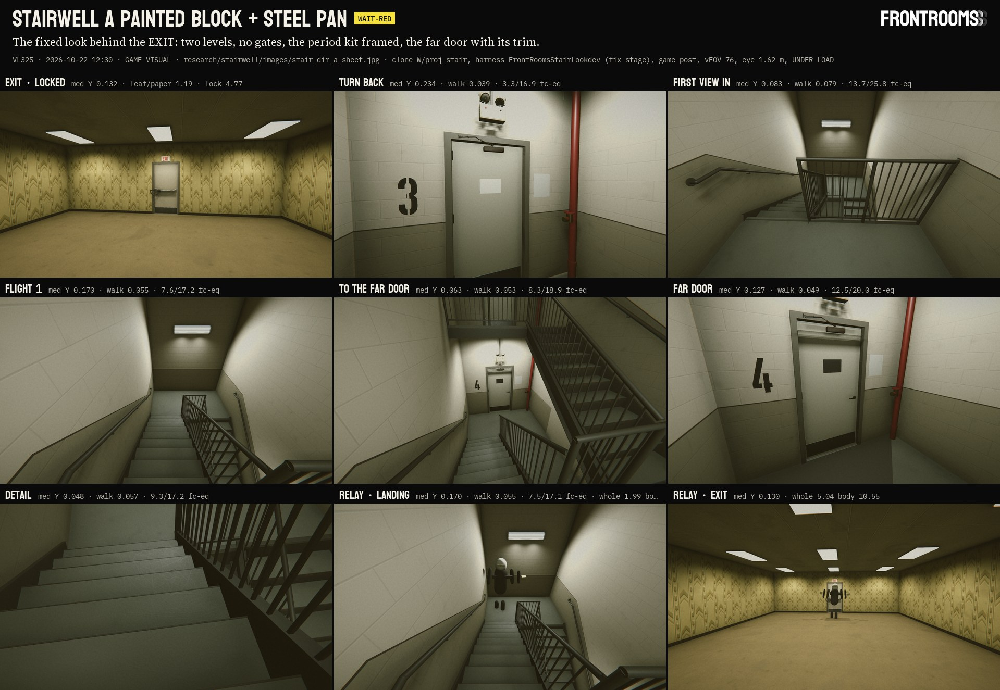
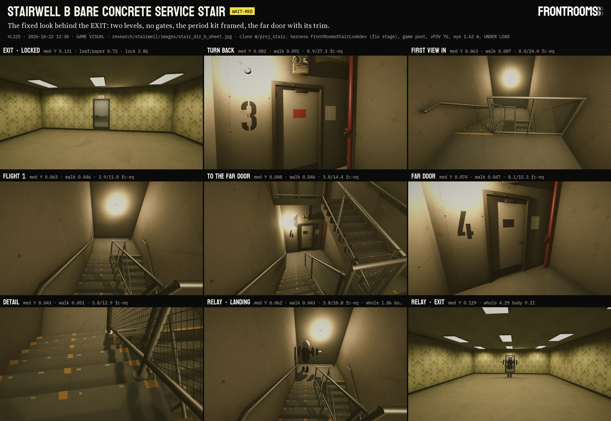
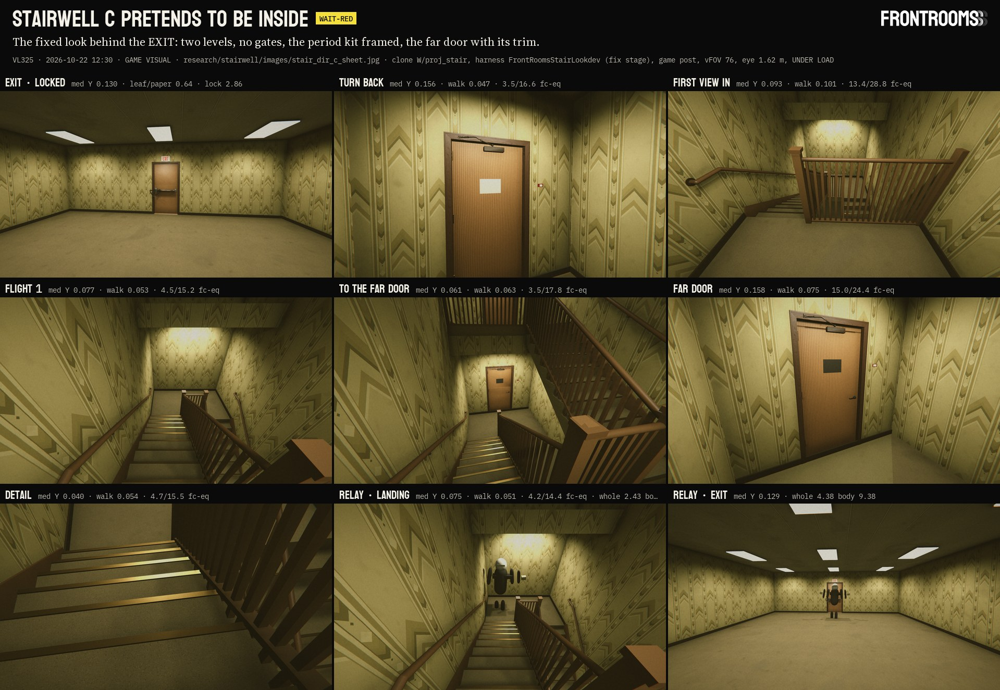

# 10 · Stairwell directions (C22): three looks behind the floor's EXIT door

Workflow `c22-stairwell-look`. Stage 2 (Directions) written 2026-10-22 morning; **revised the same day in stage 5 (Fix)** after two critics (`50_critic_fixes.md` lists every issue and what changed). Written by 游戏视觉.
- **Read first:** `01_research.md` (code facts, geometry, references) and `SOURCES.md` (S1… ids used below).
- **Where the work happened:** pre-renders and blockout kits only in the clone `W/proj_stair` (main dfc0086 + working tree, synced 07:2x). Nothing was merged. Main was not opened in Unity. The only files written in main are in this folder.
- **Status:** PROPOSAL. Red picks A, B or C. C22 and A13 are decided and are not re-asked. C23 (lit `Kit_ExitSign` + crossbar) is what all three show, with the two A13 door states.
- **v1 of this file and its images:** `W/_partial/stairwell_v1_images_1022/`, `W/_partial/stairwell_v1_data_1022/`.

**Marks.** **SP**: a starting value, not a decision. **ESTIMATE**: trade practice, not a code text. **UNVERIFIED**: not checked against a source. **CR**: a request to another line.

---

## 0. Short answer

| | Direction | One line | Relay at the exit, 8.6 m (whole / body) | Relay on the turn landing (whole / body) | Walk path, post Y median · E p2 (fc-eq) |
|---|---|---|---|---|---|
| **A** | **Painted block + steel pan stair** | The generic 1980s office egress stair: warm putty block over a tan band that wraps the landings, dark steel pan stairs, picket guards, a red standpipe at both door landings. | **5.04 / 10.55** | 1.99 / **6.19** | 0.049–0.079 · 7.5–13.7 |
| **B** | **Bare concrete service-core stair** | A garage or back-of-house core: board-formed concrete, galvanized pipe guard with wire-mesh infill, worn yellow nosings, stencilled numbers, caged globes. | **4.29 / 9.21** | 1.86 / **5.95** | 0.043–0.091 · 3.8–8.1 |
| **C** | **The stair that pretends to be inside** | The maze's paper, carpet, ceiling tiles and troffers carry on into a carpeted stair with a round oak rail and brass nosings. | **4.38 / 9.38** | 2.43 / **9.60** | 0.047–0.101 · 3.5–15.0 |

The bar is 4 : 1 (the Run! study, `room_visuals/21_run_fix_1014.md` §3). "Whole" = all Relay pixels against a 12 px ring (Run! B method); "body" = the dark body only (Run! A method). fc-eq = E relative to an assumed 50 fc maze floor; absolute fc is not measured. The maze's post median Y is 0.130. §5 has every number.

**My recommendation: A.**
- It is the code-true 1990 stair (S1, S3), and the `turn_back` frame now shows why: stencil numeral, wall stair-ID sign, blank stair face with closer and NO RE-ENTRY, twin-head unit with its red pilot, standpipe and valve.
- Paper and carpet give way to block and steel in one door: the clearest "you have left the floor".
- Its pale putty leaf is the only exit leaf that passes the C23 rule "exit leaf at or above the paper" (1.17–1.75), so the chain and the Relay read best against it.
- It reuses the Run! B twin-head and wraparound.

C is the cheapest and the strangest look; keep it for a later deep-floor event (narrative's call). B is the grittiest; if picked, its exit leaf needs a pale finish (leaf / paper 0.70–1.04).

**Ship it in two parts** (critic gameplay 12):
1. **Readability minimum**, with 关卡设计's 2–3 days, on greybox or C materials: the two-level geometry (§1.1), the A13 door states (§1.2), the far-door trim, numerals that count up, steady lights at the §1.3 gains, the exit lamp hold, the EXIT at EmissionGain 2.0 casting no shadow, the end-mounted sign on corridors.
2. **The look pass** (A's kits, textures and wear) after.

**What the measurements found:**
1. **The exit reads in the worst case only if its lamps are held.** In a tier-5 hall (40 % steady, 25 % stutter, 18 % failing, 12 % dead) with the lamps within 2 cells of the exit held Steady, the Relay passes at 0° and 45° (5.03 / 4.80) and the body passes at 70° (9.22); with those lamps dead it fails (whole 1.61–1.75, body 2.18–2.43). So the lamp hold is part of the spec (§1.3).
2. **The A13 lock reads past 8 m** in A: leaf / lock 4.77 : 1 at 8.6 m, 5.04 at 12 m, 4.91 at 20 m, 3.22 at 30 m (B, C 2.7–3.5). The EXIT stays lit in both states.
3. **The EXIT needs gain 2.0 and an end sign on corridors.** In place, at gain 1 its letters are 1.26 × the lit wall in raw HDR (family bar 1.5–2.5); gain 2.0 gives 2.44. At 70° along the wall the flat sign's letters are 14 px at 12 m and gone at 30 m; `Kit_ExitSign_End` gives 64 / 18 / 5 px.
4. **On the turn landing the body passes in all three; the whole figure fails in all three** (1.86–2.43) on the prototype's pale head. Since the Relay could reach the open exit door (CR §7), this is a live test, and the head is a flag for Relay design.
5. **Never dark, now on screen too:** walk-path post Y about one stop under the maze, every walk path above the 1 fc minimum at p2 (fc-eq, relative).
6. **The door-head strip was shadow, not LOD:** the frame head and the sign shadowed the recessed leaf. C23 spec: the exit frame and the sign cast no shadow (§1.2; a production finding for all steel doors, `50` Era 9).

---

## 1. What all three share

### 1.1 Geometry (01 §3.3, revised)
- **Footprint:** 1 × 2 cells, clear 2.84 × 5.84 m. Walls 0.16 m on the cell lines.
- **Two levels only.** The stair serves the exit floor and the far floor, as 叙事's ID string already says (`LEVELS 0 TO B1`, `NO ROOF ACCESS`):
  - a plain slab closes the shaft 3.30 m over the exit landing: no up flight, no gate (UBC 1991 §3306(o) asks only one stair of a building to reach the roof; §3306(p) signs "no roof access");
  - the far landing is the shaft floor: no down flight, no gate, nothing in the well below to tempt or to explain;
  - the open space under the turn landing stays open (UBC §3309(f)).
- **Floor to floor 3.50 m:** 2 flights of 10 risers × 175 mm, 9 treads × 280 mm.
- **Widths:** flights **1.12 m** (44 in, the code minimum), well **0.60 m**, landings 1.66 m deep.
- **Doors:** centred in the landing end wall at z 0. The far door is directly below the exit door.
- **Flight sides:** flight 1 (exit landing → turn landing) along the latch-side wall (−x); flight 2 (turn landing → far landing) along +x.
- **Guards:** 42 in at the well and along the whole top edge of the exit landing (with no flight above, its flight-2 side is a 3.5 m drop).
- **Option, not built:** if the stair ever continues below the far floor, a down-gate there is a borrowed discharge-level device (UBC §3309(e): in code it marks the street floor), with a mid-grey plate (#8A8780), never the brightest surface.
- **For 关卡设计 (CR):** 3.96 m floor to floor (24 × 165 mm risers, 11 × 280 mm treads, 1.38 m landings) still fits 1 × 2 cells and suits a 1990 office plenum (01 §5); about +0.3 s of walk.

### 1.2 The exit door and the sign (C23 + A13, all three)
- **Exit door:** `Kit_DoorFrame_Steel` + `Kit_DoorLeaf_Steel` (no lite) in A and B; C uses the maze's `Kit_DoorLeaf_Veneer` in `Kit_DoorFrame_Wood`.
- **Push face (maze side):** `Kit_ExitDevice_Crossbar` at door (−0.022, 1.000, 0.900), Euler (0, −90, 0), scale (−1, 1, 1).
- **A13 states (maze side), one state change, no blink:**
  - **LOCKED:** a dark ½ in proof-coil chain (#34302B, L* 20) wrapped twice round the crossbar near the latch end, through an eye bolt in the wall beside the latch jamb (−0.64, 1.0), ends joined by a laminated-steel padlock under the bar. Chained exits were a real violation of the period (Hamlet, NC, 1991 [memory, verify]); the padlock echoes the HUD padlock (3113:6999) and the map's keyhole family.
  - **UNLOCKED:** the chain coiled on the floor against the wall, latch side, the padlock open.
  - **The EXIT sign stays LIT in both.** Floor 1 has no key under A13, so it starts UNLOCKED (CR 系统设计 to confirm).
- **Pull face (stair side):** blank, with `Kit_DoorCloser_*` (regular arm) and a NO RE-ENTRY plate at 5 ft (blank placeholder; NYC LL5 C26-608.5; string 叙事: `NO REENTRY` / `NEAREST REENTRY ON LEVEL B1`).
- **Sign:** `Kit_ExitSign` on the frame's `exit_sign_p` anchor (bottom 2.18 m, maze face), `FrontRoomsExitSign` Configure(Lit), **EmissionGain 2.0** (window 1.75–2.0, §5.3), no spill light. **The exit frame and the sign cast no shadow** (the strip fix).
- **Corridor exits:** where the exit door sits on a corridor side wall, `Kit_ExitSign_End` (double-faced, end-mounted) replaces the flat sign.
- **Ceiling:** the exit side needs a Standard (2.9 m) ceiling (01 §3.2).
- **Inside the stair:** no EXIT sign, no photoluminescent strip, no arrows (叙事's list).

### 1.3 Light rules (all three)
- **Fixtures:** one per landing: exit landing, turn landing, far landing.
  - **Door landings:** 0.80 m off the door wall, so the door face is lit (at 0.30 m the far door was darker than three quarters of the frame).
  - **Turn landing:** 0.30 m off the far wall, washing the wall you walk toward. With no landing above it, A's wraparound is wall-mounted there at 2.55 m.
  - **A and C linear sources are two spots 0.6 m apart** along the lamp: a long wash, not a round pool.
- **Gain (SP):** A ×2.4, B ×2.9, C ×1.5 on the stage-2 intensities. Walk-path post Y lands at about one stop under the maze (§5).
- **Shadows:** every stair light is soft-shadowed (6 lights in A and C, 3 in B).
- **Everything is steady:** 0 changes per second, well inside the 3/s limit and Reduce Flashing.
- **The exit lamp hold (CR 关卡设计):** the map lamps within 2 cells of the exit door are held Steady (mode 0) through the per-cell lampModes override. Measured need: §5.4.
- **Light-tightness (CR 关卡设计, revised after critic gameplay 4):**
  - on the **new** floor, hold the lamps round the far door and release them with the swing, as in the title;
  - on the **old** floor, keep the exit lamps lit and force castsShadow on lamps within 10 m of the shell (or a light layer, a URP-asset change by 游戏视觉);
  - the stair interior stays steady whatever the outside lamp modes are.
- **Scene fill:** the scene's "Soft ambient direction" (directional 0.16, rgb .769/.816/.800, shadow strength 0.18) and `FrontRoomsLook.ApplyAmbient()` are part of every render.

### 1.4 Signs (placeholders; strings 叙事, type and art 平面视觉)
- **Floor numeral:** stencil-cut block numerals on the block wall, **hinge side** of each stair door (A painted 0.46 m, B black spray 0.60 m; C a suite plate only). Placeholders count **up**: exit floor 3, far floor 4. **Rule:** the stair token and CAUGHT's FLOOR count use one scheme (count up, or 叙事's `0` / `B1`; Red's call).
- **Stair ID sign:** on the **wall beside the latch jamb** at 5 ft, readable open or shut (UBC 1991 §3306(p)): stair, level, terminus, roof access (`STAIR A` / `LEVEL 0` / `LEVELS 0 TO B1` / `NO ROOF ACCESS`, 叙事). A and B only.
- **On the leaves:** exit door NO RE-ENTRY (pale); far door a dark floor-access plate (`REENTRY ON THIS FLOOR`). Only the far door has pull trim (a lever).
- **During a far-door hold:** the lever moves down and the leaf gives 1–2 mm (stack pressure), so it reads stuck, not locked. The give is a sound and motion beat (CR 声音设计).
- **Arrival door, floor side:** a non-EXIT stair-ID or floor plate, **no** dead EXIT sign (both critics).
- **None of:** photoluminescent strips, tactile signs, running man, arrows.

### 1.5 Frames and measurements (per direction)
Through the game's post, 1920 × 1080, 4× MSAA, vFOV 76, eye 1.62 m (`data/poses_fix_{A,B,C}.tsv`):

| Frame | Camera |
|---|---|
| `door`, `door_unlocked` | maze side, 5 m, the exit locked / unlocked |
| `exit_8m`, `exit_8m_unlocked` | maze side, 8.6 m |
| `landing` | just inside, 35° down: the first view in |
| `flight` | top of flight 1 down to the turn landing |
| `turn_back` | on the exit landing, looking back at the shut exit door (the period kit) |
| `far_approach` | from the turn landing, down flight 2 to the far door |
| `far_door`, `far_door_held` | arriving at the far door at eye level; the hold state |
| `detail` | 1.0 m over tread 5, 0.7 m back on the walk line, vFOV 40 |
| `relay_stair` | as `flight`, the Relay on the turn landing |
| `relay_maze` | 8.6 m, the Relay 1.7 m in front of the locked exit |
| `sign_g1.0…2.5` | 5 m, EXIT EmissionGain sweep, with a raw HDR pass |
| `door_lod0`, `diag_head*` | the door-head diagnostics |

- **Exit-approach ladder** (separate run, `-stairLadder`): a 63 × 33 m Level 0 hall, 231 map troffers, tier-5 draw (seed 5), cameras at 12 / 20 / 30 m × 0 / 45 / 70°, locked and unlocked, the end sign at 70°, the Relay at 45° (8.6 m) and 70° (12 m); exit cells held Steady (f9) or Dead (f10).
- **Passes per frame:** ID mask, Relay-parts mask, door-parts mask (chain/padlock, EXIT letters, sign face, exit leaf, crossbar, far-door trim), white-Lambert float E pass (stair frames), raw HDR (sign frames).
- **Scripts:** `data/measure_fix.py.txt`, `data/make_fix_images.py.txt`, `data/gen_stair_numerals.py.txt`; the run log `data/runs.md`.

### 1.6 Production facts found on the way
1. **World-y grime.** `FrontRoomsSurface.shader:455` darkens walls below y 0 by world height. A real descent would darken the new floor's walls; the rebase (01 §3.4 B) avoids it.
2. **Light-tightness:** §1.3.
3. **The fill floor.** The scene directional passes 82 % through every shadow: 2.0–5.1 fc-eq on the walk path with every stair lamp off (stage 2, r8).
4. **Recessed leaves and lamp shadows.** A shadow-casting map lamp near any `Kit_DoorFrame_*` door paints a lit sliver and a displaced dark band on the leaf (default bias). For 游戏视觉: a frame-side shadow fix; for 关卡设计: lamp bias (`50` Era 9).

---

## 2. A · Painted block + steel pan stair (recommended)

**2.1 Idea.** The 1980s office core stair (01 §1.2–1.3, §1.8). 8 in block in warm putty eggshell over a tan semi-gloss band that follows the flights and wraps the landings at 1.1 m, with a dark cut-in line along its top (BSS 120 Fig. 2.7.5, S3). Dark brown-grey steel pan stairs with C10 channel stringers and light-grey deck-enamel fill. Picket guards; pipe rails worn to bare steel on top, returned to the wall. A red standpipe with a hose valve at both door landings. A twin-head battery unit over each door.

**2.2 Materials** (Resources/Surfaces; "new" = a slot to add, values SP)

| Surface | Slot | Value in the renders |
|---|---|---|
| Walls above the band | **new `Stair_Block`** (Run! B `Run_Block_{A,N,S}`, 0.4 m tile) | #DACFBC (L* 83.5), smoothness ×0.55 |
| Band | `Stair_Block`, own material | #A39A86 tan (L* 63.9), smoothness ×1.05 |
| Band cut-in line | **new `Stair_CutIn`** (12 mm strip) | #4A4238 |
| Steel (stringers, pans, risers, guard, nosing lip) | **new `Stair_SteelEnamel`** | #47443E (L* 29.0), smoothness .48 |
| Nosing chips | wear mask in production (red-oxide primer) | #7B3F2A, on the walk lines only |
| Tread and landing fill | **new `Stair_TreadFill`** on `Stair_ConcreteFloor` (normal ×1.0) | #BDBEB8 |
| Rails | **new `Stair_RailEnamel`**, bare-steel top in a wear mask | #3E3B36 (L* 25.0); top #A8A9A4, metallic .85 |
| Door leaf / frame | `Prop_SteelPutty` / frame #5F5A50 | #B7B09E (L* 72) |
| Standpipe, valve | **new `Stair_RedEnamel`**; `Prop_Brass` | #8E1E17 |
| Lock (A13) | **new `Prop_ChainOxide`**, `Prop_SteelLaminated` | #34302B; #9A9C97 |
| Far-door plate | placeholder for 平面视觉 | #2B2925 |

**2.3 Kits and budgets** (production LOD0 / LOD1 / LOD2 tris, ESTIMATE)
- **New:** `Kit_StairFlight_SteelPan` 7,000 / 2,200 / 400; `Kit_StairLanding_SteelPan` 1,800 / 600 / 100; `Kit_StairGuard_Picket` (one run, 26 half-inch pickets) 4,000 / 1,200 / 150 (LOD2 a card); `Kit_StairGuard_LandingEdge` (well, and the exit landing's full edge) 1,600 / 500 / 60; `Kit_StairRail_Wall` (extensions, returns, flanges, 3 brackets) 1,800 / 600 / 90; `Kit_Standpipe_Riser` 900 / 300 / 60; `Kit_HoseValve_2half` 3,000 / 900 / 150; `Kit_SprinklerPendant` (one, at the top) 600 / 150 / 0; **`Kit_ExitChain_Locked` + `Kit_ExitChain_Dropped` + `Kit_Padlock`** about 3,500 / 1,000 / 100 together (the blockout builds the chain from 284 boxes; production is one mesh per state); numeral decals 2 tris a digit.
- **Reused:** Run! B `Kit_WrapFixture_4ft` (hero pass proposed 1,500 / 500 / 100) and `Kit_EmergencyTwinHead` set; main's steel door set, closer, crossbar, `Kit_ExitSign`, `Kit_ExitSign_End`, `Kit_Lock_Lever`.
- **Blockout as rendered:** the whole two-level stair 710 renderers, 39 materials, 107,736 tris counting every kit LOD (`data/stats_fix_A.txt`).
- **Production estimate for the whole stair:** about 96k tris at LOD0 (one floor period ~63k plus the far landing's door set, twin-head, light and valve, plus the lock), about 34 draws once merged per material.

**2.4 Light plan.** One 2-lamp 4 ft wraparound per landing (two spots 170/120°, 1.6 each before gain ×2.4, range 6.5, cool white): over the door landings 0.80 m off the door wall, on the far wall of the turn landing. Twin-head over each door, normal power, only the red AC pilot lit. Measured: walk post Y 0.039–0.079 (median per frame), E p2 7.5–13.7 fc-eq.

**2.5 Sound hooks** (for 声音设计; events only)
- Footsteps "steel pan" on treads, "concrete fill" on landings; a long bright tail that stays the player's own; a 120 Hz ballast bed.
- Exit door: the full real sequence (crossbar, latch, swing, closer check, strike), and for A13 a chain rattle on a locked push and a chain drop on unlock.
- Far door: a heavy pull and a stack-pressure whistle during a hold, with the 1–2 mm give.

**2.6 How the descent reads.** The band zigzags down both walls and wraps every landing; the stencil numeral changes 3 → 4 between the two doors; the far door is the only door with trim.

**2.7 Relay readability.** Turn landing body **6.19** (whole 1.99, head 1.93). Exit at 8.6 m whole **5.04**, body 10.55 (protan 4.99). Ladder: §5.4.

**2.8 WebGL** (separate track; desktop unchanged)
- Bake the light into the vertex colour or albedo of the merged two-level mesh and combine per material at spawn (no lightmap index restore at 192 m roots, no APV).
- Keep at most the nearest fixture realtime and unshadowed.
- Pickets: one merged mesh per run, a card at LOD2. The chain: one mesh.
- Start the new map build at the exit threshold so the far-door hold fires less (关卡设计's call, WebGL only).
- Textures `Stair_Block`, `Stair_ConcreteFloor` at 1024 on the WebGL tab.

**2.9 Risks.** The most new kits; the wraparound needs a hero pass; the chain must stay readable at LOD1 (≥ 12 m).

---

## 3. B · Bare concrete service-core stair

**3.1 Idea.** A service core or garage stair (01 §1.8): cast-in-place concrete with plywood-form seams and tie cones, unpainted. Board-formed concrete is a 1960s–70s and parking-garage look; for a 1990 hotel or office core it is the least likely of the three (critic era 17). Solid flights, troweled treads with 50 mm safety-yellow nosings worn through on the walk lines, a galvanized pipe guard with woven-wire mesh infill (openings under 4 in), stencilled numerals, a caged globe per landing, a coffee-can ashtray on the turn landing (narrative hook, not a cue).

**3.2 Materials:** walls #D9D6CF, bodies #C9C5BD, risers #CFCBC3 (`Stair_Concrete`); treads #D2D0CA (`Stair_ConcreteFloor`); nosings #D9A712 with worn flecks #C4B88F; guard #A4A7A3 metallic .75 with mesh infill #A9ACA8 (alpha-tested, double-sided); door leaf grey primer #8C887E (L* 57, below the paper: needs a pale finish if B is picked); globe emission (1, .82, .60) × 4 × √gain.

**3.3 Kits:** cast flight 1,200 / 400 / 60; slab landing 300 / 100 / 20; **`Kit_StairGuard_PipeMesh`** (top and bottom rail, posts on flanges, mesh panel as an alpha card) 2,500 / 800 / 100; wall rail with returns 1,800 / 600 / 90; caged globe 2,500 / 800 / 120; lock as A. Blockout 614 renderers, 110,504 tris (all LODs). **Production estimate:** about 75k tris, about 30 draws.

**3.4 Light:** one caged globe per landing (point light, 2.6 × 2.9, range 6, about 2,850 K): door landings on the door wall beside the door, turn landing on the far wall. The cage and box cast no shadow; shadow bias 0.2 / 1.2 (the dashed arcs are gone). Walk post Y 0.043–0.091, E p2 3.8–8.1 fc-eq.

**3.5 Sound:** "concrete" steps, the longest dark tail, no hum.

**3.6 Descent:** the worn yellow stripes ladder down two flights; numerals 0.60 m.

**3.7 Relay:** turn landing body **5.95** (whole 1.86); exit whole 4.29, body 9.21.

**3.8 WebGL:** the cheapest geometry; bake the globes (a shadowed point light costs 6 atlas slices).

**3.9 Risks:** the least era-likely; the darkest leaf; the furthest from the maze palette.

---

## 4. C · The stair that pretends to be inside

**4.1 Idea.** The exit door looks like every maze door (veneer, wood frame); behind it the maze continues, sloped: Level 0 paper, cove base, carpet over treads and risers with brass nosings, a 2.9 m drop ceiling with the maze's troffer over each landing, a round 48 mm oak rail on 32 mm square balusters (3 per tread), oak skirts, a brass suite plate as the only floor sign. Wrong on purpose: no emergency unit, no standpipe, combustible finishes.
- **If used, its copy of the Level 0 paper must leave out the C08 wallpaper-cue layer**, or the cue patterns would turn inside the safe room and point at nothing (critic gameplay 12).

**4.2 Materials:** grime-0 copies of `L0_Wallpaper`, `L0_Carpet`, `L0_Ceiling`; soffits `Stair_SoffitPlaster` #D8CC97; oak #7A5530 / #8A6337; brass. Door leaf veneer (leaf / paper 0.54–0.96: needs a paler veneer if picked).

**4.3 Kits:** carpeted flight 1,500 / 500 / 80; drop-ceiling landing 600 / 200 / 40; **`Kit_StairGuard_OakBaluster`** (round rail, 27 balusters, 2 newels) 4,500 / 1,300 / 160; oak wall rail with extensions, returns and brass brackets 1,500 / 500 / 70; skirts. Blockout 543 renderers, 78,832 tris. **Production estimate:** about 40k tris, about 22 draws; shares batches with the maze.

**4.4 Light:** the Level 0 troffer turned across each landing, two spots 0.6 m apart (2.5 each × 1.5), range 6.5; door landings 0.80 m off the door wall. Walk post Y 0.047–0.101, E p2 3.5–15.0 fc-eq.

**4.5 Sound:** exactly the maze: carpet steps, a short dead echo, the troffer hum.

**4.6 Descent:** slope only, and a 0.2 m suite plate: the least legible.

**4.7 Relay:** turn landing body **9.60** (whole 2.43); exit whole 4.38, body 9.38.

**4.8 WebGL:** the cheapest overall.

**4.9 Risks:** it undoes the step out of the floor; the safe room looks like the hunting ground; the least code-true. Best as a deep-floor event.

---

## 5. All measurements (final set: f8 stair, f9 / f10 ladder)

Linear Rec. 709 Y of the post frame. Walk = tread and landing surfaces in view. E = white-Lambert illuminance; fc-eq relative to the maze floor = 50 fc (ESTIMATE). Relay ratios: hi / lo of mean Y against a 12 px ring.

### 5.1 Stair frames (`data/metrics_fix_stair.json`)

| Dir | Frame | Median Y | Walk Y median | Walk E p2 / median (fc-eq) | Relay whole (protan) | Body | Head |
|---|---|---|---|---|---|---|---|
| A | landing | 0.083 | 0.079 | 13.7 / 25.8 | — | — | — |
| A | flight | 0.170 | 0.055 | 7.6 / 17.2 | — | — | — |
| A | turn_back | 0.235 | 0.039 | 3.3 / 16.9 | — | — | — |
| A | far_approach | 0.063 | 0.054 | 8.3 / 18.9 | — | — | — |
| A | far_door | 0.127 | 0.049 | 12.5 / 20.0 | — | — | — |
| A | detail | 0.048 | 0.057 | 9.3 / 17.2 | — | — | — |
| A | relay_stair | 0.170 | 0.055 | 7.5 / 17.1 | 1.99 (1.99) | **6.19** | 1.93 |
| A | relay_maze | 0.130 | — | — | **5.04** (4.99) | 10.55 | 1.11 |
| B | landing | 0.063 | 0.087 | 8.0 / 24.0 | — | — | — |
| B | flight | 0.063 | 0.046 | 3.9 / 11.8 | — | — | — |
| B | turn_back | 0.082 | 0.091 | 0.9* / 27.3 | — | — | — |
| B | far_approach | 0.048 | 0.047 | 3.8 / 14.4 | — | — | — |
| B | far_door | 0.074 | 0.047 | 8.1 / 15.3 | — | — | — |
| B | detail | 0.043 | 0.051 | 3.8 / 12.9 | — | — | — |
| B | relay_stair | 0.062 | 0.043 | 3.8 / 10.8 | 1.86 (1.81) | **5.95** | 2.03 |
| B | relay_maze | 0.129 | — | — | **4.29** (4.24) | 9.21 | 1.08 |
| C | landing | 0.094 | 0.101 | 13.4 / 28.8 | — | — | — |
| C | flight | 0.077 | 0.054 | 4.5 / 15.2 | — | — | — |
| C | turn_back | 0.156 | 0.047 | 3.5 / 16.6 | — | — | — |
| C | far_approach | 0.061 | 0.063 | 3.5 / 17.8 | — | — | — |
| C | far_door | 0.158 | 0.075 | 15.0 / 24.4 | — | — | — |
| C | detail | 0.040 | 0.054 | 4.7 / 15.5 | — | — | — |
| C | relay_stair | 0.075 | 0.052 | 4.2 / 14.4 | 2.43 (2.36) | **9.60** | 1.83 |
| C | relay_maze | 0.129 | — | — | **4.38** (4.26) | 9.38 | 1.05 |

\* B `turn_back`: 21 walk pixels at the bottom frame edge in a guard shadow; the visible landing floor there is only 718 px. Every other B walk path is ≥ 3.8 fc-eq at p2.

### 5.2 The far door (VL327)
- Only the far door has trim: lever + dark plate = 8,379 px at the `far_door` camera. Held: the lever's box moves 21 px down; the 2 mm give is below one pixel (motion and sound only).
- Far-door mean Y and its percentile in the frame: A 0.139 (51st) at eye level, 0.118 (64th) from the turn landing; B 0.062 (43rd) / 0.059 (64th); C 0.142 (44th) / 0.108 (77th). Lit, but not the brightest thing: that claim is withdrawn.

### 5.3 The EXIT sign (raw HDR T2, `sign_g*`, A; B and C identical)

| EmissionGain | T2 raw (letters / lit paper) | Post letters / paper | Hue / sat |
|---|---|---|---|
| 1.0 | 1.26 ✗ | 1.32 | 12.0° / 0.63 |
| 1.5 | 1.85 | 1.41 | 12.0° / 0.63 |
| **2.0** | **2.44 ✓** (8.6 m: 2.65; 12 m: 2.52) | 1.46 | 12.1° / 0.63 |
| 2.5 | 3.03 (over) | 1.49 | 12.3° / 0.63 |

### 5.4 Exit approach ladder, A (`data/metrics_fix_ladder_hold.json`, `…_dead.json`)

| Camera | Letters px | Sign / paper (post) | Lock px, leaf / lock (locked) | Lock px (unlocked) | Leaf / paper |
|---|---|---|---|---|---|
| 12 m · 0° | 53 | 2.92 | 118, 5.04 | 63 | 1.21 |
| 12 m · 45° | 41 | 2.65 | 127, 6.79 | 59 | 1.20 |
| 12 m · 70° flat / end sign | 14 / 64 | 2.39 / 1.32 | 92, 7.59 | 46 | 1.32 |
| 20 m · 0° | 16 | 4.09 | 52, 4.91 | 17 | 1.36 |
| 20 m · 45° | 17 | 3.50 | 44, 6.00 | 23 | 1.39 |
| 20 m · 70° flat / end sign | 11 / 18 | 2.98 / 1.17 | 36, 4.79 | 18 | 1.44 |
| 30 m · 0° | 10 | 3.81 | 26, 3.22 | 7 | 1.68 |
| 30 m · 45° | 5 | 3.44 | 23, 3.88 | 7 | 1.69 |
| 30 m · 70° flat / end sign | 0 / 5 | — / 1.45 | 18, 4.94 | 7 | 1.68 |

| Relay at the exit | Exit cells held Steady: whole / body | Exit cells Dead: whole / body |
|---|---|---|
| 0°, 8.6 m | **5.03** / 10.52 | 1.61 / 2.18 ✗ |
| 45°, 8.6 m | **4.80** / 11.39 | 1.75 / 2.43 ✗ |
| 70°, 12 m (corridor) | 3.13 ✗ / 9.22 | 4.60 / 6.93 |

B and C: the same sign and Relay numbers; lock 2.9–3.5 : 1 (B), 2.7–3.8 : 1 (C); leaf / paper below 1.0 in both until 30 m.

**Photosafety:** every stair light is static: 0 changes per second. The hall's stutter and failing lamps are stills here.

**Images** (`images/`, own renders): full frames `stair_dir_{a,b,c}_*.jpg` and `stair_ladder_{a,b,c}_*.jpg`; Shot-format checks `stair_dir_{a,b,c}_sheet.jpg`, `stair_dirs_compare.jpg` (VL325), `stair_v_relay_readability.jpg`, `stair_v_illuminance.jpg` (VL326), `stair_v_far_door.jpg` (VL327), `stair_v_exit_states.jpg`, `stair_v_exit_ladder.jpg`, `stair_v_sign_gain.jpg` (VL328), `stair_v_door_head.jpg`; label-free crops for Figma in `images/figma/`.

---

## 6. Comparison

| | A | B | C |
|---|---|---|---|
| Code-true 1990 | yes (S1, S3, S4) | yes, but a garage / service-core wall | no (on purpose) |
| "You have left the floor" | strongest | strong | none |
| Descent read | band + stencil numerals + the far door's trim | worn yellow ladder + stencils | slope only, small plate |
| Exit leaf vs paper (C23 rule) | 1.17–1.75 ✓ | 0.70–1.04 ✗ | 0.54–0.96 ✗ |
| A13 lock at 12 m (leaf / lock) | 5.04 | 3.39 | 3.08 |
| Relay at the exit (whole, 8.6 m) | 5.04 ✓ | 4.29 ✓ | 4.38 ✓ |
| Relay on the landing (body) | 6.19 ✓ | 5.95 ✓ | 9.60 ✓ |
| Walk post Y median | 0.039–0.079 | 0.043–0.091 | 0.047–0.101 |
| New textures | 2 sets | 2 sets | 0 |
| Whole stair, production est. (LOD0) | ~96k tris, ~34 draws | ~75k, ~30 | ~40k, ~22 |

**Pick: A.** Second: C as a deep-floor event. B only if Red wants grit, with a pale exit leaf.

---

## 7. For other lines (written here; no messages sent)

- **关卡设计:**
  - (a) **Exit lamp hold:** lamps within 2 cells of the exit door held Steady (per-cell lampModes). Without it the Relay at the exit fails (§5.4).
  - (b) **Light-tightness:** §1.3 (new floor's lamps held round the far door; old floor's exit lamps lit, castsShadow within 10 m of the shell).
  - (c) **Shut and latch the exit door** as soon as the player clears the leaf swing inside the 1.66 m landing, by 3D or path distance (today `StartDoorShutDistance = 4f` flat XZ, `FrontRooms3DGame.cs:155, :918`); the Relay must not path through during the swing. The far door is about 1 m flat from the exit door, so reused flat-distance code would misfire.
  - (d) Two levels per stair (§1.1); 3.96 m floor to floor as an option.
  - (e) Exits on a corridor side wall get `Kit_ExitSign_End`; a lit EXIT first seen through a Window edge counts as a cue at glass, so placement checks that sightline.
  - (f) Standard 2.9 m ceiling on the exit side; rebase favoured by the world-y grime.
  - (g) Map lamps keep Unity's default shadow bias, which paints a sliver on recessed leaves (§1.6.4).
- **系统设计:** confirm the Floor 1 rule (no key under A13 → its EXIT shows UNLOCKED from the start).
- **声音设计:** steel-door Foley on the exit door (01 §0.9a); chain rattle on a locked push, chain drop on unlock; the far door's heavy pull, whistle and 1–2 mm give during a hold; echo stays the player's own.
- **叙事 / 平面视觉:**
  - Numbering: one scheme for the stair token and CAUGHT (count up, or `0` / `B1`), Red's call.
  - With two levels, the gate strings (`NO ACCESS ABOVE / BELOW THIS LEVEL`) are not needed; the ID sign moves to the wall and takes the leaf's floor plate.
  - The alarm condition: a code-true 1990 stair unlocks on a control-station signal (UBC §1807(j)); EGRESS makes the Relay the alarm responder, so the fiction needs "no signal reaches the doors".
  - Arrival door: a stair-ID or floor plate on the floor side, not a dead EXIT.
  - Numeral face and size (placeholders: stencil, A 0.46 m, B 0.60 m).
- **Relay design:** the pale head reads 1.05–1.11 : 1 against Level 0 paper at the exit and fails every "whole" test on the turn landing. Re-run `-stairShots relay_stair,relay_maze` and the ladder's `relay_45,relay_70` with the squeezed-giant rig.

## 8. Files

- **Specs:** `10_directions.md` (this), `50_critic_fixes.md`, `01_research.md`, `SOURCES.md`, `media_candidates.md`, `30_figma.md`, `40_for_red.md`.
- **Images:** `images/` (own renders; v1 in `W/_partial/stairwell_v1_images_1022/`).
- **Data:** `data/` — harness `FrontRoomsStairLookdev.cs.txt` (fix stage), `gen_stair_numerals.py.txt`, `measure_fix.py.txt`, `make_fix_images.py.txt`, `run_fix.zsh.txt`, `metrics_fix_*.json`, `stats_fix_*.txt`, `poses_fix_*.tsv`, `log_fix_*.txt`, `runs.md`, `run_status_fix.txt`; stage-2 files kept beside them.
- **Clone only:** `W/proj_stair` (harness, blockout prefabs in `Assets/StairBlockout/{A,B,C}/`, placeholder textures in `Assets/StairLookdevTex/`); raw renders in `W/stair_work/runs/` (f8, f9_ladder, f10_ladder_dead final).
- **VL specs:** `W/vl_pending/stairwell.md` (VL325–VL328).
- **Figma:** section `3484:7309` (`30_figma.md`).
