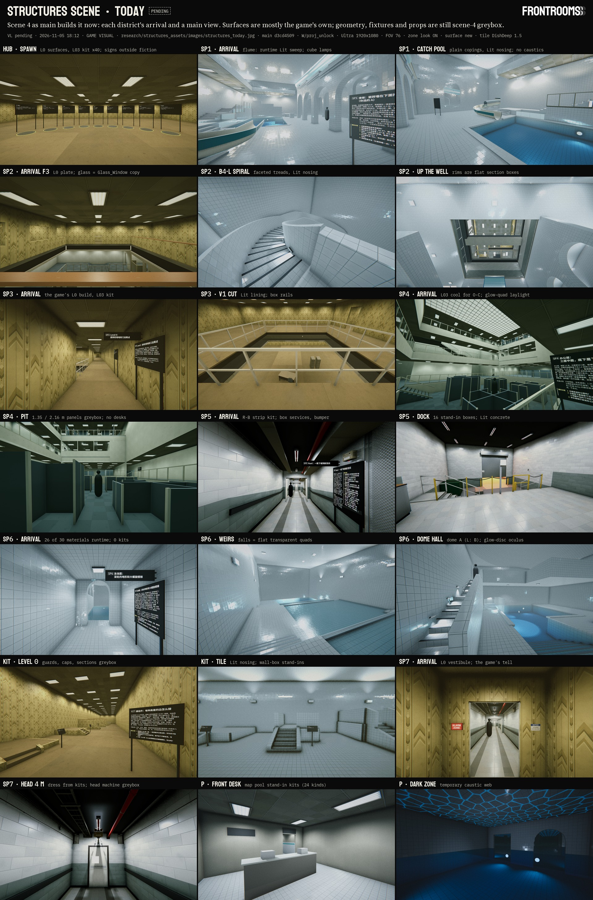

# Structures assets · 10 · Survey: what scene 4 builds today, and what the game's standard asks of each piece

Line 游戏视觉 (`visual`), workflow `structures_assets` step 1 (Survey, then Research, then Plan; a second workflow builds), stage Survey, 2026-11-05 17:46-18:2x (America/Los_Angeles), account G (switch #21), parent session `local_1fc9f09c`.

Red's ask, verbatim (this line's chat, 2026-11-05 17:42:27 and 17:42:55, plain user turns): "我需要你开始对structure scene里面的资产进行全方位的升级和revise，就像是主游戏项目的标准一样" and "升级的逻辑和之前一样，调研现行，再进行revise".

What it means: every asset of scene 4 (`Assets/Scenes/FrontRoomsStructures.unity`, built at Play by `Assets/Scripts/FrontRoomsMap/Structures/*.cs`) is brought up to the main game's standard, the way this line upgraded the game's rooms: research first, then revise. "The logic as before" is the surface_detail precedent (Red 11-04 13:4x: "调研3A游戏是如何通过法线贴图等一系列技巧来提升这些模型信息量并且和光线追踪协作的，来优化每一个房间"; `research/surface_detail/`) and the research-first style (Red 10-31: "…research在那个年代的锁是什么样的…"). This page is the inventory the Research and Plan stages design from; `W/structures_assets/survey.tsv` carries every row of it (115 elements, 13 columns).

Done here: read all 23 Structures files (23,736 lines; sha1s in section 9) and the scene file; listed every visible element per district with its builder, mesh, material, lights and the sign's 灰盒占位; rendered every stop of every district in the line's clone `W/proj_unlock` after a fresh `fr sync` (main `d3cd4509`, 17:57) with a clone-only harness that also dumped each district's renderers, materials and lights; one TODAY contact sheet. **Not done:** nothing written to main, nothing landed, no Structures file changed, no git, no download, nothing played aloud (silent clone, rule 24); frame time not measured; no phone or WebGL build.

Reused, not redone: `research/level_space/70_structures_districts.md` (what each district builds, its sign's greybox list), `handoff/level_space.md` §5 (Red's picks), `research/surface_detail/20_design.md` and `60_build.md` (the shared core K1-K9, the open packages 7 trims and 8 bevels), `research/tech_art/60_visual_build.md` (rows 1, 7, 8, 16 and L.3), `research/zone_lamps/30_for_red.md` (O-C, P1-A, P2-A), the level_space line's review logs `W/level_space/renders/scene4/*/log.txt` for earlier cost lines (there is no `BUILD_LOG.md`; the cost lines are the record).

Owners (binding for every later stage): scene 4 and `Structures/*.cs` are co-claimed by 夸张结构调研与设计 (`level_space`) and 关卡设计 (`map`); this line owns the assets (`Resources/Props`, `Resources/Surfaces`, `Resources/Rendering`, `Tools/Blender/frontrooms_kit`, `Tools/lookdev`). An upgrade = our production assets plus a staged diff of `Structures/*.cs` that wires them, which the owners land or accept. `FrontRoomsPoolMaterials.cs` and `FrontRoomsPoolStandIns.cs` (the material factory and the pool stand-in kits) are 关卡设计's map files.

## 0. Short answer

1. **Ten districts, 115 elements.** HUB, SP1-SP7, the kit row (KIT) and the pool route P (the map's own pool code, key 7). Today, at desktop Ultra in the clone: 19,154 renderers (7,549 without P's streamed map world), 6.04 M triangles (1.61 M without P), 2,509 lights placed of which 619 were on at the inventory moment, 11 reflection probes (section 6).
2. **Surfaces are mostly the game's own.** Walls, floors, ceilings and stairs load `Resources/Surfaces` by name (L0, Office, RunB, Stair) or our pool tile `Prop_PoolTile_FieldMesh` / `CourseMesh` (DishDeep 1.5, GZ-C glaze), so they already carry surface_detail. What is not: **86 distinct structures-only runtime materials stand in for real ones** (URP Lit / Unlit made at Play by `FrontRoomsPoolMaterials.Lit / Glow / Transparent / Emissive`, plus copies: the flume's seven gelcoats, the pool nosing, 16 lamp-lens glows plus the laylight, oculus, niche, halide, globe and valance glows, the dock's sealed concrete, the access panels, the laylights, the map's pool greys); the other 27 runtime materials of the scene are scene UI or the game's own runtime copies. None of the 86 has `FrontRooms/Surface`, surface_detail, a phone twin or GlassRT parity.
3. **Geometry is one hard-box builder.** Every shell is `FrontRoomsStructuresMesh` (boxes and quads, planar metre UVs, no bevel, no edge profile, no LOD): arrises, arch intrados, copings, stair nosings and slab edges are knife edges. The precedent left exactly this open: surface_detail package 8 `surface_bevels_contract` (corner bead r 1-3 mm, reveals, steps, bullnosed tile; it names "Structures/*Kit*, *PoolTerrain*, *Well*") and package 7 (trims).
4. **Lamps: the pool is the largest gap.** Level 0 (L03 at lens 1.8) and Run! (R-B strips with the red tube, twin-head units) use the game's kits. The Office (SP4, SP2 F2) hangs L03 with the cool lens where the game hangs Red's O-C pendant. Every pool lamp is a `CreatePrimitive` cube with a glow quad: SP1, SP2, SP6 and KIT build 207 of them, 57 metal-halide wall boxes and 49 down-fills where Red's P1-A wall boxes go, 36 underwater lamps where P2-A's wet niches go, and 65 step, landing, weir, globe, niche and dome-B lights; there are no caustics (Red 11-04 13:10: "全部按推荐", P1-A + P2-A + caustics). SP4's 10 stair lamps, SP5's dock light, two sodium heads and closet lamp, and the laylights are the same kind of stand-in.
5. **Props: 68 kinds have no asset (a few may share one family); 13 landed families are not wired** (both lists in section 4.1). Missing: the flume, the 24 pool stand-in kinds of the map's table (shared by P and the SP districts), the two pool lamps, the dock set, the E8 cage, the caged ladder, computer cabinets, file shelving, training furniture, 1.35 m and 2.16 m panels, laylights, the glass-block floor light, access panels, work lamps, comb plates, guard and rail kits. Not wired although landed: SP7's whole head machine (the game's `FrontRoomsRunRecede` and `FrontRoomsRunRestack` with their `Kit_RunRecede_*`, `Kit_RunRestack_*`, `Kit_RunCompartmentFrame`, `Kit_RunMagnetHolder` kits, landed 11-05 13:3x-13:44), `Kit_CRTMonitor`, the Run! B services in SP5 and SP2 F1, the RN-F door kits, the ghost-band materials, the lounge seating, the pool tile's nosing / tread / riser / coping pieces, O-C.
6. **Water:** the nearest rectangles already become 游戏视觉's water (W-D, Red 13:1x "我目前认为这个ok"); falls, sheets, foam and the slide's film stay flat transparent quads; caustics are a temporary cell-web texture (P) or none (SP districts); the pool's glint photosafety finding (0d: 4.0 flashes in the worst second) still stands.
7. **Who fixes what** (survey.tsv, column owner): 46 rows need both sides (our asset, their wiring), 27 our side only (with 灯具适配 or 水体仿真调研 where named), 22 their side only (wiring of assets that exist, the plate's lamp choice, the builder's edge option), 19 nothing (the game's own pieces, scene UI), 1 later (tiers).

## 1. How the survey was made

- **Code first.** Each district's `Build` names its pieces through `kit.Safe("piece", ...)`; every piece's method was located with its line range, the kit primitives it calls (Box, WallRun, Ring, Sweep, Spiral, Flight, Guard, Water, Lamp, Troffer, StandIn, Kit), the materials it binds and the kits it asks for. The tables in section 3 cite `file:line` in main at the sha1s of section 9.
- **Then the built scene.** Harness `W/proj_unlock/Assets/Editor/StructuresAssets/FrontRoomsStructuresAssetSurvey.cs` (clone-only, never landed; launcher `W/structures_assets/run_today.sh`; log `W/structures_assets/logs/unity_today_20261105-180105.log`): Unity 6000.6.3f1 `-batchmode -buildTarget OSXUniversal`, Play in scene 4, quality Ultra, 1920 x 1080, the walker's own camera (FOV 76, the scene's post), each district entered through the scene's `Jump`, then every stop rendered as a raw PNG, plus per district `inventory_<code>.tsv` (every renderer: path, mesh and its source, triangles from the index counts so kit meshes count too, materials with source and shader, LODGroup, shadow mode), `materials_<code>.tsv`, `lights_<code>.tsv`, `summary.tsv`, `shots.tsv`. Run 18:01-18:12: FINISHED fail=0, 94 frames, 0 console errors or structure warnings. State at render: surface detail new (`FrontRoomsSurfaceDetail.Today` false), tile DishDeep, DishTone 1.50, pool zone look ON, the scene's default water version.
- **Clone sync.** `fr sync visual --line 游戏视觉 --discard` (17:57; main `d3cd4509`; 26 files updated, 210 removed). Every file the sync replaced or removed (236, mostly the tech_art and surface_detail harnesses) is saved in `W/structures_assets/clone_only_save/` with a README.
- **Limits.** "Stand-in" counts in section 6 count renderers whose path says `STAND-IN`; many greybox pieces are not named so (lamp fixtures, the T2 blocks, the flume), so the primitive-mesh and runtime-material counts are the better gauge. The P district's numbers include the map world streamed round the route (the game's own Level 0 and pool rooms).

## 2. The main game's standard, by kind (the codes of survey.tsv's `standard` column)

| Code | The standard | Where it is written |
|---|---|---|
| SURF | A `Resources/Surfaces/<name>.mat` on `FrontRooms/Surface`, with surface_detail's kind and terms (K1 gloss mips, K2 specular AA, K3 micro-shadowing, K4 specular occlusion, K5 gloss map, K6 detail normal, K7 edge highlight, K8 hex tiling, K9 box-projected reflections), `FrontRoomsSurfaceDetail.Today` as the switch, a `_Phone` twin where the family has one, WebGL compiled out, RT parity in GlassRT's hit shader. Wear comes from staged maps with a cause, not procedural cracks. | `surface_detail/20_design.md` §0-1; VISUAL_STANDARD 1.1 |
| TILE | The pool tile family `Resources/Surfaces/Pool/Prop_PoolTile_*`: Field, Course, Cap, Coping, Deck, Lane, Mosaic, Nosing, Riser, Tread (+ Club, + Mesh, + Phone twins); porcelain .93/.95/.96, 150 mm, grey-green joints; Red's DishDeep at tone 1.5 and GZ-C glaze; a box probe per room; bullnosed tile on corners (package 8, P6). | `bathroom_rooms/70_look_build.md` §4, §13; `level_space/73_pool_glaze.md` §7 |
| KIT | A Blender kit from `Tools/Blender/frontrooms_kit` (`build_asset.py`, `kitlib.py`): FBX in `Resources/Props/Models` with LOD0 / LOD1 / LOD2 (budget and distances in the sidecar, hand-built or by ratio), a JSON sidecar (material slots from `Resources/Surfaces`, anchors, colliders, footprint, placement, minimum ceiling), imported by KitImporter v3 with LOD cross-fade (tech_art row 7); real construction (bevels, seams, fixings) that holds at the 0.35 m hero distance; period 1988-91, no brands. 267 kit models (FBX) with 279 sidecars are in main today. | VISUAL_STANDARD 1.1 (hero LOD0); `tech_art/60` row 7 |
| LAMP | The zone's own fixture kit and the game's lamp logic (flicker, dim, dead, Relay warning, blackout), the lens drive of `FrontRoomsTrofferKit` / `FrontRoomsLampKit`, `ShippedShadowFilter` and the explicit light data of row 16. Level 0: L03 at lens 1.8; Office: O-C, the 8 ft indirect pendant `ZL_PEND`; Run!: R-B strips + T-A / T-B heads; pool: P1-A indirect metal-halide wall boxes, P2-A 300 W wet niches every 3 m, caustics. Never a bare spot under a lens quad. | VISUAL_STANDARD 1.2; `zone_lamps/30_for_red.md`; `70` §2 |
| WATER | 游戏视觉's water: `FrontRooms/Water` with `FrontRoomsWaterSurface`, `Submerged`, `Planar`, `Rings` (shaped), the water light (key I), the waterline knob; RT water (P4d) next; photosafety by `Tools/lookdev/flash_check.py`. The water line's twelve versions on K (the stand-in, two variants, five absorptions, two ankle and two waterline versions; `Structures/FrontRoomsStructuresWater.cs`), Red picks by walking. | `handoff/visual.md` §3 items 0d, 3a, 3b |
| GLASS | `FrontRooms/Glass` (`Glass_Window`, `Glass_Edge`, `Glass_Wired`) with GlassRT on High / Ultra; real frames and glazing beads; GlassRT parity for new surface terms. | `handoff/visual.md` §2; VISUAL_STANDARD 1.1 |
| ARCH | The map's shell: planar-UV boxes in the level's surfaces with `_CeilingHeight` grime; door trims (F4), cove base (Office kit), LMS arches; the precedent's open items: bevels (package 8) and trims (package 7, trim sheet row 14). | `surface_detail/60_build.md` §4.7; `tech_art/60` L.3 |
| LOOK | `FrontRoomsZoneLook` (pool zones), `FrontRoomsPostStack` zone volumes (Office, Run_B), the game's film look, box probes per family (row 8). | `tech_art/60` L.3 row 8; Look.cs header |
| TIER | Desktop is the reference; phone = the desktop layout at LOD1 + phone twins + distance culls; WebGL never pulls the desktop down. Scene 4 is desktop Editor only by design (RULES 5b), so this applies when Red takes a structure into the game. | VISUAL_STANDARD 1.1 |
| OUT | Outside the fiction, kept as is: placards for Red (scene-4 type closed by 平面视觉, VL509), pads, metric marks, the Relay stand-in for sight lines. | `70` §1 |

## 3. What each district builds today, and its gap

Gap words: **none**; **material** (a stand-in material where a real one is needed); **mesh** (bevels, trims, real construction); **lighting**; **missing** (no asset exists); **wiring** (the asset is in main, the district does not use it). Owner: **ours** (this line's assets), **theirs** (the Structures owners' wiring), **both**. File names are short for `Assets/Scripts/FrontRoomsMap/Structures/FrontRoomsStructures<Name>.cs` (`Slide.cs` = `FrontRoomsStructuresSlide.cs`) unless a folder is given; `FrontRoomsPoolMaterials.cs`, `FrontRoomsPoolStandIns.cs` and `FrontRoomsMapWorld.Pool.cs` sit in `Assets/Scripts/FrontRoomsMap/`.

### HUB (key 0) · a Level 0 hall with one pad per district

| Id | Element | Built by | Today | Gap · owner |
|---|---|---|---|---|
| H01 | hall shell | `Hub.cs:20-36` | 6 boxes in L0_Wallpaper / L0_Carpet / L0_Ceiling | mesh (no base, no corner bead) · theirs, low priority |
| H02 | 40 troffers | `Hub.cs:85-129` | L03 kit, the map's drive | none |
| H03 | pads, placards | `Signs.cs:315-455, 822-850` | primitives, runtime Lit, Placard Text | OUT |

### SP1 (key 1) · the slide on its tile wall (Red's A), pool level

| Id | Element | Built by | Today | Gap · owner |
|---|---|---|---|---|
| S1-01 | 8.7 m pool hall shell, round shaft hole | `Slide.cs:253-291` | boxes + `SlabRoundHole` in `Prop_PoolTile_FieldMesh` | mesh: no bullnose or cove tile at arrises and wall-floor joints · both |
| S1-02 | upper floor +9.0: start room, guard stool, CRT monitor, blank rules board | `Slide.cs:293-315` | 4 `StandIn` cubes (stool steel, CRT runtime Lit + `Prop_ScreenCRT_On`, board Lit) | missing (stool, rules board); wiring (`Kit_CRTMonitor` is in main) · both |
| S1-03 | tower: ring walls, spiral, landings | `Slide.cs:317-356` | `Ring` prisms with tile-fitted UVs, `Spiral` 7.5° sectors | material (nosing is runtime Lit .24/.27/.31, not `Prop_PoolTile_Nosing` / `Tread` / `Riser`), mesh (faceted, no handrail) · both |
| S1-04 | core B3 | `Slide.cs:358-369` | `CoreB3` boxes, tile + Lit nosing | material, mesh · both |
| S1-05 | crossing room, ankle sheet | `Slide.cs:371-382` | water quad -> 游戏视觉's water inside the cap | water (ankle water fades in white rooms, 3b) · 水体仿真调研 + ours |
| S1-06 | service void lamp | `Slide.cs:384-395` | `Stair_Block`; one `Lamp()` | lighting · ours |
| S1-07 | support A: the tile wall under the flume | `Slide.cs:397-513` | `WallRun` with round openings, `Ring` joints, `Prism` copings | mesh: arch intrados knife edges, coping a 0.32 m tile prism (not `Coping` / `Cap`) · both |
| S1-08 | catch pool | `Slide.cs:517-534` | `Basin`, 5 copings, a flight, water, 3 underwater stand-ins | material; missing: overflow gutter, drains, ladder, depth marks, P2-A niches, caustics · both |
| S1-09 | court terraces, falling sheets | `Slide.cs:536-613` | boxes, water quads, `Transparent` "water sheet" | material (flat sheet, no flow, foam or splash) · ours + 水体仿真调研 |
| S1-10 | floating office ceiling | `Slide.cs:615-669` | L0_Ceiling + Plenum_Dark lids, L03 troffer | mesh (lid edge, no T-bar edge) · theirs |
| S1-11 | start tub and start light | `Slide.cs:673-718` | boxes + Glow red / green | missing (a dispatch signal head) · ours |
| S1-12 | **the flume** SL-A tube, SL-B channel, SL-C capped, bands, flanges | `Slide.cs:722-803` | `Sweep` of 2-D profiles: zero-thickness two-sided skins, 48-sided tube; 7 runtime Lit / Transparent materials; 161,524 of SP1's 169,718 triangles | mesh (no wall thickness, no bolted flanges, seams or saddles; no LOD), material (FRP gelcoat: orange peel, fibre print-through, chalking, wet film) · both: our flume kit made from the path, their wiring |
| S1-13 | flume water film, lip foam | `Slide.cs:806-843` | runtime URP Lit "water Level" (stays stand-in past the water cap), Transparent foam | material · ours + 水体仿真调研 |
| S1-14 | 10 metal-halide wall boxes, 6 down-fills, 3 underwater, 2 own | `Slide.cs:847-889`; `Kit.cs:1138-1304` | cube + glow quad, 30 fixtures | missing: P1-A and P2-A kits, caustics · 灯具适配 kits through us, their wiring |
| S1-15 | pool zone look, probe | `Slide.cs:124-141` | `FrontRoomsZoneLookVolume` PoolLevel, one 1024 probe | none |
| S1-16 | Relay stand-in, sign, marks | `Signs.cs:876-897`; `Slide.cs:895-914` | capsule + sphere; placard | OUT (optional: the game's Relay posed) |

### SP2 (key 2) · the well, four floors over the pool

| Id | Element | Built by | Today | Gap · owner |
|---|---|---|---|---|
| S2-01 | F0 pool hall: basin, arcade, cascade wall | `Well.cs:99-160` | boxes, `Basin`, copings, flights, water | as S1-01 / S1-08 · both |
| S2-02 | B4-L large spiral (1.45 m) and its laylight | `Well.cs:164-219` | `Spiral` sectors; Glow "SP2 laylight diffuser" quad; 3 `Lamp()` | mesh (faceted, no handrail, no soffit finish); lighting (laylight a glow quad) · both |
| S2-03 | gallery +4.5, glass and tile guards | `Well.cs:223-238` | `Guard` Glass: 12 mm pane prism on a `Prop_SteelPutty` band, runtime copy of `Glass_Window` (auto edge, grime off) | mesh (no shoe or fixings) · both |
| S2-04 | core B3 through five levels | `Well.cs:242-294` | `CoreB3` x4, walls per floor | mesh; material (pool storey nosing); lighting (`Lamp()`) · theirs + ours |
| S2-05 | F1 Run! service floor | `Well.cs:298-344` | `Plate` in RunB surfaces | wiring: no Run! B dress (bumper rail, sprinkler, tray, EMT kits) · theirs |
| S2-06 | F2 Office floor + furniture | `Well.cs:348-399, 673-685` | `Plate` + the game's `FrontRoomsOfficeKit.Dress` | lighting: L03 cool lens instead of O-C · theirs (plate lamp choice) |
| S2-07 | bridge | `Well.cs:403-410` | boxes + guards | mesh · theirs |
| S2-08 | F3 Level 0 and the glass-block floor light E7 | `Well.cs:414-481` | `Plate`, runtime Emissive glass block | missing (prism glass pavers in a frame) · ours |
| S2-09 | rims: the cut floors | `Well.cs:485-544` | flat section boxes | mesh (no floor build-up: finish, slab, plenum, T-bar edge) · theirs + our trims |
| S2-10 | cascade C5, 9 m down the F0 wall | `Well.cs:548-582` | Transparent sheet | material · ours + 水体仿真调研 |
| S2-11 | F0 lamps: 12 wall boxes, 9 down-fills, 8 basin lamps | `Well.cs:586-623` | cube + glow quad | missing (P1-A / P2-A) · 灯具适配 + ours |
| S2-12 | F1 R-B strips | `Well.cs:628-669` | `ZL_STRIP` kit | none (`Well.cs:660` lacks `ShippedShadowFilter`, their note) |
| S2-13 | zone volumes, pool zone look F0 | `Well.cs:689-700` | `FrontRoomsPostStack` Office / Run_B; PoolLevel | none |

### SP3 (key 3) · the Level 0 field and its checks (V1, V2, V4, rooms beyond)

| Id | Element | Built by | Today | Gap · owner |
|---|---|---|---|---|
| S3-01 | the field, 12 openings | `Level0.cs:72-140` | `Plate` in L0 surfaces, L03 per cell | none on material (the map's own build) · theirs for mesh |
| S3-02 | missing ceiling tiles | `Level0.cs:143-167` | dark box in the hole | mesh (exposed T-bar, tile edge, a loose tile: `L0_CeilingTile_Loose` exists) · ours + theirs |
| S3-03 | V1 cut | `Level0.cs:171-200` | boxes, runtime Lit "SP3 plenum lining" | material; mesh (no floor build-up at the cut) · both |
| S3-04 | V1 patch below | `Level0.cs:204-226` | `Kit_OfficeDesk`, `Kit_TaskChair`, `Kit_FilingCabinet` x2 | none (the sign lists them as greybox; they are kits) |
| S3-05 | V2 drop: flight, guard, step run, sloped rail | `Level0.cs:230-277` | `Flight`, `Guard` Glass / Rail, prism rail | mesh (square rails; real: 1.5 in pipe, brackets, newels, glass shoe) · both |
| S3-06 | V4 tall grid | `Level0.cs:281-295` | `Kit_WaterCooler`, `Kit_TaskChair`, L03 | none |
| S3-07 | computer room | `Level0.cs:299-314` | 3 `StandIn` cubes, runtime Lit grey | missing (1988-91 cabinets, console, raised-floor panels) · ours |
| S3-08 | split suite: flight, rings, spiral | `Level0.cs:318-361` | sectors and prisms | mesh (an office spiral is a steel kit: column, treads, balusters) · both |
| S3-09 | training room | `Level0Beyond.cs:96-108` | 2 `StandIn` cubes (laminate, runtime screen) | missing (tables, pull-down screen) · ours |
| S3-10 | F7 islands, half-wall guards | `Level0Beyond.cs:125-175` | boxes, oak-capped prisms | mesh (corners) · theirs |
| S3-11 | sunken lounge | `Level0Beyond.cs:179-199` | an empty floor | wiring (`Kit_Sofa3`, `Kit_ClubChair`, `Kit_SideTableTurned`, `Kit_SmokingStand` exist; `62` Q4 open) · theirs |
| S3-12 | file mezzanine and shelving | `Level0Beyond.cs:203-243` | `StandIn` rows in `Prop_SteelBeige` | missing (open steel file shelving) · ours |

### SP4 (key 4) · the Office stack and pit

| Id | Element | Built by | Today | Gap · owner |
|---|---|---|---|---|
| S4-01 | F0 atrium floor | `Office.cs:84-127` | `Plate` in Office surfaces (surface_detail O1-O3), L03 cool | lighting (O-C missing) · theirs + ours |
| S4-02 | F1 gallery, boardroom glass, panel row | `Office.cs:139-180` | `Plate`, prisms, 7 `Kit_CubiclePanel` | mesh (glass walls as guard prisms, no mullions) · both |
| S4-04 | the pit and its four panel bays | `Office.cs:213-290` | kits at 1.52 / 1.65 m; greybox prisms at 1.35 and 2.16 m | missing: no kit at 1.35 or 2.16 m (`Kit_CubiclePanelShort` is half width at 1.52, `_Tall` 1.65); no desks or chairs (`FrontRoomsOfficeKit` not called) · both |
| S4-05 | raised floor, creeping slope B9 | `Office.cs:294-336` | ramps, slab | mesh (600 mm panels, edge nosing) · both |
| S4-06 | boardroom tiers | `Office.cs:340-345` | empty by design | none (70: it stays empty) |
| S4-07 | E5b blade field | `Office.cs:349-372` | fabric prisms 1.35 / 1.65 / 2.16 | missing (freestanding panels with frames and feet) · ours + theirs |
| S4-08 | stack faces and the 11.9 m laylight | `Office.cs:376-415` | Glow "SP4 laylight lens" + runtime Lit t-bars | missing (luminous ceiling: T-bar grid, prismatic panels, lamp rows above) · ours |
| S4-09 / 10 | slot stair hall, B3 core | `Office.cs:419-482` | flights, `Stair_Slab` / `Stair_Band`, `Lamp()` | mesh; lighting · both |

### SP5 (key 5) · Run!: the ramp to the dock

| Id | Element | Built by | Today | Gap · owner |
|---|---|---|---|---|
| S5-01 | spine: head, three 1:8 runs, landings | `Run.cs:103-151, 200-226` | ramps in RunB floors | none on material |
| S5-02 / 03 | walls, bumper vinyl, cove; sprinkler main, tray | `Run.cs:169-196, 230-242` | quads and tilted boxes in RunB materials | wiring (`Kit_BumperRail_1200`, `Kit_CornerGuard_1200`, `Kit_SprinklerMain_3m`, `Kit_CableTray_3m`, `Kit_ConduitEMT`, `Kit_PipeHanger_Band` exist; the slope may need pieces) · theirs (+ ours) |
| S5-04 | fire-door walls FD1 / FD2 | `Run.cs:246-285` | boxes | wiring (`Kit_RunCompartmentFrame`, `Kit_DoorLeaf_SteelRun_DA`, closers) · theirs |
| S5-05 | riser shaft D7 | `Run.cs:289-319` | boxes + a chain-link `StandIn` cage | missing (caged ladder, clamped riser pipes) · ours |
| S5-06 | janitor closet and the E8 cage | `Run.cs:323-367` | 7 kits + a mesh guard | missing (the E8 cage: framed chain-link panels, gate, padlock) · ours |
| S5-07 | goal door RN-F, F5 lite, C42 | `Run.cs:371-412` | boxes and cubes | wiring (`Kit_DoorLeaf_SteelRun_DA`, `Kit_DoorLite_Exit`, `Kit_ExitDevice_Crossbar`) · theirs |
| S5-08 | **the dock** | `Run.cs:416-521` | 5 kits + 16 `StandIn` boxes; runtime Lit "sealed concrete (greybox)" | missing: `Kit_OverheadCoilingDoor`, `Kit_DockLeveler`, `Kit_DockBumper`, `Kit_DockLightArm`, `Kit_DockEdgeGuard`, `Kit_Bollard`, `Kit_PlatformTruck`, `Kit_DumpsterFrontLoad`, `Kit_CCTVCamera` (named by 70 §7); material (sealed concrete) · ours + their wiring |
| S5-09 | outside ramp, two sodium heads | `Run.cs:525-547` | `Lamp()` cubes, runtime concrete | missing (HPS wall pack, retaining-wall block) · ours |
| S5-10 / 11 | R-B strips; T-A heads; T-B remote heads | `Run.cs:551-679` | `ZL_STRIP`, `Kit_EmergencyTwinHead`; T-B a `StandIn` | wiring (SP7 builds T-B from `Kit_EmergencyTwinHead_Yoke` + `_Lamp`) · theirs |
| S5-12 | hose cabinet, time clock, ducts | not built (70 §7) | - | missing (`Kit_HoseCabinet`, `Kit_TimeClockStation`) · ours |

### SP6 (key 6) · the deep pool terrain and the large stairs

| Id | Element | Built by | Today | Gap · owner |
|---|---|---|---|---|
| S6-01..03, 05, 06, 10, 11 | corridor, BeachHall, IslandChannel, WeirTerraces, DomeGallery, Grotto, Casbah | `PoolTerrain.cs:197-522, 943-1085` | boxes, ramps, rings, copings, step runs, water: tile + runtime Lit nosing | mesh (bullnose, cove, coping and tread tiles), material (nosing), lighting (P1-A) · both |
| S6-04 | C9 wet block's globe light | `PoolTerrain.cs:336-357` | `Lamp()` with runtime Lit "globe glass" | missing (vapor-tight globe) · ours |
| S6-05 | weir falls | `PoolTerrain.cs:180-187` | Transparent "weir fall (white water)" quads | material; mesh (weir lip) · ours + theirs |
| S6-07 | B4-M spiral | `PoolTerrain.cs:533-565` | `Spiral` sectors | mesh, material · both |
| S6-08 | D4 saucer dome and oculus | `PoolTerrain.cs:569-610` | rings, `SlabRoundHole`, quad | mesh (facets; tile layout on the curve) · both |
| S6-09 | dome hall light B (L): spots, arms, oculus shade | `PoolTerrain.cs:612-854` | cylinders, boxes, Glow "oculus diffuser (B)" | missing (B's lamp kits) · ours |
| S6-12 | C8 covered basin's access floor | `PoolTerrain.cs:1089-1132` | runtime Lit "access floor panel (greybox)" | missing (panels or grating over a balance tank) · ours |
| S6-13 | light wells over the round holes | `PoolTerrain.cs:193-208` | `Lamp()` + lid | missing · ours |
| S6-14 | 94 lamp fixtures (wall boxes, down-fills, own, underwater) | `Kit.cs:1138-1304` | cube + glow quad | missing (P1-A / P2-A) · 灯具适配 + ours |
| S6-15 | 13 water bodies | `Kit.cs:1100-1111` | W-D water inside the cap; no caustics | lighting (caustics), photosafety · ours |

SP6 is the most scene-made district: 0 kit renderers, 26 of its 30 materials runtime, 289 primitive renderers.

### KIT (key 8) · every level edge by the plate

| Id | Element | Built by | Today | Gap · owner |
|---|---|---|---|---|
| K-01 | Level 0 hall: plinths 1-6 steps, void cell, section, storey below | `KitRow.cs:38-55, 104-152` | `Plate` | mesh (guards, caps, sections greybox, as its sign says) · theirs + our trims |
| K-02 | tile hall | `KitRow.cs:56-78` | `Plate` in tile, Lit nosing, Glass guard, 23 lamp stand-ins | as tile; P1-A · both |
| K-03 | units, gauge, labels | `KitRow.cs:156-238` | OUT | none |

### SP7 (key 9) · Run!: the door that backs away, and its five ends

| Id | Element | Built by | Today | Gap · owner |
|---|---|---|---|---|
| S7-01 | vestibule | `RunRecede.cs:331-344` | L0 cell, 2 L03 | none |
| S7-02 | corridor 1 x 14 | `RunRecede.cs:349-395` | the game's `FrontRoomsRunDress` over a `RunRigLayout` (VCT, block, cove, bumper, sprinkler, tray, EMT, pull station, bell, extinguisher) | none: the production dress |
| S7-03 | entrance arch or Run door, ALARM ZONE tell, NOTICE plate | `RunRecede.cs:420-575` | dress arch; the Run door from cubes; `FrontRoomsAlarmTell`; `Kit_SafetyPlate_10x7` | wiring (door kits) · theirs |
| S7-04 / 05 / 08 / 09 | compartment frames and magnets; recede track, guide slot, trolleys; the head (end wall, goal door, sweeps, guide pin, hangers); T2 blocks (~90 cubes) | `RunRecede.cs:577-909` | boxes and `CreatePrimitive` cubes | **wiring**: the game's own receding head and re-stack (`FrontRoomsRunRecede`, `FrontRoomsRunRestack`, `Kit_RunRecede_Head`, `_HeadGear`, `_Wall`, `_Track_3m`, `_FloorSlot_3m`, `_TrackStop`, `_SweepMoving`, `_SweepSeated`, `Kit_RunMagnetHolder`, `Kit_RunCompartmentFrame`, `Kit_RunRestack_*`) landed 11-05 13:3x-13:44 and are not used here · theirs, on our API |
| S7-06 | ghost bands | `RunRecede.cs:654-695` | runtime lighter copies | wiring (`RunB_*_Ghost` materials exist) · theirs |
| S7-10 | R-B strips with the red tube, twin heads; the light driver | `RunRecede.cs:913-1130, 1755-2150` | the game's kits; looks A / B / C and the re-strike by a scene-4 copy of the rig | lighting (production is the game's `FrontRoomsRunRig`, card 3 landed) · ours + theirs |
| S7-11 | #2 FAR SHORE: collar, coupling, raw shell, caged work lamps, wool, grit | `RunEndFarShore.cs:506-1079` | boxes in game materials; runtime wool, grit, rust | missing (work lamp, collar, debris) · ours |
| S7-12 | #3 LIGHT LEAVES (Red's direction): embers, beam, grit, sparks, 20 rows on N | `RunEndLightLeaves.cs:957-2093` | additive billboard quads | lighting / VFX · ours + theirs |
| S7-13 / 14 | #4 DON'T LOOK BACK wall twin; #5 DREAM RUN pallets and comb plates | `RunEndLookBack.cs:189-239`; `RunEndDreamRun.cs:648-760` | boxes in game materials | wiring (head wall); missing (comb plate and pallet kit) · theirs / ours |

### P (key 7) · the pool route: the map's own pool family

| Id | Element | Built by | Today | Gap · owner |
|---|---|---|---|---|
| P-01 | pool club and pool level modules | `FrontRoomsMapWorld.Pool.cs` (map) | our pool tile family since `pool_tile_real_contract` (11-05 04:23); valance lamps | lighting (P1-A / P2-A), water · map + ours |
| P-02 | **24 pool stand-in kinds**: TowelDesk, SignBlank, LockerBank, LockerBench, ShowerSet, GlassBlockHalfWall, GlassBlockWall, FloorDrain, MainDrainGrate, PoolLadder, GuardChair, RingBuoy, RulesBoard, PaceClock, DepthMark, ObsWindow, Soffit, Beam, PipeRail, GateBars, PipeRun, Oculus, SlideTube, CourtLines | `FrontRoomsPoolStandIns.cs:189-389` (map) | merged boxes, bars and discs in runtime greys; 112 stand-in renderers on the route | missing (all 24 as `Kit_*` with these names, so one table swaps; the same kits serve SP1, SP2 and SP6) · ours + map (try `FrontRoomsKitLibrary` first) |
| P-03 | ceiling caustics | `FrontRoomsPoolMaterials.cs:477-501` (map) | a runtime cell-web texture, additive Unlit (reads as a hex grid, frame P_s14) | lighting (the caustic shader is ours to land) · ours |
| P-04 | fire stair iron gate, rails, wall lamps | map stand-ins | greybox | missing · ours + map |

## 4. Gaps across districts

| Gap | What is there today | Where | The standard's answer | Owner |
|---|---|---|---|---|
| G1 edges | knife edges on every shell: arrises, intrados, slab edges, copings, steps | `Mesh.cs:13-248` (every district) | package 8: bevelled box / edge profile in the kit builder (r 1-3 mm corner bead; bullnosed tile; rounded nosings), K7 edge highlight where geometry cannot | theirs (builder option) + ours (profiles, tile edge maps) |
| G2 pool tile pieces | only Field / Course on every pool face; runtime Lit nosing; prism copings | SP1, SP2 F0, SP6, KIT | the family's Nosing, Tread, Riser, Coping, Cap, Deck, Lane, Mosaic and bullnose / cove trims; an overflow gutter | both |
| G3 pool lamps | 207 cube + glow-quad fixtures (57 wall boxes, 49 down-fills, 36 underwater, 65 step / landing / weir / globe / niche / dome-B); no caustics | SP1, SP2, SP6, KIT, P | P1-A wall boxes, P2-A wet niches, twin heads, caustic shader + additive glow shader, caustics zoned per lamp (zone_lamps §3 row "泳池 P1-A + P2-A + 焦散") | 灯具适配 kits, ours (shaders, land), theirs (placement) |
| G4 Office lamp | L03 cool lens | SP4, SP2 F2 | O-C pendant `ZL_PEND` via `FrontRoomsLampKit.Family.Pendant` | theirs (Plate) on our kit |
| G5 wired-not | boxes and cubes where a landed kit exists | SP7 head machine, SP5 services and doors, SP2 F1, S1-02 CRT, S3-11 lounge, S7-06 ghost bands | use the kits and the game's recede and re-stack | theirs |
| G6 new kits | 53 prop kinds have no kit (list in section 0 item 5 and survey.tsv) | every district, P | Blender kits, LOD0 / 1 / 2, sidecars, period research per family | ours |
| G7 runtime materials | 137 structures-only URP materials standing in for real ones | every district | `Resources/Surfaces` assets on `FrontRooms/Surface` with surface_detail kinds; phone twins | ours (+ their bindings) |
| G8 flowing water | flat transparent quads for falls, sheets, foam, the slide's film | SP1, SP2, SP6 | a flow material on 游戏视觉's water (scroll, foam, white water), splash at the foot; photosafety | ours + 水体仿真调研 |
| G9 guards, rails, glass | square prisms; 12 mm pane on a box band; runtime chain-link | `Kit.cs:988-1043` (every district) | guard and rail kits by length (1.5 in pipe rail, posts with base plates, returns; glass in a shoe; framed chain link), `FrontRooms/Glass` with frames | ours (kits) + theirs (`Guard()` calls them) |
| G10 stairs | box flights, sector spirals | `Kit.cs:663-909` | stair kits or profiles: stringers, soffits, nosings, rails; large spirals pool-only (Red) | both |
| G11 lamp logic | the scene's own lamp budget; no flicker / dim / dead / Relay warning on scene lamps | `Look.cs:555-632` | the game's lamp logic on every lamp (VISUAL_STANDARD 1.2) when a structure enters the game | theirs + ours |
| G12 tiers | desktop Editor only; no LOD on procedural shells; phone and WebGL not built | `Structures.cs:651-694` | phone at LOD1 + twins + culls; WebGL unchanged | later, per structure Red takes in |

### 4.1 The asset lists behind G5 and G6

**No asset in main (68 kinds, a few may share one family; G6).** Names as 70 or the map's table give them where they exist.

| Group | Kinds |
|---|---|
| Pool props, the map's table (24; `FrontRoomsPoolStandIns.cs` cases) | Kit_TowelDesk, Kit_SignBlank, Kit_LockerBank, Kit_LockerBench, Kit_ShowerSet, Kit_GlassBlockHalfWall, Kit_GlassBlockWall, Kit_FloorDrain, Kit_MainDrainGrate, Kit_PoolLadder, Kit_GuardChair, Kit_RingBuoy, Kit_RulesBoard, Kit_PaceClock, Kit_DepthMark, Kit_ObsWindow, Kit_Soffit, Kit_Beam, Kit_PipeRail, Kit_GateBars, Kit_PipeRun, Kit_Oculus, Kit_SlideTube, Kit_CourtLines |
| Pool lamps (2 + 2 shaders) | P1-A wall box, P2-A wet niche; caustic shader, additive glow shader (zone_lamps §3) |
| SP1 (3) | the FRP flume (SL-A / SL-B / SL-C sections, flanges, saddles, from the riding line), the top guard's stool, the dispatch start light |
| SP2 (2) | glass-block floor light E7, the B4-L skylight / laylight |
| SP3 (6) | computer cabinets, operator console, raised access floor panels (also SP4), open steel file shelving, training tables, pull-down projection screen |
| SP4 (3) | panels at 1.35 m and 2.16 m with their posts, the luminous ceiling / laylight (may share SP2's family) |
| SP5 (15) | caged ladder, clamped riser pipes, E8 storage cage, Kit_OverheadCoilingDoor, Kit_DockLeveler, Kit_DockBumper, Kit_DockLightArm, Kit_DockEdgeGuard, Kit_Bollard, Kit_PlatformTruck, Kit_DumpsterFrontLoad, Kit_CCTVCamera, HPS wall pack, Kit_HoseCabinet, Kit_TimeClockStation |
| SP6 (6) | vapor-tight globe light, access panels or grating, dome B's small spot, lamp arm and oculus shade, the light well over a round hole |
| SP7 ends (3) | caged work lamp on a cord, expansion-joint collar (with fire-stop wool), comb plate and tile pallet |
| Everywhere (3) | pipe rail with posts and returns, glass guard in a shoe, framed chain-link guard |
| P fire stair (1) | the pool side's wall lamp |

**In main, not used by scene 4 (13 families; G5).**

| Family | Where scene 4 builds its own instead |
|---|---|
| the game's receding head: `FrontRoomsRunRecede`, `Kit_RunRecede_Head`, `_HeadGear`, `_Wall`, `_Track_3m`, `_FloorSlot_3m`, `_TrackStop`, `_SweepMoving`, `_SweepSeated` | SP7 head, track, slot, sweeps (`RunRecede.cs:618-814`) |
| compartment frames and magnets: `Kit_RunCompartmentFrame`, `Kit_RunMagnetHolder` | SP7 FD1 / FD2 (`RunRecede.cs:577-614`), SP5 fire-door walls (`Run.cs:246-285`) |
| the re-stack: `FrontRoomsRunRestack`, `Kit_RunRestack_Blocks` / `_flinch` / `_step`, `_Strips` | SP7 T2 blocks (`RunRecede.cs:851-909`) |
| Run! B services: `Kit_BumperRail_1200`, `Kit_CornerGuard_1200`, `Kit_SprinklerMain_3m`, `Kit_SprinklerHead_Upright`, `Kit_CableTray_3m`, `Kit_ConduitEMT`, `Kit_PipeHanger_Band` (or `FrontRoomsRunDress`) | SP5 walls and services (`Run.cs:169-242`), SP2 F1 (`Well.cs:298-344`) |
| RN-F door: `Kit_DoorLeaf_SteelRun_DA`, `Kit_DoorLite_Exit`, `Kit_ExitDevice_Crossbar`, `Kit_DoorFrame_Steel`, `Kit_DoorCloser_*` | SP5 goal door (`Run.cs:371-412`), SP7 Run door and goal door (`RunRecede.cs:479-573`) |
| T-B remote head: `Kit_EmergencyTwinHead_Yoke` + `_Lamp` | SP5 (`Run.cs:652-679`) |
| ghost-band materials `RunB_*_Ghost` | SP7 bands (`RunRecede.cs:654-695`) |
| `Kit_CRTMonitor` | SP1's monitor (`Slide.cs:311-313`) |
| lounge seating: `Kit_Sofa3`, `Kit_ClubChair`, `Kit_SideTableTurned`, `Kit_SmokingStand` | SP3's sunken lounge is empty (`Level0Beyond.cs:179-199`; 62 Q4 open) |
| the office dresser `FrontRoomsOfficeKit.Dress` | SP4's pit and fields have no desks (SP2 F2 uses it) |
| O-C pendant `ZL_PEND` (`FrontRoomsLampKit.Family.Pendant`) | SP4, SP2 F2 (`Plate.Office` hangs L03 cool) |
| pool tile pieces `Prop_PoolTile_Nosing`, `_Tread`, `_Riser`, `_Coping`, `_Cap`, `_Deck` (+ Phone) | every pool step and coping (runtime Lit nosing, Field tile) |
| `L0_CeilingTile_Loose` | SP3's missing tiles (`Level0.cs:143-167`) |

## 5. What every upgrade keeps (Red's picks; level_space.md §5, this line's §5)

- The slide on its tile wall: "A · 墙在下面" (11-02, D's chat); "让瓷砖作为墙壁去托举滑梯", mixed styles, the player rides, the Relay never, the tower as high as possible (10-31 17:15).
- Pool tile: "目前默认先选dish deep最后一个" = DishDeep at tone 1.5 (11-05 ~12:5x); GZ-C glaze "选这个" (11-04 ~16:4x); porcelain white "和dream pool更相似的瓷白" (10-31 17:19); porcelain stairs, dark nosing only (10-31 17:24).
- Pool look and lamps: "全部按推荐" (11-04 13:10): P1-A + P2-A + caustics; level water x4 / dark x3 / club x1.
- Water: every version on K, Red picks by walking ("我需要你把每一版的水都做进去，然后让我在structure scene试了之后我选择对应的", 11-04 13:1x in 水体仿真调研's chat); W-D "我目前认为这个ok".
- Scene-4 looks: "每个都按推荐来做" (11-04 ~14:1x): S1 C (SP6 dome A / B on L), S2 B (SP4 T-caps on the pinwheel arm ends), S3 A, S4 B (SP5 dock strips 1.6 -> 1.0, the sodium slot the brightest).
- Run!: R-B strips "run选择R-B" (10-31); heads "这里应该是TA和TB相结合"; the red tube at its brightest level ("加，用更亮档", "用这个点位吧"); look B ships ("用我们自己的检查", 11-04 20:0x); #3 THE LIGHT LEAVES to deepen ("我喜欢第三个，以这个去深化", 11-04 ~20:2x); its rows and the dome A / B wait on Red's walk ("我先去走一遍", 11-05 ~12:5x).
- Zone lamps: L03 at lens 1.8 ("选择L03但是我希望灯罩亮度可以是1.8"), O-C in the Office ("办公室选择O-C"), the tall hall keeps L03 ("这里用当前现有的") (10-31).
- Large spirals only in the pool level ("办公室里/level 0还有level run里都不应该出现大型的螺旋滑梯", 10-31 17:29).
- Era lock 1988-91, nothing past 1993, no brands; staged assets, not shader tricks (VISUAL_STANDARD 1.1).

## 6. Cost baseline (TODAY)

Measured in the clone at 18:01-18:12 (desktop Editor, Ultra, after each district's build; `W/structures_assets/renders/today/summary.tsv`). Triangles are summed from the index counts of every renderer under the district (kits included; the scene's own cost line counts only readable meshes, so it reads 1,980-163,986). Texture MB is the scene's cost line (Profiler runtime size of the textures the district's materials reference, Editor). Frame time not measured (rule 25), phone tier and WebGL not built.

| District | Renderers (on) | Triangles | runtime mesh / kit / primitive tris | Kit renderers | LODGroups | Materials (asset / runtime) | Lights (on / shadowed) | Probes | Textures MB | Pool tile m² |
|---|---|---|---|---|---|---|---|---|---|---|
| HUB | 352 (352) | 28,940 | 72 / 26,960 / 1,908 | 200 | 80 | 14 (6 / 8) | 40 (40 / 6) | 0 | 135.8 | 0 |
| SP1 | 226 (208) | 169,718 | 161,524 / 5,452 / 2,742 | 46 | 16 | 43 (11 / 32) | 54 (35 / 2) | 1 | 152.3 | 8,392 |
| SP2 | 787 (769) | 189,665 | 14,794 / 170,967 / 3,904 | 521 | 198 | 77 (49 / 28) | 146 (132 / 17) | 1 | 585.1 | 4,990 |
| SP3 | 2,348 (2,338) | 331,154 | 20,116 / 307,108 / 3,930 | 2,124 | 850 | 36 (24 / 12) | 422 (128 / 10) | 0 | 278.7 | 0 |
| SP4 | 687 (679) | 100,000 | 13,934 / 84,042 / 2,024 | 537 | 211 | 25 (13 / 12) | 111 (102 / 2) | 0 | 182.8 | 0 |
| SP5 | 395 (387) | 140,655 | 4,036 / 132,727 / 3,892 | 145 | 35 | 67 (46 / 21) | 36 (13 / 3) | 0 | 228.9 | 0 |
| SP6 | 378 (323) | 26,412 | 17,952 / 0 / 8,460 | 0 | 0 | 30 (4 / 26) | 96 (24 / 4) | 5 | 49.1 | 12,923 |
| KIT | 402 (402) | 41,538 | 7,116 / 33,700 / 722 | 250 | 100 | 26 (12 / 14) | 73 (61 / 3) | 1 | 264.3 | 3,739 |
| SP7 | 1,974 (1,281) | 584,424 | 3,802 / 577,058 / 3,564 | 1,561 | 563 | 64 (43 / 21) | 41 (20 / 4) | 0 | 312.2 | 0 |
| P | 11,605 (11,497) | 4,431,105 | 419,168 / 4,010,319 / 1,618 | 9,282 | 3,240 | 130 (78 / 52) | 1,490 (64 / 10) | 3 | 798.2 | 9,809 |

Runtime materials above include scene UI (fonts, placards, pads, marks, probe proxies) and the game's own runtime copies (游戏视觉's water, CRT screens, the stairwell, the alarm LED, the soffit halo); the stand-ins for real materials among them: SP1 21, SP2 13, SP3 4, SP4 4, SP5 13, SP6 15, KIT 4, SP7 9, P 25 (86 distinct across the scene; the factory caches by name, so districts share some). Primitive renderers (`CreatePrimitive` cubes, quads, cylinders: lamp fixtures, stand-ins, placards): HUB 87, SP1 104, SP2 175, SP3 94, SP4 54, SP5 85, SP6 289, KIT 91, SP7 189, P 169. Lamp fixtures built by `Lamp()` (cube + glow quad): SP1 30, SP2 60, SP4 10, SP5 4, SP6 94, KIT 23.

Earlier cost lines of the level_space line (scene-4 cost line, readable meshes only), for comparison: HUB 1,980 tris / 352 renderers / 40 lights / 136.7 MB (11-04 13:31); SP1 163,986 / 196 / 54 / 141.9 (11-04 20:37); SP2 18,010 / 755 / 146 / 568.4; SP3 23,994 / 2,329 / 422 / 275.2 (11-04 13:31); SP4 15,958 / 687 / 111 / 173.8 (11-04 16:35); SP5 7,876 / 362 / 36 / 217.2 (11-04 17:07); SP6 23,622 / 307 / 96 / 46.0; KIT 7,820 / 392 / 73 / 253.8 (11-04 13:45); SP7 7,366 / 1,974 / 41 / 299.9 (11-05 04:01). The renderer counts moved since (SP1 +30, SP2 +32, SP3 +19, SP5 +33, SP6 +71, KIT +10; not itemised: the water bodies, the probe proxies and the sign blades all landed after those logs).

## 7. TODAY images

`images/structures_today.jpg` (Shot format, 1919 x 2909, 21 tiles, `structures_today_fit.txt` ends ALL LABELS FIT): each district's arrival and one main view, plus P's front desk and dark zone. All 94 frames (every stop of every district, raw PNG) with poses and the look state in `shots.tsv`: `W/structures_assets/renders/today/` (outside the repo; the Plan picks the ones to keep). The arrival frames show each district's placard at 2.5 m by design; the signs are outside the fiction and stay.

My one look (rule 26): the tile now carries the scene (DishDeep 1.5 and GZ-C read in every pool room), so the eye goes to what is not tile: the flume's flat ivory and teal skins (SP1), knife-edged arches, copings and stair edges, the glowing quad fixtures on every pool wall, the dark teal greybox panels of SP4's pit, the grey boxes of P's front desk and lockers, the hex-grid caustic web over P's dark zone, the flat sheets of the falls. SP7's corridor (the game's dress) and SP3's Level 0 (the map's own build) already read at the game's level.

## 8. What the Research stages answer (from this survey)

1. **Pool construction, 1975-1991 (G1, G2, G8, P-02):** overflow gutters and roll-out edges, coping stones and bullnose / cove tile, step nosing tiles, drains, ladders and rails, lifeguard chairs, lockers, showers, towel desks, depth marks, pace clocks, natatorium glass block; how POOLS (Tensori) and AAA pool levels model these and where they lean on normal maps; FRP flume construction (gelcoat, flanges, bolts, saddles; a 1980s water-park flume's section).
2. **Large structural pieces (G1, G9, G10):** stair, spiral and guard construction under 1990 codes (BOCA / UBC: 42 in guards, 34-38 in handrails, the 4 in sphere), glass guard shoes, chain-link guards, slab edges and cut floors, raised access floors, laylights and luminous ceilings; how AAA builds bevels, trims and edge decals on modular architecture and how that meets ray-traced reflections (the surface_detail sources reused).
3. **Level families at scale, lamps and props (G3, G4, G6, G11):** the pool lamp system (P1-A, P2-A, caustics; with 灯具适配), O-C in a three-storey atrium, the dock of 1990 (coiling door, leveler, bumpers, light arm, HPS wall packs), the computer room, file shelving, training rooms, work lamps; the kit budgets per district against section 6 and tech_art's LOD, culling and light-data rows.

## 9. Files

- Inventory: `W/structures_assets/survey.tsv` (115 rows: id, district, element, builder, mesh, material, lights, greybox, standard, gap, owner, keep, note).
- Frames and per-district dumps: `W/structures_assets/renders/today/` (94 `<code>_sNN_raw.png`, `shots.tsv`, `summary.tsv`, `inventory_<code>.tsv`, `materials_<code>.tsv`, `lights_<code>.tsv`, `log.txt`).
- Harness and launcher (clone-only): `W/proj_unlock/Assets/Editor/StructuresAssets/FrontRoomsStructuresAssetSurvey.cs`, `W/structures_assets/run_today.sh`; Unity log `W/structures_assets/logs/unity_today_20261105-180105.log`; clone-only files saved before the sync: `W/structures_assets/clone_only_save/`.
- Journal: `W/structures_assets/journal.txt`.
- Base (main `d3cd4509`, sha1 first 8, lines): `FrontRoomsStructures.cs` 8cd982e5 719 · `Hub` d0cf5041 149 · `Kit` 5e210b15 1841 · `KitRow` a2741934 269 · `Level0` 1f3719ed 439 · `Level0Beyond` 602b1ef2 269 · `Look` 7a80535b 1036 · `Mesh` edf63e7a 248 · `Office` 23b8f22d 548 · `PoolRoute` 3da315ff 1045 · `PoolTerrain` 92ebd5c7 1231 · `Run` 37e4896d 818 · `RunEnd` c3f85bb8 677 · `RunEndDreamRun` 1aebb721 838 · `RunEndFarShore` 58649892 1946 · `RunEndLightLeaves` bda4ac96 2656 · `RunEndLookBack` f9dbec63 741 · `RunRecede` 6e40e43b 4141 · `Signs` 29cd02a6 898 · `Slide` a2bfae98 1129 · `Walker` f15f4301 267 · `Water` 46373a89 1052 · `Well` d76381d3 779 · `Assets/Scenes/FrontRoomsStructures.unity` c70cbde8 · `FrontRoomsMap/FrontRoomsPoolMaterials.cs` 6b2c2c56 · `FrontRoomsMap/FrontRoomsPoolStandIns.cs` 77a75652.
