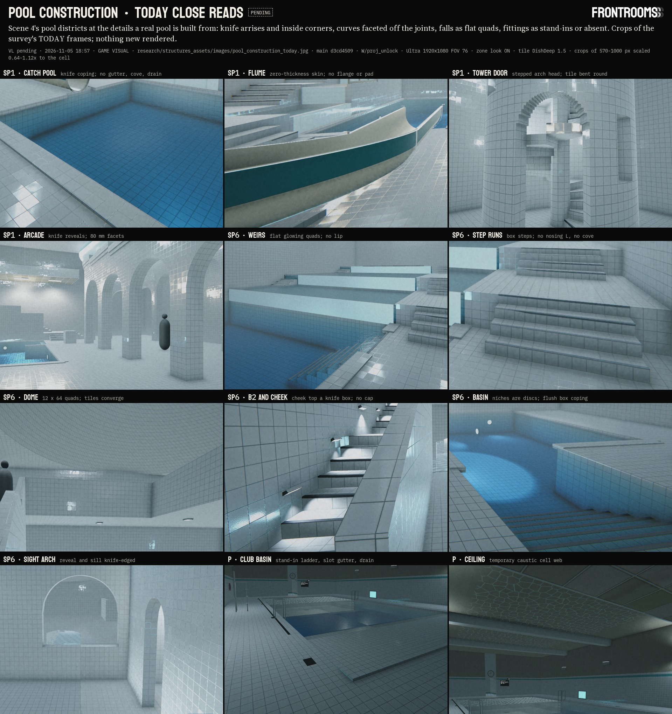
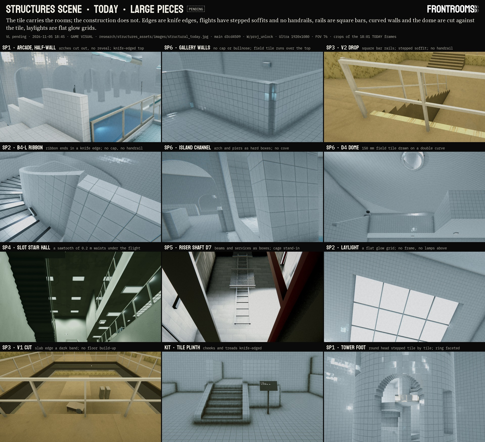
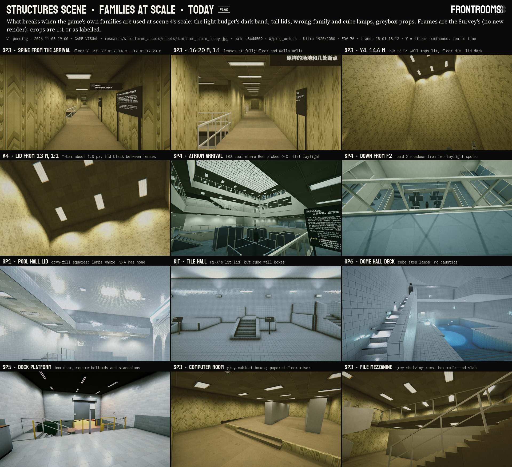

# Structures assets · 20 · Research: how real buildings and AAA games build what scene 4 shows

Line 游戏视觉 (`visual`), workflow `structures_assets` step 1 (Survey, Research x3, Plan; a second workflow builds), account G (switch #21), parent session `local_1fc9f09c`. The three research tracks ran in parallel on 2026-11-05 18:22-19:1x (America/Los_Angeles); the Plan stage merged them here at 19:0x-19:5x, one part per track, with the overlaps settled in section 1. The inventory they start from is `10_survey.md`; the packages, order and costs they lead to are `30_plan.md`; every source row is in `SOURCES.md`.

Red's ask, verbatim (this line's chat, 2026-11-05 17:42:27 and 17:42:55, plain user turns): "我需要你开始对structure scene里面的资产进行全方位的升级和revise，就像是主游戏项目的标准一样" and "升级的逻辑和之前一样，调研现行，再进行revise". The logic as before: the surface_detail precedent (Red 11-04 13:4x: "调研3A游戏是如何通过法线贴图等一系列技巧来提升这些模型信息量并且和光线追踪协作的，来优化每一个房间"; `research/surface_detail/`) and the research-first style (Red 10-31: "…research在那个年代的锁是什么样的…").

**Done:** web pages, patents and talks read as text (Part A: PC1-PC45; Part B: B1-B34; Part C: F01-F28; "[search]" = read through a search summary, not the page itself); main read only (the Structures builders, the pool stand-ins and materials, `FrontRoomsLampKit`, `FrontRoomsMapWorld`'s lamp code, `FrontRoomsSurface.shader`'s vertex inputs, GlassRT's scene build and hit shader, `FrontRoomsKitLibrary`, `kitlib.py`, the water file of scene 4); one measurement on a TODAY frame (Part C, S1); three Shot-format evidence sheets made of crops of the Survey's TODAY frames (`images/pool_construction_today.jpg`, `images/structural_today.jpg`, `sheets/families_scale_today.jpg`, each with a fit file ending ALL LABELS FIT). **Not done:** no Unity run and no NEW render (step 2 builds and renders); nothing written to main, nothing landed; no git; no download asked for; nothing played aloud (rule 24); frame time, the phone tier and WebGL not measured (rule 25). Three PDFs were saved by the fetch tool itself into the session's `tool-results` folder during web reading; none was opened or used and none is in the project (`SOURCES.md`, end).

**Reused, not redone:** `10_survey.md` and `W/structures_assets/survey.tsv` (115 elements); `bathroom_rooms` (TM 5-662, the 1990 pool room, the tile family and its trims, caustics), `level_space` 60-63 and 70 (the districts, their look rules, the slide, the large stairs, the furniture kit specs), `zone_lamps` 10-30 (the period fixtures and Red's lamp picks), `surface_detail` 10 and 20 (D1-D55, K1-K9, the open packages 7 trims and 8 bevels), `tech_art` 11, 12, 21 and 60 (draws, kits, measured light costs, LOD cross-fade, the open rows 5, 6, 8, 10 and 14), `wall_material` 10.

**Ids used in this page and in `30_plan.md`.**
- Parts: **A** pool construction, **B** large structural elements, **C** the level families at scene 4's scale, lamps and props. Sections are A.n, B.n, C.n. Inside Part A, "section n" means A.n; inside Part C a bare "§n" means C.n; a § after a file name is that file's.
- Findings: Part B's F1-F15 (written "B F1" outside Part B); Part C's S1-S8 ("C S1").
- Sources (rows in `SOURCES.md`): PC1-PC45 (Part A), B1-B34 (Part B), F01-F28 (Part C: always two digits, in brackets in the text, so never a finding).
- Reused ids keep their file's prefix: BR (bathroom_rooms; S40 = TM 5-662), LS (level_space), D or SD (surface_detail), C1-C34 (tech_art file 12; not Part C), TA (tech_art), PL / R / Z (zone_lamps sources). Zone_lamps' pool fixtures are written **ZL F1-F10** (ZL F2 the wall up-light, ZL F5 the flush sealed lens, ZL F6 the wet niche, ZL F7 the jelly jar, ZL F9 the restrike lamp).
- Floors carry their district: SP2 F0 is the pool floor, SP2 F3 the Level 0 floor; SP4 F0-F2. Element ids (S1-01, P-02, X-03, ...) are `survey.tsv`'s.

## 0. Short answer (the three parts together)

1. **The surfaces are the game's; the construction is not.** DishDeep 1.5, GZ-C and the game's Level 0, Office and Run! surfaces carry every near view. What reads as a model is everything of 30-300 mm and larger: knife arrises and inside corners, copings that are tile prisms, open flights with a sawtooth of 0.2 m waists and no handrails, square-bar rails, curves with the tile bent round them instead of faceted, laylights drawn as glow grids, cut floors drawn as dark bands, cube lamps, greybox props (A.0 items 1-2; B.0 items 1-3; C.0 item 1; the three TODAY sheets).
2. **Distance decides what can carry information** (B.2). At 1080p and FOV 76 a 3 mm joint spans 0.7 px at 3 m and 0.1 px at 20 m; scene 4's main views look 16-40 m, where only copings, nosings, rails, slab edges, joints on the 3 m cell, fixtures and lamp rows read. The surface scale is solved (surface_detail) and stops near 10 m; the element scale (30-300 mm) and the module scale (1-3 m) are the work now.
3. **Geometry where the reflections look** (A.0 item 9; B.4). The planar water and GlassRT reflect geometry: GlassRT's BLAS are opaque and materials at queue 2450 or above are not traced, so decals and mesh decals never appear in RT glass, and a normal-map bevel changes neither silhouette, shadow nor reflection. Pool edges, coves, nosings, lips, facets, rails and slab sections are therefore geometry; the maps keep the tile's set, dish and gloss (landed); decals only where neither the water nor RT glass sees.
4. **Edges** (B F1, F2, F14; A.3). The builder bevels the exposed convex edges (8 of a box's 12, face-weighted normals; tile 6-10 mm, painted board 2-3 mm, concrete a 19 mm chamfer, steel 2-3 mm, oak caps 3-6 mm) and never rounds an edge that meets another piece (Red's door lesson: "为什么现在门还是悬空的，两处还是有缝隙"); every tiled wall foot gets a cove (r 25 mm in rooms, r 50 mm in basins, inside the period codes' 1-6 in); wet tile gets a soft joint on every 3 m cell line (EJ171: 12 ft or less where wet). The pool tile family already has Cap, Coping, Nosing, Tread and Riser pieces that scene 4 never uses; it needs four more (Bullnose, Cove, Gutter, Weir lip).
5. **Curves** (A.4; B F4, F11). Flat tiles facet: one flat facet per tile column (per course on intrados and vaults, per tile on the dome: about 6,050 tiles, about 12 k triangles), round heads cut on the true circle with a bullnose reveal, the tile size chosen by the tightest radius as setters did (150 mm down to R 1.2 m; 108 / 75 mm to 0.6; 50 mm to 0.3; 25 mm below). Fewer triangles than today except on the dome; the reflections then step tile by tile, as on POOLS' columns.
6. **A pool's edge is a period system** (A.2): fully recessed gutter (deck about 12 in over the water, a handhold), roll-out (deck about 5 in over, a short curb) or deck-level rim-flow (water at the floor, a porcelain grate; TM 5-662 3-4 to 3-6; patents 1975-84). Proposed per district: SP6 rim-flow, SP1 and SP2 roll-out, P the recessed gutter; KIT shows all three side by side.
7. **Stairs, guards and slabs** (B F5-F10). Sloped soffits and stringers instead of waists; handrails both sides at 34-38 in with 12 in extensions (ADA 1991); helicoid soffits, ribbon caps and inside rails on the large spirals; B4-S as a steel spiral kit; guards at 42 in in five real builds (two-line pipe rail in service zones; the late-1980s 6 in sphere in public zones; glass in a shoe under a cap rail, as the 1988 UBC asked; framed 10 ga woven wire; capped half walls); one slab-edge profile per level, so SP2's well reads as four different floors from the pool deck.
8. **Fittings are what say "pool"** (A.5): ladders (1.90 in tube, bronze sockets on 20 in centres, satin escutcheons, rubber bumpers), grab rails, wet niches (face ring about 263 mm, 3 m centres), return inlets 12 in under the water, the main drain in a contrasting frame, gutter drains every 3 m. Scene 4's basins have none.
9. **Falls need the construction that shapes the water** (A.6): square porcelain weir lips with a drip groove (free curtains landing about 0.23 m out after 0.6 m), a clinging film on SP2's cascade, a thin film in the flume; all on a flow variant of the game's water (Valve's flow maps: 2 fetches and about 21 instructions) with one `flash_check.py` turn per fall.
10. **The flume** (A.7) is a kit placed along the riding line: 3 m cells, 45° bends at r 3.0, drops in whole courses, flange rings with 40-60 bolts, the tub, the exit lip and a bearing pad on every tiled saddle, on four gelcoat materials with the period's wear (waxed gloss, chalking, print-through at grazing light, crazing round bolt holes): about 55 k triangles at LOD0 against 161.5 k today.
11. **Lamps** (C S1, S2, C.4). 757 of the districts' 1,019 lights already hang the game's kits. The gaps: (a) the 207 pool cube fixtures: 57 wall boxes become P1-A (`ZL_HIDUP`), 49 down-fills lose their bodies and follow their boxes (P1-A's "抬头看不到任何灯泡"), 36 underwater lamps become P2-A (`ZL_NICHE`), step and weir lamps small niches, dry landings the ZL F5 flush lens, the C9 globe the ZL F7 jelly jar; (b) SP4's and SP2 F2's L03 cool lens where Red picked O-C (the hook exists); (c) SP5's T-B grey boxes (the kits are in main); (d) the light budget's dark band on SP3's spine, measured (floor Y .115 at 19 m against .23-.29 nearer), fixed with no new light by far lamp pools on `FrontRooms/LampGlow`; (e) scene 4's lamps run none of the game's lamp modes, the cheapest variety at scale.
12. **Caustics and thrown light are landed** (`FrontRoomsWaterSubmerged`); in scene 4 they need wiring, not a shader: `Underwater()` registers nothing itself, and the water file registers its cubes as niches only while key I is on (section 1, correction 1).
13. **Props** (C.5): `62` and `63` already specify about 60 of the kits scene 4 needs, with sizes, states and LOD budgets; 8 are new (panels at 1.35 and 2.16 m, a freestanding blade, the caged ladder, clamped riser pipes, the HPS wall pack, the expansion-joint collar, the comb plate), besides Part A's pool kits. Order by what each main view shows: the dock, the computer room, the pit's panels, the file mezzanine and training room, SP5's cage and shaft, the slide start, SP7's ends (after Red's #3).
14. **At scale the sameness is the subject** (C S4, S8; `70` §2: "the banal kit at the wrong scale is the drama"). Each repeat becomes a different instance of the same real thing: a state per instance, never the same as both neighbours; the game's lamp modes; a cause per wall (a dye lot, a roll's butt join on walls taller than one roll); decals only where something happened.
15. **Cost:** every part's figures are estimates; `30_plan.md` section 6 adds them without double counting (the niche, the laylight set and the trims once). Frame time is measured in the combined test (rule 25).

## 1. Where the parts meet (settled here for the plan)

| Topic | Part A says | Part B says | Part C says | Settled |
|---|---|---|---|---|
| Wet niche | `Kit_PoolNiche`: shell rim, face ring, seal, pilot screw, the ring of cut tiles (A.5.4) | - | `ZL_NICHE` (P2-A): face ring Ø 273 mm, lens Ø 208 mm, lamp, 160 / 2222·528·48 / 48 (C.4.2) | one kit, `ZL_NICHE`, with Part A's construction; only the visible parts at LOD0 (about 1.0-1.5 k triangles: the housing behind the tile is never seen); it registers its own light with `RegisterNiche` or keeps the parent name the water file looks for |
| Laylights and light wells | - | grid, frames, panels, cavity (F12) | the diffuser's lamp rows, per-panel age, specks, dead rows from the lamp logic, no shadows (S3, S6, C.4.6) | one kit family and one 2.7 MiB diffuser set, counted once |
| Trims | Bullnose, Cove, Gutter, Weir lip tile pieces (A.3, A.2.3, A.6) | the structures trim sheet: sealant, shoe aluminium, pipe paint, woven-wire cut-out, wall angle and T-bar, pour stop, abrasive nosing, fascia band (B.6 item 4) | the family edge set: carpet bar, fascia cap, steel angle nosing, bullnose block end, curb angle (S5) | the four tile pieces in the pool family; one structures trim sheet carrying B's and C's strips (tech_art row 14 and surface_detail package 7, for scene 4) |
| Profiles | bullnose, cove, cap, nosing L, coping, three gutter sections, weir lip, niche surround | handrail tube, pipe rail, glass shoe, cap rail, channel frame, oak and tile caps, slab edge per level, pour stop, wall angle, T-bar, I-beam, fascia | - | one profile library, Rendering-owned, swept by their builder (`30_plan.md` section 2) |
| Bevels | edges as geometry in the pool (item 9) | the builder's edge option (F1) | edges at drops per family (S5) | F1 is surface_detail's package 8 (`surface_bevels_contract`) built for scene 4 |
| Nosings | the family's Nosing L, Tread and Riser in pool rooms | the same in pool rooms; `Stair_*` with a cast abrasive strip in cores (F5) | - | as Part B; Red's dark nosing and porcelain treads stay |
| Wear | placed decals with a cause; baked curvature and AO masks per steel kit (A.8) | the DBuffer decal path of tech_art row 10, a wear atlas (F15) | decals only where something happened (S8 R-d) | decals wait for row 10 (open); until then wear lives in the kits' own texture sets, which RT glass and the planar water also see |
| Globe lamp | SP6 C9's globe is Part C's | - | ZL F7, shared with SP5's janitor closet (C.4.4) | one jelly-jar kit, also P's fire-stair wall lamp |
| Caustics | the water file already gives each body its two strongest lamps as caustic sources; niches only under key I (A.5.2) | - | `Underwater()` registers nothing (C.4.2 item 5) | both are right: see correction 1 |

**Corrections to the Survey** (`10_survey.md`):
1. Scene 4's water file (水体仿真调研's `FrontRoomsStructuresWater.cs`, main `46373a89`) registers the lights under every "Lamp · underwater" parent as wet niches while key I is on (`:125`, `:491-508`; key I is off by default) and gives each water body its two strongest lamps as floor caustic sources (`:857`). So the Survey's "no caustics (SP districts)" holds for the default state only; under key I the cubes already throw light and caustics. `Underwater()` (`Kit.cs:1281`) itself registers nothing.
2. The Survey's triangle totals sum every LOD level of every kit (an LODGroup's three renderers are each in the inventory, e.g. L03's housing 396 + 216 + 44). Counted at LOD0 only (this stage, same inventories): 4.31 M in the scene, 1.19 M without P (6.04 M and 1.61 M with every level). Per district in `30_plan.md` section 6.

## Part A · Pool construction (track 1 of 3; sources PC1-PC45)

Written by the Research stage "pool construction", 18:23-19:0x. Inside this part, "section n" means A.n.

**Done here:** web pages and patents read as text (ids PC1-PC45, rows in `SOURCES.md`; "[search]" means read through a search summary, not the page itself); main read only (`Structures/FrontRoomsStructuresKit.cs`, `FrontRoomsStructuresPoolTerrain.cs`, `FrontRoomsStructuresSlide.cs` call sites, `FrontRoomsPoolStandIns.cs`, the pool tile maps' PNG headers, and 水体仿真调研's `FrontRoomsStructuresWater.cs` for how scene 4's water finds niches and caustic lamps); 7 TODAY frames of the survey looked at 1:1 and 12 crops of them set in one Shot-format sheet (section 14; no new render, no Unity run). **Not done:** nothing written to main, no Unity, no git, nothing played aloud, no download asked for. One honest note: two WebFetch reads of PDF links (a gutter brochure, 1.1 MB; a SIGGRAPH slide deck, 6.3 MB) were saved by the fetch tool itself into this session's `tool-results` folder; they were not opened or used and are not in the project (`SOURCES.md`, end).

**Reused, not redone** (cited with these prefixes):
- BR = `bathroom_rooms/SOURCES.md` (S40 TM 5-662, 1986; S41 1960 pool catalogue; S43 1965 tile book; S45, S46, S49; T1-T9 of `70` §4.1) and `bathroom_rooms/10_research.md` §2 (the 1990 pool room in numbers: depth marks, gutter drains on 10 ft centres = one per 3 m cell, ladders 1.9 in OD stainless, 300 W wet niches, main drain, lockers, guard chair); `70_look_build.md` §4 (the tile family Field, Course, Cap, Coping, Deck, Lane, Mosaic, Nosing, Riser, Tread and their mesh-UV layouts) and §7.4-7.5 (caustics projected from the ripple surface, the thrown light per niche, `FrontRoomsWaterSubmerged.RegisterNiche`; landed 11-04).
- LS = `level_space/SOURCES.md` (LS70-LS79 the slide; LS135 Swindon's leisure-pool beach), `61_slides.md` §1-2 (dimensions, joints, supports, styles), `63_furniture_run_pool.md` §2.4, §4.5, §5.2, §6.2 (deck and slide kits), `70_structures_districts.md` §2-4, §8 (the districts and look rules).
- ZL = `zone_lamps/10_pool.md` (F2 = P1-A, F6 the wet niche: PL02, PL07-PL10; F7 the globe).
- SD = `surface_detail/SOURCES.md` (D1-D55), `10_aaa_techniques.md`, `20_design.md` (P1-P10, K1-K9, packages 7 trims and 8 bevels).
- TA = `tech_art/11_draws_culling_lod.md` (draw costs).

**Boundaries with Parts B and C** (same stage, in parallel): Part B (large structural elements) takes stairs and spirals as structure, guards, glass shoes, slab edges, raised floors, laylights and the general AAA bevel / trim / edge-decal practice; Part C (families at scale, lamps and props) takes the lamps as fixtures (P1-A, P2-A's optics, O-C, the globe, the dock, work lamps) and props at scale. This part takes what a pool is built of: the basin edge, the tile's special shapes, tile on curves, the fittings in and at the water, the water features, the flume, the hall's ageing, and the P-02 kinds that are construction (drains, ladder, depth marks, glass block, slide tube, oculus). Where a piece belongs to two parts (a step's nosing, a niche), this page gives the pool side and names the other.

### A.0 Short answer

1. **A real pool is made of special shapes; scene 4's pools are made of field tile on boxes.** Every edge a 1960-1993 pool has is a named piece: bullnose on outside corners and caps; sanitary cove on every inside corner and on the basin's wall-floor joint (later codes ask r at least 1/2-1 in and at most 6 in where shallow, PC10-PC12); the step's nosing and tread (dark tile on the front 3/4-2 in of the tread and the top 2 in of the riser where codes ask it, PC14: the same L Red picked on 10-31); the coping (bullnose, r 15 mm on tile, 1 1/2 in on precast, PC15-PC16); the gutter lip with its handhold; the rim-flow grate ("tile with drain openings", TM 5-662 3-5, BR:S40); the depth-mark inlay; the main drain "marked plainly in an appropriate contrasting color" (S40 2-5). Scene 4 builds all of them from `Box`, `Prism` and `Slab` faces in `Prop_PoolTile_FieldMesh` plus a runtime Lit nosing: knife arrises, knife inside corners, a 0.32 m tile prism for a coping (`Kit.cs:1126`). The tile family in main already has Cap, Coping, Nosing, Tread and Riser materials with mesh-UV trim maps (`70` §4.3-4.4); scene 4 uses none of them (only `FieldMesh` and `CourseMesh` appear in the survey's ten material dumps). **Upgrade:** a pool edge kit of 2-D profiles (bullnose, cove, cap, nosing L, coping, three gutter sections, weir lip, niche surround) that the builder sweeps along the edges it already knows (`Basin`, `Coping`, `Flight`, `StepRun`, `Spiral`, `WallRun` ends, `RoundHead`), on the family's trims plus four new trim sets. About 0.5-2 k triangles per room.
2. **On curves, flat tiles facet, and the facet edges are the joints.** A flat tile of width w on radius R stands off the curve by w²/8R and turns by w/R: 150 mm tile stands off 2.3 mm on R 1.2 and 9.4 mm on R 0.3 (section 4). Setters choose the tile by the smallest radius (a 99 in dome takes 4 in squares, PC17) and go to mosaic on tight curves (PC17-PC18). Scene 4 instead bends the tile texture round smooth or arbitrarily faceted curves: the shaft at 1.5° (0.31 tile per facet), the newel at 30°, piers and drums at 15°, arches at 80 mm, the dome in 12 x 64 quads with converging UVs; a round opening in a curved wall comes out stair-stepped (TODAY `SP1_s04`). **Upgrade, nearly free:** one flat facet per tile column (per course on intrados and vaults, per tile on the dome: about 6,050 tiles, 12 k triangles), the tile's UV cell on each facet, 150 mm where R is at least 1.2 m, 108 mm or half-courses to R 0.6, 2 in (50 mm) to R 0.3, 1 in below, and openings cut true. That is the physical form of POOLS' "light breaks tile by tile" on its columns (SD:D28).
3. **The edge system is a period choice per district.** Fully recessed gutter (deck about 12 in over the water, cantilevered over the trough; competition pools; hard to climb out), roll-out (deck about 5 in over, a curb behind the grate), deck-level / rim-flow (lip about 1 in over the deck; water to the floor; the cheapest) (PC2; TM 5-662 3-4 to 3-6); stainless gutters from at least 1960-69 (Ogden, Whitten), factory sections of about 8 ft with a semicircular handgrip and perforated covers by 1978 (PC5-PC6); PVC/ABS gutter grills with an antiskid top and a nose handgrip by 1975 (PC3). **Recommendation:** the pool level's deck-level basins (SP6) as tiled rim-flow with a porcelain finger grate (TM 5-662's "tile with drain openings"; water brimming at the floor, no lip to hold: the canon's calm full water); the catch pools and SP2's basin, whose water sits 50 mm under the deck, as roll-out (lip at the water, a short curb up to the deck; riders climb out); the club (P) as a tiled recessed gutter with a handhold (the period commercial pool).
4. **Fittings are small and they are what says "pool".** Ladders (1.90 in OD tube, 0.065 in wall, 304 or 316, frames 5.5-6.5 in off the wall, bronze sockets on 20 in centres under satin-chrome escutcheons, white rubber bumpers, stainless treads; PC20-PC21 and BR:S41), grab rails over recessed steps, wet niches (face ring about 263 mm, lens about 230 mm, lens top at least 457 mm under the water, on 3 m centres; ZL F6) with their ring of cut tile, return inlets 12 in under the water (S40 fig 3-3), the main drain at the deepest point in a contrasting frame, gutter drains every 10 ft, deck drains. Scene 4 has none of them (SP1, SP2, SP6, KIT); the map's route P has stand-in ladder bars and dark squares. Each is a small kit (0.1-2.5 k triangles at LOD0) on existing steel and tile materials.
5. **Water features need the construction that shapes the water.** A 6 mm sheet over a square, level edge needs about 7-10 gpm per foot; too little flow wraps under the edge and clings (a wet wall); a rounded crest needs at least 25 mm of water; a 6 mm sheet over 1 m lands about 0.3 m out (PC24); with no air under it the nappe clings to the face (PC25); a slot whose upper lip overhangs the lower throws a sheet that "appears to emerge directly from the tile" (PC26). So SP6's three 0.6 m weirs and SP1's terrace weirs want a square porcelain lip with a drip groove (free, glassy curtains landing about 0.23 m out with a foam line), and SP2's 9 m cascade a clinging film down the tile (rivulets, a bright line at each horizontal joint, a splash trough at the foot). Today all are flat transparent quads. AAA: flow-mapped sheets (Valve: 2 fetches and about 21 pixel instructions, PC29), foam at the impact, the wet face behind (ours: `FRWetBand`).
6. **The flume.** Its construction is on disk (LS70-LS79: 6-10 mm laminate behind a gelcoat, flanged joints with up to 60 stainless bolts and a flush sealant line, steps only downstream). New here is the wear: monthly paste wax keeps the gloss, neglect chalks and dulls it and lets chlorine and calcium residue into the porous gelcoat (PC30); inspection lists crazing, blistering, bare fibreglass and oxidation (PC31); cure shrinkage prints the glass reinforcement through the gelcoat (PC32); crazing gathers where fittings and laminate move differently (PC33). Today the flume is 161,524 of SP1's 169,718 triangles, a two-sided zero-thickness sweep in 7 runtime materials. **Upgrade:** a section kit (cell, 45° bend r 3.0, drop variants, transition, flange ring with bolts, tub and lip, a bearing pad on each tiled saddle) placed along the riding line with LOD0/1/2 (about 55 k triangles at LOD0, fewer than today), one gelcoat material on `FrontRooms/Surface` carrying that wear, SL-A as a milky translucent variant.
7. **The hall's air writes on its metal and tile.** An indoor pool is among the most aggressive building atmospheres: chloramines tea-stain 304 stainless brown, worst in crevices and unwashed places, and 316 is the recommended grade (PC35-PC36); the Uster pool ceiling fell on 9 May 1985, killing 12, through chloride stress corrosion cracking of stainless rods (PC34). The visible result, each with a cause: satin stainless with brown at welds, escutcheons and bolt heads; white scale where splash dries; rust bleed only under carbon-steel screws; efflorescence and scale on grout below copings and at the waterline (BR:T9). The canon's level is pristine, so the SP districts get the light end (crevices, the waterline line), the club (P) the full set.
8. **AAA pool sets are rare; the techniques are not.** Used: POOLS (Unity, baked GI, no RT; SD:D25-D29) for the tile and its light; Bethesda's kits (footprints in multiples, glue pieces, few hero pieces; PC27), Insomniac's trims (SD:D14), id's decals (SD:D13) and mesh edge decals (PC28), face-weighted bevels (SD:D24), POM only at the hero (SD:D10), Valve's flow maps (PC29), NVIDIA's ray-traced caustics (PC38), Remedy's hybrid RT reflections and contact shadows in Control (PC37), Frostbite-style wet surfaces (our `FRWetBand`), interior mapping for thick glass (PC39-PC40). **Searched and not found:** a documented pool set in Half-Life: Alyx, Control or Alan Wake 2 (PC45); none is cited as one. The genre's community kits (UE5 Poolrooms packs: modular walls, edges, stairs, waters, tunnels; Lumen) confirm the kit split, nothing more (PC41-PC42).
9. **Why the edges must be geometry.** Ray-traced and planar reflections and traced shadows see geometry, not normal maps (SD §10, SD:D19): the pool's arrises, coves, nosings, lips and facets are exactly what the planar water and GlassRT mirror at full size. The tile's set, dish and gloss stay in the maps (landed); the shapes go into the mesh.
10. **Pipeline:** has the tile family and its trims (unused in scene 4), DishDeep 1.5 and GZ-C, the wet band and meniscus, the W-D water with rings and water light, projected caustics and the per-niche thrown light (scene 4's water, 水体仿真调研's `FrontRoomsStructuresWater.cs`, already gives each body the two lamps that light it most as caustic sources, :463 and :857, and registers the `Underwater()` stand-ins as niches by their parent's name "Lamp · underwater" while key I is on, :125 and :493-508, off by default), box probes, GlassRT, kitlib bevels, KitImporter LOD cross-fade. Needs: the edge kit and four trims, per-tile faceting in `Ring` / `RoundHead` / `BuildDome` (a builder change in their files), about nine fitting kits, the flume kit and gelcoat, a flow material for falls and films, a niche kit that the water still finds (same name, or registering itself), and compact caustic sources that are real fixtures rather than the halls' broad lamps.
11. **Cost, the pool districts together (ESTIMATE, desktop; section 13):** +75-120 k triangles of edges, facets, fittings and falls in SP1, SP2, SP6 and KIT (5-7 % of today's 1.61 M without P), while the flume kit saves about 105 k (161.5 k today, about 55 k at LOD0): about even overall; P +25-45 k on its 4.43 M; +20-25 MiB of maps (trims 9, gelcoat 9, fittings 3, flow 1); +10-25 renderers per district with small fittings merged per material per room (+60-80 unmerged); GPU: shading paths unchanged except the falls' transparent layer (+0.05-0.5 ms where a fall fills the view) and the niches' thrown light and caustics (70 §7.7 measured +0.15-0.35 ms of caustics in a hall; more niches per body cost more, unmeasured). Phone, when a structure enters the game: LOD1 kits, the half-size `_Phone` twins, edges kept (cheap), falls as two scrolled layers. WebGL: unchanged until the WebGL line asks (RULES rule 5).

### A.1 How this was done

- From disk first (the reuse list); then only what those pages leave open: the edge systems, the special shapes and the rules behind them, tile on curves, ladder and rail hardware, weirs and falls, FRP wear, pool-hall corrosion, glass block; then AAA and community practice for each. Patents on Google Patents (dates, quotes); trade sites through their pages or through search summaries (marked). Modern codes are LATER: used only for proportions where the period sources are silent, as `bathroom_rooms/10` §2 did.
- Code facts from main `d3cd4509`: `FrontRoomsStructuresKit.cs` (`RoundHead` :308, `Ring` :389, `TileFit` :462, `Flight` :663, `Spiral` :866, `Guard` :988, `Basin` :1113, `Coping` :1126, `WallBox` :1253, `Underwater` :1281), `FrontRoomsStructuresPoolTerrain.cs` (`BuildDome` :569, drums :310-313, apse :237, B4-M :539), `FrontRoomsStructuresSlide.cs` (shaft :336, newel :338, piers :475-481), `FrontRoomsStructuresWell.cs` (B4-L :172), `FrontRoomsPoolStandIns.cs` (:189-389).
- TODAY evidence: the survey's frames (`W/structures_assets/renders/today/`), cropped in section 14.

### A.2 The basin edge: gutters, rim-flow, coping

#### A.2.1 How real pools did it (1960-1993)

| System | Form | Numbers | Evidence |
|---|---|---|---|
| Fully recessed overflow gutter | a trough round the inside walls under a cantilevered deck; the gutter is the handhold in a public pool | deck about 12 in (0.30 m) over the water; drains on 10 ft centres; Nevada (rule last amended 1988): at least 3 in deep under the lip, the overflow edge rounded and no thicker than 2 1/2 in for its top 2 in, the water about 1 in under the lip in use | PC2; TM 5-662 3-4, fig 3-2 (BR:S40); PC1 [search] |
| Roll-out | the lip and grate at the water, the deck rising behind as a curb | deck about 5 in (0.13 m) over the water; easy to climb out; no end-wall reference for racers | PC2; TM 5-662 3-4 ("open at the top of the wall (roll-out type)") |
| Deck-level / rim-flow | a grated trench in the deck beside the wall; the deck and the pool edge slope to it | lip about 1 in over the deck; the cheapest; water runs across the grate | PC2; TM 5-662 3-5: "covered with metal grating or tile with drain openings", no troughs |
| Skimmer | slots in the wall with floating weirs | every 15-25 ft; about 6 in from the water to the deck | TM 5-662 3-6 |
| Gutter materials | concrete cast with the wall (tiled) first; then prefabricated steel or plastic | "gutters have been prefabricated from other materials such as steel or plastics" (filed 1980) | PC4 |
| Stainless gutters | field-welded sections (Ogden US 2,932,397; Whitten US 3,432,867), then factory sections | sections about 8 ft long, a semicircular handgrip with a small lip, perforated polyethylene or stainless cover plates on self-tapping screws (filed 1976); "larger commercial pools are often fabricated from stainless steel sheet metal sections" (filed 1981) | PC5, PC6 |
| Gutter grills | removable modular grills of L-section bars | an inner slotted wall that "tends to slice the wave forms", an antiskid top, a nose handgrip; PVC or ABS preferred so the grill needs no NEC grounding (filed 1974) | PC3 |
| All-ceramic overflow edges (Europe) | a glazed gutter stone with a handhold under a ceramic finger grating on plug-in connections | free section 245 cm² per metre for the standard hole pattern; RAKO's Wiesbaden channel piece 225 x 195 x 160 mm; systems also named Finland, Zürich, Berlin | PC7, PC8 (modern listings of old systems) |
| Coping on lip-less edges | a bullnose coping over the wall's top; a raised nose doubles as a handgrip | precast bullnose 12 x 22 in with a 1 1/2 in radius (modern listing); the cantilevered coping with a raised nose "has long been available" in precast; on tile, the family's coping: 30 mm thick, nose r 15 mm, 20 mm over the wall | PC15, PC16; `70` §4.1 |

The gutter drains on 10 ft centres land on the 3 m cell within 2 % (BR §2.1): one drain per cell along every gutter, with no special case.

#### A.2.2 How games build it

- POOLS' basins have edges with thickness and a lip in the same tile as the walls; no metal gutter is seen in its 13 store frames (judgement, SD §11, SD:D28).
- The edge is a swept profile and a kit of its own: the genre's UE5 packs sell "edges" beside walls, stairs, waters and tunnels (PC41); Bethesda's rule that pieces share footprints in multiples and that "glue" pieces join kits (PC27) is our 3 m cell and 0.15 m course: an edge section 3 m long, a corner, an end where the edge meets a wall, a step-down piece.
- Gratings: bars in geometry where the eye is close (they catch light and drop shadow into the trough), an alpha-tested strip or POM beyond (SD:D10).

#### A.2.3 What it means for scene 4

| Where | Today | Proposed edge (keeps every level of `70`) |
|---|---|---|
| SP1 catch pool (S1-08; 0.9 m, water 50 mm under the deck, steps out on the south side) | `Basin` boxes and five `Coping` prisms (0.32 x 0.11 m) | roll-out: a tiled lip at -0.04, a porcelain grate 0.20 m wide behind it, the 50 mm curb up to the deck in Coping trim, cove at the floor; gutter drain every 3 m |
| SP2 F0 basin (S2-01; 1.07 m, 50 mm under the deck) | the same | roll-out as SP1 |
| SP6 deck-level basins (the basin under W3: surface 30 mm under T3, "deck-level, no guard"; C1 in the dome hall; the channel's edges at the deck) | coping prisms flush with the deck | rim-flow: the porcelain finger grate flush with the deck, the lip 10-20 mm under it, the water at the lip; the deck tile sloping to it (1/4 in per ft, BR §2.2 row 2) |
| SP6 floor water (C2 sheet flood, C3 beach, the Casbah's flooded floor) | floor tile under water | no edge, by design ("no coping, no rail, no edge to hold", `70` §8); the wet band and meniscus at the walls (landed) |
| P club basin (P-01) | the map's pool pass: deck slab, a dark slot | tiled recessed gutter with the rounded handhold (the period commercial pool), drains every 3 m |
| KIT tile hall (K-02) | `Plate` edges | one bay per system on the plinths, so Red can compare them side by side |

Pipeline: three 2-D gutter sections (roll-out, rim-flow, recessed) swept by the builder along `Basin` and `Coping` lines; a mitred corner piece and an end piece; a grate mesh or strip; the gutter trough's own dark water film behind the lip; the lip's wet band from the water height (`FrontRoomsPoolTile.ForWater`). New trim set **Gutter** (D, N, S at 2048 x 512, mesh UV: U along the edge in metres from the world datum so its joints meet the wall's, V across the section; `_FR_MESH_UV _FR_TILE` like Coping). Cost: about 24 triangles per straight 3 m section plus about 100 per corner; a porcelain finger grate 0.2 m wide with 25 mm bars and 8 mm slots is about 30 bars per metre: about 200 triangles per metre at LOD0 (top and two sides of each bar), 2 per metre at LOD1 (alpha-tested strip over a dark trough); maps +4.2 MiB desktop for the trim, +1 MiB for the grate (BC7 with mips, 1 byte a texel), a quarter on the phone twin.

#### A.2.4 Coping and caps where there is no gutter

- `Coping()` today is a tile prism 0.32 m wide and 0.11 m tall with knife arrises. On a pool edge it becomes the family's bullnose coping (mesh, mitred corners; the harness built 45 m of it in 114 triangles, `70` §4.5), on wall tops and parapets the family's **Cap** (a bullnose cap course; `70` §4.4 uses it on the hall wainscot).
- SP1's support A copings (0.9 x 0.30 on a 0.15 corbel course, `70` §3) are wall copings: Cap faces with bullnose arrises, the corbel course a projecting tile course with a bullnose under its nose; the tiled saddle under the trough a cap course with a cove into the trough's bearing pad (section 7).
- Parapets 1.07 m (SP2 gallery, SP6 island, bridge, Casbah, the start room's cheeks and slot walls): double-bullnose Cap on top, bullnose on the ends.

### A.3 The tile's special shapes: bullnose, cove, nosing, caps, inlays

#### A.3.1 How real pools did it

- **Bullnose:** a tile with one or two rounded edges in the field tile's size and thickness (3 x 6, 4 x 4, 6 x 6 in; PC9 [search]); half-round bullnose for step nosings (PC9); "bullnose safety edge tile" 2 1/4 x 6 in for pool steps and edges (PC14 [search]); bullnose and cove in the 1965 standard series (BR:S43, `70` T1).
- **Cove:** sanitary cove base, round-top where it meets a painted wall, flat-top under more tile, 4 x 4 / 4 x 6 / 6 x 6 in (PC9). In the basin every wall-floor and wall-wall junction is coved: Illinois r at least 1 in and at most 6 in where 42 in deep or less (PC10); Michigan at least 1/2 in (PC11); Washington's maxima grow with depth, 10 in at 3 ft, 12 in at 3 ft 6 in, 18 in at 5 ft (PC12). LATER codes: they fix the proportion, not the 1990 date.
- **Step nosing:** ceramic nosing tile units go back to 1920s patents (US 1,716,224; US 1,497,163 "safety stair tread", PC13 [search]); public-pool rules ask the step edge outlined in contrasting tile visible from the deck (Arizona, 1998, PC14); Florida's rule as quoted: the front 3/4-2 in of the tread and the top 2 in of the riser in dark tile (PC14 [search]). Red's pick (10-31 17:24; `70` §2): a dark nosing 50 mm on the tread and 25 mm down the riser, porcelain treads and risers, no teal band: the same shape, and it is already the family's Nosing L (flat 42 mm + r 8 mm + flat 17 mm, three ribs on the tread leg; `70` §4.1).
- **Depth marks:** numerals at least 4 in high, contrasting, on the wall at or above the water and on the deck edge, at most 25 ft apart, at the maximum and minimum depths, the break points and every foot (S40 2-5); tile makers sold special shapes for depth markers (S43). **Main drain** "marked plainly in an appropriate contrasting color" (S40 2-5). **Lane lines and targets:** dark lines with T-ends and end-wall targets (BR §2.2 row 1; the family's Lane).

#### A.3.2 How games build it

- Geometry bevels with face-weighted normals where the silhouette or the highlight line matters (SD:D24, SD §9); trims with the bevel in the normal where only the face's shading matters (SD:D14); mesh edge decals laid over unbevelled geometry (PC28: Blender add-ons that generate edge decals from a bevel's settings; UE packs for modular interiors, 90° edges only).
- POOLS' corners, copings and step edges read as rounded tile at play distance (judgement on SD:D28's frames).
- For us the choice is fixed by section 0 item 9: the pool's edges are seen in the planar water and in GlassRT, which reflect geometry, so the pool edges are geometry; decals and normal-map bevels are for the club's minor edges and for LOD1/2.

#### A.3.3 What it means for scene 4

| Shape | Where in scene 4 (examples) | Profile (proposal) | Material |
|---|---|---|---|
| Bullnose, outside arris | piers 0.6 x 0.6 (SP1 support A, SP6 arcade), wall ends, arch reveals (both edges of every intrados), the shaft's door and slot windows, cheek walls, the Casbah's blocks, the grotto's mouth, the E6 niche | r 8 mm (within `20` P6's 6-10 mm), 4 segments | Field / FieldMesh with mesh UV (new **Bullnose** trim strip 2048 x 128) |
| Cap (double bullnose) | every 1.07 m tiled guard and parapet, the start room's cheeks and slot walls, spine-wall copings | top course with r 8 mm both sides | Cap (exists) |
| Cove base | every room's wall-floor joint (SP1 hall, SP6 corridor and halls, SP2 F0, KIT) | round-top cove 100 mm high, r 25 mm | new **Cove** trim (2048 x 256) |
| Pool cove | every basin's wall-floor and wall-wall joint (catch pools, C1, C4, C8, C9, W3 basin, the Casbah floor) | r 50 mm (2 in: inside the codes' 1-6 in band) | Cove, Mosaic under the water where the basin floor is mosaic |
| Nosing L + tread + riser | every `Flight`, `StepRun`, `CoreB3` and `Spiral` in the pool districts (about 150 steps in SP1, 200 in SP6, 60 in SP2 F0) | the family's L (flat 42 + r 8 + flat 17 mm), its ribs | Nosing, Tread, Riser (exist; scene 4 draws a runtime Lit "nosing" instead) |
| Depth inlay | basin walls at the water and the deck edge (where marks belong) | a framed inlay of dark tile, numerals only when 叙事设计 supplies them (era lock; `70` §2: every sign inside the fiction stays blank) | Course or Lane |
| Main drain frame | the deepest point of each basin | a contrasting tile frame round the grate (S40 2-5) | Lane |

Pipeline: a small profile library in the builder (2-D sections in metres, swept along edges the builder knows); the trims on `_FR_MESH_UV _FR_TILE` so the tile's per-tile hash, joints and dish carry round the edge; U from the same world datum as the field (`70` §4.3: rows on 150 mm from world 0) so a bullnose's joints line up with the wall's; K7 edge highlight stays for the joints themselves. Cost: a straight edge run adds 8 triangles (bullnose at 4 segments; a cove at 6 segments 12), a curved edge 2-3 per tile course; per room 200-600 triangles as `20` P6 estimated; maps +1.0 MiB (Bullnose) and +2.1 MiB (Cove) desktop.

### A.4 Tile on curves: arches, the shaft, piers, drums, ribbons, the apse, the vault, the dome

#### A.4.1 How real tile meets a curve

- **A tile is flat.** On a curve of radius R a tile of width w stands off the curve by its sagitta s = w²/8R and turns by w/R radians against its neighbour; a tile of thickness t touching its neighbour at the back opens the joint at its face by about t·w/R on a convex curve. The surface is a polygon of small mirrors, one per tile, and the joints are its edges.
- **Setters choose the tile by the tightest radius:** a dome of about 99 in radius takes 4 in squares (Monolithic Dome Institute, PC17 [search]); smaller units follow tighter curves (in masonry, halving the unit's length halves the minimum radius, PC18 [search]); tight curves go to mosaic (PC17-PC18).
- **Arches and vaults are laid in courses** that run along the curve (Guastavino's tile vaults: thin tiles in several bonded courses, built from the edges inward, PC19 [search]; `70` §2 already asks joints that "run on from wall to wall and round arch intrados"). **Domes** are laid in rings, the tile count dropping toward the crown, a cut closure tile in each ring, every tile flat.
- **The read:** under a lamp each tile column of a curved wall shows its own patch of reflection, stepping from column to column; on a dome each tile its own. That is what POOLS' columns show at 0.5-1 m (SD:D28 frames `919d1f55`, `b1d6a882`: per-tile patches, wobbling joints) and what a smooth curve with a bent tile texture cannot show.

#### A.4.2 The numbers for scene 4's curves

Tile 8 mm thick; "today" is the builder's facet step (code lines in section 1).

| Curve | R (m) | 150 mm: stand-off, turn, joint opening | Real choice | Today |
|---|---|---|---|---|
| SP1 shaft, outside (75 tiles round) | 1.80 | 1.6 mm, 4.8°, +0.7 mm | 150 mm, one facet per column | 1.5° facets (0.31 tile each): the tile bent round a smooth cylinder |
| SP1 shaft, inside (63 round) | 1.50 | 1.9 mm, 5.7°, +0.8 mm | 150 mm | 1.5° |
| SP1/SP6 arches of span 2.4 | 1.20 | 2.3 mm, 7.2°, +1.0 mm | 150 mm courses | 80 mm facets |
| SP1 bend-bay arches 1.70 | 0.85 | 3.3 mm, 10.1°, +1.4 mm | 108 mm (4 1/4 in) or half courses | 80 mm |
| SP6 B4-M inner ribbon | 0.80 | 3.5 mm, 10.7°, +1.5 mm | 108 mm or 2 in | 6° sectors (0.56 tile each) |
| SP6 corridor arch 1.5 | 0.75 | 3.8 mm, 11.5°, +1.6 mm | 2 in or 108 mm | 80 mm |
| Arches 1.2 (tower door, sight arches, C9), SP6 oculus shaft | 0.60 | 4.7 mm, 14.3°, +2.0 mm | 2 in (0.5 mm, 4.8°) | 80 mm; the oculus shaft 15°; the tower door stair-stepped |
| SP1 pier corbel and coping rings; SP6 stepping drums (Ø 0.9 in the code, :310; `70` §8 says 0.6) | 0.45 | 6.3 mm, 19.1°, +2.7 mm | 2 in (0.7 mm, 6.4°) | 15° (0.79 tile each) |
| SP1 round piers at the bends | 0.30 | 9.4 mm, 28.6°, +4.0 mm | 1 in mosaic (0.3 mm, 4.8°) or 2 in | 15° |
| SP1 tower newel | 0.25 | 11.3 mm, 34.4°, +4.8 mm | 1 in mosaic | 30° (12-sided) |
| SP2 B4-L ribbons | 2.95 / 4.40 | 1.0 / 0.6 mm, 2.9° / 2.0° | 150 mm | 6° (2.1 / 3.1 tiles each) |
| SP6 apse | 3.00 | 0.9 mm, 2.9° | 150 mm | 6° (2.1 tiles each) |
| SP6 grotto vault (span 3.0, rise 0.30) | 3.90 | 0.7 mm, 2.2° | 150 mm courses along the vault | (vault builder) |
| SP6 saucer dome (sphere, both ways) | 8.70 | 0.3 mm, 1.0° each way | 150 mm in 45 rings, about 6,050 tiles | 12 rings x 64 quads (facets 0.5 x 0.59 m), UVs t·r so the columns converge |

Rule proposed for the builder: **150 mm where R is at least 1.2 m; 108 mm or half courses (75 mm) from 0.6 to 1.2 m; 2 in (50 mm) from 0.3 to 0.6 m; 1 in below 0.3 m**, always one flat facet per tile column (singly curved) or per tile (the dome), facet edges on the joints, the tile's UV cell exactly on its facet (so `_FR_TILE`'s per-tile hash, set and dish fall per facet). The stand-off of a small tile is then under 1 mm everywhere and the turns 2-6°: the reflections step tile by tile as on a real curved wall.

#### A.4.3 How games build it

Game curves are usually a tiling texture on smooth geometry: cheap, and the reflection slides smoothly across bent tiles, which reads as CG. The documented reference for the right read is POOLS (SD:D28); the high-end stills Red named ("和dream pool更相似的瓷白", 10-31 17:19) are made in 3D software from white tile and warm light against unlit corners; their maker calls the water the hardest part (PC43). No engine technique is needed: the facets are geometry, and they cost fewer triangles than today on the shaft (75 + 63 facets against 240 segments) and about +10.5 k on the dome.

#### A.4.4 Pipeline and cost

- Builder (their files; a staged diff): `Ring` takes the facet count from `TileFit`'s whole-tile count (plus a tile size by radius), `RoundHead` facets per course (75-150 mm by radius) with its UV cells, `BuildDome` builds rings of whole tiles (count per ring = round(2πr / 0.15)), the round opening in a ring wall is cut as the true intersection of the opening's cylinder with the wall (no per-segment steps) with a bullnose reveal (section 3).
- Tile at 2 in and 1 in: the Field set at a UV scale of x3 / x6 gives a glazed 50 / 25 mm tile with joints scaled to 1 / 0.5 mm (real mosaic joints are 1.5-2 mm: a small `_TileGrid` joint-width knob, or the Mosaic set's joint for the 1 in case); no new maps. The 1 in unglazed Mosaic (exists) stays for basin floors.
- Cost: dome +10.5 k triangles; arches -0 to +2 k each district (per-course facets replace 80 mm facets); shaft, ribbons, apse fewer than today; piers, drums, newel +0.1-0.3 k each. Maps 0. GPU 0.

### A.5 Fittings in and at the water

#### A.5.1 How real pools did it

| Fitting | 1960-1993 form and numbers | Evidence |
|---|---|---|
| Ladder | stainless tube 1.90 in (48.3 mm) OD, wall 0.065 in (1.65 mm), heavy 0.109 in; 304, or 316L for salt water; frames 5 1/2-6 1/2 in (140-165 mm) off the wall; two anchor sockets per side on 20 in (508 mm) centres; 4-6 in bends; white rubber bumpers against the wall; stainless (or plastic) treads, 2-4 of them; 3/8 x 4 in bolts | PC20 [search], modern catalogues of the same form as BR:S41 (1960: stainless, 1.9 in OD, F-109, F-110); Army pools also used painted steel (S40 15-13) |
| Anchors and escutcheons | cast bronze sockets set in the deck with a bronze wedge and a 1/4-20 bonding screw; a cast bronze, satin-chrome escutcheon over each | PC21 [search] |
| Grab rails, recessed steps | the same tube as deck-anchored rails over steps recessed into the wall; with a recessed gutter most bathers leave by ladder | PC2; PC21 |
| Wet niche (P2-A's housing) | a forming shell in the wall; a sealed lamp unit, heavy glass lens in an elastomer seal, stainless face ring held by a pilot screw at the top; a coiled cord so the lamp lifts to the deck; PAR56 300-500 W incandescent (lamp 178 mm); face ring about 263 mm (a 1985 unit), lens about 230 mm; lens top at least 457 mm under the water; 3 m centres; dry niche behind a port, changed from a tunnel; a small niche for spas 6.5 in | ZL F6 (PL02, PL07-PL10); PC23 [search] |
| Niche ageing | scale crust at the lens edge, iron stains from screws, an algae line, a fogged lamp, a cracked lens; one GFCI branch per side, so a side goes dark together | ZL F6 |
| Return inlets | fittings 12 in under the water line, adjustable for volume, velocity and direction | S40 fig 3-3, 10-7 |
| Main drain | at the deepest point; a plain flat grate is period-correct (anti-entrapment covers came with the 2007 law); "marked plainly in an appropriate contrasting color"; commercial square grates of 9 and 12 in (modern listings) | S40 10-3, 2-5; BR:S46; PC23 [search] |
| Gutter drains | on 10 ft centres, one per 3 m cell | S40 fig 3-2; BR §2.1 |
| Skimmer | a slot in the wall, a floating weir, a leaf basket under a deck lid | S40 3-6 |
| Deck drains | the deck slopes 1/4-1/2 in per ft to drains (LATER figure) or to the rim-flow trench | BR §2.2 row 2; S40 3-5 |
| Tile round a fitting | the face ring, inlet and grate sit on the tile plane; the 150 mm grid is cut round them: a ring of cut tiles round a niche, a frame of cut tiles round a grate | deduction from the grid and the fittings' sizes [D] |

#### A.5.2 How games build it, and what of it we have

- Ladders and rails are hero props: tubes swept along a bent path (16-24 sides at LOD0, 8-12 at LOD1), the bends' highlight sells the steel; welded and clamped fittings modelled; bevels in geometry (SD:D24).
- The niche: an emissive lens with a real light. Ours goes further and is landed: a registered niche puts its light into the basin and back onto the ceiling as thrown light with caustics, and takes its share of the ceiling with it when it flickers, dims or dies (`FrontRoomsWaterSubmerged.RegisterNiche`, `70` §7.5). Scene 4's `Underwater()` (`Kit.cs:1281`) builds a 0.3 m cube with a disc lens and registers nothing itself; 水体仿真调研's water registers those lamps as niches by their parent's name while key I is on (off by default, `FrontRoomsStructuresWater.cs:493-508`), and gives each body the two lamps that light it most as its floor caustic sources (:463, :857; in calm water these nets are faint, `70` §7.4). So the thrown light exists in scene 4 only under key I, from cubes; a niche kit must keep the name or call `RegisterNiche` itself.

#### A.5.3 What it means for scene 4

| District | Fittings the composition implies (placement stays with the owners) |
|---|---|
| SP1 catch pool (0.9 m deep) | 3 wet niches (the 3 underwater lamps; lens centres about 0.6 m under the water, 0.3 m over the floor), 4-6 return inlets, the main drain at the deepest point in its dark frame, gutter drains every 3 m along the roll-out; the tiled steps out already exist (no ladder needed; Red's composition has no handrails there) |
| SP2 F0 basin (1.07 m) | 8 niches (the 8 basin lamps), inlets, a main drain, gutter drains; optional grab rails at the deep side |
| SP6 (deck-level water, many bodies) | niches only where the water is at least 0.9 m deep (Casbah floor 6, grotto 4, C8 under the access floor 3, C9 1, basins 3 each; ankle and sheet water cannot hold one), inlets, main drains in each basin, rim-flow grates; no ladders (Red's steps into water are the way out; the C7 stair has "no rail" by design) |
| P club | 2 ladders at the deep end, grab rails, 6 niches (300 W, three a side, BR §2.1), inlets, the main drain, gutter drains, 8 depth inlays on the wall and 8 on the deck (blank), lane lines and targets (Lane, exists) |
| KIT tile hall | one of each, for comparison |

#### A.5.4 Pipeline and cost (LOD0 / LOD1 / LOD2 triangles; ESTIMATE)

| Kit (`Tools/Blender/frontrooms_kit`) | Triangles | Materials | Notes |
|---|---|---|---|
| `Kit_PoolLadder` (3 and 4 treads) | 2,400 / 1,000 / 300 | `Prop_StainlessSatin` + a wear mask (tea staining at welds and escutcheons, the scale band at the waterline), rubber | the map's table name, so `FrontRoomsPoolStandIns` swaps it |
| `Kit_PoolGrabRail` | 1,200 / 500 / 150 | same | |
| `Kit_PoolNiche` (the construction: shell rim, face ring, seal, lens, pilot screw, the cut-tile ring) | 1,000 / 300 / 60 | steel, glass, the lens emission | calls `RegisterNiche`; the lamp's optics and light are Part C's P2-A |
| `Kit_ReturnInlet` | 120 / 40 / - | chrome or bronze | |
| `Kit_MainDrainGrate` (12 in, flat, slotted) + frame | 400 / 2 (alpha) / - | cast bronze or ABS, Lane tile frame | the map's table name |
| `Kit_FloorDrain` (4-6 in strainer, dished tile) | 150 / 2 / - | chrome | the map's table name |
| `Kit_GutterGrate_3m` (porcelain finger grate) | 600 / 2 / - | Gutter trim | section 2.3 |

Maps about 3 MiB desktop (stainless wear 2 x 512², niche, grate, drain at 512²); draws: if the small fittings are merged per material per room by the builder's mesh (as its shells are), +5-10 renderers per district; as separate kit instances +40-70. Light: none new (the niches are today's 36 underwater lights).

### A.6 Water features: weirs, falls, the cascade, films

#### A.6.1 How real water behaves at a tiled edge

- **Sheets over a weir** (PC24): a 6 mm (1/4 in) sheet over a square edge needs about 7-10 gpm per foot of edge (26.5-38 l/min per foot); a 25 mm sheet about 36 gpm per foot; the smoother and more level the edge, the less flow (an edge level to 1.6 mm needs about 3 mm of water over it); a rounded edge needs at least 25 mm; with too little flow "the water will not effectively break the plane and could wrap under the edge" (a wet wall, not a fall); a 6 mm sheet over a 1 m wall lands about 0.3 m out, a 25 mm sheet about 0.7 m; a catch basin always holds at least 0.3 m of water.
- **The nappe** (PC25): free (air under it), depressed, or clinging (no air: it runs down the face); a clinging nappe carries more water.
- **Slot sheets** (PC26, filed 1992, granted 1996): an opening whose upper lip projects beyond the lower uses the wall-attachment (Coanda) effect; the sheet free-falls and "appears to emerge directly from the tile". The product is at the era lock; the hydraulics of a slot are not.
- **On glazed tile** a thin film breaks into rivulets with dry stripes unless the flow is high, and every horizontal joint (struck 0.7-1.3 mm under the face, `70` §4.3) trips the film into a fine bright line; where splash dries it leaves white scale (BR:T9) [D: deduction from film flow and the tile's geometry].

#### A.6.2 How games build it

- **Flow maps** (Valve, SIGGRAPH 2010, PC29 [search]): a 2-D flow vector per point at low resolution, authored in Houdini; two phases of a scrolling normal map cross-faded to hide the reset and offset by noise to hide the pulse; Portal 2's version added 2 texture fetches (flow and noise) and about 21 pixel-shader instructions; Left 4 Dead 2 flowed normals, Portal 2 also colour (debris).
- A fall is a mesh sheet on the nappe's path with flow-mapped normals and a little transparency, foam where it lands (a decal ring and a few particles), the wet face behind; mist only for high falls.
- Ours: the W-D water body with rings, the water light and the caustics; nothing flows yet (`FrontRooms/Water` is a still body).

#### A.6.3 What it means for scene 4

| Feature | Today | Real construction and read |
|---|---|---|
| SP6 weirs W1-W3 (9 m each, 0.60 m drops, ankle sheets above) | flat transparent quads "weir fall (white water)", glowing | a square porcelain weir lip (Weir lip trim: a sharp arris, a 6 mm drip groove under the nose so the sheet springs free); a 6 mm sheet lands about 0.23 m out after 0.6 m (scaled by √h from PC24); a glassy curtain with a foam line on the sheet below; the lip lit (R8, `70` §2) |
| SP1 court terraces (C5, 0.60) into the catch pool | the same | the same lip; the last weir over the pool's north edge falls into the catch pool beside the rider (pool M7) |
| SP2 cascade C5 (from a 3 m slot 0.3 m high at F1, 9 m down the F0 wall into a splash trough) | one transparent sheet | a clinging film down the tile: rivulets, the joint lines, a darker wet face, the splash trough with a grate at the foot, white scale where splash dries; or a slot with an overhanging upper lip for a free sheet that peels off the wall (a choice for the owners) |
| SP1 flume film and the tub's spill (F key) | runtime Lit "water Level", Transparent foam | a thin film (2-3 cm) along the trough's bottom flowing with the ride (about 5 m/s), foam and spill at the tub's lip and at the exit lip |

Photosafety (the 0d finding: 4.0 flashes in the worst second from glints on rippled beach water): flow-mapped sheets must keep their glints small and steady; every fall gets a `Tools/lookdev/flash_check.py` turn test like the beach water.

#### A.6.4 Pipeline and cost

- A flow variant of `FrontRooms/Water` (ours): along-surface flow from the mesh's UV direction (sheets and films need no painted map) or a 256² RG flow map where it turns (the gutter, the trough's spill); two phases of the existing ripple loops (`FR_Ripple_*`), a foam mask, the wet band behind from the same water height; desktop and phones one path, WebGL two scrolled layers (as the caustics, `70` §7.4).
- Meshes from the builder: a nappe sheet per weir (about 128 triangles), the cascade film (about 50), foam rings (about 50 each).
- Maps about 1-1.5 MiB (flow maps, foam mask); GPU: a transparent layer of 2 fetches plus about 25 ALU over the water shader's base: +0.05-0.2 ms for a weir at 3 m, +0.2-0.5 ms when the cascade fills the view from F0 (ESTIMATE at 2560 x 1440; nothing measured).

### A.7 The flume (fibreglass)

#### A.7.1 Construction (on disk; LS70-LS79, `61` §1-2)

Laminate 1/4-3/8 in (6-10 mm) behind a gelcoat face (LS76); bolted flange pairs, faces primed and caulked with flexible polyurethane, up to 60 stainless 3/8 in bolts a flange, the sealant wiped flush inside as a thin line, alignment pins so "the downhill piece is not higher than the uphill piece", openings at most 8 mm (LS77, LS78); the 1981 seamless joint of resin putty under a screwed L-bracket (LS70); a closed section began as a canopy bolted to an open trough's lip flanges (LS70); joints are where slides leak, crack, work loose and show daylight (LS73, LS77). Red's supports: the tile walls carry the flume, no freestanding steel (`61` §0.1); a tiled saddle 0.7 m long under the trough on every pier (`70` §3). The riding line is already a kit vocabulary: 3.0 m cells, 45° bays round r 3.0 bends, drops in whole tile courses (0, 2, 3, 4, 5 per cell), a style change only at a joint (`70` §3).

#### A.7.2 Surface and wear (new here)

- **Gelcoat:** sprayed polyester; slides are cleaned and waxed at least monthly with a carnauba or PTFE paste wax to keep colour and gloss; skipped, dust, pollutants and chlorine or calcium residue become part of the porous gelcoat, and it fades, chalks and discolours (ProSlide's maintenance guidance as quoted, PC30 [search]).
- **What inspectors look for:** crazing, blistering, bare fibreglass, oxidation, gel coat degradation (state waterslide inspection checklists, PC31 [search]).
- **Print-through:** the reinforcement's pattern shows through the gelcoat as a fine relief, caused by nonuniform residual stress as the resin cures and shrinks round the fibres; thicker gelcoat or a surfacing veil reduce it (Lin et al., J. Composite Materials 2010 and 2007; trade guide; PC32 [search]).
- **Crazing:** hairline networks where gelcoat and laminate (or a metal fitting) move differently with temperature; repaired by grinding out and re-gelling (PC33 [search]).
- **From the facts above, the visible list [D]:** a waxed high gloss with a slight orange peel (sprayed coat, long wave); the riding track along the trough's bottom polished (or dulled) differently from the walls; the mat's print-through only at grazing light; spider crazing round bolt holes and flange roots; the sealant line at every joint; stainless hex heads with washers round each flange outside; white scale lines along the film's edges inside and short white streaks under any flange that weeps outside; SL-A's unpigmented laminate milky blue-green, showing light and silhouettes but not detail (LS, `61` §1.4 inference), darker where the laminate doubles at flanges.
- **Contact:** every saddle shows how the flume bears: a black elastomer bearing pad (about 10 mm) between the tile saddle and the FRP. Red's rule for doors ("为什么现在门还是悬空的，两处还是有缝隙", VISUAL_STANDARD 1.3) applies: no gap, no float.

#### A.7.3 How games build it

A path-placed modular kit: straight and bend pieces authored once and set along the path's frames, LOD per piece, bolts as geometry at LOD0 and as normal detail at LOD1 (Bethesda's footprint logic, PC27; our builder's `Sweep` already carries the path frames p / right / up). Trims for flange faces and bands (SD:D14).

#### A.7.4 Pipeline and cost

- `Kit_Flume_*` (Blender, `frontrooms_kit`): SL-B trough (0.9 m inside, walls to 0.65 m leaning 3°, bottom radii 22 / 19 / 11 in, a 70 mm lip flange; LS70, `70` §3), SL-A tube (Ø 1.2 m, 8 mm), SL-C (the trough with a bolted canopy, caps #263D42), each as a 3.0 m cell, a 45° bend at r 3.0, drops of 0-5 courses; transitions; flange rings at every joint with 40-60 bolts; the start tub (`61` §2.7) and the rounded exit lip (LS71); the saddle pad. Placed by the builder along the riding line (a staged diff of `Slide.cs`).
- Material (ours, `Resources/Surfaces`): `Prop_Gelcoat_Ivory`, `_TealBand`, `_SLC_Cap`, `_SLA_Milky` on `FrontRooms/Surface`: K1/K2 gloss mips and specular AA (glossy and curved: it shimmers otherwise), K5 gloss map (the riding track, wax), orange-peel normal, print-through as a detail normal faded by distance, crazing masks at flange roots and bolt holes, the scale line at the film's edge; SL-A a thin-surface transmissive variant (the hall's light and the night key's tube lamps through the laminate).
- Cost: a straight cell about 1,300 triangles at LOD0 (two skins at 48 sides, the flange ring, 40 bolts), a bend about 2,000; 79 m is about 30 pieces: about 50-60 k at LOD0 (today 161.5 k), 20 k at LOD1, 6 k at LOD2; maps about 9 MiB (one 2048 x 1024 D/N/S set shared by the styles, colours in the materials, plus small masks); renderers about 10 (today 7 materials in merged sweeps); GPU less than today (fewer triangles; one opaque material where SL-B and SL-C draw today's two-sided transparent skins).

### A.8 The hall over time: corrosion, scale, efflorescence

- **Stainless in pool air:** an indoor pool atmosphere is "one of the most aggressive to be found in a building environment"; corrosion usually shows as tea staining or local brown stains, superficial, not structural; 316 (molybdenum) is recommended; ladders, rails and benches in standard grades are fine when washed regularly (ASSDA, PC35 [search]; Natare, PC36 [search]). The Nickel Institute's 1995 guide (NI 12010) recommended 904L or 6 % Mo alloys for loaded parts (via PC35).
- **Uster, 9 May 1985:** the indoor pool's suspended ceiling, hung on stainless rods, fell and killed 12; chloride stress corrosion cracking of the rods (304 reported), chloramines the main agent (HSE SIM 5/2002/18, PC34 [search]). It is why pool steel is stainless, specified, and inspected; the cracking itself is invisible.
- **Tile and grout:** a white calcium line at the waterline, grey silicate scale, body-oil grime, scale wicking into grout, a scum ring when the level falls (BR:T9, S40 4-4; landed as `FRWetBand`'s scale line in the club); efflorescence under copings and caps where water evaporates [D]; rust bleed only under carbon-steel screws and anchors (the niche's "iron stains from screws", ZL F6).
- **What the pool level shows:** the canon's level is pristine (`bathroom_rooms/15` §2; `_TileWear` 0 in the level, 1 in the club); so SP1, SP2 F0 and SP6 get only what a well-kept hall has (the waterline's meniscus and wet band, faint tea staining in stainless crevices, damp grout under the water), and P's club the full list.
- **Pipeline:** placed decals with a cause (tech_art row 10: URP DBuffer decals in `FrontRooms/Surface`) for rust bleed under a fitting, a scale streak under a flange, efflorescence under a coping; a curvature and AO mask baked per steel kit (kitlib) drives the tea staining in `Prop_StainlessSatin`'s wear (no shader-drawn stains, VISUAL_STANDARD 1.1).

### A.9 SP2's foot and SP6's terrain: the pool-specific parts

- **SP2 F0** (S2-01, S2-10, S2-11): the roll-out basin (section 2.3), its 8 niches with registration, inlets and drain; the west arcade's arches per course with bullnose reveals; cove base round the hall; the cascade wall and its splash trough (section 6); the gallery's tile guards with Cap. The B4-L's treads, soffit and rail are Part B's; its tiled ribbons take Cap on top and 150 mm columns (R 2.95-4.40).
- **SP6 corridor and arch** (S6-01): cove base, the round arch (span 1.5, R 0.75) in 2 in or 108 mm courses with a bullnose reveal; one sealed flush lens per cell (families).
- **BeachHall** (S6-02): the beach is a floor sloping 1:12 into the water, period in 1970s leisure pools (Swindon's shelving lagoon and dry beach, LS135); the floor is the abrasive Deck tile, and the waterline crosses it as a line (the wet band from `_WaterY`, landed); the apse (R 3.0) in 150 mm columns; the D2 arcade (span 2.4) per course with bullnose; the terrace's cheek with Cap.
- **IslandChannel** (S6-03): bullnose copings on the deck edges at the water; the bridge's and island's parapets with Cap; the stepping drums (R 0.45) in 2 in tile with a bullnose cap round the top, tops 3 cm proud of the water (`70` §8).
- **WeirTerraces** (S6-05): three weir lips (section 6), STEP RUNs with the Nosing L, the basin under W3 as rim-flow.
- **DomeGallery** (S6-06..09): the dome in 45 rings of whole tiles (section 4), the oculus shaft (R 0.6-0.75) in 2 in tile with a bullnose at its mouth; C1 basin with niches; the C7 stair into water with Nosing / Tread / Riser and the waterline crossing a riser just under its nosing (`70` §4.5 built exactly this in the harness).
- **Grotto** (S6-10): the segmental vault (R 3.9) in 150 mm courses along the vault, one facet per course; four niches at 3 m; the E6 lit niche at the end with bullnose reveals.
- **Casbah** (S6-11): every block's arrises bullnosed, Cap on parapets, the flooded floor's six niches.
- **C8 covered basin** (S6-12): Red's access floor stays (Part B has raised floors); the pool version of the period is a grating over a balance or surge tank, and the holes' tube rails are Part B's; its three niches under the floor register like the others so the holes glow and ripple.
- **C9 wet block** (S6-04): the cold plunge with one niche and steps in; the globe is Part C's.

### A.10 The map's 24 stand-in kinds (P-02) that are construction

`FrontRoomsPoolStandIns.cs` (map, :189-389) builds 24 kinds as boxes and bars; the same kits serve P and the SP districts. The furniture kinds (TowelDesk, SignBlank, LockerBank, LockerBench, ShowerSet, GuardChair, RingBuoy, RulesBoard, PaceClock) have their period specs in BR §2.2 rows 8-23 and `63` §6.2 and go to Part C; CourtLines (aerobics), PipeRail, GateBars, PipeRun, Soffit and Beam to Parts B and C. The construction kinds:

| Kind | Real form | Kit (LOD0 triangles, ESTIMATE) |
|---|---|---|
| `Kit_FloorDrain` | a 4-6 in chrome or bronze strainer in a dished field of tile; the deck sloping to it | 150; the dish in the tile's own mesh |
| `Kit_MainDrainGrate` | a flat slotted grate, 9-12 in square, at the deepest point, in a contrasting frame (S40 2-5, 10-3; BR:S46; PC23) | 400 with the frame |
| `Kit_PoolLadder` | section 5 | 2,400 / 1,000 / 300 |
| `Kit_DepthMark` | a framed inlay at the water and on the deck edge; numerals only from 叙事设计 | 8-40 (tile inlay) |
| `Kit_GlassBlockWall`, `Kit_GlassBlockHalfWall` | units 8 x 8 x 3 7/8 in nominal (203 x 203 x 98 mm), 1/4 in mortar joints, joint reinforcement no more than 16 in apart, expansion strips at head and jambs (Pittsburgh Corning design data, PC44 [search]); each block two pressed halves sealed together, so its edge shows a mid seam; patterned inner faces (wavy, clear, fluted) distort what is behind; the half wall with a bullnose tile cap | 24 per block (bevelled faces), a 2.6 m wall about 4 k; LOD1 one panel; the depth through interior mapping (PC39-PC40) or a parallax offset per block, light from the other side rather than today's emissive glow |
| `Kit_ObsWindow` | an underwater observation port in a stainless frame, the dry-niche and tunnel family (ZL F6) | 300 + `Glass_Window` |
| `Kit_Oculus` | the map's round glowing skylight; SP6's oculus is a tiled shaft (section 4) | the shaft from the builder; a lens or diffuser kit 200 |
| `Kit_SlideTube` | the flume kit (section 7) | section 7 |

All keep the table's names, so one table swaps when the kit exists (`10_survey` 4.1); `FrontRoomsKitLibrary` first, the stand-in if absent (as `Kit()` does today).

### A.11 AAA and strong indie games: what they do, what we take

| Source | What it does | What scene 4 takes |
|---|---|---|
| POOLS (Tensori, 2024; Unity URP and HDRP, baked GI and SSGI, no RT; SD:D25-D29) | each tile a slightly different mirror set by hand under soft bounced light, filmed with bloom and grain | taken already (pool_tile_real, DishDeep 1.5, GZ-C); new: per-tile facets on curves (section 4) give the same breaks on columns, arches and the dome |
| Bethesda, Skyrim's kits (GDC 2013, PC27) | "Kits, first and foremost, are systems"; footprints in multiples; snap at half the footprint; glue pieces between kits; hero pieces sparingly; kits are the space's identity, clutter and light its character | the 3 m cell and 0.15 m course as footprint and snap; edges, corners and ends as the glue; the flume as a kit on the riding line's vocabulary |
| Insomniac, Ultimate Trim (GDC 2015, SD:D14) | trims with bevels in the normal on architecture | our tile trims (Cap, Coping, Nosing exist; Bullnose, Cove, Gutter, Weir lip new) |
| id, DOOM decals (SD:D13); mesh edge decals (PC28) | placed decals for wear and detail; decals along edges of unbevelled geometry | placed wear with a cause (section 8); edge decals only on the club's minor edges and LOD1/2 |
| Face-weighted bevels (SD:D24) | geometry bevels with weighted normals instead of baked bevels | every fitting kit; the pool edges as swept profiles |
| POM (Tatarchuk, SD:D10) | height ray-marched in the pixel; flat silhouette | the grate's and drain's slots at LOD1 only |
| Valve, flow maps (SIGGRAPH 2010, PC29) | two-phase flowed normals, noise to hide the pulse, 2 fetches and about 21 instructions | falls, the cascade's film, the flume's film, the gutter's surge |
| Wet surfaces after S. Lagarde (Frostbite; the porosity model `70` §4.3 already follows; ours landed as `FRWetBand`) | porosity darkens, a water film raises gloss, puddles fill grout | the lip, the weir face, the cascade wall, the beach's waterline |
| Naughty Dog and Sledgehammer micro-shadowing (SD:D12, D2; ours K3) | grooves darken under grazing direct light | the tile's joints at the coves and nosings (landed) |
| NVIDIA, ray-traced caustics (Ray Tracing Gems II ch. 30, PC38) | a water-caustics method for large surfaces after one reflection or refraction, fully dynamic, no preprocessing | the RT path for P4d later; today our projected loops and the per-niche thrown light (landed) |
| Remedy and NVIDIA, Control (GDC 2019, PC37) | hybrid RT: glossy reflections (off-screen geometry, through windows), contact shadows near casters blended with shadow maps, one-bounce indirect diffuse near surfaces with baked fallback | what P4d and GlassRT will see: geometry edges and facets, not normal tricks (section 0 item 9) |
| Interior mapping (van Dongen 2007, blog 2018; Marvel's Spider-Man 2018 by inference, PC39-PC40) | rooms behind windows from a cube of textures, no geometry | the depth of thick glass block without modelling each cavity |
| Community UE5 Poolrooms packs (PC41-PC42) | modular walls, edges, stairs, waters, tunnels; modelled tiles textured in Substance; Lumen and deliberately artificial light | confirms the kit split; nothing to copy |
| Searched, not found (PC45) | a documented pool set in Half-Life: Alyx (the Northern Star chapter is a hotel; no pool documented), Control, Alan Wake 2 | not cited as references |

### A.12 Our pipeline: what each element has and needs

| Element | Has (landed) | Needs | Whose |
|---|---|---|---|
| Tile surfaces | Field / Course / Mosaic / Deck / Lane in DishDeep 1.5 and GZ-C; `_FR_TILE` per-tile hash, set, dish, tone; K1-K9 | a tile-size knob by radius (Field at UV x3 / x6, joint width) | ours |
| Edges | Cap, Coping, Nosing, Tread, Riser materials and trims (unused in scene 4); K7 for joints | Bullnose, Cove, Gutter, Weir lip trims; the profile library; the builder sweeping them | ours (trims, profiles, kit pieces); theirs (the builder diff, landed by the owners) |
| Curves | `TileFit` whole-tile UVs on rings | facets per tile column / course / tile; true round openings in ring walls | theirs (`Kit.cs`, `PoolTerrain.cs`), staged by us |
| Basin edges | the harness's bullnose coping and lane lines (clone only, `70` §4.5) | gutter sections, corners, ends, grates, gutter drains | ours + theirs |
| Fittings | `Prop_StainlessSatin`, kitlib bevels, KitImporter LOD | ladder, grab rail, niche, inlet, main drain, floor drain, gutter grate kits; stainless wear mask | ours |
| Niches and caustics | `RegisterNiche`, thrown light, `FR_Caustic_*`, compact sources per body (`causticSourceA/B`); in scene 4 the water line's file picks the two strongest lamps per body and registers the `Underwater()` cubes under key I | a niche kit the water still finds (name "Lamp · underwater" or its own `RegisterNiche`); compact caustic sources as real fixtures (hidden low-voltage downlights, `70` §7.4) instead of broad wall boxes; the map's temporary cell web retired (P) | ours (kit, shader) + 水体仿真调研 (their water file) + theirs (placement) + map (P) |
| Water | W-D water, rings, water light, waterline knob, `FRWetBand` | a flow variant for falls and films; nappe sheets, foam; flash_check on each fall | ours + 水体仿真调研 (their K versions) |
| Flume | nothing but the riding line and its runtime sweep | `Kit_Flume_*` sections, gelcoat materials, SL-A translucency, saddle pads | ours (kit, materials) + theirs (placement on the line) |
| Wear | the club's `_TileWear`, scale line, macro dirt | DBuffer decals in `FrontRooms/Surface` (tech_art row 10), baked curvature and AO masks per steel kit | ours |
| RT | GlassRT on High / Ultra, the planar water | GlassRT hit-shader parity for the new trims (`_FR_TILE` there too), P4d later | ours |
| Tiers | `_Phone` twins of the tile family | phone twins of the new trims and gelcoat; LOD1 kits; WebGL unchanged | ours |

### A.13 Cost estimate (ESTIMATE; desktop Ultra; nothing measured, rule 25)

Triangles at LOD0 over the survey's TODAY numbers (`10_survey` §6); maps BC7 with mips at 1 byte a texel (phone twins about a quarter); renderers with small fittings merged per material per room. GPU: tris and draws negligible on this Mac at these counts; the per-pixel costs that change are named.

| District | TODAY triangles | Edges and facets | Fittings | Water features | Flume | Renderers | GPU notes |
|---|---|---|---|---|---|---|---|
| SP1 | 169,718 | +8-14 k (about 20 arches per course with bullnose, copings as Cap, cove base, about 150 steps with the Nosing L) | +8-12 k (3 niches, inlets, drain, 30 m of roll-out grate) | +1-2 k (court weirs, flume film, tub spill) | 161.5 k today -> about 55 k LOD0 (20 k LOD1) | +10-20 | the court falls and the film: +0.05-0.2 ms in view; 3 niches (thrown light under key I, as today's cubes) |
| SP2 (F0) | 189,665 | +3-6 k | +12-16 k (8 niches, 36 m of grate) | +0.5 k (the cascade) | - | +8-15 | the cascade +0.2-0.5 ms when it fills the view; 8 niches |
| SP6 | 26,412 | +20-28 k (dome +10.5 k, about 20 arches, drums, oculus, about 200 steps, copings, coves) | +20-28 k (about 20 niches, inlets, drains, 30 m of rim-flow grate) | +1-2 k (three 9 m weirs) | - | +15-25 | about 20 niches over 13 bodies: thrown light and caustics +0.2-0.6 ms in the busiest views (unmeasured) |
| KIT (tile hall) | 41,538 | +2-4 k | +3-6 k (one of each) | - | - | +5-10 | - |
| P (club and level, the map's pool pass) | 4,431,105 | +5-10 k | +20-35 k (2 ladders, rails, 6 niches, 54 m of recessed gutter, inlays) | - | - | +10-20 | the cell web replaced by our caustics (70 §7.7) |

Scene-wide maps: trims about 9 MiB (Bullnose 1.0, Cove 2.1, Gutter 4.2, Weir lip 1.0, grate 1.0), the gelcoat set about 9 MiB, fittings about 3 MiB, flow and foam about 1-1.5 MiB: **about 22-23 MiB desktop, about 6 MiB as phone BC7 or about 3 MiB as ASTC 6 x 6**. These ship in every desktop build while they sit under `Resources` (the line's open item `70` §9.5: an editor-only Resources follow-up).

Phone, when a structure enters the game (scene 4 is desktop Editor only, RULES 5b): LOD1 kits, `_Phone` twins, the edges kept (a few hundred triangles a room), falls on the two-scrolled-layer path, niches' thrown light on the flipbook path (`70` §7.4). WebGL: none of this until the WebGL line asks.

### A.14 TODAY evidence: the pool construction sheet

`images/pool_construction_today.jpg` (Shot format, 1919 x 2039, chip PENDING, 12 tiles in 3 columns; `pool_construction_today_fit.txt` ends ALL LABELS FIT): crops of the survey's TODAY frames (no new render): SP1 catch pool, flume, tower door, arcade; SP6 weirs, step runs, dome, B2 and cheek, basin, sight arch; P club basin and ceiling. Crops are 3:2, 570-1000 px wide, scaled 0.64-1.12x to the cell; crop boxes in the fit file; crops and their generator in `W/structures_assets/renders/pool_crops/`. Honest notes: the dome tile shows the converging tile columns more than its 0.5 m facets (the facets read only under grazing light); no TODAY frame is at the 0.35 m hero distance, so the hero rows of the build's sheets need new cameras (the coping, a niche, a nosing, a weir lip, a flange, a ladder escutcheon).

My one look (rule 26): the tile carries every frame; what breaks the read is the geometry under it: arrises and coves that are knife lines, a door head made of stairs in a tiled cylinder, falls that are lit panes, a coping that is a slab, a flume that is a ribbon, and basins with no fitting in them at all. A real tiled pool is soft at every edge and busy with small steel; scene 4's are crisp and empty.

### A.15 Open questions (answered in `30_plan.md`; Red's where it is taste)

1. **Edge system per district:** REC rim-flow (deck-level) for SP6's deck-level basins, roll-out for SP1's catch pool and SP2 F0, recessed gutter with handhold for the club (P). Alternatives: one system everywhere; skimmers (the small-pool look).
2. **Tile size on tight curves:** REC 150 mm at R at least 1.2 m, 108 / 75 mm to 0.6, 2 in to 0.3, 1 in below (real practice; the piers, drums, newel and small arches change locally). Alternative: 150 mm everywhere with per-tile facets (reads polygonal on the newel and drums).
3. **Depth marks:** framed blank inlays (the era lock) or none until 叙事设计 supplies numerals.
4. **The cascade (SP2):** a clinging film down the tile (REC: it is what a 3 m slot does at modest flow) or a free sheet from an overhanging slot.
5. **Ladders in the SP districts:** none (Red's compositions leave by steps) or grab rails at SP2 F0's deep side.
6. **SL-A's translucency:** a thin-surface transmissive variant of `FrontRooms/Surface` (REC) or `FrontRooms/Glass`.
7. **Ownership of the builder changes** (profiles swept by `Kit.cs`, facets in `Ring` / `RoundHead` / `BuildDome`): staged by us as a diff, landed by 夸张结构调研与设计 / 关卡设计 with the walk gate (`FrontRoomsStructuresWalkTest` fail=0) before any geometry or collision change (journal PARENT NOTE).

### A.16 Sources

Rows PC1-PC45 are in `SOURCES.md`, Part A ("READ" = the page read as text; "[search]" = read through a search summary). Nothing downloaded on purpose; no media.

## Part B · Large structural elements (track 2 of 3; findings F1-F15, sources B1-B34)

Written by the Research stage "large structural elements", 18:23-18:58.

**Scope of this part.** The large structural pieces of scene 4: edges and corners, walls and their ends, openings and arches, straight flights and cores, spiral, helical and circular stairs, terraces, ramps and landings, guards and handrails, slab edges, cut floors, pits and the well, domes, vaults and oculi, laylights and luminous ceilings, columns and exposed structure, movement joints, and how a building of 1980-1993 ages. Part A (pool construction: copings and gutters, drains, ladders, the flume itself) and Part C (level families at scale, lamps, props: the dock's equipment, the computer room, the E8 cage, P1-A / P2-A / O-C) are the other two parts. Where a piece is shared (the dock, copings, the flume's tile walls, the laylight's lamps, the access floor) this part covers its structure and names the other part.

**Done here:** read RULES, VISUAL_STANDARD, `handoff/visual.md` §1-5, `10_survey.md` and `survey.tsv`; read the builders this part touches in main `d3cd4509` (`FrontRoomsStructuresMesh.cs` whole; `FrontRoomsStructuresKit.cs` `WallRun`, `RoundHead`, `Ring`, `Flight`, `StepRun`, `RakeWall`, `RakingGuard`, `Ramp`, `CoreB3`, `Spiral`, `Guard`, `Basin`, `Coping`; `FrontRoomsStructuresPoolTerrain.cs` `BuildDome`) and the pipeline pieces they meet (`FrontRoomsSurface.shader` vertex inputs, GlassRT's scene build and hit shader, `FrontRoomsKitLibrary.cs`, `Tools/Blender/frontrooms_kit/kitlib.py` bevels and LODs); about 40 web lookups (sources B1-B34, rows in `SOURCES.md`); costs computed from the survey's per-renderer inventories (B.7; script `rs/cost.py` in the session scratchpad); one look of my own at 12 TODAY frames; one Shot-format sheet of TODAY crops, `images/structural_today.jpg` (staged, fit file ends ALL LABELS FIT). **Not done:** no Unity run and no NEW render (step 2 builds and renders); nothing written to main; no git; no download (WebFetch cached one ICC PDF on guard-code history in the session's tool folder; it was not opened or used); nothing made a sound; frame time, phone tier and WebGL not measured (rule 25).

**Reused, not redone:** surface_detail `10_aaa_techniques.md` (D1-D37: normal maps and their filtering, roughness, bevels in geometry or in the normal map §9, what RT changes §10, POOLS §11) and its open packages 7 (trims) and 8 (`surface_bevels_contract`, 20 §5, 60 §4.7); tech_art `12_content_kits.md` (C1 Ultimate Trim, C2-C3 Skyrim kits, C6-C7 DOOM decals, C12 URP decals and DBuffer, C34 T-bar ceilings) and its rows 7 (LOD cross-fade), 10 (authored decals) and 14 (trim sheet); level_space `60_large_stairs.md` (LS61-LS67, the B4-M and B4-L geometry and finishes) and `70` §1-2 (module, guards 1.07 m, ramps 1:12 and 1:8, arches springing at 2.1 m or more, look rules); level_space SOURCES LS47 (ADA 1991), LS48 (spiral stair code), LS49 and LS84 (raised floors), LS60 (docks), LS65 (UBC 1976).

**Source ids.** B1-B34 are this part's (rows in `SOURCES.md`, Part B). D = `research/surface_detail/SOURCES.md`, C = `research/tech_art/SOURCES.md` (file 12), LS = `research/level_space/SOURCES.md`. "[search]" = read through a search summary, not the page (VISUAL_STANDARD 2.1). Code is cited as `file:line` in main at the survey's sha1s (`10_survey.md` §9).

### B.0 Short answer

1. **The tile carries the pool rooms; the construction does not.** DishDeep 1.5 and GZ-C read in every pool room. What reads as a model now is the building: knife edges on every shell; open flights with a sawtooth of 0.2 m waists under them and no handrails; square-bar rails; ribbons and half-walls with no cap, the field tile running over their tops; round heads cut against the tile and stair-stepped at the 7.5° ring segments; a dome shaded in 0.6 m flat facets; laylights drawn as flat glow grids; slab cuts drawn as dark bands (`images/structural_today.jpg`).
2. **Distance decides what can carry information** (B.2). At 1080p a 150 mm tile spans 5 px at 20 m and its 3 mm joint 0.1 px. The main views of SP1, SP2, SP4, SP5 and SP6 look 16-40 m, so there the eye reads only what is 30 mm or larger: copings, nosings, rails, slab edges, joints every 3 m, fixtures. A real building has all of these. Scene 4 has none of them yet.
3. **Real construction gives a big plain volume its information by how it was built:** formwork panels and tie holes, the module's movement joints, edges eased by beads, chamfers and bullnose tile, handrails on brackets, a slab section at every cut, and aging with a cause. AAA games copy that logic, not clutter. Control's concrete library came from a real building's panels and boards, and its ceilings from Boston City Hall's coffers (B24). The same logic runs through Bethesda's grid kits (C2-C3, B28), Insomniac's trims (C1) and DOOM's placed decals (C6).
4. **Edges (F1, F2).** The builder bevels the exposed convex edges: 8 of a box's 12, with face-weighted normals, 36 tris instead of 12. It coves the wall-floor joints of tiled rooms. It never rounds an edge that meets another piece: that would open a gap, Red's door lesson ("为什么现在门还是悬空的，两处还是有缝隙"). Cost: +103 k to +482 k tris on the scene's 1.61 M (without P), 0 extra draws, 0 MB.
5. **Curves (F4, F11).** Rings, round heads and the dome get one flat facet per tile column. Real tiles are flat, and per-tile facets are what break a lamp's reflection tile by tile (POOLS' look). Round heads are cut along the true circle and get a bullnosed arris. Round heads need fewer triangles than today; the dome goes from 1.5 k to about 12 k tris.
6. **Stairs (F5, F6).**
   - Every open flight gets a sloped soffit and stringers instead of the sawtooth.
   - Handrails go on both sides at 34-38 in, with 12 in extensions (ADA 1991, B1), as builder sweeps on cast brackets.
   - Nosings in the pool rooms use the pool family's existing Nosing, Tread and Riser pieces, and the dark nosing stays (Red 10-31).
   - B4-M, B4-L and the tower get a helicoid soffit, a cap and an inside handrail.
   - B4-S becomes a steel spiral kit.
7. **Guards (F8).** The kit's 1.07 m is the period's 42 in. Each of its five styles gets a real build:
   - Two-line pipe rail belongs in service zones, which is where industry used it (B2).
   - Public zones take infill that stops a 6 in sphere, the late-1980s rule (B3).
   - Glass sits in a shoe with a cap rail: the 1988 UBC allowed no glass guard without an attached rail (B2).
   - Woven wire is framed: 10 ga, 1.5 in diamond, 1-1/4 × 5/8 in channels (B14).
   - Half-walls get real caps and end returns.

   Which style stands where stays level_space's design.
8. **Slabs and the well (F9, F10).** Every cut floor shows its section: finish, a 6-1/4 in composite slab, beams at the cell lines with sprayed fireproofing, the plenum, the T-bar on its wall angle, and a fascia. Each level gets its own profile, so from the pool deck the well reads as four levels.
9. **Joints and aging (F14, F15).**
   - Wet tile gets a soft joint at every 3 m cell line (EJ171 asks for 12 ft or less in wet areas, B9) and at every inside corner.
   - CMU gets control joints at 25 ft or less; the dock slab gets sawcuts.
   - Wear is placed by cause: efflorescence under joints; rust and tea staining under every steel fixing in the pool halls (the Uster collapse, B20); scuffs at foot, cart, hand and shoulder height. The builder already knows every cause, so it can place them by rule.
10. **RT and our pipeline.**
    - GlassRT builds opaque BLAS only and skips materials at queue 2450 or above. Decals and mesh decals therefore never appear in RT glass.
    - Its hit shader reads only the base, mask, normal and macro maps.
    - Information that must hold in RT glass and in the water's planar mirror goes into geometry (bevels, coves, rails, profiles) and texture sets; decals carry the rest.
    - `FrontRooms/Surface` has no vertex-colour or UV2 input. A per-vertex mask would cost a new input in every pass plus GlassRT parity, so prefer geometry, a trim sheet and decals.
11. **Whole-part cost (B.7, estimates, not measured; the sum with Parts A and C is `30_plan.md` section 6):**
    - +0.23-0.77 M tris on the scene's 1.61 M (without P).
    - One trim-sheet material per district (+1 draw per pass).
    - About 55-63 MiB of new textures on desktop (25-29 MiB phone ASTC 6x6) if every family is made; the edges, rails, stairs, curves and joints alone need only the trim sheet and the two tile pieces (about 16-24 MiB).
    - Decals 0.1-0.3 ms on desktop if adopted.

    The owners stay as agreed: the builder hooks are theirs (a staged diff from us); the profiles, kits, texture sets and Surface terms are ours.

### B.1 How each finding reads

Every finding F1-F15 has five parts:
- **Real:** the reference, with its source.
- **AAA:** the technique, with the game, talk or article.
- **Scene 4:** the elements by survey id (`survey.tsv`, `10_survey.md` §3) and what the code does today.
- **Pipeline:** the kit, texture set, Surface term, lamp, decal or code hook needed, and its owner.
- **Cost:** tris, MiB, draws, ms on desktop and phone.

Owners follow the agreed split (journal PARENT NOTE 17:5x): 夸张结构调研与设计 (level_space) and 关卡设计 (map) own `Structures/*.cs` and the scene. This line makes the production assets in its own paths and hands them a staged diff of `Structures/*.cs` with TODAY | NEW frames at each district's stops. Any geometry or collision diff also passes their walk gate (`FrontRoomsStructuresWalkTest`, fail=0).

### B.2 Why huge plain volumes read as models: the information budget by distance

Screen density at the game camera (1080p, vertical FOV 76°): 691 / d px per metre, 1,382 / d at 2160p (tech_art 12 §1).

| Distance | px per m (1080p) | 3 mm joint | 10 mm sealant joint | 38 mm handrail | 50 mm nosing | 150 mm tile | 0.3 m coping or slab edge |
|---|---|---|---|---|---|---|---|
| 0.35 m (hero) | 1,974 | 5.9 px | 20 px | 75 px | 99 px | 296 px | 592 px |
| 3 m | 230 | 0.7 px | 2.3 px | 8.8 px | 11.5 px | 35 px | 69 px |
| 10 m | 69 | 0.2 px | 0.7 px | 2.6 px | 3.5 px | 10 px | 21 px |
| 20 m | 35 | 0.1 px | 0.35 px | 1.3 px | 1.7 px | 5.2 px | 10 px |
| 40 m | 17 | 0.05 px | 0.17 px | 0.66 px | 0.9 px | 2.6 px | 5.2 px |

What follows:
- **The surface scale (mm) is solved, and it stops at about 10 m.** surface_detail's tile, gloss and joints carry the near views. Past 10 m the tile becomes a fine grid tone and then a flat tone.
- **The element scale (30-300 mm) is what the far views read.** In a real natatorium or atrium that means copings, nosings, rails and posts, cap rails, slab edges and fascias, movement joints, fixtures and lamp rows. Scene 4 builds none of them with a shape: the copings are tile prisms, the rails square bars, the slab edges flat boxes.
- **The module scale (1-3 m) is the rhythm.** Real buildings show it as joints at the module, beams at the cell lines, panel grids and course lines. The 3 m cell is already scene 4's lattice. Joints and beams on it give the big halls their order at 20-40 m.
- **Thin geometry flickers at distance.** A 38 mm rail is about one pixel at 20 m. Geometry alone will alias there, so keep the rails' LOD1 the same thickness with fewer sides, and lean on TAA and specular AA (surface_detail K2).

### B.3 Findings

#### F1 · Convex edges: arrises, reveals, caps, copings, step and slab edges

- **Real.** No exposed corner of a 1990 building is a knife edge:
  - Drywall outside corners are finished over metal corner bead. Square bead leaves a slightly rounded nose under the compound; bullnose bead gives a 3/4 in (19 mm) radius. Both are standard products (B7); the bullnose's share of commercial work in 1990 is not checked here.
  - Exposed concrete corners are cast against 3/4 × 3/4 in (19 mm) 45° chamfer strips, the commercial default (B6).
  - Tile corners take radius-bullnose or quarter-round trim pieces (B30). A pressed tile's own cushion edge is already rounded (D33).
  - Service corners take stainless corner guards 48 in (1.22 m) high with a 1/8 in (3 mm) radius (B8). The game already has `Kit_CornerGuard_1200`.
  - Rolled steel has mill radii of a few mm.
- **AAA.**
  - Geometric bevels with face-weighted normals where the silhouette or the highlight matters. The practitioner rule is to use face-weighted normals whenever the bevel's vertex cost is affordable (B27, D24).
  - Normal-map bevels from a trim sheet where only the shading matters (Ultimate Trim, C1 / D14).
  - Edge-normal mesh decals to soften low-poly corners (B26).
  - A normal-map bevel never changes the silhouette, the shadow or a reflected image (surface_detail 10 §9).
- **RT.**
  - The water's planar pass and GlassRT reflect geometry.
  - Secondary rays start from the geometric surface (D19), and flat-shaded low poly gives a hard shadow terminator (D17, D18).
  - A geometric round shows as a highlight line in direct view, in the planar water and in RT glass. A normal-map round shows only in direct view.
- **Scene 4 today.** `FrontRoomsStructuresMesh.BoxInto` (`Mesh.cs:143-174`) writes six flat quads per box with one normal per face; `Prism` and `RakeWall` do the same (`Kit.cs:194-224`, `728-760`). Affected everywhere (G1):
  - wall ends and opening jambs (`WallRun`'s prism ends);
  - half-wall and ribbon tops (sheet tiles 2 and 4);
  - copings (`Coping`, a 0.32 × 0.11 m tile prism, `Kit.cs:1126-1130`);
  - nosings and step edges (KIT plinths, sheet tile 11);
  - slab edges at voids, piers and blocks (SP6 island channel and Casbah, sheet tile 5);
  - the floating office lids (S1-10) and the dock edge (S5-08).
- **Pipeline** (the builder is theirs; the profiles and the spec are ours).
  - **Edge option.** `Box` and `Prism` get an edge radius, a segment count (1 or 2) and an edge mask.
  - **Default mask:** the top 4 and the vertical 4 edges, because a piece standing on a floor never rounds its foot. Free-standing pieces (lids, beams, caps) round all 12.
  - **Normals:** face-weighted, so a 1-segment chamfer shades as a round.
  - **UVs:** stay planar per face. The planar projection takes the dominant axis, so a 45° strip carries one face's tile joints round the corner.
  - **Radii by material:** tile 6-10 mm (the precedent's P6), painted board 2-3 mm, concrete a 19 mm 45° chamfer, steel 2-3 mm, oak caps 3-6 mm (as `kitlib.py`'s `_bevel`, `kitlib.py:201-220`).
  - **Collision:** unchanged, render-only. The walk gate still runs because the diff touches `Kit.cs`.
  - **WebGL:** if a structure later enters the game, the bevel contract's rule applies: keep box edges there (surface_detail 20 §6).
- **Cost** (B.7): per box 36 tris (8 edges, 1 segment) or 68 (2 segments), against 12 today; scene 4 without P +103 k to +482 k tris; 0 draws, 0 MB; desktop vertex cost about 0.05-0.2 ms over the forward, depth and shadow passes (ESTIMATE); phone at LOD1 = 1 segment.

#### F2 · Concave junctions: coves, inside corners, spring lines

- **Real.**
  - Pool, shower and locker rooms run a sanitary cove base tile at the wall-floor joint: a concave foot that can be cleaned (B30). Offices and service corridors run a 4 in vinyl cove base (the game's O5, `RunB_Cove`).
  - EJ171 puts a movement joint (sealant, not grout) at every interior inside corner of tile (B9), so a tiled inside corner reads as a soft joint, a little wider and glossier than the grout.
  - Vault spring lines in tile sit on a course line, often with a cap course or a change of tile.
- **AAA and RT.** SSAO and RT contact shadows see only geometry (surface_detail 10 §6). NVIDIA's account of Control credits RT contact shadows with the darkening at contact that shadow maps miss (B25). A real concave piece gives a corner its gradient in every path.
- **Evidence from our own pipeline.** The hard dark line at SP6's grotto wall-vault spring line (夸张结构调研与设计, 11-04 21:3x; `handoff/visual.md` §3 3a) was a shading term failing exactly at such a junction. It is fixed in the shader, but the junction is still a knife fold.
- **Scene 4.** Affected:
  - every tiled hall's wall-floor joint (SP1, SP2 F0, SP6, KIT, P);
  - the vault spring lines (SP6 grotto, the D4 dome's rim);
  - the ribbon feet on B4-M and B4-L.
- **Pipeline.**
  - The Plate lays a cove strip (a quarter round, r 25-50 mm, 2-3 segments) along every wall-floor joint of a tiled room. The Plate already resolves every wall and floor.
  - Two new pool tile pieces, both mesh-UV like the Nosing: `Prop_PoolTile_Cove`, and `Prop_PoolTile_Bullnose` for F1. The family has no cove or bullnose piece today: Cap, Coping, Course, Deck, Field, Lane, Mosaic, Nosing, Riser, Tread (+ Club, Mesh and Phone twins).
  - The sealant line comes from the trim sheet (F14).
- **Cost.** About 4-6 tris per straight run of joint; SP6 an estimated 2-4 k tris; two new tile pieces at the family's map size; 0-1 extra draw per district.

#### F3 · Walls, their thickness, their ends, their openings

- **Real.** Wall types of 1990, finished thickness (standard sizes, not sourced in this file):
  - steel-stud partition: 3-5/8 in studs with 5/8 in board each side, 4-7/8 in (124 mm);
  - concrete block: 6 in and 8 in nominal (5-5/8 and 7-5/8 in actual), painted or tiled;
  - 2-hour shaft walls;
  - cast concrete pool and retaining walls: 8-12 in;
  - thick-set tile: a mortar bed adds 1-1.5 in (25-38 mm).

  So the kit's three thicknesses read as real walls:

  | Kit thickness | Reads as |
  |---|---|
  | 0.16 m | a tiled 6 in block or a tiled stud wall |
  | 0.3 m | an 8 in block with furring and tile, or a 12 in block |
  | 0.6 m | a concrete pool or retaining wall |

  - **Free ends:** a bullnose return in tile, corner bead on board, an end cap or bullnose block on CMU.
  - **Openings:** a hollow-metal frame (2 in face) or, in tile, bullnose jambs and head returned into the reveal. A cased opening has a casing trim.
- **AAA.** Grid kits carry opening pieces whose frames match the wall's thickness (Skyrim and Fallout 4, C2-C3, B28). Reveals take trims (C1).
- **Scene 4.** `WallRun` (`Kit.cs:230-306`) splits a run into prisms at every opening; the jambs are the prisms' end faces and the head is flat or a `RoundHead` (F4). Districts:
  - openings in every district;
  - SP4's B1 arch reveal (stop 14);
  - SP5's fire-door walls (S5-04; the RN-F frame and leaf kits exist, G5);
  - SP1's support A, the tile wall that holds the flume (S1-07; Red's "让瓷砖作为墙壁去托举滑梯", 10-31 17:15).
- **Pipeline.**
  - `WallRun` gets a reveal option per opening: the edge mask of F1 on jambs and heads, bullnose returns in tile.
  - A frame hook (`Kit_DoorFrame_Steel` exists, G5 wiring) and a sill for windows.
  - Free wall ends use the mask's vertical edges.
- **Cost.** Opening edges only: tens of tris per opening.

#### F4 · Arches and round heads

- **Real.**
  - Arches the walker passes under spring at 2.1 m or more in this project (70 §1).
  - A flat tile laid on a curve stands off it by its sagitta, w² / 8R (computed): a 150 mm tile on R 0.75 m stands 3.75 mm off at its centre, on R 1.5 m 1.9 mm, on R 3 m 0.9 mm. On tight curves setters go to narrow strips or 1 in mosaic (B31).
  - The arris is finished with a radius bullnose or quarter round (B30).
  - So a tiled curved surface is a polygon of flat tiles: one facet per tile column.
- **AAA.** Smooth normals on arcs, with the facet count matched to the material's module (here the tile column). No stair-stepped outlines.
- **Scene 4 today.**
  - `RoundHead` (`Kit.cs:308-351`) cuts the intrados into 8 cm segments with one flat normal each: 30-59 segments for r 0.75-1.5 m, so tile joints cross facet edges.
  - `Ring` (`Kit.cs:389-452`) computes a round hole per 7.5° segment at the segment's mid angle, so a round head in a curved wall is stair-stepped segment by segment (sheet tile 12, the SP1 tower). The hole's radial faces are flat.
  - Districts: SP1's tower and support A (S1-03, S1-07), SP2's arcade (S2-01), SP6's arches and vaults (S6-01..11), P's round arch doors (P stop 4).
- **Pipeline.**
  - `RoundHead` takes one segment per tile column (π r / 0.15), aligned to the joints, either flat per tile or with smooth radial normals plus the tile map's own per-tile tilt. That is 16-31 segments for r 0.75-1.5 m, fewer than today.
  - `Ring` holes are cut along the true circle per tile column, and the jamb faces follow it.
  - The arch face gets a bullnose ring (F1).
  - On R below about 1.5 m the intrados could be laid in `Prop_PoolTile_Mosaic` or in narrow strips. That is a look change on curves: level_space's call and Red's pick. The field keeps DishDeep.
- **Cost.** `RoundHead` gets fewer tris than today; `Ring` costs ×1.3-5.2 (B.7) only where it is seen close.

#### F5 · Straight flights and stair cores

- **Real (1990, commercial).**
  - **Geometry:** risers 4-7 in and treads at least 11 in (ADA 1991 4.9.2, B1; UBC 1976 7.5 / 10 in, LS65).
  - **Nosings:** a leading-edge radius of 1/2 in (13 mm) or less, a projection of 1-1/2 in (38 mm) or less, the underside sloped at 60° or more (ADA 1991 4.9.3, B1).
  - **Handrails:** both sides, 34-38 in above the nosings, extending 12 in past the top riser and 12 in plus one tread past the bottom one (4.9.4). The grip is 1-1/4 to 1-1/2 in, set 1-1/2 in off the wall (4.26.2).
  - **Construction:** office and service cores are steel pan stairs, with channel stringers (MC12 on one project drawing), closed risers, concrete-filled pans and cast abrasive nosings (B4). Pool and terrace stairs are cast concrete, tiled, with a sloped soffit; the waist is about 6 in measured square to the soffit (B5 [search]). Neither kind has a sawtooth of blocks under it.
- **AAA.** Stair kits carry their soffit, stringer and rail as one family (Skyrim, Fallout 4; C2-C3, B28). The nosing is real geometry so it catches the highlight line that tells one step from the next.
- **Scene 4 today.**
  - `Flight` with `solidBase: false` hangs a 0.2 m waist under each tread (`Kit.cs:663-707`), so every open flight shows a sawtooth soffit (sheet tiles 3 and 7: SP3's V2 drop, SP4's slot stair hall).
  - No flight has a handrail. The code says so on SP1's steps (`Slide.cs:529`: "6 risers of 0.158, a cheek, no handrail, a dark nosing on each").
  - The nosing is a dark 50 × 25 mm prism with knife edges: Red's dark nosing (10-31 17:24), built as a box.
  - `CoreB3` (`Kit.cs:827-854`) makes landings and the scissor wall as slabs.
  - Districts: SP1's core and steps (S1-04, S1-08), SP2's F0 flights and core (S2-01, S2-04), SP3's V2 drop and split-suite flight (S3-05, S3-08), SP4's slot hall and core (S4-09/10), SP6's flights, KIT's plinths (K-01, K-02).
- **Pipeline.**
  - `Flight` builds a sloped soffit slab and two stringers or cheeks in place of the waists: a channel band in `Stair_Band` / `Painted_Metal` in cores, a tiled cheek in pool rooms.
  - The nosing becomes a real profile. In pool rooms it uses the family's own `Prop_PoolTile_Nosing` / `_Tread` / `_Riser` (in main and unused, survey G2) with the dark nosing as Red picked. In cores it uses the `Stair_*` family with a cast abrasive strip from the trim sheet.
  - Handrails use F8's handrail profile: both sides, extensions and returns per ADA 1991, on wall brackets and post-top brackets (a cast kit, merged per district).
  - `CoreB3` landings get their edge profile.
- **Cost** for one open flight of 13 risers (ESTIMATE): soffit and stringers +30 tris, waists -144 tris, two handrails with returns about 2.1 k tris, 8 brackets about 2.4 k tris at LOD0 (dropped at LOD1); 0 MiB when the brackets use `Prop_StainlessSatin` or `Painted_Metal`; brackets merged into the district's trim renderer.

#### F6 · Spiral, helical and circular stairs; terraces

- **Real.**
  - The period's large stairs (LS61-LS64: SAS Royal 1960, Met Opera 1966, Itamaraty 1970, Louvre 1989; `60_large_stairs.md` §1) have a smooth helicoid soffit (a poured shell or a welded box helix) and a continuous ribbon or glass guard with a cap. The Louvre's curved laminated glass guard carries its handrail with no balusters (LS64).
  - As exits, circular stairs need the smaller radius at least twice the width and a run of 10 in or more at the narrow end (UBC 1976 §3305, LS65), with handrails as in F5.
  - B4-S, the one-cell spiral that Level 0 and the Office keep (Red: "办公室里/level 0还有level run里都不应该出现大型的螺旋滑梯", 10-31 17:29), is a steel kit in period practice: a centre column, pie treads in checker plate or pans, balusters and a helical rail (LS48 code text, [search]).
- **Terraces.** The pool's terraces and weir steps are tiled concrete with bullnosed tread edges and the dark nosing (F5), drained to the deck (Part A). A terrace edge over a 0.76 m drop takes a guard (70 §1).
- **AAA.** A helix is one swept mesh with smooth normals, not stepped sectors. The rail is swept along the walk line.
- **Scene 4 today.**
  - `Spiral` (`Kit.cs:866-907`) lays 0.12 m sector treads, which leaves a stepped underside.
  - Its ribbons are solid bands from 0.3 m under the nosing line to guard height, with knife-edged tops and ends; the field tile runs over the top (sheet tile 4).
  - There is no cap and no handrail.
  - Districts: SP2's B4-L (S2-02), SP6's B4-M (S6-07), SP1's tower spiral (S1-03), SP3's split-suite B4-S (S3-08).
- **Pipeline.**
  - `Spiral` adds a helicoid soffit sweep under the treads (inner and outer edge, 6° steps like the ribbon).
  - The ribbon gets a cap profile and bullnosed ends: a tile cap (`Prop_PoolTile_Cap` exists) in the pool, stainless on the Office's glass ribbon (`60` §3 table).
  - An inside helical handrail goes on brackets. Where the ribbon is the guard, its cap can carry the outer rail.
  - B4-S becomes a kit (`Kit_SpiralStair_Steel` family: column, treads, balusters, rail) placed by the builder.
- **Cost.**
  - Helicoid soffit: about 2 × 60 tris per turn.
  - Helical handrail, 16 sides at 6°: 1,920 tris per turn per rail.
  - Ribbon caps: 2 tris per 6° step.
  - B4-S kit LOD0: about 10-15 k tris (LOD1 about 4 k); ESTIMATE.

#### F7 · Ramps and landings

- **Real.**
  - **ADA 1991 4.8 (B1):** a slope of 1:12 or less; a rise of 30 in or less per run; landings at least 60 in long and as wide as the run; handrails on both sides at 34-38 in, with 12 in extensions, when a run rises more than 6 in; a curb of at least 2 in at drop-offs.
  - **Steeper ramps:** ramps that are not exits were allowed at 1:8 in the UBC family (1997 text: exit ramps 1:12, other ramps 1:8; the 1991 edition not checked, B32 [search]). Scene 4's service ramps are 1:8.
  - **Raised floors:** computer rooms on raised floors were reached by ramps of about 1 in per foot (LS49, LS84).
- **Scene 4.** Ramps:
  - SP5's spine, three 1:8 runs with landings (S5-01);
  - SP4's raised floor and creeping slope B9 (S4-05; `Office.cs:297` already plans "a kerb with a steel handrail");
  - SP6's BeachHall beach;
  - SP5's outside ramp (S5-09).
- **Pipeline.**
  - `Ramp` (`Kit.cs:807-819`) gets an optional 50 mm curb, handrails both sides from F8's profiles, and landing edge profiles.
  - The finish stays each level's own: Run!'s VCT; broom-finished concrete on the dock and the outside ramp (F13).
- **Cost.** As F5's handrails; the curb and edges are trivial.

#### F8 · Guards and handrails

- **Real.**
  - **Height:** guards are 42 in (1,067 mm) at drops; the kit's `GuardHeight` 1.07 is right (70 §1).
  - **Open guards:** the model codes of the late 1980s asked for intermediate rails or a pattern that stops a 6 in sphere (the 1980 Standard Building Code text; BOCA as practitioners recall it). The 4 in sphere arrived in the 1990s (UBC 1994) (B3, [search]).
  - **Pipe rails:** two-line pipe railings, a top and a mid rail, had long been industrial practice (B2), so in a 1990 building they belong to service zones.
  - **Glass:** the 1988 UBC was the first mainstream code to address glass railings, and it allowed no glass balusters without an attached handrail or guardrail. The first structural glass balustrade shoe was patented in 1967. Glass with no top rail came only with the 2009 IBC (B2).
  - **Woven wire:** partitions and cages are 10 ga wire woven into 1-1/2 in diamond mesh, clinched to cold-rolled channel frames 1-1/4 × 5/8 in (a San Diego specification of February 1992; VA 10 22 13; B14).
  - **Handrails:** 1-1/4 to 1-1/2 in round, 1-1/2 in off the wall (B1).
- **AAA.** Rails are real tubes with LODs. Chain link is an alpha cut-out over a modelled frame. Control's RT contact shadows gave its chain-link fences the shadows shadow maps had lost (B25).
- **RT (ours).**
  - GlassRT builds opaque BLAS (`FRGlassRTScene.mm:399`, instances `:682`) and skips materials at queue 2450 or above (`FrontRoomsGlassRTSystem.cs:1229`).
  - So an alpha-tested wire mesh is either absent from RT glass (cut-out queue) or a solid sheet (opaque queue).
  - Model the frame; keep the wire as a cut-out and accept that it is absent from RT glass. The two Mesh guards (SP2 `Well`, SP5 `Run`) are not seen through glass at their stops (not checked frame by frame).
- **Scene 4 today.** `Guard` (`Kit.cs:988-1028`) and `RakingGuard` (`767-804`) build five styles out of square bars:

  | Style | Built from |
  |---|---|
  | HalfWall | a 0.16 m prism under a 0.2 × 0.04 m oak cap |
  | TileWall | a 0.2 m prism |
  | Glass | a 0.06 × 0.10 m steel band, a 12 mm pane, a 0.06 m cap, 0.05 m posts every 1.5 m |
  | Rail | 0.04 m posts every 1.2 m, a 0.05 m top rail, a 0.03 m mid rail at 0.51-0.55 m |
  | Mesh | posts, a 10 mm chain-link prism, a 0.04 m top rail |

  See sheet tiles 3 and 10. Where they stand (explicit `GuardStyle` uses per file; the Plate also picks styles from cell data, `Kit.cs`):

  | Style | Files that use it |
  |---|---|
  | Rail | `Well` 1, `Level0` 2 (V1 and V2, public office floors), `Office` 1, `Run` 1, `PoolTerrain` 4, `KitRow` 1; CoreB3 tops |
  | Glass | `Slide` 2, `Well` 4, `Level0` 5, `Level0Beyond` 5, `Office` 3, `KitRow` 1 |
  | Mesh | `Well` 1, `Run` 1 |
  | HalfWall | `Well` 1, `Level0Beyond` 5, `KitRow` 1 |
  | TileWall | `Slide` 2, `Well` 2, `PoolTerrain` 1, `KitRow` 1 |
- **Pipeline** (the profiles and kits are ours; `Guard()` calling them by style and length is theirs).
  - **(a) Pipe rail:** 1-1/2 in (42 mm OD) posts with base flanges or side-mount plates, at 1.5 m or less; top and mid rails as builder sweeps with elbow returns.
  - **(b) Public-zone infill** on the same posts: pickets about 5.5 in clear (the period's 6 in sphere), or a punched or mesh panel.
  - **(c) Glass:** an aluminium shoe channel (about 100 mm, swept); 12 mm tempered panes with polished edges and 6 mm butt gaps; a cap rail (required in 1990). Keep the posts only where level_space keeps them.
  - **(d) Woven wire:** channel frames (a swept profile), the diamond mesh as a cut-out map in the trim sheet, a top channel, 2-4 in clear of the floor. Gates and padlocks belong to Part C's E8 cage.
  - **(e) Half-walls:** the oak or tile cap as a real cap with rounded edges and end returns. A tile half-wall takes a `Cap` piece instead of the field tile running over its top (sheet tile 2).
  - One handrail profile serves F5-F8.
  - **Metals by level** (structure belongs to the room's language, VISUAL_STANDARD 1.3):

    | Level | Rails and posts |
    |---|---|
    | pool | satin stainless tube (`Prop_StainlessSatin`; the period's pool rails) |
    | Run! and service | painted steel (`Painted_Metal`, `RunB_GalvSteel`) |
    | Office | painted steel or satin aluminium (`Prop_SteelPutty`, `Trans_AluminiumSatin`) |
    | Level 0 | painted metal under the oak cap |

    All of these exist in `Resources/Surfaces`, so the rails need no new material beyond the trim sheet.
  - Which style stands where stays level_space's design (their 70 picks). For example, SP3's public office floors carrying the industrial Rail style is theirs to keep (it may be part of the wrongness) or to change.
- **Cost** per 1.2 m bay at LOD0 (ESTIMATE):

  | Style | Tris per bay |
  |---|---|
  | pipe rail | 150-200 |
  | pipe rail with pickets | about 250 |
  | glass | about 60 plus the panes |
  | woven wire | about 70 plus one cut-out quad |
  | cap | about 20 |

  The scene's 13,648 guard tris today (survey inventories) would become roughly 60-120 k. There are 0 new draws when everything is swept into one trim material per district, and LOD1 halves the sides.

#### F9 · Slab edges, cut floors and pits

- **Real.** A 1990 office floor in section, top to bottom:
  - carpet or VCT, about 10 mm;
  - a composite slab, 3 in deck plus 3-1/4 in of lightweight concrete: 6-1/4 in, 159 mm (B15);
  - steel beams at the cell lines (W16-W21 class, 400-530 mm deep: standard sizes, not sourced) in sprayed fireproofing;
  - a plenum with ducts, sprinkler mains and cable trays;
  - a 15/16 in T-bar ceiling with 2 × 4 ft panels (C34) on a wall angle.

  The kit's Office storey of 3.9 m (13 ft) fits this build-up. At a floor opening: a bent-plate pour stop at the slab edge, the guard fixed on or beside it, a gypsum fascia closing the plenum, the ceiling's wall angle against the fascia.

  Atria of the period (Portman's Hyatt Regency Atlanta, 1967: tiered balconies with planters round a 22-storey atrium, B23) read as one continuous slab-edge band per storey.
- **Scene 4.** Affected:
  - S2-09, SP2's rims: flat section boxes (survey frame SP2_s08);
  - S3-03, SP3's V1 cut: a dark runtime "plenum lining" band (sheet tile 10);
  - S3-02, SP3's missing ceiling tiles: a dark box in each hole (`L0_CeilingTile_Loose` exists);
  - S4-02 / S4-04 / S4-08, SP4's gallery, pit and stack faces;
  - K-01, KIT's sections;
  - S1-10, SP1's floating office lids.
- **Pipeline.** One slab-edge profile per level (Level 0, Office, Run!, pool), which the Plate sweeps along every void edge. It carries:
  - the finish line;
  - the slab in concrete (the stairwell's trowelled `Stair_Slab`, kind 10, exists);
  - the pour-stop plate;
  - beams at the cell lines with a sprayed-fireproofing surface (a new, small set);
  - the plenum's dark with the silhouettes of services the game already has (`Kit_SprinklerMain_3m`, `Kit_CableTray_3m`, `Kit_ConduitEMT`);
  - the T-bar edge and wall angle (trim sheet);
  - the fascia in the level's wall paint.

  At the missing tiles: exposed T-bar with cut and loose panels (`L0_CeilingTile_Loose`).
- **Cost.** The profile about 40-80 tris per metre of edge (ESTIMATE); one 1024² fireproofing set (4 MiB desktop, 1.8 MiB phone); service kits instanced as in the Run! dress.

#### F10 · The well and the shafts (SP2)

- **Real.** In a stack of different floors, the section is what tells them apart. From the pool deck looking up (SP2 stop 8) each rim shows its own level:

  | Floor | Its rim |
  |---|---|
  | F0 | tile with a bullnose coping |
  | F1 | Run!'s block and a steel angle |
  | F2 | the Office's gypsum fascia and glass guard |
  | F3 | Level 0's papered fascia |

  Shaft walls are 2-hour assemblies (gypsum shaft wall or CMU).
- **Scene 4.** S2-03, S2-04, S2-07 (the bridge), S2-09.
- **Pipeline.** F9's four profiles. The bridge's edges and guards follow F8.
- **Cost.** As F9.

#### F11 · Domes, vaults and oculi

- **Real.**
  - Domes of the period were thin shells and were often ribbed. Nervi's Palazzetto dello Sport (1957) is a roughly 60 m shell of 1,620 precast ferrocement diamond units, with ribs poured between them; the structure is the pattern (B22).
  - A tiled spherical dome sets flat tiles in courses that taper towards the crown and end on a ring or a medallion.
  - On SP6's sphere (R 8.7 m) a 150 mm tile stands only 0.32 mm off the curve in each direction (computed), so the field tile is settable there. Tighter vaults go to mosaic or plaster.
  - An oculus has a curb and an edge piece.
- **Scene 4 today.** `BuildDome` (`PoolTerrain.cs:569-610`):
  - 12 rings × 64 segments of flat quads (1,536 tris), one normal per quad, chords of 0.59 m at the rim. Lamp images break in 0.6 m facets, not tile by tile.
  - The UVs fan the courses towards the crown, as real tapered courses do.
  - The oculus is a tiled ring with a lid.
  - Dome A / B on key L waits on Red; both stay.
  - Districts: S6-08, S6-09, the grotto vaults (S6-10), SP1's tower top.
- **Pipeline.**
  - Per-tile facets: about 44 courses of 0.15 m along the meridian and 2πr / 0.15 columns per course, about 5.7 k quads (about 12 k tris). Or keep the quads and give them smooth sphere normals plus the tile map's per-tile tilt.
  - The oculus gets a bullnosed curb and a cap ring.
  - Ribs only if level_space wants a ribbed dome: a design change, theirs and Red's.
- **Cost.** About +10 k tris, 0 MiB, 0 draws.

#### F12 · Laylights and luminous ceilings

- **Real.**
  - A laylight is a glazed panel flush with a ceiling, under a skylight or lit artificially (B17).
  - Luminous ceilings date from the 1940s (Richard Kelly). The Seagram Building's of 1958 were stretched rigid-vinyl diffusers by Lightolier. By the 1960s-70s they were common in offices and criticised for their lack of contrast (B16).
  - **Build:** a grid (T-bar or framed panels), translucent diffusers (prismatic acrylic or vinyl) or louvres, and a white cavity above with rows of fluorescent strips.
  - **What makes a real one read** (B16 gives no numbers; general observation): the lamp rows faintly visible through the diffusers, edges darker than the middle, panels a little different from each other (replaced, yellowed, dusty), the grid's shadow lines.
- **Scene 4.** Affected:
  - S2-02, SP2's B4-L laylight: a "laylight diffuser" glow quad (sheet tile 9);
  - S4-08, SP4's 11.9 m laylight: a glow lens with runtime T-bars;
  - S6-13, the light wells over the round holes;
  - S6-09, dome B's oculus shade (Part C's lamp kits).
- **Pipeline.**
  - A laylight kit family: the grid frame, the panels, the cavity box.
  - The diffuser as an emissive texture set with lamp-row structure and per-panel variation, driven by the zone's lamp logic through `FrontRoomsLampKit`'s lens drive (flicker, dim, dead, Relay warning; VISUAL_STANDARD 1.2).
  - A few real lights above, with their values set by 灯具适配 / Part C.
  - GlassRT already reads emission (its EmissiveLens path).
- **Cost.** About 20 tris per 2 × 2 ft panel, so a 6 × 6 m laylight is about 2 k tris and 1 draw; a 1024² diffuser set is about 2.7 MiB on desktop.

#### F13 · Columns and exposed structure

- **Real.**
  - **Formed concrete:** plywood panels (4 × 8 ft, 1.22 × 2.44 m) leave a joint grid, form ties leave holes on about a 2 ft (0.6 m) grid (B34 [search]), and each lift leaves a cold joint. Exposed corners carry 19 mm chamfers (B6).
  - **Ties as pattern:** Ando made the 1.8 × 0.9 m panel with six tie holes a signature (B21). Rybczynski traces how Kahn's and Ando's tie holes went from constructional necessity to decoration (B21). A plain wall takes its scale from its formwork.
  - **Concrete block:** 8 × 8 × 16 in units, struck joints, control joints at the lesser of 25 ft or 1.5 × the wall height (B10).
  - **Steel:** rolled W-shapes, painted or fireproofed, with bolted connections and base plates.
- **AAA.** Control's concrete library was built from a real campus building's mix of concrete panels and boards, and its ceilings from Boston City Hall's coffers combined with lights, columns and beams (B24). The big volume is read through its construction module.
- **Scene 4.** Affected:
  - S5-05, SP5's riser shaft D7: beams and services as boxes (sheet tile 8);
  - S5-08, the dock: runtime "sealed concrete (greybox)";
  - S5-09, the outside ramp and its retaining walls;
  - S6-12, the C8 balance-tank floor;
  - S1-06, the service void;
  - SP2's F1.

  S7-11, #2's raw shell, is in flux (RunEnd*, hands off).
- **Pipeline.**
  - The look rule keeps each level's own surfaces (70 §2: "The banal kit at the wrong scale is the drama … never a new material"). Run! already has CMU (`RunB_Block*`, surface_detail kind 9) and the stairwell's trowelled concrete (`Stair_Slab`, kind 10) for floors.
  - A formed-concrete wall set would be the only new family: the dock's retaining walls, the shaft's concrete, SP6's tank. It is world-planar like the tile, so the panel and tie grid stay on the world lattice. It is a choice for level_space and Red.
  - Steel beams become a swept I-profile in paint or fireproofing.
  - CMU control joints become sealant strips (F14).
- **Cost.** The concrete set at 2048² × 3 maps: 16 MiB desktop, 7.1 MiB phone; the profiles are trivial.

#### F14 · Movement and expansion joints

- **Real.**
  - **Tile (EJ171):** joints at 25 ft or less each way indoors, 12 ft or less where wet or sunlit, 8-12 ft outdoors; at every inside corner indoors and at all corners outdoors; widths from 3/8 in (B9 [search]; EJ171's 1990 wording not checked).
  - **CMU:** control joints at 25 ft or less, or 1.5 × the wall height (B10).
  - **Slabs on grade:** sawcuts at 2-3 times the thickness (in feet per inch), cut to a quarter of the depth (B11).
  - **Buildings:** expansion joints are set by the structure (the federal method: Technical Report 65, 1974, B12) and covered with metal plates at floors, walls and ceilings (B13).
- **AAA.** Joints and trims are the cheapest information on a big surface: trim strips and mesh-decal strips (C1, B26).
- **Scene 4.**
  - The wet tile of SP1, SP2 F0, SP6 (12,923 m² of tile), KIT and P gets a soft joint at every 3 m cell line on wet floors and walls, and at every inside corner. 12 ft is 3.66 m, so a joint on every cell line is both on the grid and period-correct.
  - SP5's CMU walls get a control joint every 7.6 m or less and at openings.
  - The dock slab gets sawcuts at 3 m.
  - SP7 #2's expansion-joint collar is in flux.
- **Pipeline.**
  - The 1.5 m tile sheet cannot hold a 3 m joint, so the Plate emits sealant strips along the cell lines of wet tiled floors and walls and along inside corners: 6-10 mm wide, 1 mm recessed, a grey a touch darker and glossier than the grout, in the trim-sheet material.
  - The CMU set gets a raked control-joint strip.
  - The dock's sawcuts are dark 3 mm strips.
  - An expansion-joint cover kit, if level_space wants one.
- **Cost.** About 2 tris per straight run; SP6 an estimated 3-5 k tris; 0 extra draws (the trim material). It reads as a line out to about 10-15 m at 1080p (B.2).

#### F15 · Aging with a cause, 1980-1993

- **Real.**
  - **Efflorescence:** white salt deposits where water moves through masonry or grout. Heavy white streaks below joints point at water entering higher up, and the deposit lightens with time unless water keeps coming (NCMA TEK 8-3A, B19).
  - **Rust:** rust bleeds below steel fixings.
  - **Natatoria:** chloramines attack stainless and carbon steel, and condensation forms on cold surfaces (B20). The Uster pool ceiling collapse (1985, 12 dead) was traced to chloride stress-corrosion cracking of stainless hangers (B20). So every steel fixing over a pool would carry tea staining and streaks.
  - **Wet zones:** grout damp and darker; mildew in sealant joints.
  - **Wear by height:**
    - shoes and mops, 0-0.15 m;
    - carts and bumpers, 0.15-0.9 m (48 in corner guards exist for this band, B8);
    - hands, 0.85-1.1 m (handrails polished, caps dulled, glass smudged);
    - shoulders, 1.2-1.6 m in narrow corridors;
    - nosings worn in the walking line.
- **AAA.** Authored decals with a cause (DOOM 2016, D13 / C6); mesh decals for edges (B26); vertex-colour sets (The Last of Us Part I, wall_material §2); curvature masks (D23); The Order's tiling plus decals (wall_material §2).
- **RT (ours).** URP decal projectors are not in GlassRT's TLAS, and mesh decals at queue 2450 or above are skipped (`FrontRoomsGlassRTSystem.cs:1229`). So wear on a surface that is seen in RT glass or in the water's planar pass must be in its texture set wherever it matters. The hit shader already reads the macro map's tone, dirt, ring and wet terms (`FrontRoomsGlassRT.metal:285-306`).
- **Scene 4.** Every district. The builder knows every cause (fixings, copings, weirs, posts, rail ends, corners, nosings, wall feet, water edges), so decals can be placed by rule.
- **Pipeline.**
  - tech_art row 10's DBuffer decal path in `FrontRooms/Surface` (open; Screen Space on phones and WebGL).
  - One wear atlas: efflorescence streaks, rust and tea stains, drip lines, scuffs, hand smudges, mildewed sealant.
  - Placement rules emitted by the builder.
  - The shader's height bands (`_FloorGrime`, the ceiling band) stay as broad tone (70 §2).
- **Cost.** The atlas at 2048² × 3 maps: 16 MiB desktop, 7.1 MiB phone; one decal pass plus instanced draws. ESTIMATE: 0.1-0.3 ms desktop for about 200 decals, 0.3-0.8 ms phone (screen space). Not measured.

### B.4 How AAA gives huge simple volumes information, and what survives our RT

| Technique | Who (source) | What it gives a big plain volume | Our raster | Our GlassRT and the water's planar pass | Fit for scene 4 |
|---|---|---|---|---|---|
| Grid kits, one module | Skyrim, Fallout 4 (C2, C3, B28) | consistency, joints at the module, fast variation by kit-bashing | scene 4 is already a kit (3 / 0.6 / 0.15 m) | geometry: yes | add the joint and trim pieces of the module (F14) |
| Construction-module material library | Control (B24); real: Ando, Kahn (B21), Nervi (B22) | scale from panels, ties, coffers, ribs | texture sets and kits | yes (base maps and geometry) | formed concrete (F13), coffers or ribs only as design |
| Trim sheet with baked bevel normals | Insomniac, Sunset Overdrive (C1 / D14) | eased edges and profiles on long linear pieces, few materials | yes | the normal map: yes; the silhouette: no | T-bar edges, wall angles, shoes, fascias, sealant, nosing strips |
| Geometric bevels, face-weighted normals | mid-poly practice (D24, B27) | highlight and shade lines on every edge | yes | yes | the builder's edge option (F1) |
| Projected decals | DOOM 2016 (D13, C6); URP DBuffer (tech_art row 10, C12) | wear with a cause, stains, scuffs | after row 10 | no | wear on surfaces not seen in RT glass (F15) |
| Mesh decals | Star Citizen and Alien: Isolation workflows (B26) | edge damage, strips, labels | yes (transparent) | no (queue 2450 or above skipped) | avoid where RT or the planar water sees it |
| Macro variation | our 8 m and 12.8 m macro maps; hex tiling (D9) | no two metres alike | yes | yes (the hit shader reads macro) | exists; give it causes (wet zone, heat over lamps) |
| Vertex-colour masks | The Last of Us Part I (wall_material §2) | damp, grime, age per vertex at no texture cost | needs a COLOR input in `FrontRooms/Surface` (none today, `FrontRoomsSurface.shader:926-933`) | needs GlassRT parity | only if decals cannot do it |
| Curvature and edge-wear masks | Substance generators (D23) | wear on edges, dirt in recesses | baked into kit textures | yes | the new kits (rails, brackets, shoes) |
| Distance-dependent detail | CoD WWII detail gloss (D2) | sheen stays right far away | K1, K6 exist | partly | exists |
| RT-friendly geometry | D17-D19; Apple's opaque-geometry hint (B29) | clean highlights and shadows in RT | n/a | our BLAS are opaque; cut-outs skipped | real edges, no stacked coplanar planes, cut-outs only where RT does not look |

### B.5 Per district: which findings apply, and the first gain

| District | Elements (survey ids) | Findings | What the player first sees change |
|---|---|---|---|
| HUB | H01 | F1 (low priority) | little: Level 0 surfaces, few outside corners |
| SP1 | S1-01, 03, 04, 06, 07, 08, 09, 10 | F1, F2, F4, F5, F6, F8, F9, F14, F15 | the arcade and support A gain bullnose arrises and true round heads; the tower and core gain handrails; the hall's 8.7 m walls show soft joints on the 3 m lattice |
| SP2 | S2-01, 02, 03, 04, 07, 08, 09 | F1, F2, F5, F6, F8, F9, F10, F12, F14, F15 | looking up the well, four different slab sections; B4-L gets a smooth soffit, a cap and a handrail; the laylight becomes a lit grid with lamp rows |
| SP3 | S3-02, 03, 05, 08, 10, 12 | F1, F5, F6, F8, F9 | the V1 cut shows a floor's section; V2's flight a soffit and stringers; rails become pipe; missing ceiling tiles open onto a real T-bar |
| SP4 | S4-02, 04, 05, 08, 09/10 | F1, F5, F7, F8, F9, F12 | the slot hall's sawtooth becomes a soffit; the atrium's slab-edge bands and glass shoes; the 11.9 m laylight built |
| SP5 | S5-01, 04, 05, 08, 09 | F1, F3, F7, F8, F13, F14, F15 | the spine gets handrails and curbs; the shaft its beams and joints; the dock its concrete, edge angle and sawcuts (equipment: Part C) |
| SP6 | S6-01..11, 07, 08, 12, 13 | F1, F2, F4, F6, F11, F14, F15 | the gallery walls get caps; arches true heads; the dome tile-by-tile facets and an oculus curb; decks soft joints every 3 m; coves at every wall foot |
| KIT | K-01, K-02 | F1, F2, F5, F8, F9, F14 | plinths and sections gain edges and real sections (this is the reference row for every edge type) |
| SP7 | S7-02 (none), S7-11 (in flux) | F13, F14 for #2 only, after Red's #3 decision | nothing now: the corridor is the game's own dress |
| P | P-01, P-04 | F1, F2, F5, F8, F14 | via the map's pool pass (关卡设计): bullnose and coves on the pool family |

### B.6 What the pipeline needs

1. **Builder hooks** (theirs; we stage the diff with TODAY | NEW frames, journal PARENT NOTE):
   - `FrontRoomsStructuresMesh`: the edge option (radius, segments, mask), face-weighted normals, render-only.
   - `Ring` / `RoundHead` / `BuildDome`: per-tile facets and true-circle heads.
   - `Flight`: sloped soffit and stringers.
   - `Spiral`: helicoid soffit, cap, inside rail.
   - `Guard` / `RakingGuard`: call the profiles and kits by style and length.
   - The Plate: coves, sealant joints, slab-edge profiles.
   - `Ramp`: curbs and rails.
   - `WallRun`: reveals and frame hooks.
   - `Coping`: the family's Coping / Cap pieces (shared with Part A).
   - **Hands off:** SP7's RunEnd* and RunRecede (Red's #3 pending) and their title files.
   - **Pending note to fold in:** `Well.cs`'s pending `ShippedShadowFilter` line if we touch `Well.cs` (journal PARENT NOTE).
2. **Profiles** (ours): one profile library that the builder's `Sweep` (`Kit.cs:602`) takes. Contents:
   - handrail tube 42 mm, pipe rail, glass shoe, cap rail, channel frame;
   - oak cap, tile cap, bullnose, cove, nosing;
   - the slab edge per level, pour stop, wall angle, T-bar, I-beam, fascia.

   Proposed home: a Rendering-owned file (e.g. `Assets/Scripts/Rendering/Structures/FrontRoomsStructureProfiles.cs`), so the profiles are ours and the placement is theirs. To be agreed with them.
3. **Kits** (ours, Blender `frontrooms_kit`, LOD0 / 1 / 2, sidecars):
   - handrail brackets (wall, post-top);
   - post base flange and side-mount plate;
   - glass shoe end caps and clamps;
   - B4-S steel spiral;
   - laylight module;
   - access-floor panel with edge trim and ramp nosing (with Part C's computer room);
   - an expansion-joint cover if wanted.

   `Kit_CornerGuard_1200` exists: wire it.
4. **Texture sets** (ours):
   - a structures trim sheet: sealant, shoe aluminium, pipe paint, the woven-wire cut-out, wall angle and T-bar, pour-stop steel, cast abrasive nosing strip, fascia band;
   - the tile pieces Cove and Bullnose (`gen_pool_tile.py`);
   - formed concrete (the only new wall family, a choice);
   - sprayed fireproofing;
   - the laylight diffuser;
   - the wear decal atlas.
5. **Surface terms** (ours):
   - Geometry needs none.
   - DBuffer receiving (tech_art row 10) if decals are adopted.
   - GlassRT parity for the new tile pieces (the hit shader lacks `_FR_TILE` today, surface_detail 00 §3).
   - The laylight's emission uses the existing emission path.
6. **Lamps:** the laylight's cavity lamps and the light wells, with 灯具适配 / Part C, inside the game's lamp logic.
7. **Where the assets live.** 70 §1 keeps structures-only files out of `Resources`; about 100 MiB of pool textures already ship in every desktop build (`handoff/visual.md` §3 item 3). But `FrontRoomsKitLibrary` loads kits from `Resources/Props/Models` (`FrontRoomsKitLibrary.cs:16, 161, 182`). So scene-4-only kits either ship, with their MiB in every build, or need a scene-referenced loader. This is a Plan decision.

### B.7 Cost tables (estimates unless marked)

**(a) Bevels on the builder's boxes** (inventories of the 18:01 TODAY run; box-built runtime shell tris exclude the flume, water, CRT, glow and sign meshes; box-equivalents = tris / 12):

| District | Box-built shell tris | Box-equivalents | Guard-material tris | + half the boxes, 1 segment, 8 edges | + every box, 2 segments, 8 edges |
|---|---|---|---|---|---|
| HUB | 72 | 6 | 0 | +72 | +336 |
| SP1 | 23,904 | 1,992 | 228 | +23,904 | +111,552 |
| SP2 | 12,464 | 1,038 | 1,320 | +12,464 | +58,165 |
| SP3 | 20,116 | 1,676 | 4,324 | +20,116 | +93,874 |
| SP4 | 13,932 | 1,161 | 5,760 | +13,932 | +65,016 |
| SP5 | 4,036 | 336 | 612 | +4,036 | +18,834 |
| SP6 | 17,882 | 1,490 | 576 | +17,882 | +83,449 |
| KIT | 7,092 | 591 | 828 | +7,092 | +33,096 |
| SP7 | 3,802 | 316 | 0 | +3,802 | +17,742 |
| All (without P) | 103,300 | 8,608 | 13,648 | +103,300 (+6 % of 1.61 M) | +482,066 (+30 %) |

Per box: 12 tris today; 8 edges at 1 segment = 36; 8 edges at 2 segments = 68; all 12 edges = 44 / 92.

**(b) Curves** (computed):

| Piece | Today | One facet per tile |
|---|---|---|
| ring r 1.45 / 2.18 / 2.95 / 4.5 / 6.0 m | 48 facets per circle (7.5°) | 61 / 91 / 124 / 188 / 251 (×1.3-5.2) |
| round head r 0.75 / 1.0 / 1.5 m | 30 / 40 / 59 segments | 16 / 21 / 31 |
| D4 dome (R 8.7 m, rim 6 m) | 768 quads, 1,536 tris | about 5.7 k quads, about 12 k tris |

Sagitta of a flat tile on a curve: 150 mm tile at R 0.75 / 1.0 / 1.45 / 2 / 3 / 6 m stands 3.75 / 2.81 / 1.94 / 1.41 / 0.94 / 0.47 mm off; a 108 mm tile half that; 1 in mosaic under 0.11 mm.

**(c) Linear pieces** (ESTIMATE):
- Handrail tube, 16 sides: 32 tris per straight run, about 256 per elbow, 1,920 per helical turn.
- Guard bay of 1.2 m: 60-250 tris by style.
- Slab-edge profile: 40-80 tris per metre.
- Cove and sealant strips: 2-6 tris per straight run.
- Brackets: about 300 tris each at LOD0.

**(d) Textures** (BC7 / BC5 at 1 B per px, ASTC 6x6 at 0.444 B per px, mips ×4/3):

| Set | Size, maps | Desktop | Phone |
|---|---|---|---|
| Structures trim sheet | 2048 × 1024, 3 | 8.0 MiB | 3.6 MiB |
| Formed concrete | 2048², 3 | 16.0 MiB | 7.1 MiB |
| Wear decal atlas | 2048², 3 | 16.0 MiB | 7.1 MiB |
| Sprayed fireproofing | 1024², 3 | 4.0 MiB | 1.8 MiB |
| Laylight diffuser | 1024², 2 | 2.7 MiB | 1.2 MiB |
| Tile Cove + Bullnose | at the family's size | about 2 × 4-8 MiB | about 2 × 2-4 MiB |
| All, if every family is made | | about 55-63 MiB | about 25-29 MiB |

**(e) Per finding:**

| Finding | Tris | MiB | Draws | ms desktop / phone |
|---|---|---|---|---|
| F1 bevels | +103-482 k | 0 | 0 | about 0.05-0.2 / LOD1 1 segment |
| F2 coves | +5-15 k | +8-16 (tile pieces) | 0-1 per district | negligible |
| F3 reveals | small | 0 | 0 | negligible |
| F4 arches and rings | -2 to +20 k | 0 | 0 | negligible |
| F5-F7 stairs, ramps, rails | +40-80 k | 0 (existing metals) | brackets merged | about 0.05 / not built |
| F8 guards | +50-110 k | in the trim sheet | +1 per district (trim material) | about 0.05 / not built |
| F9-F10 slab edges | +10-30 k | +4 | 0-1 | negligible |
| F11 dome | +10 k | 0 | 0 | negligible |
| F12 laylights | +4 k | +2.7 | +1 per laylight | lamps: Part C |
| F13 concrete | small | +16 | 0 | 0 |
| F14 joints | +10-20 k | in the trim sheet | 0 | negligible |
| F15 decals | 0 | +16 | 1 decal pass + instanced | 0.1-0.3 / 0.3-0.8 (screen space) |

The ms column is ESTIMATE throughout: unmeasured (rule 25). The combined test measures desktop Ultra frame time per district before and after. Scene 4 builds no phone tier; phone figures apply only when Red takes a structure into the game, at LOD1 with culls.

### B.8 What every upgrade keeps, and what needs Red

**Kept:**
- porcelain white, DishDeep at tone 1.5, GZ-C;
- the dark nosing only, no teal band (10-31 17:24);
- tile walls holding the slide, never industrial supports (Red 10-31 17:15: "滑梯当前的支架样式我不喜欢，看起来非常的工业");
- large spirals in the pool level only;
- level_space's guard styles where they stand;
- S1 C (dome A / B on L), S2 B (SP4 T-caps), S4 B (the dock strips);
- the water versions on K;
- the light_leaves rows;
- every walk route (render-only edges; rails without colliders; the walk test after any geometry diff).

**Needs Red** (level_space asks, in one message, VISUAL_STANDARD §3 step 6):
1. Mosaic or narrow strips instead of the field tile on tight vaults and intrados, R below about 1.5 m. This changes the look on curves.
2. The formed-concrete family for the dock, the shaft and SP6's tank: a new material where the look rule prefers the level's own.
3. Public-zone infill on SP3's and SP4's rails (the period's 6 in pattern) against today's industrial two-line rail.
4. A ribbed dome or the tiled shell.

### B.9 Questions for the plan (answered in `30_plan.md`)

1. **Package order, by gain per cost.**
   - (1) Builder edges, coves and sealant joints: every district, lowest cost, the largest change at every distance.
   - (2) Stairs, ramps and rails: profiles plus brackets.
   - (3) Curves: rings, heads, the dome.
   - (4) Slab edges and the well.
   - (5) Laylights, with Part C's lamps.
   - (6) Formed concrete, control joints and decals (needs tech_art row 10's DBuffer first).
2. Whether level_space and 关卡设计 accept a Rendering-owned profile file called from their builder.
3. Where scene-4-only kits live (B.6 item 7).
4. Which TODAY | NEW stops to render per package: the survey's stops plus KIT's six as the edge reference.
5. The walk test after each geometry diff, and the combined-test rows: frame time per district, Ultra, desktop.

### B.10 Sources and project facts

Rows B1-B34 are in `SOURCES.md`, Part B.

Project facts used (main `d3cd4509`, read here):
- `FrontRoomsStructuresMesh.cs:143-192`: boxes, flat normals, planar UVs.
- `FrontRoomsStructuresKit.cs`: 194-306 (prisms, walls, round heads), 389-452 (rings and holes), 663-707 (flights), 728-804 (raking walls and guards), 807-819 (ramps), 827-854 (B3 cores), 866-977 (spirals and ribbons), 988-1095 (guards), 1113-1130 (basins and copings).
- `FrontRoomsStructuresPoolTerrain.cs:569-610`: the dome.
- `FrontRoomsSurface.shader:926-933`: vertex inputs, with no COLOR and no UV2.
- `NativePlugin/FRGlassRTScene.mm:399, 682`: opaque geometry and instances.
- `FrontRoomsGlassRTSystem.cs:1229`: queue 2450 or above not traced.
- `FrontRoomsGlassRT.metal:240-306`: the surface hit shading (emission, base, mask, normal, macro tone, dirt, ring, wet, streak).
- `FrontRoomsKitLibrary.cs:16, 161, 182`: kits load from Resources.
- `Tools/Blender/frontrooms_kit/kitlib.py:201-220`: MITER_ARC bevels, 3-6 mm.
- `Slide.cs:529`, `Office.cs:297`: the comments quoted above.
- The pool tile family in `Resources/Surfaces/Pool`.

### B.11 Images

`images/structural_today.jpg` (Shot format, 1919 x 1751, chip PENDING, 12 crops of the Survey's TODAY frames; `structural_today_fit.txt` ends ALL LABELS FIT). The "sheet tiles" this part cites count left to right, top to bottom: 1 SP1 arcade and half wall, 2 SP6 gallery walls, 3 SP3 V2 drop, 4 SP2 B4-L ribbon, 5 SP6 island channel, 6 SP6 D4 dome, 7 SP4 slot stair hall, 8 SP5 riser shaft D7, 9 SP2 laylight, 10 SP3 V1 cut, 11 KIT tile plinth, 12 SP1 tower foot.

## Part C · The level families at scene 4's scale, lamps and props (track 3 of 3; findings S1-S8, sources F01-F28)

Written by the Research stage "families at scale, lamps and props", 18:22-19:03. Inside this part a bare "§n" means C.n; a § after a file name is that file's.

**This part covers** (10_survey §8 item 3, and the stage brief): SP3 (the Level 0 field), SP4 (the Office stack and pit), SP5 and SP7 (Run!), the hub and the kit row's Level 0 hall, at scene 4's scale (long walls, tall voids, pits, stacked floors, views past 16 m); every fixture in scene 4 against the zone lamps standard, the pool lamp system included; props and furniture still in greybox; signs inside the fiction; how AAA games keep repeated modules from reading as copies; the cost per district. **The other two parts:** Part A, pool construction (tile pieces, gutters, copings, ladders, the pool's 24 stand-in kinds, the flume), and Part B, large structural pieces (stairs, spirals, guards, slab edges and cut floors, raised floors, the construction of laylights, bevels and trims). Where a topic touches theirs, this file says what the lamp or prop side needs and points there.

**Done here:** web reading (sources F01-F28, rows in `SOURCES.md`; "[search]" = read through a search summary, not the page); main read only (the Structures code, `FrontRoomsLampKit.cs`, `FrontRoomsTrofferKit` usage, `FrontRoomsMapWorld.cs` lamp code, the research folders named in §1); one measurement on the survey's TODAY frame `SP3_s00` (§3.1); this part's evidence sheet built from the survey's TODAY frames in Shot format (§11). **Not done:** nothing written to main, nothing landed, no Structures file changed, no Unity run (the survey's 94 frames were enough for this part), no git, no download, nothing played aloud. Frame time not measured (rule 25); every millisecond figure below is an estimate and says so.

### C.0 Short answer

1. **The level families already wear the game's surfaces; what breaks at scene 4's scale is the light, the ceilings, the edges and the sameness, not the materials.** Five things the game never had to solve under a 2.9 m lid: (a) the scene's light budget shows itself as a dark band in the main views (lit lenses over an unlit floor); (b) ceilings seen from 10-15 m below (the 0.6 m grid aliases, the lid between lenses goes black); (c) every edge at a drop is a knife edge with no family edge piece; (d) repetition is broken per tile, per panel and per strip, never per wall, per lot or per roll, which is the scale scene 4 shows; (e) **scene 4's 1,019 own lamps run no lamp modes** (no dead, dim, stuttering or failing lamp; only SP5's and SP7's Run! trip, SP1's night key and a few hand-set dead troffers change them), where the game rolls each lamp's mode (tier 1: 62 % steady, 20 % stutter, 10 % failing, 5 % dead, 3 % dim; `FrontRoomsMapWorld`, `FrontRoomsTierRules`). The cheapest variety at scale is the game's own lamp logic.
2. **Measured (§3.1):** along SP3's 39 m spine (the district's main view) the carpet's linear luminance is 0.23-0.29 at 6-14 m, **0.115-0.15 at 17-20 m**, and 0.17-0.21 again at 22-32 m: the budget's 16-19 m fade band sits in the middle of the view between near lamps and far view lamps, while every lens in it stays at full emission (`FrontRoomsStructuresLook.AddLamp` sets the lens once; `Tick` switches only the light). Fix with no new light: an analytic light pool per lamp on `FrontRooms/LampGlow` (the shader O-C's lit ceiling already uses) that takes over from the light past 16 m; 2 triangles and no texture per lamp.
3. **Lamps (§4):** of the 1,019 lights the districts place, 684 hang the game's L03 kit and 73 the game's Run! kits (R-B strips, twin heads); **SP4's 89 troffers and SP2's F2 share are L03 with the cool lens where Red picked O-C** ("办公室选择O-C"), and the hook to hang O-C already exists (`FrontRoomsLampKit.ForCell` / `BuildMapLamp`, the map's own call; the light stays the map's); **the 207 pool fixtures and 14 others (SP4's landing lamps, SP5's sodium heads, dock light and closet lamp) are `CreatePrimitive` cubes with a glow quad**, and SP5's seven T-B heads are grey boxes. In the pool, **the 49 down-fills are the biggest wrong**: they put glowing squares on every lid, where Red's P1-A ("抬头看不到任何灯泡") has no fixture on the ceiling at all. They are the lit ceiling's bounce, so the upgrade removes their bodies and ties their light to the wall boxes (a dead box darkens its bay). Caustics are already in main (`FrontRoomsWaterSubmerged`: projected loops, per-niche thrown light that dies with its lamp), but scene 4's underwater lamps register nothing: wiring, not a new shader.
4. **Props (§5):** `62` and `63` already specify 143 new kits with sizes, materials, states, colliders and LOD budgets (71 + 72); scene 4 needs about 60 of them (a few optional), plus 8 that neither file has (panels at 1.35 and 2.16 m, a freestanding blade, the caged ladder, clamped riser pipes, the HPS wall pack, the expansion-joint collar, the comb plate). Order by what each main view shows: the dock (SP5) first, then the computer room (SP3), the pit's panels and desks (SP4), the file mezzanine, the training room, the E8 cage and shaft, SP7's ends (in flux, last).
5. **Signs (§6):** scene 4's signs inside the fiction are few and blank by rule (`70` §2); the game's EXIT stays out of the SP districts (one way down per floor, C41). What the upgrade needs is sign bodies with world-text slots (rules board, notice plates, stair and floor plates), faces from 平面视觉, strings from 叙事设计.
6. **AAA practice (§3.8):** Bethesda's kits (variants named 01/02/03, interoperable kits, the finding that players notice repeated clutter and small details before repeated architecture, "art fatigue"), Remedy's Control ("the mundanity of the space is important"; bare monumental rooms carried by light), tiling breakers (Quilez, Heitz and Neyret, Mikkelsen), placed decals (The Order: 1886, DOOM). For scene 4 the repetition is the subject ("the banal kit at the wrong scale is the drama", `70` §2), so the job is to make each repeat a slightly different instance of the same real thing: a state per instance, never the same as both neighbours; the game's lamp modes; a cause per wall (a dye lot, a roll's butt join); decals where something happened.
7. **Cost (§7):** lights stay the same in number (fewer visible fixtures in the pool), shadowed lights fall (laylight and indirect lamps should cast none), triangles rise most in SP3 (+130-180 k LOD0 over its rooms, about +40-60 k in any one view), SP4 (+62-72 k for O-C and the new panels; dressing the pit with the game's workstations adds about +150-200 k in the arrival view at today's LOD distances, over `62`'s 120 k Office room budget, so it needs a lighter station kit or LOD1 forced past about 6 m) and SP5 (+35-40 k for the dock, about +110 k with the T-B heads, the cage, the shaft and the closet), textures about +25-30 MB across the scene (most props draw existing `Resources/Surfaces`), renderers +15-35 % per district, with draws following under the SRP Batcher (no instancing in the project: `tech_art/21_measured.md`). Frame time not measured. Phone: the same far pools are the phone's answer to Forward+'s 32-light cap.

### C.1 Reused, not redone

| Source (main, read only) | What it settles for this part |
|---|---|
| `research/structures_assets/10_survey.md` §3-6, `W/structures_assets/survey.tsv`, `renders/today/*.tsv` (this workflow's Survey stage) | element ids (H01 ... S7-14, P-01 ... P-04), counts of lamps, stand-ins, runtime materials, the cost baseline |
| `research/level_space/70_structures_districts.md` §1-2, §5-7, §9 | each district's layout, its look rules (level surfaces, lamps, the light budget "on within 16 m, view lamps beyond", "light on every joint", the era lock, signs blank) |
| `research/level_space/62_furniture_l0_office.md` §2-4 (LS56-LS99) and `63_furniture_run_pool.md` §2-7 (LS100-LS119) | period findings and the full kit specs (71 + 72 kits: purpose, basis, size, materials, variants, states, collider, sight, LOD budget, priority) for Level 0, the Office, Run!, the dock, the club and the pool level |
| `research/zone_lamps/10_office.md`, `10_pool.md` (PL01-PL30), `10_run.md` (R01-), `10_other.md` (Z01-Z28), `20_design.md`, `30_for_red.md` | the period fixtures (ZL F1-F10 of the pool, O-A/O-B/O-C, R-A/R-B/R-C, T-A/T-B, H-A, jelly jars), their costs in the lamp notation, Red's picks (O-C, P1-A + P2-A + caustics, R-B, T-A + T-B, L03 at 1.8 and in tall halls), how each lamp type fails |
| `research/surface_detail/10_aaa_techniques.md` (D1-D37), `60_build.md` §2-3 | the AAA surface techniques (per-tile hashes, hex tiling, macro maps, decals, trims, bevels, RT), the kinds that landed per family (ceiling kind 3 per panel, broadloom kind 8 per piece and lot, block kind 9, hard floor kind 10), what was left (the C+2 paper unchanged, traffic lanes, bevels, trims) |
| `research/wall_material/10_research.md` §2-5 | real wallcovering: roll widths, plumb seams, shading between and across strips, the A24 team's "no striation at corridor distance" |
| `research/tech_art/21_measured.md`, `60_visual_build.md` rows 7, 16, L.3 | measured draws and lights (SRP Batcher only, no instancing; spot shadows 28-50 % of draws in lamp-dense views; Level 0 lamp shadows visible), LOD cross-fade landed, light data row 16, open rows 5, 6, 8, 10, 14 |
| `research/exit_sign/10_spec.md` | the 1988-89 EXIT rules (NFPA 101-1988, UL 924), the stencil face |
| `Assets/Scripts/Rendering/FrontRoomsLampKit.cs` (header), `FrontRoomsMapWorld.cs` 3700-3800 | the lamp families in main (Strip, RemotePlate, Pendant, Wrap), `ForCell` / `BuildMapLamp` / `LensDrive`, O-C's lit-ceiling glow quad, the map's lamp-mode roll |

### C.2 How this was done

- **Code and frames.** The scene's lamp primitives (`FrontRoomsStructuresKit.Lamp`, `WallBox`, `DownFill`, `Underwater`, `Troffer`, `Kit.cs:1132-1304`) and budget (`FrontRoomsStructuresLook.AddLamp`, `Tick`, `Scale`, `Look.cs:455-600`) read in full; the light inventories of the Survey grouped by fixture name (§4.1); the TODAY frames of SP3, SP4, SP5, SP6, SP7, KIT and P looked at at 1:1 and in crops.
- **One measurement.** `SP3_s00` (the arrival, camera at 1.64 m as `shots.tsv` gives its pose, level, looking east along the spine, FOV 76° vertical, 1920 x 1080): for a floor point d metres ahead, the image row is 540 + 540 · (1.64 / d) / tan 38°; the linear luminance (sRGB decoded, Rec. 709 weights) averaged over a 3 x (±0.3 m) patch on the corridor's centre line at 16 distances (§3.1).
- **Sources.** Web pages read as text, or through a search summary where a page refused (marked [search]); present-day product pages are used only for construction and size and marked LATER, never to date a thing; dates come from the reused period sources. Ids F01-F28 are this file's; internal ids (PL, Z, R, LS, D) are the reused files'.

### C.3 The families at scene 4's scale: what breaks

Each finding: what a real building does, what AAA games do, what it means for scene 4's elements (survey ids), what our pipeline needs, and the cost. Owner words as in the survey: **ours** (this line's assets and shaders), **theirs** (the Structures owners' wiring: 夸张结构调研与设计 and 关卡设计), **map** (关卡设计's map files).

#### C.3.1 S1 · The light budget shows itself: lit lenses over an unlit floor (measured)

- **Real building.** A lamp that is on lights the floor and walls under it; a bright lens over a dark floor happens only when the lamp is aimed elsewhere. The zone-lamps rule "the lens follows the light" (`zone_lamps/10_pool.md` §7) works both ways: the eye reads the pool under a lens as proof that the lens is on.
- **AAA practice.** Engines fade dynamic lights out by distance (Unreal's light component: `MaxDrawDistance` with `MaxDistanceFadeRange`, the light fading out as it approaches the draw distance [F11]) while the fixture's emissive mesh stays, so a big interior's far lighting comes from baked light (lightmaps, probes). Scene 4 is built at Play, so nothing can be baked. A middleware pattern for exactly this gap replaces a light that has faded out by a decal that keeps its pool on the floor [F12] (a vendor listing: the pattern, not its claims). Our own precedent is closer: O-C's lit ceiling is an analytic additive quad on `FrontRooms/LampGlow`, driven by the lamp's own block, no texture, transparent so GlassRT never traces it (`FrontRoomsLampKit` header).
- **Scene 4, measured.** `SP3_s00`, floor luminance on the spine's centre line (linear Y):

  | d (m) | 4 | 6 | 8 | 10 | 12 | 14 | 16 | 17 | 18 | 19 | 20 | 22 | 25 | 28 | 32 | 36 |
  |---|---|---|---|---|---|---|---|---|---|---|---|---|---|---|---|---|
  | Y | .194 | .241 | .234 | .286 | .228 | .233 | .187 | .151 | .125 | **.115** | .125 | .175 | .205 | .206 | .212 | .151 |

  The budget (`Look.Tick`: level = clamp((19 − d) / 3), a view lamp at 1) runs the spine's first seven troffers (x ≤ 19.5 m) by distance, while the district marks the spine's troffers from x 22.5 m on and V2's as view lamps (`Level0.cs:252-254`): the lamp at x 19.5 m (d 18 m) burns at a third, the next is a view lamp at full, so the floor halves at 17-20 m and recovers at 22 m. The band is the seam between budgeted and view lamps, and the lenses over it are as bright as the near ones (crop in §11). A one-line fix for this seam is to mark two more troffers as view lamps (theirs); the general fix, for every stop and seam, is below. The same rule runs in every district: SP3 had 128 of its 422 lamps on at the inventory moment, KIT 42 of 50; the main views of SP1, SP3, SP4, SP5, SP6 and SP7 reach past 16 m (`70` §2).
- **What the pipeline needs.**
  - *Ours:* a lamp-pool kit (a quad or a low ring mesh, 2-16 triangles, the footprint of the troffer's inner 96° cone: about 6 m across at 2.9 m, clipped by the corridor's walls) on a `FrontRooms/LampGlow` variant with an analytic falloff (no texture), and, for Level 0's walls, the two scallops the spot paints at the wall tops (optional, a strip quad per wall side).
  - *Theirs:* `Look.Tick` drives the pool at (1 − level) × the lamp's state while the light runs at level, so past 16 m the lamp keeps its pool instead of losing it; view lamps keep their lights. The same hook feeds S2's states.
- **Cost.** 2-16 triangles and one renderer per far lamp (SRP Batcher, one shared material; per-renderer level through `SetShaderUserValue`, tech_art row 5) or one merged mesh per district with a lamp index per vertex; 0 MB; additive overdraw of far quads, a few thousand pixels each: ESTIMATE under 0.1 ms at 1080p on the M3 Max, not measured; no light added; GlassRT does not see the pools (they are transparent: a far floor reflected in glass shows today's darker floor). **Honest flaw:** a pool lights nothing standing in it (no specular, no shadow), which reads only on a prop in the far band.
- **Alternative, for the record:** raising the budget radius costs real lights (Forward+ caps visible lights at 256 per camera on desktop and 32 on mobile, the main light included [F10]; SP3 alone places 422).

#### C.3.2 S2 · Lamp states: scene 4 is steady, the game is not

- **Real building.** Lamps age apart: the lumen method's light-loss factor multiplies lamp lumen depreciation, ballast factor and the luminaire's and room's dirt [F13], so no two lamps of a 1990 floor were alike; a 1995 survey of older federal buildings found their fixtures significantly aged and discoloured (R03, `zone_lamps/10_run.md` §1), and the Cornell field study of 1989-90 found that occupants had modified 79 of 164 parabolic louvres in two years (`zone_lamps/30_for_red.md` §1.1). Each lamp type fails its own way: fluorescent flickers, darkens at the ends and dies in pairs; metal halide drops out on a voltage dip and restrikes over minutes; incandescent just dies (`30_for_red.md` §1.6).
- **The game.** Each map lamp rolls a mode from the chunk's tier (tier 1: 62 % steady, 20 % stutter, 10 % failing, 5 % dead, 3 % dim; `FrontRoomsMapWorld.cs:3762-3776`), with photosafe shapes (stutter episodes of 2 or 3 dips, one per 0.55 s slot; failing dropouts held at least 0.34 s with at least 1.1 s between them, `:4142-4150`).
- **Scene 4.** Its own lamps run no modes by design (`Look.Scale`: "Scene 4's pool lamps are steady (nothing flickers)"); the exceptions are keyed states (SP5's and SP7's Run! trip and looks, SP1's night) and a few hand-set dead troffers (`Kit.Troffer(dead: true)`). At scale this is the main "copy" read: a 422-lamp field (SP3), three stacked Office floors (SP4) and 60 m of Run! strips (SP5, SP7) where every lens is the same. At the game's tier-1 odds SP3 would show about 21 dead, 13 dim, 84 stuttering at times and 42 failing.
- **What the pipeline needs.**
  - *Theirs and map:* a scene-4 lamp-state driver that uses the map's own mode functions (exposed static, or a shared helper) and odds: default the game's tier 1, a key for "all steady" (today), per district; it writes each lamp's level to the light, the lens, O-C's glow, the far pool (S1) and the glaze's reflection proxies (GZ-A). The probes are captured with every lamp at its steady level, the proxies follow the state (`Look.Scale` re-captures the district's probes on every state change today; a flickering lamp must not do that).
  - *Ours:* nothing for L03, O-C or the Run! strips (their lens drives exist); the HID families (P1-A, H-A) need the HID modes of `zone_lamps/20_design.md` §6 (drop-out on a dip, compressed restrike, the auxiliary quartz lamp, colour drift).
- **Cost.** CPU only: about 1,000 lamps at the map's 10 Hz tick, one property-block write per changed lamp; ESTIMATE under 0.2 ms a frame, not measured. Photosafety: the modes are the game's (`flash_check.py` gives the title stream's doors 3.0 and Run! look B 1.0 a second); a flickering lamp over water adds glints to the open 0d finding (the pool's 4.0 flashes in the worst second), so the pool districts' fluorescent modes wait for 0d.

#### C.3.3 S3 · Ceilings seen from 10-15 m below

- **Real building.**
  - *Physics of a tall room.* The room cavity ratio is RCR = 5 h (L + W) / (L W) [F13]. V4 (9 x 12 m, 14.6 m, work plane at 0.76 m): RCR = 5 x 13.84 x 21 / 108 = 13.5, past the end of the usual tables (0-10). Almost all the troffers' flux reaches the walls before the floor, so the wall tops are bright, the floor is dim and the ceiling between the lenses gets only interreflected light. `SP3_s04` shows exactly that: scallops at the top, a dark lid; the district already lights V4's 12 troffers at intensity 20 (four times Level 0's 5) and range 22 m in a 120 / 80° cone, after 32 in the game's 162° cone grazed the wall tops white (`Level0.cs:283-291`; `70` §5, "a tall room needs about ten times the lamp").
  - *Luminous ceilings (the SP4 and SP2 laylights).* Developed from studies of interreflection in the 1940s, with lamp-spacing criteria in the 1950s; fluorescent lamps behind diffuse panels that open for relamping (General Motors Technical Center, 1956) [F15]; thermoformed rigid vinyl panels, which buckled in the first large mock-ups (Seagram, with Richard Kelly and Lightolier) [F14]. An old one is not one white plane: panels yellow, insects and dust gather on top, dead lamp rows leave dark bands (the same ageing as a sealed lens, `zone_lamps/10_pool.md` F4).
  - *The grid at height.* A standard 15/16 in (24 mm) T-bar face 13 m above the eye spans about 1.3 px at 1080p and FOV 76° (691 px per radian at the image centre); obliquely, less.
- **AAA practice.** A texture-drawn grid aliases into moiré and shimmer in the mid and far distance; Golus's grid keeps each line's width in screen space with derivatives and fades a line thinner than a pixel to its average coverage [F09]. Our `FrontRooms/Surface` already has that idea as K7, `FRDetailLine` (lines filtered by the pixel's footprint, `surface_detail/60_build.md` §2.1).
- **Scene 4.** SP3 V4 (S3-06: 14.6 m), SP4's slot hall lid at +10.7 and the laylight at 11.9 m over the pit (S4-08, S4-09), SP2's B4-L skylight panel (`SP2_s07`), SP1's 8.7 m lid.
- **What the pipeline needs.**
  - *Ours:* the lay-in ceiling kind (3) draws its T-bar as a footprint-filtered line where the pixel footprint passes about 1 cm (so every 2.9 m room draws as today); the laylight's diffuser as a kit material (Part B builds its grid and frames): an emission map with the lamp rows as soft bands, the ceiling kind's per-panel terms (age, yellowing, a replaced panel) in a diffuser variant, insect and dust specks from an atlas, dead rows driven by S2.
  - *Theirs:* one or two shadowless up-fill "bounce" lights under a tall lid (SP1 already places three, "grid bounce (up-fill)"), or the district's box probe for the lid's ambient; laylight lamps cast no shadow (S6).
- **Cost.** About 10-20 ALU on ceiling pixels in tall rooms only; the diffuser: one 1024² emission map and one 1024² age atlas, about 2.7 MiB BC7 (the same diffuser set as Part B's laylight item F12: one set, counted once); 1-2 lights per tall room, no shadows.

#### C.3.4 S4 · Repetition at 30-60 m and at 15 m of height

- **Real building.**
  - *Wallcovering.* Commercial Type II vinyl comes 54 in wide in 30-yard bolts [F16]; the narrow goods Level 0's 0.75 m paper resembles come in single rolls of 4-7 yards (`wall_material/SOURCES.md`). Each production run (dye lot) has its own shade; installers keep one lot to a wall, and plain goods are hung reversed strip to strip to hide the shading from edge to edge [F17, F18], which shows most "looking along a wall" (`wall_material/10_research.md` §3). So the real causes of macro variation on a long or tall papered wall are a tone step where the lot changes (usually at a corner), and, on a wall taller than one roll (V4's 14.6 m against 3.7-6.4 m of roll), a horizontal butt join every roll length where the match slips: the wrong scale itself produces a seam the 2.9 m game never has.
  - *Carpet, ceiling, block, VCT* already vary per piece, panel, block and tile, each with a cause (`surface_detail/60_build.md` §3.1: 12 ft broadloom rolls in 9.6 m pieces with their own dye lots; panels with their own age; blocks with their own set; tiles with their own batch).
- **AAA practice.** Per-instance and per-cell hashes, macro maps at metres, stochastic and hex tiling (Heitz and Neyret 2018, Mikkelsen 2022; `surface_detail` D8, D9), Quilez's three tiling breakers (random offset and rotation per tile, Voronoi blends of offset copies; one of them at two fetches) [F08], vertex-colour layers and decal projectors (The Order: 1886, The Last of Us Part I; `wall_material` §2). At modular scale Bethesda's finding is that players notice repeated clutter and small details before repeated architecture [F01].
- **Scene 4.** V4's paper wall (S3-06), the spine's 39 m (S3-01), SP4's 11.9 m void faces in `Office_Wall` (S4-08), SP5's 27 m of block (S5-02, per-block terms exist), the hub hall (H01).
- **What the pipeline needs.**
  - *Theirs:* the shell builder (`FrontRoomsStructuresMesh`) writes a per-wall-run value (a hash of the wall's run) into a vertex channel (colour alpha or UV2.x): 4 bytes a vertex, no texture. The map's maze shell can take the same channel later (tech_art row 5 plans a vertex channel for `_CeilingHeight`).
  - *Ours:* the paper path (`_FR_PRINT`) and the paint kinds read it as the wall's lot: a tone step of 1.5-2.5 % and a small hue shift (the map's shell writes no lot value, so the game's rooms draw exactly as today); above one roll's length a butt join per roll length with a match slip of a few millimetres, only where `_CeilingHeight` exceeds it: with the roll set at 6.4 m (7 yd) the game's tallest papered room, the 5.4 m hall, keeps no join and V4 at 14.6 m gets two, so C+2 is untouched where it shipped. **The C+2 paper is Red's pick:** both terms go to Red as an option with a TODAY | NEW pair, not as a landing.
- **Cost.** 4-8 ALU (lot) and about 10 ALU (butt join, tall rooms only); 0 MB; one vertex attribute.

#### C.3.5 S5 · Edges at drops and wall ends, per family

- **Real building.** Each family ends its floor at a drop with its own piece: broadloom over a slab at an opening is cut and held by a metal edge bar, the slab's section showing below (V1's design: carpet, slab 0.20, plenum, the grid cut back, `70` §5); the Office's atrium edge is a finished fascia with a cap and the guard in a shoe (`70` §6: a 1.0 m `Office_Wall` fascia); a back-of-house step or ledge gets a steel angle or a rubber nosing, and block walls end on bullnose units; a dock face carries a steel curb angle, the leveler's pit frame and bumpers (`63` §2.2). Gypsum corners carry a metal corner bead (`surface_detail/10` §9).
- **AAA practice.** Geometry bevels where the highlight or silhouette matters, trim sheets and edge decals where only shading does (Insomniac's Ultimate Trim, D14); under ray tracing a knife edge reflects and shadows as a knife edge (`surface_detail/10` §10).
- **Scene 4.** V1's lining (S3-03), V2's stage ledge (S3-05), the computer room's raised edge, which today shows the wall's wallpaper on its riser (S3-07, `SP3_s06`), the kit row's plinths and void cell (K-01), SP4's void fascias and pit ledges (S4-02, S4-04, S4-08), the dock face (S5-08). Construction is Part B's (slab edges, cut floors, raised floors, guards); package 8 (bevels) and 7 (trims) of `surface_detail` are the vehicles.
- **What the pipeline needs.** *Ours:* a family edge set in the trim sheet (tech_art row 14): Level 0 carpet bar and section strip, Office fascia cap and reveal, Run! steel angle nosing and bullnose block end, dock curb angle. *Theirs:* the builder lays them along the edge runs it already knows (one call per run).
- **Cost.** ESTIMATE 50-200 triangles a metre at LOD0, one shared trim material (one draw per district, merged as the builder merges per material), the trim sheet's 2-4 MB shared with row 14.

#### C.3.6 S6 · Shadows at scale

- **Real building.** A shadow's softness follows the source's size: a 15 x 12 m luminous ceiling casts almost none; indirect light (O-C) "almost no shadows, like an overcast day" (`zone_lamps/30_for_red.md` §2.1); a troffer at 2.9 m soft ones; HPS heads and bare HID hard ones.
- **Practice.** URP renders one shadow map per shadowed spot into the atlas; in the game's lamp-dense views the spot shadows are 28-50 % of all draws, and in the Level 0 maze they are plainly visible (1.9-31.8 % of pixels change without them) (`tech_art/21_measured.md`). A big area source's contact darkening is better carried by SSAO (on: 3-10 % of pixels).
- **Scene 4.** `SP4_s12` (from F2 over the void) shows hard X-shaped shadows of a guard on the floor from two of the laylight's 12 spots: a laylight cannot cast them. The rule "one in three may shadow within 9 m" (`Look.AddLamp`) ignores the fixture.
- **What the pipeline needs.** *Theirs:* a shadow policy per lamp kind at `AddLamp`: laylights and indirect lamps none; troffers and strips one in three within 9 m (the map's); sodium heads always (`Shadowed`, kept); pool wall boxes none (their light is the lid's bounce). *Ours:* nothing.
- **Cost.** A saving: each shadowed spot re-renders its casters (hundreds of draws in the atrium).

#### C.3.7 S7 · Phone tier at scale

- **Facts.** Forward+ caps visible lights at 32 per camera on mobile, the main light included [F10]; the phone tier is the desktop layout at LOD1 with phone twins and distance culls (VISUAL_STANDARD 1.1); the lamp kits have phone prefabs (`Troffer_L03_Phone`, `ZL_PEND_Phone`, `ZL_STRIP_Phone`); scene 4 is desktop Editor only (RULES 5b), so this applies when Red takes a structure into the game.
- **At scale.** SP3's field had 128 lights on at one moment: four times the phone cap; V4 alone puts 12 lamps in one view. The far pools of S1 are the phone's answer too: real lights within about 8-10 m, pools beyond; the landed caustics' phone loop (`FR_Caustic_FinePhone`, a flipbook) with 2-3 real lights (`zone_lamps/30_for_red.md` §2.3); the big new kits (dock door, cabinets, shelving) need LOD1 at about 45 % and a cull below 2.5 % of screen height (`62` §3.1).
- **What it needs when a structure enters the game:** a phone lamp budget (at most about 24 real lights in a view, the rest pooled), LOD1 and LOD2 on every new kit of class H and M, phone twins of the new surfaces, the shell's vertex channel (S4) on phones too.

#### C.3.8 S8 · How AAA keeps repeated modules from reading as copies, and what scene 4 takes from it

- **Bethesda (Skyrim, Fallout 3, Fallout 4).** Kits on a standard unit; seven kits made more than 400 dungeon cells, the cave kit used over 200 times [F01]. Repetition is fought with: visual variants of a piece suffixed 01/02/03; kit-bashing (mixing kits, adding unique pieces); interoperable kits with one standard door, window and portal system, which Burgess calls the main weapon against repetition; floating sub-kits that hide the grid; never tying lighting or inhabitants to a kit; and the observation that small details and clutter are noticed before architecture; "art fatigue" is their word for the loss of authenticity when the same assets are seen too often [F01, F04]. The Level Design Book: texture variants are cheap in the art pass because they need no retest of the module's geometry [F05].
- **Remedy (Control, the Oldest House).** The mundane office set against monumental, windowless brutalist scale is the point ("The mundanity of the space is important"); bare blocky rooms were carried by lighting rather than wall clutter, and large blocks of light stand in for windows [F06, F07]. That is `70` §2's "the banal kit at the wrong scale is the drama" in a shipped game.
- **Surface level.** Per-instance hashes, hex and stochastic tiling, macro maps, placed decals (The Order: 1886, DOOM 2016; `surface_detail/10` §4, §8).
- **For scene 4 (proposed rules, every district):**
  - R-a: every repeated kit instance takes one of its states (`62` / `63` "States": midTask, cleared, abandoned; full, gappy; shut, ajar) by a hash of its cell, never the same as both neighbours.
  - R-b: every lamp takes the game's mode (S2).
  - R-c: macro causes per wall and run, not per pixel noise (S4).
  - R-d: decals only where something happened (tech_art row 10: a water stain under a laylight's leak, scuffs and tyre marks at the dock, cart wheel marks on the ramp, foot traffic at the arches).
  - R-e: one signature piece in each main view, the way Bethesda defers hero pieces until the kit works [F01]: SP3's tape drives, SP4's empty tiered boardroom behind glass, SP5's coiling door with the sodium slot, SP1's slide.

### C.4 Lamps: every fixture in scene 4 against the zone lamps standard

#### C.4.1 Inventory (lights placed per district, grouped by fixture; on = lit at the Survey's inventory moment)

Lamp notation as `research/zone_lamps/30_for_red.md`: tris = lens / housing LOD0·LOD1·LOD2 / phone mesh. "Kit in W" = an option kit of 10-31 that exists as FBX in `W/zone_lamps/kit/out/` (built by `zl_build.py`, the builder of main's lamp kits) but is not in main.

| District | Fixture as built (placed, on) | Standard (Red's pick) | Gap | Becomes | Kit, cost per unit |
|---|---|---|---|---|---|
| HUB | L03 x40 (40) | L03 at lens 1.8 | none | keep | `Troffer_L03` (main) |
| SP3 | L03 x422 (128); V4's 12 at intensity 20, range 22 m, 120 / 80° cone (`Level0.cs:283-291`), view lamps | L03; the tall rooms keep L03 ("这里用当前现有的", 10-31) | budget band (S1); all steady (S2); dark lid, grid aliasing in V4 (S3) | keep the kit; far pools, the game's modes, an up-fill in V4 | pool 2-16 tris, no texture |
| SP4 | L03 cool x89 (85) | O-C, `ZL_PEND` ("办公室选择O-C") | wrong family under every 2.9 m lid | O-C where `ForCell(Office, Standard, 2.9)` says Pendant (F0-F2 bands, pit lid, raised floor, boardroom, blade field); L03 cool where the lid is tall (slot hall +10.7, the atrium), as the game's own rule does | `ZL_PEND` (main): 6 / 770·322·90 / 18; 1.67 MiB; 3 draws desktop, 2 phone; light unchanged |
| SP4 | laylight: 12 spots + one Glow lens + runtime Lit T-bars | a luminous ceiling: lamp rows in a light box over diffusers | one flat white field; hard shadows (S6) | the laylight kit (§4.6; Part B builds grid and frames) | emission + age maps 2.7 MiB; 12 lights without shadows |
| SP4 | landing lamps: 5 slot landing, 3 core landing, 2 core half landing (`Lamp()` cubes) | the B3 core is an egress stair: the stairwell's own fixture; the open slot hall's landings: the Office's lamp | cube stand-ins | B3: the 4 ft wrap (`Kit_WrapFixture_4ft` through `FrontRoomsLampKit.Family.Wrap`, as the map's back-of-house rooms); slot landings: a wall wrap or O-C under a 2.9 m soffit | wrap: in main, 0 new textures |
| SP2 F3 / F2 / F1 / F0 | L03 x75 (75) over F3 and F2; Run! B strips x9 on F1; pool F0: 12 wall boxes, 9 down-fills, 8 underwater, B4-L step lights 8, B4-L uplights 6, B4-L laylight 1, glass-block light 1, core flights 8, core landings 5, core far landings 4 | F3 L03; F2 O-C; F1 R-B; F0 P1-A + P2-A + caustics | F2 wrong family; F0 as the pool below | F2 O-C; F0 §4.2; core lamps as SP4's B3 | as above |
| SP1 | wall boxes 10, down-fills 16, SL-A night line 12 (0 on by day), up-fill bounce 3, underwater 3, tower 3, service void 1, L03 6 | P1-A + P2-A + caustics | cube fixtures; glowing down-fill squares on the lid | §4.2 | §4.2 |
| SP6 | underwater 25, wall boxes 21, down-fills 15, B4 step 6, sealed flush lens (ZL F5) 5, B4-M step 5, dome B: compact metal-halide wall spot 4, compact soffit downlight 2, recessed downlight 2, eye uplight 1; weir 3, gallery soffit downlight 2, vapour-tight globe (F7) 1, B4 landing 1 | P1-A + P2-A + caustics; ZL F5 and ZL F7 are zone_lamps fixtures | cube fixtures; dome B is Red's open key L (wait) | §4.2; ZL F7 the jelly-jar kit; dome B unchanged until Red walks it | §4.2 |
| KIT | L03 x50 (42); tile hall: wall boxes 14, down-fills 9 | L03; P1-A | as SP1 | as SP1 | as SP1 |
| SP5 | R-B strips 21 (9 on); T-A twin heads 4; T-B remote heads 7 (grey boxes); HPS heads 2; dock light 1; closet 1 | R-B ("run选择R-B"); T-A + T-B ("这里应该是TA和TB相结合"); HPS for the street (`zone_lamps/10_other`) | T-B greybox; HPS, dock and closet lamps are cubes | T-B = `ZL_RPLATE` + `Kit_EmergencyTwinHead_Yoke` / `_Lamp` (main; SP7 already builds it); HPS wall pack, dock light arm, closet lamp (§4.4) | `ZL_RPLATE` 136 / 78 / 38 (main) |
| SP7 | lamp heads 16 (the game's twin-head parts), R-B strips 14, release-hall strips 9, L03 2 | R-B + T-A / T-B, the red tube | none on the corridor (the game's dress and rig) | keep; #2's caged work lamps are a new kit (§4.5); SP7 is in flux (Red's #3) | — |
| P | the map's own: 1,490 fixtures (64 on), L03 and the club's valances | the map's rule; the pool cells take P1-A + P2-A when the pool lamp contract lands | P1-A / P2-A not in the map yet; caustic web (P-03) | the map's pool lamp contract (关卡设计 + 灯具适配) | — |

**In numbers:** the game's kits hang 757 of the 1,019 district lights (684 L03, 73 Run!); 89-plus are the wrong family (L03 cool for O-C); 221 have a cube body (207 pool, 14 others); 7 are grey boxes (T-B).

#### C.4.2 The pool lamp system in scene 4 (P1-A, P2-A, caustics)

Red, 2026-11-04 13:10 ("全部按推荐"): P1-A (indirect metal-halide wall boxes) + P2-A (300 W wet niches every 3 m) + caustics. The period basis is `zone_lamps/10_pool.md` (ZL F2: the wall up-light that makes the ceiling the lamp; ZL F6: the wet niche, 300 W on 10 ft centres in Ontario's 1975 guide, PL08; the niche lamp lifted to the deck on its coiled cord, PL07, 1982; ZL F7: the jelly jar, PL23; ZL F5: flush sealed lenses). Scene 4 already places its lights in that pattern (wall boxes thrown 30° off the wall into the room with a 110° cone so the lid is the brightest surface; `Kit.WallBox`), with cubes for bodies. What the upgrade means, piece by piece:

1. **Wall boxes (57: SP1 10, SP2 12, SP6 21, KIT 14) become P1-A.** The kit exists in W: `ZL_HIDUP` (4 / 588·108·66 / 10, with a second lit-ceiling patch, `Lens_Tall`, made for the 5.4 m tall hall and the nearer match for SP1's 8.7 m hall; 0.83 MiB; 3 draws a box: lens, lit-ceiling glow, housing). Its glow is the patch of lid the box lights, on its own renderer like O-C's, so a dead box leaves a dark bay ("坏掉的样子：一个灯箱坏了，它上面那一块天花就暗下去", `30_for_red.md` §2.2). The lights stay as placed.
2. **Down-fills (49: SP1 16, SP2 9, SP6 15, KIT 9) lose their bodies.** Each is a 0.45 m cube with a glowing square on the lid (`Kit.DownFill`), so every pool lid today shows rows of lamps, against P1-A's look ("抬头看不到任何灯泡", "光好像从天花本身来"). Physically they stand for the lit lid's bounce onto the floor, which a real-time renderer without global illumination has to add as light. So: keep the light (wide, soft, shadowless), drop the fixture, and drive each down-fill from the wall boxes whose patches it stands under (the bay goes dark with its box). Where a lid needs a real down-light (no wall to throw from), the period fixture is ZL F5, the flush sealed lens in a suspended ceiling, which SP6 already names five times. Saving: 98 renderers and about 600 triangles; the GZ-A reflection proxies of those 49 lenses go with them.
3. **Underwater lamps (36: SP1 3, SP2 8, SP6 25) become P2-A.** Kit in W: `ZL_NICHE` (160 / 2222·528·48 / 48; the kit's stainless face ring Ø 273 mm and lens Ø 208 mm, against PL10's 1985 ring of Ø 263 mm; top of lens at least 457 mm under the water, PL02). They light only the pool in zone_lamps' design (the pool's own rendering layer); this project runs with light layers off (`m_SupportsLightLayers: 0`, `tech_art/60` §16.1), so either 设置菜单与画质预设 turns rendering layers on (their asset) or the niches keep lighting whatever is in range, as today. One GFCI branch per wall side: a side of niches goes out together (`10_pool.md` §7).
4. **Step, landing, weir and globe lights (SP2 8 + 6, SP6 6 + 5 + 3 + 1 + 1).** "Light on every joint" (`70` R8): wet steps and weir pools take small niche lamps (the P2 family scaled to a spa size; a dated source for step niches was not found: [U]); dry steps and landings the F5 flush lens or the lit lid's bounce; the C9 wet block's globe is ZL F7, the jelly jar (glass globe 162-238 mm for 75-200 W, cast guard, 100 W A19 at about 2,700 K; PL23, `10_pool.md` §3.7), shared with SP5's closet lamp (§4.4). Dome B's lamps (Red's key L, S1 C) stay as built until Red walks them.
5. **Caustics: in main already, not wired in scene 4.** The period behaviour (`10_pool.md` §5): moving nets on the floor and walls from compact overhead light, on the ceiling and upper walls from the underwater lamps; faint with the overheads on, the room's main moving light with them off. The game practice is a projected, animated caustic texture (GPU Gems ch. 2 [F23]; Stam's wave-theory texture, cheap and physically loose [F24]); height-field and ray-traced caustics exist (Yuksel and Keyser [F25]; NVIDIA's DXR caustics at GDC 2019 [F26]). **This line already landed the projected kind** (the water look of 11-04): `FrontRoomsWaterSubmerged` (`Scripts/Rendering/Water`) feeds `FrontRooms/Surface` with caustic loops baked from the ripple's own surface (`Resources/Rendering/Water/FR_Caustic_Fine`, `_Long`, `_FinePhone`; desktop two layers and the long loop, phones the flipbook, WebGL two scrolled layers), on the ripple's clock so Reduce Motion freezes them; every Surface material takes them by where it is, so no draw is added. A wet niche registered with `RegisterNiche(light, baseIntensity)` throws its light and caustics back up out of the basin and dims and dies with its lamp (its intensity is read every frame: S2's modes carry through for free); a body's `causticSourceA/B` (at most two compact lamps) carry the floor caustics. **Scene 4's `Underwater()` registers nothing** (Part A found this too; the water file registers the cubes only while key I is on, section 1 correction 1), so no SP basin has thrown light or caustics; P's ceiling shows the map's own runtime cell web instead (P-03, `FrontRoomsPoolMaterials.Caustic`). What is needed is wiring (theirs, on our API): `Underwater()` registers its light; each body names its compact sources (under P1-A's indirect light there are few compact sources, so the floor nets stay faint and the niches' ceiling nets are the moving light at night, which is the period behaviour); the map's pool pass moves from its cell web to the landed caustics (a contract to 关卡设计). Limits: 12 bodies and 16 niches published a frame (`MaxBodies`, `MaxLamps`; the nearest bodies first, niches in registration order under them), so SP6's 13 bodies and 25 niches need the registration ordered by the walker's district. Photosafety: caustics move, so the 0d finding (4.0 flashes in the worst second from glints on the water) gets one `flash_check.py` turn with the niches registered before any pool structure enters the game.
6. **HID behaviour.** P1-A is metal halide: steady when on, out on a deep voltage dip, back over minutes (compressed), dim and cool first, with an auxiliary quartz lamp lit while it waits (ZL F9; `10_pool.md` §7, `20_design.md` §6). Low-wattage metal halide was being advertised to architects in 1987-89 (Architectural Lighting [F22]), so the lamp is in period. In scene 4 a key can show the restrike (as SP5's T trips Run!); in the game it is 系统设计's event.
7. **Who.** The formal P1-A / P2-A kits were routed to 灯具适配 (zone_lamps line; `handoff/visual.md` §3 item 00; the caustics have since landed with this line's water look); `ZL_HIDUP` and `ZL_NICHE` are the starting geometry and `promote/make_package.py` the path O-C took into main. Part A's `Kit_PoolNiche` (shell rim, pilot screw, the ring of cut tiles) and `ZL_NICHE` (face ring, lens, lamp) overlap at the ring and the lens: one kit, `ZL_NICHE` (section 1). This part adds the counts above and the down-fill finding.

#### C.4.3 O-C in a three-storey Office

- **Period.** The lensed-indirect pendant is the 1989 best practice for offices (the 1979/1984 patents granted in 1987; Cornell 1989-90: by 1990 three quarters of occupants preferred indirect light) and needs more storey height (two more feet a floor, still said in 1998), so it belongs exactly where SP4 is: 3.9 m storeys under 2.9 m lids (`30_for_red.md` §1.1).
- **What lights an atrium.** Much of a real atrium's light at night is the surrounding floors' own lighting spilling into the void (a 2010 example borrows its night light from the office windows round it [F28], LATER: the principle only), so the bands' lamps, not the laylight alone, should read from the pit.
- **What it does to the view.** From the arrival rail (`SP4_s00`), each floor's open side shows a row of 8 ft pendants hanging 0.6 m under its lid, the lid lit evenly over them, and almost no shadows; from below the void, three floors of pendant rows recede. That is the Office's identity next to Level 0's lenses, and it answers the stack's "same kit three times" read with the kit Red chose.
- **The hook (theirs, on our kit).** `Plate.Office` asks `FrontRoomsLampKit.ForCell(ZoneTheme.Office, ZoneHeight.Standard, 2.9, false)`, builds with `BuildMapLamp` (lens + "Lens glow" + housing), drives both renderers with `LensDrive` (peak 1.4); `Look.AddLamp` needs the glow as a second renderer (one more argument); near a void edge the pendant hangs centred or turns along the edge (the map's `PendantNorthClear` idea), so no end overhangs the fascia.
- **Cost (SP4, 85 lamps on).** Per lamp +372 LOD0 triangles over L03 (776 against 406), about +31.6 k LOD0 in all, fewer at distance (O-C LOD1 330 against L03's LOD0); +85 draws (the glow), +2 SetPass; +1.67 MiB once; lights, shadows and the light budget unchanged. SP2's F2 the same per lamp.

#### C.4.4 Run!, the dock and the street (SP5)

- **T-B remote heads (7 grey boxes):** the game's `ZL_RPLATE` with `Kit_EmergencyTwinHead_Yoke` and `_Lamp` (in main; SP7 builds exactly this). Wiring only.
- **The street's high-pressure sodium heads (2 cubes, 4.0 m over the outside ramp; Red's S4 B: the sodium slot is the brightest thing in the dock).** Period: HPS on sale since 1965, 2,100 K, Ra about 24, end-of-life cycling (`zone_lamps/10_other.md`, `10_pool.md` PL15); outdoor HID luminaires with prismatic lenses for low-wattage HPS were patented by 1983 (US 4,384,316, GTE) [F19]. The building-wall fixture is the wall pack: a die-cast aluminium housing with a prismatic borosilicate glass refractor and an aluminium reflector, one 70-150 W ED17 lamp, dark bronze (present-day listings, construction only, LATER [F19]). New kit `Kit_WallPackHPS` (about 0.40 x 0.22 x 0.30 m [EST]; lens = the refractor, the lit part the lamp logic drives; housing; LOD budget 600 / 250 / 60 [EST]); surfaces from main (`Painted_Metal` in a bronze tint, `Prop_Glass` with a prism normal). Keeps `mustShadow` (its light must not cross walls).
- **The dock light (1 cube):** `Kit_DockLightArm` (`63` §6.1: swing arm, reach 1.60 m, head, mounted at 2.4 m; LS60, LS106). Period lamp: an incandescent flood in a ceramic socket (R-40 or PAR up to 300 W) on a hinged or flexible arm (present-day spec sheets of long-running lines, LATER [F20]): a warm, narrow beam into the truck bay.
- **The janitor closet (1 cube):** a guarded jelly jar or a porcelain lampholder with a bare lamp (`zone_lamps/10_run.md` F6: janitor and pump rooms; `10_other.md`: 300 W pendant incandescent in supply rooms, Z02): one kit shared with SP6's F7 globe.
- **Strips and heads:** the game's (R-B with the red tube, T-A). Unchanged.

#### C.4.5 SP7's ends: the work lamps (#2 FAR SHORE)

A bare shell lit by temporary lamps: `62`'s `Kit_TempLightString` (caged lamp holders on a cord strung from a bare grid, LS99; states Lit, Dead, OneOut) or a single caged incandescent hand lamp on a cord. SP7's ends wait on Red's #3 combination (`RunEnd*` and `LightLeaves` are in flux, journal PARENT NOTE): build the kit, wire it when the owners say.

#### C.4.6 Laylights, the lamp side (SP4's 11.9 m laylight, SP2's B4-L laylight and glass-block floor light)

- **Today:** one Glow lens and 12 spots (SP4), one 6 x 6 m diffuser and one light (SP2): flat white fields, the brightest surfaces by design (`70` §6).
- **The real thing:** fluorescent rows in a light box behind diffusing panels that open for relamping [F15], thermoformed vinyl panels [F14], lamp-spacing criteria since the 1950s [F15]; an old one shows yellowed panels, insects and dust on top, a replaced panel whiter than the rest, dead rows.
- **What it needs:** the diffuser material (ours, §3.3: lamp-row emission bands, per-panel age, specks), the rows driven by the lamp logic (a dead row is a dark band and one light less), no shadows from its lights (S6), the T-bar grid and frames from Part B. The B4-L skylight in SP2 has no daylight on a B level (`10_pool.md` F10): it is a backlit panel and stays a deliberate impossibility only if Red wants it.

### C.5 Props and furniture

The period research and the kit specs exist: `62` §2-3 (Level 0 and the Office: 71 new kits, LS56-LS99) and `63` §2, §6 (Run!, the dock, the club, the pool level: 72 new kits, LS100-LS119), each with purpose, dated basis, size, materials from `Resources/Surfaces`, variants, states, collider, sight and LOD budget (`62`: LOD0 / LOD1 triangles; `63`: class H = hero LOD0 at 0.3 m with three LODs, M = three LODs with small parts dropped at LOD1, S = two LODs culled at 25-30 m). This section only says which of them scene 4 needs, what is new, and in what order. Room budgets from `62` §4.5: a Level 0 room under 60 k triangles, an Office room under 120 k (and the live kit has run 2-13 times over earlier budgets, `62` §3.1, so the budget is the constraint, not the sum of the kits).

#### C.5.1 What is greybox, by district, and what replaces it

| Element (survey id) | Today | Kits (name: `62` / `63` spec, P = priority there, or NEW) | Scene-4 count, budget | Notes |
|---|---|---|---|---|
| SP3 computer room (S3-07, 4 x 3 cells, floor +0.30, 2.6 m clear) | 3 grey `StandIn` cubes | `Kit_SystemCabinet` (CPU, Disk, Comms, PDU, DiskPack; 2,000 / L1, P1), `Kit_TapeDrive` (3,000 / L1, P1), `Kit_LinePrinter` (2,500, P1), `Kit_CRACUnit` (1,500, P2), console = `Kit_OfficeDesk` + `Kit_TaskChair` (main) + `Kit_DataTerminal` (1,500, P2) + `Kit_DotMatrixPrinter` (1,200, P2), `Kit_EPOStation` (600, P2), `Kit_TapeRack` (2,500, P2), `Kit_FireAnnunciator` (main) as the halon panel; clutter `Kit_FanfoldBox`, `Kit_FloorTileLifted`, `Kit_HalonCylinder`, `Kit_ChartRecorder` (P3) | two rows of 4-6 cabinets, 3-5 tape drives, about 30 renderers and 15 colliders (`62` §2.3); ESTIMATE 45-55 k LOD0, inside the 60 k room budget | the tape drive's reel window is the most legible single piece (`62` §0); the raised floor's panels and edge are Part B's |
| SP3 training room (S3-09) | 2 `StandIn` cubes | `Kit_TrainingTable` (Row2 + ChairsTucked as one mesh: row set 4,000 / L1), `Kit_StackChair` (1,000 / L1, the most repeated piece), `Kit_ProjectionScreen` (800), `Kit_OverheadProjector` (1,500), `Kit_Lectern` (1,000), `Kit_AVCart` (1,200) with `Kit_CRTTV` (main), `Kit_MarkerBoard`, `Kit_FlipChartEasel` | four tiers of two rows: ESTIMATE 40-55 k LOD0 only with chairs baked into the row sets and the back rows at LOD1 | `62` Q3: 0.30 m tiers with two rows each (Red's sign question) |
| SP3 sunken lounge (S3-11) | empty floor | existing: `Kit_Sofa3_Charcoal`, `Kit_ClubChair` (+ `_Oatmeal`), `Kit_SideTableTurned`, `Kit_SmokingStand`, `Kit_TableLampPleated`, `Kit_Torchiere`, `Kit_Ashtray`; or `62`'s `Kit_ModularSofa` (2,500, P1), `Kit_PlanterTree` (3,000, P1), `Kit_AshUrn`, `Kit_CoffeeTableLow` | ESTIMATE 15-25 k | wiring first (kits in main); which set is `62` Q4 (theirs) |
| SP3 file mezzanine (S3-12) | `StandIn` rows in `Prop_SteelBeige` | `Kit_OpenShelfFile` (1,500 / L1, P1, runs), `Kit_MobileShelving` (3,000 / L1, P1, carriages on rails), `Kit_LateralFile` (1,200, P1), `Kit_FileCart`, `Kit_RecordsCarton`, `Kit_SteelShelving` (1,500, P1), `Kit_MicroficheReader` | ESTIMATE 30-45 k under the 2.5 m gallery | the rows make blind aisles on purpose (`62` §0 item 4); 2.13 m shelving leaves 0.37 m under the gallery |
| SP3 missing ceiling tiles (S3-02) | a dark box in the hole | `L0_CeilingTile_Loose` (main), an exposed T-bar edge, `Kit_CableWhips` (P3) hanging out | 2-3 k | wiring plus one small kit |
| SP4 pit bays, raised floor, blade field (S4-04, S4-05, S4-07) | panels at 1.52 and 1.65 m are kits; at 1.35 and 2.16 m greybox prisms in the fabric colour; freestanding blades greybox | **NEW** height variants of the panel family at 1.35 m and 2.16 m (`Kit_CubiclePanel` and `Kit_PanelPost` at those heights: the family's fabric, frame and top cap; the kit's panel is 456 triangles at LOD0, measured in the Survey's inventory) and a freestanding blade with stabiliser feet (1.35 / 1.65 / 2.16); systems lines joined panels of different heights in line (Steelcase Series 9000's guide, LATER [F27]); the exact 1980s height steps were not found [U] | about 80 panels: ESTIMATE +30-40 k LOD0 over today's prisms | scaling the 1.65 m kit to 2.16 m would stretch its fabric 42 % (`70` §6): new meshes, not scales |
| SP4 desks and chairs (S4-04) | none ("灰盒占位：只有隔板，没有桌椅") | the game's office dresser `FrontRoomsOfficeKit.Dress` (main; SP2's F2 uses it): a workstation of `Kit_OfficeDesk` 1,366 + `Kit_TaskChair` 5,168 + `Kit_CRTMonitor` 3,096 + `Kit_Keyboard` 1,306 + `Kit_DeskPhone` 966 + `Kit_PCDesktop` 740 = about 12.6 k LOD0 (Survey inventory); the variety layer of `62` §2.7 (`Kit_PanelFlipperBin`, `Kit_PanelTray`, `Kit_PinnedPapers`, `Kit_DeskPersonal`, P2-P3) | 16 stations in the pit: about 200 k at LOD0, about 90 k at LOD1; the pit must use LOD1 past about 6 m to hold `62`'s 120 k Office room budget | `70` §6 built the pit without desks on purpose (a sight test across the panels); desks at 0.74 m and chairs do not block a standing eye line; the owners decide (§9 Q4) |
| SP5 dock (S5-08) | 5 kits + 16 `StandIn` boxes; runtime Lit "sealed concrete" | `Kit_OverheadCoilingDoor` (H, opening 3.66 x 4.27 m, slats, hood, guides, hand chain; shut / halfUp / open), `Kit_DockLeveler` (H), `Kit_DockLightArm` (M), `Kit_DockBumper` x2 (S), `Kit_DockEdgeGuard` (S: stanchions Ø 0.05 x 1.07, chain spans up to 1.80, a 1.20 gate), `Kit_Bollard` x4 (S, Ø 0.17 x 1.07), `Kit_PlatformTruck` (M), `Kit_DumpsterFrontLoad` (M), `Kit_CCTVCamera` (S), `Kit_ReceivingDesk` (M), `Kit_PalletLoad_Wrapped` (M), `Kit_PalletJack` (M), `Kit_SteelShelving` (M), `Kit_WheelChock` (S) (`63` §6.1, P1-P3); the bay floor in `Stair_Fill` (main: sealed concrete with trowel arcs and scuffs, hard-floor kind 10 without tiles) | ESTIMATE 33-40 k LOD0 (H kits 4-8 k, M 1.5-3 k, S 0.3-1 k each) | `63` §7: the coiling door, leveler and light arm make a dock read as a dock at a glance, the first item of its order of work |
| SP5 riser shaft D7 (S5-05) | boxes + a chain-link `StandIn` cage | **NEW** `Kit_CagedLadder` (a fixed steel ladder with cage hoops, bottom rung 3.5 m up), **NEW** `Kit_RiserPipe_3m` with clamps (`RunB_SprinklerRed`, `RunB_GalvSteel`), the tray riser from `Kit_CableTray_3m` (main) | ESTIMATE 4-6 k | view-only |
| SP5 E8 cage (S5-06) | 7 kits + a mesh guard | `Kit_WireCagePartition` (`62` P1: Panel1520, Panel760, Door with a hasp for `Kit_Padlock_*`, Post; a body-only collider so sight crosses), `Kit_SteelShelving`, `Kit_CartonStack` (`63` P3), `Kit_ChairDolly8` (main) | ESTIMATE 3-5 k | needs `Prop_WireMesh` (alpha-cut, `62` §3.1: proposed new surface) |
| SP5 closet and spine (S5-06, S5-12, the duct) | closet: kits; spine: no hose cabinet, time clock or duct | `Kit_MopSink`, `Kit_MopRack`, `Kit_FloorMachine` (`63` P1, if the closet stays enterable: `63` Q1), `Kit_HoseCabinet` (H), `Kit_TimeClockStation` (H; card faces 平面视觉, strings 叙事设计), `Kit_Duct_3m` (M, 0.61 x 0.30 at 2.45 m; the 1:8 slope needs a sloped piece) | ESTIMATE 15-25 k | the spine reads back of house before the trip (`63` §7 item 2) |
| SP5 T-B remote heads (S5-11) | 7 `StandIn` boxes | `ZL_RPLATE` + `Kit_EmergencyTwinHead_Yoke` (924 tris each) + `_Lamp` (2,256 each), as SP7 | about 6.5 k LOD0 a unit, 45 k for seven at LOD0 | wiring; the game's kits |
| SP7 #2 FAR SHORE (S7-11) | boxes in game materials; runtime wool, grit, rust | the work lamp (§4.5), **NEW** an expansion-joint collar with fire-stop wool, debris from `Kit_TIScrap` (`62` P3) | ESTIMATE 5-10 k | in flux (Red's #3): build, do not wire |
| SP7 #5 DREAM RUN (S7-14) | boxes | **NEW** a comb plate (the toothed plate at a moving floor's landing), tile pallets from `Kit_Pallet` + `Kit_TransTileBox` (main) | ESTIMATE 3-6 k | in flux |
| SP1 slide start (from the survey's SP1 list; Part A owns the flume) | start lights, stool, monitor as `StandIn`s; a CRT still | `Kit_SlideTrafficLight` (`63` P1: incandescent lenses, not LED dots; red / green / dark / green with nobody), `Kit_DispatcherPost` (`63` P2), `Kit_CRTMonitor` (main, not wired), the guard's stool (`63` PL-SLIDE) | 3-6 k | the light gives the slide its event (`63` §0 item 3) |
| P, SP1, SP2, SP6 pool props (P-02) | the map's 24 stand-in kinds | Part A (pool construction) | — | — |

#### C.5.2 Order for scene 4 (by what each main view shows, `63` §7's rule)

1. SP5's dock set (the release; the brightest view of Run!).
2. SP3's computer room (on the arrival's left; the most period-specific room of Level 0).
3. SP4's panels at 1.35 / 2.16 m and the freestanding blades (the arrival's foreground), then the pit's desks if the owners want them.
4. SP3's file mezzanine and training room.
5. SP5's cage, shaft, closet, hose cabinet, time clock and duct.
6. SP1's slide-start kit (with Part A's flume).
7. SP7's ends (after Red's #3).

#### C.5.3 Variety rules for the repeated pieces

- **One state per instance by a hash of its cell, never the same as both neighbours** (R-a, §3.8), from each kit's own states (`62` / `63`): cabinets midTask / cleared / abandoned, shelving full / gappy / racked, chairs tucked / out / turned, the coiling door shut / halfUp.
- **Rows and tracks merge** (one collider per row, repeated seats and screens baked into row kits, `62` §1.2 and §0 item 5), so variety comes from state and clutter, not from more renderers.
- **Per-instance tint and level through `Renderer.SetShaderUserValue`** (tech_art row 5) rather than property blocks, which keep renderers in the SRP Batcher's fast path.
- **LOD1 at about 45 % and a cull below 2.5 % of screen height** on every new kit (`62` §3.1), with the cross-fade that landed in row 7.
- **Clutter of use** from each room's programme (`62` / `63` §1.1), placed where the use puts it (by the printer, at the dock edge, under the clock), never scattered evenly.

### C.6 Signs inside the fiction

| Sign | Where in scene 4 | Today | The game's standard | What the upgrade needs |
|---|---|---|---|---|
| EXIT | P (the map's exit plan); no SP district | the game's `Kit_ExitSign` family and world text (P) | NFPA 101-1988 / UL 924: 6 in letters on a stencil face (`exit_sign/10_spec.md`); one EXIT per floor, the way down (C41), so none in SP5 or SP7 by rule | nothing (no EXIT added to the SP districts) |
| Pool rules board, depth marks, NO DIVING | SP1 (rules board, blank `StandIn`), P (`Kit_RulesBoard`, `Kit_DepthMark`, `Kit_SignBlank` stand-ins) | blank by rule (`70` §2: blank unless 叙事设计 supplied it) | world text per language, faces by 平面视觉, strings by 叙事设计 | the boards and marks are Part A's kits; the face is a world-text slot |
| Safety and notice plates | SP7 (`Kit_SafetyPlate_10x7` NOTICE), the stub rooms (`Kit_SafetyPlate_Electrical`, `_Staff` in main) | the game's kits | the game's plates | wiring only where a stub room is built |
| ALARM ZONE tell | SP7 | the game's `FrontRoomsAlarmTell` | — | nothing |
| Office plates | SP4 (none today) | — | room number plates (`Kit_DoorNumberPlate*`, main), a directory board (`62` `Kit_DirectoryBoard`, P2, with an anomaly hook), floor plates in the B3 core (the stairwell's sign box, `Stair_SignBox`) | optional; strings 叙事设计 |
| Dock | SP5 (none today) | — | dock door number painted over the door (a decal), the receiving log on `Kit_ReceivingDesk` | a decal and the desk's log (平面视觉) |
| District placards for Red | every district | 平面视觉's sign E (VL509) | outside the fiction | keep as they are |

### C.7 Cost per district: TODAY and after this part's items

TODAY from `10_survey.md` §6 (desktop Editor, Ultra, the clone, 18:01-18:12; triangles from index counts, kits included). AFTER = TODAY plus this part's items only (lamps of §4, props of §5, far pools, edge sets, laylight); Parts A and B add theirs (the sum: `30_plan.md` section 6). Every AFTER figure is an ESTIMATE from the kit budgets above; frame time was not measured (rule 25).

| District | TODAY renderers / tris / lights (on, shadowed) / textures MB | This part's items | AFTER (ESTIMATE): Δ tris LOD0 (in one view with LODs), Δ renderers, lights, Δ MB |
|---|---|---|---|
| HUB | 352 / 28,940 / 40 (40, 6) / 135.8 | lamp modes only | +0, +0, 40, +0 |
| SP1 | 226 / 169,718 / 54 (35, 2) / 152.3 | 10 P1-A, 16 down-fill bodies out, 3 P2-A, caustics, slide-start kit | +16-19 k (+10 k), -20, 54 (shadowed 0-2), +2 |
| SP2 | 787 / 189,665 / 146 (132, 17) / 585.1 | 12 P1-A, 9 down-fill bodies out, 8 P2-A, F2 O-C (its share of the 75 L03), core and landing lamps as wraps | +45-60 k (+20-30 k), +30-60, 146, +3-4 |
| SP3 | 2,348 / 331,154 / 422 (128, 10) / 278.7 | computer room, training room, file mezzanine, lounge, loose tiles, far pools (about 294 lamps), V4 up-fill | +130-180 k (+40-60 k), +150-300 (+294 if each pool is its own renderer; 3-6 if merged per chunk), 423-424, +4-8 |
| SP4 | 687 / 100,000 / 111 (102, 2) / 182.8 | 85 O-C, 80 panels at 1.35 / 2.16 / freestanding, laylight kit, landing lamps; desks if the owners want them | +62-72 k without desks; with the game's 16 workstations +150-170 k at LOD1, +260-270 k at LOD0 (+150-200 k in the arrival view at today's LOD distances), +170-260, 111 (shadowed 2 -> 0-1), +4-5 |
| SP5 | 395 / 140,655 / 36 (13, 3) / 228.9 | dock set, T-B heads, cage, shaft, closet, hose cabinet, time clock, duct, HPS wall packs | +100-125 k (+50-70 k), +120-170, 36, +3-6 |
| SP6 | 378 / 26,412 / 96 (24, 4) / 49.1 | 21 P1-A, 15 down-fill bodies out, 25 P2-A, ZL F7 globe, 16 step and weir lamps, caustics | +80-90 k (+25-35 k), +10-30, 96, +2-3 |
| KIT | 402 / 41,538 / 73 (61, 3) / 264.3 | 14 P1-A, 9 down-fill bodies out, far pools | +8-9 k, -4, 73, +1 |
| SP7 | 1,974 / 584,424 / 41 (20, 4) / 312.2 | #2 and #5 kits (in flux) | +8-16 k, +20-40, 41, +1 |
| P | 11,605 / 4,431,105 / 1,490 (64, 10) / 798.2 | the map's pool lamps (contract) | the map's |
| Shared, once | — | trim sheet edge set (row 14), laylight diffuser maps, far-pool material (the caustics are landed) | +5-7 MB |

Reading the numbers: the whole of this part adds about 0.45-0.57 M LOD0 triangles over all districts without SP4's desks (0.65-0.77 M with them), against P's 4.43 M today; no district gains lights; shadowed lights fall in SP4 (laylight) and the pool halls (wall boxes and down-fills without shadows); textures rise about 25-30 MB because the props draw existing `Resources/Surfaces` and only add small atlases (screens, labels, file tabs, the time clock's cards) and the shared items. In one view, the largest new load is SP4's pit if it is dressed: with the game's workstations it passes `62`'s 120 k Office room budget, so a dressed pit needs a lighter station kit (desk, chair and screen baked as one mesh, as `62` bakes its row kits) or LOD1 forced past about 6 m; SP5's dock stays inside `63`'s classes with its LOD1 levels working. ESTIMATE for the desktop GPU: well under 1 ms per view at 1080p on the M3 Max for the added geometry (the scene already draws P's 4.4 M triangles); the CPU side is renderer count under the SRP Batcher (tech_art 21: draws are 5.6-12 times SetPass, no instancing; GPU Resident Drawer is row 6, not engaged). Phone (when a structure enters the game): LOD1 everywhere, real lights within about 8-10 m and far pools beyond (Forward+ 32 lights), caustics baked.

**Against tech_art's rows.** LOD (row 7): the cross-fade landed, and every new kit imports with it through KitImporter v3, so the LOD1 levels the budgets above rely on fade instead of popping. Light data (row 16): every new lamp keeps `FrontRoomsMapWorld.ShippedShadowFilter(light)` right after it is made, as `Kit.Lamp` does today, so the Editor shows the shipped soft-shadow filter. Property blocks (row 5): per-instance tint, state and lamp level through `SetShaderUserValue`, so the new renderers stay on the SRP Batcher's fast path. Culling (rows 1 and 6): row 1's door culling is the title stream's; scene 4 culls by its district boxes and the 384 m spacing, and the GPU Resident Drawer (row 6, not engaged) is what would cut the CPU cost per renderer in the prop-heavy districts (SP3, SP4, SP5). Box probes (row 8): the pool halls keep their own; the Office atrium and V4 would gain one each once the families settle. **Phone milliseconds** are not estimated: scene 4 is desktop only (RULES 5b), and when a structure enters the game S7's rules apply and the combined test measures it.

### C.8 What our pipeline needs (input to `30_plan.md`)

| # | Item | Kind | Owner | For | Cost |
|---|---|---|---|---|---|
| 1 | P1-A wall box (`ZL_HIDUP` from W, promoted as O-C was: textures, phone mesh, prefab, a `FrontRoomsLampKit` family, its lit-ceiling glow) | lamp kit | 灯具适配 or ours (Plan decides) | SP1, SP2 F0, SP6, KIT (57), the map's pool later | 4 / 588·108·66 / 10; 0.83 MiB; 3 draws |
| 2 | P2-A wet niche (`ZL_NICHE` from W, the same path) | lamp kit | same | SP1, SP2, SP6 (36) | 160 / 2222·528·48 / 48 |
| 3 | Down-fills without bodies, driven by their boxes; ZL F5 flush lens where a lid needs a real down-light | code + lamp rule | theirs (`Kit.DownFill`, the driver) | 49 in the pool districts | -98 renderers |
| 4 | Caustics and the niches' thrown light: `Underwater()` calls `FrontRoomsWaterSubmerged.RegisterNiche`, each body names its compact sources, registration ordered by district (12 bodies and 16 niches a frame); the map's pool pass leaves its cell web for the landed caustics | wiring on our landed API | theirs (scene 4) + map (contract) | SP1, SP2 F0, SP6, P | 0 draws, 0 new textures (in `FrontRooms/Surface`), pool rooms' pixels only |
| 5 | HID lamp modes (dip out, compressed restrike, auxiliary lamp, drift) | lamp logic | ours (kit drive) + 系统设计 (events) | P1-A, H-A | CPU only |
| 6 | O-C in the Office plates (`ForCell` / `BuildMapLamp`; `Look.AddLamp` with the glow) | code hook | theirs, on our kit | SP4 (85), SP2 F2 | +372 tris, +1 draw a lamp; +1.67 MiB |
| 7 | Far lamp pools (`FrontRooms/LampGlow` variant with a footprint falloff; the budget cross-fades light to pool) | material + mesh + code hook | ours (material, mesh) + theirs (`Look.Tick`) | every district | 2-16 tris a lamp, 0 MB |
| 8 | The game's lamp modes in scene 4 (driver, tier-1 odds, an all-steady key; probes at the steady level) | code hook | theirs + map (expose the mode functions) | every district (the pool's fluorescent modes after 0d) | CPU only |
| 9 | Shadow policy by lamp kind at `AddLamp` | code hook | theirs | SP4 laylight, pool halls | a saving |
| 10 | Lay-in ceiling's T-bar as a footprint-filtered line past about 1 cm a pixel (kind 3, K7) | Surface term | ours | V4, the slot hall, the atrium | 10-20 ALU, tall rooms only |
| 11 | Laylight diffuser (lamp-row emission, per-panel age, specks; dead rows from the lamp logic) | material + maps | ours (Part B builds grid and frames) | SP4, SP2 | 2.7 MiB |
| 12 | Up-fill bounce under tall lids | lamp placement | theirs | V4, SP1 | 1-2 lights, no shadow |
| 13 | Per-wall lot value in a vertex channel (shell builder) and the paper / paint reading it; butt joins above a roll's length (option for Red: C+2 is Red's pick) | builder hook + Surface term | theirs (builder) + ours (shader) | V4, the spine, the atrium, the hub | 4 bytes a vertex; 4-18 ALU |
| 14 | Family edge set in the trim sheet (carpet bar, fascia cap, steel angle nosing, bullnose block end, curb angle) | trim kit | ours (row 14) + theirs (placing) | every drop | 50-200 tris a metre; shared sheet |
| 15 | Props of §5.1 in the §5.2 order (about 60 kits from `62` / `63`, a few optional, plus NEW: panels 1.35 / 2.16 / freestanding, caged ladder, riser pipe, HPS wall pack, expansion collar, comb plate; the work lamp is `62`'s `Kit_TempLightString`) | Blender kits (`Tools/Blender/frontrooms_kit`, LOD0 / 1 / 2, sidecars) | ours; wiring theirs | SP3, SP4, SP5, SP7, SP1 | per §7 |
| 16 | New surfaces: `Prop_WireMesh` (alpha-cut, `62` proposal); the HPS refractor's prism normal; the dock's tread plate if `Prop_SteelBlack` cannot carry it | surfaces | ours | SP5 | 1-3 MiB |
| 17 | Wiring of landed kits (the survey's G5 list: the T-B heads, Run! B services, RN-F doors, ghost bands, `Kit_CRTMonitor`, lounge seating, `L0_CeilingTile_Loose`, the office dresser) | code | theirs | SP1, SP2, SP3, SP4, SP5, SP7 | as the kits |
| 18 | Sign bodies with world-text slots where §6 says so | kits + world text | ours (bodies), 平面视觉 (faces), 叙事设计 (strings) | SP4 optional, SP5 decal | small |

### C.9 Questions for Red that this part raises (`30_plan.md` section 5 puts them in one ask, in Chinese)

1. **The C+2 paper at the wrong scale.** Add a lot step from wall to wall and, only in rooms taller than one roll, the horizontal butt joins a real hanger would have left (V4 at 14.6 m)? The game's rooms draw exactly as today (the map writes no lot value, and with a 6.4 m roll no game room is taller than one roll). REC yes, after a TODAY | NEW pair at V4 and on the spine. Honest flaw: the paper is Red's pick; this is the first change to its look anywhere.
2. **Scene 4's lamps take the game's lamp modes** (dead, dim, stutter, failing at the game's tier-1 odds) by default, with a key for all-steady? REC yes, so that Red judges each structure as it would be in the game; the pool districts' fluorescent lamps stay steady until the glint photosafety finding (0d) is fixed.
3. *(Told, not asked: it follows from P1-A.)* The pool's 49 down-fills lose their visible bodies; their light stays and follows the wall boxes.
4. *(For the owners, not Red, unless they ask him.)* SP4's pit with desks and chairs or with panels only (`70` §6 built it without on purpose).

### C.10 Sources

Rows F01-F28 are in `SOURCES.md`, Part C. Nothing was downloaded; no image from these sources is copied anywhere; the evidence images of C.11 are our own frames.

### C.11 Images

`sheets/families_scale_today.jpg` (Shot format, 1919 x 1751, 12 tiles, chip FLAG; `families_scale_today_fit.txt` ends ALL LABELS FIT): the Survey's TODAY frames and three crops, each captioned with this part's finding: SP3's spine and its 16-20 m band at 1:1 (S1), V4 and its lid at 1:1 (S3), SP4's atrium (O-C missing, the flat laylight) and the hard X shadows seen from F2 (S6), SP1's pool lid with the down-fill squares, the kit row's tile hall (P1-A's lit lid with cube boxes) and SP6's cube step lamps (§4.2), SP5's dock, SP3's computer room (with the wallpapered riser) and file mezzanine (§5). No new render was made for this part; the frames are `W/structures_assets/renders/today/` (main `d3cd4509`, `W/proj_unlock`, Ultra 1920 x 1080, FOV 76, 18:01-18:12). Builder `W/structures_assets/tools/make_families_sheet.py`; the spine measurement `W/structures_assets/tools/measure_spine.py` (reprints §3.1's table from the frame).
