# Structures assets · 60 · Build log: the production assets of scene 4, stage by stage

Line 游戏视觉 (`visual`), workflow `structures_assets` step 2 (build), one section per stage (VISUAL_STANDARD 2.1), America/Los_Angeles. Plan: `30_plan.md` (packages P1-P20, contracts K1-K4, groups G1-G4); research `20_research.md`; survey `10_survey.md`.

Red's ask, verbatim (this line's chat, 2026-11-05 17:42:27 and 17:42:55, plain user turns): "我需要你开始对structure scene里面的资产进行全方位的升级和revise，就像是主游戏项目的标准一样" and "升级的逻辑和之前一样，调研现行，再进行revise".

What this file is and is not: the build stages' log (what was built, where, the numbers, the gate, what is open). Nothing here is landed by itself: packages land through `W/apply/structures_*` (ours) and the staged contracts (theirs, `W/apply/structures_*_contract/`, landed by 夸张结构调研与设计 and 关卡设计). No git, no download, nothing played aloud (rule 24); frame time is measured in the combined test (rule 25).

## G1-a · profiles, tile trims, trim sheet, surfaces and the K1 diff (2026-11-06 10:11-12:3x)

Stage agent of workflow `visual-structures-build-g1` (group G1, the shared foundation; 30_plan §4), parallel to G1-b (rail, stair and shared kits, laylight, lamp common). Read: RULES, VISUAL_STANDARD, `handoff/visual.md`, `30_plan.md` whole, `plan.tsv` (G1 rows and every P1-P9 row), the journal's PARENT NOTEs (binding), and `20_research.md` where a package needed it. In code: `FrontRoomsStructuresMesh.cs`, all of `FrontRoomsStructuresKit.cs`, `FrontRoomsStructures.cs` (keys, build, districts), the lamps and pool rooms of `FrontRoomsStructuresLook.cs`, `KitRow.cs`, `Hub.cs`, `FrontRoomsPoolTile.cs`, `gen_pool_tile.py`, the Surface shader's tile and general paths, GlassRT's material description. Done in the clone `W/proj_unlock` and in `W/apply/structures_shared_contract/`. Nothing written to main, no git, no download, nothing played aloud.

### G1-a.1 What was built

| Package (ours, `W/apply/`) | What | Files |
|---|---|---|
| P1 `structures_profiles` | the TODAY / NEW switch, Red's five asks and the stand-in table (`FrontRoomsStructuresAssets`); the exposure solver and the box writer, whose rounds are the map's `FrontRoomsBevel` (`FrontRoomsStructureBevels`); the profile library and sweeps (`FrontRoomsStructureProfiles`) | `Assets/Scripts/Rendering/Structures/` (new folder, 3 files + metas) |
| P2 `structures_tile_trims` | five new map sets (Field50, Bullnose, Cove, Gutter with its finger grate, WeirLip) and eight new mesh-UV materials with phone twins (Field108Mesh, Field75Mesh, Field50Mesh, MosaicMesh for tiled curves, ask 2; Bullnose, Cove, Gutter, WeirLip); `FrontRoomsPoolTile.Kinds`; GlassRT's C# record for a tile | `Tools/lookdev/pool_tile/gen_pool_tile.py`, `Resources/Surfaces/Pool/` (16 materials, 30 maps + metas, the manifest), `Scripts/Rendering/PoolTile/FrontRoomsPoolTile.cs`, `Scripts/Rendering/GlassRT/FrontRoomsGlassRTSystem.cs` |
| P3 `structures_trim_sheet` | `Prop_StructTrim` (+ `_Phone`): 16 strips, metal per texel; `Prop_WireMesh` (woven wire, cut out); `Prop_Fireproofing` (+ `_Phone`) | `Tools/lookdev/structures_trim/gen_struct_trim.py`, `Resources/Surfaces/` (5 materials), `Resources/Surfaces/Textures/` (StructTrim, WireMesh, Fireproofing + phone maps, the manifest) |
| P8 `structures_surfaces` | the stand-ins mapped to the game's surfaces (`FrontRoomsStructuresAssets.Real`, in P1's file); the one new surface, `Prop_AccessFloor` (+ `_Phone`), the computer room's access floor laminate on 600 mm panels | `Resources/Surfaces/Prop_AccessFloor*.mat`, `Textures/AccessFloor*` (same generator as P3) |
| K1 `structures_shared_contract` (theirs) | the edge option, the switch and its keys, guards, stairs and level edges built real, the stand-in swap, the lamp modes and far pools, the KIT guard row | the six `Structures` files in `files/`, `CONTRACT.diff`, `base/`, `GATE.txt`, `README.md` |

### G1-a.2 The edge option (P1 + K1 Mesh.cs, plan row X-01), on the map's shared rounds

- **One implementation (PARENT NOTE 11-05 19:28).** 总控 asked that scene 4's bevels sit on 关卡设计's surface_bevels contract, never a second implementation. That contract landed in main on 11-06: `FrontRoomsMapWorld.Bevel.cs` at 09:03, with its fix at 11:43. Its public `FrontRoomsBevel` says scene 4's kits may call it. So `FrontRoomsStructureBevels` writes every round with `FrontRoomsBevel.Strip` and `FrontRoomsBevel.Mitre`. The rounds carry the map's held normals, held UV0, segment rule and radii (`BevelWallRadius`, `BevelTileRadius`). Scene 4 keeps only what its builder needs: the exposure solver below, turned boxes, and an octant patch where three rounds meet at a corner (the map's `Box` does not take that case). The first version (11:0x) had its own strips, face-weighted normals and 1 to 2 segments. It was written before the contract was read, and it was replaced at 12:1x. Face-weighted normals would also have shown the map's two-lamp valley: a dark core along every rounded outside corner lit by a lamp on each side.
- **Where an edge is real.** The builder used to write every box straight away. In NEW it records each box and prism (`Mesh.Box`, `Mesh.PrismBox`, and `Kit.Prism` through it); at `Finish` the set is solved together. An edge of a box is bevelled only when no other box of the same mesh touches it. The test uses three probes 1.5 mm outside its two faces (4 mm in along the face) and on their diagonal, at every 0.25 m of its length, 3 to 64 samples. Two slabs side by side, a ledge on the next cell's ledge, a wall under its lid, a cap on its wall and an L corner's overlap all keep a flush joint. An edge covered for part of its length keeps today's knife edge rather than a groove (B27; Part B F1).
- **By material** (`FrontRoomsStructureBevels.For` and `Shape`; period practice in B6, B7, B30). Board, paper and paint get the map's corner bead, r 3 mm. Tile gets the map's surface bullnose, r 3/8 in (9.5 mm); this is the map's P6 figure, not G1-a's first 8 mm. Cast concrete gets a 1/2 in edger's round on slab and stair edges; the shared rounds have no chamfer, so the first version's 3/4 in form chamfer is gone. Run!'s block gets a 1 in bullnose, wood and laminate 3 mm, and carpet over a slab edge 4 mm. Metal gets none: a deburred steel arris is under a millimetre, and a held round shows only its outline, which is under a pixel at any walking distance. Pickets therefore stay at 12 triangles. Glass, a `_FR_DETAIL` surface, glows and the scene's own signs, pads and marks get none. The `_FR_DETAIL` rule is the map's: that surface's per-wall id reads the normal (package B2). FrontRooms/Surface's plain path takes the map's faceted round: about 0.8 mm of arc per facet, 4 to 12 facets, even, so 6 on the bead and 12 on tile. The mesh-UV tile and URP materials keep a smooth round. The map's `BevelMaterial`, `BevelFaceted` and `BevelFacets` are private, so `Shape` restates them rule for rule (ask A-1 in the contract's README). A half-wall cap takes a 6 mm round (`Mesh.EdgeOverride`), shaped by the same rules. The radius is held under 0.3 of the box's smallest half size, so thin parts never fold. WebGL players keep box edges, as the map's do.
- **Shading and UVs.** Each half of a round carries its own face's normal, so it is lit as that face and is never darker than the darker face (the map's surface_bevels_fix). It takes that face's UV0 held near the face's tangent line (`HoldKeep`), so a mesh-UV tile shows its glaze over the round, not the joint of a tile that ends at the arris. The big faces keep today's normal and UVs (world planar, or a prism's own frame), and a prism's rounds take the prism's frame at the same held points. A corner of three rounds is three fans from its middle, each third held to its own face. No `_FR_PlanarSnap` is set. With held normals, the plain path's frame on each half is already its face's own, a turned wall included, and the snap would stretch a turned wall's paper by 1/cos of its angle. Where two rounds mitre at a corner, their halves on the shared face hold UV0 towards different tangent lines. That leaves a UV0 seam of at most a radius along the mitre, as in the map's own `Box`; the plain path never reads UV0.
- **Openings.** A wall run beside an opening is split at the opening's sill and head heights, so each jamb is one whole exposed edge (`Kit.RunPiece`). An arch's spandrel, made of quads, is registered as touching (`Mesh.Occluder`), so the pier above the springing stays square. **Known limit:** at an opening's head corner the jamb's round and the head's round stop at the joint instead of mitring. That leaves a notch of the radius's size: 3 mm on board, under a pixel at 3 m, but 9.5 mm on tile, visible within about 1 m. A corner patch for this is left for G2, where the tiled arches are.
- **Never touched:** colliders. The collision mesh is written by today's calls, with the same expressions, in both modes. Curved pieces (Ring, Sector, RoundHead, the sweeps) keep their quads; their per-tile facets are K2's, with P2's small-tile materials.
- **Tested outside Unity**, on dotnet with Unity's own CoreModule and the map's `FrontRoomsBevel` compiled in as it is in main (3df76103). 114,688 single boxes were checked: 7 specs (smooth and faceted, 1.5 to 20 mm) x 2 rotations x 2 UV rules x 4,096 edge masks. All are closed and face outward, each has the box's volume less its rounds, and none has a UV0 seam where a face meets a round or where a round meets a corner patch. Against the map's own `FrontRoomsBevel.Box`, on every mask it takes (10,194, at 4, 6 or 12 segments, smooth and faceted), the volume, area and normals are the same within float precision. The solver gives the expected masks on slabs side by side and on an L of walls.

### G1-a.3 The profile library (P1, plan package P1)

Sections in metres, with the solid on the left as a section is walked (`FrontRoomsStructureProfiles`). Sweeps run along a path with mitred joints, either square to the path (tubes) or plumb (shoes, nosings, stringers). Closed sections can be capped by ear clipping. u runs in metres from world 0, and V is the section's own or a map's. Tested on dotnet: every closed section swept with caps is closed, faces outward and has the exact volume; every open section faces outward.

| Section | Size (period source) | Used by |
|---|---|---|
| Tube | 42.2 mm (1 1/4 in NPS, handrail grip 1 1/4-1 1/2 in, B1), 33.4 mm (1 in pipe), 48.3 mm | rails, posts, bottom and mid rails |
| Bar | 1/2 in square picket, 2 in square post | pickets (6 in sphere, B3), woven-wire posts |
| GlassShoe + ShoeGasket | 64 W x 105 H, a 24 mm pocket for 12 mm glass and two 6 mm gaskets (1988 UBC glass guards, B2) | glass guards (matches G1-b's Kit_GlassShoe_EndCap) |
| CapRail | 50 W x 38 H, half-round top r 25, 16 mm slot | glass guards (matches Kit_CapRail_EndCap) |
| PoolNosing | the nosing L as Prop_PoolTile_Nosing's map unrolls it: 50 mm on the tread, r 8, 25 mm down the riser, 3 mm proud | pool stairs (Red's dark nosing) |
| CarpetBar | 38 mm ribbed leg, r 4 nose, 19 mm face leg | carpeted stairs, ledges, void edges |
| AbrasiveNosing | 76 mm cast nosing with a 22 mm return | cores, Office and Run! stairs |
| Angle, WallAngle, TBar, IBeam, Fascia, Channel | steel angles (curb angle 3 x 3 x 3/16 in, B33), the ceiling's wall angle (7/8 in) and main tee (15/16 in face), I-beams, the Office fascia, the woven-wire frame's 1 x 1/2 in channel (B14) | KIT and G2-G4 |
| Cove, BullnoseCorner, GutterSection (roll-out, rim-flow, recessed), WeirLip, Sealant | the pool cove r 50 with its flats, the outside-corner bullnose, the three period gutters, the square weir lip with its drip groove (Part A A.2-A.6) | G2's edges and falls (V exact to P2's maps) |

### G1-a.4 The tile trims (P2, plan package P2; Part A A.2-A.6, B30, B31)

Generated by `gen_pool_tile.py` (the pool family's own generator, extended; deterministic). It uses the same maps as the landed tile: a D data map (tone, glaze thickness, grout), N, S (smoothness, cavity, dirt, chips), a phone set at half size, and the shared face map. In the real look (DishDeep, Red's pick) each tile is drawn by the shader, so every new kind carries its own `_TileEdge` (joint, cushion, corner, grout depth) to match its maps. Running it for the new sets only left all 138 existing pool files byte-identical (`shasum -c`).

| Kind | Set and map | Use | Real look (`_TileEdge` mm) |
|---|---|---|---|
| Field108Mesh | the Field maps at 0.8727 m: 109.1 mm tiles (4 1/4 in, 11 to 1.2 m), 2.2 mm joints | tiled curves R 0.85-1.2 m (ask 2 A) | 2.18 / 1.31 / 0.87 / 0.51 |
| Field75Mesh | the Field maps at 0.6 m: 75 mm, 1.5 mm joints | R 0.6-0.85 | 1.5 / 0.9 / 0.6 / 0.35 |
| Field50Mesh | new set Field50, 1024 px = 0.6 m: 2 in glazed, 1.6 mm (1/16 in) joints, cushion r 1.0, 12 x 12 | R 0.3-0.6 | 1.6 / 1.0 / 0.8 / 0.45 |
| MosaicMesh | the 1 in unglazed porcelain mosaic on mesh UVs | R < 0.3 (newel, drums) | as Mosaic |
| Bullnose | new set, 2048 x 512, V 0.30 m: a 142 mm face leg, r 8 round, a 142 mm top leg (the glaze thins on the round, its top a dust ledge) | outside corners swept with `BullnoseCorner` | profile (own normal map) |
| Cove | new set, 2048 x 256, V 0.18 m: the pool's cove r 50 with 50 mm flats, the floor flat unglazed, scale at its foot | basin floors (`Cove(0.05, 0.05)`) | profile |
| Gutter | new set, 2048 x 1024, V 0.70 m: abrasive deck 0.20, the flush porcelain finger grate 0.20 (12 mm fingers, 8 mm slots over a dark channel), the curb's back, its bullnosed top, the pool face with its wet line | the roll-out edge (ask 1 B; `GutterSection(RollOut)`) | profile |
| WeirLip | new set, 2048 x 512, V 0.28 m: the underside, a 6 x 6 mm drip groove, the nose face (scale under the flow), the top | weir lips (`WeirLip`) | profile |

All are FrontRooms/Surface materials with `_FR_TILE` and `_FR_MESH_UV`, porcelain white (Red, 10-31 17:19), and each has a `_Phone` twin; `FrontRoomsPoolTile.Get(kind)` picks the twin by tier. Their V spans match P1's sections exactly, so a sweep lays the map's bands on the right faces.

**GlassRT (the C# side, `surface_rt_parity`'s first step).** A `_FR_TILE` material used to be described to the RT hit shader as a plain Surface. A glass pane beside a tile wall then mirrored the tile's data map (tone, glaze thickness, grout) as if it were colour. With a real look on (any look but Today), it is now described with its base map off and the glaze's colour (the grout's share mixed in at 5 %); its mask and normal stay. Today keeps today's record. `FrontRoomsPoolTile.Publish` describes the loaded tiles again when the look changes (macOS only, the same `#if` as GlassRT). The per-tile set and dish in the Metal hit shader still need the plugin rebuilt (open item `surface_rt_parity`).

### G1-a.5 The trim sheet, woven wire, fireproofing (P3) and the access floor (P8)

Generated by `Tools/lookdev/structures_trim/gen_struct_trim.py` (new; deterministic; it reuses the pool tile generator's noise, normals and metas). The maps sit in `Resources/Surfaces/Textures`, so the game's surface importer gives them its rules by suffix (`_A` sRGB, `_N` normal, `_S` linear; BC7 HQ, trilinear, aniso 16). After the run, the 1,178 existing files of `Resources/Surfaces` were byte-identical.

- **`Prop_StructTrim`** (+ `_Phone`): 2048 x 1024, 1 m of u across the sheet (0.49 mm a texel), 16 strips of 64 px in `FrontRoomsStructureProfiles.Strip`'s order. It is one material on FrontRooms/Surface with `_FR_MESH_UV` and `_FR_SHEEN` (`_Metallic` 1 x mask B: metal per texel; `_Sheen` 0), so bare metal and paint share one draw. Strips: sealant; clear anodised shoe aluminium, brushed; grey pipe enamel chipped to steel; the cast abrasive nosing with three grit bands; white wall angle; galvanised pour stop with concrete splash; the Office fascia in latex orange peel; the anodised carpet bar with its ribbed leg and worn nose; a dark bronze anodised fascia cap; black steel angle nosing worn to steel at its heel; a painted bullnose block end; the dock's curb angle in safety yellow worn off its arris with rust; broom concrete with a sawcut; galvanised steel; No. 4 brushed stainless; the ceiling tee's white face. (Strip V for the carpet bar and the abrasive nosing follows P1's sections.)
- **`Prop_WireMesh`**: woven wire partition mesh, 10 ga (3.43 mm) on 1 1/2 in diamonds, crimped over and under at each crossing, galvanised (B14). URP Lit, alpha clipped at 0.5 with mips that keep the wire's coverage (no thinning with distance), both faces, render queue 2450. GlassRT never traces it (queue and cut-out; plan row X-02's honest flaw).
- **`Prop_Fireproofing`** (+ `_Phone`): sprayed cementitious fireproofing on steel, 1 m map. Lumps of 14 and 5 mm, fibre, an off-white grey, rough (for beams in G2-G4).
- **`Prop_AccessFloor`** (+ `_Phone`, P8): the computer room's access floor, 2 x 2 panels of 600 mm in a 1.2 m map. High-pressure laminate in a light warm grey with a fine chip pattern, each panel its own lot and a quarter turn of the pattern, and a 2 mm black PVC edge at every joint (B18). UVs in metres; G1-b's `Kit_AccessFloorPanel_600` takes this slot with metre UVs and panel corners on 0.6 m multiples.
- **The stand-in table** (`FrontRoomsStructuresAssets.SurfaceTable`): 23 lit stand-ins go to the game's own surfaces as a straight swap. The construction greys go to `Plenum_Dark`, `Stair_Fill`, `Prop_AccessFloor`, `Prop_Fireproofing`, `Prop_WireMesh` and `Wall_Compound`. The prop greys whose shape stays until their kit lands go to the plastics, laminates, steels, rubber and frosted glass. Nothing new was made where a main surface fits. The dock's tread plate was not made: G4 decides it with its dock (`Prop_SteelBlack` first).

| Package | New maps desktop / phone (MiB, ESTIMATE, formats as imported: pool maps BC1/BC3, surface maps BC7, mips) | Plan said |
|---|---|---|
| P2 tile trims | 22.0 / 5.5 (Gutter 6.7, Bullnose 4.4, WeirLip 4.4, Field50 3.3, Cove 2.2 desktop) | 9.3 / 2.3 |
| P3 trim sheet, wire, fireproofing | 12.7 / 3.2 (trim 8.0, fireproofing 4.0, wire 0.7) | 13-14 / 6 |
| P8 access floor | 4.0 / 1.0 | 1-3 / 0.5 |
| **G1-a total** | **38.7 / 9.7** | about 24-26 / 9 |

P2 is over its estimate. Its four profile sets keep the field tile's texel density across V too (0.59 mm/px), as the field itself does. Halving their V (non-square texels, the joints and the grate's fingers keep full resolution along U) would save about 7 MiB with little to see. This is offered as an option and has not been done: VISUAL_STANDARD 1.4, an over-budget desktop told plainly. All of it is under `Resources` and ships in every build until the editor-only follow-up (30_plan R4).

### G1-a.6 The K1 diff (theirs: `W/apply/structures_shared_contract/`)

The six files of 夸张结构调研与设计 and 关卡设计 (`FrontRoomsStructuresMesh.cs`, `FrontRoomsStructuresKit.cs`, `FrontRoomsStructures.cs`, `FrontRoomsStructuresLook.cs`, `FrontRoomsStructuresKitRow.cs`, `FrontRoomsStructuresHub.cs`). The diff adds 845 lines and removes 15; each removed line comes back behind the switch, unchanged for TODAY. All six files apply cleanly to main (`patch --dry-run`), and every base sha1 equals main's. Its README follows VISUAL_STANDARD 2.6 and says what changes and what does not.

| Hunk | NEW (default) | TODAY (`;` off) |
|---|---|---|
| Mesh: edge option, stand-in swap, per-wall value | boxes recorded, solved, rounded where exposed by the map's `FrontRoomsBevel`; lit stand-ins take the game's surfaces; UV1 = a wall's lot and foot (Red's ask 4: read later by G3's scale terms, off until Red picks) | every box written as it comes |
| Kit: Prism, WallRun | prisms recorded as oriented boxes with their own UV frame; runs split at the openings' heights; spandrels touch | as before |
| Kit: Guard, RakingGuard | rail on flanged posts and saddles (G1-b's kits by family) with pickets on public floors (ask 3 REC B; `,`) or the two-line rail; glass in a shoe under a cap rail, 6 mm gaps, no posts; framed woven wire; half-wall caps r 6 mm; a tile cap course on a tiled rake | as before |
| Kit: Flight (StepRun, CoreB3) | riser-high blocks on a 150 mm waist slab under a flight in the air; the pool nosing L, the carpet bar, the abrasive nosing, Run!'s vinyl | as before |
| Kit: Plate edges | the floor to the arris on a ledge; carpet bars on carpeted ledges and void edges | as before |
| Kit: StandIn | the stand-in's finish swapped where the game has one | as before |
| Look: lamps | the game's tier-1 lamp modes on the troffers (ask 5 REC B; `.` = steady), pool districts and fixture boxes steady; far pools under lamps the budget put out; probes captured at the steady level | as before |
| Structures: keys, rebuild | `;` NEW / TODAY with the walker kept in place; `'` `/` `,` `.` Red's asks; a district built under another switch or answer is rebuilt from a fresh instance on its next visit, its lamps keeping their first build's shadow pattern; `SetAssetsNew` for the harness; `FR_STRUCTURES_NEW=0` in a harness process starts in TODAY | as before (plus the `;` key) |
| KitRow, Hub | KIT: plinths 3-6 carry every guard style side by side, and each label names its guard. HUB: one line on the keys placard | as before |

Colliders are byte-identical by construction: each NEW branch issues today's collider call with today's expression (`BoxCollider` mirrors `Kit.Box`; `RunPiece` mirrors `Prism`; every guard ends with its style's own collider line). SP7 and the pool route P stay TODAY in NEW (`FrontRoomsStructuresAssets.NewFor`).

**Correction 2026-11-06 18:1x (夸张结构调研与设计's K1 review, briefs/visual.md 18:03):** this is false for KIT. GuardRow changes the guard style, and so its collider, on 16 KIT spans in NEW. Walkability is intact (walk test fail=0, the reachability flood identical); our walk ran in NEW only, their combined test also runs TODAY. Everywhere else the colliders are today's.

### G1-a.7 Numbers

Triangles of the NEW pieces, counted exactly on the writers (dotnet; LOD0). The builder's merged meshes have one level, as every shell of scene 4 has. LOD1 and LOD2 belong to G1-b's kits, which have their own. The rounds are counted at the map's facet rule, plain path:

| Piece | Triangles (TODAY) | Note |
|---|---|---|
| a box with no exposed edge | 12 (12) | unchanged |
| a rounded edge / a corner of three rounds | 2 x facets / 3 x facets | board 12 / 18, tile 24 / 36; a face across a round's end adds its quarter circle |
| a box with 4 exposed edges, board / tile | 108 / 204 (12) | the usual ledge, slab edge, wall end; a mesh-UV tile 108 |
| a free pier, its 4 vertical edges, board | 108 (12) | |
| a plinth or a cap end: 8 edges, 4 corners of three rounds, board / tile | 204 / 396 (12) | |
| a free box, all 12 edges, board / tile | 300 / 588 (12) | rare: most boxes touch something |
| rail bay 1.2 m, pickets (ask 3 REC) | about 200 (about 60) | 8 pickets x 12 (metal: no rounds), a post, the share of top and bottom rails; plus G1-b's flange and saddle kits |
| rail bay 1.2 m, two-line (ask 3 A, service) | about 104 (about 60) | |
| glass run of any length | 152 + 12 a pane (about 60 a 1.5 m bay) | shoe 44, gaskets 24, cap rail 72; posts gone |
| nosing per step: pool L / carpet bar / abrasive | 16 / 14 / 10 (12) | |
| a flight in the air | + one waist box | the sawtooth's hidden faces stay as before |

District totals are counted from the scene's own inventory in the render stage (`Mesh.Triangles` is in each district's cost line). The check run did not get the Unity slot: the doors run held it from 11:00 to past 12:15, first for its build and then for its S2 captures. As an ESTIMATE for KIT: about 240 recorded boxes, about 120 with exposed edges. At the map's facet counts they add +9-14 k; G1-a's first 1-2 segment strips added +2-4 k. The guard row and rails add +4-7 k (pickets now square), and nosings and bars +1 k. That makes about +14-22 k on KIT's 28.5 k LOD0. 30_plan said +24-44 k with G2's edge systems and fittings. HUB adds under 1 k. The map's facet rule costs about six times the first version's rounds. A lighter rule for scene 4, such as fewer facets on the phone, would change the shared contract, so it would be an ask to 关卡设计 and is not made here. No lights are added. Shadowed lamps keep the same pattern. Renderers: + the flange and saddle kits (about 2 a post) and the far pools (1 a far lamp, off when near). New maps: 38.7 MiB desktop / 9.7 phone (G1-a.5).

### G1-a.8 Gate (rule 25) and checks

- **Roslyn macOS + iOS, 0 errors, with K1 applied** (last run 12:17, after the shared rounds): `fr gate --staging W/structures_assets/gate_g1` with 14 overrides: K1's six files, P1's three, P2's two (`FrontRoomsPoolTile.cs`, `FrontRoomsGlassRTSystem.cs`), and G1-b's `FrontRoomsStructuresLampModes.cs`, `FrontRoomsStructuresLamps.cs` and `FrontRoomsLampKit.cs`. Result: FR GATE OK (`GATE.txt`, also copied into the contract). The clone-only harness compiled too (15 overrides).
- **Outside Unity (dotnet, Unity's own CoreModule):** the round writer was checked on 114,688 single boxes, with the map's `FrontRoomsBevel` compiled in: all closed, all facing outward, every volume right, no UV0 seam at a face's edge. It also matched the map's own `Box` on all 10,194 masks that `Box` takes. The solver's masks were right on slabs side by side and on an L of walls. Every closed section, swept and capped, came out closed with its exact volume; every open section faces outward; the maps' V spans match.
- **The clone compiles with main's map landing:** the rounds need `FrontRoomsMapWorld.Bevel.cs`, which the clone lacked, so G1-b's next Unity job waited on it at 12:10. At 12:2x main's newer map, pool plan, pool route and title files were synced into `W/proj_unlock`. All were stale copies that nobody had edited. The clone now compiles whole: Assembly-CSharp 285 files and Editor 110 files, 0 errors (`logs/roslyn_clone_g1a`).
- **Byte identity of what exists:** after the generators ran, the 138 existing pool tile files and the 1,178 existing files of `Resources/Surfaces` were byte-identical (`shasum -c`). The contract applies cleanly to main (`patch --dry-run -p1`), and every one of its base sha1s is main's.
- **No shader change** in G1-a, so no shader compile gate applies. One variant is new: the trim sheet is the first material to pair `_FR_SHEEN` with `_FR_MESH_UV`. It compiles in the check run.
- **Packages:** `W/apply/structures_profiles` (7 paths), `structures_tile_trims` (96), `structures_trim_sheet` (45) and `structures_surfaces` (16) were built with `W/tools/mkapply.py`. Each gave DRY RUN OK on main, MANIFEST OK on a scratch `--apply`, and ALREADY APPLIED on a second apply (`W/_rehearsal/structures_*_113811`). `structures_profiles` was rebuilt at 12:19 for the shared rounds and rehearsed again (`structures_profiles_121911`: DRY RUN OK, MANIFEST OK, ALREADY APPLIED). All four packages dry-ran OK on main at 12:2x. P1 and P2's C# compile alone, without K1 (`fr gate --staging W/structures_assets/gate_g1a_pkgs`, 5 overrides, OK), so they land first and inert.
- **Walk gate:** colliders are unchanged by construction, except KIT's 16 guard spans in NEW (correction above). The render stage runs the walk test, which should give fail=0.
- **NEW-off proof:** the render stage runs with `FR_STRUCTURES_NEW=0`, in the survey's district order, against `renders/today`.
- **Not run in G1-a: the Unity check.** `tools/run_g1a_check.sh` waited for the slot from 11:13 to 11:55 while the doors run, which has priority, held it; it was stopped before claiming the slot. The render stage's first Unity job is therefore also the first run of this code. Check first that KIT, HUB, SP3, SP4 and SP6 build in NEW without a console error (the district's own catch would show it on its placard). Then look at the bevel strips, the nosings and the guard row.

### G1-a.9 Open, and for the next stages

- **For the render stage:** every district's s00 plus one main view, TODAY | NEW, the phone row, and heroes at 0.35 m and 3 m (a coping, a nosing, a rail bracket, a glass-shoe end, a slab edge, a sealant joint). Also the walk test, the NEW-off proof and flash_check on the lamp-mode films. The harness already takes `SAS_MODES` and `SAS_PICK`. Still to add: phone, hero and off.
- **For G2 (K2):** Ring, RoundHead and the dome in per-tile facets with ask 2's materials (`FrontRoomsStructuresAssets.CurvePitch` and `CurveTileKind` are ready). The opening head corner mitre on tiled walls. The edge systems from `GutterSection`, `Cove` and `WeirLip` with P2's maps, and copings with the water side given (`Coping(..., water)`).
- **For G3 and G4:** slab edges per level from `Fascia`, `Angle`, `TBar` and `WallAngle` with the trim sheet; ask 4's scale terms read UV1, which the mesh already writes.
- **For 关卡设计 (asks in the contract's README, nothing waits on them):** A-1, make `BevelMaterial`, `BevelFaceted` and `BevelFacets` public, so `Shape` calls them instead of restating them. A-2, if the map ever needs three rounds at a corner, `Octant` can move into `FrontRoomsBevel` as it is.
- **For G2, the same note binds the pool's edges.** A tiled arris takes `FrontRoomsBevel` (`BevelTileRadius`). P2's Bullnose, Cove, Gutter and WeirLip maps are for the shaped trim pieces the map has no equivalent of: a coping's bullnose, a cove base, a roll-out gutter, a weir lip. The wet band and meniscus come from the map's pool pass (`FrontRoomsPoolTile.ForWater` / `MoveWater`), never a second one.
- **P2's maps over budget** (22 MiB against 9.3): halving the profile sets' V would save about 7 MiB. This is an option, not done.
- **GlassRT:** the hit shader still lacks `_FR_TILE` (`surface_rt_parity`, a plugin rebuild).

### G1-a.10 Files

- Clone `W/proj_unlock`: `Assets/Scripts/Rendering/Structures/FrontRoomsStructuresAssets.cs`, `FrontRoomsStructureBevels.cs`, `FrontRoomsStructureProfiles.cs` (+ metas, folder meta); `Tools/lookdev/pool_tile/gen_pool_tile.py`; `Tools/lookdev/structures_trim/gen_struct_trim.py`; `Resources/Surfaces/Pool/` and `Resources/Surfaces/` (the new materials and maps); `Scripts/Rendering/PoolTile/FrontRoomsPoolTile.cs`; `Scripts/Rendering/GlassRT/FrontRoomsGlassRTSystem.cs`; K1 applied in the clone only. The harness `Assets/Editor/StructuresAssets/FrontRoomsStructuresAssetSurvey.cs` is clone-only and never landed.
- Contract: `W/apply/structures_shared_contract/` (`README.md`, `CONTRACT.diff`, `files/`, `base/`, `base/SHA1S.txt`, `files_SHA1S.txt`, `GATE.txt`).
- Packages: `W/apply/structures_profiles`, `structures_tile_trims`, `structures_trim_sheet`, `structures_surfaces` (rebuild: `W/venv/bin/python W/structures_assets/tools/make_g1a_packages.py`, which copies from the clone and runs `W/tools/mkapply.py`; rehearse: `W/structures_assets/kits/rehearse_g1b.sh <tracks>`).
- Sheets: `sheets/structures_g1_maps.jpg` (+ `_fit.txt`, ALL LABELS FIT; `tools/make_g1a_maps_sheet.py`): the new maps as their generators draw them, not in engine. `tools/make_g1a_sheet.py` builds `sheets/structures_g1_foundation.jpg` (TODAY | NEW at KIT s00-s05, HUB s00, SP3 s01, SP4 s00, SP6 s04 + COST) from a NEW run. The check launcher is `tools/run_g1a_check.sh` (slot rule; `SAS_MODES=new`).
- Tests outside Unity: `W/structures_assets/tools/bevtest/` (dotnet against Unity's CoreModule; `MapBevel.cs` is main's `FrontRoomsBevel` class copied as it is, `MapStub.cs` the map's radii: `/usr/local/share/dotnet/dotnet build`, then `dotnet bin/Debug/net7.0/bevtest.dll`; `SAME=1` against the map's `Box`, `COUNT=1` the triangle counts, `SWEEP=1` the sections).

## G1-b · Rail, stair and shared kits, the laylight, lamp common (P4, P5, P6, P7, P9)

Line 游戏视觉 (`visual`), workflow `visual-structures-build-g1` (wf_aae13c2e-942), stage G1-b, 2026-11-06 10:12-12:40 (America/Los_Angeles), account G, parent session `local_1fc9f09c`. Red's ask, verbatim (this line's chat, 2026-11-05 17:42:27 and 17:42:55): "我需要你开始对structure scene里面的资产进行全方位的升级和revise，就像是主游戏项目的标准一样" and "升级的逻辑和之前一样，调研现行，再进行revise". This stage builds 30_plan.md §2's P4, P5, P6, P7 and P9 (§4's G1 row, second agent); G1-a builds P1-P3, P8 and the K1 diff in parallel and wires these kits through K1.

**Done:** 24 kits (+ 19 material variants: 43 FBX) from a copy of main's `Tools/Blender/frontrooms_kit` (kitlib bevels, hand-built LOD0 / LOD1 / LOD2, sidecars with lodDistances), two lamp families (ZL_FLUSH, ZL_GLOBE) built the way the landed zone lamps were (`zone_lamps/kit/zl_build.py`'s helpers, Troffer_Trim housings, lens maps, desktop and phone prefabs), five new maps sets from generators, one new shader (FrontRooms/LampPool), two new runtime helpers and `FrontRoomsLampKit` extended; imported, measured and rendered in `W/proj_unlock` in seven Unity batch jobs under the slot rule (logs/unity_g1b_20261106-105754, -120409, -120745, -121811, -122950, -123252, -123438: the setup and every booth; every booth again under the game's ambient; the far pools, the glass and the light well; the laylight drive; the access floor on P8's material three times, with its UV and nosing fixes between them), each `G1B SETUP DONE fail=0`, the slot FREE after each; five convention-v2 packages in `W/apply/` (inert alone). **Not done here:** nothing landed in main; no Structures file touched (K1 is G1-a's); the in-scene TODAY | NEW pairs at KIT / HUB / district stops (they need K1); no walk test (every kit is render-only except Kit_SteelShelving's sidecar box, which G3 places); no flash_check (no light moves in this stage's frames: the lamp modes are a CPU helper that K1 wires; its flash limiter is the game's); no git, no download, nothing played aloud (rule 24); frame time not measured (rule 25).

**Reused, not redone:** the zone lamps' kit builder and trim rows (`W/zone_lamps/kit/`), FrontRoomsLampKit's family contract (lens / housing LOD / phone), the Run! B hand-built LOD helpers (`_run_b_common.py`: segs, bevels, levels, lod_meta), FrontRoomsMapWorld's lamp-mode constants and shapes (flash limiter included), FrontRooms/LampGlow's analytic patch, the Survey's TODAY frames (renders/today) for the TODAY tiles.

### G1-b.1 Packages (all ABSENT paths in main: nothing replaced except FrontRoomsLampKit.cs)

| Package (`W/apply/`) | What | Paths | LOD0 / LOD1 / LOD2 tris (measured) | New maps desktop / phone (BC7 + mips) |
|---|---|---|---|---|
| `structures_rail_kits` (P4) | 10 rail kits: 7 in three metals, the 3 glass-guard pieces in two (27 FBX) + generators | 120 | bracket 1,448 / 476 / 154; post-top 698 / 174 / 90; base flange 1,554 / 384 / 88; side mount 1,180 / 296 / 84; return 1,118 / 418 / 94; elbow 480 / 120 / 48; end cap 216 / 60 / 18; shoe cap 480 / 124 / 36; clamp 550 / 136 / 44; cap-rail end 336 / 132 / 36 | 0 / 0 (main's metals) |
| `structures_stair_kits` (P5) | Kit_SpiralStair_Steel (+ _Putty) + generator | 9 | 13,998 / 4,646 / 1,440 | 0 / 0 (Painted_Metal, L0_Carpet) |
| `structures_laylight` (P6) | 4 laylight bays, light well, Prop_LaylightDiffuser (+ _Phone), maps, generators | 48 | bay 1,018 / 154 / 74 (a 3 x 3 m bay); light well 2,612 / 618 / 216 | 5.67 / 1.33 |
| `structures_lamp_common` (P7) | ZL_FLUSH, ZL_GLOBE (FrontRoomsLampKit Flush / Globe), FrontRooms/LampPool + ZL_FarPool, FrontRoomsStructuresLampModes, FrontRoomsStructuresLamps, FrontRoomsLampKit.cs (replaced), generators | 58 | flush lens 32 + housing 256 / 88 / 24, phone 10; globe lens 1,040 + housing 5,436 / 1,788 / 208, phone 296; far pool 2 a lamp | 1.92 / 1.92 (the phone draws the same lens maps) |
| `structures_shared_kits` (P9) | shelving (+ _Beige), access floor (panel, cell, pedestal, edge trim, ramp nosing), FRP grating, cable whips, Prop_FRPGrating, Prop_FlexConduit, generators | 61 | shelving 10,096 / 1,896 / 240; cell 2,808 / 1,144 / 312; panel 756 / 132 / 24; pedestal 816 / 244 / 64; edge trim 2,340 / 220 / 60; ramp nosing 604 / 96 / 16; grating 408 / 204 / 36; whips 3,640 / 1,144 / 328 | 1.12 / 1.12 |

Every kit is one renderer per LOD (a LODGroup with the cross-fade of tech_art row 7), render only (the shelving's sidecar box excepted), shadows by FrontRoomsKitLibrary's size rule; no Light anywhere in these packages. Map sizes as imported (renders/g1b/measure.tsv), counted at BC7's 1 byte a texel with a full mip chain (x 4/3); the phone column is what the phone tier draws, at the same rate. Every map under Resources/Surfaces/Textures takes main's FrontRoomsSurfaceTextureImporter on import (cap 4096), so its size is its PNG's (the laylight atlas 1024, its dust map and the phone set 512); the lamp lenses keep this stage's settings (512; the globe's N and S and the flush lens's S at 256). New maps in all: about 8.71 MiB desktop, 4.38 MiB phone (30_plan section 2 counted 2.7 / 1.2 for P6 and 1-2 / 0.5 each for P7 and P9: G1-b.6).

### G1-b.2 The kits, and the calls they asked for

- **P4 rail hardware** (20_research.md F8; ADA 1991 4.26 and 4.8.5, 1988 UBC glass guards). The swept tubes are P1's (G1-a: tube r 0.0211 = 1-1/4 in NPS, shoe 64 x 105, cap rail 50 x 38: both agreed in the journal, 11:05); the kits are what the sweeps stand on or end in: `Kit_RailBracket_Wall` (cast swan-neck on a three-screw flange, the rail 38 mm clear of the wall, a saddle with two screws up into the tube), `Kit_RailBracket_PostTop` (post cap, neck and saddle; the rail axis 40 mm over the post top), `Kit_RailPost_BaseFlange` (4 in flange 8 mm, socket collar, four anchor studs with washers and hex nuts), `Kit_RailPost_SideMount` (200 x 100 x 10 plate bolted to the slab edge, a sleeve round the post on two webs), `Kit_RailReturn_Wall` (the run's end returned to the wall in a cast short-radius elbow and flange; the other hand at scale (-1, 1, 1)), `Kit_RailElbow_90` (mandrel bend R 63 mm from a top rail into a post), `Kit_RailEnd_Cap` (welded domed cap), `Kit_GlassShoe_EndCap`, `Kit_GlassClamp` (D clamp with gaskets, two screws), `Kit_CapRail_EndCap`. Metals by level as variants of one mesh (kitlib VARIANTS): base = Prop_StainlessSatin (pool), `_Painted` = Painted_Metal (Run!, service, Level 0), `_Putty` = Prop_SteelPutty (Office); glass hardware base = Trans_AluminiumSatin, `_Stainless` (pool). No new map: every metal is main's. Pickets (ask 3) are K1's sweep along P1's profiles, not a kit.
- **P5 `Kit_SpiralStair_Steel`** (B4-S; F6, LS48): the scene's geometry exactly (15 risers of 0.18 m, 14 treads of 23 degrees from the column to r 1.25, the last riser at 322 degrees, top +2.70), built as the period's kit: a 6-5/8 in column (OD 168 mm) with a floor plate and four anchors, a hub sleeve a riser (the stacked spacers that set the rise, a chamfer line at each), pan treads with a 3 mm rim and a formed 38 mm nosing lip, a flat-bar stiffener under each, three 19 mm balusters a tread (the 6 in sphere), a 1-1/2 in newel at the foot, a 42.2 mm helical rail at 0.91 m over the nosing line (34-38 in) running level 6 degrees past the last riser, and a heavier top baluster. **Call: carpeted pans, not checker plate.** The plan named checker plate; in a carpeted Level 0 / Office suite that reads as plant-room steel, which Red rejected for the slide ("看起来非常的工业"); the pans carry the floor's L0_Carpet (world-projected, so it continues the room's carpet) and the steel is the scene's own Painted_Metal (Level0.cs:40), `_Putty` for the Office. Render only: the builder keeps its helical walking ramp and its r 0.32 collision post; the kit's column replaces the Ring post r 0.12 in NEW.
- **P6 laylight** (F12, C.4.6): `Kit_Laylight_Module` is one 3 x 3 m bay of the scene's grid: 25 prismatic panels (600 mm, the lens, slot Prop_LaylightDiffuser) on a 15/16 in T-bar grid (face 24 mm, web 38 mm, bulb), the bay's own edges carrying half a T-bar so neighbouring bays meet as one; `_B` and `_C` assign the panels to other cells of the atlas (no two neighbours alike), `_DeadRow` puts one tube row out across the bay. `Prop_LaylightDiffuser` (+ `_Phone`): a 4 x 4 atlas of panels on a 2.4 m tile (mesh-UV metres): two fluorescent rows faint through every panel along the bay's X (0.66 between, 1.0 on a row), edges dimmer under the T-bars, per-panel age (yellowing, dust, insects), one replaced panel whiter, cells 13 / 14 with one row dead, the cone prisms in the Surface detail fine pass (kind 99 = no kind term, 1 in span, faded where sub-pixel). `Kit_LightWell_Round`: the oculus's D 1.20 diffuser in a white enamel frame with eight spring clips and the lamp's cavity can, origin at the top of the shaft. SP2's laylight stays a lit laylight (the owners' 19:5x call): electric, cool white, never daylight. **Call: the drive.** At today's stand-in drive 1.7 the game's post presses the whole field against its white (the booth's lit field, the frame's top half, pixels over 60: p5 / median / p95 = 119 / 200 / 209, the post's white near 215; sheet tile "P6 · AT TODAY'S DRIVE 1.7"): the rows, the panels' age and a dead row vanish; at 1.15 it still sits on the tone curve's shoulder (124 / 197 / 208: rows faint, age gone); at 0.9 the field spreads and sits lower (123 / 174 / 192). `FrontRoomsStructuresLamps.LaylightLensPeak` = 0.9 keeps it the brightest surface with its rows, panels and a dead row readable; the caller may pass 1.7 for today's level.
- **P7 lamp common** (C.3.1, C.3.2, C.4.2, zone_lamps 10_pool 3.5 / 3.7): `ZL_FLUSH` (ZL F5) is a 2 x 2 ft recessed, enclosed and gasketed lay-in: a white enamel door frame (31 mm face, 10 mm proud, filleted) with four quarter-turn cam latches and mitre seams, a black gasket, a prismatic acrylic lens 4 mm up with two U-lamps faint through it and two dead insects; `ZL_GLOBE` (ZL F7) is the jelly jar: a cast body with four ribs and a flange, a threaded collar, a gasket, a clear globe (162 mm class) whose emission paints the frosted A19 inside, water and insects in its bottom, and a four-bar cast guard with a hoop and a bottom boss; it mounts on a ceiling or a wall. Both are `FrontRoomsLampKit` families (Flush, Globe: housing on Troffer_Trim, LOD 4 / 12 / 46 m, desktop only; the phone prefab is the lens mesh with the frame in a swatch), lens peaks 1.6 and 2.0. **Far pools:** `FrontRooms/LampPool` (a LampGlow variant for floors: the same analytic patch, applied in two parts in one pass, Blend One SrcAlpha = add + floor x (1 + lift): the lift raises the floor's own shade so the carpet or tile and its pattern stay, the add carries the lamp's own floor radiance so a far bay nothing else lights still gets its pool; ZL_FarPool `_Gain` .25, `_Add` .10, sigma .40 of the quad, for Level 0's troffer on carpet; a zone scales it through the share), one shared 2-triangle quad per pool, the drive and the room clip in a property block. **Call: two terms, not one.** Job 1's booth had the pure lift (Blend DstColor One, as first built): it restores SP3's measured seam band (a band that keeps the ambient and the neighbours' tails) but leaves a far bay that nothing else lights at Y .026 against .15 lit; the add closes that gap. **Lamp modes:** `FrontRoomsStructuresLampModes` rolls each lamp's temperament at the game's tier-1 odds and returns its level per frame with the game's shapes and flash limiter (constants read from FrontRoomsMapWorld), Reduce Flashing honoured; `GameModes` = ask 5's B by default, A (steady) on K1's '.' key; pool districts roll steady until 0d. No light is created anywhere in P7 (every light stays Kit.Lamp's, ShippedShadowFilter there).
- **P9 shared kits** (C.5, 62 / 63 specs): `Kit_SteelShelving` (0.914 x 0.457 x 2.134, six 22 ga pan shelves with hems on 14 ga angle posts punched at 1-1/2 in, nut-and-bolt corners, crossed sway straps on the back and ends, plastic feet; putty enamel, `_Beige`; a box collider in its sidecar), the access floor (`Kit_AccessFloorPanel_600`: laminate top, black edge band, galvanised pan and corner seats for a lifted panel; `Kit_AccessFloor_Cell_3m`: 25 panels as one renderer, each top centred on one of the four 0.6 m panels P8's map draws in its 1.2 m tile (so the drawn PVC edge meets the panel's own; never the same as its left or near neighbour), two a hair proud; `Kit_AccessFloorPedestal` for 0.30 m; `Kit_AccessFloor_EdgeTrim_3m`: an aluminium nosing angle with an abrasive insert over a painted fascia, screwed; `Kit_AccessFloor_RampNosing_1200`), `Kit_AccessGrate_600` (moulded FRP, 16 x 16 openings, drafted bars 7 / 5 mm, a 1 mm chamfer, gritted tops in `Prop_FRPGrating`), `Kit_CableWhips` (a junction box on the deck, two 3/8 in flexible-conduit whips sagging through a missing tile and back up inside its edge, `Prop_FlexConduit`'s convolutions along the whip, two grey LV cables, one cut loose). Prop_AccessFloor is P8's (G1-a's `structures_surfaces`): P9 needs P8 first; the booth's floor tiles show P8's material as packaged (in the clone since 11:38, sha 01e278db; re-rendered in job 5).

### G1-b.3 The API K1 calls (journal 2026-11-06 G1-b -> G1-a SIGNATURES)

- `FrontRoomsLampKit` (Scripts/Rendering, replaced; the payload is 灯具适配's merged file d4803ccd = main's 08ac29bf (their WallBox and Niche, landed 12:28) + our Flush / Globe, as the parent's 12:29 note asked; base 08ac29bf): `enum Family { Strip, RemotePlate, Pendant, Wrap, WallBox, Niche, Flush, Globe }` (Flush and Globe appended after the pool's two), `FlushLensPeak 1.6f`, `GlobeLensPeak 2.0f`; `Build(Family.Flush / Family.Globe, parent, position, rotation, lensName, phone)` as for the pendant (lens returned, housing desktop only, nothing lit, shadows off, no Relay registration). Existing families and their callers unchanged (the enum is appended; IsKitLens also knows the two new lenses). Five hunks in all (doc, enum, two lens peaks, two Kit rows, IsKitLens's bound): if the file moves again before Red lands this (灯具适配's coming HID modes change it too: whichever lands second rebases, parent note 12:38), the dry run refuses and those five go onto the new base. Nothing of ours stores a Family as a number (the booth names Family.Flush / Globe; no prefab, sidecar or scene carries one), so Flush 4 -> 6 and Globe 5 -> 7 need no re-serialising.
- `FrontRoomsStructuresLampModes` (Scripts/Rendering/Structures, new): `State Roll(int seed, bool steadyOnly)`, `float Advance(State s, float dt)` (0..1; 1 with GameModes off), `bool Busy(State s)`, `bool GameModes { get; }`, `void SetGameModes(bool on)`, `int Version`. Apply the level to the light (x the budget level) and the lens drive; never through Look.Scale (it re-captures probes on every change).
- `FrontRoomsStructuresLamps` (Scripts/Rendering/Structures, new): `MeshRenderer BuildPool(Transform parent, Vector3 floorCentre, float radius, Rect room, string name)`, `void SetPool(Renderer pool, Color lightColor, float share)` (share = (1 - budget level) x lamp level), `Color LensDrive(Color tint, float peak, float level)`, `void DriveLens(GameObject kit, Color drive)`, `LaylightLensPeak 0.9f`, `LightWellLensPeak 2.4f`, `PoolsAvailable`.
- Kits by name through `FrontRoomsKitLibrary.Spawn` (origins, fronts and anchors as the journal's 10:25 G1-b NAMES line; sidecar `lodDistances` per kit; `spiral` block in Kit_SpiralStair_Steel's sidecar: place with localRotation Euler(0, -startDeg, 0)).

### G1-b.4 Gates (rule 25)

- **Roslyn, macOS + iOS, 0 errors:** `fr gate --staging W/structures_assets/g1b_gate` (FrontRoomsLampKit.cs replaced, FrontRoomsStructuresLampModes.cs and FrontRoomsStructuresLamps.cs new; 3 overrides; GATE.txt PASS at 12:40 on main d3cd4509 with its working tree as it stood after 灯具适配's 12:28 landing, FrontRoomsLampKit = the merged d4803ccd, logs/g1b_gate_final.txt). The clone-only editor scripts compile with them (`g1b_gate_editor`, 6 overrides, 12:40, logs/g1b_gate_editor_final.txt; and in Unity in each job), and the clone's whole tree with G1-a's P1 files (roslyn_check --tree proj_unlock, 0 errors). With the K1 contract applied: `fr gate --staging W/structures_assets/g1b_gate_k1` = K1's six files (W/apply/structures_shared_contract/files) + G1-a's P1 / P2 runtime files (at their GATE sha1s) + these three: FR GATE OK mac + iOS, 14 overrides (12:40, with the merged FrontRoomsLampKit d4803ccd; logs/g1b_gate_k1_final.txt).
- **Shader:** FrontRooms/LampPool imported with no error and every pass forced through ShaderUtil.CompilePass in the clone (Metal, the editor's target), FrontRooms/Surface untouched (logs/unity_g1b_*.log, `PASS FrontRooms/LampPool compiles`).
- **Packages:** each dry run on main `DRY RUN OK`; each rehearsed on a skeleton copy of main (`kits/rehearse_g1b.sh`: MANIFEST OK, then ALREADY APPLIED): all five `DRY RUN OK` on main at 12:37 (after the pool look's 12:28 landing); structures_rail_kits, _stair_kits and _laylight rehearsed at 12:18 (W/_rehearsal/structures_*_121851; their payloads unchanged since), structures_shared_kits again at 12:37 after its rebuild (W/_rehearsal/structures_shared_kits_123720) and structures_lamp_common at 12:40 on the merged FrontRoomsLampKit (W/_rehearsal/structures_lamp_common_124043): MANIFEST OK for 120 / 9 / 48 / 58 / 61 paths, then ALREADY APPLIED (logs/g1b_rehearsal.txt, logs/g1b_rehearsal_final.txt, logs/g1b_rehearsal_lampkit.txt)
- **Not run, by design:** the walk test (no collider changes: render-only kits; the shelving's box arrives with G3's placement), the NEW-off PNG pair (nothing in scene 4 calls these packages until K1; K1's pair covers it), flash_check (no moving light in this stage's frames; the lamp modes' first flash_check is a combined-test row with K1).

### G1-b.5 Sheets (Shot format; staged under `sheets/`, fit files ALL LABELS FIT)

- `sheets/structures_g1_rails_stairs.jpg` (+ `_fit.txt`): TODAY SP3 V1's square-bar rails, the pool / Level 0 / Office rail sets, LOD2, the bracket and flange at 0.35 m, the elbow and post top close; TODAY glass on a band, the glass guard in its shoe, the shoe end and the clamp at 0.35 m; TODAY B4-S, the kit at the eye, from its foot, at LOD2, the newel at 0.35 m; COST.
- `sheets/structures_g1_lamps_laylight.jpg` (+ `_fit.txt`): TODAY SP4's laylight, the four bays at 0.9 (REC), at 1.15 and at today's 1.7, a dead bay, off, a panel and its T-bar at 0.35 m, the phone tier; the light well lit; TODAY SP6's lamp cubes, ZL F5 + ZL F7 lit and dead, each at 0.35 m, the phone tier; far pools TODAY / NEW / every lamp lit, and their floor Y; ask 5's note; COST.
- `sheets/structures_g1_shared_kits.jpg` (+ `_fit.txt`): TODAY SP3's file rows, the shelving, a post at 0.35 m, LOD2; TODAY SP3's computer room, the raised floor corner, its edge trim at 0.35 m, LOD2; TODAY SP6 C8, the grating over its tank, at 0.35 m; the cable whips from the eye and at 0.5 m; the land-order note; COST.
- The booth's far-pool corridor, floor Y (linear) on the centre line by distance (eye at z -0.4; lamps every 3 m; the budget's 19 m with a 3 m fade):

```
d (m):     6    10    14    16    17    18    19    20    22    25    28
pools_ref    0.134 0.141 0.150 0.139 0.140 0.134 0.133 0.132 0.125 0.121 0.121
pools_today  0.134 0.140 0.137 0.098 0.077 0.057 0.040 0.026 0.015 0.014 0.014
pools_new    0.134 0.140 0.137 0.103 0.092 0.090 0.090 0.094 0.088 0.082 0.079
```

### G1-b.6 Honest flaws and open items

- **Booth, not scene.** Every NEW tile is a look-dev booth of the game's own surfaces under the family's scene-4 ambient and the game's post, not a scene-4 stop: the in-scene TODAY | NEW pairs and the phone rows at the stops come with K1 (G1-a) and the G1 render.
- **Far pools are an estimate of the lamp's light, not the light.** The add assumes a mid-albedo floor under a Level 0 troffer (`_Add` .10); a brighter floor (pool tile) or a stronger lamp wants a larger share from K1. The lift needs a float colour target (the game's HDR buffer); on an 8-bit target only the add remains. A pool lights nothing standing in it. Booth numbers in G1-b.5.
- **A lit diffuser reads smooth at 0.35 m.** The prisms live in the Surface detail normal (they catch the room's light off, and in reflections), not in the emission: at the hero distance a lit panel is a soft field with its lamp rows and age, no prism sparkle.
- **ZL_GLOBE casts no cage shadow.** FrontRoomsLampKit keeps every housing's shadows off; the period's bar shadows on the ceiling would need a point-light cookie or a shadowed light (follow-up, not built).
- **The wall return is a cast short-radius elbow** (R 30 mm on a 42.2 mm tube): the 1-1/2 in wall clearance leaves no room for a bent return; at 0.35 m it reads as a casting, which it is.
- **B4-S's rail is at 0.91 m** over the nosing line (34-38 in, the period's spiral practice), lower than the scene's 1.07 m ribbon; the owners can ask for 1.07 (one constant).
- **Prop_AccessFloor is P8's:** Kit_AccessFloor* need P8 (G1-a's `structures_surfaces`) landed first (their FBX slot remap resolves it on Red's import); landed alone, the panels' top has no material until P8 arrives and the kits are reimported. The panel UVs follow P8's layout (panel edges at 0 and 0.6 m of a 1.2 m tile, UV metres): job 5 showed P8's drawn edges crossing the panels while they kept the random offsets made for a plain laminate; fixed before job 6. If P8's tile changes, `_struct_shared._panel_uv` follows.
- **Maps over the plan:** the laylight set is 5.67 MiB desktop / 1.33 phone (plan 2.7 / 1.2): its albedo, normal, mask and emission atlas are 1024 (16 panels with their own age on a 2.4 m tile) and only the dust map is 512. The stage meant the normal (a gentle sag) and the mask at 512 through its importer settings, but main's FrontRoomsSurfaceTextureImporter sets every Resources/Surfaces map again on import (cap 4096), so a surface map's size is its PNG's: writing those two at 512 in gen_structures_g1b.py would bring the set to 3.67 MiB (not done: the booth tiles were rendered with the 1024 maps; a regenerate, reimport and re-render). On phones the lamps (1.92 MiB) and the FRP grating and flex conduit (1.12 MiB) draw their desktop maps, over the plan's 0.5 each; on desktop both are inside the plan's 1-2. All in Resources: they ship in every build (30_plan R4).
- **Lamp modes are a faithful copy, not a shared call:** FrontRoomsMapWorld's mode functions are private; the helper repeats their formulas with MapWorld's public constants. If 关卡设计 ever changes a shape, the helper should follow (or both call one helper, a later contract).

### G1-b.7 Combined-test rows (for the parent's handoff list)

1. P4, P5, P6, P7, P9 landed after P1 (the Structures folder .meta) and P8 (Prop_AccessFloor): in Red's Editor every kit imports with its slots remapped (FrontRoomsKitImporter v3; re-check derived .meta a minute later); `FrontRoomsKitLibrary.Has` true for the 24 kits and 19 variants; `FrontRoomsLampKit.Available(Flush / Globe)` true.
2. With K1: KIT s00-s05 and HUB s00 TODAY | NEW, the district s00s and main views: rails on their brackets and flanges at the agreed axes (wall gap 38 mm), B4-S on its walking ramp (rotation -startDeg), laylight bays on the 0.6 grid, flush lenses and globes on their lids.
3. Lamp modes (ask 5 B by default, '.' for A): flash_check.py turns in SP3's spine, SP4's floors and SP5's strips with the modes on (limit 3 a second), Reduce Flashing on and off; probes captured at the steady levels (no re-capture per flicker); pool districts steady until 0d.
4. Far pools: SP3 spine floor 16-20 m (today Y .115-.15) against the lit 6-14 m (.23-.29); no pool crosses a wall; GlassRT and the planar water show the darker far floor (expected).
5. Laylight drive in SP4 / SP2: 0.9 (REC) against 1.15 and today's 1.7 by Red's eye, a dead bay with its light.
6. Frame time desktop Ultra per district NEW against TODAY (30_plan section 6).

### G1-b.8 Files and how to resume

- Generators (land with the packages): `Tools/Blender/frontrooms_kit/assets/_struct_common.py`, `_struct_rails.py`, `_struct_shared.py`, `structures_*.py` (24 modules); `Tools/lookdev/structures/gen_structures_g1b.py` (laylight, FRP, flex maps); `Tools/lookdev/structures/lamps/zl_struct.py`, `zl_struct_tex.py` with the zone lamps' `build_lamps.py`, `zl_build.py`, `gen_lamp_textures.py` they reuse. Rebuild: Blender -b --factory-startup --python build_asset.py -- <modules> [--out-root <project>]; zl_struct.py -- <outdir> FLUSH GLOBE; venv python zl_struct_tex.py <layout dir> <tex dir>; venv python gen_structures_g1b.py <tex dir>.
- Work (W, not landed): `W/structures_assets/kits/` (the kit workspace, `run_g1b.sh` = copy into the clone + one Unity job under the slot rule; `unity/FrontRoomsStructuresG1b{Setup,Render,Scenes}.cs` = the clone-only setup, measure and booth; `make_g1b_packages.py`, `rehearse_g1b.sh`, `make_g1b_sheets.py`; `cs/` the runtime files), renders `W/structures_assets/renders/g1b/` (raw tiles, shots.tsv, measure.tsv, pools_measure.txt, log.txt), logs `W/structures_assets/logs/unity_g1b_*.log`, gates `W/structures_assets/g1b_gate*/GATE.txt`.
- Packages: `W/apply/structures_rail_kits`, `structures_stair_kits`, `structures_laylight`, `structures_lamp_common`, `structures_shared_kits` (v2). Land order: P1 (G1-a) before structures_lamp_common (the Structures folder's .meta); P8 (G1-a) before structures_shared_kits (Prop_AccessFloor); the rest in any order; K1 after both groups' packages. The generators share two modules: `_struct_common.py` rides in structures_rail_kits and `_struct_shared.py` (the laylight's and light well's code too) in structures_shared_kits; the other packages' modules import them (Tools only, the game never does), so rebuilding a kit wants all five landed. The clone `W/proj_unlock` carries main's Props/Lamps/WallBox/** and Niche/** (42 files, synced 12:39) and the merged FrontRoomsLampKit, so the G1 render compiles the same enum (parent note 12:29).
- Resume: if a package's base moved, `W/tools/rebase_apply.sh <track>`; to change a kit, edit its module, rebuild, `kits/run_g1b.sh` (idempotent), `python3 kits/make_g1b_packages.py <track>`, `kits/rehearse_g1b.sh <track>`, `W/venv/bin/python kits/make_g1b_sheets.py`.

## G1 render · TODAY | NEW in scene 4, from the clone with G1-a, G1-b and K1 (2026-11-06 12:44-13:5x)

Line 游戏视觉 (`visual`), workflow `visual-structures-build-g1` (wf_aae13c2e-942), stage G1 render, account G, parent session `local_1fc9f09c`. Red's ask, verbatim (this line's chat, 2026-11-05 17:42:27 and 17:42:55, plain user turns): "我需要你开始对structure scene里面的资产进行全方位的升级和revise，就像是主游戏项目的标准一样" and "升级的逻辑和之前一样，调研现行，再进行revise". This stage renders what Red will see for G1 (30_plan §4's G1 row) and runs the group's gates (rule 25). Read: RULES, VISUAL_STANDARD, `handoff/visual.md` §1-3, `30_plan.md` §0-9 and appendix A, `plan.tsv` (G1 rows, every P1-P9 row), the G1-a and G1-b sections above, the journal's PARENT NOTEs (17:5x, 19:06, 19:20, 19:28, 19:5x, 21:13, 10:11, 12:29, 12:38, 12:47). **Not done here:** nothing written to main, no package landed, no owner's file edited in main (K1 is applied in the clone only), no git, no download, nothing played aloud (rule 24: the clone is silent; the films have no audio track and were never played); frame time not measured (rule 25). Red's five asks (30_plan §5) stay open: built as recommended, the alternatives on keys.

### G1r.1 The clone before the renders

Main moved during the stage, so `W/proj_unlock` took main's newer files one by one (the clone's old copies are in `W/structures_assets/clone_only_save/g1render_presync_1253/`): `FrontRoomsMapWorld.Pool.cs` 24dd1f7a (12:43 pool lamp contract, 12:51 HID contract), `FrontRoomsMapWorld.cs` 8a1612df, `QualitySettings.asset` edaed722 (11:50: the Handheld level read again), `Resources/Props/Lamps/NicheSmall/**` (22 files, 12:46). `FrontRoomsLampKit.cs` in the clone is 灯具适配's merged file ae6a4040 (main 0ef785ae + our Flush and Globe; enum `..., Niche, NicheSmall, Flush, Globe`), as the 12:47 note asks. K1's six files, P1-P9 and the harness are the only other differences from main (an rsync dry run listed nothing else). The clone tree compiles: Roslyn, all seven assemblies, mac + iOS, 0 errors.

### G1r.2 What ran (one Unity batch per slot hold, the doors run first; `tools/run_g1r.sh`)

The survey harness (clone-only, `Assets/Editor/StructuresAssets/FrontRoomsStructuresAssetSurvey.cs`, never landed) was extended: modes run mode-major (every district once in the survey's order first, so the lamps' one-in-three shadow pattern is the main-code run's); per-mode district and stop lists; LOD0-only triangle counts (renderers in no LODGroup or in LOD0); `SAS_NONOISE` (film grain and URP dithering off, for pixel comparisons between two Unity processes); `newsteady` (ask 5 A); `SAS_HERO=2` (the heroes located in NEW, rendered NEW with every lamp steady, then KIT rebuilt TODAY and the same cameras rendered); films at 60 fps for `flash_check.py`; ask 3 A frames; the off state (every light of the district at 0 through `Look.Scale`: lights, reflection proxies and far pools went to 0, the lenses did not; corrected in the G1 fix, G1x.1 item 2); the iPhone 16 Pro profile (2622 x 1206, quality Medium, the water's phone tiers); and a G1 shader gate before Play. `tools/run_g1r.sh SWAP=1` runs a job on main's own Structures files, `FrontRoomsPoolTile.cs`, `FrontRoomsGlassRTSystem.cs` and `pool_tile_manifest.json` and puts the clone's back when Unity exits. The walk test is level_space's `FrontRoomsStructuresWalkTest.cs`, copied into the clone with its output moved to `W/structures_assets/renders/walk/` (its SP7 "ends" token dropped: hands off).

| Run (`renders/`) | Code | What | Result |
|---|---|---|---|
| `g1r_k1` 13:19 | K1 | TODAY then NEW at the 20 G1 stops, heroes v1 | FINISHED fail=0, 50 shots; findings G1r.5 |
| `g1r_main` 13:22 | main (SWAP) | TODAY at the G1 stops, inventories; the G1 shader gate | FINISHED fail=0, 32 shots; shader gate PASS |
| `g1r_k1b` 13:33 | K1 + the SceneLit fix | TODAY (noise off), NEW + inventories, newsteady, heroes v2 (9), 8 films, ask 3 A, off | FINISHED fail=0, 88 shots, 0 console errors |
| `g1r_phone` 13:34 | K1 | KIT s00 s03, SP6 s04, HUB s00, TODAY and NEW, iPhone profile | FINISHED fail=0, 8 shots (1 known warning: no realtime probes at Medium) |
| `g1r_main2` 13:35 | main (SWAP) | TODAY (noise off), the same frame sequence as `g1r_k1b`'s TODAY | FINISHED fail=0, 20 shots |
| `walk/g1r_walk` 13:35 | K1, NEW | every district incl. SP7 and P | FINISHED fail=0 (79 PASS, 0 FAIL) |
| `g1r_main3`, `g1r_k1c` 13:39 | main / K1 | SP4 s11 and s12 (no sign in view), noise off | FINISHED fail=0, 8 + 8 shots |

Desktop: Ultra, 1920 x 1080, the scene's own stops and camera (FOV 76, eye 1.62 m). Logs `W/structures_assets/logs/unity_g1r_*.log`; the commands in `tools/g1r_jobs.txt`, `run_g1r_chain2.sh`, `run_g1r_chain3.sh`.

### G1r.3 What the player sees, district by district

- **KIT** (the reference row): every exposed arris rounded by its material (board and paper 3 mm, tile 9.5 mm, concrete 1/2 in, metal none); the guards on plinths 3-6 built as the period built them (Level 0 hall: half wall with an oak cap, a pipe rail with pickets on base flanges and post-top saddles, glass in an aluminium shoe under a cap rail, woven wire in a channel frame; tile hall: tile wall, glass in a stainless shoe, stainless rail, tile wall); pool nosing L and aluminium carpet bars on the steps; carpet bars on ledges and the void's edge; the slab section lit as concrete.
- **HUB**: unchanged but for 196 triangles of rounds; its 40 troffers run the game's lamp modes (ask 5 B).
- **SP1, SP2, SP6** (pool family): the foundation only: tile rounds, nosings, the frameless glass guards (SP1's upper glass, SP2's F3 guard), stairs on waist slabs. Their own pieces (edges, P1-A, niches, flume, falls, laylight, dome) are G2.
- **SP3**: the V1 cut's pipe rail with pickets on flanged posts (ask 3 B), carpet bars, lamp modes, far pools on the spine.
- **SP4**: glass guards in shoes under cap rails round the atrium, rails on flanges, flights on waist slabs with nosings.
- **SP5**: Run!'s block with a 1 in bullnose, the woven-wire cage in its frame, two-line rails (no pickets in Run!), the dock floor (Stair_Fill) lit by the sodium heads.
- **P**: unchanged by design (the map's own route; K2m is G2): TODAY and NEW are the same build.

### G1r.4 Numbers (harness inventories; LOD0 = renderers in no LODGroup or in LOD0, kits included)

| District | LOD0 TODAY -> NEW | of which the builder (rounds, guards, nosings) | rail kits (P4) | renderers | lights (shadowed) | colliders |
|---|---|---|---|---|---|---|
| HUB | 18,540 -> 18,736 (+1 %) | 72 -> 268 | 0 | 352 -> 356 | 40 (6) -> 40 (6) | 21 -> 21 |
| SP1 | 167,638 -> 198,926 (+19 %) | 161,524 -> 183,704 (the flume included) | 9,108 | 226 -> 263 | 54 (2) -> 54 (2) | 15 -> 15 |
| SP2 | 137,966 -> 179,584 (+30 %) | 14,794 -> 34,688 | 21,724 | 787 -> 894 | 146 (17) -> 146 (17) | 48 -> 48 |
| SP3 | 214,934 -> 378,278 (+76 %) | 20,116 -> 52,236 | 131,224 | 2,348 -> 3,115 | 422 (10) -> 422 (8) | 37 -> 37 |
| SP4 | 70,788 -> 148,748 (+110 %) | 13,934 -> 32,866 | 59,028 | 687 -> 1,043 | 111 (2) -> 111 (2) | 43 -> 43 |
| SP5 | 105,329 -> 116,229 (+10 %) | 4,036 -> 10,000 | 4,936 | 395 -> 413 | 36 (3) -> 36 (3) | 27 -> 27 |
| SP6 | 26,412 -> 115,024 (+335 %) | 17,952 -> 47,332 | 59,232 | 378 -> 595 | 96 (4) -> 96 (4) | 15 -> 15 |
| KIT | 28,538 -> 149,552 (+424 %) | 7,116 -> 27,242 | 100,888 | 402 -> 774 | 73 (3) -> 73 (3) | 2 -> 2 |
| P | 3,209,622 -> 3,209,622 | unchanged | 0 | 11,720 -> 11,720 | 1,496 (10) -> 1,496 (10) | 296 -> 296 |
| **without P** | **770,145 -> 1,305,077 (+69.5 %)** | 239,544 -> 388,336 | 386,140 | | | |

- The builder's own rounds, guards and nosings add +149 k LOD0 over the seven districts; KIT's +20 k matches G1-a's estimate (+14-22 k). The rail hardware adds +386 k at LOD0: every post carries `Kit_RailPost_BaseFlange` (1,554) and `Kit_RailBracket_PostTop` (698), SP3 alone 131 k. Past a few metres the posts draw LOD1 (384 + 174) or LOD2 (88 + 90), so the drawn count is far lower than this LOD0 sum (frame time not measured, rule 25). A lighter LOD0 flange (its four nut-and-washer stacks) is the obvious saving and is offered, not done.
- Lights and colliders are unchanged in every district except KIT's 16 guard spans in NEW (colliders by construction elsewhere; lights: the same lamps, the same shadow pattern). New maps of the nine packages: 47.4 MiB desktop / 14.1 phone (G1-a 38.7 / 9.7, G1-b 8.71 / 4.38).
- The scene's own cost line (`[FrontRooms] STRUCTURES · built ...`) after a `;` rebuild shows "may shadow" doubled (HUB 14 -> 28, SP3 141 -> 282): `Look.CountLamps` counts the old district's lamps too, whose lights are destroyed only at the end of the frame (finding F2). The lights themselves are unchanged (the harness counts them under the district's root).

### G1r.5 Findings and what was done

- **F1, fixed in P1 (ours):** SP5's dock floor rendered black in NEW. The stand-in `SP5 sealed concrete (greybox)` maps to `Stair_Fill`, and every `Stair_*` surface carries `_FR_OWN_LIGHTS` (the stairwell's own lights only: a light reaching over 6 m is skipped, so the map's lamps do not shine through its walls). Scene 4's lamps reach 10-16 m. The same keyword keeps TODAY's `Stair_Slab` sections (KIT's void edges, Level 0, Office and Well concrete), `Stair_Band` and `Stair_Block` dark. Fix: `FrontRoomsStructuresAssets.Real` -> `SceneLit` gives scene 4's builder, in NEW only, a cached copy of such a material without the keyword (`<name> (scene 4, scene lights)`); TODAY and the game keep the shared material. `FrontRoomsStructuresAssets.cs` be36b804 -> 434de91f; `structures_profiles` rebuilt and rehearsed (DRY RUN OK, MANIFEST OK, ALREADY APPLIED); gates again OK (G1r.6). The SP5 sheet and the slab-edge hero show it.
- **F2, for the owners (K1 or their next touch):** the cost line's "may shadow" doubles after a rebuild (G1r.4). One line fixes it without touching TODAY: in `Look.CountLamps`, skip a lamp whose light's `gameObject` is not active in the hierarchy when `FrontRoomsStructuresAssets.New` (Rebuild deactivates the old root before it destroys it). Not changed here: K1 is staged for review and the numbers above come from the harness.
- **F3, a proof method:** two Unity processes never give the same pixels with film grain and URP dithering on (their offsets advance with every render), and a 2-frame difference in the run moves the water. The proof frames were therefore rendered with both off and with identical frame sequences (G1r.6). K1's README says the proof compares with the survey's frames of 11-05; main has moved since (map bevels, the pool contracts), so the comparison is with a main-code run made now.
- **F4, framing:** the first rail-bracket hero sat behind a run's cheek and its oak cap, and the first joint hero looked straight through frameless glass; heroes v2 (nine) fix both. The nosing camera is set from the plate's geometry (the vertex search found nothing; cause not traced).
- **F5, honest look notes:** a dead or dim lamp at a stop changes a NEW frame (the game's 5 % dead; SP3's second troffer from the arrival), so the sheets add ask 5 A frames; frameless glass guards (1988 UBC) read as a cap rail over a shoe at a distance (the glass shows only in reflections; the G1 review called it the floating look and the G1 fix rebuilt the panes, G1x.1 item 1); no sealant bead was built in G1 (G2's wet cells), so the joint hero showed the 6 mm pane joint (the G1 fix built one in the KIT tile hall, G1x.1 item 9); the laylight stand-in in SP4 stays lit with every light off (its kit is G3's).

### G1r.6 Gates (rule 25)

- **Roslyn macOS + iOS, 0 errors, K1 applied:** `fr gate --staging W/structures_assets/gate_g1r` = K1's six files + P1 3 (with the SceneLit fix) + P2 2 + P7 2 + `FrontRoomsLampKit.cs` ae6a4040: FR GATE OK, 14 overrides (13:4x, `gate_g1r/GATE.txt`); the packages alone (8 files, no K1) `gate_g1r_pkgs`: FR GATE OK. The clone tree (all seven assemblies, with the harness and the walk test): 0 errors, mac + iOS.
- **Shader:** one Unity batch before Play (`g1r_main/compile_check.txt`): `FrontRooms/Surface` ForwardLit for the 5 keyword sets of the 22 G1 materials (the trim sheet is the first to pair `_FR_SHEEN` with `_FR_MESH_UV`) and `FrontRooms/LampPool`'s pass, Metal macOS, Metal iOS, D3D, fragment and vertex: 28 ok, 0 failed; the control (LampPool's text with an undeclared identifier under `FR_G1_CTL_BROKEN`) fails 3 of 3 with the keyword and compiles 3 of 3 without: PASS.
- **Walk test:** fail=0 in NEW in every district (79 PASS, spirals and floods; P on its route both ways). Colliders are today's calls in both modes.
- **NEW off = today** (`renders/g1r_proof.tsv`; main's code against K1 with NEW off, noise off, the same frame sequence): 0 px over 1/255 at HUB s00, SP1 s02, SP2 s00 and s08, SP3 s01, SP4 s11 and s12, SP5 s03, SP6 s04, KIT s02 and s05: a stop of every district. At SP1 s00, SP3 s00, SP4 s00, SP5 s00, SP6 s00 and KIT s00 / s01 / s03 / s04 the 137-1,737 differing pixels lie only on the glyphs of the district signs and the plinth labels (the dynamic font atlas fills in another order); P, the control (the same code in both runs), differs as much (831 and 9,916 px: its sign and its water caustics).
- **flash_check.py:** 8 films of 10 s at 60 fps in NEW with the game's lamp modes (HUB s00, KIT s00 and s03, SP3 s00 and s01, SP4 s00, SP5 s00 and s03), MP4 without an audio track (ffprobe: video only), never played: all PASS (`g1r_k1b/flash_summary.txt`).
- **Packages:** all nine `DRY RUN OK` on main at 13:47; `structures_profiles` (after F1) and `structures_lamp_common` (rebuilt on main's `FrontRoomsLampKit.cs` 0ef785ae with the merged ae6a4040, PARENT NOTE 12:47) rehearsed again: MANIFEST OK, ALREADY APPLIED. K1: `patch --dry-run -p1` on main clean for its six files (13:4x).

### G1r.7 Sheets (Shot format, staged under `sheets/`, every fit file ALL LABELS FIT)

`structures_g1_overview.jpg` (every district's main view, COST, GATES); per district `structures_g1_kit.jpg` (s00-s05, COST, NOTE), `_hub`, `_sp1`, `_sp2`, `_sp3`, `_sp4` (s00 and s12), `_sp5`, `_sp6`, `_p`; `structures_g1_kit_hero.jpg` (nine pieces at 0.35 m) and `_kit_hero3m.jpg` (3 m); `structures_g1_phone.jpg` (iPhone profile); `structures_g1_lamps_asks.jpg` (ask 5 B / A, ask 3 B / A, lamps on / off, FLASH CHECK). TODAY tiles are main's own code; NEW tiles are K1 + P1-P9 as recommended; the heroes come from one run that built KIT in both modes. Builder: `W/structures_assets/tools/make_g1r_sheets.py`.

### G1r.8 Files and how to resume

- Clone `W/proj_unlock`: K1 applied, P1-P9, the merged LampKit, the harness (`Assets/Editor/StructuresAssets/FrontRoomsStructuresAssetSurvey.cs`, v4) and the walk test copy (`FrontRoomsStructuresWalkTest.cs`, fresh .meta); clone-only, never landed.
- Renders `W/structures_assets/renders/g1r_*` and `walk/g1r_walk` (raw PNG, shots / summary / inventory / lights / materials TSVs, logs, films and their MP4s); the proof table `renders/g1r_proof.tsv`; the scene's build-log lines for `~/FrontRoomsMapWork/integration/structures/BUILD_LOG.md` (another line's folder: the parent or the owners append them) in `W/structures_assets/buildlog_g1_lines.txt`.
- Re-run: `tools/run_g1r_chain2.sh A` (the four jobs of the second round), `tools/run_g1r_chain3.sh`, then `tools/g1r_films.sh g1r_k1b` and `W/venv/bin/python tools/make_g1r_sheets.py`.

## G1 fix · the review's ten items, built, re-rendered and gated (2026-11-06 14:36-16:4x)

Line 游戏视觉 (`visual`), workflow `visual-structures-build-g1` (wf_aae13c2e-942), stage G1 fix, account G, parent session `local_1fc9f09c`. Red's ask, verbatim (this line's chat, 2026-11-05 17:42:27 and 17:42:55, plain user turns): "我需要你开始对structure scene里面的资产进行全方位的升级和revise，就像是主游戏项目的标准一样" and "升级的逻辑和之前一样，调研现行，再进行revise". This stage applies the G1 review's FIX list (journal, 14:35: ten items) in the clone and the authoring folders, re-renders the affected images at the same cameras, re-runs the group's gates (rule 25) and re-makes the sheets. Read: RULES, VISUAL_STANDARD, `handoff/visual.md` §2-3, `30_plan.md` §0-2, §4-9, the KIT, HUB and shared rows, the G1 sections above, the journal's PARENT NOTEs (17:5x, 19:06, 19:20, 19:28, 19:5x, 21:13, 10:11, 12:29, 12:38, 12:47; none newer). **Not done here:** nothing written to main, no package landed, no owner's file edited in main (K1 changed in the clone and in its staging folder only), no git, no download, nothing played aloud (rule 24: the films have no audio track and were never played); frame time not measured (rule 25). Red's five asks (30_plan §5) stay open, built as recommended with the alternatives on keys; Red's picks (§8) are unchanged.

### G1x.1 The ten items: cause, fix, result

1. **Glass guards floated** (SP1 s02, SP2 s00, SP4 s00 and s12, KIT s05, the glass-shoe and joint heroes). *Cause:* K1 wrote every pane into the merged shell with TODAY's `GlassMaterial` copy, whose auto edge and grime are off because a merged mesh has no pane frame: a clear pane with nothing on it. *GlassRT in the batch:* the log reads `waiting: layout self-test` at the start and `on: Apple9, High` at every district after it, but the global `_FR_GlassRTWeight` was 0.00 after every render (logged per stop and per glass hero), so these frames carry **no traced reflection**; the sheets say so in their meta. The glass has to read by its own shading, as on phones and WebGL. *Fix (K1 `Kit.cs`, NEW only):* every pane is now built as the game builds its window panes (`FrontRoomsGlassPane`): one unit cube scaled to the pane, on the shared `Glass_Window`, so FrontRooms/Glass takes the pane frame from the object. Its 12 mm polished edges draw as the green float-glass edge (at the 6 mm joints and the run ends), and its grime lays out per pane (dust above the shoe, smears and prints at hand height under the cap rail, the lit haze). A per-renderer block sets the smear band's floor and the 12 mm guard's own two values: face-on alpha 0.15 (T 0.85, a 12 mm clear float pane's visible transmittance; `Glass_Window`'s 0.11 is a 6 mm pane's T 0.89) and an even dust film 0.08 (the shader's own haze; the window's is 0). The second pair was added after this stage's own look at SP1 s02, where the far pane (about 15 m, face on, against tile) still vanished with edges and grime alone. *Result:* at 2-8 m the panes read as glass (KIT s05, SP4 s00 and s12, the glass-shoe and joint heroes: the green joint and end edges, prints and smears at hand height, the haze over the void); SP2 s00's lower guards read faintly at about 10 m. SP1 s02's upper guard (15 m, face on, the hall's lit white tile behind it) still shows only by its cap rail, its shoe and a hairline joint. Measured against the frame before the block (run 3's tile), the pane moved from 148.8 to 147.4 (the walls unchanged at 154.7 and 161.0): the two values are worth 1.4 levels in 255 there, and a read unaided would need roughly 15-25, an alpha of 0.4 or more of the dark glass, which is tinted glass, not 12 mm clear float. **Not taken further:** clear glass in an evenly lit room shows by its reflection, which GlassRT traces in the game on an Apple9 Mac and which these batch frames lack; the sheets and the open list say so (G1x.6). A raked pane (a stair's glass guard) is a parallelogram, made by a parent's turn and scale and the cube's own turn (a closed-form 2 x 2 SVD, checked in numpy), so its frame and its dust follow the slope; no raking glass guard stands at the G1 stops, so that path is compiled and not rendered. The panes are render only (no collider: the guard keeps its one; no shadow) and each registers with the bevel solver as its prism did. TODAY keeps `GlassMaterial` and its prisms. *Cost:* 12 triangles and one renderer a pane: SP1 5, SP2 26, SP3 28, SP4 102, KIT 18.
2. **The off state was not off** (the asks sheet's OFF tiles). *Cause:* `Look.Scale` drove the lights, the reflection proxies and the far pools, never the lens (TODAY sets a lens once, at `AddLamp`; NEW's `TickModes` drove it by the mode's level only). *Fix (K1 `Look.cs`, NEW only):* `Scale` drives the lens too (`DriveLens`: emission x the mode's level x the lamp's scale), and `TickModes` multiplies by the scale. TODAY's lens is unchanged. *Result (run 4's off frames against the render stage's):* KIT s00 off: pixels over 150 from 35,924 to 20,963 (the rest is the sign's white text and lit wall paper), SP3 s01 off: 1,749 to 0 (brightest 115), HUB s00 off: 34,234 to 5,211 (its placards). SP4 s00 off keeps 166,190 such pixels: its laylight stand-in stays lit: it is a glow quad, not a lamp of the scene's list, and its kit is G3's. The render stage's text that "the lenses follow" was wrong and is corrected above (G1r.2).
3. **Phone metals turned black** (the phone sheet, KIT s00 and s03). *Cause:* quality Medium has no realtime reflection probes, so P3's metal texels (metallic 1) reflected nothing there. *Fix (P3, `gen_struct_trim.py`):* the trim sheet's phone twin is a lit fallback: `_Metallic` 0 on `Prop_StructTrim_Phone`, and each metal texel's phone albedo is its metal's colour times 0.7 (linear; a metal facing up mirrors the lit ceiling, one facing the room the walls and the floor). Dielectric strips are unchanged; nothing else in the generator's output changed (`shasum` over `Resources/Surfaces`). *Result:* the carpet bars read light grey on the phone. Main's own metals have no phone twins and keep metal there (`Trans_AluminiumSatin` on the glass-shoe end caps, `Prop_StainlessSatin` at 0.45 on the pool rails): darker on the phone; the phone sheet's flaw says so.
4. **Painted rails at 0.35 m** (the rail-bracket, base-flange and woven-wire heroes). *Cause (a):* `Painted_Metal` is a 1 m tile of 1024 px (1 mm a texel, made for doors and frames) with a 0.52 smoothness: on a 42 mm tube its orange peel read as 3-6 mm lumps of plaster. *Cause (b):* `RailTube` 12 and `PipeTube` 10 segments showed facets on the silhouettes, and the 33.4 mm bottom rail ran through every post. *Fix:* `Prop_RailEnamel` (P3, generated from `Painted_Metal.mat` as it is in the project: the same maps and colour at a 0.30 m tile, `_Smoothness` 1.2 = 0.62 enamel, the peel at 0.8; no new map). K1's painted rails, posts and woven-wire posts wear it (`RailPaint`, falling back to `Painted_Metal`), and so do the seven `_Painted` rail kits (P4: the slot renamed in `_struct_rails.py`, registered in `_struct_common.py`, rebuilt in Blender 4.3; the base and `_Putty` files untouched; triangle counts unchanged). The tubes have 24 and 20 segments (a facet's sagitta 0.18 and 0.21 mm). The bottom rail and the two-line rail's mid rail are built bay by bay: each bay's pipe ends just inside its posts where its whole end lies within the post (`CopeDepth`, level or raked), so the joint seen is the true saddle curve, and a fillet weld runs round that curve (`Weld`: a 3 mm bead with its crown, 96 triangles). *Result:* the heroes read as enamelled, welded steel; a bay costs 40 + 192 triangles (was 20 a run), a post 48 (was 24).
5. **The nosing sparkled at 8-15 m and nothing moved in the films.** *Cause, measured:* the pool nosing L's r 8 nose gives a 1 px line of highlight at distance (205-210 against 130-140 tile) that rasterised into a string of dots; the tile path's specular AA is capped at roughness 0.18 (`_FR_TileAA.y`, the glaze's global tuning, Red's GZ-C look), so a round that turns 90 degrees within a pixel keeps a needle highlight. *Fix:* FrontRooms/Surface's `FRTileAA` takes `max(_FR_TileAA.y, _TileLot.z)` as its ceiling (`_TileLot.z` was unused and is 0 in every material, so every material keeps today's arithmetic: proven by the NEW-off frames, 0 px at every tile stop); scene 4's NEW nosing uses a copy with 0.55 (P1 `FrontRoomsStructuresAssets.FarAA`). Up close the round spans many pixels and turns little per pixel, so the hero is unchanged. The shader hunk rides in P2 and was rebased onto main's new shader (zone_double_doors landed `_FR_LEAFWEAR` at 15:34: a5302188). *Result in the review's patch (KIT s03, the far run):* peak 219 to 190 (TODAY 188), pixels at 200 or more 13 to 0; the dark nosing still steps as a thin dark line does. *Motion:* three walk-along films at 60 fps (the walker moved each frame): the KIT Level 0 plinth row from about 8 m to 0.4 m past plinth 4's rail (the flange and saddle LOD switches at 8 m and 2.5 m), SP3's corridor with V1's rails from about 13 m to 3 m (pickets under a pixel past about 10 m), and the KIT tile hall toward the far nosings (15 to 8 m). flash_check PASS (walk KIT 1.5 flashes in the worst second, the others 0.0). A scan of every block's frame-to-frame second difference finds no pop and no crawl spike: the tile hall walk's worst block is 1.9 times its median; the other two reach 3.2-3.9 times only on near posts and walls sweeping past the camera (looked at). The LOD switches cross-fade (tech_art row 7).
6. **Sheets mixed lamp deaths into the asset comparison.** Every district sheet and the overview now take their NEW tiles from the newsteady frames (ask 5 A: every lamp steady), so only the assets differ from TODAY (main's code has no lamp modes); ask 5 B stays on the asks sheet, against A. SP4 s12's NEW tile is newsteady as well.
7. **The slab edge showed carpet under the bar.** *Cause:* the Level 0 floor box is 50 mm of carpet (`FloorThick` .05), so 31 mm of carpet texture ran down the void face under the carpet bar's 19 mm leg, and the same on carpeted ledges. *Fix (K1 `Kit.cs`, NEW):* a void edge on carpet gets a skin of the section's material 1.5 mm proud of the floor box's face, from its foot up to the pile (`SectionFace`; the plate's section material, else `Stair_Slab` scene-lit); a carpeted ledge's floor strip is the pile's 12 mm (`CarpetPile`), behind the bar's leg. *Result:* the slab-edge hero reads aluminium bar, concrete.
8. **COST rows were missing** on the 0.35 m and 3 m hero sheets, the phone sheet and the asks sheet. Each has one now (per piece LOD0 / LOD1 / LOD2 and the builder's exact counts; the phone tier's maps and what it draws; the lamp modes, lens drive, far pools and the off state).
9. **The joint hero showed nothing; K1 built no cove or sealant joint.** *Fix (K1 `KitRow.cs` + `Kit.cs`, NEW):* the KIT tile hall gets its deck's cove base: P2's `Prop_PoolTile_Cove` (r 50 with its 50 mm flats, the map's own V) laid 2 mm proud with 4 mm skirts that close its edges, along the south, east and west walls and the north wall's two floor-level ends (to plinth 6's and plinth 1's faces), mitred at the corners (`CoveBase`), and one TCNA EJ171 movement joint across the deck on the grout line x 19.5: a 10 mm grey polyurethane bead, tooled 0.4 mm concave, on the trim sheet's sealant strip, over the cove's six facets and up its wall flat (`SealantJoint`; P1's `Sealant(w, depth)`). The units grid starts past the cove and the gauge stands 0.12 m clear of it (tile hall, NEW only; TODAY's arithmetic unchanged). Two defects found on the way and fixed: the cove's u stepped at every facet at the hero (one 42 m quad strip whose far ends lay behind the camera: a ring every 1.2 m now, `Dense`), and the bead showed windows where its own arc dipped behind the cove's facet chords (it follows the six facets now). The hero row "joint" is this sealant joint over the cove; "glassjoint" keeps the pane joint. **Not built here:** coves at the plinths' feet and in the basins (the plate's general cove, with the pool's contract K2 in G2); the coping hero's re-entrant corner still stops its two rounds in a dark Y (a corner patch, with G1-a's opening-head corner, for G2).
10. **The flush lens clipped flat white** (the laylight and lamps sheet's ZL_FLUSH hero). *Fix (P7, our hunk of the merged `FrontRoomsLampKit.cs`):* `FlushLensPeak` 1.6 to 0.9, as the laylight's 1.7 to 0.9 (the booth's lens region p5 / median / p95 / max at 1.6: 119 / 202 / 207 / 212; at 1.15: the same; at 0.9: 117 / 189 / 200 / 206); the U-lamp rows, the prisms and the insects read and the lens stays the brightest surface. The sheet shows 0.9 (REC) against 1.15 and 1.6. The payload is 灯具适配's merged ae6a4040 with that one constant and its doc line changed (dd8cfe1a), on main's 0ef785ae: whichever LampKit change lands second rebases (PARENT NOTE 12:38). `GlobeLensPeak` 2.0 is unchanged.

### G1x.2 What ran (each its own slot hold; the doors run first)

| Run | What | Result |
|---|---|---|
| booth, `kits/run_g1b.sh` (G1B_ONLY=rails,lamps), 15:20 | the 14 `_Painted` kits reimported on `Prop_RailEnamel`; the rail booths; the lamps booth with the flush lens at 1.6, 1.15 and 0.9 | G1B SETUP DONE fail=0 |
| `g1x_k1` (`tools/run_g1x_chain.sh`), four times 15:24-16:07 | K1 + the fixes: the G1 shader gate first; TODAY noise off in `g1r_main2`'s frame sequence; NEW and newsteady at every G1 stop (SP4 s12 too) with inventories; the ten heroes; eight lamp-mode films and three walk-along films; ask 3 A; the off state | FINISHED fail=0, 104 shots, 0 console errors (each run) |
| `g1x_phone` (last 16:17), `g1x_k1c` and `walk/g1x_walk` (15:43) | the iPhone profile; SP4 s11 and s12 for the proof; the walk test (on the code before run 4's pane values: render only, NEW only) | fail=0, 8 shots (the known GZ-A probe warning on the phone); walk test FINISHED fail=0, 79 PASS |
| `g1x_compile` 15:47 | the G1 shader gate on the rebased Surface (main a5302188 + our hunk) | PASS |
| `g1x_main4` 16:20 (SWAP=1) | main's own code, TODAY noise off, `g1r_main2`'s sequence, on today's Surface shader: the proof's new reference (G1x.4) | FINISHED fail=0, 20 shots; the clone's files restored and checked |

The runs repeated because the stage looked at its own frames: run 2 for the cove's stepped joints, run 3 for the bead's windows, run 4 for the far pane at SP1 s02 (journal); `g1x_main4` because main's shader moved under the stage.

### G1x.3 Numbers (harness inventories; LOD0 = renderers in no LODGroup or in LOD0, kits included)

| District | LOD0 TODAY -> NEW (the render stage's NEW) | renderers | lights (shadowed) | colliders |
|---|---|---|---|---|
| HUB | 18,540 -> 18,736 (18,736) | 352 -> 356 | 40 (6) -> 40 (6) | 21 -> 21 |
| SP1 | 167,638 -> 199,474 (198,926) | 226 -> 267 | 54 (2) -> 54 (2) | 15 -> 15 |
| SP2 | 137,966 -> 180,500 (179,584) | 787 -> 922 | 146 (17) -> 146 (17) | 48 -> 48 |
| SP3 | 214,934 -> 388,558 (378,278) | 2,348 -> 3,144 | 422 (10) -> 422 (8) | 37 -> 37 |
| SP4 | 70,788 -> 149,362 (148,748) | 687 -> 1,145 | 111 (2) -> 111 (2) | 43 -> 43 |
| SP5 | 105,329 -> 116,729 (116,229) | 395 -> 414 | 36 (3) -> 36 (3) | 27 -> 27 |
| SP6 | 26,412 -> 118,528 (115,024) | 378 -> 595 | 96 (4) -> 96 (4) | 15 -> 15 |
| KIT | 28,538 -> 158,832 (149,552) | 402 -> 791 | 73 (3) -> 73 (3) | 2 -> 2 |
| **without P** | **770,145 -> 1,330,719 (+72.8 %; was +69.5 %)** | | | |

The fix adds about 25.6 k LOD0 triangles without P: the rails' denser tubes, bays and welds (SP3 +10.3 k, SP6 +3.5 k), the KIT cove, bead and welds (+9.3 k), the panes (12 a pane). Renderers grow by one a pane (SP4 +102). Lights and colliders are unchanged in every district. New maps: none (`Prop_RailEnamel` uses `Painted_Metal`'s; the trim's phone set keeps its size).

### G1x.4 Gates (rule 25)

- **Roslyn macOS + iOS, 0 errors (16:25, the final files):** `fr gate --staging W/structures_assets/gate_g1x` (K1's six files + P1's three + P2's two + P7's two + `FrontRoomsLampKit.cs` dd8cfe1a: 14 overrides) FR GATE OK; `gate_g1x_pkgs` (the eight package files without K1) FR GATE OK; the clone tree (all seven assemblies) 0 errors. K1's `GATE.txt` is this run's.
- **Shader:** the G1 shader gate in Unity on the rebased Surface (`g1x_compile/compile_check.txt`, and again before run 4's Play, `g1x_k1/compile_result.txt`): 28 variants of the five Surface keyword sets of the 22 G1 materials and LampPool's pass, Metal macOS, Metal iOS and D3D: 28 ok, 0 failed; the broken control fails 3 of 3 and compiles 3 of 3 clean: PASS.
- **Walk test:** fail=0, 79 PASS, every district in NEW (run 2's code; what changed after it, the panes' two block values and a comment, is render only; colliders are today's calls; the panes, welds, cove and bead are render only).
- **NEW off = today** (`renders/g1x_proof.tsv`, `tools/g1x_proof.py`): runs 1-3 matched main's code's frames of 13:35-13:39 (`g1r_main2` / `g1r_main3`, rendered before any fix) at a stop of every district. Run 4, on the rebased shader, differed at SP2 s00 by 218 px (max 18/255) on two 3 px runs of the near cap's far arris; main's own code moves the same pixels between its shader of 13:35 (87a758e1) and its shader of 15:34 (a5302188), so the reference was made again on today's shader (`g1x_main4`, 16:20). Against it: 0 px over 1/255 at HUB s00, KIT s02 and s05, SP1 s02, SP2 s00 and s08, SP3 s01, SP5 s03, SP6 s04, and SP4 s11 and s12 (`g1x_k1c` against `g1r_main3`, both on 87a758e1); the rest on sign and label glyphs only (an overlay of the differing pixels checked at KIT s00 s01 s03 s04, SP1 s00, SP3 s00, SP4 s00, SP5 s00, SP6 s00: every one on a sign or a plinth label); P is the control (887 and 133 px; `g1r_main2` against `g1x_main4`, the same code, differs as much). So every TODAY path, and the shared Surface hunk at `_TileLot.z` 0, render as before.
- **flash_check.py:** eight lamp-mode films and three walk-along films, 10 s at 60 fps, MP4 without an audio track (ffprobe: video only), never played: all PASS (worst 2.0 flashes in a second, SP5 s00's lamp film; the KIT Level 0 walk 1.5; the rest 0.0). The pop scan (`g1x_k1/pops_summary.txt`): the worst block 3.9, 1.9 and 3.2 times its film's median, the first and last on near posts and walls sweeping past.
- **Packages:** all nine DRY RUN OK on main (16:25); P1, P2, P3, P4 and P7 rebuilt and rehearsed (`W/_rehearsal/structures_*_155131`: MANIFEST OK, ALREADY APPLIED). P2 now carries `Assets/Resources/Rendering/FrontRoomsSurface.shader` on base a5302188. K1: `patch --dry-run -p1` on main clean for its six files (16:25); every base sha1 is main's.

### G1x.5 Sheets (Shot format, staged under `sheets/`, every fit file ALL LABELS FIT)

Re-made by `W/structures_assets/tools/make_g1x_sheets.py`: `structures_g1_overview`, `_kit`, `_hub`, `_sp1` to `_sp6`, `_p` (NEW = newsteady), `_kit_hero` and `_kit_hero3m` (ten pieces and a COST row), `_phone` (and COST), `_lamps_asks` (ask 5 B / A, ask 3 B / A, lamps on / off through the lens drive, FLASH CHECK with the walk films, COST). G1-b's `structures_g1_lamps_laylight` (the flush lens at 0.9 REC against 1.15 and 1.6) and `structures_g1_rails_stairs` (the Level 0 set in enamel) by `kits/make_g1b_sheets.py`. Every meta line names GlassRT's state. Long panel lines wrap inside their tile now (the KIT COST's proof and flash lines had run past it). SP1's sentence names the far pane's limit (G1x.1 item 1), SP2's says which guards the stop shows, SP6's says no string of bright dots (its tile joints show); a stop with two proof rows shows the main run's own. Stamp 16:25; every sheet looked at after the last build.

### G1x.6 Open, and why not done

- **Coves at the plinths' feet and in the basins, the coping's re-entrant corner:** the plate's general cove and a corner patch belong to G2 (K2), with the tiled arches' head corners (G1-a.2's known limit).
- **The dark nosing still steps** as a thin dark line at 8-15 m (no bright dots any more); a footprint fade of the map's own ribs and joints would need the tile shader's trim path changed, a Red's-look question (GZ-C), not taken.
- **The glass reads by its haze and edges, not by reflections, in these frames:** GlassRT was on with weight 0 in batch; in the game on an Apple9 Mac the traced reflection adds to it (not measured here). At 15 m face on against a lit wall (SP1 s02's upper guard) the pane shows only by its cap rail, shoe and joints; the review asked for a read there without RT, and the only means left (a darker pane) would be tinted glass, so it is not taken (G1x.1 item 1, measured). The phone tier has no RT: there the far panes read as here.
- **Main's metals on the phone** stay metal (no `_Phone` twins); a scene-4 phone fallback for them would be a runtime material swap of main's surfaces, not taken in G1.
- **`Kit_SpiralStair_Steel` (P5) still wears `Painted_Metal`:** its rail and balusters would take `Prop_RailEnamel` the same way; G3 places it.
- **Raked glass panes** are built by code no G1 stop shows.

### G1x.7 Files and how to resume

- Clone `W/proj_unlock`: K1 (`Kit.cs` 400a1ffc, `Look.cs` 9d1b2b8f, `KitRow.cs` 19b97963; `Mesh.cs` 7c1fc338, `FrontRoomsStructures.cs` 8b820638 and `Hub.cs` 82a16193 as G1-a left them), P1 (`FrontRoomsStructuresAssets.cs`, `FrontRoomsStructureProfiles.cs`), P2's shader (main a5302188 + our hunk = 42275803), P3's regenerated phone trim and `Prop_RailEnamel`, P4's `_Painted` kits, P7's LampKit dd8cfe1a, the harness v5 and the booth (clone-only). The pre-fix copies are in `W/structures_assets/clone_only_save/g1fix_presave/` (the K1 and P files as they stood before `g1x_main4`'s swap in `pre_main4/`).
- Contract `W/apply/structures_shared_contract/` (files, `CONTRACT.diff` 1,188 lines in (1,122 non-blank: the count first given here), 19 out, `files_SHA1S.txt`, `GATE.txt` of 16:25, README §1, §2 and §6 for this stage); packages `W/apply/structures_profiles`, `_tile_trims`, `_trim_sheet`, `_rail_kits`, `_lamp_common` rebuilt (`tools/make_g1a_packages.py --only ...`, `kits/make_g1b_packages.py ...`, `kits/rehearse_g1b.sh ...`).
- Renders `W/structures_assets/renders/g1x_k1`, `g1x_phone`, `g1x_k1c`, `g1x_compile`, `g1x_main4`, `walk/g1x_walk`, the booth `g1b` (its pre-fix frames in `g1b_before_fix`); the proof `renders/g1x_proof.tsv`; the films' MP4s, flash files and the pop scan (`pops_summary.txt`, `pops_walk_*.jpg`) in `g1x_k1`.
- Re-run: `tools/run_g1x_chain.sh A` (A to D; `A only`), then `tools/g1x_films.sh g1x_k1`, `tools/g1x_proof.py`, `tools/g1x_pops.py g1x_k1`, `W/venv/bin/python tools/make_g1x_sheets.py`, `kits/make_g1b_sheets.py rails lamps`.

## G1 package · land-ready: the nine packages, the K1 contract, the docs (2026-11-06 16:31-16:5x)

Line 游戏视觉 (`visual`), workflow `visual-structures-build-g1` (wf_aae13c2e-942), stage G1 package, account G, parent session `local_1fc9f09c`. Red's ask, verbatim (this line's chat, 2026-11-05 17:42:27 and 17:42:55, plain user turns): "我需要你开始对structure scene里面的资产进行全方位的升级和revise，就像是主游戏项目的标准一样" and "升级的逻辑和之前一样，调研现行，再进行revise". This stage checks G1 against main as it stands, completes the K1 contract and the docs, and hands the parent a PACKAGE READY line. Read: RULES, VISUAL_STANDARD, `handoff/visual.md` §2-3, `30_plan.md` §0-2 and §4-9 with appendix A, the G1 sections above, the journal's PARENT NOTEs (17:5x, 19:06, 19:20, 19:28, 19:5x, 21:13, 10:11, 12:29, 12:38, 12:47; none newer). **Not done here:** nothing built or re-rendered (no Unity: no shader moved under the packages), nothing written to main, no package landed (the parent lands ours; the owners land K1), no git, no download, nothing played aloud (rule 24); frame time not measured (rule 25). Red's five asks stay open, built as recommended with the alternatives on keys; Red's picks (30_plan §8) unchanged.

### G1p.1 Main against the packages

- LANDINGS' last row is 15:35 (zone_double_doors' docs); main's `Scripts/FrontRoomsMap/Structures/` is untouched since 11-05 19:33; the files G1 leans on are as the fix stage left them: `FrontRoomsMapWorld.Bevel.cs` 3df76103 (A-1 watches it), `FrontRoomsLampKit.cs` 0ef785ae, `FrontRoomsSurface.shader` a5302188, `PoolRoute.cs` c8787b12, `Well.cs` d76381d3. No iCloud placeholder under main's `Assets` or `Packages`.
- **DEPENDS ON: none.** The doors run's Part A (`zone_double_doors`) landed at 15:34 and P2's Surface is already main's a5302188 plus our hunk. Its Part B (`zone_double_doors_pool`, 38 paths, built in `W/proj_doorlean`, not yet packaged) shares no path with G1 and none of its 16 new GUIDs. Any later doors package that touches `FrontRoomsSurface.shader` and G1's P2 rebase on whichever lands first (`W/tools/rebase_apply.sh`).

### G1p.2 The nine packages (convention v2, `W/apply/`; every one DRY RUN OK on main at 16:3x)

| Package | Id | Paths | Replaced in main (base -> payload) | Rehearsal (`W/_rehearsal/<track>_163306`) |
|---|---|---|---|---|
| `structures_profiles` | P1 | 7 | none (the `Scripts/Rendering/Structures` folder and its three files are new) | MANIFEST OK 7, ALREADY APPLIED |
| `structures_lamp_common` | P7 | 58 | `FrontRoomsLampKit.cs` 0ef785ae -> dd8cfe1a (its .meta kept) | MANIFEST OK 58, ALREADY APPLIED |
| `structures_tile_trims` | P2 | 97 | `FrontRoomsSurface.shader` a5302188 -> 42275803, `FrontRoomsPoolTile.cs` 3af9e166 -> 1a9aa83e, `FrontRoomsGlassRTSystem.cs` 43b4a8c4 -> 26b1fc29, `pool_tile_manifest.json` b87314a4 -> 60be8bc2, `gen_pool_tile.py` 3e67a0b2 -> 255f7bc5 (four .metas kept) | MANIFEST OK 97, ALREADY APPLIED |
| `structures_trim_sheet` | P3 | 47 | none | MANIFEST OK 47, ALREADY APPLIED |
| `structures_surfaces` | P8 | 16 | none | MANIFEST OK 16, ALREADY APPLIED |
| `structures_rail_kits` | P4 | 120 | none | MANIFEST OK 120, ALREADY APPLIED |
| `structures_shared_kits` | P9 | 61 | none | MANIFEST OK 61, ALREADY APPLIED |
| `structures_stair_kits` | P5 | 9 | none | MANIFEST OK 9, ALREADY APPLIED |
| `structures_laylight` | P6 | 48 | none | MANIFEST OK 48, ALREADY APPLIED |

463 paths in all, six of them replacing a main file. Checks over the payloads: 218 new `.meta` files, no GUID twice, none among main's 3,928, none among the doors' Part B; no CR in any text file; the runtime C# is the gated text (the K1 contract's Chinese strings are scene 4's own signs and flashes, as main's file already has); every `Assets/` payload file equals the clone's copy; the 33 G1-b generator files equal their sources in `W/structures_assets/kits/`. Logs: `W/structures_assets/logs/pkg_g1/dry_<track>.txt`, `rehearse_all.txt`.

### G1p.3 Land order, and what the game sees

1. `structures_profiles` (P1), 2. `structures_lamp_common` (P7: it writes into P1's `Scripts/Rendering/Structures` folder, whose `.meta` is P1's), 3. `structures_tile_trims` (P2), 4. `structures_trim_sheet` (P3), 5. `structures_surfaces` (P8), 6. `structures_rail_kits` (P4: its `_Painted` kits name P3's `Prop_RailEnamel`, which the importer's slot remap must find), 7. `structures_shared_kits` (P9: `Kit_AccessFloor*` need P8's `Prop_AccessFloor`), 8. `structures_stair_kits` (P5), 9. `structures_laylight` (P6: its generators, like P5's and P9's, import P4's `_struct_common.py` and P9's `_struct_shared.py`; Tools only), then K1 by 夸张结构调研与设计 + 关卡设计 (README section 2).

Each code package compiles alone on main (fr gate with only its own files, 16:3x: P1 3, P2 2, P7 3 overrides; FR GATE OK mac + iOS), so a pause between two landings never leaves Red's open Editor with a compile error. In the game: P2's Surface shader recompiles with the same output for every existing material (`_TileLot.z` is 0 in all of them; the NEW-off proof is 0 px at every tile stop), and GlassRT's record for a pool tile under a look other than Today changes (a traced reflection of pool tile, macOS GlassRT on High and up, takes the glaze's colour instead of the tile's data map). Everything else is inert until K1, and K1 is scene 4 only (rule 5b). The new maps (47.4 MiB desktop, 14.1 phone) sit under `Resources` and ship in every build until the editor-only follow-up (30_plan R4).

### G1p.4 Gates (rule 25), again at packaging

- **Roslyn macOS + iOS, 0 errors:** `fr gate --staging W/structures_assets/gate_g1x` (K1's six files + the eight package files, 14 overrides) FR GATE OK at 16:35 with `main_fp` e1cf787163f0, the same as 16:25's (main's C# unchanged); `gate_g1x_pkgs` (the eight alone) OK; each code package alone OK (above). Logs `logs/pkg_g1/gate_*.txt`; the 16:25 GATE files kept beside them.
- **Shader:** no shader moved under the packages since the fix stage's Unity shader gate on the rebased Surface (15:47, again before run 4: 28 variants ok, the control fails 3 of 3), so no Unity job was run here.
- **Walk test, flash_check, the NEW-off proof:** as G1x.4 (no code has changed since). The proof was recomputed from the contract's staged inputs (`frames/proof_noise_off/`): the same numbers as `renders/g1x_proof.tsv`.

### G1p.5 The K1 contract, completed (`W/apply/structures_shared_contract/`)

- Its six bases are main's (16:33). `CONTRACT.diff` applied to copies of main's six files gives `files/` byte for byte: 45 hunks, 1,188 lines in and 19 out (Kit +828 -7, Look +121 -1, Structures +83 -2, KitRow +81 -5, Mesh +72 -2, Hub +3 -2). The fix stage's "1122 in" counted only the non-blank lines (1,122); README section 2 and G1x.7 corrected.
- `GATE.txt` is the 16:35 run. `fr land` dry run on the folder (nothing written): one FAIL by design, the gate's file list (14 files: our eight package files are not in main yet), and the expected WARNING that the six files are 关卡设计's (rule 3). Once our packages are in main, `fr gate --staging W/apply/structures_shared_contract` (6 overrides) writes the gate `fr land` reads.
- **`frames/` added** (APFS clones of the stage's files, no extra disk): `sheets/` (the 14 Shot sheets with their fit files), `raw/` (59 PNG at the G1 stops: `_TODAY` = main's own code with the game's grain, as on the sheets; `_NEW` = K1 + P1-P9 with every lamp steady; `_NEW_lampmodes` = the default NEW, ask 5 B), `proof_noise_off/` (44 PNG: main's code against K1 with `;` off, noise off, the proof's inputs).
- README: head, section 2 (bases, diff count, land order and why, the gate and `fr land` result), section 4 (in G1 the `'` and `/` keys flash and rebuild but change nothing until G2: the keys placard's line could say so), section 5 (the frames).

### G1p.6 Sheets (staged under `sheets/`, every fit file ALL LABELS FIT, each looked at in this stage)

The 14 sheets of the fix stage (16:25) unchanged. `structures_g1_maps.jpg` re-made at 16:46 (`tools/make_g1a_maps_sheet.py`): the cove's map added (2x, the KIT deck's cove) and a COST row (rule 10: G1-a.5's table; the G1 fix added no map); the earlier file is kept in `W/structures_assets/logs/pkg_g1/maps_sheet_before/`. `structures_g1_rails_stairs.jpg`, `_lamps_laylight.jpg` (15:26) and `_shared_kits.jpg` (12:37) unchanged, each with its COST row. 18 G1 sheets in all.

### G1p.7 Combined-test rows (for the parent's `handoff/visual_combined_test.md`)

`## structures G1 (landed <time>, account G; Red 11-05 17:42 "我需要你开始对structure scene里面的资产进行全方位的升级和revise，就像是主游戏项目的标准一样"; inert until the owners land K1, scene 4 only, rule 5b; detail research/structures_assets/60_build.md)`

| Row | Package | Paths (main) | Live in the game when it lands? | Detail |
|---|---|---|---|---|
| SG1-1 | `structures_profiles` (P1) | NEW `Scripts/Rendering/Structures/` (+ folder .meta): `FrontRoomsStructuresAssets.cs`, `FrontRoomsStructureBevels.cs`, `FrontRoomsStructureProfiles.cs` | NO: K1 (scene 4) is the only caller | G1-a.2, G1-a.3, G1r.5 F1, G1x.1 |
| SG1-2 | `structures_lamp_common` (P7) | `FrontRoomsLampKit.cs` 0ef785ae -> dd8cfe1a (Flush, Globe appended after NicheSmall; lens peaks); NEW `FrontRoomsStructuresLampModes.cs`, `FrontRoomsStructuresLamps.cs`, `Props/Lamps/` ZL_FLUSH, ZL_GLOBE, `Shaders/FrontRoomsLampPool.shader`, ZL_FarPool; lamp generators | NO: no game caller; the appended enum keeps every number | G1-b.1-.3, G1x.1 item 10 |
| SG1-3 | `structures_tile_trims` (P2) | `FrontRoomsSurface.shader` a5302188 -> 42275803; `FrontRoomsPoolTile.cs` (eight kinds appended), `FrontRoomsGlassRTSystem.cs` (a `_FR_TILE` material under a non-Today look traced with its glaze colour); 16 pool materials, 30 maps, the manifest, `gen_pool_tile.py` | PARTLY: the shader recompiles, same output; GlassRT's reflection of pool tile (macOS, High+) | G1-a.4, G1x.1 item 5 |
| SG1-4 | `structures_trim_sheet` (P3) | NEW `Prop_StructTrim` (+ `_Phone`, lit metal), `Prop_WireMesh`, `Prop_Fireproofing` (+ `_Phone`), `Prop_RailEnamel`, maps, manifest, `gen_struct_trim.py` | NO | G1-a.5, G1x.1 items 3-4 |
| SG1-5 | `structures_surfaces` (P8) | NEW `Prop_AccessFloor` (+ `_Phone`), maps | NO | G1-a.5 |
| SG1-6 | `structures_rail_kits` (P4) | NEW 27 rail kits (FBX + sidecar + metas) in `Props/Models`, generators | NO (Red's Editor imports them, KitImporter v3) | G1-b.1-.2 |
| SG1-7 | `structures_shared_kits` (P9) | NEW shelving, access floor kits, FRP grating, cable whips, `Prop_FRPGrating`, `Prop_FlexConduit`, generators | NO | G1-b.1-.2 |
| SG1-8 | `structures_stair_kits` (P5) | NEW `Kit_SpiralStair_Steel` (+ `_Putty`), generator | NO | G1-b.2 |
| SG1-9 | `structures_laylight` (P6) | NEW four laylight bays, `Kit_LightWell_Round`, `Prop_LaylightDiffuser` (+ `_Phone`), maps, generators | NO | G1-b.2 |
| SG1-K1 | `structures_shared_contract` (theirs; 夸张结构调研与设计 + 关卡设计 land it) | `Structures/FrontRoomsStructuresMesh.cs`, `Kit.cs`, `FrontRoomsStructures.cs`, `Look.cs`, `KitRow.cs`, `Hub.cs` | scene 4 only: NEW by default, `;` = today's greybox bit for bit | `W/apply/structures_shared_contract/README.md` |

The run (scene 4 = `Assets/Scenes/FrontRoomsStructures.unity`, desktop Editor Ultra, silent; after the packages and K1): the ten rows of `W/vl_pending/structures_g1.md` ("Frames to take in the combined test": `;` in every district; KIT s00-s05 and the heroes; `,` and `.`; Red's Editor importing the kits; frame time NEW against TODAY per district; SP5's dock floor and the concrete sections; the glass guards at 2-15 m with GlassRT; lamps off through the lens; KIT's cove, joint and far nosings while walking).

### G1p.8 Files and how to resume

- Logs `W/structures_assets/logs/pkg_g1/` (dry runs, rehearsal, gates, `fr_land_dry_k1.txt`, the 16:25 GATE copies, `maps_sheet_before/`); rehearsals `W/_rehearsal/structures_*_163306`.
- Re-run: `bash W/apply/<track>.sh` (dry run), `zsh W/structures_assets/kits/rehearse_g1b.sh <tracks>`, `W/tools/fr gate --staging W/structures_assets/gate_g1x`; the contract: `patch --dry-run -p1 < W/apply/structures_shared_contract/CONTRACT.diff` in main; its frames are clones of `renders/g1r_main`, `g1r_main3`, `g1x_k1`, `g1x_k1c` and `g1x_main4` (README section 5).

## G2 review · assets: image 1's pool pieces as they stand (2026-11-07 22:02-22:5x)

Line 游戏视觉 (`visual`), workflow `visual-structures-build-g2` (G2 = image 1's pool group), stage "Review: the slide, walls, edges, fittings (image 1 as it stands)", account G, parent session `local_1fc9f09c`. Red's words (this line's chat, verbatim): 11-05 17:42 "我需要你开始对structure scene里面的资产进行全方位的升级和revise，就像是主游戏项目的标准一样" and "升级的逻辑和之前一样，调研现行，再进行revise"; 11-07 21:52:22 "全部按推荐" (30_plan §5 decided as recommended; here ask 1, the edge per district, and ask 2 A, tile by radius); 21:54:49 "我希望保留图1中的水和瓷砖，地形，空间设计等方案，然后保留图2中的灯。然后以后只细化图1，图二未来不再细化。"; 21:58:37 "光影水反应该给图1 structure scene，未来图2泳池组不在推进和细化，开始删除并且节省空间。光照改在图1开始做，并且滑梯，墙壁等资产需要游戏视觉进行调研review的同时revise和升级。" Scope: SP1, SP2 (every floor) and SP6. The map's P, K2m, SP7 and the lamps are out of scope here; the lamps are the light review's. **Not done here:** nothing built, nothing written to main, no git, no download, nothing played aloud (rule 24); GlassRT weight 0 in batch; frame time not measured (rule 25). The full review with every row is the stage's working page `W/structures_assets/g2_review_assets.md`; this section is its record.

### G2r.1 What ran

- **The clone:** W/proj_unlock synced from main 29ef237f at 22:05 (G1, K1 and probe_hold in). Clone-only files were saved in `W/structures_assets/clone_only_save/g2review_presync_2207/`, the harness folder restored, the clone tree Roslyn 0 errors.
- **Harness v6** (clone-only): `SAS_VIEWS`, review cameras per district in district-local metres.
- **One Unity job:** `renders/g2rev_main`, 22:16, FINISHED fail=0, 74 shots, 0 console errors. It rendered every stop of SP1, SP2 and SP6, KIT s03-s05, and 45 review cameras (`tools/g2rev_views.tsv`). All in NEW, main's default since K1, with every lamp steady (ask 5 A).
- **Looked at:** every frame, in contact sheets and full-size crops.
- **Code read:** Slide.cs, Well.cs, PoolTerrain.cs, and Kit.cs `Ring`, `RakeWall`, `Spiral`, `Coping`, `Basin`.
- **Reused:** 20_research Part A, `level_space/61_slides.md` §1-2, 63 §6.2.
- **New sources:** three (G2r.6).

### G2r.2 Image 1 in numbers (NEW, every lamp steady, LOD0)

| District | LOD0 | renderers | materials (runtime) | the heaviest |
|---|---|---|---|---|
| SP1 | 199,474 | 267 | 44 (30) | the flume 124,800 in 7 runtime URP Lit materials (SL-A 62,208, ivory 25,680, SL-C cap 19,584, inside 12,240, flange bands 3,744, teal 1,344) |
| SP2 | 180,596 | 922 | 81 (29) | troffer trims 50,958; stainless 23,704 |
| SP6 | 118,528 | 595 | 30 (26) | C8's three hole guards 59,232 (24 posts); tile 32,398 |

### G2r.3 Findings

- **The slide.**
  - The flume is two-sided sweeps with no thickness, sampled every 0.1 m.
  - The ivory reads as brushed metal, and SL-A as clear glass rather than a milky laminate.
  - The flanges are 70 mm bands with no bolts or sealant.
  - The saddles are flat tile blocks under a round trough, 5 mm short, with no cradle and no pad.
  - The exit is a cut end, and the last cell sits in the deck's plane with no bearing.
  - The start light is boxes with flat glowing squares, and the start room's stool, CRT and board are stand-ins.
  - Real (LS70, LS76-LS78, 61 §2.2-2.7, [N1]): bolted flange pairs with mastic, cradles bedding the lower 130 degrees on a resilient pad, a rounded exit lip, and an incandescent traffic light (LS114, LS115).
- **Walls.** Ask 2 A has not started. Every curve bends the tile map round quads: the tower, newel, arches, piers, apse, drums, ribbons, vault and dome.
- **Edges.** Ask 1 has not started.
  - Every basin edge is `Kit.Coping`, a 0.32 x 0.11 slab 30 mm proud of the deck.
  - There are no coves outside KIT, and no Cap courses on tiled guards.
  - The P1 profiles and P2 maps for all of them are in main.
- **Fittings, glass block, props.**
  - No fitting stands in any basin.
  - The one glass-block piece is the E7 floor light, an emissive slab.
  - The map-only kinds of P11 / P14 / P15 are dropped from G2, since P is no longer refined.
- **Water flow.** 14 falling sheets, all two-sided flat quads.
- **Defects** (wrong today; NEW fixes them in G2):
  - D1: SP6's stepping-drum tops render black. `Kit.Ring` with rIn 0 writes cap quads with two corners on the centre, so their normal is zero; TODAY too by the code (not rendered in TODAY in this run).
  - D2: the oculus collar pokes 0.2 m below the dome, with a black notch.
  - D3: the tower door's head is a staircase.
  - D4: the dome's joints spiral.
  - D5: SP6's sloped parapets have no cap.
  - D6: C8's guards are picket cages, though ask 3 says A in service zones.
  - D7: a stair nosing strip sits on the weir crests.
  - D8: the E7 light reads as a white floor.
  - D9: the spirals show a sawtooth from below, and have no soffit or rail.
  - D10: the flume's last cell has no bearing.

### G2r.4 Build lists (ESTIMATE, LOD0 over SP1 + SP2 + SP6)

**G2-b, the slide and the water flow:**
- B1: the flume shell with thickness on the riding line (`FrontRoomsStructureFlume`, ours; Slide.cs `BuildFlume` NEW).
- B2: flange kits A / B / Cap with bolts.
- B3: tiled cradles with `Kit_Flume_SaddlePad`.
- B4: the exit and start lips; the last cell's bearing (a 15 mm tiled bed REC, or a one-course plinth, the owners' call).
- B5: the gelcoat set (`Prop_Gelcoat_Ivory`, `_TealBand`, `_SLC_Cap`, `_SLA_Milky`, with SL-A's translucency in `FrontRooms/Surface`).
- B6: the slide-start set (`Kit_SlideTrafficLight`, `Kit_GuardStool`, `Kit_RulesBoard`, `Kit_SlideCrossbar`, `Kit_SlideChain`, main's `Kit_CRTMonitor`, `Kit_DispatcherPost` as a may).
- B7: the `FrontRooms/Water` flow variant.
- B8: nappe / film / foam meshes and P2 `WeirLip`, through the K2 `Sheet()` / `Fall()` / `BuildCascade` hunks.
- B9: the ride once and the walk test.

The slide goes from 124.8 k to about 50-65 k; flow adds +3-5 k.

**G2-c, walls, edges, fittings, glass block, props:**
- C1-C5: K2 `Ring`, `RoundHead`, `Spiral`, the dome and the vault in tile by radius (`CurvePitch` / `CurveTileKind` and P2's Field108 / 75 / 50 / Mosaic Mesh are in main), with true round holes and bullnose reveals.
- C6: edges per district: SP6 rim-flow, SP1 and SP2 F0 roll-out, with grates, ends and pool coves.
- C7: cove base and movement joints in the halls (K1's `CoveBase` / `SealantJoint`).
- C8: Cap courses and raking caps (G3, G14).
- C9: `Kit_MainDrainGrate`, `Kit_ReturnInlet`, `Kit_FloorDrain`, `Kit_GutterGrate_3m`.
- C10: `Kit_GlassBlockPaver` for E7.
- C11: the mays (ring buoy, blank depth inlays, the CCTV camera after G4).
- C12: C8's guards to ask 3 A with shared corner posts (-30 to -35 k).
- C13: KIT's three edges side by side.
- C14: FR-2's step end in `Kit.Guard`.

G2-c adds about +50-85 k (+15-55 k with C12).

**G2 in all**, lamps not counted: from about 55 k fewer to about even, against 498.6 k today. New maps about 17-20 MiB desktop, 5 phone.

**Gate:** Roslyn mac + iOS 0 with K2 applied; Unity compile for B5 and B7; walk test fail=0 and the ride once; NEW off = today 0 px; flash_check per fall after LW0; dry run and rehearsal MANIFEST OK.

### G2r.5 Open, for the owners (nothing new for Red)

1. The last cell's bearing (a, REC, or b).
2. Banking and the 3-degree lean: offered, not recommended.
3. The cascade as a film (REC), with the free sheet on a key.
4. C8 as a service zone, so ask 3 A.
5. Depth marks: blank, or none until 叙事设计 supplies numerals.
6. The dispatcher post replacing the shelf CRT.
7. D1's TODAY fix.

### G2r.6 Sources (new; to SOURCES.md with G2's docs)

- **[N1]** US 4,149,710, P. P. Rouchard, "Waterslide amusement device", filed 1977-09-21, granted 1979-04-17, https://patents.google.com/patent/US4149710A/en. Fibreglass-reinforced resin modules; transverse end flanges bolted with threaded fasteners; a viscous mastic (silicone) or a gasket between the faces; steel support plates bolted to the flanges. READ (via a fetch summary).
- **[N2]** US 4,198,043, Timbes and Price, 1980, https://patents.google.com/patent/US4198043. A modular sectional flume; earlier flumes were sheet metal or laid-up fibreglass on open frames. [search]
- **[N3]** Pittsburgh Corning glass block family including paver units, https://sweets.construction.com/swts_content_files/778/P19351.htm; paver floors on aluminium grids, 6 and 8 in, https://aecinfo.com/innovate-building-solutions/glass-block-floor-with-pavers/product.html. Both current: LATER, they show the system's form only. [search]

### G2r.7 Sheets and files

- **Sheets:** `sheets/structures_g2_review_slide.jpg` (10 tiles: the hall, the exit lip, the last cell, a saddle, SL-A from the deck, the low bend, the start light, the start room, the tower door, COST) and `sheets/structures_g2_review_walls.jpg` (12 tiles: drums D1, oculus D2 / D4, apse, B4-L D9, the catch pool edge, the knife inside corner, the sloped parapet D5, the cascade, weir W1 D7, E7 D8, C8 D6, NOTE). Shot format, chip FLAG, fit files ALL LABELS FIT, each looked at.
- **Frames and numbers:** `W/structures_assets/renders/g2rev_main/`.
- **Cameras:** `tools/g2rev_views.tsv`; launcher `tools/run_g2rev.sh`; sheets `tools/make_g2rev_sheets.py`.
- **Journal:** `W/structures_assets/journal.txt` (G2 REVIEW assets entries).

## G2 review · light: LW0, the pool lamps, the spring line, FR-1, LC-2 (2026-11-07 22:02-23:0x)

Stage agent of the 游戏视觉 G2 workflow (image 1's pool group; Red 21:54 / 21:58). The full review: `W/structures_assets/g2_review_light.md`. Nothing landed; no git; no download; nothing played; frame time not measured (rule 25).

### G2l.1 What ran
- Four Unity batch jobs in W/proj_unlock (main 29ef237f, synced 22:05), one at a time under the slot: L1 22:24-22:27 (census of every light and water body in SP1 / SP2 / SP6; spring stills; 25 probe-tier turn films), L2 22:37-22:42 (spring stills with the bodies rebuilt at each view and room-box variants; planar-tier turns; controls without water; FR-1 trims census; LC-2), L3 22:44-22:48 (the speed sweep, the glint-term candidates, LC-2 in step), L4 22:50 (image 1's beach water, the B2 lights at 76 deg/s). All fail=0, 0 console errors. Harness clone-only (`Assets/Editor/G2LightReview/`); a clone-only soft-box prototype of the water include for L2 only, restored to main 2243a740 at 22:42.
- The demo's own 4.0 re-measured from `W/demo/edit/flash/p1_from_master.mp4` and taken apart on its displayed frames.

### G2l.2 LW0 (pool glint flashes)
- Demo (image 2, 152 deg in 1.9 s, peak 120 deg/s): 4.0 reproduced; the flashing blocks lie on the near-black lane line and the deck edge; a cap on the glints never passes (0.25: 3.5), lifting the dark stripe does (0.08: 3.0; 0.12: 2.0).
- Image 1, the same turn: **SP6's beach water 1.0 (flat 0.5, I5 1.5, phones 1.0); 0.0 at 76 deg/s**. SP1 catch pool 2.0; SP2 basin 2.5 (2.0 at 76, 1.0 at 51; phones 3.5 / 2.5); SP6 weir foot 2.5; under the dome 3.0; **SP6 dome hall deck by the B2 stair 4.0 at 120 and 76 deg/s** (2.0 at 51); without water HUB 2.0, SP4 2.5, KIT 2.5.
- The glint terms (flat water, the probe tier's lamp term off, a 1.0 m source, half the gain, a rougher calm) all stay within +-0.5 of the base. **Verdict: the water stays as it is; LW0 passes on image 1.** The deck view is the B2 stair's lit treads and dark nosings: **B2 step and landing lights at half -> 3.0** at 120 and 76 deg/s (off: 2.0): K2 hunk, G2-a.

### G2l.3 K2 lamps
- Census: 43 wall boxes, 40 down-fills, 36 underwater stand-ins. SP6's boxes stand 0.15 m inside their walls; niches 0.05-0.27 m off the wall; no box on a curved wall; 28 of 43 boxes have a flat lid over their glow patch; one SP6 niche floats (2.85, -2.40, 46.0); SP6 registers 25 niches against the 16-slot packing.
- Rules applied: P1-A on the wall face (terrace boxes +4.6 -> +3.9); glow only over a flat lid; down-fills keep their light without bodies and follow the nearest box under the same lid within 7 m (10 with none get `ZL_FLUSH`); P2-A where the water at the wall foot exceeds 0.95 m (ring at waterY - 0.70), `ZL_NICHE_S` at 0.60-0.95 m (ring at waterY - 0.35: SP1's catch pool, 0.90 m deep, all 3; SP6's BeachHall east wall); one small niche per flight into water; the niche keeps the name `Lamp · underwater` (Water.cs registers it with RegisterNiche); HidTick per box on a dip key (proposed `Home`, Shift ignored); placement deferred until after `kit.Finish()` (faces by ray). Cost LOD0 +16.3 k SP1, +34.0 k SP2, +91.3 k SP6; lights and maps unchanged.

### G2l.4 The SP6 spring line
- The water light is gated by hard room-box faces (`FRSubFind`, `FRSubBounce`; the niches' thrown light rides on the same test). The dome hall's bodies stop at +1.00 (the gallery soffit) in a hall to +6.00; the saucer dome has no collider, so ceiling rays miss it; the grotto's walls lie on the box's faces; margins are symmetric through arches. Each face across a wall or vault is a hard 5 % step (+0.077 stop to 0 at the dome view).
- Fix, rendered: rooms fitted per side over three heights and to the highest surface (dome included), plus 0.6 m soft faces (`_FR_SubBoxSoft`, 0 = today): no hard edge in any view (dome view median +0.022, p99 +0.158 stop). Ours: the include and `FrontRoomsWaterSurface`'s explicit room box; theirs: Water.cs `Body()`.

### G2l.5 FR-1 and LC-2 in the pool halls
- FR-1: metal, glass and trim renderers without a probe of their hall: SP1 43 of 104, **SP2 488 of 532 (every floor above F0)**, SP6 242 of 310; SP6's nosing is one renderer over 36 x 38 m. Fix: `kit.Finish()` at each hall's end in Slide / Well / PoolTerrain; probes for SP2 F1-F3, SP1's upper room and core, SP6's corridor, grotto, C8 / C9.
- LC-2: the pool rig has no fast mode (HID one step and a slow restrike; niches Steady or Dead). The pool fluorescents forced to stutter in step, staggered or half a slot apart: 0.0 at SP1 s02, SP1 s03 (3 at 3.5 m) and SP2 F0 up the well (61 lamps). They may take the game's modes now that LW0 passes.

### G2l.6 Build list, sheets, files
- G2-a: ours A1 `structures_water_light_box` (soft faces, explicit room box, niche packing by distance), A2 `structures_pool_lamp_rig` (placement and HID helpers); theirs K2 hunks L1-L5 and W (g2_review_light.md section 6), with the gates there.
- Sheets (Shot format, ALL LABELS FIT): `sheets/structures_g2_light_lw0.jpg`, `structures_g2_light_spring.jpg`, `structures_g2_light_k2.jpg`.
- Evidence: `W/structures_assets/g2_light/renders/l1`-`l4` (`census_*.tsv`, `bodies.tsv`, `trims_*.tsv`, `flash_summary*.tsv`, frames, stills, masks); tools `W/structures_assets/tools/g2light_*.py`, `run_g2light.sh`, `make_g2light_sheets.py`.

## G2-a · light on image 1: LW0, the pool kits (K2), the spring line, FR-1 (2026-11-07 23:0x - 2026-11-08)

Stage agent of the 游戏视觉 G2 workflow (image 1's pool group). Red, this line's chat: 2026-11-07 21:58:37 "光影水反应该给图1 structure scene，未来图2泳池组不在推进和细化，开始删除并且节省空间。光照改在图1开始做，并且滑梯，墙壁等资产需要游戏视觉进行调研review的同时revise和升级。"; 21:54:49 "我希望保留图1中的水和瓷砖，地形，空间设计等方案，然后保留图2中的灯。然后以后只细化图1，图二未来不再细化。"; 21:52:22 "全部按推荐". Built on "G2 review · light" above (W/structures_assets/g2_review_light.md). Built and gated in the clone W/proj_unlock; nothing landed; no git; no download; nothing played (rule 24); frame time not measured (rule 25). The lid of the MacBook was closed at 2026-11-08 00:02: the Unity jobs ran in the machine's dark-wake windows (one stalled 00:03-00:18).

### G2a.1 What was built
- **Ours, `W/apply/structures_water_light_box` (A1):** `FrontRoomsWaterSubmerged.hlsl` soft room faces (`_FR_SubBoxSoft`, the review's prototype plus the deepest-room choice under soft faces; 0 = today's maths bit for bit); `FrontRoomsWaterSubmerged.cs` `BoxSoft` (published every frame, reset at load; never tied to `SetWaterLight`, which the title rooms call) and the 16 niches nearest the viewer when more are registered (SP6 has 26; the map and the title rooms never exceed 16, so their order stands); `FrontRoomsWaterSurface.cs` a light room (`lightRoom`, `lightRoomPad`, `lightRoomHeight`) used only for the water's thrown light, mirror and bounce (the reflections keep today's box, so the LW0 counts do not move); `FrontRoomsSurface.shader` one line: the wet band only inside a room's own box (`sub.roomW > 0.5`; always true with the hard test), so the soft ramp outside a room never wets a corridor floor.
- **Ours, `W/apply/structures_pool_lamp_rig` (A2):** `Scripts/Rendering/Structures/FrontRoomsStructuresPoolLamps.cs` (new): `PlaceWallBox` (the wall face by a ray scoped to the district, `BuildWallBox`, the lit-ceiling patch only under a flat lid, the up-light at face + out 0.16 + up 0.22 thrown 30 degrees or along the caller's aim), `PlaceNiche` (P2-A over 0.95 m of water at the wall's foot, ring 0.70 m under; ZL_NICHE_S at 0.55-0.95 m, ring 0.35 m under; a replaced stand-in keeps scene 4's tuned light, an extra niche takes x 0.4 / x 0.6), `Bind` (a bounce within 7 m of its box's lit patch, same lid, nothing between), `PlaceFlush` (ZL_FLUSH on the lid), `HidLevel` (the map's: Dead 0, Stutter / Dim 60 %, Failing cycling, the quartz lamp's 15 % in (1, .78, .55)), `NicheLevel` (incandescent: Steady or Dead, a dip dims it as V^3.4).
- **Theirs, `W/apply/structures_pool_contract` (K2; README per VISUAL_STANDARD 2.6):** Kit.cs (the NEW paths of WallBox / DownFill / Underwater, `PlaceLampKits`, `ExtraNiche`, `Halls`), Look.cs (the rig's drive, `Dip`, `PoolRoomAt`, lamps outside the shadow pattern, never a shadow for the rig), Mesh.cs (a hall zone in the group key for every material but the pool tile), PoolTerrain.cs / Slide.cs / Well.cs (halls, probes, `PlaceLampKits`, SP6's terrace boxes, the moved niche, the B2 lights at half, two extra niches, Well's pending `ShippedShadowFilter` in NEW), Structures.cs (Home: the pool district's dip, Shift ignored), Water.cs (光影水反's: the light room from the district's pool rooms, `BoxSoft` 0.6 in NEW). Everything behind NEW (`kit.New`, `NewFor`).
- **Fixes the gate runs forced, each verified in a later run** (the journal has the order): the bounce bound by its distance to the box's lit patch, as the census measured (3 of SP1's hall bounces had taken ZL_FLUSH on the hall lid, whose reflection proxies drew a cluster of bright tile discs on the court wall); the pool tile never split by hall (a hall's tile reflecting its own probe drew moving streaks on SP6's B2 cheek: 3.5 -> back) and the new probes at the halls' importance 2 (at 3 they took over every big renderer touching them); a pool room's only one or two boxes stay steady (SP6's dome hall had rolled a failing south box: the deck's count moved 2.5-3.5 with its cycle); a lamp's room is the room it hangs in (rooms reach 3 m under their floor for the water: the start room had claimed two hall bounces); the kits placed after the districts register their pool rooms; ZL_NICHE_S down to 0.55 m of water for C9's 0.57 m cold plunge; a stand-in that becomes ZL_NICHE_S keeps scene 4's tuned light (Red 21:54: image 1's water kept; the catch pool read darker at x 0.4).

### G2a.2 Placed (the scene's own log line per district, the final code)

| District | P1-A wall boxes (lit patch on) | P2-A | ZL_NICHE_S | bounces following a box | ZL_FLUSH | temperaments (ask 5 B) |
|---|---|---|---|---|---|---|
| SP1 | 10 (3) | 0 | 4 (the catch pool's 3, the steps' cheek) | 8 (the hall) | 8 (start room 3, core 5) | 1 dead, 1 aged, 1 failing (the hall's 8); the crossing room's 2 steady |
| SP2 | 12 (5) | 8 | 0 | 7 | 2 (gallery soffit) | 1 dead, 1 aged, 2 failing |
| SP6 | 21 (18) | 22 | 4 (BeachHall east, C7 cheek, C9 plunge, under W3) | 15 | 0 | 1 dead, 6 aged, 0 failing; the dome hall's 2 steady |

Every light the scene made stays, in its place in the budget; the two extra niches (SP1's steps, SP6's W3) take no turn in the shadow pattern. The niches keep the name `Lamp · underwater`: Water.cs's key I registers all 38 (SP1 4, SP2 8, SP6 26: each light's parent carries that name in the final rig listing, `g2a_light4/rig.tsv`), and with more than 16 the 16 nearest the walker are published.

### G2a.3 LW0 (flash_check.py, area rule, worst second; the review's turn: 152 deg, peak 120 or 76 deg/s; final code)

| View | 120 deg/s planar / probe / I5 | 76 deg/s planar / probe / I5 | Verdict |
|---|---|---|---|
| SP6 BeachHall beach water (LW0's own case) | 1.0 / 0.5 / 1.0 | 0.0 / 0.0 / 0.0 | PASS |
| SP2 s08, the F0 basin | 2.5 / 3.5 / - | 1.5 / 1.5 / 1.0 | PASS at walking pace (phones at 120 deg/s 3.5, as on main) |
| SP1 s02, the catch pool | 2.0 / 2.0 / 2.0 | 0.5 / 0.0 / - | PASS |
| SP6 s07, the dome hall deck by the B2 stair | 4.5 / 3.5 / - | 4.0 / 3.0 / 3.5 | **OPEN** |
| Home dips (one step out, quartz 15 %, niches back) | SP1 0.5, SP2 0.0, SP6 0.5 | | PASS |
| LC-2 longer (20 s; two troffers in step, half a slot apart, all) | SP1 s03 0.0 / 0.0 / 0.0; SP2 up the well (61) 0.0 / 0.0 / 0.0 | | PASS |

- The B2 deck: the review measured 4.0 on main and 3.0 with the B2 step and landing lights at half; with K2 the half stays (built), but the view reads 3.5-4.0 at 76 deg/s in every variant tried in this stage: B2 x 0.25 3.5, B2 off 3.0 (I5 3.5), cones 130 / 110 3.5, the rig's shadows back 3.5, the moved C7 niche out 3.5, the niche lenses at the stand-ins' level 4.0, the dome boxes' light at their glass 3.5. The flashing blocks are the stair's ladder of lit treads and dark nosings and the cheek's top sweeping through a third of the frame (event maps in the journal's scratch evidence): the stair's pattern, not the lamps. Next: the stair's own look (G2-c's edges and nosings, or a continuous handrail light in place of the step lights), then the same film.
- The water's sparkle is unchanged (the review's verdict): no glint cap, no source or roughness change.

### G2a.4 The SP6 spring line (key I Recommended against Today, log2 ratio, final code)

| View | main (hard faces) median / p99 stop | G2-a (fitted rooms, 0.6 m soft faces) |
|---|---|---|
| s06, under the dome | +0.000 / +0.077 (0 above the +1.00 face) | +0.017 / +0.096 |
| s07, up to the dome (yaw 45, pitch -25) | +0.000 / +0.077 | +0.011 / +0.106 |
| s08, the grotto vault | +0.055 / +0.138 (walls on the box faces) | +0.079 / +0.153 |

No hard face in any view: the term reaches the dome and the vault as one wash. The grotto vault's patch of whole tiles a little darker (the mirror's net on K1's flat per-tile facets, about 0.05 stop) stays, as in the review: LW1's look round judges it.

### G2a.5 FR-1 in the pool halls (metal, glass and trim renderers without a probe of their hall)

| District | before (main) | after (G2-a) | probes added |
|---|---|---|---|
| SP1 | 43 of 104 (41 %) | 1 of 106 (1 %) | start room + corridor, core, tower (256) |
| SP2 | 488 of 532 (92 %) | 8 of 509 (2 %) | F1, F2, F3 (512) |
| SP6 | 242 of 310 (78 %) | 0 of 250 | corridor, C8, grotto, C9 (256) |

The pool tile (field, courses, nosing, tile trims) keeps one group per district (Red's tile and glaze keep the probes they were picked under). The nosing (one renderer over the district) still blends the BeachHall and island probes as before.

### G2a.6 Gates (rule 25) and cost
- **NEW off = today:** SP1 s02, SP2 s08, SP6 s04, SP6 s07, KIT s03, HUB s00 rendered with the final code (NEW off, noise off) against main's own twelve files swapped back in, the same frame sequence: **0 px over 1/255 at all six** (`W/structures_assets/renders/g2a_proof_final.tsv`).
- **Roslyn macOS + iOS 0 errors:** `fr gate --staging W/structures_assets/gate_g2a` (the contract's eight files + A1's two .cs + A2's one), 11 overrides, FR GATE OK (2026-11-08 03:43); the clone tree too, and with main's ten .cs swapped in.
- **Shader:** CompileVariant per keyword set of FrontRooms/Surface's G1 materials, Metal macOS / Metal iOS / D3D: 28 ok, 0 failed; the known-bad control fails on all three (the include and the Surface's one line).
- **Walk test** (the clone-only FrontRoomsStructuresWalkTest, NEW): fail=0 (spirals, the flood from every stop, 16 legs both ways). G2-a changes no collider.
- **Packages:** `structures_water_light_box` (4 paths, 4 kept .meta) and `structures_pool_lamp_rig` (2 new): DRY RUN OK, scratch `--apply` MANIFEST OK, a second ALREADY APPLIED (`W/_rehearsal/*_034346`). **Contract** `W/apply/structures_pool_contract`: `patch -p1` on main's eight files clean, equal to `files/`; 49 hunks, +660 -33; README per VISUAL_STANDARD 2.6 (sections 1-6); `GATE.txt` = the combined gate's (re-run `fr gate --staging` on the folder after our two packages land).
- **Cost** (sidecars; LOD0 lens + housing): SP1 +18.6 k (10 P1-A, 4 ZL_NICHE_S, 8 ZL_FLUSH), SP2 +33.9 k (12 P1-A, 8 P2-A, 2 ZL_FLUSH), SP6 +91.9 k (21 P1-A, 22 P2-A, 4 ZL_NICHE_S); renderers: the stand-in bodies out, the kits in (phone: lens meshes only); lights: the same + 2 extra niches; new maps 0; probes +10 (3 x 512, 7 x 256: an ESTIMATE of 6-17 MiB a 512 HDR cube by format, 1.5-4 MiB a 256); frame time not measured (rule 25).

### G2a.7 Open, sheets, files
- Open: the SP6 B2 deck at walking pace (section G2a.3: the stair's look next); the niche light's colour (scene 4's cyan kept; P2-A's warm lamp side by side is a look round); C9's 0.55 m deviation from the zone lamps rule (theirs to accept); the pool fluorescents' game modes (they may take them now that LW0's own case passes: one line in Look.AddLamp, fluorescent lamps only); the dip key (`Home`, the owners' to pick); the probes' cost (the owners'). Tell 光影水反 when K2 and our two packages land: LW0 (its own case), the spring line and K2's lamps are their three preconditions for key I's Recommended default, and the B2 deck is the one view still over 3.
- Sheets (Shot format, ALL LABELS FIT, each looked at): `sheets/structures_g2_a_lamps.jpg` (TODAY | NEW in SP1, SP6, SP2, the kits at close range, the game's modes, the Home dip, COST), `structures_g2_a_lw0.jpg` (the gate films, the counts, the B2 deck tried), `structures_g2_a_spring.jpg` (I off, main's hard faces, G2-a's fitted soft rooms at three views), `structures_g2_a_gate.jpg` (the NEW-off proof, the phone row, the gates, FR-1).
- Evidence and tools: renders `W/structures_assets/renders/g2a_k2` (the first build), `g2a_main` (main's code), `g2a_k2final` (the proof), `g2a_frames` (every stop of SP1, SP2, SP6 in NEW, the hero views), `g2a_phone`; light runs `W/structures_assets/g2_light/renders/g2a_light` (LC-2), `g2a_light2`, `g2a_b2`, `g2a_b2v2`-`v5` (the B2 deck tried), `g2a_light3` (the final gate: rig.tsv, trims, spring, films, dips), `g2a_light4` (SP1 after the room fix); logs `W/structures_assets/logs/unity_g2a_*.log`, `unity_g2light_g2a_*.log`. Tools: `tools/run_g2a.sh` (the slot rule, SWAP=1 = main's twelve files), `run_g2a_chain*.sh`, `make_g2a_packages.py`, `g2a_proof.py`, `g2a_trims.py`, `make_g2a_sheets.py`; the clone-only harness additions in `W/proj_unlock/Assets/Editor/G2LightReview/FrontRoomsG2LightReview.G2a.cs` (dips, rig, the B2 variants) and `tools/g2a_views.tsv` (the hero views).
- Resume: the journal `W/structures_assets/journal.txt` (G2-a lines). The land order: `structures_water_light_box`, `structures_pool_lamp_rig` (ours), then the contract (theirs: `fr gate --staging`, `fr land`); docs from `to_main`.

## G2-b · the slide (flume) and the water flow on image 1 (2026-11-08 04:0x-09:4x)

Stage agent of the 游戏视觉 G2 workflow (image 1's pool group). Red, this line's chat: 2026-11-07 21:58:37 "光影水反应该给图1 structure scene，未来图2泳池组不在推进和细化，开始删除并且节省空间。光照改在图1开始做，并且滑梯，墙壁等资产需要游戏视觉进行调研review的同时revise和升级。"; 21:54:49 "我希望保留图1中的水和瓷砖，地形，空间设计等方案，然后保留图2中的灯。然后以后只细化图1，图二未来不再细化。"; 21:52:22 "全部按推荐"; 11-05 17:42 "我需要你开始对structure scene里面的资产进行全方位的升级和revise，就像是主游戏项目的标准一样". Built on "G2 review · assets" above (`W/structures_assets/g2_review_assets.md` section 3, the slide S-1 to S-12, section 9, the water flow, and the build list G2-b B1-B9) and on G2-a's state of the clone (K2 with its lamps, A1, A2). Built and gated in the clone W/proj_unlock; nothing landed; no git; no download; nothing played (rule 24); frame time not measured (rule 25). Red's slide stays as it is: the riding line, the ride (E, R, about 15 s, no stop), the mixed styles and colours (61 section 2.5) and his tile walls carrying it ("我认为应该是让瓷砖作为墙壁去托举滑梯", 10-31 17:15).

### G2b.1 What was built (ours: three packages; theirs: K2 hunks)
- **`W/apply/structures_flume` (P12):** `Scripts/Rendering/Structures/FrontRoomsStructureFlume.cs` (new) builds the flume in NEW from the owners' riding line:
  - the shell with its 8 mm of laminate behind the gel coat (LS76), as closed sections: SL-B the open trough (0.9 inside, the round bottom r 0.45, walls to 0.65) with its rolled 70 mm lip flanges (a 10 mm round into the lip, a 6 mm rolled nose, an 8 mm fillet under it); SL-C the same trough, dark inside, under a half-round cap (inside r 0.46, 8 mm) whose 12 mm edge flanges sit on the lips and are bolted to them every 300 mm (LS70: "a canopy or cap 58 can be attached to the flanges"); SL-A the 1.2 m tube, both skins;
  - rings only where the line turns (a straight cell its two mitred ends; a bend bay 8 rings at LOD0, 12 where a player can come near), on each joint's bisector (the line's own frames); LOD0 / LOD1 / LOD2 about 60-90 / 30 / 16 points round the trough; the shell in clusters of one zone up to 9 m, each with a LODGroup (cross-fade, `FrontRoomsLodFade`);
  - a bolted flange pair at every joint (29): two 50 mm ribs 60 mm proud round the outer skin (the cap's its own), a grey polyurethane line between them and a thin line wiped flush inside (LS77; US 4,149,710: "a viscous mastic"), 3/8 in stainless hex bolts at 150 mm (LS77: up to 60 a flange): heads and washers upstream, nuts, washers and thread downstream; at LOD0 only where a player can come within a couple of metres (the low runs over the deck, the slot's two cells by the start room); elsewhere LOD0 is the LOD1 build (square heads); the start flange on the tub's tiled lip; each pair its own LODGroup;
  - the exit lip (LS71's rounded lip; 61 section 2.1): the last module runs on 60 mm past the riding line's end over the pool's edge and its laminate rolls round on itself (a 4 mm bead round the whole section) instead of ending as a cut pipe;
  - the riding lane (the strip of the SL-B trough's bottom the riders and the water polish: 0.64 m of arc) and the teal band (outside, 0.38-0.63 m) as v-ranges of the shell in their own materials;
  - for the owners' cradles: `Cradle` (the tiled cradle's seat, body and two bearing pads at a joint) and `BedPads` (the last module's two pads in its bed).
  - Surfaces (`Resources/Surfaces`, FrontRooms/Surface on mesh UVs in metres, `_Phone` twins): `Prop_Gelcoat_Ivory`, `_Track`, `_TealBand`, `_SLC_Cap`, `_SLA_Milky`, `_SLA_Flange` on the pool doors' FRP albedo (`DoorGelcoat_A`: its pigment mottle) and the flume's own calm maps (`FlumeGelcoat_N` / `_S`: the doors' orange peel and flow-out spectra, the strands' print-through at a fifth of the doors' weight, a waxed 0.87; the doors' own maps drew a web of strands in a 0.87 highlight at 1.25 m, job g2b_1), the lane on `FlumeTrack_A/N/S` (a polished centre at 0.92, scuffs along the ride, the film's chalky scale lines at 0.275 m of arc each side); generator `Tools/lookdev/structures/gen_flume_gelcoat.py`.
  - FrontRooms/Surface `_FR_TRANSLUCENT` (SL-A's milky laminate; shader_feature_local_fragment, WebGL compiled out): the light that reaches the laminate's BACK face (every lamp with its shadow, the ambient) comes through, diffused (a wrapped lobe) and tinted, and a lamp straight behind it glows through; the tube stays opaque (no sorting; its depth there for the planar water and GlassRT, which treats it as a plain Surface: diffuse, no traced mirror). Its own hunks only, on main's Surface: it lands in either order with G2-a's `structures_water_light_box` (the second rebases 3-way).
- **`W/apply/structures_water_flow` (P13):** `Resources/Rendering/FrontRoomsWaterFlow.shader` (new, "FrontRooms/WaterFlow") and `Scripts/Rendering/Structures/FrontRoomsStructureFalls.cs` (new):
  - the shader: premultiplied, both sides (the normal turned to the eye); the pool water's own ripple loops (`_FR_RippleLong`, `_FR_RippleFine`, their current slices) sampled along the flow, stretched into streaks and carried down at the water's speed (v0 at the lip, then free fall; the films at a steady speed) in two cross-faded phases (Valve's flow maps, PC29); Fresnel for n = 1.333 on the renderer's probe; the lamps as GGX glints of a rough sheet, their peak CAPPED (LW0: nothing makes glints brighter before the flash gate); a clear sheet's little scatter, foam's white; a wall film's rivulets and the bright line where each tile joint trips it; fog on premultiplied colour;
  - the builder: `Nappe` (a free sheet on its free-fall path from a lip: 0.66 m/s, so after 0.6 m it lands about 0.23 m out, PC24; it aerates in its last fifth; a foam line where it lands, drifting away), `WallFilm` (a film clinging to the tile along a path, its first stretch optionally a full sheet over a crest: SP2's cascade over the slot lip's top and front, under it back to the wall, 9 m down into the trough; 16 % face on, 68 % of the wall in 45 mm rivulets), `TroughFilm` (the slide's 15 mm film running with the ride, thinning up the sides), `WeirLip` (P1's square porcelain weir lip with its 6 x 6 mm drip groove, in P2's WeirLip tile; ends closed).
- **`W/apply/structures_slide_start` (P15's start part):** five kits in `Resources/Props/Models` (Blender, `Tools/Blender/frontrooms_kit/assets/_struct_slide.py` and a module each; hand-built LOD0 / LOD1 / LOD2, no colliders): `Kit_SlideTrafficLight` (the start light: a black painted head 0.24 x 0.50 x 0.18 on a 40 mm post, two 160 mm aspects a face, red over green, domed glass lenses in their retaining rings under tunnel visors; LS114, 63 section 6.2 "incandescent, not LED dots"), `Kit_SlideCrossbar` (a 42.2 mm stainless tube 1.80 m in two flanged escutcheons), `Kit_SlideChain` (hook plates, 6 mm oval links in a 70 mm sag), `Kit_GuardStool` (a vinyl seat at 0.76 m, four splayed 1 in legs, a foot ring), `Kit_RulesBoard` (a blank white enamelled panel 0.90 x 1.20 in an aluminium frame; the words are 叙事设计's); the lenses' surfaces `Prop_SlideLensRed` / `_Green` (+ `_Phone`: coloured pressed glass, the stipple in the normal map, the incandescent hot spot in the emission map; `Tools/lookdev/structures/gen_slide_light.py`).
- **Theirs, K2 (`W/apply/structures_pool_contract`, the same contract as G2-a's), NEW only:** Slide.cs `BuildFlume` (the builder), `Saddle` (a tiled cradle on the coping or the kerb's first step: its seat in tile by its radius, ask 2 A, 50 mm at r 0.47, 75 mm at r 0.62, bullnosed lips, a slot for the flange pair, a 10 mm black pad in each half), `BuildHall` (the last module in a 15 mm tiled bed on two pads; the deck's collider as today), `WeirWall` / `Fall` (the court's four weirs: the lip and the nappe), `BuildWater` (F: the trough's film, the tub's spill and the exit outflow as nappes), `BuildTub` / `BuildUpper` (the kits; the light driven by the district's own timer through a property block per lens, written on a change only; the stool keeps its stand-in's collider); Well.cs (the F1 weir's lip and nappe, the cascade's film, F1's water to the lip's back edge, the splash trough's lip and spill); PoolTerrain.cs (W1-W3: the lips and nappes, no dark nosing strip on the crests: D7). Water.cs (光影水反's) unchanged by G2-b.
- **The cascade's navy (found by job g2b_4, fixed in K2's Well.cs):** the Submerged look takes a point under a water's rectangle and below its surface as IN that water; SP2's F1 channel (7 cm of water) reached over the slot lip to z 9.15, past the cascade wall's face (z 9.0), so the whole 9 m wall under the lip was drawn 9 m deep in the channel's water: a navy panel (on main too, hidden under the old blue sheet). In NEW, F1's water stops at the lip's back edge (z 8.93) and the cascade film's first stretch is a full sheet over the crest (no rivulets; `WallFilm(sheetPoints)`). A floor bound per body in the Submerged look (A1 + Water.cs) was tried first and taken out: the NEW-off bisect (G2b.4) showed its shader edit moved TODAY by a few edge pixels although the test is the same with no floor; A1 and Water.cs are G2-a's final again.

### G2b.2 Placed and cost (the final code; inventories of `g2b_frames2`, LOD0 or no LOD group)

| District | G2-a NEW | G2-b NEW | What G2-b puts in (and takes out) |
|---|---|---|---|
| SP1 | 205,294 tris, 212 renderers | 181,962 tris, 245 renderers | the flume 62,612 / 32,888 / 8,560 (12 shell clusters, 29 flange pairs, 1,236 bolts with their washers and nuts where a player can come near) in place of the sweeps (124,800 at one level); the cradles and pads inside the district's tile groups; the five kits 17,916 (+ main's CRT 3,096); the court's four weirs: lips, nappes and foam lines 532 |
| SP2 | 215,504, 615 | 216,308, 620 | the F1 weir's lip and nappe, the cascade (a full sheet over the crest, the film, its foam), the splash trough's lip and spill: 740 for the water |
| SP6 | 211,736, 373 | 213,646, 382 | W1-W3's porcelain lips, five nappe spans and their foam lines: 1,764 for the water |

Lights and colliders: unchanged (the start light is emission through a property block; every new piece is render-only). New maps: `FlumeGelcoat_N/S` 2 x 1024 sq, `FlumeTrack_A/N/S` 3 x 1024 x 256, `SlideLens_A/N/S/E` 4 x 256 sq (about 5.3 MiB desktop). The F part (the flume's running film, the tub's spill, the exit's outflow) is built and stays off by default, as today's F. Frame time not measured (rule 25).

### G2b.3 The ride, the walk test, flashes (LW0's rule)
- **The ride** (the G2L harness, 60 fps, every second frame written: `g2_light/renders/g2b_ride2/ride_SP1/`, 502 frames): E in the tub starts it; it ends by itself at frame 1003 (16.7 s); the walker ends in the catch pool (1.50, -0.93, 15.00). Path, speed and camera are the scene's own, unchanged. The first try (`g2b_ride`) ran out of time: with the lid closed its first turn took 2,169 s of wall clock in the sleep windows; the harnesses now take `G2L_DEADLINE` / `SAS_DEADLINE` (clone-only).
- **Walk test** (NEW): fail=0, 79 PASS (spirals, the flood from every stop, 16 legs both ways). The final edits change no collider (`kit.Water` makes none).
- **Flashes** (`flash_check.py`, area rule, worst second; the review's turn: 152 degrees, peak 76 deg/s at walking pace or 120 deg/s; `g2light_flash_all.py`):

| View | 76 deg/s | 120 deg/s | Verdict |
|---|---|---|---|
| SP2 s08, the cascade (the final code, `g2b_ride3`) | 1.5 | 3.0 | PASS |
| SP6 W1 from T1's dry walk | 0.0 | | PASS |
| SP6 W3 from T3 | 1.0 | | PASS |
| SP1 s02 at eye level (pitch 6): the hall, T1's nappe far | 5.0 | 4.5 | **OPEN, not G2-b's**: with G2-b's 151 renderers hidden (`nog2b`, `g2b_ctl`) 4.5 |
| SP1 the court from T1's walk (pitch 15): T2 into T1 | 5.0 (4.5 in `g2b_ctl`) | | **OPEN, not G2-b's**: hidden 4.5 |

The SP1 events sit in the hall's top: the floating ceiling's troffers, the wall boxes' lit patches and K1's tile glint clusters sweeping through the blocks (the glint cap's counterfactual 1.0-2.0: bright glints). G2-a measured SP1 looking down at the water (pitch 33): 0.5 at walking pace; at eye level the hall's own lamps and tile flash. That is LW0's and the owners' next to G2-a's B2 deck. The flow water's glints are capped (GGX alpha at least 0.07, the peak capped), as LW0 asks.

### G2b.4 Gates (rule 25) and the NEW-off bisect
- **NEW off = today** (the final code, `g2b_final`: the survey directly, noise off, the proof's stops in g2a_main's order): SP1 s02, SP2 s08, SP6 s04, SP6 s07 and KIT s03 **0 px over 1/255** against main's own code (`g2a_main`); HUB s00 124 px (max 51) = G2-a's run `g2a_k2` to the pixel (the hub has two run-to-run states: G2-a's own two runs differ by the same 124 px; G2-b builds nothing in the hub). `W/structures_assets/renders/g2b_proof_final.tsv`.
- **The bisect** (`tools/run_g2b_swap.sh`: one file at a time at G2-a's final, `W/structures_assets/swap_src_g2a`): the first proofs (`g2b_today`, `g2b_fix`) differed at SP2 s08 (130 px, max 14: the TODAY sheets' edges), SP6 s04 (705, max 84: the risers' meniscus) and SP6 s07. Surface at G2-a's: no change. Submerged.hlsl at G2-a's: equal to main at all six. All twelve at G2-a's: equal to main. The floor bound I had put into the Submerged look moved TODAY although its test is the same with no floor set (another compiled shader). It is out; the cascade is fixed in `Well.cs` (G2b.1).
- **A run-to-run glare, not code:** SP1 s02's north wall by the arch washes white in some runs of any code (main against main: `g2a_main` / `g2b_main` 649,007 px; also in NEW, `g2b_frames` SP1 s02), as do SP6 s07's far arch and the hub; it comes after a shader file changed (probes captured while variants compile, it seems). Proofs and sheets use runs without it; the harness's to settle (a warm-up run before a proof).
- **Roslyn macOS + iOS 0 errors:** `fr gate --staging W/structures_assets/gate_g2b` (K2's eight, A1's two .cs, A2's one, `FrontRoomsStructureFlume.cs`, `FrontRoomsStructureFalls.cs`: 13 overrides) FR GATE OK, 2026-11-08 09:09 (main eb220af8); its `GATE.txt` is the contract's.
- **Shader:** FrontRooms/Surface's G2-b keyword sets (none, `_FR_MESH_UV`, with and without `_FR_TRANSLUCENT` and `_EMISSION`, `_FR_TILE`, `_FR_DETAIL`, `_FR_SHEEN`, `_FR_OWN_LIGHTS`) and FrontRooms/WaterFlow on Metal macOS / Metal iOS / D3D: 44 ok, 0 failed; the broken control fails on all three (`renders/g2b_gate/g2b_compile.txt`). The Submerged include is G2-a's again (gated in G2-a).
- **Phone** (iPhone 16 Pro profile, Medium, NEW): SP1 s01 s02, SP2 s08, SP6 s03 s04: the kits, the flume and the falls in the phone tier (`_Phone` surfaces). One warning (a GZ-A probe capture), as in G2-a's phone run.
- **Packages:** `structures_flume` (38 paths), `structures_water_flow` (4), `structures_slide_start` (43), and G2-a's `structures_water_light_box` (4, as G2-a built it) and `structures_pool_lamp_rig` (2): DRY RUN OK on main eb220af8; scratch `--apply` MANIFEST OK, a second ALREADY APPLIED (`W/_rehearsal/*_090911`). `structures_flume`'s Surface carries only its own hunks; with A1's line the two merge (diff3) to the clone's Surface byte for byte, in either order (the second lands through `rebase_apply.sh`).
- **Contract K2** (`W/apply/structures_pool_contract`): `patch -p1` on main's eight files = `files/`; 65 hunks, +954 -52; base SHA1S = main; README section 7 (G2-b's hunks K2-F1 to K2-F8); `GATE.txt` 09:09.

### G2b.5 Open, sheets, files
- **Open (nothing for Red):** SP1 at eye level flashes 4.5-5.0 at walking pace with or without G2-b (LW0's and the owners', with G2-a's B2 deck). The cascade from across the basin (11 m) reads as faint streaks (the film 16 % face on over 68 % of the wall); in play its motion shows it; a stronger read is a look round. A few millimetres of dark slit at a low cradle's flange slot, seen at 0.6 m (sheet `structures_g2_b_flume`, Hero 0.6 m): G2-c's polish. The stool's 12-sided foot ring shows its facets at 1.5 m (its LOD0 could take 24). Not built: banking, the walls' lean, the dispatcher post (a may), the falls' spray; the falls' sound is not ours (rule 24). The run-to-run glare above: the harness's.
- **Sheets** (Shot format, ALL LABELS FIT, each looked at in this stage): `sheets/structures_g2_b_flume.jpg` (TODAY | NEW at the review's flume cameras, the heroes, COST), `structures_g2_b_start.jpg` (the start room's kits), `structures_g2_b_water.jpg` (the falls, flash, cost), `structures_g2_b_gate.jpg` (the ride, the phone tier, the proof, the gates); each with its `_fit.txt`.
- **Evidence:** renders `W/structures_assets/renders/g2b_frames2` (the final NEW frames, inventories), `g2b_final` (the proof), `g2b_main` and `g2a_main` (main's code), `g2b_bis1`-`g2b_bis3` (the bisect), `g2b_stool`, `g2b_gate` (phone, shader gate); `g2_light/renders/g2b_ride` (SP1 and SP6 turns), `g2b_ride2` (the ride), `g2b_ride3` (SP2's turns, final), `g2b_ctl` (the flash control); logs `W/structures_assets/logs/unity_g2b_*.log`, `run_g2b_*_stdout.txt`.
- **Tools:** `tools/run_g2b.sh` (the slot rule; SWAP=1 = main's twelve files), `run_g2b_swap.sh` (SWAPSRC / SWAPLIST), `run_g2b_chain*.sh`, `g2b_edit_final.py`, `make_g2b_packages.py`, `make_g2b_sheets.py`, `g2b_proof.py`, `g2b_views*.tsv`; kits `kits/frontrooms_kit/assets/_struct_slide.py` and the five modules; clone-only harness `Assets/Editor/G2bReview/FrontRoomsG2bSetup.cs`, `G2LightReview/FrontRoomsG2LightReview.G2b.cs` (the ride), `.Parts.cs` (`nog2b`).
- **Land order:** `structures_water_light_box`, `structures_pool_lamp_rig` (G2-a's), `structures_flume`, `structures_water_flow`, `structures_slide_start` (ours; each inert alone), then the contract (theirs: `fr gate --staging`, `fr land`); docs from `to_main`.

## G2-c · walls, edges, fittings, glass block on image 1 (2026-11-10 09:38-10:5x)

Stage agent of the 游戏视觉 G2 workflow (image 1's pool group), relayed to account B (G's run died at its weekly limit 2026-11-08 09:47, one minute after this stage's start; nothing of it was on disk). Red, this line's chat: 2026-11-07 21:58:37 "光影水反应该给图1 structure scene，未来图2泳池组不在推进和细化，开始删除并且节省空间。光照改在图1开始做，并且滑梯，墙壁等资产需要游戏视觉进行调研review的同时revise和升级。"; 21:54:49 "我希望保留图1中的水和瓷砖，地形，空间设计等方案，然后保留图2中的灯。然后以后只细化图1，图二未来不再细化。"; 21:52:22 "全部按推荐" (ask 1: pool edges SP6 A rim-flow, SP1 and SP2 F0 B roll-out, KIT all three; ask 2: tile on curves A, by radius; ask 3: pickets on public floors, the two-line rail in service zones). Built on "G2 review · assets" above (`W/structures_assets/g2_review_assets.md` sections 4-8, 10 and the build list G2-c C1-C14) and on G2-a's and G2-b's state of the clone. Built and gated in the clone W/proj_unlock (the stage itself landed nothing; the parent and the owners landed it right after, see "Landed" in G2c.3); no git; no download; nothing played (rule 24); frame time not measured (rule 25). Red's tile (DishDeep 1.5, GZ-C, porcelain white), water, terrain and spaces stay as they are; what changes is how the tile is laid where the walls curve and how the edges, caps and fittings are built.

### G2c.1 What was built (ours: three packages; theirs: K2 hunks, NEW only)
- **`W/apply/structures_curve_tile` (ours):** `Scripts/Rendering/Structures/FrontRoomsStructureCurveTile.cs` (new), the geometry the contract calls (triangle lists by tile kind, district-local metres; no collider anywhere):
  - **Ring** (C1): a tiled ring wall, pier or drum with one flat facet a tile column in the tile its radius takes (`FrontRoomsStructuresAssets.CurvePitch` / `CurveTileKind`: 150 mm at R 1.2 m and over, 4 1/4 in to 0.85, 75 mm to 0.6, 50 mm to 0.3, 25 mm below; ask 2 B keeps 150 mm); a full circle holds a whole number of columns, their joints symmetric about the first round hole's crown, each facet's UV cell exactly on it (so `_FR_TILE`'s per-tile hash, set and dish fall per facet and a lamp's reflection steps tile by tile); holes cut on the true circle, each face's hole dilated by the bullnose (3/8 in, the map's `BevelTileRadius`, the round K1 gives every box arris) so a quarter round turns each face into the reveal; a round head swept through the wall as a true intrados in courses (review D3: the tower door's stair-stepped head); solid caps fanned with their normal (D1: the stepping drums' black tops); a free top's bullnose (`capRound`); a ring's top laid in its outer face's tile (a drum's in 50 mm).
  - **Arch** (C2): a round head in a straight wall: the intrados one facet a course of the tile its radius takes, a bullnose on both arrises continuing the jambs' K1 rounds, the spandrels stopping at the round.
  - **Dome** (C4; D2, D4): the saucer dome in whole 150 mm tiles in rings from a crown roundel to the rim (one facet a tile, each ring a whole number of tiles fitted to its circumference, joints staggered); the oculus cut true round (tiles across its edge clipped to the circle), a bullnose turning the shell up into the shaft, the shaft's inside face in 75 mm columns from the shell to its lamp housing (it no longer pokes 0.2 m under the shell with a black notch).
  - **HelixBand** (C3): a spiral's ribbon faceted by radius, its courses level, its raking top left for the Cap course.
  - **EdgeSection** (C6): RollOut = P1's `GutterSection(RollOut)` (the flush finger grate behind a 50 mm tiled curb with its r 15 bullnose, V as `Prop_PoolTile_Gutter`'s map), RimFlow = the same edge without the curb (the grate flush with the deck at the water), Recessed = P1's channel under its coping, Tank = the family's bullnose coping (a balance tank's open edge 0.6 m over its water); the pool face 1.5 mm proud of the basin's wall, the deck legs 1.5 mm over the deck. **CapSection** (C8): a double-bullnose cap tile over a tiled guard's top.
  - **GlassPavers** (C10): 6 in pressed-glass pavers with 4 mm chamfered tops and prismatic undersides in an aluminium T-grid.
  - `FrontRoomsStructureProfiles.cs` (P1's file): the sweep's u at a creased (mitred) joint is each point's own distance along its own segment. With the centreline's u every run after a corner was sheared (the two triangles of each long strip interpolate it differently): the first SP1 gutter drew its grate fingers and curb joints as chevrons, tile by tile (job g2c_3's hero); fixed, straight in g2c_frames. Smooth joints and the ends are unchanged.
- **`W/apply/structures_pool_fittings` (ours, P11; C9):** three kits from `Tools/Blender/frontrooms_kit` (`assets/_struct_pool.py` + a module each; hand-built LOD0 / LOD1 / LOD2, no colliders, no text): `Kit_MainDrainGrate` (a 12 in cast bronze frame and slotted grate, 12 mm bars at 22 mm over the dark sump; the period's flat grate, BR:S40 2-5) 2,536 / 616 / 72 tris; `Kit_ReturnInlet` (a chrome-plated bronze eyeball fitting, wall frame +Z out of the wall) 860 / 248 / 90; `Kit_FloorDrain` (a 5 in chrome strainer with radial slots) 2,944 / 836 / 144.
- **`W/apply/structures_glass_block` (ours, P14; C10):** `Prop_GlassBlock` + `_Phone` (FrontRooms/Surface with G2-b's `_FR_TRANSLUCENT`: the light below reaches the glass's back and comes up through it; a pale green pressed-glass albedo, glossy).
- **Theirs, a new contract on top of K2 (`W/apply/structures_pool_walls_contract`; K2 itself, as G2-b left it, was landed by 夸张结构调研与设计 2026-11-10 09:45, so this one's bases are main's files after it), NEW only, every collider today's call for call:**
  - `Kit.cs`: `Ring(..., capRound = false)` and `RoundHead` NEW (the library; today's loops then run with no material for the colliders); `Coping` NEW (today's collider at once; the edge decided at `Finish` by the water beside it (the side over a water lower than the deck), turned so the water lies on its path's left, its system by `EdgeFor(district)` or Tank when the water is more than 0.2 m under the deck, chained corner to corner and swept with mitred corners and returned ends where steps, a flume's bed or a weir cut it; no water beside it: today's prism); `Basin` NEW: the pool's cove r 50 round the floor and its fittings (`FlushBasins`: the main drain in a 0.45 m square of the dark Lane tile at the floor's centre, return inlets 0.3 m under the water on the two long walls, one a 3 m, slid clear of the niches); `Guard(TileWall)` in the pool: the wall to the cap's foot (its top arrises kept square by the cap's volume) and the Cap course, chained at `Finish`; `RakingGuard(TileWall)` in the pool: the wall to the cap's foot and a plumb-ended cap on the rake (the K1 review's G3 and G14); `Spiral` NEW for the pool's tiled spirals (each tread a block on a helicoid waist, so one smooth soffit runs under the stair: D9's sawtooth gone; the pool's nosing L on each step; the ribbons faceted under a Cap course; between walls a helical handrail on the newel, 0.90 m over the nosing line, on G1-b's cast wall brackets); `ServiceRails` and `SharedPosts` (C12); `GlassGuard`: an end on a lower run's end steps back 45 mm onto its own floor (C14, the K1 review's FR-2); `AppendCurve` public for the districts.
  - `PoolTerrain.cs`: `BuildDome` NEW (the library's dome; dome light B also shades the 75 mm shaft's renderer, 1-2 vault renderers expected in NEW); `GrottoVaultNew` (the grotto's vault in 21 courses of 150 mm from the springing; today's 12 facets stay as its collider only); `SlopedParapet` through the raking tile guard in NEW (D5: the same collider); the ten drums with `capRound`; C8's hole guards with `ServiceRails` + `SharedPosts` (ask 3 A in the balance tank's service floor, one post a corner: D6).
  - `Slide.cs`: `capRound` on the tower's cap ring and the piers' tops. `Well.cs`: `GlassBlockFloorNew` (E7: today's box as the floor's collider only, the pavers, an aluminium angle at the carpet; TODAY's boxes in today's order).

### G2c.2 Placed and cost (the final code; inventories of `g2c_frames`, LOD0 or no LOD group)

| District | G2-b final | G2-c | What G2-c puts in (and takes out) |
|---|---|---|---|
| SP1 | 181,962 tris | 235,610 tris | the round piers in 50 mm columns with their top rounds (+22 k: about 2.4 k a pier of three rings), the tower in 150 mm columns (75 outside, 63 in) with the door's true round head and the slot windows' reveals, the newel in 25 mm mosaic, the tower stair's helicoid waist and nosings, the newel rail (12 degrees a segment) on 5 wall brackets, every arch in courses with both rounds, the catch pool's roll-out edge in two chains (the flume's bed and the steps cut it), its cove r 50, its main drain and four return inlets |
| SP2 | 216,308 | 241,588 | E7's glass-block pavers 10,080 + the T-grid 1,452 (cast no shadow), the F0 basin's roll-out edge, cove, main drain and inlets (fittings 7.7 k), the arcade's three arches in courses, B4-L's soffit, nosings and its two ribbons faceted under their Cap courses, Cap courses on the gallery's tiled guards |
| SP6 | 213,646 | 214,936 | C8's three hole guards to the two-line rail with one post a corner (stainless 66,384 -> 32,880), the dome in whole-tile rings (about 12 k) and its oculus shaft, the grotto vault in 21 courses, the apse in 150 mm columns, the ten drums in 50 mm with real tops, the arches in courses (75 / 108 / 150 mm), B4-M's soffit and ribbons, every basin's rim-flow edge (C8's tank edge: the bullnose coping), the sloped parapets with their raking caps |

Colliders: today's, call for call (every NEW piece is render only; the walk test sees the same scene). Lights: unchanged (G2-a's). New maps: 0 (P2's Field108 / 75 / 50Mesh, MosaicMesh, Gutter, Cove, Coping, Lane sets; the glass on G2-b's translucent Surface). Renderers: about +10 a district (the tile kinds by radius, the edges' and caps' materials; the fittings 3 kits a basin). Frame time not measured (rule 25).

### G2c.3 Gates (rule 25)
- **NEW off = today** (`g2c_today`: the survey directly, noise off, the proof's stops in g2a_main's order) against main's own code (`g2a_main`; main's TODAY has not changed: K2 is NEW-only): SP1 s02, SP2 s08, SP6 s04, SP6 s07 and KIT s03 **0 px over 1/255**; HUB s00 67 px (max 59) in the pads' placard band (the build-stat glyphs, run to run, as G2-a's 124 px). The first run showed SP6 s07's far arch in its other run-to-run state (20,311 px: the reflection through the arch, as G2-b found 680 / 20,344); the second run matched. `W/structures_assets/renders/g2c_proof.tsv`.
- **Walk test** (NEW, `FrontRoomsStructuresWalkTest`): fail=0, 79 PASS (spirals, the flood from every stop, 16 legs both ways), as G2-b's.
- **Roslyn macOS + iOS 0 errors:** `fr gate --staging W/structures_assets/gate_g2c` (K2's eight files + our seven .cs: G2-a's Submerged.cs, WaterSurface.cs, PoolLamps.cs, G2-b's Flume.cs, Falls.cs, G2-c's CurveTile.cs, Profiles.cs) FR GATE OK, 15 overrides, 2026-11-10 10:36; its `GATE.txt` was the new contract's until the owners' own gate at land (below). The clone tree too (all assemblies).
- **Unity:** every G2-c job (g2c_1, g2c_2, g2c_3, g2c_frames x2, g2c_walk, g2c_today) 0 error CS, 0 console errors, FINISHED fail=0. No shader changed in G2-c (Prop_GlassBlock uses `_FR_MESH_UV` + `_FR_TRANSLUCENT`, gated in G2-b).
- **Packages:** `structures_curve_tile` (3 paths, 1 kept .meta), `structures_pool_fittings` (16), `structures_glass_block` (4): DRY RUN OK on main as it is now; scratch `--apply` MANIFEST OK and a second ALREADY APPLIED (`W/_rehearsal/structures_*_103651`).
- **Contract** (`W/apply/structures_pool_walls_contract`, new: K2 landed 09:45, as the parent's 09:47 / 09:50 notes ask): the four files G2-c changes (Kit.cs, PoolTerrain.cs, Slide.cs, Well.cs) on main's current bases; `CONTRACT.diff` 28 hunks, +713 -23 (Kit.cs 14, PoolTerrain.cs 10, Slide.cs 2, Well.cs 2); `patch -p1` on main's four: clean, equal to `files/` (4 of 4); README per VISUAL_STANDARD 2.6 (sections 1-6); `GATE.txt` = gate_g2c's. K2's own folder is as it was when it landed (G2-c had first refreshed it in place; restored: `files/` and `base/` from the copies moved to `W/_partial/{files,base}_20261110_103504`, `CONTRACT.diff` regenerated = 65 hunks +954 -52, `GATE.txt` = gate_g2b's, README with a closing line pointing here).
- **Landed (after this stage's DONE line):** 2026-11-10 10:44 the parent (游戏视觉, account B) applied `structures_curve_tile`, `structures_pool_fittings` and `structures_glass_block` to main (MANIFEST OK: 3, 16 and 4 paths); 10:46 夸张结构调研与设计 + 关卡设计 gated the contract on main as it then was (our three packages in: `fr gate`, macOS + iOS 0 errors, 4 overrides; it rewrote the contract's `GATE.txt`) and landed it (`fr land`: 4 written, sha1 verified; Kit.cs 9849c0d4 -> 3ce6b4fa, PoolTerrain.cs 6949bc65 -> 4639fc73, Slide.cs c9203cfa -> ae2ed89d, Well.cs d5533c3e -> 5bd77bea; backup `W/backup/fr_land_structures_pool_walls_contract_20261110-104630`). Main's G2-c files now equal the clone's. Scene 4 starts in NEW (`FrontRoomsStructuresAssets.StartNew`), so what this section built is what scene 4 shows from now on; `;` still flips the district back to today's greybox.

### G2c.4 Open, sheets, files
- **Open (nothing for Red):** the cove base along the halls' wall feet (K1's `CoveBase` exists; the paths are per hall, SP1, SP2 F0, SP6, about 410 m: C7); KIT's three edge systems side by side (C13: `KitRow.cs`, not in K2); SP6's basins built of blocks (C1, under W3, C9, the channel) take their drains and inlets by explicit calls; the deck drains (Kit_FloorDrain built, not placed); the ring buoy and blank depth inlays (C11, mays; numerals are 叙事设计's); where a ring's top round meets a hole's jamb a ~9 mm corner is open, and at an arch's springing the pier box's face covers the first ~0.1 m of the round (both seen only at the hero distance); the flash check is LW0's own (the parent's notes of 11-10 09:39 and 09:50): SP1 at eye level (4.5-5.0 flashes in the worst second) and SP6 s07 by the B2 stair (4.0) fail in main since G2-a and G2-b. G2-c moves no light and did not re-measure, but it adds glinting surfaces on purpose (ask 2 A: facets that break the light tile by tile; the chrome fittings; the glass pavers), so G2 render re-measures SP1, SP2 and SP6 on the final code, with turns past the tower, the piers, the apse, the dome and E7 as well as the old stops, finds the term and writes the three numbers here.
- **Sheets** (Shot format, ALL LABELS FIT, each looked at in this stage): `sheets/structures_g2_c_curves.jpg` (TODAY | NEW on the tower door, the walk arches, the drums, the dome, B4-L; the tower stair from below, a round pier, the apse, the grotto vault; COST), `sheets/structures_g2_c_edges.jpg` (TODAY | NEW at SP1's and SP2's basins, B2's parapet, C8, E7; the gutter at 0.9 m, SP6's rim-flow, the cheeks, the main drain, E7 from below; COST, GATES, OPEN); each with its `_fit.txt`; both re-made 10:50 with the landed status (the first versions of 10:39 / 10:43 are kept in `W/_partial/g2c_sheets_103943`).
- **Evidence:** renders `W/structures_assets/renders/g2c_frames` (the final NEW frames, inventories), `g2c_today` (the proof), `g2c_1` - `g2c_3` (the build's looks), `walk/g2c_walk`; kit previews `W/structures_assets/kits/previews_g2c`; logs `W/structures_assets/logs/unity_g2c_*.log`, `blender_g2c_fittings.txt`, `roslyn_g2c_clone_mac`.
- **Tools:** `tools/run_g2c.sh` (the slot rule), `run_g2c_chain.sh` (F frames, W walk, P today), `g2c_views.tsv` (the review cameras on G2-c's pieces + the heroes), `g2c_proof.py`, `make_g2c_packages.py`, `make_g2c_sheets.py`; kits `kits/frontrooms_kit/assets/_struct_pool.py` and its three modules.
- **Land order:** `structures_curve_tile`, `structures_pool_fittings`, `structures_glass_block` (ours; each inert alone), then `W/apply/structures_pool_walls_contract` (theirs: `fr gate --staging`, `fr land`); docs from `to_main`. Done in that order at 10:44 and 10:46; the docs land with G2's package.

## G2 render · TODAY | NEW of image 1's pools with all of G2 in main, and LW0 at SP1 / SP2 / SP6 (2026-11-10 10:54-11:4x)

Stage agent of the 游戏视觉 G2 workflow (image 1's pool group), account B. Red, this line's chat: 2026-11-07 21:54:49 "我希望保留图1中的水和瓷砖，地形，空间设计等方案，然后保留图2中的灯。然后以后只细化图1，图二未来不再细化。"; 21:58:37 "光影水反应该给图1 structure scene，未来图2泳池组不在推进和细化，开始删除并且节省空间。光照改在图1开始做，并且滑梯，墙壁等资产需要游戏视觉进行调研review的同时revise和升级。"; 11-10 11:11:45 "目前先别做平面视觉相关的工作，把额度用在所有3d视觉相关的". All of G2-a, G2-b and G2-c was in main before this stage began (landed 11-10 09:41-10:46, G2c.3), and the clone W/proj_unlock equals main for every file G2 touched (Structures/*.cs, Rendering/Structures, Rendering/Water, the Rendering shaders: sha1-checked at the start). So TODAY here is main BEFORE G2 (the review's frames `g2rev_main`, 11-07 22:16: main 29ef237f in NEW with every lamp steady, the same stops and review cameras, the same post with its film grain) and NEW is main now. Nothing landed by this stage; no git; no download; nothing played (rule 24); frame time not measured (rule 25). The parent's notes of 11-10 09:39, 09:50 and 09:52 bind it: LW0's own check at SP1, SP2 and SP6 on the final code (the worst SP6 stop, s07 included), the term behind SP1's flashes, and one probe of the speckle on dark faces at hero range.

### G2rd.1 What ran (each job its own slot hold, `tools/run_g2r.sh`; launcher `tools/run_g2r_chain.sh` letters D E F R G H P S; 0 error CS and 0 console errors in every job)
- **D `g2r_diag`, E `g2r_diag2`, F `g2r_diag3`** (11:08-11:21): turn films for LW0 (the G2L harness, 60 fps, 960 x 540, the check's turn: 152 degrees in 3.0 s, peak 76 deg/s, 0.5 s still before and after) at every pool stop at its own pitch, plus SP1's court (the walk from T1, pitch 15) and SP6's beach water, under variant tokens added to the clone-only harness (`Assets/Editor/G2LightReview/FrontRoomsG2LightReview.G2r.cs`, hooked in `.Parts.cs`): `steady` (ask 5 A), `box<x>`, `boxfar` (the wall boxes' up-light back where scene 4's stand-in had it), `fill<x>`, `upfill<x>`, `l03_<x>` (the floating grid's L03 troffers, light and lens, through Look.Scale), `troffoff` (their lens renderers hidden), `l03range<x>`, `l03cone<a>`, `glaze<s>` (the pool tile's core smoothness), `refl0`, `nosingoff`, `noplacard` (scene 4's placards and the Relay stand-in hidden).
- **R `g2r_frames`** (11:21): NEW (every lamp steady) at every stop of SP1 (s00-s04), SP2 (s00-s09) and SP6 (s00-s10) from the scene's own cameras, the 45 review cameras plus G2-c's five, the inventories, and each district's lamps-off state at one stop (SP1 s02 55 lamps, SP2 s08 146, SP6 s04 97, every one at 0 through Look.Scale): 79 shots.
- **G `g2r_gate`** (11:23): the gate films with the game's lamp modes (ask 5 B) at the stops D-F had filmed steady, SP2's cascade, SP6's W1 and W3, and the flume ridden once (G2-b's `ride`).
- **H `g2r_heroes`** (11:24), **H2 `g2r_heroes2`** (11:32, the gutter grate re-aimed: the first frame had the grate under its edge): the brief's heroes at 0.35 m and about 3 m with the film grain and dithering off (`tools/g2r_heroes.tsv`). **P `g2r_phone`** (11:25): the iPhone 16 Pro tier at Medium at SP1 s02, SP2 s08, SP6 s04 and s07 (one warning, a GZ-A probe capture, as in G2-a's and G2-b's phone runs). **S `g2r_speckle`** (11:28): the speckle's three heroes with the grain and the renderer's SSAO off (`SAS_SSAO=0`, a clone-only switch in the survey harness's views).
- Clone-only files changed (presaved in `W/structures_assets/clone_only_save/g2r_presave/`): the G2L harness's `.Parts.cs` (one line) and new `.G2r.cs` (+ meta), the survey harness's views (`SAS_SSAO`). The clone's game files are main's.

### G2rd.2 What the player sees (TODAY = main before G2, NEW = main now; sheets `structures_g2_sp1/_sp2/_sp6.jpg`)
- **SP1, the slide hall:** the stand-in boxes are 灯具适配's black P1-A wall boxes with their up-light scallops; the SL-A tube reads as milky aqua laminate on bolted flange rings, the trough as waxed ivory gel coat with its teal band; the cradles are tile; the start tub has the signal head, the crossbar in its escutcheons and the chain (from the tub the head sits at the frame's left edge, 1 m away); the catch pool has the roll-out gutter, its cove, a main drain in its dark Lane square (it reads as a dark slab in the pool from the deck: the period's contrasting mark) and a small niche in place of the white disc; the weirs have porcelain lips and nappes; the tower's door has a true round head and the ring is laid in columns. The most changed stop is the start tub (17 % of the pixels), the least the tower foot (6 %).
- **SP2, the well:** F3, F2 and F1 are as they were (0.0-2.5 % of the pixels change, all of it F0 far below); F0's basin has its roll-out edge, cove, drain and inlets, P1-A boxes and P2-A niches; B4-L's spiral runs on a helicoid soffit under Cap courses; E7 from below is a grid of glass-block pavers; the cascade's film reads faint from across the basin (G2b.5's open look round).
- **SP6, the deep pool terrain:** P1-A boxes and P2-A niches, rim-flow edges, the weirs' porcelain lips, the dome in whole-tile rings with its oculus cut round, the grotto's vault in courses with its P2-A, and C8's two-line rails (36.6 % of that stop's pixels change).
- **Lamps off:** with every lamp at 0 the halls stay lit by the scene's ambient and probes (the boxes' glass and the niches go dark); scene 4 has no blackout state of its own.
- **Phone:** the kits, the flume and the falls in the phone tier, as G2-b's phone row.

### G2rd.3 LW0: the three numbers, the terms, and why no fix is staged (`flash_check.py`, area rule, worst second; sheet `structures_g2_flash.jpg`)

**The three numbers on the final code (76 deg/s, the game's lamp modes; every lamp steady in brackets): SP1 7.0 (7.0), SP2 2.0 (2.5), SP6 4.5 (4.5). SP2 passes; SP1 and SP6 fail. Key I (光影水反's) stays OFF.**

| Stop | game modes | steady | What moved it (variant: count, steady) |
|---|---|---|---|
| SP1 s00 arrival (pitch 0) | 7.0 | 7.0 | scene 4's placard hidden 4.5; + L03 x 0.5 4.0; L03 lenses hidden 7.0 |
| SP1 s01 start tub (19) | 4.5 | 4.0 | L03 x 0.5 4.0; placards hidden 4.0 |
| SP1 s02 eye level (6) | 5.5 | 6.0 | **L03 lenses hidden 3.0**; L03 x 0.5 3.0; L03 range 5 m 5.5; cone 120 6.0; wall boxes x 0.5 5.0, x 0.7 6.0, at the stand-in's place 4.5; bounces x 0.5 6.5; grid up-fills x 2 5.0; glaze 0.8 5.5; probes 0 4.5 |
| SP1 court, T2 into T1 (15) | 5.0 | 4.5 | **L03 x 0.5 2.0** (+ glaze 0.9 1.5); lenses hidden 4.5; nosings hidden 4.5; glaze 0.9 4.0, 0.8 3.5; boxes 5.0 |
| SP1 s03 terrace top (12) | 5.5 | 5.0 | L03 x 0.5 4.0; lenses hidden 5.0; placards hidden 5.0 |
| SP1 s04 tower foot (-5) | 4.5 | 4.0 | L03 x 0.5 4.0; placards hidden 4.0 |
| SP2 s00 / s02 / s05 | 1.5 / 1.0 / 2.0 | 1.5 / 1.0 / 2.5 | |
| SP2 s08 basin, niches on (33) / cascade (-15) | 2.0 / 2.0 | 2.0 / - | |
| SP6 beach water (LW0's own case) | 0.0 | 0.0 | |
| SP6 s02 / s04 / s06 / s08 / s10 | 1.0 / 2.5 / 2.5 / 0.5 / 3.0 | 1.0 / 2.5 / 2.0 / 0.5 / 3.0 | |
| SP6 W1 / W3 (the falls) | 0.0 / 0.0 | - | |
| SP6 s07 dome hall deck (33) | 4.5 | 4.5 | B2 lights off 3.5, at a quarter 4.0; nosings hidden 4.0; glaze 0.8 4.0; boxes x 0.7 4.5; B2 off + glaze 0.9 3.0; B2 off + nosings hidden + glaze 0.9 2.5 |
| The ride (30 fps frames) | 3.0 | | |

- **No pixel in these films is over 0.74 linear** (the ACES shoulder): the brighter side of every counted transition is the 0.35-0.9 band, never clipped glints. The count comes from the hall's mid-scale contrast as the view sweeps: in SP1 the white tile at 0.5-0.7 of display beside the cream grid, its L03 lenses, the dark grout, Red's dark nosings and the black box bodies. A display gain of 0.8 on the films (a counterfactual, `tools/g2r_counter.py`) brings s02 to 2.0, s03 to 3.0, the court to 3.0, s00 to 5.0.
- **The terms, by view:** SP1 at eye level = the floating grid's **L03 lens glow** (Level 0's lens at 1.8: hiding the lenses halves the count) → **灯具适配's, per the 09:39 note: stopped there and handed to the parent.** SP1's court = the **troffers' light on the terraces' lit treads** with Red's dark nosings (the lenses do nothing there) → scene 4's troffer level in `FrontRoomsStructuresSlide.BuildFloatingCeiling` (the owners'; `kit.Troffer(..., scale 1)`). SP1 s00 = **scene 4's own placard** (white text on a black panel) in the arrival view and the near pier's grout grid. SP1 s01 / s03 / s04 = the hall's own contrast (no single lever in reach). SP6 s07 = **B2's stair: lit treads and Red's dark nosings** (the K2 half on its step and landing lights stays), the glazed treads adding.
- **Not the cause:** the wall boxes (G2-a's lamps), the water and its glints, the falls (G2-b), the flume, G2-c's new curved tile, chrome fittings and glass pavers (SP2 2.0-2.5 with all of them; SP6 s02 / s04 / s06 at or under 2.5).
- **Why no fix is staged:** every lever that closes a failing view is someone else's or Red's: the L03 lens drive (灯具适配's), the troffer level and B2's lights (the owners' Slide.cs / PoolTerrain.cs; halving the grid's troffers would close the court but not s02, s00, s01, s03 or s04), the placards (scene 4's test furniture), the dark nosing and the GZ-C glaze (Red's picks), a district exposure step (Red's look). Nothing in our paths (the lamp rig, the tile shader, the water) moves a failing view under 3. What each would do is on the flash sheet's NEXT panel for the parent to route.

### G2rd.4 The speckle on dark faces at hero range (the parent's note 09:52; one probe; sheet `structures_g2_heroes.jpg`, the last row)
- **Cause 1, the game's film grain:** `Resources/Rendering/FrontRoomsPost.asset` FilmGrain (Medium3, intensity 0.22, response 0.75, so the grain is strongest on dark faces), frozen in a still because the survey's NEW views keep the post (the proofs had turned it off, the sheets had not). In play it moves frame to frame: the film look, not a defect. With it off, the salt-and-pepper on the start light's black head, the visors and the shaded gel coat is gone.
- **Cause 2, URP's SSAO at hero range:** with the SSAO feature off as well, the "dark band" under the SL-C lip and the tube's underside over the low cradle turn out to be the ivory gel coat, clean and light: at 0.35-0.6 m the SSAO darkened them to near black with a blotchy 3-6 px noise. The game camera has no TAA (`FrontRoomsPostStack.ConfigureCamera`: `AntialiasingMode.None`, the pipeline's 4x MSAA "keeps the grain sharp"), so play shows this too. The SSAO settings are the shared URP asset's (设置菜单's call, VISUAL_STANDARD 3): not changed here; for the parent to route.
- **The maps are clean** (the flume's gel coat, the paint): no mip bias, normal strength or roughness floor is called for. The hero rows are now rendered with the grain off (SSAO on, as in play). (The start light's lit aspect differs between the three probe frames: it follows its own timer.)

### G2rd.5 Gates (rule 25) on the final code
- **Same code as G2-c's gate runs:** main = the clone for every G2 file (sha1, 10:54), so these stand: Roslyn macOS + iOS 0 errors (`fr gate --staging gate_g2c`, 15 overrides, 10:36, and the owners' land gate on main, 4 overrides, 10:46); the walk test (NEW) fail=0, 79 PASS (`g2c_walk`); NEW off = today 0 px over 1/255 at SP1 s02, SP2 s08, SP6 s04 and s07, KIT s03 (HUB 67 px: the placards' build-stat glyphs, run to run) (`g2c_today` against `g2a_main`, main's code before G2). This stage changed no game file, so it re-ran neither (rule 26).
- **The ride** (`g2r_gate`): E in the tub starts it, it ends by itself at frame 1003 (16.7 s), the walker ends in the catch pool (1.50, -0.93, 15.00): PASS; its film (502 frames, every second frame of 60 fps) flash 3.0 (limit 3).
- **Unity:** 0 error CS and 0 console errors in all nine jobs; the clone tree Roslyn 0 errors with the harness edits (`logs/roslyn_g2r_clone`).
- **LW0:** FAIL at SP1 and SP6 (G2rd.3); PASS at SP2.

### G2rd.6 Cost (harness inventories: TODAY `g2rev_main` → NEW `g2r_frames`, LOD0 or no LOD group)

| District | LOD0 tris | renderers | LOD groups | materials | lights | probes | textures MB |
|---|---|---|---|---|---|---|---|
| SP1 | 199,474 → 235,610 (+18 %) | 267 → 493 | 28 → 109 | 44 → 60 | 54 → 55 | 1 → 4 | 167.2 → 298.5 |
| SP2 | 180,596 → 241,588 (+34 %) | 922 → 993 | 232 → 261 | 81 → 92 | 146 → 146 | 1 → 4 | 596.4 → 676.9 |
| SP6 | 118,528 → 214,936 (+81 %) | 595 → 546 | 72 → 71 | 30 → 39 | 96 → 97 | 5 → 9 | 50.6 → 96.0 |

Colliders: today's (every NEW piece render only). The extra light in SP1 and SP6 is each district's extra niche (outside the shadow pattern, never a shadow). Frame time not measured (rule 25).

### G2rd.7 Sheets, films, files, resume
- **Sheets** (Shot format, English only, each `_fit.txt` ALL LABELS FIT, each looked at in this stage): `sheets/structures_g2_sp1.jpg` (TODAY | NEW at s00-s04, phone, lamps off, COST, FLASH; FLAG), `structures_g2_sp2.jpg` (s00-s09; PASS), `structures_g2_sp6.jpg` (s00-s10, phone s04 + s07; FLAG), `structures_g2_heroes.jpg` (the wall box at 0.35 / 0.6 / 3 m, P2-A at 1 m through the water and 3 m, ZL_NICHE_S, the tub's escutcheon at 0.35 / 2.5 m (image 1 has no pool ladder: its ways out are steps), the start light, the flume's flange, a cradle pad, the low bend at 3 m, the weir lip, the court weir, the gutter grate at 0.35 / 0.9 / 3 m, the tower's curved tile at 0.35 m, its door, the apse; the speckle probe; PASS), `structures_g2_flash.jpg` (FAIL), `structures_g2_overview.jpg` (PARTIAL).
- **Film:** `W/structures_assets/renders/g2r_films/ride_SP1.mp4` (the ride, 960 x 540, 30 fps, 16.7 s, the FRONTROOMSSS tone mark by `W/tools/recording_mark`, no audio track) and `_raw.mp4`.
- **Evidence:** renders `W/structures_assets/renders/g2r_frames`, `g2r_heroes`, `g2r_heroes2`, `g2r_phone`, `g2r_speckle`, `g2r_flash` (the event data), `g2r_tiles`; films `W/structures_assets/g2_light/renders/g2r_diag`, `g2r_diag2`, `g2r_diag3`, `g2r_gate` (each with `flash_summary.tsv`); logs `W/structures_assets/logs/unity_g2r_*.log`, `run_g2r_*_stdout.txt`.
- **Tools:** `tools/run_g2r.sh` (the slot rule), `run_g2r_chain.sh`, `g2r_views.tsv`, `g2r_heroes.tsv`, `g2r_speckle.tsv`, `g2r_flashdiag.py` (a film's worst window, its events and what their brighter side holds), `g2r_counter.py` (counterfactual edits counted by flash_check's rule), `make_g2r_sheets.py` (`G2R_STAMP=...`).
- **Resume:** the journal `W/structures_assets/journal.txt` (G2 RENDER lines). Nothing of this stage needs landing but the docs (this section and the six sheets from `to_main`).

## G2 package · image 1's pools land-ready: main against every G2 package, the docs, LW0's levers (2026-11-10 11:46-12:0x)

Stage agent of the 游戏视觉 G2 workflow (image 1's pool group), account B (relay of G's run). Red, this line's chat: 2026-11-07 21:54:49 "我希望保留图1中的水和瓷砖，地形，空间设计等方案，然后保留图2中的灯。然后以后只细化图1，图二未来不再细化。"; 21:58:37 "光影水反应该给图1 structure scene，未来图2泳池组不在推进和细化，开始删除并且节省空间。光照改在图1开始做，并且滑梯，墙壁等资产需要游戏视觉进行调研review的同时revise和升级。"; 11-10 11:11:45 "目前先别做平面视觉相关的工作，把额度用在所有3d视觉相关的". All of G2-a, G2-b and G2-c was in main before this stage began (G2c.3), and G2 render staged no fix (G2rd.3), so this stage built nothing. It checked main against every G2 package and contract, staged the docs, wrote down who holds each lever of LW0 and of the speckle, and wrote the VL and combined-test rows. Nothing landed by this stage; no Unity (the slot stayed FREE); no git; no download; nothing played (rule 24); nothing deleted.

### G2p.1 Main against G2 (11:50)
- **No drift since G2's last landing (10:46):** the LANDINGS rows after it are 平面视觉's docs (10:52, 11:02, 11:03) and our two world-text packages (10:59, 11:06). No `.cs`, `.shader`, `.hlsl`, `.asmdef`, or `.asset` outside `Resources/WorldText` in main is newer than 10:47. Git head is eb220af8 (no commit since 11-08). No iCloud placeholder sits under any G2 path.
- **Main's scene-4 code:** `FrontRoomsStructures.cs` 86476523, `Kit` 3ce6b4fa, `Look` 2ff9b2ce, `Mesh` 61b9a07d, `PoolTerrain` 4639fc73, `Slide` ae2ed89d, `Water` 3a091798, `Well` 5bd77bea, `KitRow` 19b97963. That is K2's `files/` for the four files only K2 changed, and the walls contract's `files/` for the other four. These are the bases for the next contracts: G2-d's, G3's, G4's, and any flash fix.
- **Gate:** main's gate as it stands is the owners' land gate of 10:46 (`fr gate` on main with all of G2 in: macOS + iOS 0 errors, 4 overrides), because no compiled file has moved since. G2 render's walk test, NEW-off proof and ride stand on the same code (G2rd.5). Nothing to re-run (rule 26).

### G2p.2 Our packages: all eight landed (dry run on main 11:50, `W/structures_assets/logs/pkg_g2/dry_*.txt`)

| Package (`W/apply/`) | Stage, plan id | Paths | Landed (`MERGED.md`) | Dry run on main now |
|---|---|---|---|---|
| `structures_water_light_box` | G2-a A1 | 4 | 09:41 | REFUSED "partially applied: 3 of 4", which is right: `FrontRoomsSurface.shader` went 13bc4c20 → b38ecd5d when `structures_flume` landed with its Surface rebased 3-way onto A1's (LANDINGS 09:44). A1's one Surface hunk reverse-applies clean on main's b38ecd5d (`patch -R --dry-run`), so all of A1 is in main. Never re-apply it: its Surface payload would drop the flume's hunks |
| `structures_pool_lamp_rig` | G2-a A2 (the pool lamps' placement and registration) | 2 | 09:41 | ALREADY APPLIED |
| `structures_flume` | G2-b, P12 | 38 | 09:44 | ALREADY APPLIED |
| `structures_water_flow` | G2-b, P13 | 4 | 09:44 | ALREADY APPLIED |
| `structures_slide_start` | G2-b, P15's start set | 43 | 09:44 | ALREADY APPLIED |
| `structures_curve_tile` | G2-c, walls and edges | 3 | 10:44 | ALREADY APPLIED |
| `structures_pool_fittings` | G2-c, P11 | 16 | 10:44 | ALREADY APPLIED |
| `structures_glass_block` | G2-c, P14 | 4 | 10:44 | ALREADY APPLIED |

- 114 paths in all; every one in main as packaged.
- **No new package:** G2 render made no fix (G2rd.3), so nothing is left to package.
  - P10 is 灯具适配's kits, used as they are.
  - P15 was cut to what image 1 shows (G2r.3, "Fittings, glass block, props"). Its start set is `structures_slide_start`. Its mays belong to G2-d: `Kit_RingBuoy`, a blank `Kit_DepthMark`, and the CCTV camera after G4. G2-d is run wf_b41a31ca-cbb, now in its Author phase, with contract draft `W/apply/structures_pool_finish_contract`. The map-only kinds are dropped (Red 21:54 / 21:58).
  - The pool lamps' registration ("Lamp · underwater", HidTick on the dip key) is A2's, and has landed.

### G2p.3 The contracts (theirs): both landed, nothing new to stage
- **K2, `W/apply/structures_pool_contract`:** landed 09:45 by 夸张结构调研与设计 + 关卡设计 (fr gate mac + iOS 0, 8 overrides; backup `W/backup/fr_land_structures_pool_contract_20261110-094556`). The folder is as it landed. Its `files/` equal main for Structures, Look, Mesh and Water. For Kit, PoolTerrain, Slide and Well its `files/` (9849c0d4 / 6949bc65 / c9203cfa / d5533c3e) are the walls contract's bases.
- **`W/apply/structures_pool_walls_contract` (G2-c):** landed 10:46 (4 overrides; backup `W/backup/fr_land_structures_pool_walls_contract_20261110-104630`); its `files/` equal main (4 of 4).
- **No G2 hunk waits for the owners.** No flash-fix hunk was made (G2p.4 says who holds each lever). `Water.cs` (水体仿真调研's, through them) is K2's 3a091798 and unchanged since. The TODAY | NEW frames of their stops are the district sheets (G2p.6) and `W/structures_assets/renders/g2rev_main` | `g2r_frames`.

### G2p.4 LW0: the three numbers and who holds each lever (nothing staged; the parent routes)

**The numbers on main as it stands** (G2rd.3; 76 deg/s, the game's lamp modes, every lamp steady in brackets): **SP1 7.0 (7.0)** at s00 with scene 4's placard in view. Without the placard, SP1's worst is 5.5 (6.0), at s02 eye level and at s03. **SP2 2.0 (2.5) passes.** **SP6 4.5 (4.5)**, at s07, the dome hall deck by B2; every other SP6 stop is at 3.0 or under. 光影水反's key I stays OFF until all three are 3 or under.

| Lever | Holder | What it does (measured, G2rd.3) | What it costs |
|---|---|---|---|
| 1. The L03 lens glow in SP1's floating grid (Level 0's lens drive at 1.8) | 灯具适配 (a lens cause is theirs: the 09:39 note) | s02 eye level 6.0 → 3.0 with the lenses hidden | a dimmer lens in the pool grid only (a pool level on their drive) |
| 2. The grid's troffer light (`Slide.cs BuildFloatingCeiling`, `kit.Troffer(..., scale 1)`) | 夸张结构调研与设计 + 关卡设计 | the court 4.5 → 2.0 at half (light and lens through `Look.Scale`); s00 without the placard, s01, s03 and s04 → 4.0 | the hall's upper half darker: image 1's light, which Red asked to keep |
| 3. Scene 4's placards (white text on black panels) | the owners (test furniture, not game content) | s00 7.0 → 4.5 hidden | none for the game; hide them in check runs |
| 4. B2's step and landing lights (half since K2) and its treads | the owners (`PoolTerrain.cs`) + Red (the dark nosing, the GZ-C glaze) | s07 4.5 → 3.5 with the lights off; with glaze 0.9 as well, 3.0; with the nosings hidden too, 2.5 | B2 unlit; Red's nosing and glaze picks changed |
| 5. A district exposure step | ours by the light plan (LW3's per-zone exposure, built with an A/B for Red); the look is Red's | display x0.8 on the films: s02 2.0, s03 3.0, the court 3.0, s00 5.0 | each pool district about 20 % darker |

- **No single lever passes SP1.** Levers 2 and 3 together leave s00, s01, s03 and s04 at 4.0, and lever 1 does not move s00 or s03. Those views flash from the white hall's own contrast: white tile at 0.5-0.7 of display beside the cream grid, dark grout, Red's dark nosings, and the black box bodies. Only lever 5 reaches that contrast. A darker exposure step never makes a glint brighter, so LW0's gate does not hold it back.
- **The fail comes from the hall at eye level, not from a G2 asset.** SP1 at eye level read 4.5 with G2-b's renderers hidden (G2b.3). G2-a had measured SP1 looking down at the water (pitch 33): 0.5. No pixel in these films is over 0.74 linear. The wall boxes, the water, the falls, the flume, the curved tile, the chrome and the glass are not the cause (G2rd.3).
- **Routing, for the parent (not done here):**
  - lever 1 to 灯具适配;
  - lever 3 to the owners, and lever 2 with it as one small contract on G2p.1's sha1s, only if the parent or Red wants lever 2's darker hall;
  - lever 4's lights to the owners; its nosing and glaze to Red;
  - lever 5 into LW3 (ours), as an A/B for Red.

  Then re-sync the clone from main, re-run the gate films at the same stops with the same turn (`zsh tools/run_g2r_chain.sh G`; D, E and F for the variants), and send the three numbers to 光影水反.

### G2p.5 The speckle on dark faces at hero range (G2rd.4), routing
- **The film grain** (`FrontRoomsPost` FilmGrain, Medium3, 0.22) is the game's film look and moves in play: nothing to do. The hero rows are rendered with it off.
- **URP's SSAO at 0.35-0.6 m** darkens the ivory gel coat under the SL-C lip, and the tube's underside over the low cradle, to near black with a 3-6 px blotch. The game camera has no TAA (`FrontRoomsPostStack.ConfigureCamera`: `AntialiasingMode.None`, 4x MSAA), so play shows it too.
- The SSAO feature lives in the shared URP renderer, which is 设置菜单's (VISUAL_STANDARD 3). It goes to them through 总控, with the evidence `W/structures_assets/renders/g2r_speckle` and the last row of `sheets/structures_g2_heroes.jpg`. Nothing is changed here. The maps are clean.

### G2p.6 Docs to land (own folder: one LANDED row; from `W/structures_assets/to_main/Documentation/research/structures_assets/`)
- `60_build.md`: main's 392f0f58 is the staged file's first 736 lines byte for byte. The staged file adds "G2-c", "G2 render" and this section, LF only. The G2-d, G3 and G4 runs append their own sections to the same staged file later: copy it as it stands at PACKAGE READY (the journal line gives the sha), or cut it after this section.
- `SOURCES.md`: adds "Part D · G2 review additions (N1-N3)", the three sources G2r.6 had left for G2's docs.
- `sheets/`: 8 new sheets and their `_fit.txt` files (16 files, each fit ALL LABELS FIT):
  - G2-c: `structures_g2_c_curves.jpg`, `structures_g2_c_edges.jpg`.
  - G2 render: `structures_g2_overview.jpg`, `structures_g2_sp1.jpg`, `structures_g2_sp2.jpg`, `structures_g2_sp6.jpg`, `structures_g2_heroes.jpg`, `structures_g2_flash.jpg`.
- Every other staged file equals main.

### G2p.7 VL rows (the line's daily batch, Figma section `2595:6093`; the spec lives here, not in `W/vl_pending`, which RULES 27 lists as a fold-in extra: add nothing)

| Sheet (`research/structures_assets/sheets/`) | Check | Verdict | Question | Statement |
|---|---|---|---|---|
| `structures_g2_overview.jpg` | Image 1 pools with all of G2 | PARTIAL | Does image 1's pool group read as built pools, Red's tile and water kept, with all of G2 in main? | Yes; LW0 still fails at SP1 and at SP6's B2 deck |
| `structures_g2_sp1.jpg` | SP1 slide hall TODAY vs NEW | FLAG | Does SP1 keep Red's hall while its stand-ins become lamps, flume, edges and tile? | Yes; flashes 4.5-7.0 in the worst second (limit 3) |
| `structures_g2_sp2.jpg` | SP2 well, every floor | PASS | Do F3-F1 stay as they were while F0's basin gains edge, fittings and pool lamps? | Yes: under 2.5 % change above F0; flash 2.0 |
| `structures_g2_sp6.jpg` | SP6 terrain TODAY vs NEW | FLAG | Do SP6's dome, grotto, drums and rim-flow edges read as tiled construction? | Yes; the s07 deck by B2 flashes 4.5 (limit 3) |
| `structures_g2_heroes.jpg` | G2 pieces at 0.35 m and 3 m | PASS | Do the lamps, flume, fittings and curved tile hold up at 0.35 m and 3 m? | Yes, grain off; SSAO darkens gel coat at 0.35 m |
| `structures_g2_flash.jpg` | LW0 turns at SP1 SP2 SP6 | FAIL | Do walking-pace turns stay at or under 3 flashes in the worst second at SP1, SP2 and SP6? | No: SP1 7.0, SP6 4.5; SP2 2.0 passes |
| `structures_g2_c_curves.jpg` | Tile on curves by radius | PASS | Is the tile laid whole by radius on rings, arches, dome and vault, with holes cut round? | Yes: 150 to 25 mm by radius; the oculus cut round |
| `structures_g2_c_edges.jpg` | Edges, caps, fittings, glass | PASS | Are ask 1's pool edges, the caps, drains, inlets and glass pavers built as a 1990 pool? | Yes: roll-out SP1 / SP2, rim-flow SP6, E7 pavers |

- **Notes for every row:** TODAY = main before G2 (`g2rev_main`, 11-07 22:16); NEW = main now (all of G2 landed 11-10 09:41-10:46). Sections: G2rd.2-G2rd.4, and G2c for the two G2-c sheets.
- **The 13 G2 sheets already in main** (landed 09:52) take one row each in the same batch, verdict as on the sheet:
  - `structures_g2_a_lamps`, `_a_spring`, `_a_gate`, `_b_flume`, `_b_start`, `_b_water`, `_b_gate`: PASS.
  - `structures_g2_review_slide`, `_review_walls`: FLAG, the state before G2.
  - `structures_g2_light_spring`: FLAG; fixed by G2-a, `structures_g2_a_spring`.
  - `structures_g2_light_k2`: PENDING; built by G2-a, `structures_g2_a_lamps`.
  - `structures_g2_light_lw0`, `structures_g2_a_lw0`: PARTIAL; SUPERSEDED by `structures_g2_flash`.

### G2p.8 Combined-test rows (for the parent's `handoff/visual_combined_test.md`)
- **Replace SG2-A2's photosafety sentence** with: "photosafety, LW0 (`flash_check.py`, area rule, worst second, 76 deg/s, game lamp modes) on main 10:46 (60_build G2rd.3): SP1 7.0 at s00 with scene 4's placard (5.5 without it: s02, s03), SP2 2.0 PASS, SP6 4.5 at s07 (the rest at 3.0 or under). Key I stays OFF. Re-measure only after a lever of G2p.4 lands."
- **A new block, "structures G2 render + package (no new paths; 60_build G2rd, G2p)"**, in scene 4 (`Assets/Scenes/FrontRoomsStructures.unity`), desktop Editor Ultra, silent:

| Row | What to see |
|---|---|
| SG2R-1 | The ride: E in SP1's tub. It ends by itself at about 16.7 s in the catch pool. Its film flashes at 3 or under |
| SG2R-2 | LW0's turns at G2rd.3's stops, at 76 deg/s, in the game's lamp modes and all steady, Reduce Flashing on and off. The counts should match G2rd.3 until a lever of G2p.4 lands |
| SG2R-3 | At hero range in play: the start light at 0.6 m, the flume flange at 0.35 m, the low cradle at 0.6 m. The grain moves; no speckle is frozen. The SSAO band under the SL-C lip stays open (设置菜单's) |
| SG2R-4 | Each pool district's lamps at 0 through `Look.Scale`: the boxes' glass and the niches go dark, and the halls stay lit by ambient and probes. Scene 4 has no blackout of its own |
| SG2R-5 | The phone tier (iPhone 16 Pro, Medium) at SP1 s02, SP2 s08, SP6 s04 / s07: the kits, flume and falls on their `_Phone` surfaces. The one GZ-A probe-capture warning is known |
| SG2R-6 | Red's open Editor imports G2's kits (KitImporter v3) with no missing material, and their derived `.meta` files are unchanged a minute later. Check once: they landed 09:41-10:44 |
| SG2R-7 | Frame time, desktop Ultra, NEW against TODAY in SP1, SP2 and SP6 (rule 25: not measured yet) |

### G2p.9 Land order (done) and what is left
- **Done, in this order:**
  - 09:41 `structures_water_light_box`, `structures_pool_lamp_rig`;
  - 09:44 `structures_flume`, `structures_water_flow`, `structures_slide_start`;
  - 09:45 K2 (the owners);
  - 09:52 docs: 392f0f58 and 13 sheets;
  - 10:44 `structures_curve_tile`, `structures_pool_fittings`, `structures_glass_block`;
  - 10:46 `structures_pool_walls_contract` (the owners).
- **Left of G2:** only these docs (G2p.6).
- **Next, the parent's:**
  - route LW0's levers (G2p.4) and send 光影水反 the three numbers;
  - send the SSAO ask to 设置菜单 through 总控 (G2p.5);
  - send the 8 new sheets to Red;
  - Unity, per the 11:15 note: G2-d render first (the rest of image 1: the halls' cove base, deck drains, SP6's block basins, the mays, KIT's edge row), then G3, then G4.
- **Files:** the dry runs in `logs/pkg_g2/`; the journal's G2 PACKAGE lines.

## G4-a · SP5's dock kits, the HPS wall packs, the light arm (P19, structures_dock)

Line 游戏视觉 (visual), workflow wf_70838411-e8b (structures G3 + G4, Author phase only), stage G4-a, account B, 2026-11-10 10:50-2026-11-10 12:11. Red's ask (this line's chat, 2026-11-05 17:42:27 / 17:42:55): "我需要你开始对structure scene里面的资产进行全方位的升级和revise，就像是主游戏项目的标准一样" / "升级的逻辑和之前一样，调研现行，再进行revise". Done here: the build list from 30_plan P19 / S5-08 / S5-09, 63 sections 2.2, 3.6 and 6.1, 20_research C.4.4 / C.5.1 (sources LS60, LS105, LS106, LS114, LS119, F19, F20) and the construction listings W1-W7 below; 22 kits and 2 lamp families built (Blender 4.3, the game's kit pipeline), 16 new maps, 7 FrontRooms/Surface materials + 7 _Phone twins, FrontRoomsLampKit's two families + the sodium drive, Blender Cycles look-dev, one sheet. NOT done: no Unity, no clone, no Run.cs (G4-b writes K4 from G4a.6), nothing landed in main, no download (web read only), nothing played aloud. Reused: kitlib / build_asset / _run_b_common / _struct_common (G1-b), the zone lamps' lamp pipeline (zl_build helpers, Canvas texture helpers) as zl_struct.py did, G1-b's setup script for the prefab code, main's Painted_Metal, Prop_SteelBlack, Prop_SteelPutty (with its kind-6 desk wear), Prop_WoodOak, Prop_PinePallet, Prop_Cardboard, Prop_TapeBeige, Prop_ChainOxide, Prop_Rubber, Prop_Chrome, Prop_Glass, Prop_PlasticBeige / Black, Prop_FabricNavy, RunB_Carton.

### G4a.1 What stood there and what it becomes (the journal's build list, 10:5x)
TODAY (Run.cs 37e4896d, BuildDock / BuildOutside / BuildLamps): 16 StandIn boxes and a runtime "sealed concrete" in the bay: a 3.66 x 3.07 x 0.06 slab curtain and a 3.9 x 0.45 x 0.45 hood, three square bollards, a leveler slab, two bumper boxes, a 1.8 m stick with a box lamp, a box chain guard and a four-box gate, a platform-truck box, a green dumpster box, a CCTV box (inside where the new hood goes); two kit.Lamp cubes for the HPS heads on the ramp walls. NEW: a 1990 downtown interior dock (LS105: single-unit trucks through a 12-14 ft grade door; LS60: manual overhead door, pull-chain pit leveler, laminated bumpers 4-6 in, chocks (OSHA 1978), swing-arm dock lights; LS106: coiling doors, a leveler, a light at each position, edge guards and bumpers, a receiving log; LS119: stretch-wrapped pallets, pallet jacks and platform trucks, front-load containers, pipe bollards).

### G4a.2 The kits (Resources/Props/Models; Unity space, front +Z; tris LOD0 / LOD1 / LOD2 with LOD distances in the sidecar)
| Kit | What it is (period construction) | Size W x H x D (m) | Pivot | Tris | Slots | Collider | Where (30_plan S5-08 / 63 RN-DOCK) |
|---|---|---|---|---|---|---|---|
| Kit_OverheadCoilingDoor | 12 x 14 ft rolling steel service door, face-of-wall, hand-chain hoist: 66.7 x 15.9 mm flat slats with real V joints (each at its own tilt, three dented low slats), endlocks in 3-angle structural guides with bolts, 6.4 mm head plates, 168 mm barrel and coil in a half-hex 24 ga hood (hem, lap seam, rivets), double-angle bottom bar + bulb astragal + 2 lift handles + slide bolt, reduction case + pocket wheel + chain guard, a real hand-chain loop (260 links) to 1.10 m, the wall keeper (W1, W2). halfUp: bar at 1.20 m | 4.24 x 4.96 x 0.58 | floor, opening centre, on the wall's room face | 19,338 / 3,054 / 762 (14 / 40 m, never culled; the chain is 8.4 k) | Prop_DoorSlatGalv, Painted_Metal, Prop_ChainOxide, Prop_Rubber | the curtain 3.66 x 3.07 x 0.06 at z 0.07 (today's) | north wall: (4.5, -4.20, 38.92) yaw 180 (hoist on the west jamb) |
| Kit_OverheadCoilingDoor_Shut / _Open | the same door shut (bar on the floor) / open (coiled, bar under the hood) | same | same | 19,698 / 3,162 / 798; 17,102 / 2,788 / 666 | same | shut: 3.66 x 4.27; open: none | other states (the dock builds halfUp) |
| Kit_DockLeveler | 6 x 8 ft mechanical pit leveler stored flush: 6.4 mm lentil tread deck 3.5 mm proud (no pit hole needed), rear hinge knuckles in the rear gap, the pull ring in its pocket with its chain, curb angles and the dark gaps, header, the 16 in lip hanging in front of the face on a full-width hinge (14 knuckles, pin ends, weld), yellow side stripes and lip bands, two lip keepers (W3, W4) | 1.98 x 0.47 x 2.34 | on the platform at the dock-face line; the deck runs to -Z, the lip hangs at +Z | 6,336 / 2,092 / 152 (6 / 18 / 60 m) | Prop_TreadPlate, Prop_TreadPlateYellow, Prop_SteelBlack, Plenum_Dark | none (floor) | (4.5, -3.00, 33.02) yaw 0 |
| Kit_DockBumper | laminated bumper 10 x 18 in, 4-1/2 in projection: 23 tyre-rubber pads, uneven, between two 4 in angles, rods, anchors | 0.28 x 0.51 x 0.12 | the face plane at its base | 1,836 / 316 / 12 (4 / 12 / 40) | Prop_Rubber, Prop_SteelBlack | its box (today's had one) | dock face x 3.3 / 5.7, origin (x, -3.70, 33.02) yaw 0 |
| Kit_DockEdgeGuard_Stanchion | 1-1/2 in pipe 42 in on a bolted flange, cap, weld ring, chain eyes at 1.00 m both sides | 0.15 x 1.07 x 0.15 | floor centre | 1,566 / 586 / 86 | Prop_SafetyYellow, Prop_SteelBlack | 0.05 box (K4 keeps today's run colliders) | z 32.90 at x -0.30, 1.10, 2.50, 3.90, 5.10, 6.20 (1.4 m pitch west, 1.1 east) |
| Kit_DockEdgeGuard_Chain_1400 / _1100 | 6 mm steel chain, 30 mm links, on snap hooks, sagging 0.12 m eye to eye | 1.42 / 1.12 x 0.15 x 0.02 | midway between the eyes, at their height | 2,880 / 1,352 / 296; 2,400 / 1,112 / 296 | Prop_ChainOxide | none | spans centred between stanchions at y Dock + 1.00 |
| Kit_DockEdgeGuard_Gate | self-closing 1 in pipe gate leaf 1.14 m: bent frame, mid rail, rubber caps, two clamp hinges (the upper with its spring), gravity latch, keeper collar on the far stanchion | 1.26 x 0.94 x 0.07 | the hinge stanchion's axis at the floor; the leaf closed along +X | 3,636 / 996 / 96 | Prop_SafetyYellow, Prop_Rubber, Prop_SteelBlack | 1.20 x 1.07 x 0.06 (today's) | hinged at (3.90, -3.00, 32.90) yaw 0 |
| Kit_Bollard | 6-5/8 in schedule 40 pipe, concrete filled and crowned, 1.07 m, a truck dent, the caulked joint at the slab | 0.19 x 1.09 x 0.19 | floor centre | 1,496 / 412 / 60 | Prop_SafetyYellow, Plenum_Dark | 0.17 x 1.07 box | (2.45, -4.20, 38.70), (6.55, -4.20, 38.70), (5.90, -4.20, 35.70) + a fourth at the west flight's foot |
| Kit_DockLightPost | 4 in pipe post 2.60 m on a gusseted base plate with four anchors, domed cap; arm_mount anchor at 2.40 m on its +Z face | 0.25 x 2.62 x 0.25 | floor centre | 1,174 / 586 / 66 | Prop_SafetyYellow, Prop_SteelBlack | 0.12 x 2.60 box (today's stick had one) | (3.0, -3.00, 32.8) yaw 0; the arm (G4a.3) on its anchor |
| Kit_WheelChock / _Hung | moulded rubber truck chock (tyre-radius face, grip ribs, forged eye) on a short chain: out on the floor / hung on a wall hook | 0.20 x 0.21 x 0.72; 0.20 x 0.49 x 0.21 | floor centre / the wall plane at the hook | 1,516 / 520 / 76; 1,050 / 340 / 64 | Prop_Rubber, Prop_ChainOxide, Prop_SteelBlack | none | hung on the dock face by the bumpers (x 2.6 / 6.4, hook y -3.25), or one out on the bay floor |
| Kit_PlatformTruck (+ _Pads, _Cartons) | 30 x 48 in oak deck on 1-1/2 in angles, 8 in casters (swivel at the handle end), 1 in pipe U handle; folded moving pads / taped cartons | 0.77 x 1.02 x 1.23 | floor centre; handle at +Z | 6,084 / 2,412 / 636 (+ pads 7,380, cartons 6,516) | Prop_WoodOak, Prop_SteelBlack, Prop_Rubber (+ Prop_FabricNavy / RunB_Carton, Prop_Cardboard) | deck box + handle box | bay floor (2.0, -4.20, 36.5) as today |
| Kit_DumpsterFrontLoad | 6 cu yd front-load container: slanted front, two ribbed black HDPE lids with grips and hinges, fork sleeves on gussets, top rail, bands, skids, drain plug | 2.15 x 1.79 x 1.75 | floor centre; its back at -Z | 3,364 / 1,500 / 88 | Prop_DumpsterGreen, Prop_PlasticBlack, Prop_SteelBlack | body box | back to the bay's west wall: (-0.62, -4.20, 37.2) yaw 90 |
| Kit_CCTVCamera | 1980s box camera in an extruded housing with front window and sunshield on standoffs, rear glands, a wall arm with a tilt head, coax + power to a wall box; it looks 35 deg toward +X, 25 deg down | 0.37 x 0.49 x 0.59 | the wall plane | 1,416 / 608 / 88 | Prop_PlasticBeige, Prop_Glass, Prop_PlasticBlack, Prop_SteelBlack | none | MOVE (today's spot is inside the hood): north wall east of the hood, origin (7.05, -0.85, 38.92) yaw 180 |
| Kit_ReceivingDesk | steel standing slant-top desk 30 x 24 in: lid on a piano hinge, book ledge, pencil trough, hasp, lower shelf, square-tube legs, glides; anchors for the register book (lidSlopeDeg in the sidecar) | 0.77 x 1.12 x 0.63 | floor centre; its back at -Z | 1,852 / 944 / 172 | Prop_SteelPutty, Prop_PlasticBlack | box | replaces Kit_StationCounter_Run120: (-1.12, -3.00, 31.4) yaw 90 |
| Kit_PalletLoad_Wrapped (+ _High) | GMA 48 x 40 in notched-stringer pallet, 3 (5) layers of cartons, hand stretch film painted with the cartons seen through it, the film rope at the deck, a torn tail, the top cartons taped | 1.25 x 0.88 (1.50) x 1.02 | floor centre | 2,076 / 820 / 236; 2,492 / 900 / 236 | Prop_PinePallet, Prop_PalletFilm, Prop_Cardboard, Prop_TapeBeige | box | 2-4 on the platform's south and west walls (the high ones against a wall, 63 G3) |
| Kit_PalletJack | manual hydraulic pallet jack, 27 x 48 in forks lowered to 85 mm, tapered tips with tandem rollers, pump with chrome ram, return spring, 180 mm steer wheels, loop handle with lever and grip | 0.69 x 1.23 x 1.60 | footprint centre; forks to -Z | 4,960 / 2,240 / 252 | Prop_PalletJackRed, Prop_Rubber, Prop_Chrome, Prop_SteelBlack | forks box + pump/handle box | an island on the platform, or under a load |

### G4a.3 The two lamp families (Resources/Props/Lamps; FrontRoomsLampKit.cs on main dd8cfe1a)
- Kit_WallPackHPS = Family.WallPack, Props/Lamps/WallPack (ZL_WALLPACK): the 1980s medium HPS wall pack (F19, US 4,384,316; W5, W6): die-cast dark bronze housing 422 x 292 x 262 mm, sloped hood with cooling fins and a drip lip, a hinged die-cast door frame (two knuckles, two captive screws), the borosilicate refractor with its external horizontal prisms in GEOMETRY (31 rows) and the internal flutes plus the lamp's smeared image in its maps, conduit hub, button photocell. Lens 124, housing 588 / 276 / 78, phone 80; atlas 512 (A, N, S, E), one material for lens and housing. Wall frame (+Z out of the wall, +Y up); the lamp sits at layout lamp_unity (0, -0.03, 0.15) and throws along aim_unity (down and out). WHERE: the ramp's retaining walls at x 1.65 (yaw 90) and 7.35 (yaw -90), z 43.5, mount y 0.36 (4.0 m over the ramp); today's Light (spot 90 / 60, 240, range 16, Sodium, Shadowed) moves to the lamp point.
- Kit_DockLightArm = Family.DockArm, Props/Lamps/DockArm (ZL_DOCKARM): the swing-arm dock light (LS60; F20; W7): two-piece pivot bracket on two U-bolts round the post, a 40 in arm of 1-1/2 in square tube swung 40 deg toward local +X, yoke, spun steel shade tilted 25 deg down, PAR38 face (the lens), wire guard, cord in clips to a switch box. Lens 440, housing 2,836 / 1,746 / 178, phone 226; atlas 512. Mounting face = the bracket's back on the post's front (the post's axis at local z -0.057): mount = Kit_DockLightPost's arm_mount. Light point = layout light_unity, aim = aim_unity (the flood looks along +Z, 25 deg down). Today's dock light (spot 60 / 40, 4, range 10, armed) moves there.
- FrontRoomsLampKit.cs (ours, Scripts/Rendering): Family gains WallPack, DockArm APPENDED (no value renumbered), two kit-table rows, WallPackLensPeak 2.4, DockArmLensPeak 2.6, IsKitLens to the last family, and HpsTick(ref HidLamp, mains, dt, out Color colour) with HpsDropOut 0.80, HpsCool 6 s, HpsWarm 16 s, HpsCycle 40 s, HpsSodium (1, 0.55, 0.22): out on a deep dip, hot restrike, warm-up pink-violet -> mercury blue -> sodium, end-of-life cycling, no auxiliary lamp; every change a single step or a ramp of seconds (photosafety; flash_check at G4 render on the slot).

### G4a.4 Surfaces and maps (Resources/Surfaces, FrontRooms/Surface, mesh-UV metres; generator Tools/lookdev/structures_dock/gen_dock_maps.py)
Prop_DoorSlatGalv (galvanised spangle 6 mm, roll streaks; 512 at 0.30 m; metallic 0.85), Prop_TreadPlate (lentil lugs 25 x 6 mm on 30 mm, paint worn to the steel on the crowns, per-texel metal with _FR_SHEEN; 1024 at 0.60 m), Prop_TreadPlateYellow (its own 512 albedo on the tread's N / S), Prop_SafetyYellow / Prop_PalletJackRed / Prop_DumpsterGreen (shared chip N / S 512 at 0.50 m + an albedo each; _FR_DETAIL kind 6 with main's Office_DeskWear_W: scratches, lot tone and the kicks at each kit's foot), Prop_PalletFilm (1024 x 512 decal atlas from the kits' own carton layout). Each has a _Phone twin (no kind terms, no per-texel metal; the galvanised steel at metallic 0.35); they share the desktop maps. New maps about 11.7 MiB desktop (BC7 with mips) incl. the two lamp atlases (2.7): over P19's 4-8 MiB estimate, said plainly; half-size phone maps are an option for the package stage.

### G4a.5 Package, gate, what the render stage does
- Staged: W/structures_assets/pkg/g4/structures_dock/<main path> (161 files; tools/make_g4a_package.py; GUIDs in pkg/g4/guids_g4a.json): 22 kits (fbx + json), the 14 materials + metas, 15 surface maps + metas, the two lamp families (model, lens material, 4 maps, folder metas), FrontRoomsLampKit.cs, 23 Blender modules (Tools/Blender/frontrooms_kit/assets/_struct_dock.py + structures_*.py), Tools/lookdev/structures_dock. The lamp builders stay in W (kits/lamps/zl_dock.py, zl_dock_tex.py: their helpers are the zone lamps line's, not in main), as G1-b's did.
- Gate (rule 25): fr gate --staging gate_g4a (FrontRoomsLampKit.cs, base dd8cfe1a) mac + iOS 0 errors, 1 override; gate_g4a_editor (+ the clone-only setup) 0 errors, 2 overrides. Main had 46 compile inputs evicted by iCloud (dataless): made local with brctl download (read only) before the gate.
- G4 render: copy pkg/g4/structures_dock/Assets/** into the clone, run kits/unity/FrontRoomsStructuresG4aSetup.RunBatch (lamp model import, the four prefabs, kit reimport, checks), copy back the prefabs and the Unity-made metas (kits' .fbx/.json, models, prefabs), then the shader compile of the 14 materials (_FR_SHEEN, _FR_DETAIL kind 6 variants), the walk test, NEW off = today and flash_check on the HPS slot.

### G4a.6 For K4 (G4-b's Run.cs draft)
Place the kits at G4a.2's spots (the 1.4 m stanchion pitch moves today's west run from -0.22 to -0.30 .. 3.90); stop the dock-face galv angle (Run.cs:438) at x 3.59 / 5.41 where the leveler's lip hinge sits; move the CCTV off the hood; keep every collider call as today (the sidecars carry the same boxes); replace the two HPS kit.Lamp cubes by FrontRoomsLampKit.Build(Family.WallPack, ...) + the Light at lamp_unity, driven by HpsTick (or held steady: ask 5 B and photosafety are K4's call), and the dock light's cube by Family.DockArm on the post's arm_mount with its Light at light_unity (armed list as today). K1 items here: LC-6 (SetTripped writes every armed lens: the new lens renderers must be in its lists); FR-1's woven wire is the cage (G4-b).

### G4a.7 Sheet and open items
sheets/structures_g4_dock.jpg (+ _fit.txt, ALL LABELS FIT; Shot format, chip PENDING; 33 tiles: TODAY s03 / s04, every kit at about 3 m, heroes at 0.35 m on the hood and hoist, the slats and bar, the chain, the leveler's lip, the bumper, the snap hook, the bollard's foot, the dock light's head lit / off, the HPS refractor lit / off; COST; GATES). The tiles are Blender Cycles look-dev with the kits' real maps, not the game's renderer. Open: the door's 19.3 k LOD0 (the chain); the raised leveler (63 state midDelivery) and the banded bollard are not built; the wrapped load's broken variant not built; frame time not measured.

### G4a.8 Construction listings read for this stage (present-day sheets of long-running lines: construction only, as F19 / F20)
W1 C.H.I. 6180 rolling steel service door spec (arcat.com datasheet): 2-5/8 in slats, structural angle guides >= 3/16 in, 1/4 in head plates, 24 ga hood, double-angle bottom bar. W2 Janus 400 series standard rolling steel specs (janusintl.com): flat slat 2-5/8 x 5/8 in, guides 3/16 in, enclosed hood. W3 Vestil RR-68 mechanical dock leveler listing: 1/4 in checkered deck, 16 in lip, telescopic toe guards, 6 in understructure, pull chain. W4 Blue Giant mechanical dock leveler brochure: 6 x 8 ft pit 87 in long, about 20 in deep. W5 Lumark WPP15 wall pack listing: 16-5/8 x 11-3/8 x 10 in, dark bronze. W6 Howard MWP70 spec: die-cast housing, hinged door frame, textured bronze, borosilicate molded glass lens, 50-150 W HPS. W7 Tri Lite SDL40 / TPI DKL-40 dock lights: 40 in arm of 1-1/2 in 14 ga square tube, PAR38 up to 300 W, wire guard, two-piece bracket.

## G3-a1 · SP3's computer room kits (P16 part 1, structures_l0_props) (2026-11-10 10:49-12:15)

Line 游戏视觉 (`visual`), workflow of the 游戏视觉 session on account B (`local_a9a1dce2`), Author phase, stage G3-a1. Red's ask, verbatim (this line's chat, 2026-11-05 17:42:27 and 17:42:55): "我需要你开始对structure scene里面的资产进行全方位的升级和revise，就像是主游戏项目的标准一样" and "升级的逻辑和之前一样，调研现行，再进行revise".

**Built in W only:** no clone touched, no Unity run (the Author phase), nothing written to main, no shared Structures file edited, no git, no download (web pages read for sizes, nothing saved but the tool's own cache), nothing played aloud (rule 24), nothing deleted. The kits are Blender modules built with `build_asset.py` (kitlib P-1b, hand-built LOD0 / LOD1 / LOD2, sidecars); materials and maps are staged as main-path files; the look is the author's own (rule 26) in Blender Cycles with every slot rebuilt from its Unity `.mat`. In-engine frames, the shader compile of the new materials, the walk test and NEW-off come at G3 render.

### G3a1.1 The room as it stands

`FrontRoomsStructuresLevel0.cs` :297-314 (main): the computer room is cells x 0-12, z 0-9, the floor at +0.30 on carpet with a step and a 1:12 ramp, two troffers; inside: two 6.6 x 1.8 x 0.6 grey `StandIn` cabinet rows (z 4.35 and 7.05) and a 1.6 x 0.8 x 0.7 console box at (1.4, 1.9), runtime Lit "computer cabinet grey". Survey frame `renders/today/SP3_s06_raw.png` (the room's door stop): three grey boxes on carpet, the step's riser in wallpaper. 30_plan S3-07: cabinets, tape drives, line printer, CRAC, console, EPO station, tape rack, clutter; 600 mm raised-floor panels with edge trim and ramp nosing (G1's, in main).

### G3a1.2 Real objects and sizes (sources read for this stage; 62's LS56, LS83-LS86, LS98 stand)

| Id | Source | What it gives |
|---|---|---|
| S1 | Computer History Museum, catalogue X1640.99L, "3420 Magnetic Tape Drive Unit", IBM, ca. 1980, https://www.computerhistory.org/collections/catalog/X1640.99L | 29 7/8 w x 66 3/8 h x 29 5/8 d in (0.759 x 1.686 x 0.752 m), 200 lb, front glass (READ) |
| S2 | "9 track tape" (Wikipedia mirror), https://www.doc.surf/wiki/9-track-tape ; US 4,803,569 (write enable ring sensing), https://patents.google.com/patent/US4803569 | 10.5 in (267 mm) reels the largest, 2400 ft the usual length of 1/2 in tape; the write-enable ring sits in a recess at the reel's rear ("no ring, no write") (READ via search summaries) |
| S3 | Dataproducts, "B-600 Line Printer Product Description", drawing B-600-PD rev C 1983-05-04, https://archive.decromancer.ca/vtda.org/docs/computing/Dataproducts/19790_B600%20Product%20Description_0568.pdf | acoustic cabinet 113 h x 87 w x 75.5 d cm, 159 kg; colours "Warm Tone - Brown and Tan" or "Cool Tone - Light Gray and Charcoal"; paper loads from the bottom through a paper entry door, exits at the rear onto a stacking shelf inside rear doors with an optional rear window; 132 (136) columns at 10 cpi (READ, text layer) |
| S4 | DEC, VT320 user guide, appendix A, https://www.vt100.net/docs/vt320-uu/appendixa.html | terminal 25.3 h x 31.4 w x 31.5 d cm, 6.6 kg; keyboard 5.1 h x 53.3 w x 17.1 d cm (READ via search summary) |
| S5 | Liebert, "Deluxe System/3 Precision Cooling" brochure SL-18000 (R8/05), Vertiv | "the latest version of a fundamental design that has been in constant use for over 30 years"; 14 gauge tubular welded frame, insulated powder-coated steel panels; microprocessor control with an LCD and a key pad (READ, text layer; sizes from 62 / LS84) |
| S6 | Ingenium, object 2007.0802.001, Kidde Halon 1301 extinguisher, 1990-92, https://collection.ingenium.ca/item/2007.0802.001 | 39 x 40 x 102.5 cm (storage size), 96 lb charge (READ via search summary) |
| S7 | Partlow MRC circular chart recorders (10 in), Dickson TH8 (8 in), dealer pages via search | 10 in charts (Partlow), 8 in (Dickson), 24 h / 7 day rotation (search snippets) |
| S8 | Epson FX-1050 user's manual (manualslib, p. 193) | wide carriage, 1988, paper to 16.5 in (search snippet); the body size stays 62's [LS98] |

Where these differ from 62 3.1 the real size wins: the line printer is the B-600's 0.87 x 0.755 x 1.13 (62 had 1.20 x 0.80 x 1.10), the terminal the VT320's 0.314 x 0.253 x 0.315 (62: 0.38 x 0.40 x 0.36); the tape unit matches 62 (0.76 x 0.74 x 1.70) to the centimetre.

### G3a1.3 The kits (Unity frame: front +Z; LOD0 / LOD1 / LOD2 triangles; every one hand-built at three levels; lodDistances d01 / d12 / cull)

| Kit (+ variants) | The real object | Size W x D x H (m) | Origin | Tris | Slots | Collider | lodDistances | Where (30_plan S3-07, 62 2.3) |
|---|---|---|---|---|---|---|---|---|
| Kit_SystemCabinet_CPU (_Off, _Charcoal) | 1989 midrange processor cabinet: welded frame, painted steel sides with pressed fields and vents, textured putty door with a charcoal stripe, charcoal fascia with the operator panel (key switch, six lit keys, VFD window), intake grille, flush pull | 0.76 x 0.86 x 1.83 | floor centre | 3,086 / 1,578 / 140 | 8 | body | 6 / 18 / 70 | rows on the 1.2 m front aisle |
| Kit_SystemCabinet_Disk (_Off, _Charcoal) | disk cabinet: three drives behind a smoked window (faceplates, handles, READY / FAULT / WP lamps, activity lamps) | 0.76 x 0.86 x 1.83 | floor centre | 4,052 / 1,916 / 194 | 9 | body | 6 / 18 / 70 | rows |
| Kit_SystemCabinet_Comms (_Off, _Charcoal) | communications controller: 48 line lamps (most lit) in the fascia, a perforated door field | 0.76 x 0.86 x 1.52 | floor centre | 2,680 / 1,680 / 122 | 8 | body | 6 / 18 / 70 | rows (short) |
| Kit_SystemCabinet_PDU (_Off) | power distribution: three 96 mm panel meters, pilot jewel, key switch; 12 breakers under a hinged clear cover | 0.76 x 0.86 x 1.52 | floor centre | 4,744 / 2,360 / 224 | 9 | body | 6 / 18 / 70 | row end |
| Kit_SystemCabinet_DiskPack (_Off) | second-hand top-loading pack drive: smoked lid over the pack (14 in platters on the spindle), three big lit keys | 0.76 x 0.76 x 0.95 | floor centre | 3,748 / 1,544 / 264 | 10 | body | 5 / 15 / 60 | row or island |
| Kit_TapeDrive_Reel (_Off) HERO | vacuum-column 9-track unit (S1): operator strip of lit keys over a glass door; light deck, two reel hubs, head cover and head, two chrome guides, rubber capstan, cleaner, sensor, two tapered vacuum columns with the tape's loops; anchors reelFile / reelMachine | 0.76 x 0.75 x 1.69 | floor centre | 4,286 / 2,522 / 508 | 13 | body | 5 / 15 / 60 | 3-5 against a wall |
| Kit_TapeReel_File, Kit_TapeReel_Machine | 10.5 in reel (S2): two windowed flanges (smoky blue-grey / grey), the wound pack (oxide edge, back-coat rim), winding hub, the drive hub's latch knob and lever, the file reel's label and red write ring | 0.267 dia x 0.06 | the axis on the back flange's back face (= the unit's anchor) | 2,440 / 1,232 / 280; 2,192 / 1,048 / 280 | 4 | none | 3 / 9 / 30 | at the anchors; turn about local Z for midTask |
| Kit_TapeDrive_Reel_Static (_Off) | the unit with both reels baked (one renderer) | as the unit | floor centre | 8,918 / 4,802 / 1,068 | 13 | body | 5 / 15 / 60 | where the reels stay still |
| Kit_TapeDrive_Cartridge (_Off) | 3480-class cartridge unit (LS86): two drives, six-cartridge loaders behind smoked windows (label ends), feed slots and lamps, lit display | 0.76 x 0.75 x 1.69 | floor centre | 4,570 / 2,518 / 350 | 9 | body | 5 / 15 / 60 | beside the reel units |
| Kit_LinePrinter (_Off) | band printer in its acoustic cabinet (S3), warm tone tan + brown: lid with a window on the band, ribbon cartridge and paper; control panel (lit keys, two-digit display); paper door low; rear doors, stacker window, green-bar output stack | 0.87 x 0.755 x 1.13 | floor centre | 3,466 / 1,642 / 250 | 9 | body | 5 / 15 / 60 | island or wall |
| Kit_CRACUnit (_Off) | downflow unit (S5): four powder-coated front panels with quarter-turn latches and pulls, control panel (LCD, membrane keys, lamps), return-air grille and filter on top, charcoal base | 1.83 x 0.86 x 1.90 | floor centre, back to the wall | 4,580 / 1,764 / 140 | 8 | body | 7 / 20 / 80 | a wall, 0.9 m service |
| Kit_DataTerminal | VT320-class character terminal (S4) on its tilt-swivel foot, 14 in tube dark, power lamp unlit; anchor keyboard (the game's Kit_Keyboard) | 0.314 x 0.425 (with cord) x 0.253 | desk point under the foot | 1,346 / 582 / 94 | 5 | none | 3 / 9 / 35 | the console desk |
| Kit_DotMatrixPrinter_OnStand, _Desk | wide-carriage tractor printer (S8, 62): rising case, smoked cover, platen knob, tractors, panel; forms from the carton on the stand's wire shelf through the top slot, out over the tractors | 0.70 x 0.52 x 0.94; 0.63 x 0.72 x 0.31 | floor centre / desk point | 2,936 / 1,624 / 218; 1,324 / 684 / 48 | 8; 6 | stand only; none | 4 / 12 / 45; 3 / 9 / 35 | beside the console |
| Kit_EPOStation, _Halon | power-off station (LS83-LS85): red mushroom button on a red box under a hinged clear cover, blank engraved red plate, pilot jewel; + the halon abort push-button box and the manual-release pull box on a yellow plate | 0.30 (0.40) x 0.084 x 0.15 | the wall point under the plates (mount at 1.2 m) | 1,116 / 436 / 140; 1,810 / 730 / 242 | 6; 7 | none | 3 / 8 / 30 | beside each exit |
| Kit_TapeRack (_Gaps), Kit_TapeCart | tape library rack (LS56): steel end panels, six bars of reels hanging in coloured seal belts (Gaps: a quarter pulled); the mobile cart (three bars, casters, handle) | 1.07 x 0.38 x 1.98; 0.98 x 0.53 x 1.20 | floor centre | 5,194 / 2,448 / 192; 4,154; 2,700 / 1,224 / 212 | 3; 4 | body | 5 / 15 / 60; 4 / 12 / 45 | a wall by the drives; the service aisle |
| Kit_FanfoldBox, _Stack | an open carton of 15 x 11 in forms (LS98): board walls, printed side, flaps out, the stack, a printout on top; a printout stack set down | 0.52 x 0.46 x 0.28 (flaps out); 0.38 x 0.28 x 0.08 | floor centre | 648 / 456 / 74; 114 | 2; 1 | none | 3 / 9 / 30 | by the printer |
| Kit_HalonCylinder, _Pair | Halon 1301 container (S6): red, the label, brass valve, gauge, actuator, discharge hose and pipe up, galvanised straps on a strut channel; pair on a manifold | 0.31 x 0.35 x 1.55; 0.67 x 0.35 x 1.55 | floor centre, wall at z -0.20 | 1,512 / 646 / 204; 3,116 | 6 | the cylinder | 4 / 12 / 45 | a corner |
| Kit_ChartRecorder | circular-chart temperature / humidity recorder (S7; LS56's dewpoint recorder): hollow steel case, hinged glass door, 10 in chart on its hub, two pens, power lamp | 0.36 x 0.155 x 0.40 | the wall point under the case (mount at 1.5 m) | 1,390 / 646 / 128 | 6 | none | 3 / 8 / 30 | a wall |
| Kit_FloorTileLifted, _Flat | one of G1's 600 mm panels lifted, leaning back 14 degrees / set down, its twin suction-cup lifter on it | 0.60 x 0.59 x 0.18 / 0.68 x 0.68 x 0.11 | floor point under the panel | 688 / 336 / 124 | 5 | none | 3 / 9 / 30 | beside the open cell (62's event) |
| Kit_AccessFloor_CellOpen_3m | G1's 3 m cell with panel (1, 3) out (centre x -0.6, z +0.6): the neighbours' edge bands, four pedestals, the slab 0.30 below, three cable bundles, a flex-conduit power whip and its box | 3.0 x 3.0 x 0.31 | cell centre at the floor top | 4,132 / 1,660 / 396 | 6 | none | 8 / 22 / 90 | at a row end, in place of a G1 cell |
| Kit_AccessFloor_CellPerf_3m | G1's cell with its z -1.2 row as five 25 % perforated air panels (the cold aisle; the downflow unit blows through the floor) | 3.0 x 3.0 | cell centre at the floor top | 2,712 / 1,112 / 312 | 3 | none | 8 / 22 / 90 | the front aisles (yaw to put the row at the cabinets) |

Existing slots reused from main (no new material where one fits): Prop_SteelBeige (cabinet steel), Prop_PlasticPutty (doors, bezels), Prop_PlasticGrey / Prop_PlasticBlack (charcoal trim), Prop_SteelBrown (the printer's brown), Prop_PlasticBeige (terminal, printer), Prop_SteelPutty (rack, cart), Prop_SteelBlack (printer stand), Painted_Metal (the tape deck), Prop_PlasticWhite (column backs, keys, filter), Prop_Glass (windows, covers), Prop_Chrome, Prop_Aluminium, Prop_Brass, Prop_Rubber, RunB_FireRed, RunB_GalvSteel, Prop_Cardboard, Prop_ScreenCRT, Prop_AccessFloor, Prop_FlexConduit, Stair_Slab, and the game's Kit_Keyboard and Kit_OfficeDesk for the console. No text, brand or logo anywhere; plates are blank engraved borders, dials ticks without numerals, print rows of marks.

### G3a1.4 New surfaces and maps (staged in structures_l0_props; FrontRooms/Surface, each with a _Phone twin)

| Material | Maps (desktop / phone) | What | MiB desktop / phone (BC7, BC5, mips) |
|---|---|---|---|
| Prop_CompAtlas | A 2048, N + S 1024 / A 1024, N + S 512 | the room's decal atlas (kits map a face into a cell, uv_rect from `CELLS` in `_struct_l0_computer.py` = the generator's): tape pack edge, 10 in chart, green-bar sheet and fanfold edge, carton print, halon label, 25 % perforated air panel, three meter dials, reel and cartridge labels, operator plates (CPU, tape, CRAC with its LCD, line printer, dot-matrix, PDU, disk pack, cartridge, comms), EPO and halon plates, drive faceplates, tape ribbon, 16 colour cells; _TileSize 1, mask R smoothness G cavity, smoothness floor 0.18 | 8.0 / 2.0 |
| Prop_CompIndicator | A + E 256 / 128 | the lit lenses (LED lenses, square key lenses, VFD window, red digits, pilot jewel; unlit cells too): the ONE slot of each kit that the lamp modes or the power state drive; _EmissionColor 1.6 | 0.17 / 0.04 |
| Prop_CompIndicator_Off | the same A, no emission | powered down: the _Off kits swap to it (cleared / abandoned states) | shares the maps |
| Prop_PerfSteel | A + N + S 512 / 256, tile 0.096 m | perforated painted steel (4.8 mm holes, 8 mm staggered, 28 % open) for vents, grilles and the comms door | 1.0 / 0.25 |

Total new maps 9.2 MiB desktop, 2.3 MiB phone (30_plan P16 estimates 6-10 / 2.5 for all of P16; the training room and the file mezzanine are mostly existing tiling surfaces). Generator `Tools/lookdev/structures/gen_structures_g3a1.py` (numpy + Pillow, every cell drawn at twice its size and box-filtered; dark faces keep broad, low normals: the 11-10 09:52 note on hero-range speckle). Materials written from main's Prop_FRPGrating.mat layout by `W/structures_assets/kits/g3a1/make_g3a1_surfaces.py`; GUIDs are fresh uuid4 values kept in `W/structures_assets/kits/g3a1/guids.json` (0 collisions with main's 24 + 84 checked); texture metas from main's AccessFloor maps (A sRGB, N normal map, S linear, E sRGB).

### G3a1.5 The look (the author's one look, rule 26) and what it changed

Renders: `W/structures_assets/kits/previews_g3a1/` (every kit at 3 m from the front left, eye 1.62 m; heroes at 0.35 m with the game's vFOV 76: the reel window, the file reel, the CPU panel, the CRAC panel, the chart), Blender 4.3 Cycles, two warm troffers over G1's access floor, every slot rebuilt from its Unity `.mat` (`kits/g3a1/g3a1_look.py`). Found and fixed on the way:
- radial "sunburst" shading on the reel flanges' inner ring: T-junction vertices shared with the hole wall smoothed across; the flanges are now built without shared vertices (flat faces);
- the black tape deck hid the tape and the loops: the deck is light painted steel (Painted_Metal; Prop_SteelPutty read as stone at 0.35 m), the column backs white, as the period decks;
- windows that showed solid insides (the chart recorder's case, the cartridge loaders' bay panel, the disk pack's well, the line printer's stacker door): now hollow cases and framed openings;
- a stale transform in my part moves (matrix_world read before the depsgraph updated): the lifted panel's pan rose to its face and the baked reels' hubs and labels fell to the axis; now matrix_basis;
- the lifted panel's drawn PVC edge crossed its face once turned: its laminate is mapped in its own frame onto one drawn panel of Prop_AccessFloor;
- the dot-matrix printer remodelled (a case rising to the back, the smoked cover, the forms out over the tractors); the CRAC's latches moved clear of its control panel.
What reads now: the reel window holds at 0.35 m (two reels with their packs, the label, hub latches, the head, guides, capstan, the tape into both columns' U loops); panels read as 1988-91 equipment without one letter of text; the room's palette is the period's warm putty and beige with charcoal fascias (the _Charcoal doors and the line printer's brown break the rows). Not seen yet: Unity's own lighting, LOD switching, the materials' macro tone and dirt, the phone tier: all G3 render.

### G3a1.6 Cost

Per kit: the table of G3a1.3. A full 62 2.3 dress (8 cabinets, two reel units with their reels and one cartridge unit, the printer, the CRAC, the console with terminal and keyboard, the dot-matrix on its stand, two EPO halon stations, the rack, a halon cylinder, the chart recorder, three cartons, the open cell) sums to about 80 k triangles at LOD0 against 62 4.5's 60 k room cap (30_plan's estimate +45-55 k): over by a third at LOD0. In one view from the door about 50 k (LOD1 past 5-7 m by the sidecars' distances). The weight is the reel units (unit 4.3 k + reels 2.2-2.4 k each); if the cap binds, the far units use Kit_TapeDrive_Reel_Static's LOD1 or the room keeps three units. Renderers about 30 with the reels separate; colliders: bodies only (no desk-top or wall piece collides); lights added: none. Slots run 8-13 a large kit (submeshes under the SRP Batcher); folding small metal parts into atlas cells would cut that, not done here. Frame time not measured (rule 25).

### G3a1.7 For G3-b (the K3 draft) and G3 render

- **Placement** (62 2.3 in the room at x 0-12, z 0-9, floor +0.30, today's stand-ins at Level0.cs :310-313): cabinet rows on the 1.2 m front aisle with a 0.9 m service aisle behind (mix heights and the _Charcoal variant; collider per row merged by the builder from the bodies); tape units in a row against a wall with Kit_TapeReel_File / _Machine spawned at the sidecar anchors `reelFile` / `reelMachine` (the reel kits' origin is the anchor: same yaw as the unit) and turned about their local Z for midTask (or Kit_TapeDrive_Reel_Static where they stand still); the line printer as an island near the door with the cartons beside it; the CRAC on a wall with its 0.9 m service zone; the console = Kit_OfficeDesk + Kit_DataTerminal + the game's Kit_Keyboard at the terminal's `keyboard` anchor; EPO halon stations at 1.2 m beside each exit, the chart recorder at 1.5 m, the halon cylinder in a corner (its wall at the kit's z -0.20); Kit_AccessFloor_CellOpen_3m in place of one G1 cell at a row end with Kit_FloorTileLifted beside the hole (the event); Kit_AccessFloor_CellPerf_3m for the front aisles (yaw so the perforated row meets the cabinets). The floor, edge trim and ramp nosing are G1's kits in main.
- **States:** the _Off kits (Prop_CompIndicator -> Prop_CompIndicator_Off) for cleared / abandoned; midTask = the lit default with turning reels. Screens stay dark. If the lamp modes should flicker the indicators, they drive the one Prop_CompIndicator slot per renderer (SetShaderUserValue, not property blocks: LC-4).
- **Sight:** tall cabinets, units, the CRAC and the rack block a 1.62 m eye (collider tops over 1.65 m); 1.52 m cabinets, printers and the console do not (62 2.3).
- **Render checks owed (rule 25):** the shader compile of the four new materials (they are plain FrontRooms/Surface keyword sets: _FR_MESH_UV, _EMISSION), kits imported by KitImporter v3 (remaps from the sidecar slots), the walk test once K3 places colliders, NEW-off at SP3 s06, a phone frame, and the 0.35 m reel window in Unity.
- **Shared files:** none needed by these kits (no change to Kit.cs, Look.cs, Mesh.cs or the importer); K3 is Level0.cs only.
- **K1 review items in this room:** none of FR-1 / FR-5 / G7 / G11 / G12 / FR-7 / FR-9 / LC-2 / LC-4 / LC-6 sits in the computer room's kits; LC-4's rule (write the lamp level only on a change) applies if the indicators are driven.

### G3a1.8 Files and how to resume

- Kit modules: `W/structures_assets/kits/frontrooms_kit/assets/_struct_l0_computer.py` + 29 `structures_*.py` (system_cabinet_*, tape_*, line_printer, crac_unit, data_terminal, dot_matrix_printer_*, epo_station*, fanfold_*, halon_cylinder*, chart_recorder, floor_tile_lifted*, access_floor_cell_open / _perf). Build: `cd W/structures_assets/kits && /Applications/Blender.app/Contents/MacOS/Blender -b --factory-startup --python frontrooms_kit/build_asset.py -- <modules> --out-root out_root --no-preview` (logs `kits/out/g3a1_*.log`).
- Maps: `W/venv/bin/python pkg/g3/structures_l0_props/Tools/lookdev/structures/gen_structures_g3a1.py kits/tex_g3a1`, then `W/venv/bin/python kits/g3a1/make_g3a1_surfaces.py`.
- Staged package tree: `W/structures_assets/pkg/g3/structures_l0_props/` (Assets/Resources/Props/Models: 29 kits + 13 variants, FBX + sidecar + .meta; Assets/Resources/Surfaces: 8 materials + 16 maps + metas; Tools/Blender/frontrooms_kit/assets: the modules; Tools/lookdev/structures: the generator); restage with `W/venv/bin/python kits/g3a1/stage_g3a1_kits.py`. The convention-v2 package (`W/apply/structures_l0_props`) is made at G3 package with G3-a2's training room and file mezzanine.
- Look: `kits/g3a1/make_shots.py` -> `shots_3m.json`, `shots_hero.json`; `Blender -b --factory-startup --python kits/g3a1/g3a1_look.py -- kits/g3a1/shots_3m.json`. Sheet: `G3A1_STAMP="..." W/venv/bin/python -B kits/g3a1/make_g3a1_sheet.py` -> `to_main/Documentation/research/structures_assets/sheets/structures_g3_computer_room.jpg` (+ `_fit.txt`, ALL LABELS FIT).

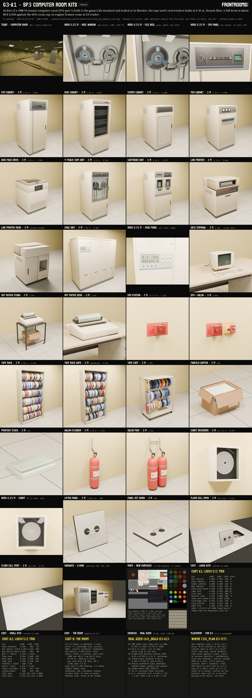

## G2-d · the rest of image 1, authored: cove base and joints, deck drains, SP6's block basins, the mays, KIT's edges (2026-11-10 11:15-12:2x)

Stage agent of the 游戏视觉 G2-d workflow (image 1's pool group), account B, **Author phase only**: no clone, no Unity, no slot; the render and package stages come after (they need the clone, which the G2 render and package stages held). Red, this line's chat: 2026-11-07 21:58:37 "光影水反应该给图1 structure scene，未来图2泳池组不在推进和细化，开始删除并且节省空间。光照改在图1开始做，并且滑梯，墙壁等资产需要游戏视觉进行调研review的同时revise和升级。"; 21:54:49 "我希望保留图1中的水和瓷砖，地形，空间设计等方案，然后保留图2中的灯。然后以后只细化图1，图二未来不再细化。"; 21:52:22 "全部按推荐" (ask 1: KIT all three edges side by side); 2026-11-10 11:11:45 "目前先别做平面视觉相关的工作，把额度用在所有3d视觉相关的" (so the depth marks are framed BLANK inlays; their numerals are 叙事设计's words and 平面视觉's art). Built on "G2 review · assets" (sections 5.2, 6, 8, S-9) and G2c.4's open list. Nothing landed; no git; no download (the iCloud placeholders in main were made local by the G4-a stage with `brctl download`, as `fr gate` asks); nothing played; nothing deleted.

### G2d.1 What was built
- **Ours, staged as `W/structures_assets/pkg/structures_pool_finish/<main path>`** (the package stage makes `W/apply/structures_pool_finish` with the importer metas the render stage's import writes):
  - `Scripts/Rendering/Structures/FrontRoomsStructurePoolFinish.cs` (new): reads the district's own finished field-tile and water meshes after its last `Finish` and builds, render only: the **cove base** at the feet of every field-tile face standing 0.45 m or more over a dry field-tile deck (a deck level is a height with 2 m2 or more of dry floor in the hall; none under water, at a riser, kerb or coping, or where no floor is in front), chained round outside arrises and curves, swept as K1's `CoveBase` (P2's `Prop_PoolTile_Cove`, r 50 + 50 mm flats), ends closed with the section; the **EJ171 joints** (K1's `SealantJoint`) on the same decks along the 3 m cell lines (20_research B F14: 12 ft or less where wet); **deck drains** (`Kit_FloorDrain` on its tile's centre, kept on a dry deck 0.35 m clear of walls); **block basins' fittings** (main drain in a 0.45 m Lane square, return inlets 0.30 m under the water, clear of niches, as `Kit.FlushBasins`); **framed blank depth marks** (ten whole Lane tiles round a 2 x 1 field of the deck's own tile, on the grid, 1 mm proud, 0.25 m behind the edge; TM 5-662 2-5 "on the edge of the deck next to the pool"); wall-frame kits (`Kit_RingBuoy`, G4's `Kit_CCTVCamera` when it is in the build); the **dispatcher post** with the `_On` screen swap; **KIT's edge exhibits** (C13).
  - Kits (`Tools/Blender/frontrooms_kit/assets/_struct_pool_finish.py`, a new helper so every landed kit builds as before; `structures_ring_buoy.py`, `structures_dispatcher_post.py`; hand-built LOD0 / LOD1 / LOD2, no collider, no text): **`Kit_RingBuoy`** 6,204 / 1,668 / 548 (46 CFR 160.050-3 / -4: a 20 in ring, 508 mm OD / 318 ID, 85 thick, "international orange (Color No. 12197 of Federal Standard 595) or white", a 3/8 in grab line four times the OD on four 2 in beckets; TM 5-662 2-13c "at lifeguard chairs"): orange shell, white braided line in four bights hanging by gravity (a laid rope's twist read as a sawtooth at 0.35 m unless sampled at 4-5 mm), a stainless 120 x 50 mm wall plate with two rod arms through the eye, tips turned up; **`Kit_DispatcherPost`** 8,636 / 2,626 / 432 (63 section 6.2: intercom handset, ride counter, whistle hook, emergency stop, small CCTV monitor; LS114): a galvanised console on the start room's shelf footprint (1.20 x 0.42, top +1.03), rubber mat, doors with a flush lock and louvres, black plinth, a 9 in B/W monitor in a black steel case with a sun hood (screen slot `Prop_ScreenCRT`), a sloped back panel with a five-drum counter (blank window), its push button and reset, a red mushroom e-stop on a yellow box, a wall intercom with its handset on the hook switch and a coiled cord, a whistle on a lanyard on a cup hook.
  - `Resources/Surfaces/Prop_RingBuoyOrange` + `_Phone` (FrontRooms/Surface on the game's plastic, FS 12197 weathered; no new map).
- **Theirs: `W/apply/structures_pool_finish_contract`** (DRAFT until rendered; README per VISUAL_STANDARD 2.6), on main's current bases (Slide ae2ed89d, Well 5bd77bea, PoolTerrain 4639fc73, KitRow 19b97963), 6 hunks +107 -11, **no Kit.cs hunk**: SP1, SP2 and SP6 call the builder after their shell's `Finish` (SP1: the hall, 2 drains, 4 marks, the ring buoy on the bottom guard's stand (its west face, bracket 0.84 m), the camera hook on the east wall at 2.6 m; SP2: F0 and the +4.5 gallery, 2 drains, 4 marks; SP6: its nine halls, 3 drains, the basins C1 / under W3 / the channel / C9 with 3 main drains and 11 inlets, 5 marks); SP1's `BuildUpper` puts the dispatcher post on the shelf's footprint and keeps the shelf's collider by the same `kit.Box` with no material (without the kit: shelf and CRT as now); KitRow makes three row-2 plinth pockets (columns 2, 4, 6) `Plate.Kind.Held` in NEW and `EdgeExhibits` lays their lid and floor collider exactly as the plate does, the deck in front render only, and a basin a bay long behind it for roll-out (water -0.05), rim-flow (-0.03) and recessed (-0.30) with the swept edge, closed ends, pool cove, main drain and inlet; K1's x 19.5 joint now stops at pocket 6's edge.

### G2d.2 Gates (rule 25) and cost
- **Roslyn macOS + iOS 0 errors:** `fr gate --staging W/structures_assets/gate_g2d` (the contract's four files + our builder: 5 overrides) FR GATE OK, 2026-11-10 12:13, main head b6af8981 (first run: 4 accessibility errors, a private nested type; fixed). `GATE.txt` in the contract.
- **Contract:** `patch -p1 --dry-run` on main's four: clean; applied, equal to `files/` (4 of 4); `base/` = main now.
- **Not yet (the render stage's, in the clone):** Unity compile and import of the two kits and the Surface, TODAY | NEW frames at SP1 s00-s04, SP2 s00-s09, SP6 s00-s10, KIT s03-s05, the Unity heroes, the walk test (fail=0 expected: no collider changes), NEW off = today (every hunk inside `kit.New`), the builder's log lines (cove m, joints m, drains, marks, fittings), flash_check where new glints look (chrome drains, the coves' glaze), the phone row.
- **Cost (ESTIMATE until rendered; LOD0 as the harness counts it):** cove ~13 tris a metre over ~410 m (~5-6 k), joints ~10 a metre (~10-12 k), Kit_FloorDrain 2,944 x 8 (~24 k counted; LOD1 836 beyond 2 m), Kit_MainDrainGrate 2,536 x 6, Kit_ReturnInlet 860 x 14 (SP6 11, KIT 3), Kit_RingBuoy 6,204, Kit_DispatcherPost 8,636 (the CRT's 3,096 goes), marks 20 each; KIT +6-8 k. New maps 0. Frame time not measured (rule 25).

### G2d.3 Open, sheets, files
- **Not built, and why:** the **light wear mask** (review 6: "P11's tea-staining mask at the light end only... The pool level is pristine (A.8)"): A.8's way is a baked curvature / AO mask per steel kit, and the frontrooms_kit pipeline has metre UVs and no bake step; that step is the next item for the fittings (the brief's "(where wet feet and cleaning wear the glaze)" is not section 6's mask and would draw wear on Red's tile, against A.8 and VISUAL_STANDARD 1.1). **S-12** (the wall passes' head-corner notch). **Inside-corner and wall joints** and the joint carried over the cove (the deck joints pass under it). The **deck's fall** (the drains sit flush on the flat slab). **KIT's exhibit water** has today's floor collider over it (walkable at deck height: the owners may add a blocker). The CCTV camera waits on G4's `Kit_CCTVCamera` (frame assumed: origin on the wall plane, +Z out, +Y up; its head should look about 20 degrees down).
- **Sheet** (Shot format, ALL LABELS FIT, looked at): `sheets/structures_g2_d_kits.jpg` (+ `_fit.txt`): Blender looks of the kits and the builder's pieces at 3 m and 0.35 m (ring buoy, dispatcher post, cove inside corner with its joint, deck drain, blank depth mark), COST. Chip PENDING: Unity frames come with the render stage.
- **Files:** builder and kits staged in `W/structures_assets/pkg/structures_pool_finish/` (GUIDS.txt); kit build logs `W/structures_assets/kits/out/g2d_build*.log`, outputs `kits/out_root/Assets/Resources/Props/Models/Kit_RingBuoy|Kit_DispatcherPost.*`; Blender looks `kits/previews_g2d/` (script `kits/hero_g2d.py`, specs `tmp/g2d_hero/*.json`); gate staging `gate_g2d/` (logs `logs/fr_gate_g2d_*.txt`); sheet builder `tools/make_g2d_sheets.py`.
- **Resume:** kits: `Blender -b --factory-startup --python kits/frontrooms_kit/build_asset.py -- structures_ring_buoy structures_dispatcher_post --out-root kits/out_root --preview-dir kits/previews_g2d`; looks: `Blender -b --factory-startup --python kits/hero_g2d.py -- kits/previews_g2d tmp/g2d_hero/<ring|post|cove|drain|mark>.json`; gate: `./tools/fr gate --staging structures_assets/gate_g2d`; sheet: `G2D_STAMP="..." W/venv/bin/python -B tools/make_g2d_sheets.py`. Render stage: copy `pkg/structures_pool_finish/Assets/...` and the contract's `files/` into the clone, one Unity job (import, compile, frames, walk, proof), then drop the DRAFT mark.

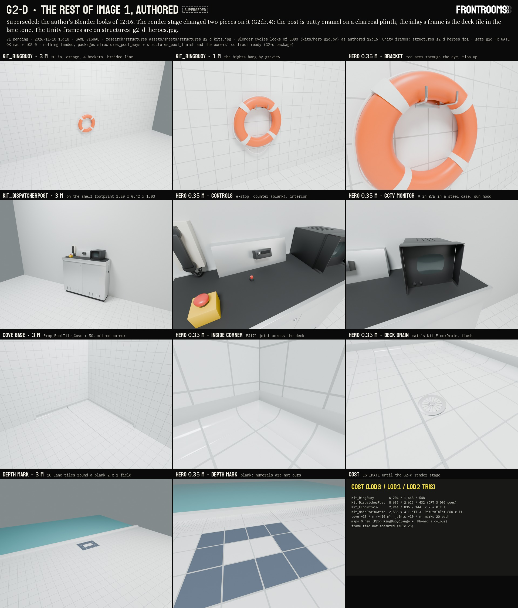

## G2-d render · TODAY | NEW of the rest of image 1, LW0 with the L03 dim, Red's exposure A/B (2026-11-10 14:04-15:0x)

Relay of the 12:31 render pass (blocked on power 12:44; the package pass died in the 12:58-14:0x sleep). Clone W/proj_unlock = main at 14:06 (every one of main's 480 local code files equal, including the two landings since: 灯具适配's FrontRoomsTrofferKit.cs 719586f2 at 12:50, PoolGridLensLevel 0.2, and the owners' zone_lamps_pool_grid_lens_contract at 13:06, Kit.cs 9807b496 + Slide.cs 76877206) + G2-d (pkg/structures_pool_finish + the contract's files/) + G4-a's Kit_CCTVCamera as a clone-only trial. Red's words this stage follows: 12:23:46 "方案A（推荐）" (scene 4's placards stay out of every flash count; the exposure A/B for Red); 11-10 11:11:45 "目前先别做平面视觉相关的工作，把额度用在所有3d视觉相关的" (no lettering: the inlays stay blank).

**G2dr.1 Jobs** (Unity slot one hold each, silent clone, private product name; every job 0 error CS, fail=0): L g2d_lw0 14:08-14:19 (main's code: 41 LW0 films placards out + 18 A/B stills); N g2d_new / T g2d_main / W g2d_walk / P g2d_phone / F g2d_flash 14:22-14:33 (G2-d as authored, the contract rebased); after my look's fixes M/G/Q twice more, and the final run 14:53-14:57: g2d_new4 (81 shots: TODAY proof stops, NEW at SP1 s00-s04, SP2 s00-s09, SP6 s00-s10, KIT s03-s05, 48 cameras of tools/g2d_views.tsv, inventories), g2d_flash4 (LW0's 32 films), g2d_phone4. Tools: tools/run_g2d.sh (SWAP=1 = main's four contract files for the job), run_g2d_chain.sh (L), run_g2d_chain2.sh (N T W P F), run_g2d_chain3/4/5.sh, run_g2d_final.sh, g2d_proof.py, make_g2d_render_sheets.py. The contract rebased first: the two Slide hunks apply clean on main's 76877206 (ours at lines 112 / 355, the dim at 761) -> files/ Slide 77ec0260; Well 9a8ed923, PoolTerrain eb115a3b, KitRow 2dafcab1 unchanged; CONTRACT.diff 6 hunks +107 -11; v1 moved aside to W/_partial/g2d_contract_v1_ae2ed89d/.

**G2dr.2 LW0 re-measured on main's code with the dim, placards out** (flash_check area rule, worst second, the check's turn 152 deg in 3.0 s at 76 deg/s, game lamp modes; g2_light/renders/g2d_lw0/flash_summary.tsv; x0.8 = the clone-only exposure step, -0.32 EV on the five profiles that set postExposure):

| stop | today | x0.8 | | stop | today | x0.8 |
|---|---|---|---|---|---|---|
| SP1 s00 arrival | 4.0 | - | | SP2 s00-s04 | 1.5 / 1.0 / 1.0 / 0.5 / 0.5 | - |
| SP1 s01 start tub | 4.5 | 4.0 | | SP2 s05 / s06 / s07 | 2.0 / 0.5 / 2.0 | - |
| SP1 s02 eye | **4.0** | 2.0 | | SP2 s08 cascade / p33 | 2.0 / 1.5 | - |
| SP1 court | 4.0 | 4.5 | | SP2 s09 F1 stair core | **3.5** | - |
| SP1 s03 terrace top | 5.0 | 4.5 | | SP6 s00 corridor | **5.0** | - |
| SP1 s04 tower foot | 4.0 | 4.0 | | SP6 s06 / s07 deck / s07 eye / s08 | 2.0 / 4.5 / 5.0 / 0.5 | 1.0 / 4.5 / 4.5 / 0.0 |

SP1 s02 at eye level is still over 3.0 with the dim: 4.0 (it was 5.5). After the dim the lens is no longer the term: the probe on G2-d's code reads steady lamps 3.0, game lamp modes 4.0, lenses hidden 4.5 (steady 3.0), wall boxes x0.5 3.0; the worst window is the hall's top right, the wall boxes' scallops on the white upper wall under the grid's edge. A lower PoolGridLensLevel will not bring s02 under 3 in the game's lamp modes; the lamp modes (+1.0 over steady) and the wall boxes' level are the levers (the lamps' owners). SP2 s09 (3.5) and SP6 s00 (5.0) are first measured today (the stair's wall lamp over dark treads with lit nosings; the corridor's grout grid against the arch opening). x0.8 closes SP1 s02 eye (2.0) and helps SP6 s06 / s08; the court, s03, s04 and SP6 s07 stay over 3 either way. Sheet structures_g2_exposure_ab.jpg (FOR RED).

**G2dr.3 TODAY | NEW** (TODAY = main now, the same camera; NEW = G2-d final, steady lamps, grain off). The builder's own lines: SP1 cove 278.0 m, EJ171 joints 340.1 m, deck drains 2/2, depth inlays 4/4, ring buoy 1/1, CCTV 1/1 (G4-a's kit, clone-only: the hook works); SP2 cove 140.9 m, joints 316.7 m, drains 2/2, inlays 4/4; SP6 cove 683.7 m, joints 1090.2 m, drains 3/3, inlays 5/5, basin fittings 14 (cove 1,103 m in all: every dry deck level's wall, pier, terrace and block foot of 0.45 m or more, not only the halls' walls the brief's 410 m counted). The knife wall-floor joints are gone at every hall wall, pier and terrace face; inside corners mitre, the coves stop at step runs and restart on the next level; the joints pass under the cove; the deck drains sit on their tile; SP6's deep basins have their main drain in its Lane square and return inlets under the water; the start room's shelf CRT is the dispatcher post; KIT's row 2 pockets hold the three edge bays. Sheets structures_g2_d_sp1 (FLAG: LW0), _sp2 (PASS), _sp6 (FLAG: LW0), _kit (PASS), _heroes (PASS).

**G2dr.4 Fixed from my own look** (no critic stage), in our files: (1) the blank inlay's frame: the Lane mosaic (25 mm, a quarter of light grout, a little brown wear) read as a beige mat from 3 m in SP1 -> FrontRoomsStructurePoolFinish.InlayTile: the unglazed 150 mm deck tile (Prop_PoolTile_Deck) in the lane colour, body = the same colour, no wear, matte (_Smoothness 0.45), one cached instance per source; (2) the dispatcher post's monitor showed its picture mirrored -> _struct_pool_finish._monitor screen UV (1-u, v); (3) the post raised LW0 at SP1 s01 from 4.5 to 6.0 (galvanised cabinet, black plinth and mat swept through the turn's lower-left window) -> putty enamel cabinet, doors, top, back panel and mat (Prop_PlasticPutty), charcoal vinyl plinth (Prop_VinylCharcoal); s01 now 5.0. Kit_DispatcherPost rebuilt with build_asset.py (8,636 / 2,626 / 432; json lodBudget now the module's 8700 / 2700 / 450). Author's versions in W/_partial/g2d_render_fix_v1/. Still showing, not chased further: SP1's inlays read warm tan beyond about 2 m (SP1's probe holds the bright cream lay-in grid and its lenses; a rough dark face's broad lobe shows mostly that; SP2 / SP6 read dark at every distance, SP1 dark within 1 m); the post's CCTV monitor shows the old shelf CRT's screen (a DOS listing, now the right way round), not a camera picture; KIT's three edges are hard to tell apart from 3 m and their exhibit water reads dark olive at a grazing view; KIT's existing SSAO halos round the plinths.

**G2dr.5 Gates** (rule 25): fr gate --staging structures_assets/gate_g2d FR GATE OK mac + iOS 0 errors, 5 overrides (re-run after each builder change; last logs/gate_g2d_relay4.txt, main eb220af8); NEW off = today: 0 px over 1/255 at SP1 s02, SP2 s08, SP6 s04, KIT s03 (renders/g2d_proof.tsv, the final code against main's, both FR_STRUCTURES_NEW=0, noise off); walk test g2d_walk FINISHED fail=0, 79 PASS, every district's flood equal to G2-c's (SP1 11747, SP2 14688, SP6 16749, KIT 10812 floor points: colliders as main); phone tier g2d_phone4 SP1 s02 / SP2 s08 / SP6 s04 (the SP6 s04 row on structures_g2_d_sp6.jpg); Unity console errors 0 in every job.

**G2dr.6 LW0 main -> G2-d final** (g2_light/renders/g2d_flash4): SP1 s00 4.0 -> 3.5, s01 4.5 -> 5.0 (the post), s02 eye 4.0 -> 4.0, court 4.0 -> 4.0, s03 5.0 -> 5.5, s04 4.0 -> 4.5; SP2 the same but s05 2.0 -> 1.5 and s06 0.5 -> 0.0 (s09 3.5); SP6 s00 5.0 -> 4.5, s01 1.5 -> 2.0, s07 deck 4.5 -> 4.0, s07 eye 5.0 -> 4.0, s09 1.0 -> 1.5, the rest the same. District worst: SP1 5.5 (main 5.0), SP2 3.5 (3.5), SP6 4.5 (5.0). The base films are repeatable (stops G2-d leaves alone count the same in every run), so these half steps are G2-d's lines at wall feet, both ways.

**G2dr.7 Cost** (inventory, NEW, main -> G2-d): SP1 renderers 493 -> 510, LOD0 triangles 235,610 -> 287,540 (+51,930), materials 60 -> 66; SP2 993 -> 1,003, 241,588 -> 262,008 (+20,420), 92 -> 93; SP6 546 -> 609, 214,936 -> 294,341 (+79,405), 39 -> 46; KIT 791 -> 828, 157,710 -> 172,368 (+14,658), 31 -> 48 (the exhibits' per-water tile instances); lights and colliders unchanged everywhere. The coves and joints are most of the triangles (K1's CoveBase rings every 1.2 m).

**G2dr.8 For the package stage**: since the author, changed in pkg/structures_pool_finish: FrontRoomsStructurePoolFinish.cs (InlayTile; gate_g2d/files carries it), Kit_DispatcherPost.fbx (0debb599) + .json, Tools/Blender/frontrooms_kit/assets/_struct_pool_finish.py; the full importer metas are the clone's (Kit_RingBuoy.fbx.meta, Kit_DispatcherPost.fbx.meta: same GUIDs as the staged minimal ones; the post's carries two stale remaps, Prop_Rubber and RunB_GalvSteel, from the first builds: harmless, drop them when packaging). The contract W/apply/structures_pool_finish_contract: base/ = main's four now (Slide 76877206), files/ 4, CONTRACT.diff, GATE.txt = gate_g2d's; README still DRAFT (drop it now that it is rendered). Not ours to package: G4-a's Kit_CCTVCamera (clone-only in C; its own package brings it).

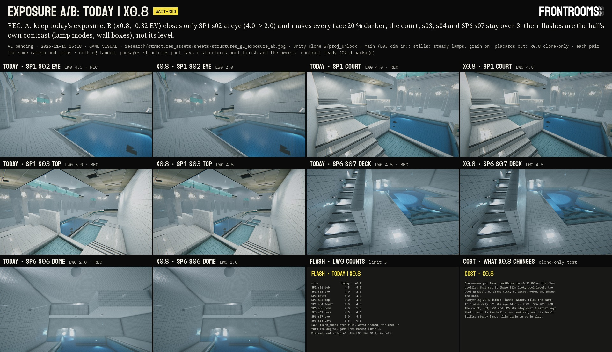
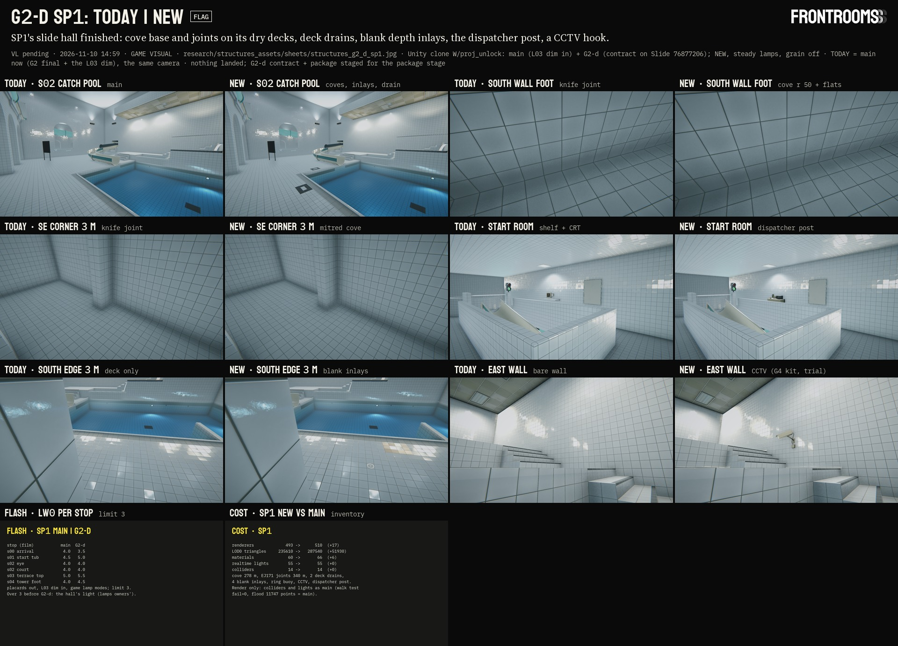
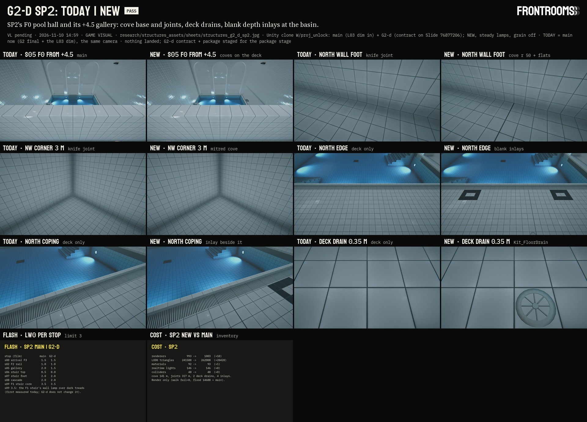
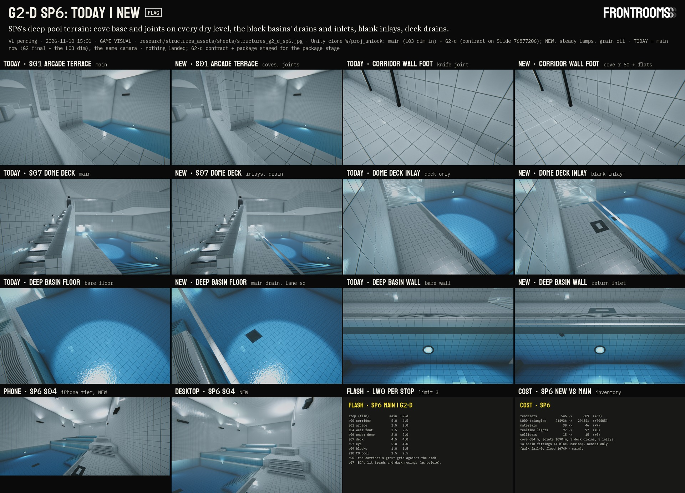
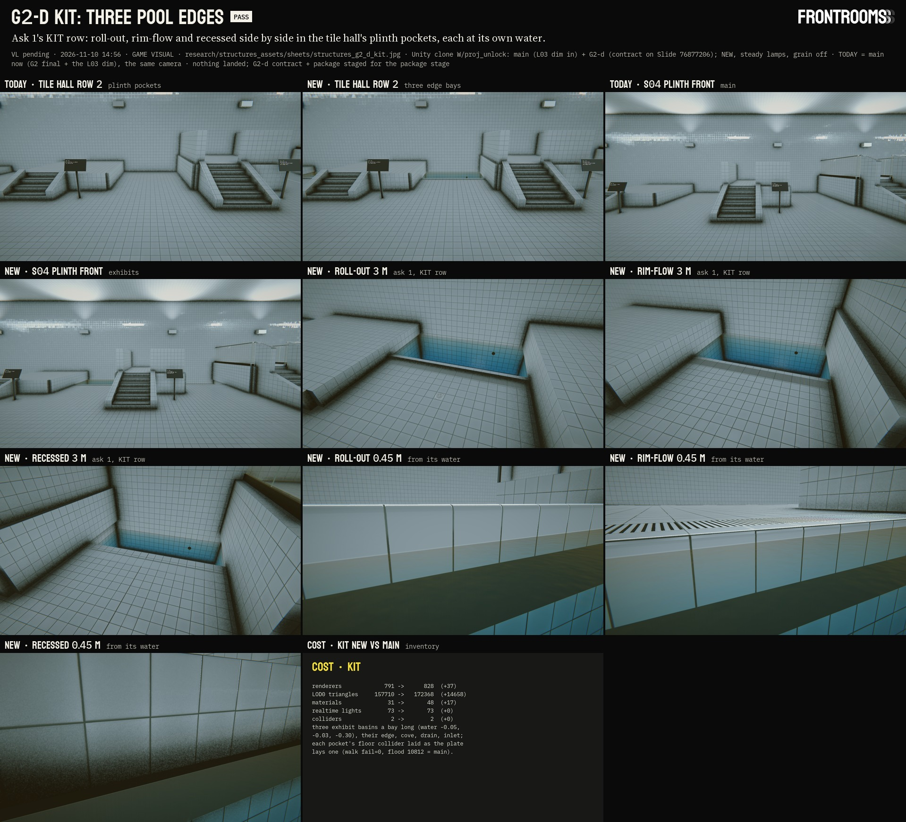
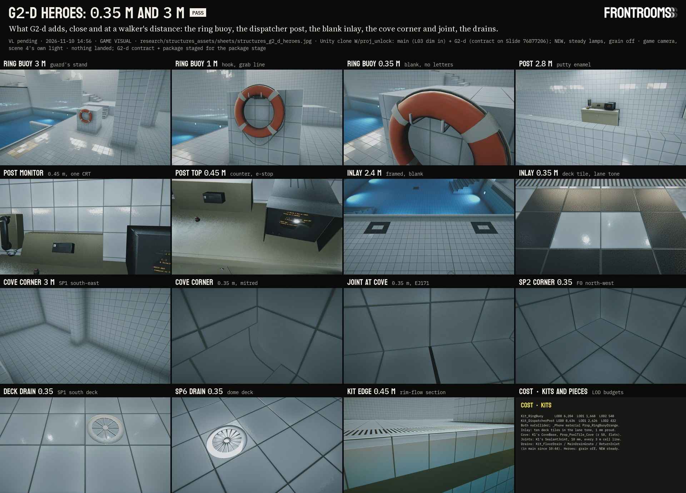

G2dr.5 note: the walk test ran on G2-d as authored (14:29); the fixes after it are render only (a material instance's parameters, the post's UVs and slots; the post has no collider), so the floods stand.

## G3-a2 · SP3's training room and file mezzanine kits (P16 part 2, structures_l0_props) (2026-11-10 12:23-15:5x)

Line 游戏视觉 (`visual`), workflow of the 游戏视觉 session on account B (`local_a9a1dce2`), Author phase, stage G3-a2 (first pass 12:23-12:58, died in the 12:58-14:0x sleep; relay pass 14:20 on, from the journal and the files on disk). Red's ask, verbatim (this line's chat, 2026-11-05 17:42:27 and 17:42:55): "我需要你开始对structure scene里面的资产进行全方位的升级和revise，就像是主游戏项目的标准一样" and "升级的逻辑和之前一样，调研现行，再进行revise". 3D only (Red 11-10 11:11:45 in this chat: no lettering; blank cards, plates and boards carry marks, never words).

**Built in W only:** no clone touched, no Unity run (the Author phase), nothing written to main, no shared Structures file edited, no git, no download (web pages read for sizes in the first pass, nothing saved), nothing played aloud (rule 24), nothing deleted. The kits are Blender modules built with `build_asset.py` (kitlib P-1b, hand-built LOD0 / LOD1 / LOD2, sidecars); the same package as G3-a1 (`structures_l0_props`). The look is the author's own (rule 26) in Blender Cycles with every slot rebuilt from its Unity `.mat` (G3-a1's look tool, Level 0 carpet underfoot). In-engine frames, the shader compile of the new materials, the walk test and NEW-off come at G3 render.

### G3a2.1 The rooms as they stand

`FrontRoomsStructuresLevel0Beyond.cs` (main 602b1ef2). **Training room** (`BuildTraining` :96-108; 30_plan S3-09): cells x 54-66, z 6-18 on four tiers (0 / -0.30 / -0.60 / -0.90 m) with side aisles at x 54-55.2 and 64.8-66; inside: four laminate `StandIn` bars 8.4 x 0.74 x 0.6 at z 6.6 / 9.6 / 12.6 / 15.6 (one per tier) and a runtime Lit white box 5.4 x 1.7 at (60, 0.85, 17.9) as the screen on the front wall. Survey frame `renders/today/SP3_s09_raw.png`: four pale bars on stepped carpet facing a white panel. **File mezzanine** (`BuildMezzanine` :203-243; S3-12): x 171-183, z 6-15, Tall 5.4, the +2.70 gallery over it (2.50 clear under); inside: three `StandIn` rows 9.6 x 2.1 x 0.45 (Prop_SteelBeige) at z 11.6 / 13.0 / 14.4, x 172.8-182.4. Frame `SP3_s13_raw.png`: the gallery, the B2 flight, glass guards, one grey mass of "file rows". G1's NEW frames (g1x_k1) show SP3 s00 / s01 only: both rooms are unchanged by G1.

### G3a2.2 Real objects and sizes (read in the first pass; 62's LS57, LS59, LS91, LS93, LS94, LS97-LS99 stand)

| Id | Source | What it gives |
|---|---|---|
| R1 | US 4,984,737, mobile storage system (Spacesaver; filed 1989-02-24), https://patents.google.com/patent/US4984737 | carriages ride floor rail sets (a track on two legs with out-turned feet); a hand wheel in a housing drives chain and sprocket to a long shaft; side panels at each end; the shelving framework stands on the carriage (READ) |
| R2 | Computer History Museum, catalogue 102710999, Micron 775 microfiche reader, https://www.computerhistory.org/collections/catalog/102710999 | standard design, 12 w x 20.5 h x 18 l in, 11.5 x 9.75 in blue-tinted screen, the fiche tray below the screen, low / high / off switch and a knob on the front, 20 lb (READ) |
| R3 | Da-Lite Model B, 70 x 70 in wall / ceiling screen (dealer pages via search) | 22 ga octagonal steel case 73.5 in, end caps, wall brackets, pull cord; the form unchanged since the 1960s (search summaries) |
| R4 | HON 600-series four-drawer lateral file (dealer pages via search) | 36 w x 18 d x 52.5 h in, putty, full-width recessed anodised aluminium pulls, label holders, lock (search summaries) |
| R5 | steel AV carts of the period (dealer pages via search) | 24 x 18 in shelves, 26 and 42 in heights, four 4 in casters (two locking), a three-outlet power assembly with cord hooks (search summaries) |
| R6 | open-format end-tab filing (Tennsco FS370-class; folder makers' pages via search) | 36 in wide, seven tiers; letter end-tab folders 12 1/4 x 9 1/2 in, colour-coded labels read on the tab edge (search summaries) |
| LS | 62_furniture_l0_office.md 2.4 / 2.9 / 3.1 | training rows 60 x 18 x 29 in, upholstered stackers (seat 18 in), the overhead (LS91: 14.2 x 16.75 x 28 in, a 10.5 in stage 8.5-9 in up, fold-down post), lectern, easel pad 27 x 34 in, the 8 x 4 ft board (LS99), the NARA cubic-foot carton (LS94), the lateral (LS93), mobile shelving (LS59) |

Where the plan's numbers and the real ones differ, the real one wins: the records carton is the NARA box's 12 x 15 x 10 in body with a 2 1/4 in lid skirt (0.31 x 0.39 x 0.27 with the lid), shelved end out (its front +Z is the printed end); the overhead's post stands at the audience edge of the stage and its head throws the image back over the operator (the journal's first list had it the other way round; corrected in the relay line 14:2x).

### G3a2.3 The kits (Unity frame: front +Z = the side a person uses; LOD0 / LOD1 / LOD2 triangles, every level hand-built; lodDistances d01 / d12 / cull; sizes are the exported bounds)

| Kit (+ slot variants) | The real object | Size W x D x H (m, bounds) | Origin | Tris LOD0 / 1 / 2 | Slots | Collider | lodDistances | Where (for K3) |
|---|---|---|---|---|---|---|---|---|
| Kit_AVCart_Low | 26 in black steel AV cart (R5): rolled-edge shelves, posts, 4 in casters, power strip, cord on hooks; anchor 'top' | 0.610 x 0.499 x 0.661 | floor centre | 2,532 / 956 / 264 | 5 | box | 4 / 12 / 45 | the overhead's cart |
| Kit_AVCart_Tall | 42 in cart with a VHS deck; anchors 'tv' (Kit_CRTTV) / 'top' | 0.610 x 0.499 x 1.068 | floor centre | 2,992 / 1,160 / 348 | 5 | box | 4 / 12 / 45 | front corner with the TV |
| Kit_AVCart_TallCord | the tall cart, its cord run to the floor | 0.610 x 1.191 x 1.068 | floor centre | 2,912 / 1,208 / 348 | 5 | box | 4 / 12 / 45 | where a socket is near |
| Kit_FileCart | hanging-file cart, 32 x 16 x 36 in (LS98): lipped tray on 3 in casters, posts, basket with rolled rails, push handle; green folders | 0.843 x 0.412 x 0.925 | floor centre | 2,560 / 1,368 / 368 | 5 | box | 4 / 12 / 45 | aisle, by the open drawer |
| Kit_FileCart_Empty | the cart empty | 0.843 x 0.412 x 0.925 | floor centre | 2,368 / 1,312 / 356 | 4 | box | 4 / 12 / 45 | aisle |
| Kit_FlipChartEasel | aluminium tripod easel, hardboard back, tray, clamp bar, 27 x 34 in pad | 0.720 x 0.688 x 1.850 | floor centre, pad faces +Z | 756 / 436 / 136 | 7 | box | 4 / 12 / 45 | front corner |
| Kit_FlipChartEasel_PagesOver | four sheets thrown over to the back | 0.720 x 0.688 x 1.868 | floor centre | 900 / 516 / 136 | 7 | box | 4 / 12 / 45 | front |
| Kit_FlipChartEasel_Written | the top sheet written (marks, no letters) | 0.720 x 0.688 x 1.850 | floor centre | 756 / 436 / 136 | 7 | box | 4 / 12 / 45 | front |
| Kit_LateralFile_2 | two-drawer lateral (counter height) | 0.918 x 0.463 x 0.724 | floor centre | 940 / 368 / 120 | 5 | box | 4 / 12 / 45 | under the gallery edge |
| Kit_LateralFile_4 | four-drawer lateral, 36 x 18 x 52.5 in (R4): recessed full-width pulls, label holders, lock, recessed plinth | 0.918 x 0.463 x 1.334 | floor centre | 1,448 / 504 / 168 | 5 | box | 4 / 12 / 45 | along the mezzanine walls |
| Kit_LateralFile_4_Open | the 2nd drawer out 0.38 m: hanging folders front to back, clear tabs, manila (the event) | 0.918 x 0.836 x 1.334 | floor centre | 2,240 / 1,056 / 288 | 6 | 2 boxes | 4 / 12 / 45 | one, by the cart |
| Kit_LateralFile_5 | five-drawer lateral | 0.918 x 0.463 x 1.670 | floor centre | 1,702 / 572 / 192 | 5 | box | 4 / 12 / 45 | wall runs |
| Kit_Lectern (_Oak) | walnut-veneer floor lectern: plinth, raised panels, open speaker side with shelves, slanted top with book ledge, brass gooseneck lamp (off) | 0.660 x 0.512 x 1.438 | floor centre, speaker at +Z | 2,044 / 860 / 108 | 4 | box | 4 / 12 / 45 | front, yaw so the panels face the rows |
| Kit_Lectern_Lit | lamp on (BulbLit), notes on the top | 0.660 x 0.512 x 1.438 | floor centre | 2,048 / 864 / 112 | 5 | box | 4 / 12 / 45 | midTask |
| Kit_MarkerBoard | 8 x 4 ft porcelain marker board (LS99): satin frame, grey corner caps, tray with markers and eraser; clean with ghosting | 2.448 x 0.079 x 1.233 | wall point at floor level, sill 0.90 | 1,250 / 738 / 122 | 8 | none | 5 / 15 / 60 | front wall beside the screen |
| Kit_MarkerBoard_Chalk | slate green chalkboard, chalk and dust | 2.448 x 0.079 x 1.233 | wall point | 1,076 / 692 / 122 | 4 | none | 5 / 15 / 60 | side wall |
| Kit_MarkerBoard_Written | marker diagrams, no letters | 2.448 x 0.079 x 1.233 | wall point | 1,250 / 738 / 122 | 8 | none | 5 / 15 / 60 | front wall |
| Kit_MicroficheReader | rear-projection fiche reader (R2): beige housings, leaning screen in a bezel under a hood, fiche carrier on runners, controls, vents, cord; screen dark | 0.318 x 0.850 x 0.533 | desk point | 1,486 / 998 / 122 | 9 | none | 3 / 9 / 35 | a desk at the mezzanine's end |
| Kit_MicroficheReader_Carousel | with a rotary fiche file at -X | 0.689 x 0.850 x 0.533 | desk point | 2,552 / 1,472 / 332 | 9 | none | 3 / 9 / 35 | the same desk |
| Kit_MicroficheReader_Lit | the page on the screen (ProjLit) | 0.318 x 0.850 x 0.533 | desk point | 1,486 / 998 / 122 | 9 | none | 3 / 9 / 35 | midTask |
| Kit_MobileShelving_3 | 3 bays | 2.931 x 0.610 x 2.103 | floor centre | 3,948 / 2,280 / 332 | 7 | box | 6 / 18 / 70 | short runs |
| Kit_MobileShelving_4 | 4 bays | 3.845 x 0.610 x 2.103 | floor centre | 4,356 / 2,652 / 372 | 7 | box | 6 / 18 / 70 | row ends |
| Kit_MobileShelving_5 | mobile carriage of 5 x 36 in bays, double-faced end-tab shelving (LS59, R1); laminate aisle end in aluminium trim with the three-spoke hand wheel at +X (anchor aisleEnd) | 4.758 x 0.610 x 2.103 | floor centre | 4,764 / 3,012 / 412 | 7 | box | 6 / 18 / 70 | rows 2-3 (z 13.0 / 14.4), two carriages a row, on rails |
| Kit_MobileShelving_5_Cartons | 5 bays, records cartons long side out on the lower tiers | 4.758 x 0.610 x 2.103 | floor centre | 4,824 / 3,116 / 442 | 7 | box | 6 / 18 / 70 | one carriage a row |
| Kit_MobileShelving_Rail | 3 m surface floor rail: aluminium ramp strip + steel head, ramped ends (R1) | 0.100 x 3.000 x 0.030 | floor centre, along Z | 104 / 104 / 48 | 2 | box | 4 / 12 / 40 | under each carriage, 3-4 rails along the travel |
| Kit_OpenShelfFile | HERO. Open-format end-tab file, 7 tiers of letter end-tab folders (R6): closed ends with front flanges, lipped shelves, back panel, top cap, recessed base, sliding supports; folder tab edges mapped from 2.56 px/mm strips, grouped and staggered | 0.914 x 0.305 x 2.134 | floor centre | 3,050 / 1,000 / 242 | 2 | box | 5 / 15 / 60 | mezzanine row 1 (z 11.6), backs to the gallery wall, runs of 10 |
| Kit_OpenShelfFile_Double | double-faced unit, folders both faces, centre panel | 0.914 x 0.610 x 2.134 | floor centre | 5,466 / 1,512 / 352 | 2 | box | 5 / 15 / 60 | free-standing island |
| Kit_OpenShelfFile_DoubleGappy | double-faced, gappy | 0.914 x 0.618 x 2.134 | floor centre | 5,598 / 1,516 / 352 | 2 | box | 5 / 15 / 60 | island |
| Kit_OpenShelfFile_Gappy | the same with gaps, leaning groups, red / blue out-guides | 0.914 x 0.309 x 2.134 | floor centre | 3,134 / 1,000 / 242 | 2 | box | 5 / 15 / 60 | mixed into the runs |
| Kit_OverheadProjector | 1988 overhead (LS91): beige base, 10.5 in stage in a grey deck, post at the audience edge, focus knob, arm, head with lens and mirror; stage dark | 0.364 x 0.735 x 0.699 | cart-top point; operator at +Z | 1,448 / 832 / 162 | 7 | none | 3 / 9 / 35 | on the low AV cart at the front, +Z toward the screen (yaw so) |
| Kit_OverheadProjector_Lit | stage lit with the transparency (ProjLit) | 0.364 x 0.735 x 0.699 | cart-top point | 1,448 / 832 / 162 | 7 | none | 3 / 9 / 35 | with the lit screen |
| Kit_ProjectionScreen_Tripod (Lit) | portable tripod screen: three legs, braces, case at 0.48 m, keystone arm | 1.926 x 0.626 x 2.337 | floor centre | 904 / 588 / 236 | 6 | box | 5 / 15 / 60 | a corner or the front |
| Kit_ProjectionScreen_Wall | 70 x 70 in pull-down in its octagonal case (R3), rolled: slat and pull ring | 1.893 x 0.114 x 0.264 | wall point at the brackets' top | 724 / 508 / 116 | 4 | none | 5 / 15 / 60 | front wall, brackets at ~2.45 m (the runtime white box goes) |
| Kit_ProjectionScreen_WallLit | pulled and lit: the overhead's keystoned square (ProjLit) | 1.893 x 0.114 x 2.194 | wall point | 732 / 516 / 124 | 6 | none | 5 / 15 / 60 | front wall, with the lit overhead |
| Kit_ProjectionScreen_WallPulled | pulled: black drop and the matte white surface (dark) | 1.893 x 0.114 x 2.194 | wall point | 732 / 516 / 124 | 6 | none | 5 / 15 / 60 | front wall |
| Kit_RecordsCarton | NARA cubic-foot carton (LS94): printed end, die-cut handholds with pushed-in flaps, lid | 0.313 x 0.389 x 0.258 | floor centre | 220 / 20 / 10 | 1 | none | 3 / 9 / 35 | floor, shelves |
| Kit_RecordsCarton_FlatBundle | flattened cartons strapped | 0.622 x 0.917 x 0.087 | floor centre | 94 / 94 / 94 | 1 | none | 3 / 9 / 35 | leaning by a wall (K3 tilt) |
| Kit_RecordsCarton_LidOff | lid set down upside down beside it, files inside | 0.686 x 0.438 x 0.254 | floor centre | 250 / 58 / 10 | 1 | none | 3 / 9 / 35 | by the cart |
| Kit_RecordsCarton_Plain | plain 18 in moving box, taped | 0.457 x 0.459 x 0.458 | floor centre | 22 / 22 / 14 | 1 | none | 3 / 9 / 35 | anywhere |
| Kit_RecordsCarton_Sagging | four high, the lower boxes bowed, leaning | 0.344 x 0.404 x 1.020 | floor centre | 1,060 / 80 / 40 | 1 | box | 3 / 9 / 35 | under the gallery |
| Kit_RecordsCarton_Stack3 | three high | 0.335 x 0.410 x 0.774 | floor centre | 660 / 60 / 30 | 1 | box | 3 / 9 / 35 | aisle ends |
| Kit_RecordsCarton_Stack5 | columns of three and two | 0.640 x 0.399 x 0.774 | floor centre | 1,100 / 100 / 50 | 1 | 2 boxes | 3 / 9 / 35 | corners |
| Kit_StackChair (_Charcoal, _Teal) | 1980s upholstered stack chair, seat 18 in (LS57 / LS98): 7/8 in chrome tube in two bends a side, cross rails, black pan and shell, navy cushion and pad, glides | 0.496 x 0.511 x 0.801 | floor centre, sitter faces +Z | 2,144 / 728 / 264 | 3 | box | 3.5 / 10 / 40 | pulled out at the Handouts rows |
| Kit_StackChair_Stack6 (_Charcoal, _Teal) | six nested, backs nesting behind | 0.494 x 0.661 x 1.226 | floor centre | 5,320 / 1,968 / 384 | 3 | box | 5 / 15 / 55 | a corner ('piled') |
| Kit_TrainingTable (_Dove) | 60 x 18 x 29 in training table (LS97 / LS98): 1-1/8 in laminate top, vinyl T-mould, kraft backer, black T-legs on foot runners with glides, stretcher | 1.530 x 0.463 x 0.737 | floor centre | 956 / 596 / 112 | 5 | box | 4 / 12 / 45 | row ends, the instructor's table, coffee |
| Kit_TrainingTable_Row2 (_Dove) | two tables ganged | 3.054 x 0.463 x 0.737 | floor centre | 1,924 / 1,204 / 224 | 5 | box | 5 / 15 / 55 | rows on the four tiers (z 6.6 / 9.6 / 12.6 / 15.6) |
| Kit_TrainingTable_Row2_Handouts | set for a session: handouts, binders, name tents, pencils, a cup ('midTask'; chairs separate) | 3.054 x 0.490 x 0.831 | floor centre | 2,518 / 1,478 / 262 | 7 | box | 5 / 15 / 55 | one tier |
| Kit_TrainingTable_Row2_Modesty (_Dove) | with black modesty panels on the presenter's side | 3.054 x 0.463 x 0.737 | floor centre | 2,084 / 1,364 / 248 | 5 | box | 5 / 15 / 55 | the front tier |
| Kit_TrainingTable_Row2_Tucked (_Charcoal, _Teal) | with four stack chairs pushed against the edge ('cleared') | 3.054 x 0.920 x 0.801 | floor centre | 4,836 / 2,260 / 512 | 7 | 2 boxes | 5 / 15 / 55 | most rows (one renderer per 4 seats) |

Kits listed with their slot variants (exported by `VARIANTS`, the same mesh): `_Dove` (Prop_LaminateFawn -> Prop_LaminateDove) on the tables, `_Charcoal` / `_Teal` (Prop_FabricNavy -> Prop_FabricCharcoal / Prop_FabricTeal) on the chairs, the stack and the tucked row, `_Oak` (Prop_WoodWalnut -> Prop_WoodOak) on the lectern, `Kit_ProjectionScreen_TripodLit` (Prop_ProjectionLit_Off -> Prop_ProjectionLit). The lit kits carry ONE lit slot each (Prop_ProjectionLit, Prop_BulbLit on the lectern lamp), so a lamp mode or a power state swaps it for its dark twin. Bounds include cords and lamps (the reader's and the overhead's cords run 0.3 m back on the desk; the lectern lamp stands 0.25 m over the top; the tall cart's cord runs 0.7 m out on the floor). Not built from the first list: `Kit_FileCart_Oak` (a slot swap of a steel cart is not an oak library cart) and `Kit_OverheadProjector_Folded` (the post folds onto the stage only on portables; the 1988 desk model keeps its post).

### G3a2.4 Surfaces (pkg structures_l0_props, FrontRooms/Surface with `_FR_MESH_UV`, each with its `_Phone` twin)

| Material | Maps (desktop / phone) | What it carries |
|---|---|---|
| Prop_PaperAtlas | A 2048, N 1024, S 1024 / A 1024, N 512, S 512 | decal atlas of paper and print, uv rects from `_struct_l0.CELLS` (kept in step with the generator): two 800 mm strips of letter end-tab folder fronts at 2.56 px/mm (colour-coded label bands: terminal-digit pairs and year bands in A, alphabetic in B; type as dashes) and their top edges, the folder side, out-guides, the carton end (ruled form block, plain handhold zone) and side (ruled block, a ring stamp without words), the board written / clean / chalk, a flip page, a handout, a binder spine, a name tent, a label card, hanging-folder tabs, a VHS face, a power strip face, the reader's front plate, a fiche envelope, 16 colour cells |
| Prop_ProjectionLit / _Off | A + E 1024 / 512 | the screen's matte white with the overhead's keystoned square in E (coloured inks transmit their hue), the lit stage with its transparency, the fiche page; _Off shares A with no emission. Emission colour 2.2 (the look at 1.4 washed out under room light; the level is set at G3 render, photosafety first: nothing flickers) |
| Prop_LaminateFawn / Prop_LaminateDove | A N S 512 / 256, tile 0.30 m | one neutral matte laminate (suede stipple, faint wipe marks; smoothness 0.40) tinted by `_BaseColor` (fawn 0.84 0.75 0.61, dove 0.735 0.735 0.70 sRGB) |

Generator: `Tools/lookdev/structures/gen_structures_g3a2.py` (staged; numpy + Pillow, every cell drawn at twice its size and box-filtered, smoothness never under 0.18, broad low normals: the 11-10 09:52 speckle note). Memory estimate (block-compressed, mips): about 7.5 MiB desktop, 2.9 MiB phone. Reused from main unchanged: Prop_SteelPutty, Prop_SteelBlack, Prop_Chrome, Prop_Aluminium, Trans_AluminiumSatin, Prop_StainlessSatin, Prop_PlasticBeige / Grey / Black / White / Red / Blue, Prop_Rubber, Prop_Glass, Prop_FabricNavy / Charcoal / Teal, Prop_WoodWalnut / Oak, Prop_WoodLaminate, Prop_Brass, Prop_BulbLit, Prop_PVCEdge, Prop_Backer, Prop_Hardboard, Painted_Metal.

### G3a2.5 The look and what it fixed (rule 26: the author's own look at every image)

Blender Cycles with every slot rebuilt from its Unity `.mat` (kits/g3a2/g3a2_look.py = G3-a1's tool with L0_Carpet underfoot), 11 heroes at 0.35 m (vFOV 76), 46 kits at about 3 m, two room vignettes. What reads: the open shelf file at 0.35 m (staggered colour-coded tab edges, folder sides in the steps, the supports in the gaps, the shelf lip's fold), the gappy leans and out-guides; the lateral's open drawer (green hanging folders, clear tabs, manila standing proud) and the recessed pulls; the carton's die-cut handhold with its flap pushed in and the files behind it; the fiche reader's lit page; the table edge (T-mould, T-legs, handouts, tents, cup); the overhead (post at the audience edge, head, lens, the lit stage); the lectern (raised panels, gooseneck); the AV carts (rolled edges, outlets, coil, VCR, the CRT on the tall one); the boards (written diagram, chalk ghosts); the easels; the screens. Found and fixed on the way:

- First build blew budgets on small round parts: casters 1,520 tris of tyre on one cart, chord-rule knobs and feet on the reader (3,278 tris), folder supports in every mobile run (1,728): `rcyl()` now gives explicit side counts to round parts of the non-hero kits; mobile runs use big folder groups without supports or sides and cheap lips (LOD0 11,300 -> 4,764); the label holder is unbevelled; LOD1 / LOD2 trimmed per kit (AV cart LOD1 1,648 -> 956; chair proxies at LOD2 in the stack and the tucked row: 1,584 -> 384, 1,280 -> 512).
- `col` shadowed by a loop variable in the carton stacks (two kits failed to build): renamed.
- Stack chair cushions faceted at 0.35 m: soft boxes 24 x 12 now, the pan made smaller so the cushion wraps it (2,144 tris, budget 2,400).
- The lectern's notes sat under the slanted top: raised.
- The look tool painted L0_Wallpaper red (its print layer is not read in Blender): a plain warm wall in the look frames (the kits are unaffected).
- Still open for G3 render: under a troffer right in front of it the lit wall screen's square washes out (as a real one does in a lit room); in the room vignette it reads. The emission level is set in-engine against the room's exposure.
- Two vertex-coplanar traps avoided by construction (no z-fighting): shelf decks stop behind their lips, end panels stop under the top cap, kick plates 3 mm under the bottom deck.

### G3a2.6 Cost

LOD0 / LOD1 / LOD2 in the table; every LOD hand-built. Rooms dressed by the 62 programme (an estimate for K3, measured at G3 render):

| Room | Dress assumed | LOD0 all | One view (LOD1 past 5-6 m) |
|---|---|---|---|
| Training room (12 x 12 m, four tiers) | per tier one Row2_Tucked + one Row2_Handouts + four pulled-out chairs + one table; the front: lit wall screen, board, overhead on the low cart, lectern, easel, a stack of six | ~82 k | ~46 k from the back door |
| File mezzanine (12 x 9 m under the gallery) | row 1 ten open shelf files (hero + gappy); rows 2-3 two 5-bay carriages each on rails; three laterals, a cart, cartons (stack5, stack3, lid off, sagging, bundle), the reader on a desk | ~63 k | ~35 k from the aisle |

The training room's full dress at LOD0 is over the 60 k room cap; K3 should use the Tucked rows (one renderer per four seats) on most tiers and pulled-out chairs only at the midTask tier. New lights: none (the lit screen, stage and page are emission only; the lectern lamp's bulb is emissive, no Light). Renderers: about 30 in each room; colliders: bodies only (the rail, cartons on the floor, desk-top and wall kits have none).

### G3a2.7 For G3-b (K3, Level0Beyond.cs) and G3 render

- **Placement (no wiring here):** the training room's four `StandIn` bars become rows of `Kit_TrainingTable_Row2*` (3.05 m) plus one `Kit_TrainingTable` per tier (8.4 m bars = two rows + one table with 0.3 m gaps), the rows face the screen at z 17.9, so the kits' seated side (+Z) points away from it (yaw 180 in the room); the runtime white box goes for `Kit_ProjectionScreen_WallLit` (or _WallPulled / rolled) with its origin at the wall at about 2.45 m; `Kit_OverheadProjector(_Lit)` on `Kit_AVCart_Low` at its anchor 'top' with +Z (the operator side, the throw) toward the screen (yaw 0; the operator stands between it and the screen); `Kit_Lectern` with its +Z (the speaker) toward the screen (yaw 0: the panels face the rows); board and easel on the front wall / corner; a `Kit_StackChair_Stack6` in a side aisle. The mezzanine's three `StandIn` rows become a run of ten `Kit_OpenShelfFile` / `_Gappy` (row 1, backs to the wall), and two `Kit_MobileShelving_5` (or _4 + _5_Cartons) per row on `Kit_MobileShelving_Rail` strips running along the travel (Z), aisle end (+X, anchor aisleEnd) toward the cross aisle; laterals along the walls, the open-drawer lateral and the cart by an aisle, cartons where the gallery's shadow falls, the reader on a desk (`Kit_OfficeDesk` + the reader at the desk point). Colliders: K3 keeps today's wall / floor colliders; each kit carries its body collider in the sidecar (walk test at render: the mobile aisles stay 0.9 m clear with the carriages closed except one open aisle).
- **Shared asks:** none (no shared file needs a change for these kits).
- **G3 render:** import the 49 kits + 11 variants (KitImporter remaps by sidecar slot); compile FrontRooms/Surface for the 10 new materials (desktop + `_Phone`); set the emission of Prop_ProjectionLit against the room's exposure (it must read as a projected square without blooming; static, so no flash count beyond the placards rule); NEW off = today; heroes in-engine: the open shelf file at 0.35 m, the open drawer, the lit screen from the back row.

### G3a2.8 Files and resume

- Helper `Tools/Blender/frontrooms_kit/assets/_struct_l0.py` (parts 1-4: slots, atlas cells, folder runs, the mezzanine kits, the training room kits) and 49 thin modules `structures_*.py` (written by `kits/g3a2/make_modules.py`); staged with the FBX + sidecars (+ .meta, GUIDs in `kits/g3a2/guids.json`) in `W/structures_assets/pkg/g3/structures_l0_props/` by `kits/g3a2/stage_g3a2_kits.py`; surfaces by `kits/g3a2/make_g3a2_surfaces.py`; maps `kits/tex_g3a2/`; generator staged at `Tools/lookdev/structures/gen_structures_g3a2.py`.
- Look: `kits/g3a2/g3a2_look.py`, shot lists `kits/g3a2/shots_*.json` (make_shots*.py), frames `kits/previews_g3a2/`; sheet `sheets/structures_g3_training_files.jpg` + `_fit.txt` (make_g3a2_sheet.py); kit table `kits/g3a2/kit_table.json` (make_doc_table.py prints G3a2.3).
- Resume: rebuild `cd W/structures_assets/kits && Blender -b --factory-startup --python frontrooms_kit/build_asset.py -- $(cat g3a2/modules.txt) --out-root out_root --no-preview`, then `W/venv/bin/python g3a2/stage_g3a2_kits.py`; look `Blender -b --factory-startup --python g3a2/g3a2_look.py -- g3a2/shots_fix.json`.
- Time: the stage ran 12:23-12:58 (first pass) and 14:20-15:1x (relay); the heading's "15:5x" was written ahead of the end.

## G4-b · SP5's services, shaft, cage, closet, hose cabinet, time clock; SP7's end kits; the K4 draft (P20 structures_run_service, K4) (2026-11-10 12:13-12:58, 14:20-15:3x)

Line 游戏视觉 (visual), workflow wf_70838411-e8b then (after the Mac slept 12:58-14:0x) wf_66860642-178, stage G4-b, account B. Red's ask (this line's chat, 2026-11-05 17:42 / 17:42:55): "我需要你开始对structure scene里面的资产进行全方位的升级和revise，就像是主游戏项目的标准一样" / "升级的逻辑和之前一样，调研现行，再进行revise"; 2026-11-07 21:52:22 "全部按推荐" (ask 5 B: the game's lamp modes, photosafety first); 2026-11-10 11:11: no 平面视觉 work (blank plates and cards). Done here: the build list (journal 12:35), 33 kits (Blender 4.3, the game's kit pipeline, every LOD hand-built), one new surface (Prop_MoldedStone + _Phone, 3 maps), Blender Cycles look-dev (28 shots, my one look, fixes below), the sheet, the package staging, the K4 draft of Run.cs (NEW only) gated, one shared ask (FR-1) gated. NOT done: no Unity, no clone, no slot, nothing landed in main, no download (web not needed: the 12:35 reading and 62 / 63 / 70 / 72 cover every kit), nothing played aloud, nothing deleted (earlier staging moved to W/_partial).

### G4b.1 What stood there and what it becomes (journal 12:35, kept; two changes)
TODAY (Run.cs 37e4896d): the services are four tilted boxes per piece (main 0.10 red, tray 0.30 x 0.06, EMT 0.025, duct 0.61 x 0.30); the shaft's riser, tray riser and pipes are boxes, the ladder rails, rungs and hoops boxes, the cage a chain-link card; the E8 cage a K1 mesh guard with a steel stile box and a brass hasp box (FR-1: its one-faced wire reads near-black from behind); the closet a wedge stand-in and a box lamp; no hose cabinet, no time clock. NEW: 1988-91 construction from 63 (3.1 RN-SPINE, 3.2 RN-JAN, 6.1), 62 (Kit_WireCagePartition, Kit_TempLightString, Kit_TIScrap), 70 / 72 (FarShore's collar and work lamps, DreamRun's comb plate) and the sources LS99, LS103, LS117, LS119, OSHA 1910.27 (1971), SMACNA low-pressure duct practice, NFPA 14 Class II. Changes against the 12:35 list: the cage door is a 4 ft opening (1.219 m) so that with one 5 ft module (62's Panel1520) it closes SP5's 2.84 m front exactly (posts at z 0.105 / 1.375 / 2.895); Kit_DoorWedge is oak (63's row: wooden, LS119), not rubber.

### G4b.2 The kits (Resources/Props/Models; Unity space, front +Z; tris LOD0 / LOD1 / LOD2; modules kits/frontrooms_kit/assets/_struct_run.py + 33 structures_*.py from kits/g4b/gen_modules.py)
| Kit | What it is | Tris | Slots | Collider | Where (K4) |
|---|---|---|---|---|---|
| Kit_Duct_3m / _1500 / _0500 | 24 x 12 in 26 ga supply duct, 1.5 m sections, S-slips and drive cleats at the joints, cross-broken panels, Pittsburgh seams | 320 / 160 / 16; 172 / 92 / 8; 172 / 92 / 8 | Prop_DoorSlatGalv (P19) | none | spine, axis x 0.995, floor + 2.60 |
| Kit_Duct_Slope8 | the 1:8 pitch change as two gores, joints both ends, a standing gore seam | 192 / 176 / 16 | Prop_DoorSlatGalv | none | the six kinks (turned 180 deg about X at the bottom ones) |
| Kit_DuctHanger, Kit_DuctWallCollar | 1 in x 18 ga straps to the soffit 0.15 over the duct; the fire damper sleeve's 1-1/2 in angles on a wall's face | 296 / 72 / 72; 376 / 96 / 96 | RunB_GalvSteel, Prop_SteelBlack | none | ~2.4 m; at the entry wall, FD1, FD2, the goal wall |
| Kit_SprinklerMain_Slope8, Kit_CableTray_Slope8 | the 4 in main's pitch change in a flexible grooved coupling; the tray's hinged vertical splice plates | 820 / 164 / 88; 728 / 88 / 48 | RunB_SprinklerRed, RunB_GalvSteel, Prop_SteelBlack | none | the kinks |
| Kit_RiserPipe_3m (+ _Galv2), Kit_RiserPipe_Tee, Kit_RiserClamp, Kit_PipeClampWall | 4 in sch 10 roll-grooved riser with its coupling; 2 in galvanised; the grooved tee; a two-bolt riser clamp on a beam; strut channel with two pipe clamps | 912 / 120 / 60; 300; 1,944; 720; 1,100 | RunB_SprinklerRed, RunB_GalvSteel, Prop_DoorSlatGalv, Prop_StainlessSatin, Prop_SteelBlack | none | the shaft (view only); fixed side counts (24-28), seen from 2.5 m and more |
| Kit_CagedLadder | fixed steel ladder 4.50 m, 2-1/2 x 3/8 in rails 16 in apart, 3/4 in rungs at 12 in, brackets on 7 in standoffs, 27 in cage of hoops with bars bolted inside, the bottom hoop flared | 5,676 / 1,716 / 1,204 | RunB_GalvSteel | none | shaft north wall, bottom rung 3.5 m over the ramp |
| Kit_WireCagePartition_Post / _Panel1520 / _Panel760 | 2 in tube post on a bolted shoe with its deck clip; welded-wire panels in 12 ga channel frames, 10 ga woven wire built as TWO faces 3.4 mm apart (FR-1), mid stiffener, clamp plates | 380; 632 / 200 / 64; 632 | Painted_Metal, Prop_WireMesh, Prop_SteelBlack | none (K4: today's guard collider) | x 1.5 |
| Kit_WireCagePartition_Door (HERO) | 4 ft door: leaf on three barrel hinges with a sag brace, barrel bolt into a keeper, offset hasp over a welded staple, the laminated padlock (zinc plates, rivets, chrome shackle) through it, transom to the deck | 2,944 / 812 / 276 | + Prop_StainlessSatin, Prop_Chrome, Prop_PlasticBlack | none | z 0.105-1.375, hinged south |
| Kit_HoseCabinet | semi-recessed Class II cabinet: 18 ga tub 0.12 into the block, full-glass door (FrontRoomsGlass) on a piano hinge, lever and cam, red swing rack with eight folds of 1-1/2 in linen hose, brass angle valve with a red handwheel at 1.40, nozzle; no lettering | 5,520 / 2,332 / 276 | RunB_CabinetWhite, RunB_FireRed, Prop_Brass, Prop_Canvas, Prop_Glass, Prop_Chrome | none | goal landing east wall (1.42, -3.00, 26.3), the face opened |
| Kit_TimeClockStation (+ _OneIn) (HERO) | electromechanical time recorder (bar-index dial, hour, minute and red sweep hands, no numerals, card throat on top, side lock) between IN and OUT racks of 13 pockets on a 3/4 in board; ten blank cards out (_OneIn: one in IN) | 3,616 / 1,458 / 376 | Prop_SteelBeige, Prop_Plywood, Prop_StationPaper, Prop_Glass, Prop_Chrome, plastics | none | goal landing west wall (-1.42, -3.00, 26.25) |
| Kit_MopSink | 24 x 24 x 10 in molded-stone floor basin, 50 mm rounded curb, floor falling to a dome strainer, stainless caps on three curbs, wall service faucet 36 in over the curb (two valves on 8 in centres, four-arm handles, vacuum breaker, pail hook, wall brace, hose thread) and a black hose into the basin | 4,152 / 1,812 / 816 | Prop_MoldedStone (new), Prop_StainlessSatin, Prop_Chrome, Prop_Rubber | its box | closet NW corner (-4.42, 0, 2.61) yaw 90 |
| Kit_MopRack (+ _OneOut) | 36 in stainless shelf at 1.55 m, four cam holders, three hooks: two wet mops (54 in oak handles, cut-end cotton heads over the sink), a corn broom, a squeegee, a rag | 2,638 / 1,206 / 330 | Prop_StainlessSatin, Prop_WoodOak, Prop_Canvas, Prop_Rubber, Painted_Metal, Prop_PlasticRed | none | over the sink (z 2.46) |
| Kit_FloorMachine | 17 in rotary floor machine stored upright: brush, grey bumper, deck, gear case, ribbed motor, transport wheels, chrome handle, grips, switch box, bail levers, black cord coiled on two hooks, the plug | 6,142 / 2,826 / 1,522 | Prop_SteelPutty, Prop_Chrome, Prop_Rubber, Prop_PlasticBlack, Prop_PlasticGrey | its base | closet (-4.14, 0, 0.40) |
| Kit_DoorWedge | oak wedge 150 x 50 x 40 mm | 20 / 12 / 12 | Prop_WoodOak | none | under the closet's propped leaf |
| Kit_TempLightString (+ _Dead, _OneOut) (SP7, unwired) | 3 m of yellow SJ cord tied at 1 m, three caged 150 W A21 work lamps 0.265 m under the tie line (FarShore's numbers) | 3,118 / 1,778 / 710 | RunB_BucketYellow, Prop_Rubber, Prop_Brass, Prop_BulbLit / Prop_Glass, Prop_SteelBlack | none | FAR SHORE's gap, later |
| Kit_ExpansionCollar (SP7, unwired) | the steel expansion-joint collar round the 2.84 x 2.90 section: 200 / 100 mm galvanised bands, 25 mm joint packed with fire-stop wool (tufted), bolts at 450, corner angles, a 250 mm bevelled threshold plate with countersunk screws | 3,612 / 420 / 196 | RunB_GalvSteel, Prop_Fireproofing, Prop_SteelBlack | none | FarShore's CollarZ0 / Z1 |
| Kit_CombPlate (SP7, unwired) | DreamRun's landing plate: galvanised 2.80 x 0.40, 20 mm proud, 30 mm nosing, 60 mm yellow band, eight comb segments, 112 teeth 100 mm long on 25 mm, 13 -> 7 mm | 3,200 / 572 / 136 | RunB_GalvSteel, RunB_BucketYellow | none | DreamRun's plates |
| Kit_TIScrap (+ _B) (SP7, unwired) | 3-5/8 in stud and track offcuts with punch-outs, broken 1/2 in gypsum board, a corner bead, an open screw carton, spilled screws | 453 / 157 / 85 | RunB_GalvSteel, Wall_Primer, Door_CoreGypsum, Prop_Cardboard | none | FAR SHORE's raw shell, later |

### G4b.3 Surfaces and maps
Prop_MoldedStone (NEW, FrontRooms/Surface, mesh-UV metres, tile 0.25 m; A / N / S 512 from Tools/lookdev/structures_run_service/gen_service_maps.py): a light grey cast composite with crushed marble and dark stone chips 1-6 mm, a little beige aggregate, satin binder, faint pits; _Phone twin (no kind terms). Needed because main's Prop_Ceramic (63's slot for "molded stone") is a brown glaze (base 0.353, 0.227, 0.141). About 0.4 MiB desktop. Every other slot is main's or P19's (Prop_DoorSlatGalv: P20 lands with or after structures_dock).

### G4b.4 The look (rule 26: my one look at every image) and what it changed
28 look-dev shots (kits/g4b/g4b_lookdev.py + g4b_shots.py -> renders/g4b_lookdev/; Blender Cycles with the kits' real maps, not the game's renderer). Fixed after looking: the clock's dial and hands sat behind the solid case's front (moved onto it inside the bezel: the face now reads, it had read as a washing machine's porthole); the clock centred on its racks (throat 1.46); the padlock's laminations bright zinc (the period's laminated lock; black read as a block); the broom's straw off Prop_Plywood (wood grain); the rag moved off the faucet; fuller mop heads; the collar's bands galvanised (painted read white on white); the look-dev's Prop_Glass made FrontRoomsGlass-clear (it had been an opaque dark slab, hiding the hose rack and the dial) and a rough opening behind the semi-recessed cabinet. Read well: the hasp and padlock at 0.35 m, the wire from both sides, the duct joints, the faucet, the floor machine, the work lamp, the wool in the collar's joint, the comb's teeth. Left: the folded hose reads flat at 0.5 m; the guard bows of the work lamps are three-sided (faceted close up).

### G4b.5 K4: W/apply/structures_run_contract (DRAFT until rendered)
Run.cs 37e4896d -> 99faf0e0, 26 hunks +516 -29, NEW only (kit.New and the kits present; a missing kit keeps that element as today). Services along the spine (duct sections, kink fittings, hangers, wall collars; main, couplings, band hangers, heads; tray, splice plates, trapezes; the EMT box kept), bumper rail tiles, FD1 / FD2 frames and DA leaves on today's leaf colliders, the shaft (ladder, riser, two W6 beams and the clamp, galvanised pipes on strut clamps, the tray riser), the cage on today's guard collider, the closet (sink, rack, floor machine, wedge, the Globe lamp), the goal door (frame; leaf and crossbar on today's hinge and collider; the lit lite in the leaf's opening), the dock at G4a.2's spots on today's colliders (props with their sidecar colliders in today's props' place), the curb angle stopped at the leveler, sawcuts, the retaining walls in block with control joints, the HPS wall packs (held steady) and the dock light arm (both families by name: compiles without structures_dock), T-A / T-B heads as yokes and sealed beams (+ ZL_RPLATE), LC-6 (NEW leaves the strips' lenses to the Look), the sign's greybox line. New colliders: the fourth bollard, the sink, the floor machine. README sections 1-6 there. RunEnd*.cs / RunRecede.cs: no hunk (SP7 waits on Red's #3).

### G4b.6 Gates and cost
- fr gate --staging W/structures_assets/gate_g4: FR GATE OK macOS + iOS 0 errors, 1 override (main eb220af8, 15:15); patch -p1 --dry-run on main's Run.cs clean, applied = files/.
- Shared ask FR-1 (Kit.cs 9807b496 MeshGuard: the woven wire as two faces 3.4 mm apart): gated with it applied, FR GATE OK 0 errors (gate_g4_shared; the first try failed on a name clash, `o` -> `wo`); hunk in the contract folder (SHARED_ASK_Kit_FR1.diff).
- Cost (LOD0, ESTIMATE until rendered): K4 in SP5 about 24 k services, 2.4 k bumper rails, 16 k frames and leaves, 11 k shaft, 4.7 k cage, 13 k closet, 11 k goal door, 9 k landing, 29 k heads (9 units), plus G4-a's dock set ~84 k; new maps 0.4 MiB (P20); frame time not measured (rule 25).

### G4b.7 Package, sheet, files, resume
- Package staged: W/structures_assets/pkg/g4/structures_run_service/<main path> (111 files: 33 kits fbx + json, Prop_MoldedStone + _Phone + 3 maps with metas, _struct_run.py + 33 modules, the map generator; tools/make_g4b_package.py; GUIDs pkg/g4/guids_g4b.json). The kits' Unity metas come from the G4 render stage's import, as G4-a's.
- Sheet: sheets/structures_g4_services.jpg (+ _fit.txt ALL LABELS FIT; Shot format, chip PENDING; 34 tiles: TODAY s00 / s02 / s01 / s05, every kit, heroes, the work lamps off, COST, GATES; tools/make_g4b_sheets.py).
- Resume (G4 render): copy pkg/g4/structures_dock and pkg/g4/structures_run_service Assets into the clone, G4-a's setup (lamp prefabs, kit reimport), the contract's files/ over Run.cs, one Unity job: TODAY | NEW at SP5 s00-s05, phone SP5 s03, heroes (hasp, clock, door hood, leveler lip, HPS refractor), SP5 tripped, walk test, NEW off = today at SP5 s03, flash_check on the HPS slot and the heads; then drop the DRAFT mark.

### G4b.8 Open
The painted door number, cabinet lettering and card faces (平面视觉 hold); the fire-door magnets (a wall holder cannot reach the leaves 0.45 m off the side walls), door closers, the shaft's block control joints, S5-01's rails and curbs (the owners' call); the floating T-B head at the west flight's foot (as today's box); HPS lamp modes stay steady until G4 render's film; the floor machine's LOD2 (1,522) and the mop sink's (816) are heavier than 15 %; the hose folds read flat close up.

## G2-d package · the rest of image 1 made land-ready (2026-11-10 15:05-15:2x)

Stage agent of the 游戏视觉 G2-d workflow (relay on account B, session local_a9a1dce2), after "G2-d render" (DONE 15:03). No Unity, no slot, the clone only read; nothing written to main; no git; no download; nothing played; nothing deleted (earlier files moved aside to `W/_partial/`). Red's words this stage follows: those of "G2-d" and "G2-d render" above (2026-11-07 21:52:22 / 21:54:49 / 21:58:37, 2026-11-10 11:11:45 and 12:23:46 "方案A（推荐）").

### G2dp.1 Main since the render stage
- **Moved 15:08:** 灯具适配 landed `FrontRoomsTrofferKit.cs` 719586f2 -> 3082fe72: `PoolGridLensDefault` 0.2 -> 0.4 (their sweep on our g2d_lw0 film: 0-15 % of the lens's displayed light counts 4.0 at SP1 s02 eye, 28-38 % counts 2.5). Not one of our paths or the contract's; the gates were re-run on main after it (main_fp ec612c2cdb15). **Every LW0 number in "G2-d render" was taken with the lens at 0.2**; the SP1 s02 film at 0.4 is queued as the next Unity job (PARENT NOTE 15:09).
- The contract's four bases are main's files now (Slide 76877206, Well 5bd77bea, PoolTerrain 4639fc73, KitRow 19b97963); every one of the packages' 17 paths is absent from main.

### G2dp.2 Our packages (convention v2, `W/apply/`; tool `W/structures_assets/tools/make_g2d_packages.py`, log `logs/pkg_g2d_make.txt`)

| Package | Paths (all new) | What |
|---|---|---|
| `structures_pool_mays` | 15 | `Resources/Props/Models/Kit_RingBuoy` and `Kit_DispatcherPost` (.fbx, .json, .fbx.meta, .json.meta), `Resources/Surfaces/Prop_RingBuoyOrange` (+ `_Phone`, + .meta), `Tools/Blender/frontrooms_kit/assets/_struct_pool_finish.py`, `structures_ring_buoy.py`, `structures_dispatcher_post.py` (C11's kits) |
| `structures_pool_finish` | 2 | `Scripts/Rendering/Structures/FrontRoomsStructurePoolFinish.cs` (dc3e8997) + .meta: the builder the owners' contract calls (C7 cove base + EJ171 joints, C9 deck drains + SP6 block basins' fittings, C11 blank inlays / ring buoy / CCTV hook / dispatcher post, C13 KIT's edge exhibits) |

- Every Assets file is byte for byte the clone's (what the render stage rendered), but the two `.fbx.meta`: those carry **main's kit importer standard** (the body of main's `Kit_FloorDrain.fbx.meta` from `materials:` on, byte for byte: 344 of 344 kit metas in main have it), the same GUIDs (Kit_RingBuoy 0399d806..., Kit_DispatcherPost bdee342a...), and `externalObjects` = exactly each sidecar's slots = the material names in the fbx (ring 3, post 9). Why: the author's minimal metas (a GUID only) went through Unity's upgrade path in the clone, which writes legacy importer flags (fileIdsGeneration 1, materialName 3, indexFormat 1, nodeNameCollisionStrategy 0, ...), and the post's clone meta still remapped two slots its rebuilt fbx no longer has (Prop_Rubber, RunB_GalvSteel). Render-neutral: KitImporter imports the normals, no blend shapes, cameras or lights are imported, every slot is remapped by name, and both kits stay far under 65,535 vertices a mesh (auto index format = 16 bit, as before).
- The Blender helpers the landed kits use (`_struct_pool.py` 11e93b25, `_struct_common.py` 3cc7a153, `kitlib.py` d6de07ab, `build_asset.py` cd0ef1ee) are main's, unchanged: G2-d's kits use a new helper of their own, so every landed kit builds as before.
- **Checks** (`logs/pkg_g2d/`): DRY RUN OK on main 15:14 (both); rehearsal on fresh skeletons `W/_rehearsal/structures_pool_mays_151426`, `structures_pool_finish_151426`: MANIFEST OK (15 / 2), then ALREADY APPLIED; `fr gate --staging W/structures_assets/gate_g2d_pkgs` = **the builder alone on main: FR GATE OK macOS + iOS 0 errors, 1 override** (15:14; so it lands first and stays inert); `fr land` dry run on the 17 files: FR LAND DRYRUN OK (fresh GUIDs against main's index, LF, owner 游戏视觉, no open claim).
- Not ours to package: G4-a's `Kit_CCTVCamera` (clone-only in the render stage; its own G4 package brings it). Until it lands, SP1's east wall stays bare and the log line says "(Kit_CCTVCamera not in this build)".

### G2dp.3 The contract (theirs): `W/apply/structures_pool_finish_contract`, READY
- `files/` 4 (Slide 77ec0260, Well 9a8ed923, PoolTerrain eb115a3b, KitRow 2dafcab1), `base/` + `SHA1S.txt` = main now, `CONTRACT.diff` 6 hunks +107 -11, **no Kit.cs hunk**; `patch -p1 --dry-run` on main's four 15:15: clean, applied = `files/` 4 of 4.
- Gate: `fr gate --staging W/structures_assets/gate_g2d` (their four + our builder: 5 overrides) **FR GATE OK macOS + iOS 0 errors**, 15:15, main_fp ec612c2cdb15 -> the contract's `GATE.txt` (the 14:52 one moved aside to `W/_partial/g2d_contract_GATE_1452.txt`). `fr land`'s dry run on the contract today fails only on "GATE.txt is stale" (it lists our builder): the owners re-gate after our packages land (4 overrides), as for the walls contract at 10:46.
- `README.md` rewritten (the DRAFT mark removed; the authored version in `W/_partial/g2d_contract_draft_readme/README.authored`): our packages and their checks, what it does with the rendered counts, base table, land steps, the hunks, unchanged / new, the TODAY | NEW frames (five sheets and what each pair shows), measured cost, LW0 deltas, seven open items.

### G2dp.4 Sheets (Shot format, ALL LABELS FIT, each looked at; `sheets/`)
- Made by the render stage, landing as made: `structures_g2_d_sp1` (FLAG: LW0), `_sp2` (PASS), `_sp6` (FLAG: LW0), `_kit` (PASS), `_heroes` (PASS).
- Re-made here from the same tiles (`tools/make_g2d_package_sheets.py`; the earlier files in `W/_partial/g2d_package_sheets_20261110_151846/`): **`structures_g2_exposure_ab`** chip **WAIT-RED** (the render stage wrote FOR RED, which VISUAL_STANDARD 5 lists as non-standard), the sentence states the recommendation and its flaw, the TODAY tiles carry REC; **`structures_g2_d_kits`** chip **SUPERSEDED** (the author's Blender looks of 12:16; the render stage changed the post's finish and the inlay's frame, G2dr.4; the Unity frames are on `_heroes`).
- **Recommendation for Red's exposure A/B: A, keep today's exposure.** B (x0.8, -0.32 EV on the five profiles that set postExposure) closes one stop (SP1 s02 at eye, 4.0 -> 2.0) and helps SP6 s06 / s08, but makes every face 20 % darker, Red's porcelain-white hall included, and the court (4.0 -> 4.5), s03 (5.0 -> 4.5), s04 (4.0) and SP6 s07 (4.5 / 4.5) stay over 3 either way: their count is the hall's own contrast (the game's lamp modes, about +1.0 over steady lamps, and the wall boxes on the white upper wall), which only the lamps' owners' levers change. The x0.8 test also shifted the base film look's profile, which other levels share; a pool-only step would need the pool's own profiles alone. Honest flaw of A: SP1 stays over 3 at every stop until the lamp levers move (and 灯具适配's 0.4 lens may already bring s02 to 2.5: not measured by us).

### G2dp.5 Docs to land (own folder: one LANDED row; from `W/structures_assets/to_main/Documentation/research/structures_assets/`)
- `60_build.md` (this file: the staged file holds main's 60_build and every section staged since, G2-d's three included; G3 / G4 sections by other runs sit between them) and 7 sheets + 7 fits: `structures_g2_exposure_ab`, `structures_g2_d_sp1`, `_sp2`, `_sp6`, `_kit`, `_heroes`, `_kits` (`.jpg` + `_fit.txt`). The G3 / G4 sheets staged beside them are those runs' to land.

### G2dp.6 VL rows (the line's daily batch, Figma section `2595:6093`; the spec lives here, not in `W/vl_pending`, which RULES 27 lists as a fold-in extra: add nothing)
| Check (<= 30 chars) | Verdict | Statement (<= 64) | Images |
|---|---|---|---|
| G2-d SP1 coves, post, inlays | FLAG | SP1 finished; LW0 over 3 at every stop (hall light) | sheets/structures_g2_d_sp1.jpg |
| G2-d SP2 coves, drains | PASS | SP2 F0 finished; LW0 at most 3.5 (s09, first measure) | sheets/structures_g2_d_sp2.jpg |
| G2-d SP6 coves, basins | FLAG | SP6 finished; LW0 4.5 at s00 / s07 | sheets/structures_g2_d_sp6.jpg |
| G2-d KIT three edges | PASS | Roll-out, rim-flow, recessed side by side | sheets/structures_g2_d_kit.jpg |
| G2-d heroes 0.35 / 3 m | PASS | Ring buoy, post, inlay, cove, drains hold at 0.35 m | sheets/structures_g2_d_heroes.jpg |
| Exposure A/B today / x0.8 | WAIT-RED | REC keep today: x0.8 closes 1 of 5 stops over 3 | sheets/structures_g2_exposure_ab.jpg |

### G2dp.7 Combined-test rows (for the parent's `handoff/visual_combined_test.md`)
- **SG2D-1** structures_pool_mays + structures_pool_finish + structures_pool_finish_contract live (scene 4, NEW): import of Kit_RingBuoy / Kit_DispatcherPost (0 errors, slots resolve: orange ring, putty post), Unity console 0 error CS; one log line a district: SP1 cove 278.0 m, joints 340.1 m, drains 2/2, marks 4/4, ring buoys 1/1, cameras 0/1 ("not in this build" until G4's kit); SP2 140.9 m, 316.7 m, 2/2, 4/4; SP6 683.7 m, 1090.2 m, 3/3, 5/5, 14 basin fittings.
- **SG2D-2** NEW off = today: 0 px over 1/255 at SP1 s02, SP2 s08, SP6 s04, KIT s03 (FR_STRUCTURES_NEW=0, noise off).
- **SG2D-3** walk test fail=0 (79 PASS), floods SP1 11747, SP2 14688, SP6 16749, KIT 10812 floor points (colliders as before); the start room's shelf still stops the player under the post; KIT's exhibit water walkable at deck height (open item 1).
- **SG2D-4** LW0 at every SP1 / SP2 / SP6 stop with the lens at 0.4 (placards out, game lamp modes, 76 deg/s): expect SP1 over 3 at s01 / court / s03 / s04 (5.0 / 4.0 / 5.5 / 4.5 at 0.2), SP2 <= 3.5, SP6 s00 / s07 4.5 / 4.0; key I stays OFF until it passes.
- **SG2D-5** phone tier SP1 s02, SP2 s08, SP6 s04 (WebGL / iPhone the same pieces: the kits' LOD1 / LOD2 and `_Phone` twins).
- **SG2D-6** looks to confirm in the game: SP1's inlays beyond 2 m (warm tan in the clone), the post's monitor (the CRT's still), Light B on SP6's dome-hall coves.

### G2dp.8 Land order and what is left
1. 游戏视觉: `structures_pool_mays`, then `structures_pool_finish` (`bash W/apply/<track>.sh`, then `--apply`; CLAIM / LANDED / MERGED rows).
2. 夸张结构调研与设计 + 关卡设计: `fr gate --staging W/apply/structures_pool_finish_contract` (4 overrides), then `fr land` (README section 2).
3. 游戏视觉: the docs (G2dp.5, one LANDED row).
- Left, ours (no owner change): SP1's inlay tint at range; a camera picture for the post's monitor; KIT's edges more legible from 3 m; the light wear mask (a bake step in frontrooms_kit); inside-corner and wall joints; S-12. Left, others': the LW0 levers (lamp modes, wall boxes: the lamps' owners; the 0.4 lens re-measure: queued), KIT's exhibit blocker (owners), G4's Kit_CCTVCamera package.


- **Red's decision on the exposure A/B (2026-11-10 15:49:04, 游戏视觉's chat, verified):** "保持现在亮度": image 1 keeps today's exposure; the x0.8 step is declined. The remaining SP1 / SP2 / SP6 flashes are open photosafety rows for their owners; key I is judged by the flashes it adds (agreed with 光影水反 15:2x).

## LW0 key I pairs · LW0 with the pool-grid lens at 0.4, key I Off | Recommended (2026-11-10 15:51-16:0x)

Stage 'LW0 KEYI' of the 游戏视觉 workflow (account B, session local_a9a1dce2), one Unity job (K lw0_keyi 15:53-15:57, slot held and freed by tools/run_g2d.sh; Unity exit 0, 0 error CS, harness fail=0, console errors 0). Clone W/proj_unlock = main for all 482 local code files at 15:52 (the one copy: 灯具适配's FrontRoomsTrofferKit.cs 3082fe72, `PoolGridLensDefault` 0.4; the pool files after the 15:55 / 15:57 stair landings still equal main). 64 films: scene 4's placards out, the game's lamp modes, the check's turn (152 deg in 3.0 s, peak 76 deg/s), counted by tools/g2light_flash_all.py (flash_check area rule, worst second; g2_light/renders/lw0_keyi/flash_summary.tsv). Key I = 光影水反's FrontRoomsStructuresWater key I: Off = glow 0 ("1 关"), Recommended = glow 5 ("6 推荐"), filmed back to back; the control repeats each pair with every lamp steady, since two films at one stop meet the game lamp modes at different phases. Nothing fixed, nothing written to main.

| view | lens 0.2 | lens 0.4 | key I Off | key I Recommended | delta | steady Off / Rec |
|---|---|---|---|---|---|---|
| SP1 s02 eye (p6) | 4.0 | **3.0** | 2.5 | 2.0 | -0.5 | 3.5 / 3.0 |
| SP1 court (s02 p15) | 4.0 | 4.5 | 4.5 | 5.0 | +0.5 | 5.0 / 4.5 |
| SP1 s03 terrace top | 5.5 | 5.5 | 5.0 | 4.0 | -1.0 | 5.0 / 4.5 |
| SP2 s08 cascade | 2.0 | 2.0 | 2.0 | 2.0 | 0.0 | 2.0 / 2.0 |
| SP2 s09 F1 stair | 3.5 | 3.0 | 3.0 | 3.0 | 0.0 | 3.0 / 3.0 |
| SP6 s00 corridor | 4.5 | 4.5 | 4.5 | 4.5 | 0.0 | 4.0 / 4.5 |
| SP6 s07 eye (p6) | 4.0 | 4.0 | 4.5 | 4.5 | 0.0 | 4.5 / 4.5 |
| SP6 beach water (LW0's own case) | 0.0 | 0.0 | 0.0 | 0.0 | 0.0 | 0.0 / 0.0 |

The other stops at lens 0.4 (lens 0.2 in brackets where it differs): SP1 s00 4.0 (3.5), s01 5.0, s04 4.0 (4.5); SP2 s00-s07 1.5 / 1.0 / 1.0 / 0.5 / 0.5 / 1.5 / 0.0 / 2.0, s08 p33 1.5; SP6 s01 2.0, s02 1.0, s03 1.5 (its first own-pitch count: in g2d_lw0 / g2d_flash4 W3's folder had the same name and overwrote it), W1 0.0, W3 0.0, s04 2.0 (2.5), s05 0.0, s06 2.0, s07 deck 4.0, s08 0.5, s09 1.5, s10 2.5. The lens is passed by SP1's pool grid only, so the SP2 / SP6 half steps are run-to-run.

- **Lens 0.4:** SP1 s02 at eye level reads 3.0 in the game's lamp modes (2.5 on the repeat, 3.5 with steady lamps): at the limit, as 灯具适配's sweep predicted. District worst: SP1 5.5 (s03), SP2 3.0 (s09), SP6 4.5 (s00). Still over 3: SP1 s00, s01, court, s03, s04; SP6 s00, s07 deck, s07 eye. Their worst windows show the same causes as in G2dr.2 (the grid's edge and the wall boxes' scallops on the white upper wall; the slide's channel at s01; the corridor's tile jambs against the bright arch at SP6 s00; the B2 stair's lit treads and dark nosings at s07). These are open photosafety rows for their owners; the lens has done its part.
- **Key I:** no view that passes with key I Off goes above 3 with it on. Two views each gain half a step in one lamp mode only, and both are already over 3 with key I Off: the court with the game's lamp modes (4.5 -> 5.0; steady 5.0 -> 4.5) and SP6 s00 with steady lamps (4.0 -> 4.5; game modes 4.5 -> 4.5). Both are the same events counted once more at the area rule's threshold (15 of the window's 60 blocks), at the same times as in the Off film. The Recommended - Off difference is a broad, smooth lift of 1-2 % (the water's bounce on the court's steps and walls), with no new bright or dark element. The same state filmed twice differs by 0.5 at 3 of the 8 views, which is this count's noise floor.
- Files: tools/run_lw0keyi_chain.sh; g2_light/renders/lw0_keyi/ (64 film folders, log.txt, flash_summary.tsv); logs/unity_lw0_keyi_20261110-155309.log; journal 'LW0 KEYI' lines 15:51-16:0x.

## G3-b · SP4's Office kits, the scale terms, the FR-7 strip and the K3 draft (P17 structures_office_props, P18 structures_scale_terms, K3) (2026-11-10 15:12-16:3x)

Line 游戏视觉 (`visual`), workflow of the 游戏视觉 session on account B (`local_a9a1dce2`), Author phase, stage G3-b. The first G3/G4 run died at 12:58, in the Mac's sleep, before G3-b began; this relay started fresh, on the journal and the disk.

Red's ask, verbatim (this line's chat, 2026-11-05 17:42:27 and 17:42:55): "我需要你开始对structure scene里面的资产进行全方位的升级和revise，就像是主游戏项目的标准一样" and "升级的逻辑和之前一样，调研现行，再进行revise". Red 2026-11-07 21:52:22 "全部按推荐" decided:
- ask 3 B;
- ask 4 built OFF, C only after Red sees the comparison;
- ask 5 B.

Red 2026-11-10 11:11: 3D only, no lettering.

**Built in W only:**
- no clone touched, no Unity run (the Author phase), no shared Structures file edited, nothing written to main;
- no git, no download (web pages read for sizes; nothing saved), nothing played aloud (rule 24), nothing deleted.

The kits are Blender modules built with `build_asset.py`:
- kitlib, hand-built LOD0 / LOD1 / LOD2, sidecars;
- their own out root `kits/out_g3b` (G4-b shares `out_root`).

**What follows the Author phase:**
- the look is the author's own (rule 26), in Blender Cycles with every slot rebuilt from its Unity `.mat`;
- P18 and K3 are gated with Roslyn (rule 25);
- the shader compile, the walk test, NEW-off, flash_check and every in-engine frame come at G3 render.

### G3b.1 What stands there today (Office.cs 23b8f22d; the Survey's TODAY frames SP4 s00-s15; G1's NEW s00 / s12)

**The pit's four bays** (`Bay`, :233). The 1.52 and 1.65 bays are the game's kits (`Kit_CubiclePanel*`, `Kit_PanelPost*`: a 64 mm panel, slate fabric, a putty rounded cap, end trims with slotted standards, a dark raceway on glides). The SW 1.35 bay and the NW 2.16 bay are dark-teal greybox prisms with 64 mm putty prism posts. In s02 and s05 they read as flat painted boards beside real panels.

**The raised floor's two low bays** (`RaisedBay`, :323) are greybox 1.35 prisms.

**The F2 blade field** (`BuildBlades`, :349) is 26 greybox prisms of 1.52 m at 1.35 / 1.65 / 2.16 m, with two greybox posts each (s10).

**The boardroom's glass** (`BuildF1`, :171):
- one 12 mm prism 9 m long over the 1.07 sill;
- two 0.06 "mullion" boxes on the cell lines (s08).

**The sloped glass** (`SlopedGlass`, :278): a band, a pane and a cap, all boxes.

**The laylight** (`BuildStack`, :392):
- a Glow quad (drive 1.7) under Lit T-bar boxes;
- 12 spots, two of them shadowed (s12's hard X shadows of a guard on F2).

With every lamp at 0 the lens stays lit (FR-9).

### G3b.2 Real objects and sizes (read for this stage; nothing downloaded)

| Id | Source | What it gives |
|---|---|---|
| O1 | Herman Miller, Action Office System literature (assets.hermanmiller.com Action_Office_System_brochure.pdf; csuohio.edu HermanMillerActionOfficeSystem.PDF) via search summaries | panel heights 32, 39, 47, 53, 62, 67, 85 in: the scene's 1.35 = 53 in (1.346 m) and 2.16 = 85 in (2.159 m) are the system's own heights |
| O2 | Steelcase Series 9000 guide (steelcase.com series9000.pdf) via search summary | panel heights 34.5, 42, 53, 61, 65, 75 in (65 in = the family's tall 1.65) |
| O3 | the game's own family, main `Tools/Blender/frontrooms_kit/assets/cubicle_panel.py`, `panel_post.py` | 64 mm panel, fabric inset 4 mm, cap rail 26 mm over the body lapping 8 mm, end trims 30 mm with r 11 corners, 16 mm slotted standards at 50 mm pitch, raceway 100 mm on 20 mm glides; post 64 sq r 8, end cap 10 mm flush with the caps |
| O4 | Kawneer Trifab 451 / US Aluminum 400 / 450 storefront data, FL20446 product approval report (451T) via search | centre-set storefront 4-1/2 in deep; 1-3/4 in face on the 450 class; EPDM gaskets interior and exterior with a snap-in glass stop |
| O5 | present-day listings of panel T-base feet (HON Verse BSXTBASE, Lorell 90261) via search: the same long-running form | 18.38-18.75 in long, 2 in wide, 1.88-1.9 in high, in place of the panel's end glides |

### G3b.3 The kits (P17 `structures_office_props`; Unity frame: length on local x, faces / front +-Z, origin the floor centre; LOD0 / LOD1 / LOD2 triangles, every level hand-built; lodDistances d01 / d12 / cull)

| Kit | The real object | Size W x D x H (m) | Tris | Slots | Collider | lodDistances |
|---|---|---|---|---|---|---|
| Kit_CubiclePanel_1350 | the family's 60 in panel at AO / Series 9000's 53 in; HERO cap rail (arch 16 steps), trims r 11 at 6 steps, standards with slots both faces, raceway with two cover plates a face, glides | 1.524 x 0.068 x 1.346 | 920 / 256 / 116 | Prop_SteelPutty, Prop_FabricCubicle, Prop_PlasticBlack | body | 6 / 18 / 70 |
| Kit_CubiclePanelShort_1350 | the 30 in panel at 53 in (a bay arm's T-cap) | 0.762 x 0.068 x 1.346 | 920 / 256 / 116 | as above | body | 5 / 15 / 60 |
| Kit_CubiclePanel_2160 | the 60 in panel at AO's 85 in (one panel, as AO built it); HERO cap at 2.16 | 1.524 x 0.068 x 2.159 | 1,048 / 256 / 116 | as above | body | 6 / 18 / 70 |
| Kit_CubiclePanelShort_2160 | the 30 in panel at 85 in | 0.762 x 0.068 x 2.159 | 1,048 / 256 / 116 | as above | body | 5 / 15 / 60 |
| Kit_PanelPost_1350, _2160 | the family's connector post at 53 / 85 in, end cap flush with the caps | 0.064 sq x 1.346 / 2.159 | 292 / 100 / 24 | Prop_SteelPutty | none (as the family) | 4 / 12 / 45 |
| Kit_PanelFreestanding_1350, _1650, _2160 | a freestanding 60 in screen: the family panel with a moulded cap end over each cap rail end, on two T-base feet (0.470 x 0.051 x 0.048, tapering to 20 mm at the toes, r 6 top edges, a glide at each toe, a clamp bracket with a screw a face) | 1.544 x 0.470 x 1.346 / 1.651 / 2.159 | 2,106 / 2,154 / 2,234; LOD1 642; LOD2 262 | as the panel | the panel body | 6 / 18 / 70 |
| Kit_StorefrontMullion | HERO: the intermediate mullion of a 1-3/4 x 4-1/2 in centre-set interior storefront, clear anodised; a 16 mm glazing pocket each side, 12.7 mm deep, mouths eased; an EPDM wedge gasket each face of the glass with a 1.4 mm bead out of the pocket | 0.0445 x 0.1143 x 1.721 | 188 / 124 / 84 | Trans_AluminiumSatin, Prop_Rubber | none | 5 / 15 / 60 |
| Kit_StorefrontJamb | the jamb at a wall: one pocket (+x) with its gaskets, a concave sealant fillet r 4.5 in each corner to the reveal | 0.046 x 0.123 x 1.721 | 156 / 68 / 48 | as above | none | 5 / 15 / 60 |
| Kit_StorefrontCorner | the 90 degree outside corner post: 114.3 square, pockets on +x and +z with gaskets, the outer corner eased r 6 | 0.116 sq x 1.721 | 168 / 124 / 60 | as above | none | 5 / 15 / 60 |

**Heights and the storefront.**
- The storefront members are 1.721 m: the boardroom's 1.81 m opening less its 44.45 mm head and sill channels. The builder sweeps those channels (`FrontRoomsStructureOfficeKits.Storefront`), so an opening of any length takes the same members.
- No new material and no new map: every slot is main's.
- The panels are new meshes at their own heights, never a scale of the 1.65 m kit (30_plan P17). They keep the family's numbers part for part, so a 1.35 or 2.16 bay joins the old kits without a step (G3b.7).
- `Kit_Workstation_Baked` is not built: the pit has no desks by the owners' design (S4-04, the sight tests).

**Package.** `W/structures_assets/pkg/g3/structures_office_props/` holds:
- 24 model files with `.meta` (fresh uuid4 GUIDs, `kits/g3b/guids.json`; 4,298 main GUIDs checked, 0 collisions);
- 13 modules (`_struct_office.py` + 12 thin `structures_*.py`);
- our new builder `Assets/Scripts/Rendering/Structures/FrontRoomsStructureOfficeKits.cs` with its `.meta`.

### G3b.4 P18 `structures_scale_terms` (FrontRooms/Surface b38ecd5d -> fc8bdde4; FrontRoomsStructuresAssets.cs 93f3e805 -> c78f5f3e)

The patch (`kits/g3b/patch_surface.py`, six anchored hunks; `_base/` keeps main's copy):

**The switch.**
- `FR_SCALE` = `!SHADER_API_GLES3 && !SHADER_API_WEBGPU`: WebGL compiles every term out.
- One global, `float4 _FR_ScaleTerms`, outside the per-material buffer (the SRP Batcher path is unchanged), with no new keyword and no new variant.
- `FrontRoomsStructuresAssets.PublishScaleTerms` writes it from `New`, ask 4, `ResetAsks` and `ResetStatics`:
  - x = ask 4 (0 Today, 1 LotSteps, 2 LotStepsAndJoins);
  - y = 1 in NEW;
  - z = `RollLength` 6.4 m.
- The global is zero in TODAY and wherever scene 4 is not running (the game never writes it). There every term sits behind a uniform branch that is not taken, and the frame is today's bit for bit.
- No derivative is added: px comes from the camera, as `FRDetailSurface` takes it (surface_detail 60_build 2.4).

**The wall value.** UV1 (`TEXCOORD1` -> `TEXCOORD6`) is the wall value that K1's mesh already writes in NEW (x the wall's lot 0..1, 0 = not a wall; y the wall's foot). Every other mesh reads zeros.

**The lot step (ask 4 B and C).** Per wall a tone step of 1.5-2.5 % lighter or darker, with a hue shift of up to 0.6 %. It applies:
- on the paper (`_FR_PRINT`);
- on painted board (`_FR_DETAIL` kind 1, Office_Wall).

A production run has its own shade and installers keep one lot to a wall (F16-F18), so the step falls at corners and arches.

**The butt joins (ask 4 C), paper only.**
- Every roll length (6.4 m, 7 yd) above the wall's foot the next roll begins, hung 2-6 mm up and up to 1.5 mm along off the pattern (the match slip, at the material UV, so print and paper slip together).
- Its joint line is filtered by the footprint: 1.5 mm of dust in the joint (-45 %), with the upper sheet's lifted edge just above it (+8 %).
- Each roll has its own shade (+-0.8 %).
- Only walls taller than one roll get any: V4's 14.6 m gets two, and no game room does (the tallest papered is 5.4 m).

**K7, the lay-in T-bar (NEW).** It runs on lay-in ceilings (kind 3) that face down, where the pixel spans more than about 1 cm and the lid is more than about 4 m over the eye:
- V4, the slot hall's 10.7 m lid and the wells;
- every 2.9 m room keeps today's map.

There the map's drawn 24 mm bar (aliasing into moire on the mips) is drawn again:
- as a line filtered by the footprint;
- over the panel's own colour, from the map at the panel's centre at a quarter-panel texel, where no bar is;
- with the bar's colour from the map on the bar.

The panel's tilt and age terms of kind 3 then run as before. Both lay-in maps are 2048 px a 1.2 m tile, and the LOD assumes it.

**GlassRT.** No record change: a per-vertex lot cannot ride the material record, and a 2 % tone step does not read under a traced reflection's roughness. This is noted beside `surface_rt_parity`.

**Owed at G3 render:**
- `CompileVariant` per keyword set (Metal mac and iOS + D3D, with the known-bad control failing);
- the NEW-off pair;
- ask 4's comparison views (G3b.9).

**Not done:** ask 4's key. The handler is `FrontRoomsStructures.cs` (shared), so the backquote is a shared ask (G3b.6). Until it lands, ask 4 stays at Today. That is the default Red's pick wants anyway; the render stage sets it through `FrontRoomsStructuresAssets.Cycle(4)` in its harness.

### G3b.5 FR-7 (`structures_trim_fr7`) and G11 (in P18's package)

**FR-7, the carpet bar read as a chrome rod (K1 review).**
- The trim generator (main `Tools/lookdev/structures_trim/gen_struct_trim.py`) is deterministic: our run of main's script reproduced main's six maps byte for byte (`kits/g3b/trim/gen_main`).
- The FR-7 copy changes the CarpetBar strip only:
  - albedo 0.70 -> 0.64;
  - smoothness 0.55 -> 0.42;
  - the worn nose +0.10 -> +0.06.

  That is a clear anodised extrusion's satin, not a polish.
- The result touches only rows 448-511 (strip 7) of `StructTrim_A` / `_S` and the phone A / S; the normals are identical.
- Staged: four PNGs (main's metas kept), the generator's three lines and `_base/` copies.
- The halls' new probes (K3, FR-1) give the bar its room's reflection instead of a neutral one; the in-engine look is G3 render's.

**G11, Prop_RailEnamel classed as Board.** P3's painted rail steel fell to `Classify`'s Board, so the 1/2 in pickets took a wall's round. It is now Metal (`FrontRoomsStructureBevels.cs` f65ffae7 -> 2cb15049; ours).

### G3b.6 The K3 draft (theirs: `W/apply/structures_l0_office_contract`, DRAFT until rendered) and the shared asks

**The draft.**
- Hunk scripts: `kits/g3b/patch_office.py` and `patch_level0.py`, on main's Office 23b8f22d, Level0 1f3719ed and Level0Beyond 602b1ef2.
- `CONTRACT.diff`: 24 hunks, +327 -5. `patch -p1 --dry-run` on copies of main is clean and equals `files/`.
- NEW only: TODAY runs today's code in each `else`.
- Our new builder `FrontRoomsStructureOfficeKits.cs` (P17's package) carries three pieces:
  - `Storefront`: sill and head channels swept, P17 jambs and mullions, gaskets, and 6 mm panes built as the game builds its window panes (a unit cube on the shared Glass_Window);
  - `RakingGlass`: K1's guard shoe and cap rail sections swept on the rake, with 12 mm sheared panes;
  - `Laylights`: G1's bays, plus a lamp-driven lens with LC-4's step rule.

**SP4 (Office.cs): every collider is today's, call for call.** Today's prisms still run, with no material, for their colliders.
- Halls (stack, slot hall, core), each with a box probe: FR-1, the dark-chrome cap rail.
- The 1.35 / 2.16 pit bays and the raised floor's bays become P17 panels, 30 in T-caps and posts (`Panel` / `Post`: a greybox span at those heights).
- The 26 blades become `Kit_PanelFreestanding_*`, with no greybox posts.
- The boardroom becomes three storefront openings of two lites.
- `SlopedGlass` becomes `RakingGlass`, with today's collider line.
- The laylight becomes 20 bays (`_B` / `_C` by hash, about one in eleven `_DeadRow`, never the same as the bay to the west or south):
  - the same 12 lamps, in today's order (so the shadow pattern is kept), each `Look.NoShadow` (rule 6; s12's X shadows go);
  - `Office.Tick` drives each bay from its nearest lamp, so a dead lamp darkens its bays and every lamp at 0 darkens the laylight (FR-9).

**SP3 (Level0.cs, Level0Beyond.cs).**
- 13 halls, each with a box probe: FR-1, the Level 0 carpet bars glowing neutral.
- The computer room: G1's access floor cells (one open with its lifter, two with the cold aisle's perforated row), the kerb's edge trim and the ramp nosing. Two P16 cabinet rows face each other across 1.6 m. Also placed:
  - on the north wall, the downflow unit, two reel drives with their reels at the sidecar anchors, the cartridge drive, a still drive, the tape rack, the halon pair and the tape cart;
  - the console where its stand-in stood, with the operator facing the rows;
  - the band printer and its forms, the dot-matrix, the chart recorder at 1.5 m, and the power-off station at 1.2 m by the arch.
- The missing tiles: one tile hangs 28 degrees from its T-bar (`L0_CeilingTile_Loose`), and G1's whips hang through the other hole.
- V4: two up-fills 4 m under the lid, with no shadow, added while `Look.AddingOutside` is set (today's lamps keep their turns).
- The training room:
  - three tiers, each with a row (Row2 + table + Row2, the stand-ins' 8.4 m) in the tier's middle and its chairs behind it on the same tier (the stand-ins sat at the tier's front edge, where seats would stand on the step);
  - the front tier is the presenter's: the overhead on its cart throwing back to the lit wall screen, the lectern, the board, the instructor's table with modesty panels toward the rows, the easel, the TV cart and a stack of six.
- The mezzanine:
  - ten open files with gappy ones between;
  - 4-bay and 5-bay carriages on rails, with hand wheels toward a 0.9 m cross aisle;
  - laterals with one drawer out and the cart by it, cartons, and the fiche reader on a desk.
- The lounge's seating: sofa, two club chairs, two turned tables (the pleated lamp, an ashtray) and the smoking stand.
- SP3's three rooms take their kits' body colliders in place of the stand-ins' boxes: 30_plan S3-07 "kit colliders -> walk gate"; the walk test decides.

**Gates (rule 25).**
- `fr gate --staging W/structures_assets/gate_g3` = **FR GATE OK, Roslyn macOS + iOS 0 errors, 6 overrides**: the 3 K3 files plus our OfficeKits, Assets (P18) and Bevels (G11). Main head eb220af8; `logs/g3b_gate2.txt`.
- `gate_g3_shared` (the same, plus the shared asks applied to copies of main's three shared files) = FR GATE OK, 9 overrides (`logs/g3b_gate_shared.txt`).
- None of our files raised a compiler warning.

**Shared asks** (exact hunks in `kits/g3b/patch_shared_asks.py`, diffs in the contract folder as `SHARED_ASK_*.diff`; for one small shared contract at render time; edited by nobody in this run):

| Ask | File (main) | Hunk |
|---|---|---|
| ask 4's key | `FrontRoomsStructures.cs` 86476523 | the backquote cycles ask 4; no rebuild (`else if (ask != 4) RefreshCurrent()`) |
| LC-4 | `FrontRoomsStructuresLook.cs` 2ff9b2ce | `Lamp.lensLevel` / `lensDirty`; `TickModes` writes the lens and pool only on a step of .05 or at the ends, the lens only while visible; a lens left behind catches up once seen |
| G12 | `FrontRoomsStructuresKit.cs` 9807b496 | `Pickets` bay by bay between the posts' faces, every clear gap at most 152 mm beside the posts too |
| G7 | `FrontRoomsStructuresKit.cs` 9807b496 | `FlightNew`'s waist 2 mm inside the steps' sides (coplanar sides z-fought; SP4's slot flight 2 and the core) |
| FR-5 / G8 | `FrontRoomsStructuresKit.cs` | prose only: posts 0.11 m apart at void corners. Ask: skip a post within 0.12 m of another run's post (a list beside `postsAt`) and set `SharedPosts` in Level0 / Office in NEW. Not drafted, because it changes the KIT row too |

**K1 items not ours here:**
- LC-6 (Run.cs) is G4's.
- LC-2 is a render-time film: two moded lamps in step.
- FR-1 in `KitRow.cs`'s Level 0 hall block is KIT's. Main moved KitRow 19b97963 -> 2dafcab1 during this stage.

### G3b.7 The look (rule 26: the author's own look at every image) and what it changed

**Renders.** `kits/previews_g3b/`, Blender 4.3 Cycles through `kits/g3b/g3b_look.py`. That is G3-a1's tool with the models of `out_g3b`, Office_Carpet / Office_Wall and cool lay-in troffers:
- 5 heroes at 0.35 m (vFOV 76): the 1.35 cap / post / T-cap junction, the 2.16 cap from below, the mullion, the mullion's foot on the sill, the T-base foot;
- 6 views at about 3 m: the 1.35 and 2.16 bays as `Office.cs`'s cross with T-caps, the family row, the freestanding trio, the storefront opening, the corner post.

**What reads.**
- The cap rail at both heights reads as the family's rounded rail, with its lap line over the fabric, the end trims' rounds and the slotted standards.
- The row "our 2.16, main's 1.65 and 1.52, our 1.35" reads as one family: same cap, trims, standards and raceway, no step between old and new.
- The freestanding screens show their moulded cap ends and T-feet.
- The storefront shows the black gasket line on both faces of the glass and the jamb's sealant.

**Found and fixed.**
- The first build spent 472 triangles on two glides and 752 on eight bracket screws: now 16-sided glides with a 0.8 mm round, and one flat 10-sided screw a face.
- The storefront members were first built at the opening's 1.81 m. They are now 1.721 m, between the channels.

**Not seen yet:**
- Unity's lighting, the LOD switching, the materials' macro tone and dirt, the phone tier;
- the laylight bays under the drive.

The look tool draws Prop_FabricCubicle lighter than the game does (the tool, not the kit).

**Sheet.** `sheets/structures_g3_office.jpg` (+ `_fit.txt`, ALL LABELS FIT, looked at; status PENDING).

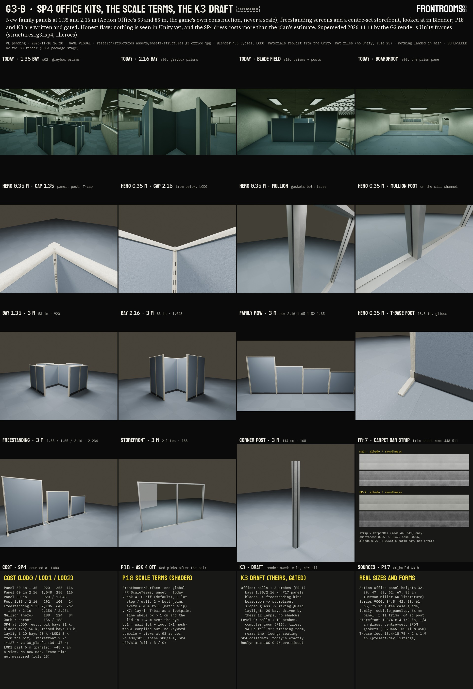

### G3b.8 Cost (ESTIMATE; LOD0; measured at G3 render)

**SP4, new dress:**

| Piece | LOD0 |
|---|---|
| pit bays 1.35 + 2.16 (12 panels, 26 posts) | about 31 k |
| the 26 blades | about 56 k |
| the raised floor's two bays | about 18 k |
| the laylight's 20 bays | about 20 k (LOD1 about 3 k from the pit, past 10 m) |
| the storefront | about 2 k |
| **total** | **about +127 k** |

Against 30_plan's props +32-44 k and laylight +2-3 k, this is over by about 80 k at LOD0. In a view, with the panels' LOD1 past 6 m, it is about 45 k. If it binds, the blades' far rows can take LOD1 earlier (sidecar distances); the panels are already lean.

**SP3's rooms** are G3-a1's and G3-a2's estimates: the computer room about 70 k, the training room about 65 k with tucked rows, the mezzanine about 60 k.

**Maps and lights.**
- New maps: none (P17 uses main's surfaces; FR-7 replaces a strip in place).
- Lights: SP4's count is unchanged, and its shadowed lights fall by 4 (the 12 laylight lamps' one-in-three); SP3 gains 2 unshadowed up-fills.
- 16 realtime probes are rendered once.

Frame time not measured (rule 25).

### G3b.9 For G3 render (owed; nothing here ran in Unity)
- **Import and gate.**
  - Import P16 + P17 + P18 + `structures_trim_fr7` into the clone and apply K3 from `gate_g3/files`.
  - Gate again on the clone; KitImporter v3 remaps by sidecar slot.
- **Compile.** `CompileVariant` of FrontRooms/Surface (P18: every keyword set with `_FR_ScaleTerms` at 0, B and C; Metal mac and iOS + D3D; the known-bad control failing), plus P16's new materials.
- **NEW off = today.** 0 px over 1/255 at SP3 s06 and SP4 s00, with `_FR_ScaleTerms` 0.
- **Walk test.** fail=0 in NEW and TODAY. SP3's rooms take new colliders; check the mezzanine's aisles and the training rows' backs.
- **flash_check.** The laylight with lamp modes on, and LC-2's two-lamps-in-step film.
- **TODAY | NEW.**
  - SP3 s00-s14 and SP4 s00-s15, with the phone row at SP3 s00 and SP4 s00.
  - Heroes: the reel window, the caps at 1.35 and 2.16, a laylight panel lit and dead, a storefront mullion, a file shelf.
- **Ask 4 for Red** (TODAY | ask 4 off | B | C):
  - SP3 s04 / s05: V4, 14.6 m of L0_Wallpaper, joins at 6.4 and 12.8 m;
  - SP3 s00 / s01: the spine, lot steps at the arches;
  - SP4 s00 / s10: Office_Wall, lot step only.

  Set the state through `FrontRoomsStructuresAssets.Cycle(4)` in the harness until the key's ask lands.
- **Orientation checks** (placements read from the sidecars, not yet seen):
  - the computer room's console (desk yaw 180, terminal at the monitor anchor), the edge trim and the ramp nosing;
  - the training room's OHP throw toward the screen;
  - the mezzanine's carriages (east ones turned 180 so their wheels face the cross aisle).

### G3b.10 Files and how to resume
- **Kits.** `W/structures_assets/kits/frontrooms_kit/assets/_struct_office.py` and 12 `structures_*.py` (written by `kits/g3b/make_modules.py`; list `kits/g3b/modules.txt`).
  - Build: `cd W/structures_assets/kits && Blender -b --factory-startup --python frontrooms_kit/build_asset.py -- $(cat g3b/modules.txt) --out-root out_g3b --no-preview`.
  - Stage: `W/venv/bin/python g3b/stage_g3b_kits.py`.
  - Look: `g3b/make_shots.py`, then `Blender -b --factory-startup --python g3b/g3b_look.py -- g3b/shots.json`.
  - Sheet: `G3B_STAMP=... W/venv/bin/python -B g3b/make_g3b_sheet.py`.
- **P18.** `kits/g3b/patch_surface.py <base> <out>` and `patch_assets_cs.py` (the shader and .cs into `pkg/g3/structures_scale_terms`, with `_base/`).
- **G11.** In the same package: `FrontRoomsStructureBevels.cs`.
- **FR-7.** `kits/g3b/trim/` (`patch_fr7.py`, the generator copies, `gen_main` / `gen_fr7`); staged `pkg/g3/structures_trim_fr7`.
- **K3.**
  - Hunk scripts: `kits/g3b/patch_office.py` and `patch_level0.py`, applied to main's files into `gate_g3/files`.
  - Shared asks: `kits/g3b/patch_shared_asks.py`.
  - Gates: `python3 W/tools/fr.py gate --staging W/structures_assets/gate_g3` (and `gate_g3_shared`).
  - Contract: `W/apply/structures_l0_office_contract/`.
- **Packages.** The convention-v2 packages (`W/apply/structures_office_props`, `structures_scale_terms`, `structures_trim_fr7` and `structures_l0_props`) are made at G3 package, from `pkg/g3/*`. `structures_scale_terms` and `structures_trim_fr7` replace main files (`_base/` = main now); the others add new paths.
- Corrections to G3b.8:
  - The pit bays are 24 panels (four 60 in arms and eight 30 in caps a bay) and 26 posts.
  - The laylight's 12 lamps lose their shadows. Today up to four may shadow (one in three); s12 shows two.

## G4 render · TODAY | NEW in SP5, SP7 TODAY with its end kits, the films, the walk, the proof (2026-11-11 06:57-07:5x)

Line 游戏视觉 (visual), the render queue of session local_a9a1dce2 (account B), stage G4 render; Unity on AC power only (pmset: AC from 06:55:28; the G3 render before it ended blocked on battery, no Unity). Red's words this stage follows (this line's chat): 2026-11-05 17:42 "我需要你开始对structure scene里面的资产进行全方位的升级和revise，就像是主游戏项目的标准一样", 17:42:55 "升级的逻辑和之前一样，调研现行，再进行revise"; 2026-11-07 21:52:22 "全部按推荐" (ask 3 B, ask 5 B: the game's lamp modes, photosafety first). Done here: the G4 packages, K4 and the shared polish contract applied and rendered in the clone W/proj_unlock; my own look at every frame; two fixes from it; every rule 25 gate. Not done: nothing landed in main (the package stage makes the packages), no git, no download, nothing played aloud, nothing deleted (moved aside to W/_partial).

### G4r.1 The build in the clone
- Sync (targeted stat-then-sha1 compare, `tools/g4r/sync_compare.py`, as STAIR REMEASURE did: main's 177 iCloud placeholders never read, Assets 0): the clone already equalled main in Assets (10 WorldText metas are Unity's own, ProjectSettings.asset keeps the private name); 3 new Blender modules of G2-d copied. The clone's own files saved first in `clone_only_save/g4r_presave/`.
- Main moved since the authors only in `FrontRoomsLampKit.cs` (dd8cfe1a -> 5a2a6e49, LW3's `TryFamilyOf`): G4-a's six hunks patch clean on it -> **7ca3b087** (IsKitLens to DockArm; `TryFamilyOf` walks every loaded kit, so WallPack and DockArm join it). Run.cs (37e4896d) and Kit.cs (9807b496) are K4's and the shared contract's bases; Look.cs ecb73796 and Structures.cs 86476523 the shared contract's.
- Applied: `pkg/g4/structures_dock` (161) + `structures_run_service` (111), LampKit 7ca3b087, the shared polish contract's files (Structures fe81ba45, Look 811d6112, Kit 9c3469b6), K4's Run.cs 99faf0e0. Gate `structures_assets/gate_g4r` (those 5 on main now): **FR GATE OK, macOS + iOS 0 errors, 5 overrides**.
- Setup (clone-only G4-a setup + G4-b's 33 kits): lamp models configured, ZL_WALLPACK / ZL_DOCKARM prefabs + _Phone, 55 kits reimported after their surfaces (FrontRoomsKitImporter v3), `Available(WallPack / DockArm)` PASS, 8 surfaces + _Phone PASS. The Unity-made files (lamp prefabs, model and kit metas) copied back into the packages (structures_dock 215 files, structures_run_service 177).
- Harness (clone-only survey, v7-v9; W master `tools/g4r/harness/`): tripped stills by the district's own T key, the HPS film (both sodium heads driven by `HpsTick` through a line dip, by reflection), the trip film, views that place unwired kits, the G4 shader-gate list, scene 4's placards and blades hidden for the sheets (`SAS_NOPLACARD`), the Relay stand-ins hidden in the review views only. Runner `tools/g4r/run_g4r.sh` (AC check before and after the slot wait, watchdog, SWAP = main's five files for TODAY).

### G4r.2 Jobs (one slot hold each; every one Unity exit 0, 0 error CS, harness fail=0, console errors 0)
| job | what | time |
|---|---|---|
| setup | import + prefabs + kit reimport + checks | 25 s |
| N g4r_new | TODAY SP5 s00-s05 + SP7 s00-s06 + TODAY tripped; NEW steady SP5 + tripped + inventory; 33 views x 2 | 185 s, 93 shots |
| F g4r_films | NEW game modes: s00 / s03 10 s; HPS films x 3; trip films s00 / s03 | 80 s |
| Q g4r_phone | phone tier SP5 s03 TODAY + NEW; the G4 shader gate before Play | 210 s |
| W / Z | walk test NEW / TODAY, SP5 | 10 s each |
| T g4r_main | main's code (SWAP): N's sequence | 30 s, 62 shots |
| V g4r_sheet / U g4r_main2 | placards hidden: the sheets' stops + views / main's code TODAY for the placard-free proof | 30 s each |
| H g4r_sheetv | the views again, stand-ins hidden, closet cameras moved | 30 s, 70 shots |

### G4r.3 TODAY | NEW (my look, rule 26)
s00 / s02: the services are kits (24 x 12 in duct with its slips and hangers, the 4 in main in grooved 3 m lengths with heads, the ladder tray with splice plates), FD1 / FD2 have their frames and DA leaves; s01: the caged ladder, riser and tray riser in the shaft; s03: the leveler stored flush with its yellow stripes, the dock light on its post, stanchions and chains with the self-closing gate, the dumpster; s04: the coiling door half up (slats, hood, hand chain, bollards) with the sodium slot under it; s05: the welded-wire cage door with its sag brace, hasp and padlock. Tripped (T): the strips go dark through the Look (LC-6: their lenses follow their lamps in NEW), the red tubes and the sealed beams light, the HPS slot stays. Heroes at 0.35 m and 3 m read: slat V joints and spangle, the hood's hem, the hoist's pocket wheel, the lip's hinge and lentil tread, the HPS refractor's prisms lit, the PAR38 face behind its guard, the laminated padlock, the time clock's dial, the hose valve, the mop sink, the floor machine. SP7 stays TODAY (Red's #3); its four end kits, placed by the harness before FD1, read in its light: the collar's wool joint and bolts, the comb's 112 teeth, the caged work lamps on yellow cord, the stud and gypsum scrap.

### G4r.4 Fixed from my own look
1. **Time cards printed digits.** The cards on `Prop_StationPaper` showed '214 / 299' and grey bars (lettering; Red 11-10 11:11 no 平面视觉): `_struct_run.py` PAPER = `Prop_Paper` (main's blank card stock), `Kit_TimeClockStation` 9c3f33c6 + `_OneIn` 7f2c28c8 rebuilt (Blender 4.3, same 3,616 / 1,458 / 376), in the package and the clone; the frames re-rendered (blank cards). Old ones in `W/_partial/g4r_struct_run_before_cards/`.
2. **Cameras.** The dock-wide camera sat inside the new wrapped load; the closet view hid the sink and floor machine behind today's cart; SP7's heroes stood past FD1, so the teleport tripped SP7's red alarm state: moved (rows in `tools/g4r/g4r_views.tsv`; earlier lists in `W/_partial/g4r_views_v1`, `_v2`).
3. **English-only sheets.** Scene 4's Chinese placards and blades hidden for the sheets' frames (harness only; the proof also run without them, G4r.5).

### G4r.5 Gates (rule 25)
- Roslyn macOS + iOS 0 errors: `gate_g4r` (5 overrides); K4 alone re-gated on main now (`W/apply/structures_run_contract/GATE.txt`, 2026-11-11 07:42, 1 override).
- Shader gate (no shader text changed in G4): the 14 dock surfaces, the 2 lamp lenses, Prop_MoldedStone + _Phone: 4 FrontRooms/Surface keyword sets x Metal macOS / Metal iOS / D3D fragment + Metal vertex, LampPool: 24 ok, 0 failed; known-bad control fails 3 of 3 -> PASS (`renders/g4r_phone/compile_check.txt`).
- Walk test NEW (the game's body): fail=0, 6 of 6 stops reached and walked back; floor points 2,336 (TODAY 2,341), from the arrival 1,037 (1,049), one-way 0; closet 26 of 26, bay 238 of 238, platform 276 of 278.
- NEW off = today: main's code (Run, Structures, Look, Kit, LampKit swapped in) against this build, both NEW off, noise off, placards hidden: **0 px over 1/255 at all 52 frames** (SP5 s00-s05, 4 tripped, 27 views; SP7 7 stops + 8 views; max 1 at s03) (`renders/g4r_proof_noplacard.tsv`). With placards shown, the only differing pixels are glyph speckle inside their text (`renders/g4r_proof.tsv`).
- flash_check (area rule, worst second, limit 3; `renders/g4r_films/flash_summary.tsv`): s00 game modes 2.0, s03 0.0; HPS through a 0.3 s dip to 0.5 (both out in one step, 6 s cool, restrike at 3 % pink-violet, 16 s through mercury blue to sodium) 0.5 from the bay and 0.5 from the ramp; a failing head cycling out 0.5; trip and power back 0.5 at s00 and s03.

### G4r.6 Cost (inventory, NEW steady; main's NEW -> G4)
Renderers 414 -> 1,089; LOD0 triangles 116,761 -> 432,477 (the worst case, every LOD0 at once: battery heads 85 k = 22 sealed beams + yokes, R-B strips 52 k, DA leaves 28 k, cable tray 28 k, coiling door 19 k); materials 64 -> 81; lights 36 -> 36; collider components 27 -> 23 (today's stand-in boxes become boxes in the district's merged collision mesh at the same sizes, plus the fourth bollard, the sink, the floor machine and the loads / desk / jack / shelving sidecars); new maps 11.7 MiB (dock) + 0.4 MiB (molded stone). Frame time not measured.

### G4r.7 Seen and left (for the owners and Red)
- The leveler deck reads near-black at the stops (dark paint as authored; SP5 has no reflection probe, so the worn crowns' steel shows only up close).
- The hose cabinet's glass shows the game glass's dust specks at 0.35 m (FrontRoomsGlass grime, full at 0.8 m): the game's own glass.
- FR-1 in SP5: the cage's wire kits have two faces; from the corridor the wire reads light grey (TODAY and NEW), from inside the locked cage it reads dark in both (backlit by the corridor; the inside is not walkable). The shared contract's K-3 is not exercised by SP5 (no `MeshGuard` there in NEW).
- With the goal door open, 2 walk points (0.3 m2) sit between its leaf, the west wall and the high wrapped load; with the door shut the corner is open (K4 README section 6).
- The HPS heads stay steady (K4, ask 5 B); HpsTick is photosafe on film; driving it is the owners' call (no dip source in SP5 today).

### G4r.8 For the package stage
Changed since the authors, all in our staging: `pkg/g4/structures_dock/Assets/Scripts/Rendering/FrontRoomsLampKit.cs` = 7ca3b087 on main's 5a2a6e49 (note `pkg/g4/structures_dock_LAMPKIT_BASE.txt`; the dd8cfe1a version in `W/_partial/g4r_pkg_lampkit_dd8cfe1a/`); `Kit_TimeClockStation` / `_OneIn` fbx + json and `_struct_run.py` (blank cards); the Unity-made metas and the lamp prefabs in both packages. K4: README RENDERED, GATE.txt re-run on main now; the shared polish contract: README carries G4's frames, DRAFT until G3's. The clone W/proj_unlock now holds main + all of G4 (packages, K4, the shared contract, LampKit 7ca3b087) + harness v9; C's own earlier files are in `clone_only_save/g4r_presave/`.

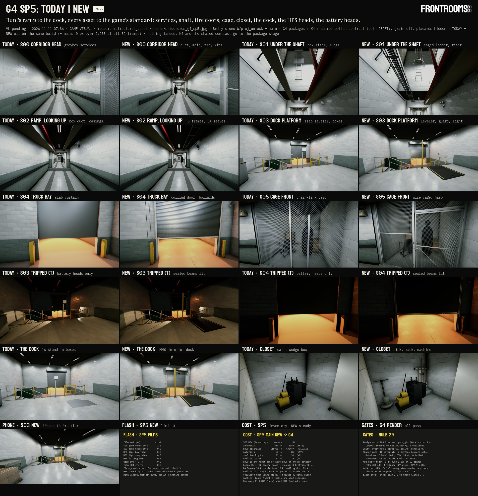
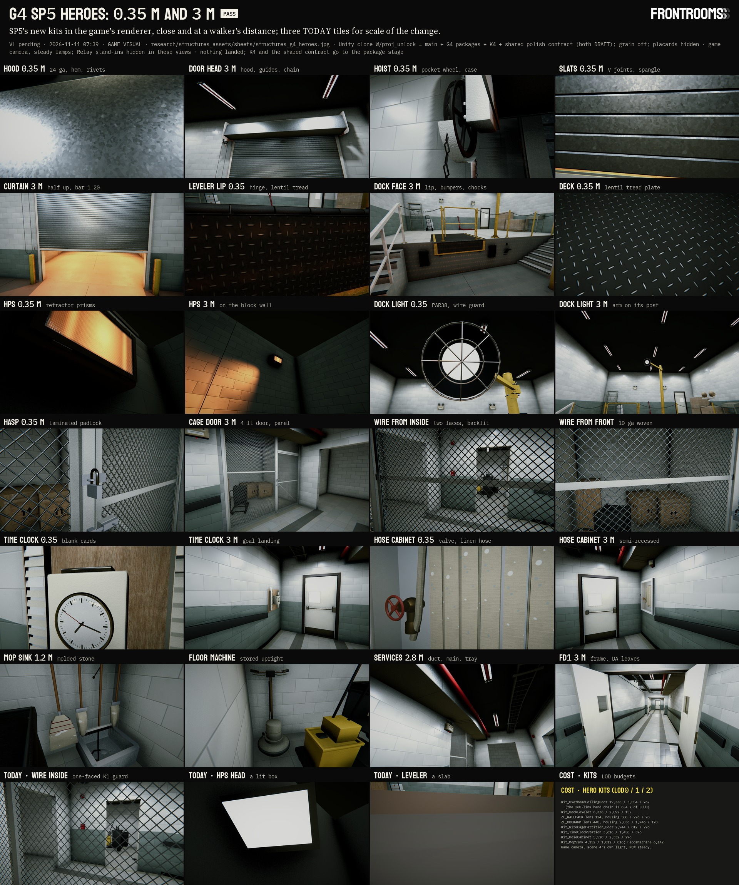
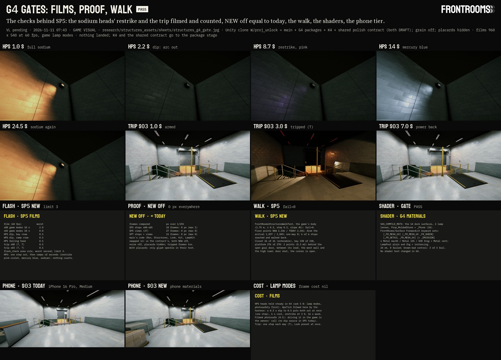
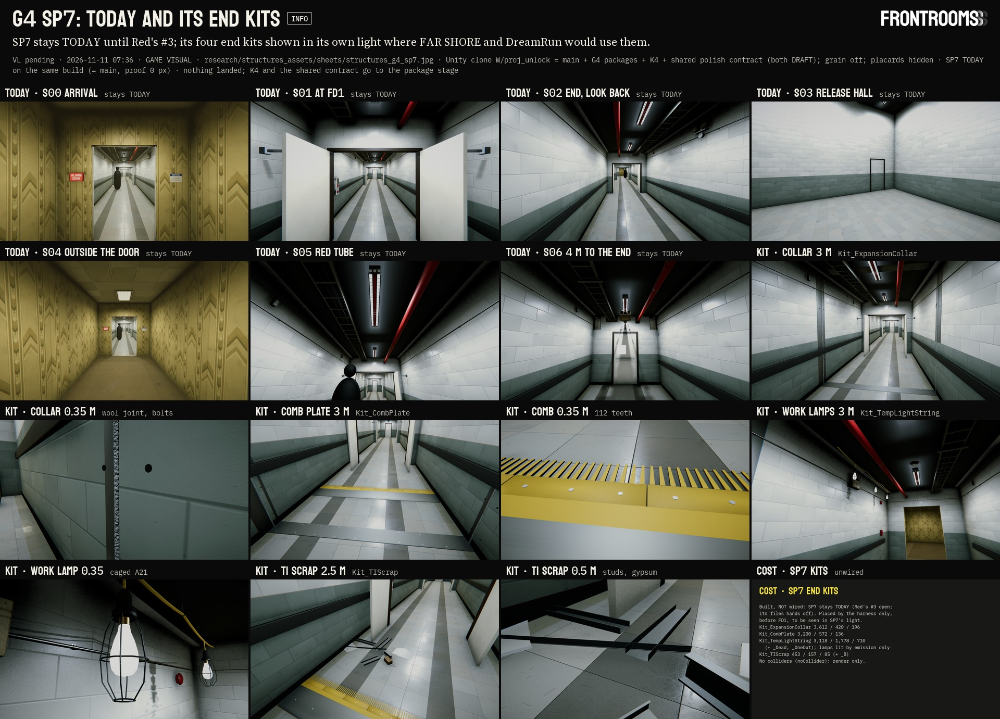

## G3 render · TODAY | NEW in SP3 and SP4, the heroes, ask 4 for Red, the films, the walk, the proof (2026-11-11 07:48-08:5x)

Line 游戏视觉 (visual), the render queue of session local_a9a1dce2 (account B). The G3 render stage of 11-10 ended blocked on battery (no Unity); the G4 render ran at 06:57 on AC; this G3 render ran inside the G3G4 package stage, on AC power only (pmset: AC since 06:55:28), because the package stage needs its frames (K3's README, ask 4's sheet, P18's shader gate). Red's words this stage follows (this line's chat): 2026-11-05 17:42 "我需要你开始对structure scene里面的资产进行全方位的升级和revise，就像是主游戏项目的标准一样", 17:42:55 "升级的逻辑和之前一样，调研现行，再进行revise"; 2026-11-07 21:52:22 "全部按推荐" (ask 3 B; ask 4 built OFF, C only after Red sees the comparison; ask 5 B); 2026-11-10 11:11 3D only, no lettering. Done here: G3's four packages, K3 and (already in the clone from the G4 render) G4, K4 and the shared polish contract, rendered in the clone W/proj_unlock; my own look at every frame; two fixes from it; every rule 25 gate. Not done: nothing landed in main, no git, no download, nothing played aloud, nothing deleted (moved aside to W/_partial).

### G3r.1 The build in the clone
- Main had not moved since the G4 render (no LANDINGS row after 11-10 17:17): K3's bases (Office 23b8f22d, Level0 1f3719ed, Level0Beyond 602b1ef2), P18's (Surface.shader b38ecd5d, Assets.cs 93f3e805, Bevels.cs f65ffae7), FR-7's (gen_struct_trim.py fa7e1523 and its maps), the shared contract's (Structures 86476523, Look ecb73796, Kit 9807b496), K4's (Run 37e4896d) and LampKit 5a2a6e49 are main's: no rebase.
- Sync check (`tools/g4r/sync_compare.py`, stat then sha1, main's 154 iCloud placeholders never read, none in Assets): the clone equalled main in Assets apart from G4's files.
- Applied (`tools/g3r/apply_g3_to_c.py`, sha1-checked; the clone's older copies in `clone_only_save/g3r_presave/`): `structures_l0_props` 590 new, `structures_office_props` 63 new, `structures_scale_terms` 3 and `structures_trim_fr7` 5 replaced, K3's three files. G3's 279 GUIDs: no duplicate, none shared with the clone's 4,538. Roslyn on the clone's whole tree, macOS + iOS: 0 errors.
- Setup (`tools/g3r/harness/FrontRoomsStructuresG3Setup.cs`, clone only, moved out after): 9 G3 surfaces and their `_Phone` twins on FrontRooms/Surface with their base maps bound; the 114 G3 kit models reimported after their surfaces (KitImporter v3 remaps); all 139 kit names K3, the OfficeKits builder and G3 use resolve; 342 kit renderers, no empty slot. Unity rewrote 146 package metas (the importer's material remaps in 146 kit metas... in 134 + 12 fbx metas, the texture importer's settings in the map metas; GUIDs unchanged): copied back into `pkg/g3` (the authored ones in `W/_partial/g3r_pkg_metas_before_unity/`).
- Harness v10 / v10b (W master `tools/g3r/harness/`, from G4's v9): modes `newpaper1` / `newpaper2` (ask 4 B / C, lamps steady, through `FrontRoomsStructuresAssets.Cycle(4)`; `newpaper0` = A); kit-anchored cameras (`kit:<Name>[#n]@x,y,z`, written back district-local to `views_resolved.tsv` for a TODAY run of the same cameras); `SAS_LC2FILM` (LC-2's worst case, below); `SAS_COMPILE_WEBGL` (GLES3x in the shader gate). Runner `tools/g3r/run_g3r.sh` (AC check before and after the slot wait, silence, private name, watchdog; SWAP = main's 15 files for TODAY: K3 3, K4, shared 3, LampKit, P18 3, FR-7's 4 maps); chain `tools/g3r/run_g3r_chain.sh`.

### G3r.2 Jobs (one slot hold each; every one Unity exit 0, 0 error CS, harness fail=0)
| job | what | time |
|---|---|---|
| S setup | import, kit reimport, checks | 25 s |
| N g3r_new | TODAY SP3 s00-s14 + SP4 s00-s15; NEW steady the same + inventories; ask 4 B / C; 29 kit heroes x 0.35 / 3 m | 325 s, 132 shots |
| F g3r_films | NEW game modes: SP3 s00 / s06 / s09, SP4 s00 / s12 (10 s); LC-2 centre pairs (20 s); OFF | 135 s |
| Q g3r_phone | phone tier SP3 s00 + SP4 s00 TODAY + NEW; the shader gate over all 411 FrontRooms/Surface materials | 755 s |
| W / Z | walk test NEW / TODAY, SP3 + SP4 (W again after the K3 fix) | 10-20 s |
| T g3r_main | main's code (SWAP): TODAY stops + the 58 hero cameras; main's NEW + inventories | 100 s, 120 shots |
| V g3r_views2 | 13 re-aimed cameras + SP3 s09 NEW after the fix | 145 s |
| G g3r_films2 | LC-2 with the pair nearest the camera (v10b) | 80 s |
| P g3r_ask4 | ask 4 C, B, A, B, C at SP3 s00 s01 s04 s05, SP4 s00 s10 (each mode's last pass kept) | 15 s |
| Y g3r_viewsT | the contract's TODAY: every stop, then the 58 hero cameras (the proof on views) | 20 s |
| O g3r_off | SP4 with every light at 0 at s00 / s09 (FR-9) | 10 s |

### G3r.3 TODAY | NEW (my look, rule 26)
- **SP3.** s06: the computer room on G1's access floor: two cabinet rows face to face across the cold aisle's perforated tiles, the reel and cartridge drives and the tape rack on the north wall, the downflow unit, the halon pair, the console with its terminal, the lifted tile and its lifter, the band printer with forms; s09: the training room's three rows on the tiers' middles, chairs behind them, the overhead throwing to the lit wall screen, the lectern, the marker board (lines and boxes, no lettering), the easel, the TV cart, a stack of six; s12: the lounge's sofa, club chairs, turned tables, lamp and smoking stand; s13: open end-tab files and mobile carriages under the gallery in place of one grey mass; s01-s03: pickets on the public rails (ask 3 B, K1); s04 / s05 (V4): the two up-fills add a little light to the lid. s07, s08, s10, s11, s14 are G1's as in main.
- **SP4.** Every pit bay at 1.35 / 2.16 m is the panel family (rounded cap rails, slotted standards, T-caps, the base raceway) in place of today's flat prisms with box posts; s08: the boardroom's three storefront openings (jambs, mid mullion, head and sill channels, gaskets); s09: the laylight bays with their lamp rows behind the prismatic panels and a dead row; s10: freestanding screens with T-feet; s11: the raking glass guard (shoe, sheared panes, cap rail) in place of a sloped slab; s12: the guard is K1's glass (today's greybox guard with diagonal braces).
- **Heroes** (`structures_g3_heroes.jpg`): the reel window with both reels, the processor's indicator strip, the disk cabinet's glazed top, the band printer's forms, the console and the lifted tile, the EPO and halon abort station, the overhead from beside and behind, the stack of six, the open files' end tabs, a carriage's hand wheel, the laterals with a drawer out, the 1.35 post's cap and T-caps, the 2.16 cap from below, the T-foot, the mullion's gaskets, the laylight lit and with its dead row.
- **The overhead's throw** (G3b.9's check): from beside and from the audience side the post stands on the audience side and the head throws to the wall screen (+z), which shows the stage's chart: correct.

### G3r.4 Fixed from my own look
1. **The walk test's two one-way pockets** (W, first run): the training room's session row (z 13.5) had its pulled-out chairs 0.62 m from the 0.3 m riser behind them; at (59.06 / 60.94, -0.6, 12.44) a player could drop in from the tier above and not climb out. K3 (ours to author, theirs to land): the session row 0.2 m toward the presenter (z 13.7), its chairs 0.82 m clear: Level0Beyond.cs 2bc0a196 -> **fc212e76** (`kits/g3b/patch_level0.py`, the contract's `files/` and `CONTRACT.diff`, the gate stagings, the clone). Walk again: one-way back to TODAY's three (G3r.5).
2. **Cameras.** 3 m from a kit's front hit walls and the next kit in SP3's small rooms, and some 0.35 m crops showed one flat panel: 13 cameras re-aimed (`tools/g3r/g3r_views2.tsv`).
3. **Ask 4's A frames.** The first pass (A) was taken while the districts' build was settling and differed from B / C on reflective things by up to 46 / 255: P re-run as C, B, A, B, C so every frame is a settled one.
4. **The shader gate's count.** The harness counted the GLES3x fragment calls as failures; GLES3x packs a pass's two stages into the vertex-stage program, so those calls return no bytes and no error: re-tallied (`tools/g3r/g3r_compile_tally.py`).
5. **Sheet text.** SP4 s12's TODAY 'X' is today's guard braces, not shadows.
- Correction to G3r.1's meta line: Unity rewrote 146 package metas, all 114 kit `.fbx.meta` (KitImporter v3's material remaps; their bodies are main's kit standard) and the 32 map `.png.meta` (the texture importer's settings); GUIDs unchanged.

### G3r.5 Gates (rule 25)
- **Roslyn macOS + iOS 0 errors** (`fr gate`, main eb220af8, main_fp 1a713af9372c): our six G3 + G4 packages alone on main (`gate_g3g4_pkgs`, 4 overrides: LampKit, Assets, Bevels, OfficeKits); K3 + our three .cs (`gate_g3`, 6); with the shared contract (`gate_g3_shared`, 9); everything of G3 and G4 together (`gate_g3g4_all`, 11: our 4 .cs + K3 3 + K4 1 + shared 3); the shared contract alone (3), K4 alone (1).
- **Shader gate of P18** (Q, before Play; `renders/g3r_phone/compile_check.txt`, `compile_tally.txt`): every FrontRooms/Surface material in the project, 411 materials = 22 distinct keyword sets x ForwardLit on Metal macOS / Metal iOS / D3D fragment, Metal vertex and WebGL GLES3x, plus LampPool plain and with fog + instancing: **140 ok, 0 failed**; GLES3x packs both stages into the vertex-stage program (its 22 fragment calls return no bytes and no error; the program is smaller where the shader compiles a feature out on GLES3 by design: `_FR_DETAIL`, `_FR_TILE`, P18's `FR_SCALE`); the known-bad control fails 3 of 3, the clean one passes 3 of 3 -> **PASS**. `_FR_ScaleTerms` is a global: no keyword, no new variant.
- **Walk test** (the game's body 1.75 m, r 0.3, step 0.3, slope 45): NEW fail=0, TODAY fail=0. SP4's floods are identical (9,428 floor points, 6,019 from the arrival, one-way 0): every SP4 collider is today's. SP3: 45,643 floor points NEW / 45,678 TODAY, from the arrival 17,510 / 17,691 (the three rooms' kits take floor), one-way 3 / 3 after the fix (TODAY's three, in main too: (35.18 / 35.44, 0, 4.4), (173.44, 0, 8.44)).
- **NEW off = today** (`renders/g3r_proof.tsv`, main's 15 files swapped in vs this build, both NEW off, noise off, placards hidden): **0 px over 1/255 at every frame**: the 31 stops in two runs (N, Y) and the 58 hero cameras (max 1).
- **flash_check** (area rule, worst second, limit 3; `renders/g3r_films*/flash_summary.tsv`): the game's lamp modes 10 s at SP3 s00 / s06 / s09 and SP4 s00 / s12: 0.0 each. **LC-2** (K1 review: two moded lamps on the same part of the screen; harness v10 / v10b forces the pair to Stutter and starts their episodes together every 4 s with the second 0.275 s late, so 12-16 dips each interleave in 20 s): the pair nearest the screen centre at SP3 s00 / SP4 s00 / SP4 s10: 0.0 / 0.0 / 0.0; the pair nearest the camera at SP3 s00 / s09, SP4 s00 / s12: **2.0** / 0.0 / 0.0 / 0.0 (the 2.0 is the spine's first two troffers, one a Dead lamp forced to Stutter, whose 0 -> 1 start is a test artefact). Every case <= 3: ask 5 B (the game's lamp modes) stands.
- **FR-9** (O): SP4 with every light at 0: the laylight goes dark (top third of s09 mean 130 -> 28 / 255).

### G3r.6 Cost (inventory, NEW steady; main's NEW -> G3)
| District | renderers | LOD0 triangles (worst case) | materials | realtime lights | reflection probes | collider parts |
|---|---|---|---|---|---|---|
| SP3 | 3,144 -> 3,536 | 388,558 -> 700,410 (+311,852) | 39 -> 75 | 422 -> 424 | 0 -> 13 | 37 -> 117 |
| SP4 | 1,145 -> 1,563 | 149,362 -> 275,416 (+126,054) | 29 -> 27 | 111 -> 111 | 0 -> 3 | 43 -> 43 |

- LOD0 is every LOD0 at once. SP3's 700.4 k: G3's own kits 253.7 k (computer room, training room, mezzanine), main's L03 troffers 174.7 k, G1's rail posts and brackets 112.6 k, runtime meshes 65.7 k. **Over the plan:** 30_plan section 6 gave SP3 props +132..+183 k (after 400-510 k) and SP4 after 182-247 k; G3's SP3 props are about 1.7-2.4x the plan's and SP4 ends 28 k over its range (the raking glass reuses K1's shoe end caps: 51.8 k). Per view the kits' LOD1 / LOD2 apply (the plan's 40-70 k drawn in the heaviest views is not measured here). Frame time not measured (rule 25). New maps: G3-a1 9.2 MiB desktop / 2.3 phone, G3-a2's 16 maps (60_build G3a2.6); P17, P18, FR-7: none.
- Lights: SP3 +2 (V4's up-fills, unshadowed, outside the pattern), SP4 the same 111 with the laylight's 12 unshadowed.

### G3r.7 Ask 4 for Red (`structures_g3_ask4.jpg`, WAIT-RED)
- A (off, today's pick), B (a lot per wall: 1.5-2.5 % lighter or darker, hue +-0.6 %), C (B + a butt join every 6.4 m up a wall taller than one roll: only V4 gets joins) at SP3 s00 / s01 / s04 / s05 and SP4 s00 / s10, settled frames.
- **What the frames show:** B moves a wall by 3 / 255 at most; C adds at V4 the joins and the pattern's slip (14-18 / 255 at most); the 1.5 mm line is under a pixel from 5-8 m, a faint line in the 2x crops. At the game's camera B and C are hard to see; the sheet's x24 tiles show where they act.
- **Recommendation: C**, as 30_plan (it is how real paper hangs, costs 10-20 ALU on papered and painted walls in scene 4 NEW only, no map, WebGL compiles it out). **Honest flaw:** it is nearly invisible, so the tall walls still read as one repeat; the walls' scale is carried by the light (V4's up-fills) more than by the paper. A stays until Red picks; the key (backquote) is the shared contract's S-1.

### G3r.8 Seen and left (for the owners and Red)
- The phone tier logs one structures warning in SP3 / SP4: Look's GZ-A probe capture "ended without its probes seen rendering" (new with K3's hall probes; SP5 has none, so G4's phone job had 0). Harmless here (no pool glaze in SP3 / SP4); the owners may scope GZ-A's check to districts with reflection proxies.
- K-2 (G7, the flight's waist) is not visible at any stop's camera: its frame is the combined test's (SP4's slot flight 2 seen along its side).
- The training room seats three rows (the stand-ins' fourth row moved off for the presenter, as drafted).
- The dot-matrix and band printers' forms carry a printed-lines texture (no legible text); the marker board shows lines and boxes only (Red 11-10: no lettering).
- FR-5 / G8 stays prose (the shared contract's README).

### G3r.9 For the package stage
Changed since the authors: K3's Level0Beyond.cs (fc212e76, the session row); `pkg/g3/*` metas (Unity's, copied back); the contract's GATE files re-run on main now. The clone W/proj_unlock holds main + all of G3 and G4 (six packages, K3 with the fix, K4, the shared contract) + harness v10b (`4898548c`); the G3 setup script is out (`clone_only_save/g3r_setup_after/`).

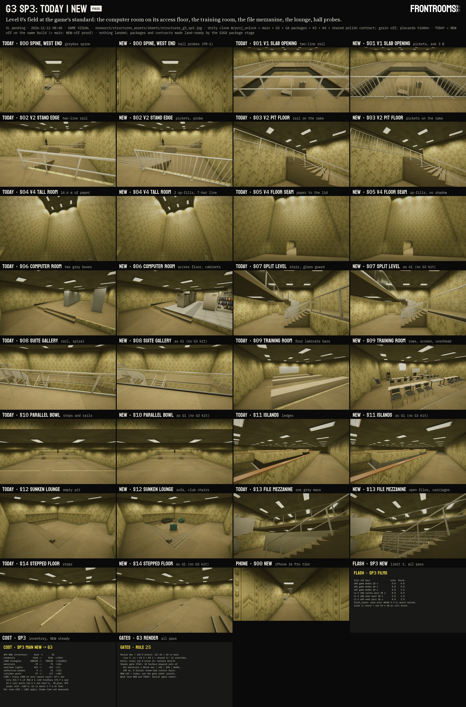
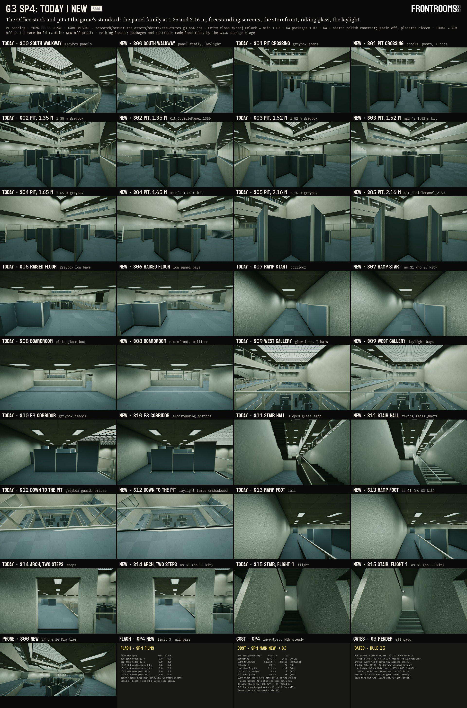
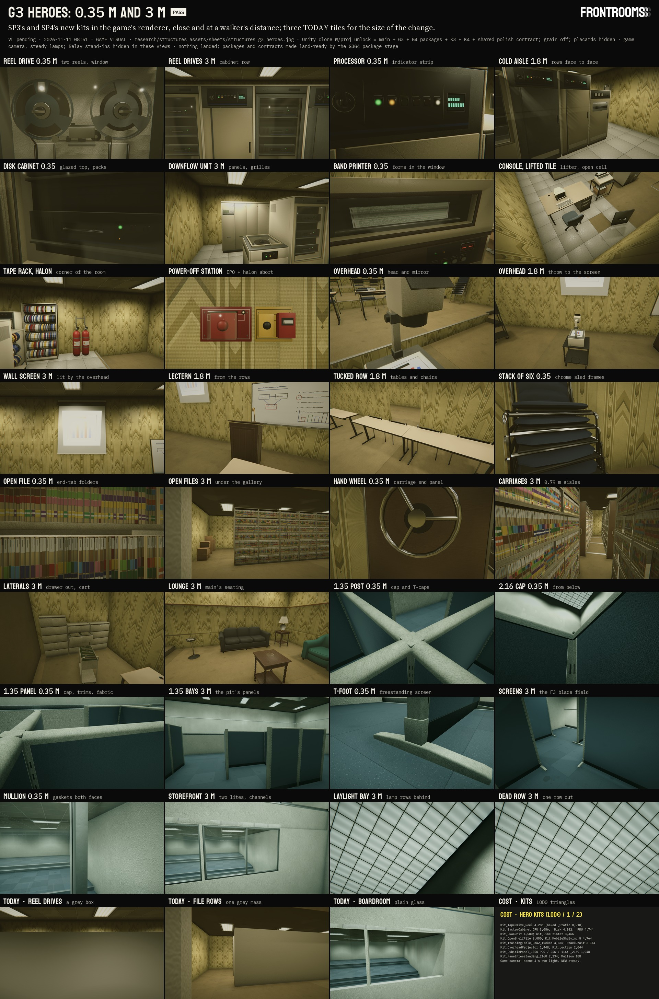
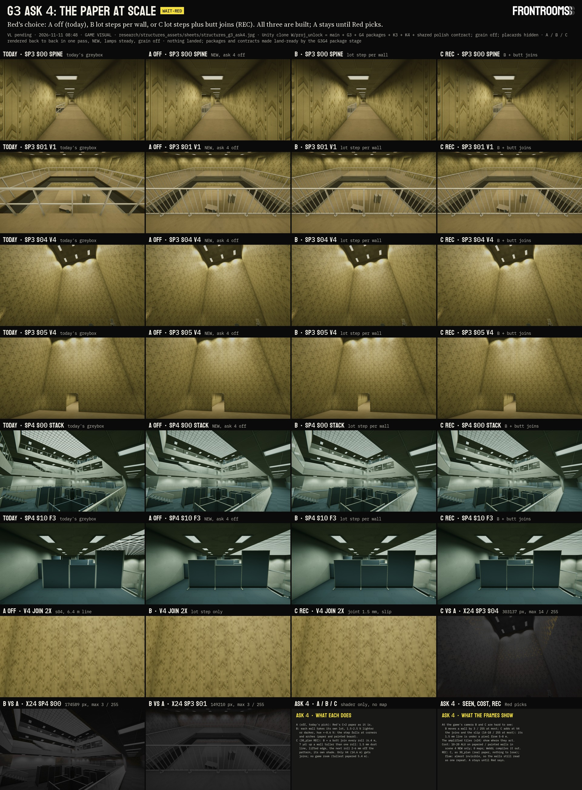
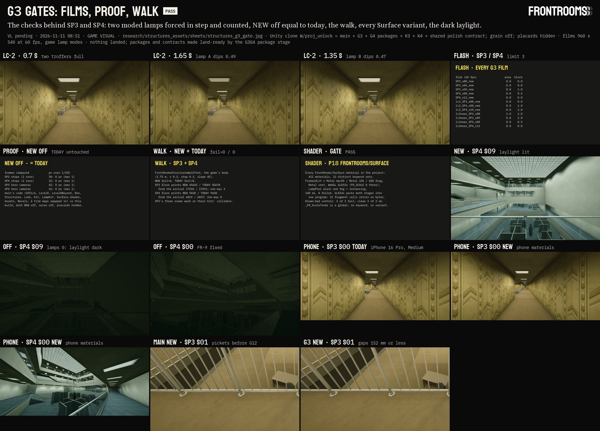

## G3G4 package · G3 and G4 made land-ready (2026-11-11 07:48-09:0x)

Stage agent of the 游戏视觉 render queue (relay on account B, session local_a9a1dce2), after "G4 render" (DONE 07:45); it ran "G3 render" above first (its frames were this stage's to show). No git; no download; nothing played; nothing deleted (earlier files moved aside to `W/_partial/`); nothing written to main. Red's words this stage follows: those of "G3 render" and "G4 render" above.

### G3G4p.1 Main since the render stages
Unchanged since 11-10 17:17 (the last LANDINGS row); every base of the six packages and the three contracts is main's file now (main head eb220af8, main_fp 1a713af9372c).

### G3G4p.2 Our packages (convention v2, `W/apply/`; tool `W/structures_assets/tools/make_g3g4_packages.py`, overlays `pkg/g3g4_overlay/<track>`, logs `logs/pkg_g3g4/`)

| Package | Paths | What | Replaced (main -> package) |
|---|---|---|---|
| `structures_trim_fr7` | 5 replaced, 4 metas kept | FR-7: the trim sheet's carpet-bar strip and its generator | StructTrim_A bd42044f -> d769a3ed, _S 5252a15c -> eaf443c8, Phone_A 95cc7ee5 -> 068faac7, Phone_S 04c1d3e0 -> 2f4f344a, gen_struct_trim.py fa7e1523 -> da9a7903 |
| `structures_scale_terms` | 3 replaced, 3 metas kept | P18 + G11 | FrontRoomsSurface.shader b38ecd5d -> fc8bdde4, FrontRoomsStructuresAssets.cs 93f3e805 -> c78f5f3e, FrontRoomsStructureBevels.cs f65ffae7 -> 2cb15049 |
| `structures_l0_props` | 590 new | P16: SP3's computer room, training room and file mezzanine kits, 9 surfaces + `_Phone`, maps, modules, generators | - |
| `structures_office_props` | 63 new | P17: SP4's panel family and storefront kits, modules, `FrontRoomsStructureOfficeKits.cs` | - |
| `structures_dock` | 214 new + 1 replaced, 1 meta kept | P19: SP5's dock kits, the WallPack / DockArm lamp families (Unity-made prefabs), maps, materials, modules | FrontRoomsLampKit.cs 5a2a6e49 -> 7ca3b087 (G4-a's hunks rebased on main's LW3) |
| `structures_run_service` | 177 new | P20: SP5's services, shaft, cage, closet, hose cabinet, time clock kits, SP7's end kits, Prop_MoldedStone + `_Phone`, modules | - |

- **Checks before packaging** (each REFUSED on failure): text files LF; `.py` and Editor files ASCII; every Assets file byte for byte the clone's (what the renders rendered); every kit `.fbx.meta` carries main's kit importer standard (the body of main's `Kit_FloorDrain.fbx.meta` from `materials:` on) with remaps = the sidecar's slots (as a set: the `_Charcoal` cabinets name `Prop_PlasticGrey` in two slots); every Blender module equals the kits folder's (the shared helpers `kitlib.py` d6de07ab, `build_asset.py` cd0ef1ee, `_struct_common.py` 3cc7a153, `_run_b_common.py` 07dfabc4 are main's, unchanged).
- **One fix on the way:** `Kit_TimeClockStation` / `_OneIn` `.fbx.meta` in `pkg/g4` were their import before the G4 render rebuilt the kits with blank cards; the clone's kept a stale `Prop_StationPaper` remap beside `Prop_Paper`. Both rewritten to main's kit standard, their own GUIDs (adce2475..., 5a1cb87d...) and the sidecar's 9 slots, in the package and the clone (`tools/g3r/fix_kit_metas.py`; render-neutral; the old copies in `W/_partial/20261111_080728_kitmetas/`).
- **DRY RUN OK on main** for all six (08:08 / 08:14, `logs/pkg_g3g4/dry_*.txt`); **rehearsal** on scratch skeletons (`kits/rehearse_g1b.sh`; `W/_rehearsal/<track>_080748` and `_081442`): MANIFEST OK 5 / 3 / 590 / 63 / 215 / 177, then ALREADY APPLIED.
- **All six on main, no contract:** `fr gate --staging W/structures_assets/gate_g3g4_pkgs` (1,053 files, 9 replaced paths) = **FR GATE OK, macOS + iOS 0 errors, 4 overrides** (LampKit, Assets, Bevels, OfficeKits): they compile on main alone and stay inert (nothing of main's calls the new kits or builder; `_FR_ScaleTerms` is zero outside scene 4's NEW). `fr land` dry run on the same staging: **FR LAND DRYRUN OK** (1,044 new, 9 replace main; fresh GUIDs against main's index; LF; every path ours, no warning).
- The packages that change live files: `structures_scale_terms` (FrontRooms/Surface, used by the whole game: every new term sits behind a uniform branch on a global that only scene 4's NEW writes, so the game draws today's frame; the shader gate passed every keyword set in the project; WebGL compiles it out) and `structures_dock` (FrontRoomsLampKit: families appended, `HpsTick`; nothing calls them until K4).

### G3G4p.3 The contracts (theirs): READY, DRAFT marks removed
| Contract | Files (main -> after) | patch --dry-run on main | Gate (fr gate, 2026-11-11) | fr land dry run |
|---|---|---|---|---|
| `W/apply/structures_l0_office_contract` (K3) | Office 23b8f22d -> 61c516d2, Level0 1f3719ed -> 4186abd0, Level0Beyond 602b1ef2 -> fc212e76; 24 hunks +329 -5 | clean, = `files/` | `GATE.txt` = with our 3 G3 .cs: OK, 6 overrides (08:28); `GATE_with_shared_contract.txt` 9; `GATE_all_g3g4.txt` 11 | fails only on "GATE.txt is stale" (it lists our .cs): after our packages land, `fr gate --staging` on the folder (3 overrides), then `fr land` |
| `W/apply/structures_run_contract` (K4) | Run 37e4896d -> 99faf0e0; 26 hunks +516 -29 | clean, = `files/` | alone: OK, 1 override (08:18); `GATE_all_g3g4.txt` 11 | **FR LAND DRYRUN OK** (ownership warning: 关卡设计's file, as expected) |
| `W/apply/structures_shared_polish_contract` | Structures 86476523 -> fe81ba45, Look ecb73796 -> 811d6112, Kit 9807b496 -> 9c3469b6; 6 hunks +44 -17 | clean, = `files/` | alone: OK, 3 overrides (08:18); `GATE_all_g3g4.txt` 11 | **FR LAND DRYRUN OK** |

- READMEs rewritten per VISUAL_STANDARD 2.6 (from whom, Red's words, our packages first, base sha1s, the dry run, the hunks, unchanged / new, the TODAY | NEW frames and what each pair shows, measured cost, what stays undecided); the authored versions in `W/_partial/g3g4pkg_*`. K3 changed once from the walk test (the training room's session row, G3r.4). The `SHARED_ASK_*.diff` drafts moved out of K3 / K4's folders (superseded by the shared contract).

### G3G4p.4 Sheets (Shot format, ALL LABELS FIT, each looked at whole and in halves; `sheets/`)
- G3 render: `structures_g3_sp3` (PASS), `_sp4` (PASS), `_heroes` (PASS), `_gate` (PASS), **`_ask4` (WAIT-RED)**. G4 render: `structures_g4_sp5` (PASS), `_heroes` (PASS), `_gate` (PASS), `_sp7` (INFO).
- `structures_g3_office` re-made with the chip **SUPERSEDED** (G3-b's Blender looks; the Unity frames are the G3 render's; `tools/g3r/make_g3b_sheet_superseded.py`; the PENDING one in `W/_partial/g3g4pkg_office_sheet_pending/`). The other authoring sheets (G3-a1, G3-a2, G4-a, G4-b) are already in main, unchanged.

### G3G4p.5 Docs to land (own folder: one LANDED row; from `W/structures_assets/to_main/Documentation/research/structures_assets/`)
- `60_build.md` (main 08ee3b82 + every section staged since: its first 1,420 lines are main's byte for byte; G3-a1 ... G4 render, G3 render and this one).
- 20 sheet files: `structures_g3_sp3`, `_sp4`, `_heroes`, `_gate`, `_ask4`, `_office`, `structures_g4_sp5`, `_heroes`, `_gate`, `_sp7` (`.jpg` + `_fit.txt`). Nothing else in the staged folder differs from main.

### G3G4p.6 VL rows (the line's daily batch, Figma section `2595:6093`; the spec lives here, not in `W/vl_pending`, which RULES 27 lists as a fold-in extra: add nothing)
| Check (<= 30 chars) | Verdict | Statement (<= 64) | Images |
|---|---|---|---|
| G3 SP3 today / new | PASS | Computer room, training, files, lounge at the game's standard | sheets/structures_g3_sp3.jpg |
| G3 SP4 today / new | PASS | Panel family, screens, storefront, raking glass, laylight | sheets/structures_g3_sp4.jpg |
| G3 heroes 0.35 / 3 m | PASS | Reels, cabinets, files, panel caps, mullion hold at 0.35 m | sheets/structures_g3_heroes.jpg |
| G3 gates | PASS | NEW off 0 px; walk fail=0; LC-2 2.0 max; P18 140 / 0 | sheets/structures_g3_gate.jpg |
| G3 ask 4 A / B / C | WAIT-RED | REC C: lot steps + butt joins, nearly invisible at play | sheets/structures_g3_ask4.jpg |
| G4 SP5 today / new | PASS | Run!'s ramp to the dock at the game's standard | sheets/structures_g4_sp5.jpg |
| G4 heroes 0.35 / 3 m | PASS | Door, leveler, HPS, wire, clock, sink hold at 0.35 m | sheets/structures_g4_heroes.jpg |
| G4 gates | PASS | NEW off 0 px at 52; walk fail=0; HPS film 0.5 | sheets/structures_g4_gate.jpg |
| G4 SP7 end kits | INFO | SP7 stays TODAY; its four end kits built, not wired | sheets/structures_g4_sp7.jpg |

### G3G4p.7 Combined-test rows (for the parent's `handoff/visual_combined_test.md`)
- **SG3-1** our six packages + K3 + K4 + the shared polish contract live (scene 4, NEW): Unity console 0 error CS; the import of 114 G3 + 55 G4 kits (KitImporter v3 remaps from the packaged metas: no meta rewritten); FrontRooms/Surface compiles (P18) on the target platforms.
- **SG3-2** NEW off = today: 0 px over 1/255 at SP3 s00-s14, SP4 s00-s15, SP5 s00-s05 (+ tripped), SP7 s00-s06 (FR_STRUCTURES_NEW=0, noise off, placards hidden).
- **SG3-3** walk test fail=0: SP3 floor from the arrival 17,510 (TODAY 17,691), one-way 3 (TODAY's three); SP4 9,428 / 6,019 as TODAY; SP5 2,336 / 1,037, closet 26 of 26 enterable.
- **SG3-4** photosafety in the game with the lamp modes on (ask 5 B), 60 s each at SP3 s00 / s09, SP4 s00 / s12, SP5 s00 / s03 (76 deg/s turns): expect 2.0 or under (the forced LC-2 pair measured 2.0); the HPS heads steady.
- **SG3-5** phone tier: SP3 s00, SP4 s00, SP5 s03 on the iPhone profile (`_Phone` twins, LOD1); one GZ-A warning on SP3 / SP4 is known (harmless).
- **SG3-6** the ask 4 key (backquote, the shared contract's S-1): A / B / C cycle without a rebuild; `_FR_ScaleTerms` = (ask, 1, 6.4, 0) in NEW, zero in TODAY and outside scene 4; the game's levels unchanged (main's frame).
- **SG3-7** looks to confirm in the game: the training room's presenter tier and the overhead's throw; the laylight dark with every SP4 lamp at 0 (FR-9) and its dead row; the halls' metals in their probes (FR-1); SP4's slot flight 2 along its side (K-2, no frame yet); the pickets' bays (K-1).
- **SG3-8** cost to read in the game: SP3 LOD0 700 k worst case (G3's kits 254 k), SP4 275 k, SP5 432 k; frame time with the profiler at SP3 s06 / s09 / s13, SP4 s00, SP5 s03 (not measured: rule 25).

### G3G4p.8 Land order
1. **游戏视觉, our six packages** (each inert alone; `bash W/apply/<track>.sh`, then `--apply`; CLAIM / LANDED / MERGED rows), in this order: `structures_trim_fr7`, `structures_scale_terms`, `structures_l0_props`, `structures_office_props`, `structures_dock`, `structures_run_service`. Before writing: no Unity of Red's on main by -projectPath at 08:0x; if his Editor is open at landing time, re-check the kit metas a minute after (the scripts write metas first, then assets, then code; the metas already carry Unity's own remaps). The same 1,053 files also pass `fr land W/structures_assets/gate_g3g4_pkgs` (dry run OK) if one landing is preferred.
2. **夸张结构调研与设计 + 关卡设计, the three contracts** after our packages, in any order: K3 (`fr gate --staging W/apply/structures_l0_office_contract`: 3 overrides once P17 is in main, then `fr land`), K4 (`fr land W/apply/structures_run_contract`, GATE current), the shared polish contract (`fr land W/apply/structures_shared_polish_contract`, GATE current). README section 2 of each.
3. **游戏视觉, the docs** (G3G4p.5; one LANDED row), and the sheets to Red (ask 4: `structures_g3_ask4.jpg`).
- **Left, ours:** ask 4 waits on Red; the SP3 cost over the plan (thin the far rows' LODs if the combined test's frame time binds); the G3-b G11 / FR-7 looks in the game. **Left, theirs:** FR-5 / G8 (prose), the signs' text (平面视觉 hold), S4-05 / S4-09 / S4-10 / S3-05, the goal door's pocket (K4 section 6), the GZ-A phone warning. **Left, not ours:** the LW3 A/B (next in the queue; the clone carries the shared contract's L-1).
- **Docs staging for one landing:** `W/structures_assets/docs_g3g4` (files/ = `60_build.md` + the 20 sheet files, base/SHA1S.txt = main's 60_build 08ee3b82): `fr land` dry run **FR LAND DRYRUN OK** (2026-11-11 09:0x; 20 new, 1 replaces main).

## LW3 lens A/B · Today | Tied 0.55 | Tied 1.0 at the same frames (2026-11-11 09:05-09:4x)

Stage 'LW3 AB' of the 游戏视觉 workflow (account B, session local_a9a1dce2). Red's decision (2026-11-06, the light line's chat, "全部按推荐" on research/light_design/10_research.md): LW3 = (c) the lens tied to its light, an A/B shown to Red before any default changes; Red 2026-11-10 15:49 kept image 1's exposure, so exposure and bloom stay untouched. The three states are the light line's scene-4 key Shift + . (FrontRoomsStructuresWater.cs cfcb434f, `ApplyLens`) on our hook FrontRoomsLampLens.cs 37ae4677: 1 Today (each lens as built, L03 at 1.8), 2 Tied at `SetViewFactor` 0.55, 3 Tied at 1.0. The harness drove the key's own path (`lens` + `ApplyLens` by reflection). Two Unity jobs in W/proj_unlock on AC power, slot held and freed by tools/lw3ab/run_lw3ab.sh: A 09:19-09:24 (stills + 66 films, exit 0, 0 error CS, harness fail=0, console 0), B 09:32 (the stills again after a warm-up frame, post and probe logs, a bloom test; exit 0, fail=0). C ran main's code: the 15 files C differs in (G3 / G4 and their contracts, not in main) were swapped to main's versions for each job and put back after. Scene 4 NEW, quality Ultra, 1920 x 1080, scene 4's placards out, grain and dithering off in the stills, lamps steady in the stills (every lamp lit, so the columns differ only by the lens state); the films in the game's lamp modes plus a steady control.

**Method.** Lens : floor in linear light before the tonemapper: the walker's camera rendered again in the same frame with HDR on and post off into an RGBAHalf target. Per lamp of the district that the Look drives (lit, within 12 m): the lens's mean over a grid across its opening (inset 12 %, points hidden from the eye by a ray dropped), the floor's mean over a 0.8 m patch under the lens (ray down), the angle from the lamp's nadir; the 'from below' view stands under the L03 nearest 2 m ahead of SP3 s00, looking up 75 deg (the walker's limit), and takes the floor from a look down at the same feet. The lens map's mean over the opening is 0.40-0.50 of the drive for the L03, 0.27-0.29 for the R-B strip. Flash: tools/g2light_flash_all.py (flash_check area rule, worst second, limit 3) on 66 films of 240 frames, 152 deg in 3.0 s (peak 76 deg/s), at the LW1 pool stops and SP3 s00, SP5 s02, SP4 s06, each Today | Tied 0.55 | Tied 1.0 back to back in the game's lamp modes, then the same three with every lamp steady.

| view (lamps measured) | 1 Today | 2 Tied x0.55 | 3 Tied x1.0 | research (period troffer) |
|---|---|---|---|---|
| L0 hall from below, 15 deg from nadir (1 L03) | 7.0 | 26.1 | **47.2** | 35-90 |
| L0 hall SP3 s00, eye, 67-82 deg (3) | 4.4-6.7 | 15.8-24.7 | 28.5-44.8 | 13-54 |
| L0 room SP3 s06, eye (9) | 5.1-8.7 | 18.6-31.9 | 33.5-57.8 | 13-54 |
| Office SP4 s06, eye, 77-85 deg (3) | 4.7-5.2 | 19.7-22.4 | 35.6-40.5 | 13-54 |
| SP1 s02, pool grid L03 over the white deck (2) | 0.8-0.9 | 4.7-4.8 | 8.1-8.3 | - |
| SP5 s02, R-B strip over waxed VCT (1) | 3.7 | 47.1 | 85.5 | - |

Floors in linear light: L0 hall 0.24-0.33, Office 0.29-0.32, SP1 deck 0.55-0.59 (white tile), SP5 VCT 0.54, the same in every state. The underwater niches (P2-A) read the same in all three states through the water (0.12-0.37: the visible pixels are the water's), and SP6 s07's wall boxes face their lid (not seen).

| stop (flash, game / steady) | 1 Today | 2 Tied x0.55 | 3 Tied x1.0 |
|---|---|---|---|
| SP1 s02 eye (p6) | 2.0 / 3.0 | **5.0 / 5.5** NEW EVENT over 3 | **5.5 / 5.5** NEW EVENT over 3 |
| SP1 court (s02 p15) | 4.5 / 5.5 | 5.5 / 5.5 (+1.0 game only) | 5.0 / 5.5 (+0.5 game only) |
| SP1 s03 (p12) | 5.0 / 4.5 | 4.0 / 4.0 | 4.0 / 4.0 |
| SP2 s08 cascade | 2.0 / 2.0 | 2.0 / 2.0 | 2.0 / 2.0 |
| SP2 s09 | 3.5 / 3.5 | 3.0 / 3.0 | 2.5 / 2.5 |
| SP6 s00 | 4.5 / 4.5 | 4.5 / 4.5 | 5.0 / 4.5 (+0.5, same events) |
| SP6 beach water | 0.0 / 0.0 | 0.0 / 0.0 | 0.0 / 0.0 |
| SP6 s07 eye (p6) | 3.5 / 4.0 | 4.5 / 4.0 (+1.0 game only) | 4.0 / 4.0 (+0.5 game only) |
| SP3 s00 L0 hall | 4.0 / 4.5 | 4.0 / 5.0 (+0.5 steady, same events) | 5.5 / 5.0 (+1.5 game, +0.5 steady) |
| SP5 s02 waxed VCT | 5.5 / 5.0 | 5.5 / 5.0 | 5.5 / 5.0 |
| SP4 s06 office | 3.0 / 2.5 | 2.5 / 2.5 | 3.0 / 2.5 |

- **Photosafety (the agreed LW1 / LW3 rule): both tied states FAIL at SP1 s02 eye**, in both lamp modes (2.0 / 3.0 -> 5.0-5.5), the stop Red's plan A of 11-10 brought to the limit. The worst window (blocks 18-20, 0-1) is the pool grid's L03 lenses at the top right (sheet row 'pool grid crop'): Today they read 0.46 linear (display about 156), tied 2.7 / 4.7 (about 202-204). Cause: today's grid dim is the lens drive x 0.4 as passed (gamma, about 0.13 in linear light); the tie applies the same 0.4 (`ShareOf`) to pi x I / A in linear light, so the grid lens is 5.8 / 10 x today's. The other plus readings are one lamp mode only (the steady control does not move) or the same events at the threshold.
- **On screen the two tied states are one frame:** the L03 lens clips at the grade's white (208 of 255 after ACES and the film look) in both, so Tied 0.55 and 1.0 differ only in linear light. What the player sees change is the lens itself: Today shows the four tubes and the prism lines through the lens (Red's L03 at 1.8); tied, the opening is one flat cream panel and the tubes are gone, closer to a later flat panel than to a 1990 prismatic troffer. 0.4-4 % of a frame moves by more than 3 levels (L0 from below, where the lens fills the view, 4 %).
- **Halation and veil:** bloom acts in this path but adds little: 10 px out from the lens, +1.6 levels Today and +2.8 tied (a test volume with Bloom intensity 3 gives +14, so the film look's 0.55 is the reason, not a broken pass). The darkest 20 % of each Today frame lifts 0.1-0.6 % tied: no milky frame. "Lenses clip with a slight halation" holds only in the letter.
- **Glossy floors and water:** no new lens streak in any state. Main's SP3, SP4 and SP5 have no district reflection probe (K3's 13 + 3 probes come with G3), so their floors reflect the baked zone cube ('FrontRooms zone reflection', intensity 0.74): SP5's waxed VCT moves 0 px. SP1 has 4 HDR probes (logged; SP2 and SP6 not counted), but the lamp images in the pool districts' probes are GZ-A proxies at a fixed gain (ProxyGain 30), not the lens; only the water's planar mirror sees the real lenses, so SP1's lens glints get a little brighter (1.2-1.6 % of pixels by more than 3 levels).
- **Mid-tones:** floors and walls do not move (exposure untouched): floor display 121-170, frame p50 equal in all states.
- **Check row 'LW3 lens A/B' (10_research.md), per state:** ratio from below 35-90: Today no (7.0), 0.55 no (26.1), 1.0 yes (47.2); at eye level 13-54: Today no (4.4-8.7), 0.55 yes (15.8-31.9), 1.0 yes (28.5-44.8; one L0 room lamp 57.8); mid-tones yes in all; lenses clip: Today in part, tied yes; slight halation: all, barely visible; no milky frame: all; white lens streaks in glossy floors and water: no in all (water: a little in the tied states); flash check: Today is the baseline, 0.55 FAIL, 1.0 FAIL (SP1 s02).
- **Recommendation: REC 1 Today (keep the default).** Both tied states break photosafety at SP1 s02 and on screen they only flatten the L03 lens; the effects the research wanted (white lens streaks in glossy floors, a halo) do not appear in main's scene 4 in any state. Honest flaw: the lenses stay 4-9 x the floor, far under a real troffer's 35-90 x, and reflections stay dim. What would change it (not done here, nothing landed): keep the pool grid's plan-A dim out of the tie (the builder's share applied in gamma, or the grid left untied), zone probes that capture the lenses (K3 with G3, LW4's recapture), and a lens map whose tube bands survive clipping; then the A/B again, where Tied 1.0 is the state that meets the research's range. Cost of every state: 0 GPU (a flip re-drives each lens once and captures the district's probes once; frame time not measured, rule 25).
- **Not measured / caveats:** the stills use steady lamps (the game's flicker, dim and dead are in the films only); job A's first still drew the L03 housing before its maps were uploaded (white frame), so the sheet uses job B, which renders a warm-up frame first; GlassRT's traced glass is not in any measured patch; the game-mode films of one stop start about 4 s apart, so their lamp phases differ (the steady control is the clean comparison).
- Sheet: sheets/structures_lw3_lens_ab.jpg (WAIT-RED, ALL LABELS FIT, rows: L0 hall eye, L0 from below, lens crop, SP5 waxed VCT, SP1 s02, pool grid crop, SP6 s07, SP4 office, numbers).
- Files (W/structures_assets): tools/lw3ab/ (run_lw3ab.sh, run_lw3ab_chain.sh, run_lw3ab_chain_b.sh, lw3ab_analyze.py, lw3ab_flash.py, make_lw3ab_sheet.py); lw3ab/harness/ (the clone-only harness part FrontRoomsG2LightReview.LW3.cs and its two hooks); g2_light/renders/lw3ab/ (66 films, flash_summary.tsv, job A stills), g2_light/renders/lw3ab_b/ (job B stills, lw3_lamps.tsv, lw3_frames.tsv, log.txt); lw3ab/lw3ab_numbers.tsv, lw3ab/lw3ab_flash.tsv; journal 'LW3 AB' lines 09:05-09:4x.

## Ask 4 · Red's pick C (2026-11-11 12:45)

Line 游戏视觉 (visual), session local_a9a1dce2 (account B). Red's words, this line's chat, 2026-11-11 12:45:31 (the button answer to '墙纸第 4 问选哪个？' with `sheets/structures_g3_ask4.jpg`): "选 C（推荐）".

- **What changes:** scene 4 NEW starts with ask 4 at C:
  - every papered or painted-board wall gets its own lot shade (1.5-2.5 % lighter or darker, hue up to 0.6 %);
  - walls taller than one 6.4 m roll get butt joins with the pattern's slip. Only V4 (14.6 m) is that tall, and it gets two.
- **Package `structures_paper_default`, LANDED 12:48** (1 path; FR GATE OK on mac and iOS with 1 override; DRY RUN OK; MANIFEST OK):
  - `FrontRoomsStructuresAssets.Paper` = `LotStepsAndJoins` in the field, `ResetAsks` and `ResetStatics` (41709000);
  - the flash line marks C as Red's pick and the default; A now reads "和现在一样，不加色差和接缝".
- **Unchanged:**
  - the enum's values, which the shader reads as 0 / 1 / 2;
  - TODAY and the game, where the global stays zero;
  - WebGL, which compiles the terms out;
  - the backquote, which cycles C, A, B, C without a rebuild.
- **Clone harness (W, not main):** `tools/g3r/harness/FrontRoomsStructuresAssetSurvey.cs` now renders every NEW mode and the tail at C, and `newpaper0` gives A. Its earlier copy is `W/_partial/FrontRoomsStructuresAssetSurvey.cs.before_paper_default`.
- **Combined test:** SG3-6 (C at the start, the key's cycle, V4's joins up close).
